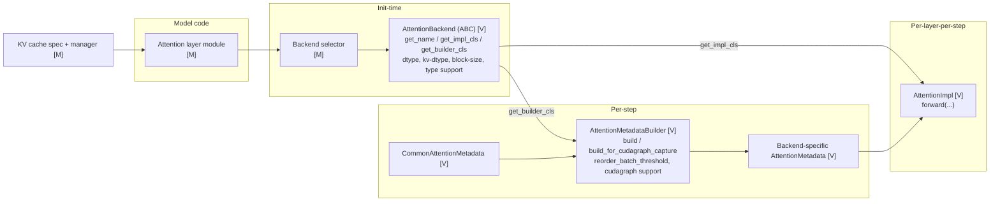
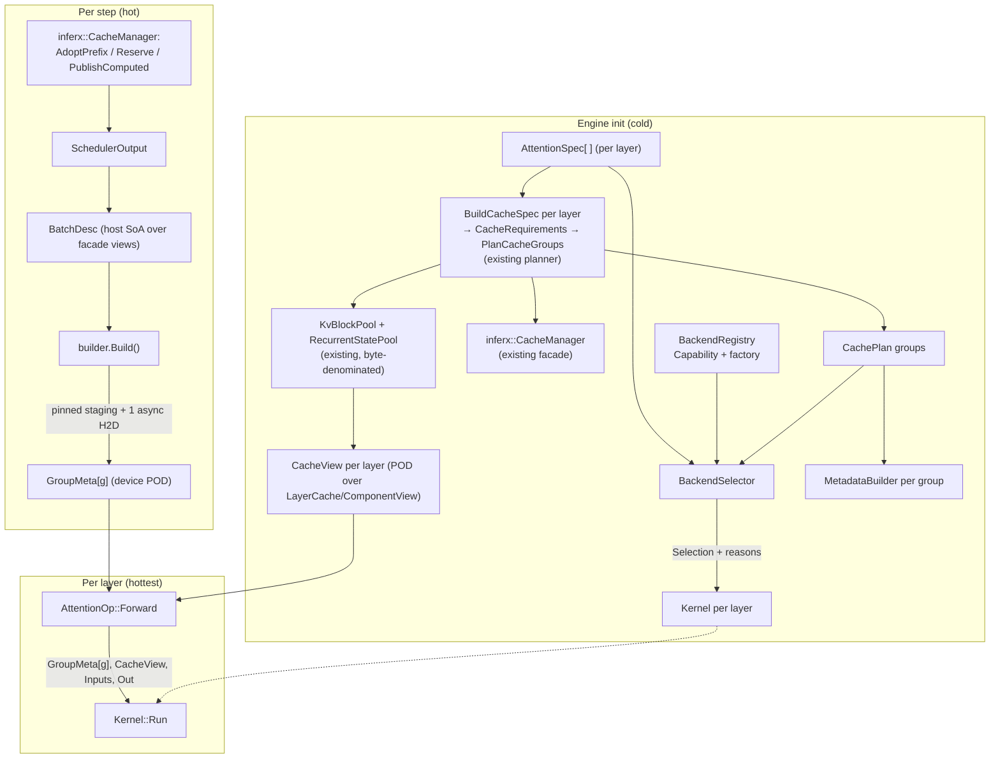
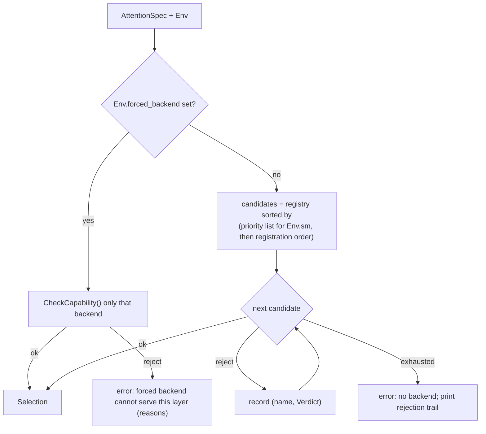
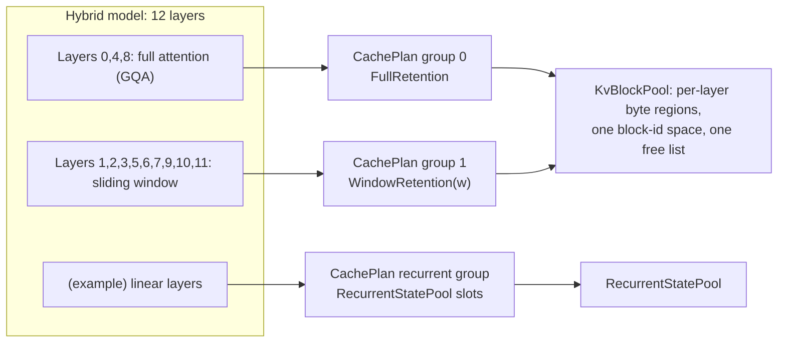

# Unified Attention Architecture (C++20)

| | |
|---|---|
| **Status** | Proposed design, grounded in the repository (revision 2, 2026-10-19) |
| **Scope** | GPU attention subsystem of the inference engine: layer-level op, backend selection, batch metadata, KV/state cache integration, CUDA Graph integration |
| **Out of scope** | Model definitions, scheduler policy, sampling, distributed communication (touched only where they constrain attention) |
| **Primary reference** | vLLM V1 attention subsystem (`vllm/v1/attention`, `vllm/v1/kv_cache_interface`, `vllm/model_executor/layers/attention`) |
| **Related** | `docs/kvcache.md` (the implemented cache subsystem this design consumes), `include/inferx/cache/*.h`, `include/inferx/ops/attention.h`, `include/inferx/models/layers/attention.h` |

---

## 0. Repository grounding and provenance

**Revision 2.** The first draft of this document was written without repository access and invented placeholder conventions plus a parallel KV-cache design. This revision grounds every interface in the tree as of 2026-10-19. Two things changed structurally:

1. All placeholder vocabulary (`attn::DType`, `attn::Status`, `StreamHandle`, `StateSpec`, a private `KvCacheManager`/`KvPool`/hash chain) is replaced by the project's existing types (`inferx::DataType`, `inferx::Status`/`StatusOr`, `DeviceStream`/`ops::OpContext`, `Tensor`, and the implemented cache subsystem).
2. The KV cache chapter no longer proposes a cache design. The repository has one — specified in `docs/kvcache.md`, implemented in `include/inferx/cache/` + `src/cache/`, and unit-tested (5 suites, 87 tests). Attention **consumes** it; §8 is now an integration chapter.

**Verified repository conventions** (all code in this document follows them):

| Convention | Where it comes from | Used here as |
|---|---|---|
| Namespace `inferx`, nested subsystem namespaces | `inferx::ops`, `inferx::models` | `inferx::attn` |
| Include guards, not `#pragma once` | `INFERX_CACHE_CACHE_SPEC_H_` etc. | `INFERX_ATTN_TYPES_H_` etc. |
| Public headers under `include/inferx/<subsys>/`, sources under `src/<subsys>/` | whole tree | `include/inferx/attn/`, `src/attn/` |
| Doxygen `/// \brief` doc comments | whole tree | everywhere |
| Enumerator names `kPascalCase` | `DataType::kBFloat16`, `CacheComponent::Growth::kPerToken` | `MaskKind::kCausal`, `Role::kDecoderSelf`, … |
| Types `PascalCase`, members/functions snake/Pascal per tree precedent | `PlanCacheGroups`, `WritePagedKv`, `NumLayers()` | `RegisterBuiltinBackends`, `FillCommonMetadata`, `BlockSize()` |
| Errors as `Status`/`StatusOr`, no exceptions | `core/status.h`, all factories (`CacheManager::Create` returns `StatusOr`) | no exceptions anywhere, including init |
| Execution context | `ops::OpContext` (`Runtime()`, `GetStream()`, `GetDevice()`) | passed through the step path |
| Tensors | refcounted `core::Tensor` (`FromBlob`, `GetShape`, `Reshape`, `Bitcast`) | owning type at model boundaries; POD `TensorView` only at the kernel boundary |
| Cache doctrine | byte-denominated storage; geometry belongs to the model family; `kNullBlockId = 0` reserved | §8 |

**Provenance of claims about vLLM.** Claims are tagged:

- **[V]** verified against vLLM's published API documentation for `vllm.v1.attention.backend` and `vllm.v1.attention.backends.utils` (multiple versions from v0.10 to v0.26 and `latest`).
- **[M]** from prior knowledge of vLLM's source, *not* re-verified. Treat as a pointer to investigate, not as a fact to build on.

No vLLM API is assumed beyond what is tagged. Where this document says "similar to vLLM", it refers to a concept, not a signature.

---

## 1. Goals and principles

### 1.1 Goals

1. One execution interface covering MHA, MQA, GQA, MLA, sliding-window, sparse, linear/recurrent, cross, and hybrid-layer models.
2. Prefill, decode, and mixed batches under continuous batching with variable-length sequences.
3. Paged KV cache, prefix caching, and non-KV state (recurrent state, cross-attention KV) under one memory model — **the one the repository already implements**.
4. CUDA Graph compatibility as a *design input*, not a retrofit.
5. Automatic backend selection driven by declared capabilities, with an explainable rejection trail.
6. Near-zero host overhead per decode step: no heap allocation, no locks, no hash lookups on the step path.
7. A new attention mechanism or backend should be addable by **adding** files, not **editing** existing ones.
8. Zero duplicate responsibility with the cache subsystem: attention adds selection, metadata, and kernels — never a second block manager.

### 1.2 Principles

| # | Principle | Consequence |
|---|---|---|
| P1 | **Separate *what* from *how*.** | The mathematical variant (`AttentionSpec`) is data; the implementation (`Backend`/`Kernel`) is code. FlashAttention is not a mechanism; MHA is not a class. |
| P2 | **Separate *when* things change.** | Per-model (spec), per-engine-start (selection, pool binding, buffers), per-step (metadata), per-layer-per-step (launch). Each gets its own object with its own lifetime. |
| P3 | **Data is a value, behavior is an interface.** | Specs, capabilities, metadata, views are trivially-copyable or cheaply-copyable value types. Only `Backend`, `Kernel`, `MetadataBuilder` are polymorphic, and all three are cold or once-per-layer. |
| P4 | **No ambient state.** | No global "forward context". Everything a kernel needs is an explicit argument. (The existing `models::Attention::Forward(OpContext&, …)` already follows this; vLLM's ambient forward context **[M]** is a Python convenience we do not copy.) |
| P5 | **Metadata is built once per step per cache group, not per layer.** | 80 layers must not mean 80 metadata builds. Generalizes what `ModelRunner` does today for one group (`AttentionMetadata`). |
| P6 | **Device addresses are stable.** | Anything a captured graph might read lives at a fixed address for the process lifetime. Matches the cache pools: allocated once at startup, never grown. |
| P7 | **Reject unsupported combinations at init, never at step time.** | `Create`-time checks fail loudly with reasons; the step path has no "unsupported" branch. |
| P8 | **Abstraction must pay rent.** | Section 11 lists abstractions deliberately *not* introduced — including a second KV manager. |

---

## 2. Analysis of vLLM's attention architecture

### 2.1 Components and responsibilities



| vLLM concept | Role | Evidence |
|---|---|---|
| `AttentionBackend` (abstract) | A *class-level descriptor* of a backend: name, factory methods for its impl and builder classes, supported dtypes / KV dtypes / kernel block sizes, whether it supports an attention type, whether `forward()` includes the KV-cache update, whether it accepts a caller-allocated output buffer. | **[V]** `get_name`, `get_impl_cls`, `get_builder_cls`, `supported_dtypes`, `supported_kv_cache_dtypes`, `get_supported_kernel_block_sizes` (returns `MultipleOf(...)`-style constraints), `forward_includes_kv_cache_update`, `accept_output_buffer` |
| Validation with reasons | Capability checks accumulate human-readable `invalid_reasons` (attention type, non-causal, attention sinks, partial-multimodal full-attention). Backends opt in to non-decoder attention types; the default is decoder-only. | **[V]** `invalid_reasons.append(...)` strings and the docstring "By default, only supports decoder attention" |
| `AttentionMetadataBuilder` | Per-step transformation of scheduler output into backend-specific metadata. Exposes `reorder_batch_threshold` (batch reordering so decode-like requests are contiguous), a CUDA Graph support level, and `build_for_cudagraph_capture`. | **[V]** `reorder_batch_threshold`, `_cudagraph_support` default `NEVER`, `build_for_cudagraph_capture(common_attn_metadata)` |
| `CommonAttentionMetadata` | Backend-agnostic batch description that builders consume. | **[V]** exists as a dataclass argument to `build*` |
| `AttentionCGSupport` | Enum of how a backend interacts with CUDA graphs; at least `NEVER` and `UNIFORM_BATCH`. | **[V]** `NEVER`, `UNIFORM_BATCH = 2` (other members not inspected) |
| `AttentionImpl` | Per-layer executor holding head counts, scale, window, etc., with `forward`. | **[V]** returned by `get_impl_cls()`; internals not inspected |
| KV layout awareness | Backends can declare whether they read pages by runtime block stride, tolerate non-contiguous block dims, or place the block dimension first. | **[V]** docstrings on "reads KV pages by the runtime block stride" and "num-blocks-first" |
| Output buffer pre-allocation | Output is allocated by the caller so that, under piecewise CUDA graphs, it lives inside the graph's memory. | **[V]** comment on `accept_output_buffer` |
| Attention layer wrapper, selector, custom-op registration so the compiler treats attention as opaque | | **[M]** |
| `KVCacheSpec` family and hybrid KV cache manager (groups of layers with identical spec share block tables) | InferX's counterpart already exists and is tested: `CacheSpec` → `PlanCacheGroups` → `CachePlan` groups (`docs/kvcache.md` §6.1) | **[M]** for vLLM's side |
| MLA: latent KV cache, separate prefill (decompressed) and decode (weight-absorbed) paths | | **[M]** |
| Decode/prefill split inside the builder (decodes first, prefills after) | | **[M]** (consistent with **[V]** `reorder_batch_threshold`) |

### 2.2 What vLLM gets right (keep)

1. **Backend is distinct from layer.** The layer states needs; the backend states capabilities; a selector matches them. Keep.
2. **Metadata building is per backend, separate from the kernel call.** Different lifetimes and frequencies. Keep.
3. **Capability checks return reasons**, not booleans. Essential for debuggability. Keep and strengthen.
4. **Caller-owned output buffer.** Required for graph capture. Keep as the *only* mode.
5. **Batch reordering** (decodes first) to make the decode/prefill split a pointer offset rather than a gather. Keep.
6. **Explicit CUDA-graph support level on the backend.** Keep.

### 2.3 What we deliberately change

| vLLM (as understood) | Here | Why |
|---|---|---|
| Capabilities as class-level static methods and `ClassVar` lists, evaluated by Python introspection | One declarative `Capability` value per backend; matching is a pure function `CheckCapability(Capability, AttentionSpec, Env)` | Testable table-driven; `constexpr`-constructible; no reflection |
| Three parallel class families per backend (Backend / Builder / Impl) | Keep builder and kernel separate (different lifetimes), but make the `Backend` a *factory + capability value*, not a class-of-classes | Removes the "return a class object" indirection that exists because Python has first-class classes |
| Mechanism variants (MLA, linear, etc.) are largely separate layer/impl families **[M]** | One `AttentionSpec` with a closed set of parameter blocks plus an open `CustomParams` escape; MHA/MQA/GQA are *one* parameter block | MHA/MQA/GQA differ only in `num_kv_heads`. Separate types would multiply backends for no behavioral difference |
| Ambient forward context **[M]** | Explicit `OpContext`/`StepContext` argument, as the existing ops layer already does | P4 |
| KV update is sometimes inside `forward`, sometimes a separate op **[V]** (flag) | Explicit `KvUpdateMode` on the kernel; the op layer inserts the separate writer only when needed. The existing `ops::WritePagedKv` is that writer for paged GQA | Makes the contract visible and testable |
| Backend declares and chooses its KV page layout | The **spec declares** the byte layout the family writes; backends only filter on it (`Capability.layouts`). The pool stores opaque bytes and never understands geometry | This is the repository's cache doctrine (`kvcache.md` §6.1: "geometry stays with the family"); it also decouples pool creation from backend selection (§8.5) |
| Prefill/decode as a runtime split in builder/impl **[M]** | Same idea, formalized as `BatchShape` + `PhaseSupport` capability and a shared `SplitPhases()` helper | Backends that handle mixed batches natively and those that do not are treated uniformly |

---

## 3. Key questions and decisions (summary)

| # | Question | Decision | § |
|---|---|---|---|
| Q1 | Common execution interface across mechanisms? | A single `AttentionOp::Forward(StepContext&, Inputs, TensorView)`. Mechanism variation lives in `AttentionSpec` and in the `Kernel` chosen for it. No per-mechanism subclass of the op. | 5, 6 |
| Q2 | Mechanism vs backend? | Mechanism = *data* (`AttentionSpec`). Backend = *implementation provider* (`Backend`) with a declared `Capability`. They meet only in `CheckCapability()`. | 5, 7 |
| Q3 | Prefill vs decode? | Not types. A *batch property* (`BatchShape`, per-request `query_len`), made cheap by decodes-first ordering. Backends declare which shapes they handle natively. | 6.3 |
| Q4 | KV and other state? | **Consume the implemented subsystem.** Layers produce `inferx::CacheSpec`s; `PlanCacheGroups` forms groups; `KvBlockPool`/`RecurrentStatePool` own memory; `inferx::CacheManager` owns the request lifecycle. Attention's only cache-side type is the kernel-facing POD `CacheView`, bound at init. | 8 |
| Q5 | Static vs dynamic information? | Static: `AttentionSpec`, `Capability`, `CacheView` (bound once). Dynamic: `BatchDesc` → `GroupMeta` (per step, per cache group). | 5, 6 |
| Q6 | Tensor layouts and input formats? | One canonical input: packed varlen `[T, H, D]` with arbitrary strides on `H`/`D`, carried as `TensorView` at the kernel boundary. Padded/batched formats are converted at the model boundary. Cache-side layout is a **spec-declared** enum (`KvPageLayout`). | 6.2, 8 |
| Q7 | Selection and dispatch? | Filter by `Capability`, rank by priority list, record rejection reasons, resolve to a `Kernel` once at init. Per-step dispatch is one virtual call per layer; template specialization is resolved at init. | 7 |
| Q8 | Decode overhead? | Metadata once per step per group into pre-sized pinned buffers; one async H2D; per-layer path is pointer arithmetic + launch. | 6, 12 |
| Q9 | CUDA Graph influence? | Stable addresses (the pools already guarantee this), device-side sizes, padded-batch conventions with `kNullBlockId`, per-backend `GraphSupport`, workspace arena with fixed pointers. | 10 |
| Q10 | Future mechanisms? | `CustomParams` + `MechanismId` + a new `Backend` registered by an explicit function. No edits to selector, op, or existing backends. | 14 |

---

## 4. Proposed architecture

### 4.1 Component map

Attention owns five components. The cache column is **not** attention's to build — it exists.

| Component | Kind | Lifetime | Owner | Purpose |
|---|---|---|---|---|
| `AttentionSpec` | value | model | model config | Full static description of one layer's attention |
| `Capability` + `Backend` | value + factory | process | `BackendRegistry` | What an implementation supports; creates kernels and builders |
| `Kernel` | polymorphic, 1 per layer | engine | `AttentionOp` | Executes attention for one layer for one step |
| `MetadataBuilder` | polymorphic, 1 per cache group | engine | `AttentionRuntime` | Turns `BatchDesc` into device-resident `GroupMeta` once per step |
| `AttentionOp` | thin handle, 1 per layer | engine | model layer | The single call site models use; binds spec + kernel + `CacheView` |
| **cache subsystem** (`CacheSpec`/`CachePlan`, `KvBlockPool`, `RecurrentStatePool`, `CacheManager`) | existing | engine | runtime setup | Specification, grouping, block ledger + prefix index, state slots, per-request lifecycle (`docs/kvcache.md`) |

`AttentionRuntime` is the composition root: it owns the registry, the bound cache plan/pools (borrowed), builders, workspace, and persistent metadata buffers, and exposes `BeginStep()`. It is a plain class, not a hierarchy.



### 4.2 Relationship rules

1. `AttentionOp` never owns memory; it holds a `Kernel` (unique) and a `CacheView` (POD, non-owning) plus a group index.
2. `Kernel` never allocates on the step path. Scratch memory comes from the `WorkspaceRef` in `StepContext`.
3. `MetadataBuilder` is the *only* writer of `GroupMeta`; kernels treat it as `const`.
4. The cache facade runs on the scheduler thread only, exactly as implemented (`CacheManager` is documented single-threaded). The GPU thread sees only immutable snapshots (block ids inside `SchedulerOutput` / `BatchDesc`).
5. The pools are created **before** backend selection, not after: pool geometry depends only on `CacheSpec` bytes (§8.5). Kernels capture strides at creation.

---

## 5. Core types

### 5.1 Basic vocabulary

Everything here reuses the repository's primitives. The only new type is the POD `TensorView`, the trivially-copyable mirror handed to kernels and captured by CUDA graphs; the owning type everywhere else is `core::Tensor`.

```cpp
// include/inferx/attn/types.h
#ifndef INFERX_ATTN_TYPES_H_
#define INFERX_ATTN_TYPES_H_

#include <array>
#include <cstddef>
#include <cstdint>
#include <span>
#include <type_traits>

#include "inferx/core/dtype.h"
#include "inferx/core/stream.h"
#include "inferx/core/tensor.h"

namespace inferx::attn {

/// \brief Non-owning, trivially-copyable tensor descriptor for the kernel
///        boundary and CUDA-graph capture.
///
/// The owning type at model boundaries is `inferx::Tensor`; this POD exists
/// because captured graphs and device-side launches need flat descriptors,
/// and because backends must not hold refcounted handles alive implicitly.
/// Strides are in elements. Rank <= 4 covers every attention operand.
struct TensorView {
  void* data = nullptr;
  DataType dtype = DataType::kBFloat16;
  std::uint8_t rank = 0;
  std::array<std::int64_t, 4> sizes{};
  std::array<std::int64_t, 4> strides{};

  [[nodiscard]] constexpr bool Defined() const noexcept { return data != nullptr; }
  [[nodiscard]] constexpr std::int64_t Dim(int i) const noexcept { return sizes[i]; }
  [[nodiscard]] constexpr std::int64_t Stride(int i) const noexcept { return strides[i]; }
};
static_assert(std::is_trivially_copyable_v<TensorView>);

/// \brief Flattens a `Tensor`'s shape/strides into a `TensorView` over the
///        same storage. The tensor must outlive the view (step lifetime).
[[nodiscard]] TensorView ViewOf(const Tensor& tensor) noexcept;

/// \brief Scratch memory handed out by the runtime; never allocated by
///        kernels on the step path.
struct WorkspaceRef {
  void* data = nullptr;
  std::size_t bytes = 0;
};

}  // namespace inferx::attn

#endif  // INFERX_ATTN_TYPES_H_
```

Error handling is `inferx::Status` / `StatusOr<T>` from `core/status.h`, project-wide. There are **no exceptions** in this subsystem, including at init: factories return `StatusOr`, and the selector returns its rejection trail as data (§7.3). On the step path a success `Status` carries no allocation; messages exist only on failure, which is off the hot path by construction.

Streams are `DeviceStream` (`core/stream.h`) and arrive inside `ops::OpContext`, exactly as the existing ops layer receives them (`WritePagedKv(OpContext&, …)`); kernels never see a bare stream handle.

### 5.2 `AttentionSpec`: *what* the layer computes

One value type describes every mechanism in the required list. It is hashable and comparable (`operator==` defaulted; C++20), so it works as a map key for selection caching. Enumerator names follow the tree's `k`-prefix convention.

```cpp
// include/inferx/attn/spec.h
#ifndef INFERX_ATTN_SPEC_H_
#define INFERX_ATTN_SPEC_H_

#include <array>
#include <compare>
#include <cstdint>
#include <variant>

#include "inferx/attn/types.h"

namespace inferx::attn {

/// \brief Who attends to whom.
enum class Role : std::uint8_t { kDecoderSelf, kEncoderSelf, kCross };

/// \brief Which positions each query attends to.
enum class MaskKind : std::uint8_t {
  kCausal,
  kBidirectional,
  /// Causal + trailing `window` tokens, inclusive of the current one.
  kSlidingWindow,
  /// Causal within fixed-size chunks; `window` = chunk length.
  kChunked,
};

struct MaskSpec {
  MaskKind kind = MaskKind::kCausal;
  std::int32_t window = 0;      ///< Tokens; meaningful for kSlidingWindow / kChunked.
  std::int32_t sink_tokens = 0; ///< Retained prefix (sliding window with sinks);
                                 ///< must be block-aligned (planner validates).
  friend bool operator==(const MaskSpec&, const MaskSpec&) = default;
};

/// \brief Optional behaviors, orthogonal to the mechanism.
enum class Feature : std::uint8_t { kSoftCap, kSinks, kAlibi, kReturnLse, kQkNormInKernel, kCount };

struct FeatureSet {
  std::uint32_t bits = 0;
  constexpr bool Has(Feature f) const noexcept {
    return bits & (1u << static_cast<unsigned>(f));
  }
  constexpr FeatureSet With(Feature f) const noexcept {
    return {bits | (1u << static_cast<unsigned>(f))};
  }
  friend bool operator==(const FeatureSet&, const FeatureSet&) = default;
};

// ---- Mechanism parameter blocks ---------------------------------------------------

/// \brief MHA (kv == q), MQA (kv == 1), GQA (1 < kv < q): one block.
///        They are a number, not a type.
struct DenseParams {
  std::int32_t num_q_heads = 0;
  std::int32_t num_kv_heads = 0;  ///< Validated: num_q_heads % num_kv_heads == 0.
  std::int32_t head_dim = 0;      ///< Q/K head dimension.
  std::int32_t v_head_dim = 0;    ///< 0 => same as head_dim.
  friend bool operator==(const DenseParams&, const DenseParams&) = default;
};

/// \brief Multi-head Latent Attention. The cached state is the latent
///        (+ rope part), not per-head K/V.
struct MlaParams {
  std::int32_t num_heads = 0;
  std::int32_t kv_lora_rank = 0;  ///< Latent width cached per token.
  std::int32_t qk_nope_dim = 0;
  std::int32_t qk_rope_dim = 0;   ///< Cached alongside the latent.
  std::int32_t v_head_dim = 0;
  friend bool operator==(const MlaParams&, const MlaParams&) = default;
};

/// \brief Linear / recurrent attention (gated delta-rule, SSM-style, …).
///        State is O(1) per request.
struct LinearParams {
  std::uint16_t recurrence_id = 0;  ///< Identifies the update rule; kernels key on it.
  std::int32_t num_k_heads = 0;
  std::int32_t num_v_heads = 0;
  std::int32_t k_dim = 0;
  std::int32_t v_dim = 0;
  std::int32_t conv_width = 0;      ///< 0 => no short-conv state.
  std::int32_t boundary_tokens = 0; ///< State-validity boundary; positive block
                                    ///< multiple (planner validates). Drives
                                    ///< RecurrentRetention's boundary.
  friend bool operator==(const LinearParams&, const LinearParams&) = default;
};

/// \brief Sparse attention: a dense base + a rule choosing which KV
///        positions participate.
enum class SparseKind : std::uint8_t {
  /// Fixed pattern computable from (position, params): strided/local+global blocks.
  kStaticBlock,
  /// An indexer produces per-token KV indices each step (an extra input).
  kIndexedTopK,
};

struct SparseParams {
  DenseParams base;
  SparseKind kind = SparseKind::kStaticBlock;
  std::int32_t block_size = 0;
  std::int32_t top_k = 0;
  friend bool operator==(const SparseParams&, const SparseParams&) = default;
};

/// \brief Escape hatch for mechanisms not yet known. Opaque to the core;
///        only matching backends read it.
struct CustomParams {
  std::uint32_t mechanism_id = 0;   ///< From MechanismRegistry; >= 0x1000.
  std::array<std::byte, 64> blob{};  ///< Trivially-copyable payload (bit_cast target).
  friend bool operator==(const CustomParams&, const CustomParams&) = default;
};

using MechanismParams =
    std::variant<DenseParams, MlaParams, LinearParams, SparseParams, CustomParams>;

/// \brief Stable mechanism ids used by Capability matching.
enum class Mechanism : std::uint32_t {
  kDense = 1,
  kMla = 2,
  kLinear = 3,
  kSparse = 4,
  kCustomBase = 0x1000,
};

/// \brief How the family physically lays out one token's cached bytes.
///        Declared by the spec (the family writes it), filtered by backends.
enum class KvPageLayout : std::uint8_t {
  // Within one page (page = `block_tokens` tokens for one layer):
  /// [2, block_tokens, Hkv, D] — K plane then V plane, token-major.
  kKvPlanarNhd,
  /// [2, Hkv, block_tokens, D] — head-major.
  kKvPlanarHnd,
  /// [block_tokens, 2, Hkv, D].
  kKvInterleaved,
  /// [block_tokens, rank + rope] (MLA).
  kLatent,
  /// Opaque kernel-defined layout for one recurrent-state component.
  kRecurrentFlat,
};

struct AttentionSpec {
  Role role = Role::kDecoderSelf;
  MaskSpec mask{};
  MechanismParams params{};
  DataType q_dtype = DataType::kBFloat16;   ///< Activation dtype.
  DataType kv_dtype = DataType::kBFloat16;  ///< Cache dtype (may be fp8); scales: §8.6.
  KvPageLayout kv_layout = KvPageLayout::kKvPlanarNhd;
  float softmax_scale = 0.0f;  ///< 0 => 1/sqrt(head_dim).
  float softcap = 0.0f;        ///< Valid if features.Has(Feature::kSoftCap).
  FeatureSet features{};

  /// Maps the variant index to a Mechanism (or the Custom id).
  [[nodiscard]] std::uint32_t MechanismId() const noexcept;
  [[nodiscard]] std::size_t Hash() const noexcept;
  friend bool operator==(const AttentionSpec&, const AttentionSpec&) = default;
};

}  // namespace inferx::attn

#endif  // INFERX_ATTN_SPEC_H_
```

**How the required mechanisms map (the key unification):**

| Requested | Where it lives | Notes |
|---|---|---|
| MHA / MQA / GQA | `DenseParams` with different `num_kv_heads` | One backend capability row covers all three |
| MLA | `MlaParams` | Different cached state (latent component in the cache spec), different kernels |
| FlashAttention | **A `Backend`**, not a mechanism | Declares `kDense` (+ maybe `kSparse::kStaticBlock`) in its `Capability` |
| PagedAttention | **State + layout** (paged cache spec, block table in `GroupMeta`), not a mechanism | Any paged-capable backend |
| Sliding window | `MaskSpec{kSlidingWindow, w}` **and** `WindowRetention{w}` in the cache spec (§5.3) | Mask is compute; window is also a *memory* policy (blocks below the floor are reclaimable — implemented by `CacheGroupManager::ReleaseSkipped`) |
| Sparse | `SparseParams` | `kIndexedTopK` adds an extra input tensor (§6.1) |
| Linear | `LinearParams` | Fixed-slot state components; no block table over tokens |
| Cross | `Role::kCross` | Cached encoder K/V is `EncoderRetention` (implemented `CrossAttentionManager`); written once, read-only afterwards |
| Hybrid | **Not an attention type.** Model-level property: different layers carry different specs; `PlanCacheGroups` forms the groups | §8.4 |
| Future custom | `CustomParams` + new `Backend` | §14 |

### 5.3 From `AttentionSpec` to the cache plan

The layer never states cache needs separately from the attention spec — one pure function produces the `inferx::CacheSpec` the planner consumes. This replaces the first draft's private `StateSpec`/`StateKind`/`Retention` vocabulary wholesale: retention kinds, byte accounting (`bytes_per_token` / `bytes_per_slot`), prefix-cacheability, and window semantics all already exist in `cache_spec.h`, tested.

```cpp
// include/inferx/attn/cache_spec_bridge.h
#ifndef INFERX_ATTN_CACHE_SPEC_BRIDGE_H_
#define INFERX_ATTN_CACHE_SPEC_BRIDGE_H_

#include "inferx/attn/spec.h"
#include "inferx/cache/cache_spec.h"

namespace inferx::attn {

/// \brief The cache requirements of one attention layer, derived from its
///        spec. Pure; init time only.
///
/// Mapping (see the table below): the mechanism picks the components
/// (GqaKvComponent / MlaLatentComponent / FixedSlot), the mask picks the
/// retention, the role picks encoder retention for cross-attention.
[[nodiscard]] bool NeedsCache(const AttentionSpec& spec) noexcept;  // encoder-self: NoCache
[[nodiscard]] StatusOr<int64_t> CacheBytesPerToken(const AttentionSpec& spec);  // cross-check
[[nodiscard]] StatusOr<CacheSpec> BuildCacheSpec(const AttentionSpec& spec);

}  // namespace inferx::attn

#endif  // INFERX_ATTN_CACHE_SPEC_BRIDGE_H_
```

| `AttentionSpec` | `BuildCacheSpec` result (existing factories) |
|---|---|
| Dense causal | `CacheSpec::FullAttention({GqaKvComponent(kv_heads, head_dim, kv_dtype)})` |
| Dense `kSlidingWindow(w)`, no sinks | `CacheSpec::SlidingWindow({GqaKvComponent(…)}, w)` |
| Dense `kSlidingWindow(w)` + `Feature::kSinks` | `CacheSpec::SlidingWindow({…}, w, sink_tokens)` — sinks must be block-aligned; `PlanCacheGroups` validates |
| Dense `kChunked(c)` | `CacheSpec::ChunkedLocal({…}, c)` |
| MLA | `CacheSpec::FullAttention({MlaLatentComponent(kv_lora_rank + qk_rope_dim, kv_dtype)})` |
| Linear (no conv) | `CacheSpec::Recurrent({CacheComponent::FixedSlot(state_bytes, dtype)}, boundary_tokens)` |
| Linear with `conv_width > 0` | `CacheSpec::Recurrent({FixedSlot(state), FixedSlot(conv_ring)}, boundary)` — the pool takes multiple components per layer |
| `Role::kCross` | `CacheSpec::Encoder({…})` (the existing `CrossAttention` factory is an alias of this) |
| Stateless (`Role::kEncoderSelf` within one forward) | no cache layer — `NoCache` in the requirements |

`prefix_cacheable` of the first draft is `CacheSpec::PrefixCacheable()` (true for full/window/chunk, false for encoder/recurrent — already implemented). `bytes_per_request` is `CacheComponent::FixedSlot(bytes, dtype)`; `bytes_per_token` comes from `DataTypeByteSize` via the existing component factories. Nothing in attention re-implements any of it.

---

## 6. Execution model

### 6.1 `Kernel`, `MetadataBuilder`, and `AttentionOp`

```cpp
// include/inferx/attn/kernel.h
#ifndef INFERX_ATTN_KERNEL_H_
#define INFERX_ATTN_KERNEL_H_

#include <memory>

#include "inferx/attn/cache_view.h"
#include "inferx/attn/metadata.h"
#include "inferx/attn/spec.h"
#include "inferx/attn/types.h"
#include "inferx/core/status.h"
#include "inferx/ops/op_context.h"

namespace inferx::attn {

/// Defined in backend.h; kernels only need it as an opaque limit bundle.
struct EngineLimits;

/// \brief Operands for one layer. Which slots are used is defined by the
///        mechanism (table below).
struct Inputs {
  TensorView q;                      // [T, Hq, D] packed varlen.
  TensorView k, v;                   // [T, Hkv, D]; !Defined() => "already in cache".
  std::array<TensorView, 2> ext{};   // Mechanism-specific extras.
};

/// \brief Everything one layer's launch needs. All members are views or POD.
struct RunArgs {
  const GroupMeta& meta;   // This layer's cache-group metadata for this step.
  const CacheView& cache;  // Bound once at init (§8.2).
  ops::OpContext& ctx;     // Runtime + stream, as the ops layer receives them.
  const Inputs& in;
  TensorView out;          // Caller-allocated (P6; graph-friendly).
  WorkspaceRef workspace;
};

/// \brief Whether the kernel writes new K/V itself or expects a separate
///        layout-aware writer to have run.
enum class KvUpdateMode : std::uint8_t {
  /// Kernel writes in.k / in.v into the cache as part of Run().
  kFused,
  /// AttentionOp calls a layout-aware writer first (ops::WritePagedKv for
  /// paged GQA); the kernel only reads the cache.
  kSeparate,
  /// No per-token cache write (recurrent state lives inside the kernel;
  /// encoder-only layers).
  kNone,
};

class Kernel {
 public:
  virtual ~Kernel() = default;

  /// \brief Hot path. No allocation, no locking.
  [[nodiscard]] virtual Status Run(const RunArgs& args) const noexcept = 0;
  [[nodiscard]] virtual KvUpdateMode GetKvUpdateMode() const noexcept = 0;
  /// \brief Upper bound of scratch bytes for any step up to the configured
  ///        limits (queried at init).
  [[nodiscard]] virtual std::size_t WorkspaceBytes(const EngineLimits& limits) const noexcept = 0;
};

}  // namespace inferx::attn

#endif  // INFERX_ATTN_KERNEL_H_
```

**Input slot conventions** (documented per mechanism, checked by `Backend::CreateKernel` at init and by debug assertions per call):

| Mechanism | `q` | `k` | `v` | `ext[0]` | `ext[1]` |
|---|---|---|---|---|---|
| Dense | `[T,Hq,D]` | `[T,Hkv,D]` | `[T,Hkv,Dv]` | – | – |
| Dense, Cross (decode) | `[T,Hq,D]` | undefined | undefined | – | – |
| Dense, Cross (first step) | `[T,Hq,D]` | encoder K (once) | encoder V (once) | encoder length per req (device `int32[B]`) | – |
| MLA | `[T,H,nope+rope]` (decode: weight-absorbed, §16.3) | latent `[T,rank]` | k_pe `[T,rope]` | – | – |
| Sparse `kIndexedTopK` | `[T,Hq,D]` | `[T,Hkv,D]` | `[T,Hkv,Dv]` | indices `int32[T,top_k]` | – |
| Linear | `[T,Hk,Dk]` | `[T,Hk,Dk]` | `[T,Hv,Dv]` | gate/beta `[T,Hv]` | conv-state input `[T,C]` |
| Custom | defined by the mechanism's documentation | | | | |

```cpp
// include/inferx/attn/op.h — the single call site models use
#ifndef INFERX_ATTN_OP_H_
#define INFERX_ATTN_OP_H_

#include <cstdint>
#include <memory>

#include "inferx/attn/kernel.h"
#include "inferx/attn/spec.h"
#include "inferx/core/status.h"

namespace inferx::attn {

/// \brief Per-layer handle binding spec, kernel, cache view, and group.
///        Movable, not copyable (owns its Kernel).
class AttentionOp {
 public:
  AttentionOp() = default;
  AttentionOp(AttentionOp&&) noexcept = default;
  AttentionOp& operator=(AttentionOp&&) noexcept = default;

  /// \brief One layer's attention for one step. At most one function-pointer
  ///        call (separate KV writer) plus one virtual call.
  [[nodiscard]] Status Forward(const StepContext& step, const Inputs& in,
                               TensorView out) const noexcept {
    const GroupMeta& meta = step.Group(group_);
    const RunArgs args{meta, cache_, step.Ctx(), in, out, step.Workspace()};
    if (write_kv_ != nullptr && in.k.Defined()) {
      if (Status s = write_kv_(args); !s.ok()) return s;  // Layout-aware, no virtual.
    }
    return kernel_->Run(args);
  }

  [[nodiscard]] const AttentionSpec& GetSpec() const noexcept { return spec_; }

 private:
  friend class AttentionRuntime;
  using KvWriteFn = Status (*)(const RunArgs&) noexcept;

  AttentionSpec spec_{};
  std::unique_ptr<Kernel> kernel_;
  KvWriteFn write_kv_ = nullptr;  // Non-null iff kernel is kSeparate.
  CacheView cache_{};
  std::uint16_t group_ = 0;
};

}  // namespace inferx::attn

#endif  // INFERX_ATTN_OP_H_
```

Per layer per step the host does: one array index, building a `RunArgs` of ~10 words on the stack, at most one function-pointer call (KV write), one virtual call (`Run`). That is on the order of nanoseconds against a kernel launch of several microseconds. We do **not** template `AttentionOp` on the kernel type: it would make every model layer a template instantiation and defeat runtime selection, for no measurable gain.

### 6.2 Layouts and input formats

**Canonical activation format: packed varlen `[T, H, D]`.** `T` is the sum of all queries in the step; requests are delimited by CSR offsets (`qo_indptr`). Rationale:

- It is what continuous batching naturally produces (one flat token tensor) and what the existing `models::AttentionMetadata` already describes.
- It handles prefill, decode, and mixed with the same tensor.
- Padded `[B, S, H, D]` inputs (encoder models, some cross-attention encoders) are converted once at the model boundary by a packing helper, not by every backend.

`TensorView` strides are arbitrary on the head and dim axes. This permits fused-QKV projections (Q, K, V as strided views into one `[T, (Hq+2Hkv), D]` buffer) without copies. Backends declare in `Capability` whether they require unit stride on `D` (nearly all do); the op layer inserts a contiguous copy only if the declared requirement is not met, and logs it once at init if it can be statically determined.

**KV page layout** is **spec-declared** (`AttentionSpec::kv_layout`, §5.2), not backend-chosen. This is the repository's cache doctrine: `KvBlockPool` stores opaque bytes per (layer, block, token) and "the owning model layer reshapes them into kernel geometry" (`kvcache.md` §6.2); the family's writer (e.g. `ops::WritePagedKv`) and its kernels agree on the byte order, and **backends filter** on the declared layout through `Capability.layouts`. A backend that wants a different physical layout must be selected for a model family that writes that layout — it cannot silently re-landscape another family's cache.

### 6.3 Prefill, decode, mixed

Prefill and decode are not classes. They are a property of the batch:

- A request is **decode-like** if `query_len <= decode_threshold` (1 for plain decode; >1 allows speculative-decoding verify steps, matching the role of vLLM's `reorder_batch_threshold` **[V]**).
- The runner **orders requests: all decode-like first, then prefills** (stable within each class). This is the only batch invariant the rest of the system relies on. It turns "split the batch" into pointer offsets.
- `BatchShape` summarizes the step.

```cpp
enum class BatchShape : std::uint8_t { kDecodeOnly, kPrefillOnly, kMixed };

/// \brief Which batch shapes a kernel handles in one Run() call.
struct PhaseSupport {
  bool decode_only = true;
  bool prefill_only = true;
  bool mixed = false;  ///< True: one launch handles decode+prefill together.
};
```

If a backend's `Capability` says `mixed = false`, the op layer does **not** change; the *kernel* uses the shared helper:

```cpp
struct PhaseSlices {
  GroupMeta decode;
  GroupMeta prefill;
  TensorView q_dec, q_pre, out_dec, out_pre;
};
/// \brief Pure pointer arithmetic over the decodes-first ordering; no
///        allocation, no device work.
[[nodiscard]] PhaseSlices SplitPhases(const GroupMeta& meta, const Inputs& in,
                                      TensorView out) noexcept;
```

Why not separate `PrefillKernel` / `DecodeKernel` types? Because the *same backend* usually handles both with different internal kernels sharing weights, scale, window, and cache layout; splitting would duplicate the spec and double the selection logic. Backends that use different implementations per phase hold two internal functions behind one `Kernel`.

Why not let backends reorder? Reordering the batch changes the layout of *every* tensor in the model for the step (hidden states, KV slot mapping, sampler inputs). That is a runner-level decision, done once, with the backend only declaring its preferred `decode_threshold`.

### 6.4 Batch description and metadata

Two stages, separated by a strict ownership boundary. The device-side contract **generalizes the existing `models::AttentionMetadata`** (CSR `qo_indptr` / `kv_indptr` / `kv_indices` / `batch_indices` / `last_page_len`) from one implicit group to one struct per cache group, keeping the shapes today's kernels (`ops::WritePagedKv`, `ops::PagedAttention` wrappers, FlashInfer plan builder) already consume.

```cpp
// include/inferx/attn/metadata.h
#ifndef INFERX_ATTN_METADATA_H_
#define INFERX_ATTN_METADATA_H_

#include <cstdint>
#include <span>
#include <type_traits>

#include "inferx/attn/types.h"

namespace inferx::attn {

/// The planner's group count is small; a fixed maximum keeps StepContext
/// a plain aggregate. The tree's CachePlan never approaches this today.
inline constexpr int kMaxCacheGroups = 8;

/// \brief Host-side, backend-agnostic batch description. Built by the
///        runner from SchedulerOutput + CacheManager views; spans point
///        into step-lifetime storage (no copies).
struct BatchDesc {
  std::int32_t num_reqs = 0;
  std::int32_t num_tokens = 0;
  std::int32_t num_decodes = 0, num_decode_tokens = 0;      // First num_decodes requests.
  std::int32_t num_prefills = 0, num_prefill_tokens = 0;
  std::int32_t max_query_len = 0, max_seq_len = 0;
  /// All requests share one query_len (graph-friendly).
  bool uniform_query_len = false;
  std::span<const std::int32_t> query_lens;    // [num_reqs]
  std::span<const std::int32_t> seq_lens;      // [num_reqs] Total incl. this step.
  std::span<const std::int32_t> positions;     // [num_tokens] In-sequence positions.
  /// Per cache group: flattened block tables, sequence after sequence
  /// (the existing kv_indices CSR shape). kNullBlockId entries mark
  /// rolled-off positions (window groups) — kernels skip null-block rows.
  std::array<std::span<const BlockId>, kMaxCacheGroups> block_ids{};
  std::array<std::int32_t, kMaxCacheGroups> block_ids_num_pages{};  // Flattened length per group.
  /// Per cache group: recurrent-state slot per request (-1 if unused).
  std::array<std::span<const std::int32_t>, kMaxCacheGroups> state_slots{};

  [[nodiscard]] BatchShape Shape() const noexcept {
    return num_prefills == 0 ? BatchShape::kDecodeOnly
         : num_decodes == 0 ? BatchShape::kPrefillOnly
                            : BatchShape::kMixed;
  }
};

/// \brief Device-side, POD, per cache group. Pointers reference *persistent*
///        buffers (P6); written only by the MetadataBuilder. This is
///        models::AttentionMetadata generalized per group: same CSR arrays,
///        plus the group's window floor and opaque backend plan.
struct GroupMeta {
  // Per-sequence CSR (device):
  const std::int32_t* qo_indptr = nullptr;       // [B+1] query extents.
  const std::int32_t* kv_indptr = nullptr;       // [B+1] page-table extents.
  const std::int32_t* kv_indices = nullptr;      // [kv_pages] block ids, seq after seq.
  const std::int32_t* last_page_len = nullptr;   // [B] tokens in each last page.
  // Per-token (device):
  const std::int32_t* batch_indices = nullptr;   // [T] sequence slot per token.
  const std::int32_t* positions = nullptr;       // [T] in-sequence position per token.
  // Per-group scalars:
  std::int32_t block_size = 0;                   // Tokens per page (plan.block_size).
  std::int32_t window_left = 0;                  // Tokens below this group's retention
                                                 // floor are skipped by the kernel
                                                 // (CacheManager::GroupSkippedTokens).
  // Scalars for grid sizing / shape dispatch only — never the source of
  // truth for sizes under graph capture: kernels read device arrays (§10).
  std::int32_t num_reqs = 0, num_tokens = 0;
  std::int32_t num_decodes = 0, num_decode_tokens = 0;
  std::int32_t num_prefills = 0, num_prefill_tokens = 0;
  std::int32_t max_query_len = 0, max_seq_len = 0;
  BatchShape shape = BatchShape::kDecodeOnly;
  /// Backend-private plan (e.g. split-KV schedule), device-resident,
  /// opaque to everyone else.
  const void* plan = nullptr;
};
static_assert(std::is_trivially_copyable_v<GroupMeta>);

/// \brief Passed to every layer of one step. Built once per step.
struct StepContext {
  const ops::OpContext* ctx = nullptr;
  std::array<GroupMeta, kMaxCacheGroups> groups{};
  std::uint16_t num_groups = 0;
  WorkspaceRef workspace{};

  [[nodiscard]] const GroupMeta& Group(std::uint16_t g) const noexcept { return groups[g]; }
  [[nodiscard]] ops::OpContext& Ctx() const noexcept { return *ctx; }
  [[nodiscard]] const WorkspaceRef& Workspace() const noexcept { return workspace; }
};

}  // namespace inferx::attn

#endif  // INFERX_ATTN_METADATA_H_
```

Two deliberate differences from the first draft, both to match what exists:

- **No `slot_mapping` array.** The existing `ops::WritePagedKv` derives each token's cache slot in-kernel from `positions` + `batch_indices` + the CSR block table (`block = kv_indices[kv_indptr[seq] + pos / block_size]`, `slot = pos % block_size`). The same triple serves the attention kernels; adding a redundant flat slot array would be a second source of truth for the same mapping. (vLLM passes a slot mapping **[M]**; we pass the mapping's *inputs* and derive.)
- **`window_left` per group** comes from `CacheManager::GroupSkippedTokens(g, num_computed)` — the implemented retention floor — rather than being recomputed in kernel space from the mask.

```cpp
// include/inferx/attn/builder.h
#ifndef INFERX_ATTN_BUILDER_H_
#define INFERX_ATTN_BUILDER_H_

#include <cstdint>

#include "inferx/attn/metadata.h"
#include "inferx/core/status.h"

namespace inferx::attn {

/// Defined in §10 (graph shapes); builders only fill metadata for one.
struct CaptureShape;

/// \brief How a backend interacts with CUDA graphs.
enum class GraphSupport : std::uint8_t {
  /// Never captured; eager only.
  kNever,
  /// May be captured for uniform decode-only batches (fixed query_len),
  /// padded to captured sizes.
  kUniformDecode,
  /// May be captured for any shape within captured limits (rare; requires
  /// fully device-driven kernels).
  kAny,
};

struct BuildContext {
  DeviceStream stream;
  class StagingArena& staging;      ///< Pinned host double buffer.
  class DeviceMetaBuffers& dev;     ///< Persistent device buffers for this group.
};

class MetadataBuilder {
 public:
  virtual ~MetadataBuilder() = default;

  [[nodiscard]] virtual GraphSupport GetGraphSupport() const noexcept = 0;
  /// \brief Largest query_len the backend treats as "decode-like" (1 = plain
  ///        decode).
  [[nodiscard]] virtual std::int32_t DecodeThreshold() const noexcept = 0;

  /// \brief Hot path: O(num_reqs + num_tokens). Writes into staging,
  ///        enqueues ONE async H2D batch, fills `out`. No heap allocation.
  ///        Not thread-safe (runner thread).
  [[nodiscard]] virtual Status Build(const BatchDesc& desc, std::uint16_t group,
                                     BuildContext& ctx, GroupMeta& out) noexcept = 0;

  /// \brief Builds metadata for a synthetic padded batch of exactly `shape`,
  ///        for graph capture/replay (§10).
  [[nodiscard]] virtual Status BuildForCapture(const CaptureShape& shape, std::uint16_t group,
                                               BuildContext& ctx, GroupMeta& out) noexcept = 0;
};

}  // namespace inferx::attn

#endif  // INFERX_ATTN_BUILDER_H_
```

The common part of `Build` (shared by all paged-KV backends) fills the CSR arrays from `BatchDesc` in a single pass; backend builders wrap it and append only their own `plan` (for example a split-KV schedule). It is provided as a free function `FillCommonMetadata(...)`, mirroring today's `ModelRunner` metadata construction — **composition, not inheritance**.

---

## 7. Backends, capabilities, selection, dispatch

### 7.1 Capability as data

A backend's abilities are a **value**, constructible at compile time, matched by a pure function. This replaces per-attribute static methods with one inspectable table (and a natural unit-test surface).

```cpp
// include/inferx/attn/capability.h
#ifndef INFERX_ATTN_CAPABILITY_H_
#define INFERX_ATTN_CAPABILITY_H_

#include <cstdint>
#include <span>
#include <string>
#include <string_view>

#include "inferx/attn/builder.h"
#include "inferx/attn/kernel.h"
#include "inferx/attn/spec.h"
#include "inferx/core/dtype.h"

namespace inferx::attn {

/// \brief Tiny constexpr bitset keyed by an enum. 64 bits: `DataType` has
///        more than 32 enumerators, so a 32-bit set would silently truncate.
template <class E, std::size_t N = 64>
struct EnumSet {
  std::uint64_t bits = 0;
  constexpr EnumSet() = default;
  constexpr EnumSet(std::initializer_list<E> list) {
    for (E e : list) bits |= 1ull << static_cast<unsigned long long>(e);
  }
  constexpr bool Has(E e) const noexcept {
    return bits & (1ull << static_cast<unsigned long long>(e));
  }
};

/// \brief Tokens-per-page constraint a kernel imposes (cf. vLLM's
///        MultipleOf-style kernel block sizes [V]).
struct BlockSizeRule {
  std::int32_t multiple_of = 1;  ///< plan.block_size must be a multiple of this.
  std::int32_t max_tokens = 0;   ///< 0 = unbounded.
};

struct Capability {
  std::string_view name;
  std::span<const std::uint32_t> mechanisms;   ///< Mechanism / custom ids handled.
  EnumSet<Role> roles;
  EnumSet<MaskKind> masks;
  FeatureSet features;
  EnumSet<DataType> q_dtypes;
  EnumSet<DataType> kv_dtypes;
  std::span<const std::int16_t> head_dims;     ///< Empty = any.
  EnumSet<KvPageLayout> layouts;               ///< Spec-declared layouts this backend reads.
  BlockSizeRule block;
  PhaseSupport phases;
  KvUpdateMode kv_update;
  GraphSupport graph;
  std::int32_t decode_threshold = 1;
  std::int32_t min_sm = 0, max_sm = 0;         ///< Compute capability x10 (e.g. 90); max 0 = open.
  bool needs_unit_stride_head_dim = true;
  bool selectable_only_if_forced = false;      ///< E.g. reference backend.
};

/// \brief What the selector knows about the machine and config. After cache
///        planning, `block_size` carries the resolved plan value so backends
///        are checked against reality, not a wish.
struct Env {
  int sm = 0;                                  ///< E.g. 90.
  std::int32_t block_size = 0;                 ///< Resolved plan.block_size; 0 = pre-planning.
  bool cuda_graphs_enabled = false;
  GraphSupport min_graph_support = GraphSupport::kNever;
  std::string_view forced_backend;             ///< "" = auto.
};

enum class Reject : std::uint8_t {
  kNone, kMechanism, kRole, kMask, kFeature, kQDtype, kKvDtype, kHeadDim, kLayout,
  kBlockSize, kArch, kGraph, kGqa,
};

struct Verdict {
  Reject why = Reject::kNone;
  std::string detail;  ///< Init-time only; allocation acceptable here.
  explicit operator bool() const { return why == Reject::kNone; }
};

/// \brief Pure; init time only. Returns the first failing criterion in a
///        fixed, documented order so rejection messages are stable.
[[nodiscard]] Verdict CheckCapability(const Capability& cap, const AttentionSpec& spec,
                                      const Env& env);

}  // namespace inferx::attn

#endif  // INFERX_ATTN_CAPABILITY_H_
```

### 7.2 Backend: capability + factory

```cpp
// include/inferx/attn/backend.h
#ifndef INFERX_ATTN_BACKEND_H_
#define INFERX_ATTN_BACKEND_H_

#include <memory>

#include "inferx/attn/builder.h"
#include "inferx/attn/capability.h"
#include "inferx/attn/kernel.h"
#include "inferx/core/status.h"

namespace inferx::attn {

/// \brief Static per-engine limits used for buffer sizing and graph capture.
struct EngineLimits {
  std::int32_t max_reqs = 0;
  std::int32_t max_tokens = 0;
  std::int32_t max_seq_len = 0;
  std::int32_t max_blocks_per_req = 0;
  /// Upper bound for split-KV style scheduling; fixed for graph capture.
  std::int32_t max_kv_splits = 0;
};

class Backend {
 public:
  virtual ~Backend() = default;
  [[nodiscard]] virtual const Capability& GetCapability() const noexcept = 0;

  // Both factories return StatusOr; failure reasons ride in the Status.
  [[nodiscard]] virtual StatusOr<std::unique_ptr<Kernel>> CreateKernel(
      const AttentionSpec& spec, const EngineLimits& limits) const = 0;
  [[nodiscard]] virtual StatusOr<std::unique_ptr<MetadataBuilder>> CreateBuilder(
      const AttentionSpec& spec, const EngineLimits& limits) const = 0;
};

/// \brief Compile-time guard for backend authors (C++20 concept): catches
///        missing members at the definition site.
template <class B>
concept BackendLike = std::derived_from<B, Backend> && std::default_initializable<B> &&
    requires(const B b) {
      { b.GetCapability() } -> std::convertible_to<const Capability&>;
    };

}  // namespace inferx::attn

#endif  // INFERX_ATTN_BACKEND_H_
```

Note what is **gone** relative to the first draft: `Backend::choose_layout`. Layout is spec-declared (§6.2), so the backend no longer participates in cache geometry; it either reads the family's layout or it does not match. `Backend` objects are stateless singletons: no per-layer data (that lives in the `Kernel`), no per-step data (that lives in `GroupMeta`). Therefore they are trivially thread-safe.

### 7.3 Registry and selector

```cpp
// include/inferx/attn/registry.h
#ifndef INFERX_ATTN_REGISTRY_H_
#define INFERX_ATTN_REGISTRY_H_

#include <vector>

#include "inferx/attn/backend.h"
#include "inferx/attn/capability.h"

namespace inferx::attn {

class BackendRegistry {
 public:
  struct Entry {
    std::unique_ptr<Backend> backend;
    int priority;
  };

  template <BackendLike B>
  void Add(int priority = 0) {
    backends_.push_back({std::make_unique<B>(), priority});
  }
  [[nodiscard]] std::span<const Entry> Entries() const noexcept { return backends_; }

 private:
  std::vector<Entry> backends_;
};

/// \brief Explicit registration function in a single .cc. No
///        static-initialization-order tricks.
void RegisterBuiltinBackends(BackendRegistry& registry);

/// \brief Selection outcome; `rejected` carries the full rejection trail.
struct Selection {
  const Backend* backend = nullptr;
  std::vector<std::pair<std::string_view, Verdict>> rejected;
  [[nodiscard]] bool ok() const { return backend != nullptr; }
};

class BackendSelector {
 public:
  BackendSelector(const BackendRegistry& registry, Env env);
  /// \brief Never throws: an empty Selection (with the trail) means nothing
  ///        fits and the caller formats the error.
  [[nodiscard]] Selection Select(const AttentionSpec& spec) const;
};

}  // namespace inferx::attn

#endif  // INFERX_ATTN_REGISTRY_H_
```

**Algorithm** (init-time; results cached by `AttentionSpec::Hash()` since many layers share a spec):



Decisions:

1. **A forced backend that cannot serve a layer is an error, not a silent fallback.** Silent fallbacks hide performance cliffs. An explicit `allow_fallback = true` config enables fallback down the priority list.
2. **No "reference fallback" in production by default.** A naive kernel as an automatic last resort turns a missing feature into a 50x slowdown nobody notices. The reference backend is selectable only explicitly (tests, bring-up).
3. **Ranking is configuration, not capability.** Capabilities say "can"; a per-architecture priority list says "prefer". Both are data. This prevents backends from lying about priority to win.
4. **Selection is per layer-spec, not per model.** Hybrid models (full-attention + sliding-window + linear layers) naturally get different backends per layer type.
5. **Selection is deterministic** (priority list is stable-sorted), so multi-rank runs choose identically; the runtime additionally asserts equality of the selection hash across ranks.
6. **Selection runs after cache planning** (§8.5) so `Env.block_size` is the resolved plan value and `CheckCapability` rejects backends whose `BlockSizeRule` does not divide it.

### 7.4 Kernel dispatch inside a backend

Dispatch has three levels, with *different* costs:

| Level | When | Mechanism |
|---|---|---|
| Backend choice | engine init | `BackendSelector` |
| Kernel specialization (head_dim, dtype, kv_dtype, mask, softcap, layout) | **layer init** | `CreateKernel` resolves to a function pointer (or a templated functor instance) via a `switch` over the spec; stored in the kernel object. Zero cost per step. |
| Schedule (grid size, number of KV splits, decode-vs-prefill launch) | per step | decided by the `MetadataBuilder` (host-side planning) and written into `GroupMeta::plan`; the kernel just reads it |

```cpp
// Sketch of resolution at layer init (inside a backend's CreateKernel).
using Fn = Status (*)(const RunArgs&) noexcept;

template <class Q, class KV, int HeadDim, MaskKind M, bool SoftCap, KvPageLayout L>
Status LaunchPagedDecode(const RunArgs& args) noexcept;  // Templated CUDA wrappers.

StatusOr<Fn> ResolveDecode(const AttentionSpec& s) {
  const auto& p = std::get<DenseParams>(s.params);
  // Nested constexpr-dispatch helpers expand only the combinations this
  // backend lists in its Capability; anything else was rejected by
  // CheckCapability().
  return DispatchDense(s.q_dtype, s.kv_dtype, p.head_dim, s.mask.kind,
                       s.features.Has(Feature::kSoftCap), s.kv_layout);
}
```

The combinatorial template explosion is bounded by `Capability` (the same table the selector uses), and kept in a **single translation unit per (backend, dtype)** to keep compile times manageable — the same discipline the existing `src/ops` per-ISA split follows.

---

## 8. KV cache integration

This chapter changed fundamentally in revision 2. The first draft proposed an attention-owned `KvCacheManager`, `KvPool`, `BlockHash` (uint64), and retention enum. The repository now has all of that — specified in `docs/kvcache.md`, implemented, and covered by 87 unit tests. Attention consumes it.

### 8.1 Concept mapping — no second cache subsystem

| First-draft attention concept | Implemented repository type | File |
|---|---|---|
| `attn::KvCacheManager` (blocks, prefix index, eviction, retention) | `inferx::CacheManager` (facade) over `CacheGroupManager` per group | `cache/cache_manager.h` |
| Retention enum `KeepAll / SlidingWindow / SingleSlot / EncoderOnce` | `inferx::Retention` variant: `FullRetention`, `WindowRetention{window, sink_tokens}`, `ChunkRetention`, `EncoderRetention`, `RecurrentRetention{boundary_tokens}` | `cache/cache_spec.h` |
| `StateSpec` bytes accounting | `CacheComponent` (`Growth::kPerToken` / `kFixedSlot`, `bytes_per_token` / `bytes_per_slot`) + factories `GqaKvComponent`, `MlaLatentComponent`, `FixedSlot` | `cache/cache_spec.h` |
| Group formation by `(StateSpec, BackendId, KvPageLayout)` | `PlanCacheGroups` → `CachePlan` groups (identical `CacheSpec`; planner-enforced uniform per-layer page bytes). Backend id **drops out** of the key (§6.2); layout rides inside the spec | `cache/cache_spec.h` |
| `attn::KvPool` (slabs/slots page unification) | `KvBlockPool` — one allocation, per-layer byte regions, refcount ledger, LRU eviction, absorbed prefix index, `kNullBlockId = 0` with a reserved row | `cache/kv_block_pool.h` |
| Recurrent "one page per request" | `RecurrentStatePool` — fixed slots, per-(layer, component) `[max_slots, bytes_per_slot]` regions, `AllocateSlot` / `ResetSlot` | `cache/recurrent_state_pool.h` |
| `BlockHash = uint64_t` chain | `inferx::BlockHash` (SHA-256) + `ChainHash(parent, tokens, salt)`, facade-owned | `cache/block_hash.h` |
| `match_prefix` / `commit` / `free` | `CacheManager::AdoptPrefix` (salted chain, n-1 cap, stats) / `PublishComputed` / `Release` | `cache/cache_manager.h` |
| Block-table and slot views for `BatchDesc` | `CacheManager::GroupBlocks(request, group)` (logical order, `kNullBlockId` pads), `StateSlot(request)` | `cache/cache_manager.h` |
| Sliding-window skip | `CacheGroupManager::ReleaseSkipped` (frees below the floor, nulls table entries) + `CacheManager::GroupSkippedTokens` → `GroupMeta::window_left` | `cache/cache_group_manager.h` |
| Prefix-cache reset | `KvBlockPool::ResetPrefixCache` (fails while blocks are held) | `cache/kv_block_pool.h` |

What attention *adds* on the cache side is exactly one type — the kernel-facing POD — plus one derivation step at init.

### 8.2 `CacheView`: the only attention-owned cache type

```cpp
// include/inferx/attn/cache_view.h
#ifndef INFERX_ATTN_CACHE_VIEW_H_
#define INFERX_ATTN_CACHE_VIEW_H_

#include <cstddef>
#include <cstdint>
#include <type_traits>

#include "inferx/attn/spec.h"
#include "inferx/attn/types.h"
#include "inferx/core/status.h"

namespace inferx::attn {

/// \brief Kernel-facing view of one layer's cached bytes, bound once at
///        init. A POD mirror of what the pools expose; the pools remain the
///        owners and the single source of truth.
///
/// For token-wise layers this flattens `KvBlockPool::LayerCache(layer)`
/// (a [num_blocks + 1, block_size, bytes_per_token] uint8 region whose row 0
/// is the null block's reserved row) plus the family's declared
/// `KvPageLayout`. For recurrent layers it flattens
/// `RecurrentStatePool::ComponentView(layer, component)` ([max_slots,
/// bytes_per_slot]).
struct CacheView {
  std::byte* base = nullptr;              ///< This layer's region.
  std::int64_t page_stride_bytes = 0;     ///< Page i -> page i+1 for this layer.
  std::int32_t block_tokens = 0;          ///< plan.block_size (token-wise kinds).
  std::int32_t page_bytes = 0;            ///< Bytes of this layer's page.
  std::int32_t slot_stride_bytes = 0;     ///< Recurrent: slot i -> slot i+1.
  KvPageLayout layout = KvPageLayout::kKvPlanarNhd;
  DataType dtype = DataType::kBFloat16;
  /// fp8/int8 scales (device), null if unquantized; see §8.6.
  const float* k_scale = nullptr;
  const float* v_scale = nullptr;

  /// \brief Address of block `id` (token-wise). Block 0 is kNullBlockId:
  /// its row exists but is never written; kernels skip null-block rows.
  [[nodiscard]] std::byte* Page(std::int64_t id) const noexcept {
    return base + id * page_stride_bytes;
  }
  /// \brief Address of slot `slot`'s state (recurrent).
  [[nodiscard]] std::byte* Slot(std::int64_t slot) const noexcept {
    return base + slot * slot_stride_bytes;
  }
};
static_assert(std::is_trivially_copyable_v<CacheView>);

/// \brief Binds a token-wise layer's view over the pool's raw region.
///        The layer index is a model layer (the pool sizes regions from the
///        per-layer components of the plan).
[[nodiscard]] StatusOr<CacheView> BindTokenWiseView(const KvBlockPool& pool,
                                                    const AttentionSpec& spec, int64_t layer,
                                                    int64_t block_size);

/// \brief Binds one component of a recurrent layer's state view.
[[nodiscard]] StatusOr<CacheView> BindRecurrentView(const RecurrentStatePool& pool,
                                                    const AttentionSpec& spec, int64_t layer,
                                                    int64_t component);

}  // namespace inferx::attn

#endif  // INFERX_ATTN_CACHE_VIEW_H_
```

The pool's `LayerCache` returns a `Tensor`; `BindTokenWiseView` flattens it (`ViewOf` + `Tensor::GetShape`) into the POD a kernel keeps. The reshape into kernel geometry (e.g. `[num_blocks, block_size, Hkv, D]` for `kKvPlanarNhd`) is arithmetic the kernel does from `page_bytes` / `block_tokens` / the spec's head geometry — the same "pool stores bytes, model interprets" split the cache subsystem already documents.

### 8.3 Per-step data flow (who does what)

```mermaid
sequenceDiagram
  autonumber
  participant S as Scheduler thread
  participant CM as inferx::CacheManager
  participant R as Runner (GPU thread)
  participant B as MetadataBuilder (per group)
  participant G as GPU stream
  S->>CM: AdoptPrefix(req, prompt, salt, max_tokens)
  S->>CM: Reserve(req, GrowthTarget) — multi-group atomic
  S->>R: SchedulerOutput (block ids, query lens) [immutable snapshot]
  S->>R: RunnerWork { slots_to_reset, slot_copies, block_copies }
  R->>G: ResetSlot ×n (facade-queued), CoW block copies, state copies
  R->>R: order requests: decodes first; build BatchDesc (spans over<br/>GroupBlocks / StateSlot / positions)
  loop each cache group g
    R->>B: Build(BatchDesc, g, ctx, GroupMeta)
    B->>B: fill pinned staging buffer (no allocation)
    B->>G: ONE async H2D into persistent device buffers
  end
  R->>R: StepContext { groups[], ctx, workspace }
  loop each layer (model forward, possibly inside a graph segment)
    R->>R: AttentionOp::Forward(StepContext, Inputs, Out)
    R->>G: (optional KV write) + Kernel::Run(RunArgs)
  end
  R->>S: step done event
  S->>CM: PublishComputed(req, prompt, output, num_computed)
```

Responsibility split, in one table:

| Concern | Owner | Existing API |
|---|---|---|
| Prefix adoption (hashing, salt, n-1 cap, pinning, stats) | cache facade | `CacheManager::AdoptPrefix` |
| Capacity check + multi-group atomic growth + window roll-off | cache facade | `CacheManager::Reserve`, `CanReserve` |
| Publishing computed blocks to the prefix index | cache facade | `CacheManager::PublishComputed` |
| Fork / beam branching (shared refs, CoW, slot copies) | cache facade | `CacheManager::Fork`, `RunnerWork` |
| Block tables / slots / skipped tokens for the batch | cache facade (views) | `GroupBlocks`, `StateSlot`, `GroupSkippedTokens` |
| Device-side resets/copies the runner must perform | runner, from facade's queue | `TakeRunnerWork` → `RecurrentStatePool::ResetSlot`, block copies |
| CSR metadata upload, per-group, once per step | attention `MetadataBuilder` | `Build` + `FillCommonMetadata` |
| Kernels, backend selection, scratch | attention | §6–§7 |

Attention never calls pool mutators on the step path. The only pool interaction at step time is reading views already snapshotted into `BatchDesc` spans.

### 8.4 Hybrid models: the implemented grouping

A *cache group* is what `PlanCacheGroups` says it is: a set of layers with identical `CacheSpec` (components + retention), ordered by first layer, recurrent group last. All layers in a group share one block table per request (`CacheManager::GroupBlocks(request, g)` returns it, with `kNullBlockId` where a window group has rolled off). This is the central trick for hybrid attention: **hybrid is a grouping problem, not a kernel problem.**



**Page unification** is the implemented scheme, not the first draft's slab/slot arithmetic: the planner requires every group to demand the same *per-layer page bytes* (`PlanCacheGroups`' uniform-page check), all token-wise groups draw block ids from one free list, and each layer's region is sized from its own `CacheComponent`. A block id spans every pool layer's region; a hybrid request allocates **separate block sets per group** (each group's manager reserves from the shared ledger), so a group's blocks idle the other groups' rows — bounded waste, reported by the planner.

Two limitations are inherited as-is and tracked (§16.12):

- **Per-group regions are not yet implemented in the pool.** Today `KvBlockPool::Create` takes uniform or per-layer components covering all pool layers; the `GroupForLayer` mapping of `kvcache.md` §6.2 is open work. Until it lands, hybrid wiring must create the pool over the flattened per-layer component list of all token-wise groups (wasting cross-group rows) — correct, not yet optimal.
- **Prefix adoption across groups** is already hybrid-correct in the facade: `FindAgreedHit` shrinks the cap until every token-wise group's hit agrees, and models with a recurrent group never adopt (state-boundary sharing does not exist yet). Attention adds nothing here; it consumes the decision.

### 8.5 Init sequence (selection after planning, not before)

The first draft ordered backend selection *before* pool creation because backends chose layouts. With spec-declared layouts and byte-denominated storage, the pool depends only on the cache specs — so planning comes first, and selection validates against the resolved reality:

1. Gather `AttentionSpec` per attention layer from the model.
2. `BuildCacheSpec(spec)` per layer → assemble `CacheRequirements` (with `NoCache` for stateless layers and `SharedCache` for cross-layer sharing; the planner resolves aliases).
3. `PlanCacheGroups(requirements, block_size, max_model_len)` → `CachePlan` (validates retentions, promotes never-clipping windows to full attention, forms groups, enforces uniform page bytes).
4. Create storage from the plan: `KvBlockPool::Create(…)` over the token-wise groups' per-layer components; `RecurrentStatePool::Create(*plan.RecurrentGroup(), max_slots, device)` when present.
5. `CacheManager::Create(pool, state_pool, plan, enable_prefix_caching)` — the facade builds one `CacheGroupManager` per group (`CreateCacheGroupManager` dispatches on retention).
6. `BackendSelector::Select(spec)` per distinct spec, with `Env.block_size = plan.block_size`; kernels/builders are created per layer / per group and may capture strides and `CacheView`s (`BindTokenWiseView` / `BindRecurrentView`).
7. Sum `Kernel::WorkspaceBytes(limits)`; allocate the workspace arena.
8. Allocate persistent device metadata buffers; optionally capture CUDA graphs (§10).

Step 3 failing is a configuration error with the planner's own message (e.g. "sink_tokens must be a multiple of block_size"); step 6 failing produces the selection rejection trail (§13.5).

### 8.6 Quantized KV

`kv_dtype` in `AttentionSpec` may be fp8/int8. The cache side already handles it naturally: `CacheComponent` bytes are computed via `DataTypeByteSize`, so an fp8 GQA layer simply carries half the `bytes_per_token` — the pool never interprets them. Scales are device tensors referenced from `CacheView` (`k_scale`, `v_scale`; per-tensor in v1). The scale pointers are stable for the process lifetime (P6) so graphs may capture them. Per-head or per-block scale layouts are an extension: add a `ScaleLayout` to `CacheView` and to `Capability`; no other component changes.

---

## 9. Execution lifecycle and threading

```mermaid
sequenceDiagram
  autonumber
  participant S as Scheduler thread
  participant R as Runner (GPU-driver thread)
  participant B as MetadataBuilder (per group)
  participant G as GPU stream
  participant L as AttentionOp (per layer)
  participant K as Kernel
  S->>S: CacheManager::AdoptPrefix / Reserve / PublishComputed
  S->>R: SchedulerOutput + RunnerWork [immutable snapshot]
  R->>R: order requests: decodes first; build BatchDesc (spans, no copies)
  loop each cache group g
    R->>B: Build(BatchDesc, g, ctx, GroupMeta)
    B->>B: fill pinned staging buffer (no allocation)
    B->>G: ONE async H2D into persistent device buffers
  end
  R->>R: StepContext { groups[], ctx, workspace }
  loop each layer (inside model forward, possibly inside a CUDA graph segment)
    R->>L: Forward(StepContext, Inputs, Out)
    L->>K: (optional KV write) + Run(RunArgs)
    K->>G: kernel launch(es)
  end
  R->>S: step done event (async; sampled tokens)
```

**Step lifecycle rules**

1. `BeginStep(BatchDesc)` is the only place the host touches per-step metadata; after it returns, the host does not read or write any `GroupMeta` content except through `const` references.
2. The pinned staging buffer is **N-buffered** (N = max in-flight steps, normally 2). The builder waits on a per-slot event before overwriting staging memory, so steps can overlap without a full device sync.
3. Device metadata buffers are persistent. With N in flight, they are likewise N-buffered unless graphs are used, in which case a single fixed copy is required (graph replays read fixed addresses). In that case ordering is guaranteed by the single stream: the H2D for step *k+1* is enqueued after step *k*'s kernels. Overlap of CPU preparation of step *k+1* with GPU execution of step *k* is preserved because only the enqueue, not the preparation, is serialized.
4. Facade-queued device work (`RunnerWork`: `slots_to_reset`, `slot_copies`, `block_copies`) is drained by the runner **before** the first kernel of the step, on the same stream — stream-ordered safety, no extra synchronization.

**Threading and ownership**

| Object | Thread | Mutability | Synchronization |
|---|---|---|---|
| `AttentionSpec`, `Capability`, `Backend`, registry, selection cache | any | immutable after init | none |
| `inferx::CacheManager` + pools' ledgers | scheduler thread only | mutable | none (single-owner; the implemented contract) |
| `SchedulerOutput`, `BatchDesc`, `RunnerWork` | produced by scheduler, consumed by runner | immutable once published | handoff via SPSC queue / atomic publish |
| `MetadataBuilder`, workspace, staging, `StepContext` | runner thread only | mutable | none |
| `Kernel` | runner thread only | mutable but not shared | none |
| Pool memory | GPU | written by kernels | stream order; cross-stream use needs events (documented) |
| `CacheView` (POD copies) | any | immutable after bind | none |

Multi-stream / multi-executor (pipeline microbatches, DP replicas) means **one `AttentionRuntime` per executor**; the registry and selector results are shared read-only, and each executor gets its own pools (they are per-executor allocations, exactly as `ModelRunner` owns its pool today). The design deliberately avoids sharing mutable per-step state across executors.

---

## 10. CUDA Graph compatibility

CUDA Graph constraints shape five concrete rules. Each is enforced by interface design, not convention.

| Constraint | Rule in this design |
|---|---|
| Kernel arguments and pointers are frozen at capture | `GroupMeta` pointers always reference persistent buffers (P6). Per-step data changes by **overwriting buffer contents**, not by changing pointers. The pools are allocated once at startup and never grown — stable addresses by construction. |
| Launch grid is frozen | Kernels size grids from **capture-time upper bounds** (`EngineLimits`, `CaptureShape`) and read the *actual* sizes from device arrays (`qo_indptr`, `seq_lens` equivalents) to early-exit idle blocks. Host-side `GroupMeta` scalars may be used for grid sizing **only outside graph mode**. |
| Host-side adaptive scheduling (e.g. choosing the number of KV splits from current lengths) is invalid inside a graph | In graph mode the builder uses the fixed `max_kv_splits`; the kernel skips unused splits using device-side lengths. (This is what `ops::AttentionPlanWorkspace`'s fixed plan sizing already does for split decode.) |
| Allocation inside a graph is forbidden / fragile | Output buffer is caller-allocated **[V: vLLM's `accept_output_buffer` rationale]**. Workspace is a fixed arena sized from `Kernel::WorkspaceBytes(limits)` at init. Kernels never call allocators. |
| Batch must have captured shape | The runner pads the batch to the nearest captured size. Padding convention: padded requests get `query_len` = the uniform length, one block-table entry pointing at the reserved **null block** (`kNullBlockId = 0`, whose pool row exists but is never written — kernels skip null-block rows by position), and their tokens carry no writes (the KV writer derives slots from real positions only). |

```cpp
/// \brief A graph capture size: uniform decode-only batches only.
struct CaptureShape {
  std::int32_t num_reqs = 0;
  std::int32_t query_len = 1;
  [[nodiscard]] std::int32_t NumTokens() const noexcept { return num_reqs * query_len; }
};
```

**Capture modes (runner level), per step:**

| Mode | Attention executes | Requirement on backend |
|---|---|---|
| Eager | outside graphs | none |
| Piecewise | attention eager *between* captured non-attention segments | none beyond reading metadata from persistent buffers (metadata H2D happens before the step, not inside segments) |
| Full (decode-only, uniform) | inside the captured graph | `GraphSupport >= kUniformDecode` **and** `BuildForCapture` implemented |
| Full (any) | inside the graph | `GraphSupport::kAny` (only fully device-driven kernels) |

A step runs in Full mode iff `BatchDesc.Shape() == kDecodeOnly`, `uniform_query_len`, a captured size ≥ `num_reqs` exists, and **every** attention group's `GetGraphSupport()` allows it; otherwise it degrades to Piecewise or Eager. The degradation is decided by the runner from `Capability` data; no attention code branches on it. (vLLM exposes the same idea through its per-backend support enum **[V]** `NEVER`, `UNIFORM_BATCH`; this design adopts the concept with the names above.)

**Capture-time check.** After capture, debug builds replay with randomized valid batches and compare outputs against eager results (§15). This catches the commonest failure: a kernel that silently reads a host-supplied size.

---

## 11. Abstractions deliberately *not* introduced, and alternatives considered

### 11.1 Not introduced

| Candidate | Rejected because |
|---|---|
| An attention-owned KV manager, pool, prefix index, or hash chain (first draft) | The cache subsystem already implements and tests all four (`docs/kvcache.md`). A second copy would double the ledger invariants and drift. |
| `class MhaAttention : AttentionBase`, `GqaAttention`, `MqaAttention` | They differ only in `num_kv_heads`. One `DenseParams` covers all. |
| `class FlashAttentionLayer` | FlashAttention is an implementation, not a semantic. It would couple model code to a kernel library. |
| `class PagedAttention` as a peer of other mechanisms | Paging is a *state/layout* concern, orthogonal to mechanism. Making it a mechanism forces a combinatorial matrix (paged × sliding × sparse…). |
| `class HybridAttention` wrapping sub-attentions | A hybrid model is a *list of layers with different specs*. A wrapper would hide that from the cache planner, which needs it to form groups. |
| `PrefillKernel` / `DecodeKernel` classes | See §6.3. Phase is a batch property; split inside the backend. |
| Global `ForwardContext` singleton | Hidden dependency; breaks unit testing and multi-executor. |
| Generic "plugin" ABI with dynamic loading | Not needed for in-tree backends; avoid until an out-of-tree requirement exists. Registry design permits adding it later. |
| Per-layer `MetadataBuilder` | 80 builds per step. Group-level instead (P5). |
| A flat `slot_mapping` device array | `positions` + `batch_indices` + the CSR block table already determine the slot; `ops::WritePagedKv` derives it in-kernel today. A second array would be a redundant source of truth. |
| Exceptions anywhere | The tree has none; factories return `StatusOr` throughout (`CacheManager::Create`, `PlanCacheGroups`, …). The first draft's "throw at init" was a placeholder convention that does not exist here. |

### 11.2 Alternatives for major decisions

| Decision | Chosen | Alternative | Trade-off |
|---|---|---|---|
| Mechanism representation | `std::variant` params + `CustomParams` | (a) inheritance tree of spec classes; (b) `std::any`/type-erased | (a) open for extension but slow equality/hash, heap allocation, RTTI. (b) loses compile-time exhaustiveness. Variant is closed for built-ins (compile-time `std::visit` exhaustiveness checks) with an explicit open slot. Cost: adding a *first-class* built-in means editing the variant; mitigated by `CustomParams` for experiments. |
| Kernel polymorphism | one virtual call per layer | (a) CRTP/`std::variant<Kernels…>` + `visit`; (b) function-pointer table only | (a) needs a closed list of kernel types at the model-layer compile unit; hurts extensibility and compile time. (b) is equivalent in cost and slightly less ergonomic. Choose virtual: simplest, cost is noise vs. launch latency. |
| Selection | Capability filter + priority list | (a) each backend implements `CanHandle(spec)` code; (b) auto-tuning by microbenchmark | (a) is flexible but opaque and untestable as data; we keep an escape hatch (`CustomParams` backends may have an extra predicate hook). (b) is a future add-on layered on the selector, not a replacement; selection stays deterministic by default. |
| Metadata ownership | builder per group, device POD | kernel computes metadata itself per call | Per-call computation repeats O(B) host work per layer. |
| KV write | Explicit `KvUpdateMode`, separate writer when needed | always fused / always separate | Always-fused excludes kernels that cannot; always-separate costs one extra launch per layer for kernels that can fuse. |
| Cache coupling | consume the implemented subsystem | attention-private cache (first draft) | The private copy duplicated a tested ledger; consuming it means attention inherits its limits (per-group regions pending, §16.12) but gets prefix caching, CoW fork, and hybrid grouping for free. |
| Layout ownership | spec-declared, backend-filtered | backend-chosen (first draft, following vLLM's flexibility) | Spec-declared matches the byte-denominated cache (pool cannot re-landscape bytes it does not interpret), and it inverts the init order favorably: pools before selection (§8.5). Families with exotic layouts bring their own backend. |
| Input format | packed varlen only | support padded natively in each backend | Native padded support multiplies backend surface; conversion at the boundary is cheap and rare. |
| Error handling | `inferx::Status` / `StatusOr` everywhere | exceptions (first draft) / `std::expected` | The tree's convention is `StatusOr`; success-path `Status` carries no allocation, which is all the hot path needs. `std::expected` is C++23, unavailable under C++20. |
| Registration | explicit `RegisterBuiltinBackends()` | static-initialization self-registration | Self-registration is order-dependent and can be dropped by linkers for static libraries. Explicit function is a one-line edit per backend and fully deterministic. |

---

## 12. Performance considerations

All numbers below are **targets to validate by benchmark**, not measurements.

### 12.1 Per-token decode overhead budget

| Stage | Frequency | Cost model | Target |
|---|---|---|---|
| Facade lifecycle | 1 / request / step | implemented `CacheManager::Reserve` (documented O(groups) host work) | already off the GPU thread |
| Scheduler → `BatchDesc` | 1 / step | O(B) pointer setup over `GroupBlocks` spans | no copies of block tables |
| `Build()` | 1 / group / step | O(B + T + pages) writes into pinned staging | zero heap allocation; single pass |
| H2D | 1 / group / step | one `MemcpyAsync`; coalesce all arrays of a group into one contiguous staging segment | ≤ 1 copy per group |
| `AttentionOp::Forward` | 1 / layer / step | array index + stack struct + ≤1 fn ptr + 1 virtual | < ~1 µs of host time excluding launch |
| Kernel launch | 1–2 / layer / step | driver cost | unavoidable; amortized away by CUDA Graphs |

### 12.2 Specific measures

1. **Incremental block-table updates.** A decode step appends at most one block per request. The builder keeps the previous step's device block table and updates only changed rows when the batch composition is unchanged (detected via a cheap per-request version counter); otherwise a full rewrite. This cuts H2D from O(B·max_blocks) to O(B) in steady-state decode.
2. **Coalesced metadata.** All per-group CSR arrays (`qo_indptr`, `kv_indptr`, `kv_indices`, `batch_indices`, `last_page_len`) go into one pinned segment → one DMA.
3. **No per-layer metadata build.** One build per group, shared by every layer in the group (P5) — the generalization of what `ModelRunner` already does for the single-group case.
4. **Workspace is a fixed-offset arena.** Layers run sequentially, so one arena is reused by all; zero allocator calls.
5. **Decode kernels read lengths and tables from device**; split-KV bounds (`max_kv_splits`) chosen once per capture size.
6. **No `std::function`, `std::shared_ptr`, `std::string` in the step path.** `RunArgs` is stack-only; `TensorView`/`CacheView`/`GroupMeta` are PODs.
7. **Cache-line separation** for per-executor mutable state (staging, builder scratch) to avoid false sharing with scheduler-thread data.
8. **Compile-time cost control.** Kernel instantiations live in per-(backend, dtype) translation units; `Capability` bounds the matrix.
9. **Fused KV write** whenever the backend supports it (saves one launch and one pass over K/V per layer).
10. **Prefix caching** is host-side on the scheduler thread (implemented: SHA-256 chain in `CacheManager::ExtendHashes`), hidden behind GPU execution of the previous step.

### 12.3 What to measure first

- Host time per `AttentionRuntime::BeginStep` at B = 1, 64, 256 (decode) and for mixed batches.
- Host time per `AttentionOp::Forward` (microbenchmark with a null kernel).
- H2D bytes per step; fraction of steps using the incremental block-table path.
- Eager vs Full-graph decode step time per batch size (validates §10).
- SHA-256 chain cost per admission at realistic prompt lengths (scheduler-thread budget).

---

## 13. Example implementations and usage

### 13.1 Engine initialization

```cpp
// Runner setup (cold path). Errors are StatusOr values, never exceptions.
auto registry = std::make_unique<attn::BackendRegistry>();
attn::RegisterBuiltinBackends(*registry);

attn::Env env{.sm = DeviceSm(),
              .block_size = plan.block_size,  // resolved by the planner (§8.5)
              .cuda_graphs_enabled = cfg.cuda_graphs,
              .min_graph_support = cfg.cuda_graphs ? attn::GraphSupport::kUniformDecode
                                                   : attn::GraphSupport::kNever,
              .forced_backend = cfg.attn_backend};

attn::EngineLimits limits{.max_reqs = 256, .max_tokens = 8192, .max_seq_len = 32768,
                          .max_blocks_per_req = 2048, .max_kv_splits = 16};

// 1. Model provides one spec per attention layer (see 13.2).
const std::vector<attn::AttentionSpec> specs = model.AttentionSpecs();

// 2. Specs -> cache requirements -> plan -> pools -> facade (existing APIs).
inferx::CacheRequirements requirements;
for (const attn::AttentionSpec& spec : specs) {
  INFERX_ASSIGN_OR_RETURN(CacheSpec cache_spec, attn::BuildCacheSpec(spec));
  requirements.layers.push_back(std::move(cache_spec));
}
INFERX_ASSIGN_OR_RETURN(inferx::CachePlan plan,
                        inferx::PlanCacheGroups(requirements, /*block_size=*/16, cfg.max_len));
auto pool = KvBlockPool::Create(/*…from plan components…*/);
auto state_pool = RecurrentStatePool::Create(*plan.RecurrentGroup(), cfg.max_seqs, device);
auto cache = inferx::CacheManager::Create(pool.ptr(), state_pool.ptr(), plan,
                                          cfg.enable_prefix_caching);

// 3. Attention runtime: selection over the planned specs, kernels, builders.
INFERX_ASSIGN_OR_RETURN(attn::AttentionRuntime rt,
                        attn::AttentionRuntime::Create(std::move(registry), env, limits, specs,
                                                       plan, pool.ptr(), state_pool.ptr()));

std::vector<attn::AttentionOp> ops;
for (size_t l = 0; l < specs.size(); ++l) ops.push_back(rt.MakeOp(l));  // binds view + group
```

### 13.2 Model code: GQA layer and MLA layer

```cpp
// A GQA layer: 32 q heads, 8 kv heads, head_dim 128 (mirrors models::Attention's Geometry).
attn::AttentionSpec GqaSpec(const LlamaConfig& cfg) {
  attn::AttentionSpec spec;
  spec.role = attn::Role::kDecoderSelf;
  spec.mask = {attn::MaskKind::kCausal};
  spec.params = attn::DenseParams{.num_q_heads = cfg.num_heads,
                                  .num_kv_heads = cfg.num_kv_heads,
                                  .head_dim = cfg.head_dim};
  spec.q_dtype = DataType::kBFloat16;
  spec.kv_dtype = DataType::kBFloat16;
  spec.kv_layout = attn::KvPageLayout::kKvPlanarNhd;  // what WritePagedKv writes.
  return spec;
}

// Sliding-window variant: the mask changes, and BuildCacheSpec therefore
// emits SlidingWindow retention instead of FullAttention.
attn::AttentionSpec SwaSpec(const LlamaConfig& cfg) {
  attn::AttentionSpec spec = GqaSpec(cfg);
  spec.mask = {attn::MaskKind::kSlidingWindow, cfg.window};
  return spec;
}

// Layer forward (the op-layer counterpart of models::Attention::Forward).
Status Attn::Forward(const attn::StepContext& step, const Tensor& qkv, Tensor& attn_out) {
  const attn::Inputs in{.q = attn::ViewOf(QView(qkv)),       // strided views into the
                        .k = attn::ViewOf(KView(qkv)),        // fused-QKV projection:
                        .v = attn::ViewOf(VView(qkv))};       // no copies.
  return op_.Forward(step, in, attn::ViewOf(attn_out));
}
```

```cpp
// MLA layer: weights stay in the layer; the op sees latent K and rope part.
attn::AttentionSpec MlaSpec(const DeepseekConfig& cfg) {
  attn::AttentionSpec spec;
  spec.params = attn::MlaParams{.num_heads = cfg.num_heads,
                                .kv_lora_rank = cfg.kv_lora_rank,
                                .qk_nope_dim = cfg.qk_nope,
                                .qk_rope_dim = cfg.qk_rope,
                                .v_head_dim = cfg.v_dim};
  spec.kv_layout = attn::KvPageLayout::kLatent;
  return spec;
}
// Forward: q_nope/q_pe projected (absorbed for decode, plain for prefill:
// §16.3); in.k = kv_c (latent), in.v = k_pe; the kernel returns latent-space
// output; the layer applies W_UV.
```

### 13.3 Per-step usage in the runner

```cpp
Status StepRunner::Run(const SchedulerOutput& so) {
  // Drain facade-queued device work first, on the step stream.
  inferx::CacheManager::RunnerWork work = cache_->TakeRunnerWork();
  for (const int64_t slot : work.slots_to_reset) {
    INFERX_RETURN_IF_ERROR(state_pool_->ResetSlot(ctx_, slot));
  }
  RunBlockCopies(ctx_, work.block_copies);   // CoW after forks.
  RunSlotCopies(ctx_, work.slot_copies);     // forked recurrent state.

  attn::BatchDesc desc = ToBatchDesc(so);    // decodes first; spans over GroupBlocks/StateSlot.
  INFERX_ASSIGN_OR_RETURN(attn::StepContext step, rt_.BeginStep(desc, ctx_));
  return model_.Forward(step, /*…*/);        // layers call op.Forward(step, …)
  // After the step, the scheduler thread calls cache_->PublishComputed(...).
}
```

### 13.4 Implementing a backend (skeleton)

```cpp
// src/attn/backends/flash_dense/flash_dense_backend.h
class FlashDenseBackend final : public inferx::attn::Backend {
 public:
  static constexpr std::array<std::uint32_t, 1> kMech{
      static_cast<std::uint32_t>(inferx::attn::Mechanism::kDense)};
  static constexpr std::array<std::int16_t, 4> kHeadDims{64, 96, 128, 256};
  static constexpr inferx::attn::Capability kCap{
      .name = "flash_dense",
      .mechanisms = kMech,
      .roles = {inferx::attn::Role::kDecoderSelf, inferx::attn::Role::kEncoderSelf},
      .masks = {inferx::attn::MaskKind::kCausal, inferx::attn::MaskKind::kBidirectional,
                inferx::attn::MaskKind::kSlidingWindow},
      .features = inferx::attn::FeatureSet{}
                       .With(inferx::attn::Feature::kSoftCap)
                       .With(inferx::attn::Feature::kReturnLse),
      .q_dtypes = {DataType::kFloat16, DataType::kBFloat16},
      .kv_dtypes = {DataType::kFloat16, DataType::kBFloat16, DataType::kFloat8E4M3FN},
      .head_dims = kHeadDims,
      .layouts = {inferx::attn::KvPageLayout::kKvPlanarNhd},
      .block = {.multiple_of = 16, .max_tokens = 0},
      .phases = {.decode_only = true, .prefill_only = true, .mixed = true},
      .kv_update = inferx::attn::KvUpdateMode::kSeparate,
      .graph = inferx::attn::GraphSupport::kUniformDecode,
      .decode_threshold = 1,
      .min_sm = 80,
      .max_sm = 0};

  const inferx::attn::Capability& GetCapability() const noexcept override { return kCap; }
  inferx::StatusOr<std::unique_ptr<inferx::attn::Kernel>> CreateKernel(
      const inferx::attn::AttentionSpec& spec,
      const inferx::attn::EngineLimits& limits) const override;
  inferx::StatusOr<std::unique_ptr<inferx::attn::MetadataBuilder>> CreateBuilder(
      const inferx::attn::AttentionSpec& spec,
      const inferx::attn::EngineLimits& limits) const override;
};
static_assert(inferx::attn::BackendLike<FlashDenseBackend>);
```

```cpp
// The kernel: resolved specializations held as function pointers.
class FlashDenseKernel final : public inferx::attn::Kernel {
 public:
  using Fn = inferx::Status (*)(const inferx::attn::RunArgs&) noexcept;

  FlashDenseKernel(Fn decode, Fn prefill, Fn mixed, std::size_t ws)
      : dec_(decode), pre_(prefill), mix_(mixed), ws_(ws) {}

  inferx::Status Run(const inferx::attn::RunArgs& args) const noexcept override {
    switch (args.meta.shape) {
      case inferx::attn::BatchShape::kDecodeOnly:  return dec_(args);
      case inferx::attn::BatchShape::kPrefillOnly: return pre_(args);
      case inferx::attn::BatchShape::kMixed:       return mix_(args);  // or SplitPhases().
    }
    return InternalError("unreachable batch shape");
  }
  inferx::attn::KvUpdateMode GetKvUpdateMode() const noexcept override {
    return inferx::attn::KvUpdateMode::kSeparate;
  }
  std::size_t WorkspaceBytes(const inferx::attn::EngineLimits&) const noexcept override {
    return ws_;
  }

 private:
  Fn dec_, pre_, mix_;
  std::size_t ws_;
};
```

### 13.5 Error output example (selection failure)

```
attention backend selection failed for layer 17
  spec: Dense{q=32,kv=8,d=192} Role=DecoderSelf Mask=kCausal q=bf16 kv=f8e4m3 features={kSinks}
  rejected:
    flash_dense : head_dim 192 not in {64,96,128,256}
    flash_sparse: mechanism kDense not supported
    reference   : not selectable unless forced
  hint: force attn.backend=reference to bring up, or add a backend declaring head_dim 192 + kSinks
```

---

## 14. Extension guidelines

| You want to add… | Touch | Do **not** touch |
|---|---|---|
| A new kernel library or faster kernel for existing mechanisms | new `Backend` subclass + `Capability` + one line in `RegisterBuiltinBackends` + priority entry in config | `AttentionOp`, selector, other backends, models, cache |
| A new dense variant behavior (e.g. a new mask) | add a `MaskKind` enumerator; backends that support it list it in `Capability`; `BuildCacheSpec` maps it to a retention (new retention alternatives belong to `cache_spec.h`, see below) | backends that do not support it (rejected automatically) |
| A new optional feature (e.g. learned bias) | add a `Feature` enumerator; list in capability | same |
| A brand-new mechanism (research prototype) | define a POD struct ≤ 64 bytes, allocate a `mechanism_id >= 0x1000`, put it in `CustomParams` via `bit_cast`; write a `Backend` declaring that id; define input slots in docs | the variant, selector, runtime, cache |
| A mechanism that becomes mainstream | promote: add a `*Params` struct to the variant and an enumerator; update `BuildCacheSpec` | existing backends (they only match the ids they list) |
| A new kind of persistent state (not KV, not recurrent, not encoder) | `cache_spec.h`: a new `Retention` alternative + `CacheComponent` semantics + planner support; attention: extend `BuildCacheSpec` and `CacheView` binding | kernels of other kinds |
| A new quantized KV format | add a `DataType` (or a scale layout in `CacheView`); declare in `Capability::kv_dtypes` | op layer |

**Rules for backend authors**

1. `Run()` must be `noexcept`, allocation-free, lock-free, and must not read host-side sizes when `GetGraphSupport() != kNever`.
2. Never retain pointers into `RunArgs` beyond the call (except `CacheView` base/stride, which are stable).
3. All specialization resolved in `CreateKernel`; no `switch` on `AttentionSpec` in `Run()`.
4. Declare *every* limitation in `Capability`. If a layer fails mid-run with an unsupported error, the capability table is wrong, and that is a bug.
5. Provide `WorkspaceBytes` as a true upper bound for the configured `EngineLimits`.
6. Ship a test against the reference backend (§15).

**Source layout** (mirrors the tree's `include/inferx/<subsys>` + `src/<subsys>` split; the host-side files below are **implemented and tested** — plan steps 1–2 plus the §6.4 metadata types):

```
include/inferx/ops/attention/
  types.h  spec.h  cache_spec_bridge.h  capability.h  metadata.h  cache_view.h
  kernel.h  builder.h  backend.h  registry.h  op.h  runtime.h        # plan steps 3+
src/ops/attention/
  cache_spec_bridge.cc  capability.cc  cache_view.cc                  # implemented
  selector.cc  runtime.cc  common/ backends/                          # plan steps 3+
tests/unit/attn/   (see §15; four suites, 26 tests, green)
docs/attention.md
```

Notes on the implemented slice: the vocabulary enums `GraphSupport` and
`KvUpdateMode` live in `types.h` (they predate the kernel/builder headers
that the doc's first sketch placed them in); `Capability` carries them by
value, so its table stays a constexpr-friendly aggregate. The KV cache
pieces live where they already are (`include/inferx/cache/`, `src/cache/`);
attention adds nothing there.

---

## 15. Testing and validation strategy

1. **Reference backend** (clear, slow, fp32-accumulate CUDA or CPU) defining numerical truth for every mechanism. Declared `selectable_only_if_forced`.
2. **Differential tests**: for each backend × each supported spec in its `Capability` (generated from the table), random batches (decode-only, prefill-only, mixed, ragged lengths, window edges, page boundaries) vs reference, with dtype-dependent tolerances.
3. **Capability soundness test**: for every cell *not* in a backend's capability, `CheckCapability()` must reject; for every cell in it, `CreateKernel` must succeed. Table-driven from the same data.
4. **Selection snapshot tests**: golden files of `Selection` and rejection trails for representative models and SM values.
5. **Cache-side tests are the existing suites** — `cache_spec_test`, `kv_block_pool_test`, `cache_group_manager_test`, `cache_manager_test`, `sha256_test` (87 tests). Attention adds: `BuildCacheSpec` round-trip tests (spec → cache spec → planner accepts; window/sinks alignment rejection) and `CacheView` binding tests over CPU pools.
6. **Graph equivalence tests**: captured replay vs eager for randomly padded batches; poison padded regions to detect reads of padding.
7. **Metadata tests**: `Build()` output compared to a simple host oracle; zero-allocation check (allocator hook counting allocations on the step path in tests).
8. **Sanitizer runs**: compute-sanitizer racecheck/memcheck on the differential suite in CI nightly.

---

## 16. Open questions and unresolved decisions

| # | Question | Current leaning | What would decide it |
|---|---|---|---|
| 16.1 | **Prefix caching for recurrent/linear state.** Implemented behavior: models with a recurrent group never adopt (state-boundary sharing does not exist; `CacheManager` documents and counts it as a miss). | Keep disabled until boundary snapshots exist. | Target models and measured hit rates; `kvcache.md` phase E. |
| 16.2 | **Large recurrent states vs page geometry.** Fixed-slot components are `[max_slots, bytes_per_slot]` regions — independent of block size, so the first draft's "state bigger than a page" problem dissolves; what remains is slot-count sizing under memory pressure. | Size `max_slots` from the memory planner alongside pool blocks. | Largest recurrent state among target models. |
| 16.3 | **MLA weights and prefill/decode math split** (decompressed MHA-style prefill vs weight-absorbed MQA-style decode **[M]**). Does the op own the up-projection weights or does the layer? | Layer owns weights; the MLA kernel handles both paths internally based on `GroupMeta::shape`. | A prototype of the MLA backend; check whether the absorbed decode path needs the weights inside the kernel (e.g. fused). |
| 16.4 | **Cascade / shared-prefix attention** (reading a common prefix once for many requests **[M]**). | Future `GroupMeta::plan` content, no interface change. | Workload with many requests sharing long prefixes. |
| 16.5 | **Speculative decoding with tree masks.** | `decode_threshold > 1` handles linear speculation; tree masks need an extra `ext` input (mask bits) + capability flag. | Spec-decoding roadmap. |
| 16.6 | **Context/sequence parallelism** (KV sharded across ranks). | `CacheView` and `GroupMeta` gain a rank-local mapping; kernels return partial LSE for merging (`Feature::kReturnLse` exists for this reason). | Parallelism roadmap. |
| 16.7 | **KV offload/transfer (disaggregated prefill).** | Facade hooks around `PublishComputed` / `Release` (`kvcache.md` §9 records the seam); no attention-side changes. | Deployment plan. |
| 16.8 | **Auto-tuning-based selection.** | Out of scope for v1; deterministic priority lists first. | Evidence of material gaps between static and tuned choice. |
| 16.9 | **Per-head / per-block fp8 scales.** | Per-tensor first. | Accuracy evaluation. |
| 16.10 | ~~Repository conventions~~ | **Resolved in revision 2** — see §0; all placeholders replaced. | — |
| 16.11 | **Exact vLLM semantics tagged [M]** in §2 (hybrid page unification, forward context, MLA split). | Do not rely on them until verified against source. Note: InferX's own hybrid grouping is now implemented and tested, which reduces the dependence on vLLM's specifics. | Reading `vllm/v1/kv_cache_interface.py` and the MLA common implementation. |
| 16.12 | **Cache-subsystem dependencies attention inherits.** (a) Per-group pool regions + `GroupForLayer` not yet implemented (`kvcache.md` §6.2) — hybrid pools waste cross-group rows today. (b) The scheduler/runner migration onto `CacheManager` is in flight (engine sources still reference the pre-refactor API). | Attention integrates against the facade as specified; the two open cache/engine items are tracked there and block end-to-end bring-up, not the interfaces in this document. | The engine wiring and pool phase-D work in `kvcache.md` §7. |
| 16.13 | **Where `BuildCacheSpec` lives in the layer stack.** Families produce `AttentionSpec`s today only implicitly (geometry structs like `models::Attention::Geometry`); the bridge function needs each family to declare masks/layouts it writes. | Add `AttentionSpec()` accessors to family configs while migrating; keep `Geometry` for backward compatibility during bring-up. | The models-layer migration order. |

---

## 17. Implementation plan (suggested order)

The cache subsystem (old plan step 2) is **done and tested**; the plan now starts from selection and metadata, always landing behind the same `AttentionOp` interface:

1. **(done)** `types.h`, `spec.h`, `cache_spec_bridge.h` (`BuildCacheSpec`, `NeedsCache`, `CacheBytesPerToken`), `capability.h`, `CheckCapability()` — with the full unit-test table (no GPU needed). Landed under `include/inferx/ops/attention/` + `src/ops/attention/`, target `inferx::attn`.
2. **(done)** `cache_view.h` bindings over CPU pools (`BindTokenWiseView` / `BindRecurrentView`) + tests, including the pool-vs-spec byte cross-check; `metadata.h` (BatchDesc/GroupMeta/StepContext) landed as types. GPU variants land with step 3.
3. `metadata.h` (`BatchDesc`, `GroupMeta`, `StepContext`) + `FillCommonMetadata()` generalizing the runner's existing single-group build; `kv_write` reusing `ops::WritePagedKv`; reference backend. First end-to-end: dense GQA, eager, decode + prefill, over the implemented `CacheManager`.
4. `FlashDense` backend (mixed batches, fused or separate KV write), migrating `models::Attention` callers onto `AttentionOp`.
5. CUDA Graph path: persistent buffers, `BuildForCapture`, padding with `kNullBlockId`, graph equivalence tests.
6. Sliding window (mask in the spec + implemented `WindowRetention`) and cross attention (`Role::kCross` + `EncoderRetention`).
7. MLA backend (`kLatent` layout, `MlaLatentComponent`).
8. Recurrent/linear backend over `RecurrentStatePool` slots and hybrid grouping; revisit 16.1/16.2 with data.
9. Sparse backends.
10. Performance pass against §12 targets; drop the incremental-update path if the benchmark shows no benefit.

Dependencies owned elsewhere (tracked in `docs/kvcache.md` §7, not here): per-group pool regions (§16.12a) and the scheduler/runner migration onto the cache facade (§16.12b). Steps 1–5 are unblocked today; steps 6–8 want the engine migration landed first.
