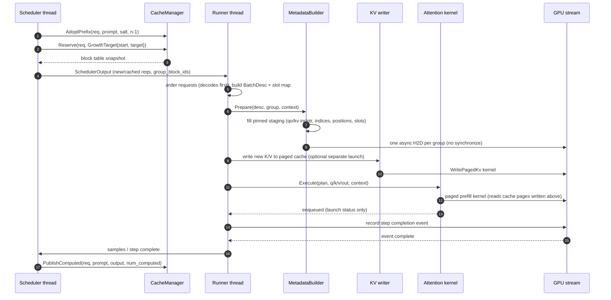
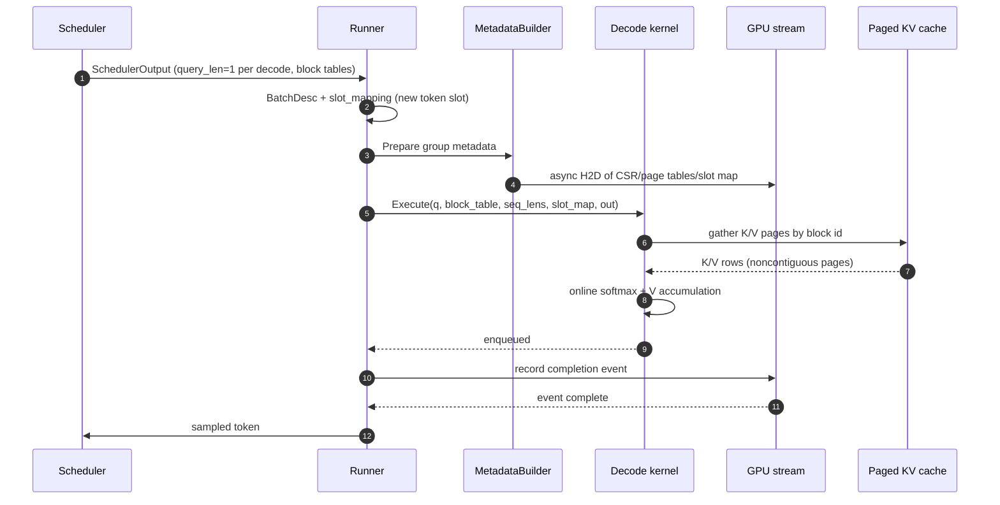
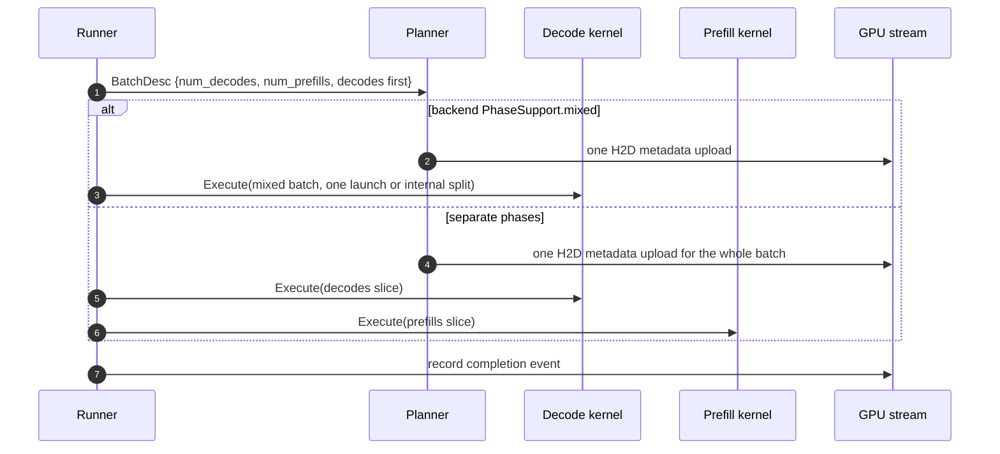

# InferX Attention Subsystem — Production Design (vLLM-Informed)

Status: design proposal for review. No production code is changed by this document.

Target repository: `divedb/InferX`, inspected worktree at commit
`0f6af60` (plus uncommitted work in the tree on 2026-10-20).
Upstream reference: `vllm-project/vllm`, commit
`428cd0cb4a42750f5339d08bb67d534cf8051429` (2026-10-20),
`[ROCm][Model] DeepSeek-V4.1 VL: stream language-model weights on ROCm (#62421)`.

Evidence labels used below:

- **[Verified]** directly read in the repository or the checked-out vLLM source.
- **[Inference]** reasoned from verified interfaces or documented behavior.
- **[Proposed]** a design choice for InferX, not an existing upstream feature.

This document does not replace `docs/kvcache.md`, `docs/executor.md`, or
`docs/attention_legacy.md`. It is the production design and migration contract for
the attention execution subsystem.

### Requirement traceability

The original task requirements are preserved and mapped to this document rather
than silently dropped:

| Requirement area | Where addressed |
|---|---|
| Repository and vLLM inspection, provenance, verified/inferred/proposed separation | §0, §2, §3, Appendix A/B |
| Scope, non-goals, platforms | §4 |
| Architecture, ownership, invalidation, diagrams | §5 |
| C++20 public interfaces and per-type contracts | §6 |
| Attention semantics and capability matrix | §9 |
| Scheduler-to-attention contract and invariants | §7 |
| KV-cache interface, layout, ownership, lifecycle | §8 |
| GPU streams, events, graph capture, coroutines | §11 |
| Backend selection, compatibility, fallback | §10 |
| Multimodal/model variants and extension points | §4, §9, §17.3 |
| Performance engineering and metrics | §14 |
| Error handling, reliability, observability | §12 |
| Test strategy and correctness oracle | §13 |
| Repository layout, build, dependencies | §15 |
| Implementation phases and migration | §16 |
| Trade-offs, alternatives, open questions, risks | §17 |
| Acceptance checklist | §18 |

---

## 0. First findings and unresolved integration questions

### 0.1 Repository findings

These are the facts that constrain the design.

1. **[Verified] A unified attention architecture already exists.** The host-side
   subsystem lives under `include/inferx/ops/attention/` and
   `src/ops/attention/`. Its composition root is
   `attn::AttentionRuntime` (`include/inferx/ops/attention/runtime.h:47`), which
   owns cache planning, `KvBlockPool`, `RecurrentStatePool`, `CacheManager`,
   backend selection, per-layer kernels, metadata builders, and persistent
   metadata buffers.
2. **[Verified] The scheduler owns KV allocation and lifetime.** The scheduler
   calls `CacheManager::AdoptPrefix`, `Reserve`, and `PublishComputed`
   (`src/engine/scheduler.cc:108`, `:126`, `:201`); the attention runtime only
   consumes non-owning `CacheView`s and `GroupBlocks` snapshots. This is the
   correct ownership boundary and must not be reversed.
3. **[Verified] The KV cache is byte-denominated and paged.** `KvBlockPool`
   stores opaque per-token bytes in one device allocation and reserves block id
   zero as the null block (`include/inferx/cache/kv_block_pool.h:69-102`).
   `CacheView` flattens one layer's region for kernels
   (`include/inferx/ops/attention/cache_view.h:30-59`).
4. **[Verified] The runner publishes an immutable per-step block-table snapshot.**
   `SchedulerOutput::group_block_ids` is filled after all reserves
   (`src/engine/scheduler.cc:159-179`) and the runner reads it rather than the
   live facade (`src/engine/model_runner.cc:333-341`). This supports asynchronous
   execution and must be preserved.
5. **[Verified] Metadata upload currently blocks the step stream.** Each array
   upload calls `SynchronizeStream` (`src/ops/attention/fill_common.cc:13-22`),
   six times per group per step. This directly violates the intended overlap
   model, prevents CUDA graph capture, and is the first production blocker.
6. **[Verified] The CUDA dense backend allocates and builds host metadata on the
   hot path.** `FlashDenseKernel::Run` lazily allocates a plan tensor
   (`src/ops/attention/backends/flash_dense.cc:106-110`), rebuilds host query
   offsets with `assign`/`clear`/`push_back` (`:120-130`), and requires the
   host `BatchDesc` mirror (`:117-119`). It cannot run under graph replay.
7. **[Verified] CUDA graphs are not implemented in the runner.**
   `ModelRunner::CaptureGraphs` returns `UnimplementedError`
   (`src/engine/model_runner.cc:254-259`), and `ExecutionConfig` exposes graph
   flags (`include/inferx/config/execution_config.h:8-21`) that currently cannot
   be honored.
8. **[Verified] Backend selection is deterministic and rejects unsupported
   configurations.** `BackendSelector` ranks by priority and preserves forced
   backend semantics (`src/ops/attention/selector.cc:17-62`); the reference
   backend is never a silent fallback (`kReferenceCapability`,
   `src/ops/attention/backends/reference.cc:282-295`). However, the runtime
   constructs `Env` with only block size and forced name
   (`src/ops/attention/runtime.cc:129-132`): `sm`, `cuda_graphs_enabled`, and
   `min_graph_support` are never populated, so architecture and graph
   compatibility are not actually checked.
9. **[Verified] The CUDA capability is broader than demonstrated support.**
   `kFlashDenseCapability` declares arbitrary head dimensions (empty
   `head_dims`), no maximum GQA ratio, `min_sm = 70`, all three phases, and
   graph support `kNever` (`src/ops/attention/backends/flash_dense.cc:158-170`).
   The repository’s own FlashInfer validation document limits validated shapes to
   head dimensions 64/128/256, GQA ratios 1–32, BF16, causal full attention
   (`benchmarks/qwen3/FLASHINFER_DEFAULT.md`). A capability table must not claim
   more than tests prove.
10. **[Verified] `AttentionOp` declares a separate KV-writer hook but the runtime
    never installs it.** `AttentionOp::Forward` checks `write_kv_`
    (`include/inferx/ops/attention/op.h:29-32`), while
    `AttentionRuntime::MakeOp` sets it to null and relies on the kernel
    (`src/ops/attention/runtime.cc:194`). The `KvUpdateMode` contract is
    therefore not enforced; fused and separate writes are not interchangeable
    without checking capability.
11. **[Verified] The attention library is only built when CUDA is available.**
    The top-level build enables the engine only when CUDA is found
    (`CMakeLists.txt:20-36`), and `src/ops/attention/CMakeLists.txt` is under the
    engine. The reference CPU backend therefore cannot be built and tested in a
    CPU-only build even though it is device-neutral.
12. **[Verified] Folly is vendored but not linked or used.** `third_party/folly`
    exists, but search finds no `folly::coro` use in engine code. The server and
    tokenizer use C++20/23 Boost.Asio coroutines
    (`include/inferx/server/engine_gateway.h`, `src/tokenizer/tokenizer_pool.cc`).
    Folly coroutines are therefore not an appropriate new dependency for the
    attention hot path.
13. **[Verified] The worktree has `docs/attention.md` deleted and an untracked
    `docs/attention_legacy.md`.** Many source comments still cite
    `docs/attention.md`. This document becomes `docs/attention_design.md`; the
    migration should restore a short `docs/attention.md` index or update the
    stale comments rather than silently losing the old rationale.

### 0.2 Upstream findings that change the design

The current vLLM architecture is not the older monolithic `AttentionImpl`
arrangement many older documents describe. At the inspected revision:

- `AttentionBackend` is a class-level descriptor of capabilities and factories
  (`vllm/v1/attention/backend.py:59`), with static support predicates such as
  `supports_sliding_window`, `supports_non_causal`, `supports_sink`, and
  `supports_compute_capability`.
- `CommonAttentionMetadata` is a per-batch, backend-neutral object carrying
  `query_start_loc`, `seq_lens`, block tables, slot mappings, and optional
  per-request flags (`backend.py:387`).
- `AttentionMetadataBuilder` is a per-KV-cache-group builder with `build`,
  `build_for_cudagraph_capture`, and optional block-table update
  (`backend.py:589-758`).
- `AttentionCGSupport` is a three-level graph contract (`NEVER`,
  `UNIFORM_SINGLE_TOKEN_DECODE`, `UNIFORM_BATCH`, `ALWAYS`) at
  `backend.py:554-566`. InferX’s current `GraphSupport` is the same concept with
  different names, but is not wired into selection.
- The model runner builds one `CommonAttentionMetadata` per padded batch and
  per-group metadata from it (`vllm/v1/worker/gpu_model_runner.py:2392-2545`).
- Padding uses `NULL_BLOCK_ID = 0` in block-table rows and `PAD_SLOT_ID = -1` in
  slot mappings (`vllm/v1/attention/backends/utils.py:52-53`,
  `gpu_model_runner.py:2298-2300`, `:3898`). This is cleaner than deriving slots
  from positions alone when a batch is padded for graphs.
- FlashAttention and FlashInfer builders split decode and prefill explicitly,
  using a `reorder_batch_threshold`/`decode_threshold`
  (`flash_attn.py:595-627`, `flashinfer.py:735-760`, `:1392-1420`), and FlashInfer
  maintains persistent paged-KV metadata buffers and workspace
  (`flashinfer.py:976-982`, `:1107-1130`, `:1318-1334`).
- KV cache specifications are typed and carry retention, page size, dtype,
  quantization mode, and layout (`vllm/v1/kv_cache_interface.py:537-628`,
  `:886-951`); the physical layout is a five-dimensional stride permutation
  (`vllm/v1/kv_cache_layout.py:15-58`).
- The KV manager owns prefix lookup, block allocation, and copy-on-write
  (`vllm/v1/core/kv_cache_manager.py:131`, `:264`, `:371`). Attention never
  allocates blocks.
- Backend selection is a priority scan with an invalid-reason trail
  (`vllm/platforms/cuda.py:377-417`), an explicit selected-backend fast path
  (`:420-470`), and per-KV-kind overrides (`vllm/v1/attention/selector.py:184-203`).

### 0.3 Unresolved integration questions and recommended answers

These are the questions that must be settled before the API is frozen. The design
below adopts the recommended answer for each; the alternatives remain open for
review.

| # | Question | Recommended decision | Consequence if not settled |
|---|---|---|---|
| Q1 | Is an explicit slot mapping required, or should kernels keep deriving slots from `(position, batch_index, block_table)`? | **Add an explicit `slot_mapping` to metadata; make it optional for legacy eager paths and mandatory for graph/padded paths.** | Padding and null-block behavior remain implicit and graph replay can write the wrong slot. |
| Q2 | Should planning be a single `IAttentionBackend::Prepare`, or a per-group metadata planner? | **Per-group planner + per-layer executor.** Planning is shared by all layers in a cache group; per-layer virtual `Prepare` would repeat O(B) work and force backend-specific plan type erasure. | Wasted planning work, complicated lifetime, and graph instability. |
| Q3 | Is a plan reused across steps? | **Build a new immutable `AttentionPlan` per step; reuse only preallocated buffers and backend plan storage.** A plan key can permit reuse when the immutable inputs and block-table versions are unchanged. | Stale metadata if batch composition or cache tables change. |
| Q4 | Does `Execute` mean enqueued or complete? | **`Execute`/`Forward` returns after host enqueue; GPU completion is represented by a step event.** The scheduler boundary may synchronize only when host values are required. | Ambiguous error reporting and unsafe workspace/cache reclamation. |
| Q5 | Where should slot/block-table padding live? | **Runner adds padded requests with `slot_mapping = -1` and block-table entries `0`; attention skips them. Kernels read device counts when in graph mode.** | Backends each invent padding behavior, breaking graph replay. |
| Q6 | Is the generic paged CUDA kernel a selectable fallback? | **Only if it declares the exact capability and passes the same differential tests. Until then it is an internal adapter, not a fallback backend.** | Silent fallback to a slower or incorrect path. |
| Q7 | Do we capture the whole model step or only attention? | **Capture the whole runner step first; attention metadata must already be stable. An attention-only graph is not useful if the next model op changes pointers.** | Attention-only graphs add complexity without end-to-end benefit. |
| Q8 | Should the host attention library be CUDA-gated? | **No. Split `inferx::attn` (device-neutral) from `inferx::attn_cuda`.** | CPU reference tests and capability tests cannot run without a GPU. |
| Q9 | Should Folly coroutines be introduced for backend discovery? | **No new Folly dependency. Use ordinary synchronous cold-path code or the existing Boost.Asio coroutine layer for control-plane I/O.** | Build complexity and no hot-path benefit. |
| Q10 | How are quantized KV scales represented? | **Ship per-tensor scales first (`CacheView::k_scale/v_scale`); add a versioned `ScaleLayout` only with a verified kernel.** | Capability claims exceed kernel support. |
| Q11 | How is TP head mapping represented? | **Static `DenseParams` carry rank-local head counts; the model layer performs TP sharding. Attention does not perform collectives.** | Attention would duplicate the executor’s collective policy. |
| Q12 | What is the async cache-release rule? | **The scheduler may reuse or release an evicted block only after the step’s completion event; the cache manager remains single-threaded.** | Use-after-free when execution overlaps scheduling. |

### 0.4 What this design keeps and what it changes

**Keep:** the existing scheduler/cache ownership model, byte-denominated KV pool,
spec-declared layouts, per-group metadata, per-layer kernel, deterministic
selection, `StatusOr`, the CPU reference oracle, and the existing test targets.

**Change:** replace synchronous metadata uploads with one asynchronous staging
copy per group; add an explicit prepared plan and workspace; make slot mapping
explicit for padded/graph batches; wire architecture and graph requirements into
selection; preallocate all backend plan state; add completion events and
observability; split device-neutral and CUDA build targets; and narrow capability
claims to tested behavior.

---

## 1. Executive summary and goals

InferX needs an attention subsystem that can run continuously batched transformer
decode and prefill over a paged KV cache, with the scheduler and KV-cache manager
remaining the sole owners of request state and physical cache allocation. The
subsystem must be fast enough that per-step host overhead is negligible against
kernel launch and GPU execution, and structured enough that a new kernel library
can be added without touching models, the scheduler, or the cache manager.

The design is a **backend-neutral C++20 contract with device-specific
implementations**:

- **Static configuration** (`AttentionSpec`) describes what a layer computes:
  role, mask/retention, mechanism, head geometry, dtypes, KV layout, scale, and
  optional features.
- **A per-group planner** turns scheduler/model-runner batch information into
  validated, device-ready `AttentionMetadata`.
- **A per-layer kernel** binds a static spec, a non-owning `CacheView`, and a
  preallocated workspace, then enqueues the device work.
- **A runtime** owns cache planning, pools, the cache facade, selection,
  kernels, builders, metadata buffers, and the workspace arena.
- **The scheduler** owns admission, prefix adoption, block reservation,
  publication, preemption, and release. Attention never mutates the cache ledger.

Goals, in priority order:

1. Preserve scheduler/KV-cache correctness under continuous batching, prefix
   reuse, sliding windows, preemption, and chunked prefill.
2. Support paged prefill and paged decode with one explicit metadata contract.
3. Make CUDA graph capture/replay possible for uniform decode batches without
   per-step host allocation or host synchronization.
4. Keep unsupported modes out of execution: capability selection must fail with a
   useful diagnostic rather than silently choosing an incompatible kernel.
5. Make every ownership and asynchronous lifetime rule explicit.
6. Provide a CPU reference oracle and a test plan that can gate each new backend.
7. Allow future MLA, linear/recurrent, sparse, quantized-KV, and HIP backends
   without changing the stable scheduler/model-runner contract.
8. Remove hot-path allocation, locking, and device-wide synchronization.

Non-goals for the first production release are listed in §4.

---

## 2. Repository context and constraints

### 2.1 Current execution path

The current path is:

```text
Scheduler::Schedule
  -> CacheManager::AdoptPrefix / Reserve
  -> SchedulerOutput {scheduled, group_block_ids snapshot, diffs}
  -> Worker::ExecuteModel
  -> ModelRunner::RunStep
       -> build BatchDesc from InputBatch + SchedulerOutput
       -> AttentionRuntime::BeginStep(BatchDesc)
            -> MetadataBuilder::Build per cache group
            -> FillCommonMetadata (host arrays -> H2D)
       -> model_->Forward(ForwardContext{StepContext, ops})
            -> Qwen3/Llama/Qwen3-MoE decoder
            -> AttentionOp::Forward(StepContext, Inputs, out)
                 -> Kernel::Run(RunArgs{GroupMeta, CacheView, OpContext, ...})
       -> sampling
       -> stream synchronize
       -> ModelRunnerOutput
  -> Worker returns
  -> Scheduler::UpdateFromOutput
       -> CacheManager::PublishComputed / append sample / finish
```

Key repository types and their responsibilities:

| Type | File | Responsibility |
|---|---|---|
| `AttentionSpec` | `include/inferx/ops/attention/spec.h:163` | Static per-layer semantic description. |
| `DenseParams`, `MlaParams`, `LinearParams`, `SparseParams`, `CustomParams` | same | Mechanism-specific parameters in a `std::variant`. |
| `CacheSpec`, `CachePlan`, `CacheRequirements` | `include/inferx/cache/cache_spec.h` | Declarative per-layer cache storage + grouping plan. |
| `KvBlockPool` | `include/inferx/cache/kv_block_pool.h` | One device allocation, per-layer byte regions, refcount/LRU/prefix index ledger. |
| `CacheManager` | `include/inferx/cache/cache_manager.h` | Request-level prefix adoption, reservation, publication, fork, release; scheduler-thread only. |
| `BatchDesc` | `include/inferx/ops/attention/metadata.h:25` | Host-side, span-based batch description. |
| `GroupMeta` | `include/inferx/ops/attention/metadata.h:63` | Device-pointing POD metadata for one cache group. |
| `StepContext` | `include/inferx/ops/attention/metadata.h:98` | Per-step groups + op context + workspace. |
| `CacheView` | `include/inferx/ops/attention/cache_view.h:30` | Non-owning kernel view of one layer's cached bytes. |
| `MetadataBuilder` | `include/inferx/ops/attention/builder.h:47` | Per-group host-to-device metadata builder. |
| `Kernel` | `include/inferx/ops/attention/kernel.h:49` | Per-layer hot-path executor. |
| `Backend` | `include/inferx/ops/attention/backend.h:33` | Capability + kernel/builder factories. |
| `BackendSelector` | `include/inferx/ops/attention/registry.h:47` | Deterministic capability selection with rejection trail. |
| `AttentionRuntime` | `include/inferx/ops/attention/runtime.h:47` | Composition root and step lifecycle. |
| `AttentionOp` | `include/inferx/ops/attention/op.h:16` | Per-layer call site; binds spec, kernel, cache view, group. |

### 2.2 Constraints imposed by the repository

1. **C++ standard:** the top-level CMake uses C++23
   (`CMakeLists.txt:7`). The design uses the C++20 subset (`std::span`,
   `std::variant`, `std::optional`, concepts, `std::byte`) and avoids
   `std::expected` so it remains portable to a C++20 build.
2. **Error convention:** all fallible APIs return `inferx::Status` (alias of
   `absl::Status`) or `StatusOr<T>` (`include/inferx/core/status.h:10-14`).
   Attention must not throw exceptions.
3. **Device abstraction:** `DeviceRuntime` supplies memory, streams, events,
   graphs, and peer access (`include/inferx/core/device_runtime.h`). Attention must
   not call CUDA APIs directly outside the CUDA backend translation units.
4. **Streams:** `ops::OpContext` is a borrowed runtime + stream pair
   (`include/inferx/ops/op_context.h`). Attention may enqueue on that stream only.
5. **Allocation:** `Allocator` and `ScratchArena` exist; attention must use a
   pre-sized workspace and must not allocate on the step path.
6. **Cache ownership:** `CacheManager` is explicitly not thread-safe and is called
   from the scheduler thread (`include/inferx/cache/cache_manager.h:38`). The
   runner must consume immutable snapshots.
7. **Build gating:** the engine and the current attention library are CUDA-gated
   (`CMakeLists.txt:20-36`, `src/CMakeLists.txt:1-12`). A CPU-only build cannot
   currently compile `inferx::attn`, which conflicts with a device-neutral
   contract.
8. **Vendored kernels:** FlashInfer headers and CUDA sources live under
   `third_party/flashinfer` and `src/ops/cuda`. The design must not introduce a
   second kernel build system.
9. **No Folly link:** Folly exists as a source tree but is absent from
   `cmake/InferXDependencies.cmake`. Do not add it for attention.
10. **Existing tests:** `tests/unit/attn/` already covers spec, cache-spec bridge,
    capability, cache view, selector, runtime, and a GPU differential. The design
    extends these rather than replacing them.

### 2.3 Current gaps that define the work

| Gap | Evidence | Production impact |
|---|---|---|
| Metadata H2D blocks after every array | `fill_common.cc:13-22` | Serializes steps, prevents graph capture, wastes overlap. |
| Lazy plan/vector allocation in kernel | `flash_dense.cc:106-130` | Hot-path allocation; graph-incompatible. |
| Graph path unimplemented | `model_runner.cc:254-259` | `--cuda-graphs` cannot work. |
| Architecture/graph not in selection env | `runtime.cc:129-132` | A backend may be selected on an unsupported SM or graph mode. |
| Capability over-claims | `flash_dense.cc:158-170` | Unsupported shapes fail at kernel launch instead of selection. |
| KV write hook never installed | `runtime.cc:194` | `KvUpdateMode` is advisory, not enforced. |
| No explicit slot mapping | `metadata.h`, `fill_common.cc` | Graph padding and null blocks are implicit. |
| No completion event | `StepContext` | Workspace/cache reuse is safe only because the runner synchronizes the whole stream. |
| No telemetry/tracing | attention sources | No bounded metrics for selection, metadata, kernel time, or failures. |
| Attention library CUDA-only | CMake | CPU reference and contract tests cannot run in CPU-only CI. |
| Stale `docs/attention.md` references | source comments | Design history is fragmented. |

---

## 3. Verified vLLM reference analysis

### 3.1 Revision and scope

The analysis is pinned to
`vllm-project/vllm@428cd0cb4a42750f5339d08bb67d534cf8051429` (2026-10-20). The
checked-out tree contains `vllm/v1/attention/`, not the older `vllm/attention/`
package. The relevant components are:

| Concern | Verified vLLM file/symbol |
|---|---|
| Backend capability descriptor and factories | `vllm/v1/attention/backend.py:59` `AttentionBackend` |
| Batch-neutral metadata | `backend.py:387` `CommonAttentionMetadata` |
| Graph support levels | `backend.py:554` `AttentionCGSupport` |
| Metadata builder contract | `backend.py:589` `AttentionMetadataBuilder`, `build` `:683`, `build_for_cudagraph_capture` `:717` |
| Per-layer implementation base | `backend.py:782` `AttentionImplBase`, `:887` `AttentionImpl`, `:1031` `MLAAttentionImpl` |
| Backend enumeration/overrides | `vllm/v1/attention/backends/registry.py:34` `AttentionBackendEnum` |
| Selection inputs | `vllm/v1/attention/selector.py:25` `AttentionSelectorConfig`, `:109` `get_attn_backend` |
| Platform priority/validation | `vllm/platforms/cuda.py:377` `get_valid_backends`, `:420` `get_attn_backend_cls` |
| Attention layer and KV spec construction | `vllm/model_executor/layers/attention/attention.py:229`, `:488`, `:606` |
| FlashAttention metadata/forward/write | `vllm/v1/attention/backends/flash_attn.py:513`, `:595`, `:1177`, `:1427` |
| FlashInfer metadata/build | `vllm/v1/attention/backends/flashinfer.py:703`, `:735`, `:1392` |
| Runner metadata construction | `vllm/v1/worker/gpu_model_runner.py:2392-2545` |
| Slot mapping construction | `vllm/v1/worker/block_table.py:153` `compute_slot_mapping` |
| Paged KV interface | `vllm/v1/kv_cache_interface.py:537` `AttentionSpec`, `:604` `FullAttentionSpec`, `:886` `SlidingWindowSpec` |
| Physical layout | `vllm/v1/kv_cache_layout.py:15` `KVCacheLayout` |
| Manager/prefix/alloc | `vllm/v1/core/kv_cache_manager.py:131`, `:264`, `:371` |
| Paged cache write op | `vllm/v1/attention/ops/paged_attn.py` `PagedAttention.write_to_paged_cache` |

### 3.2 How vLLM composes the subsystem

**[Verified] Backend descriptor.** `AttentionBackend` is a class-level
configuration object. It exposes class variables for supported activation/KV
dtypes, whether the forward includes the KV cache update, supported block sizes,
head sizes, sliding window, non-causal attention, sinks, MLA, sparse attention,
and compute capability. Selection calls class methods; construction then asks for
an implementation class, a metadata-builder class, and a spec adjustment hook.
This is a good separation of *capability* from *execution* but is expressed
through Python class methods and dynamic imports.

**[Verified] Batch metadata.** `CommonAttentionMetadata` carries
`query_start_loc` (device and CPU copies), `seq_lens`, `num_reqs`,
`num_actual_tokens`, `max_query_len`, `max_seq_len`, a block-table tensor, and a
slot-mapping tensor. It also carries optional flags for prefill state,
multimodal ranges, DCP/PCP, and R-SWA. It is backend-neutral and shared by all
backends for a batch.

**[Verified] Per-group builders.** Each KV-cache group has a builder class that
turns common metadata into backend-specific metadata. FlashAttention’s builder
returns a metadata object with `query_start_loc`, `seq_lens`, `block_table`,
`slot_mapping`, split counts, optional scheduler metadata, and causal flags
(`flash_attn.py:513-580`, `:809-980`). FlashInfer’s builder splits the batch into
decode and prefill portions using `decode_threshold` and constructs separate
prefill/decode wrappers (`flashinfer.py:1392-1820`). The runner caches metadata
builds across groups with identical specs and uses `update_block_table` when the
builder supports it (`gpu_model_runner.py:2437-2505`).

**[Verified] Padding and null blocks.** The runner fills padded block-table rows
with `NULL_BLOCK_ID = 0` (`gpu_model_runner.py:2298-2300`) and fills padded slot
mappings with `PAD_SLOT_ID = -1`
(`vllm/v1/attention/backends/utils.py:52-53`, `gpu_model_runner.py:3898`).
Kernels skip null-block/padding slots. This is the behavior that makes full CUDA
graph replay with a captured maximum batch size possible.

**[Verified] Slot mapping formula.** The block-table kernel computes a token’s
slot from the block table, position, block size, and optional context-parallel
parameters (`vllm/v1/worker/block_table.py:153-180`). The write op then scatters
K/V into the paged cache (`vllm/v1/attention/ops/paged_attn.py`).

**[Verified] CUDA graph contract.** `AttentionCGSupport` distinguishes never,
uniform single-token decode, uniform batch, and always. Builders provide
`build_for_cudagraph_capture`, and some backends support updating a block table
inside an existing metadata object (`supports_update_block_table`). The runner
uses padded request counts/tokens and fixed capture shapes
(`gpu_model_runner.py:2250-2305`).

**[Verified] KV cache ownership.** The KV manager owns block lookup, allocation,
prefix-cache adoption, copy-on-write, and freeing (`kv_cache_manager.py`).
Attention receives a slice of the cache and a block table; it does not allocate
blocks. The KV specs carry block size, heads, head size, dtype, quantization
mode, and padded page size. The physical layout is a stride permutation over
`[L, B, H, N, C]` (`kv_cache_layout.py:15-58`).

**[Verified] Selection.** `get_valid_backends` iterates a platform-specific
priority list, calls `validate_configuration`, records rejection reasons, and
then picks the minimum priority candidate. An explicitly selected backend is
validated and fails loudly; it never silently falls back. Per-KV-kind overrides
are resolved in `get_attn_backend` (`selector.py:184-203`).

### 3.3 Concern-to-component mapping

| Concern | Verified vLLM file/symbol | Proposed InferX component | Difference / rationale |
|---|---|---|---|
| Static backend capability | `AttentionBackend` (`backend.py:59`) | `AttentionBackendCapabilities` value + `Capability` | C++ value checked by a pure function; no Python class methods or dynamic imports. |
| Batch-neutral metadata | `CommonAttentionMetadata` (`backend.py:387`) | `AttentionBatchDescriptor` (`BatchDesc`) | Host spans and exact integer fields; no `torch.Tensor` CPU/GPU pairs. |
| Backend-specific metadata | `AttentionMetadataBuilder` (`backend.py:589`) | `AttentionMetadataBuilder` (per group) | Same split, but one builder per cache group; hot path is allocation-free. |
| Per-layer execution | `AttentionImpl` (`backend.py:887`) | `Kernel` + `AttentionOp` | Per-layer kernel holds static specialization; `AttentionOp` is the model call site. |
| Backend selection | `get_attn_backend` + platform priority (`selector.py`, `cuda.py`) | `BackendSelector` + `AttentionBackendRequirements` | Deterministic priority, forced mode, rejection trail; architecture and graph requirements become first-class inputs. |
| Graph support | `AttentionCGSupport` (`backend.py:554`) | `GraphSupport` (`types.h:58`) | Same levels; currently `kNever`/`kUniformDecode`/`kAny`; wire into selector and capture. |
| KV write | `forward_includes_kv_cache_update` + `do_kv_cache_update` | `KvUpdateMode` + optional writer hook | Explicit fused/separate/none; runtime must enforce the declared mode. |
| KV ownership | `KVCacheManager` (`kv_cache_manager.py:131`) | `CacheManager` + `KvBlockPool` | Already implemented; attention only receives non-owning views. |
| Block tables | `block_table_tensor` in common metadata | `BatchDesc::block_ids` + `GroupMeta::kv_indices` | Existing CSR form; explicit slot mapping to be added. |
| Slot mapping | `slot_mapping` tensor, `PAD_SLOT_ID=-1` | New `slot_mapping` span in `BatchDesc` / device array | Add for graph/padded safety; keep derivation as a legacy optimization. |
| Page layout | `KVCacheLayout` stride permutation (`kv_cache_layout.py`) | `KvPageLayout` enum (`spec.h:146`) | InferX has a smaller, spec-declared set; unsupported layouts are rejected, not silently adapted. |
| Per-layer KV spec | `get_kv_cache_spec` (`attention.py:606`) | `BuildCacheSpec` (`cache_spec_bridge.cc`) | Model family declares layout/retention; cache planner groups identical specs. |
| Prefix cache | `get_computed_blocks` / `allocate_slots` | `CacheManager::AdoptPrefix` / `Reserve` / `PublishComputed` | Same scheduler-side ownership; attention consumes block snapshots. |
| CUDA graph padding | `NULL_BLOCK_ID`, `PAD_SLOT_ID` (`utils.py:52-53`) | `kNullBlockId=0` + `slot_mapping=-1` | Reuse the convention; make it explicit in `BatchDesc` and device metadata. |
| Quantized KV | `KVQuantMode`, cache dtype (`kv_cache_interface.py:40`) | `DataType kv_dtype` + future scale layout | Do not claim quantized support until a kernel and tolerance test exist. |
| MLA | `MLAAttentionImpl` (`backend.py:1031`), `MLAAttentionSpec` | `MlaParams`, `kLatent` layout | Types exist; no production kernel in this phase. |
| Recurrent/linear | Mamba/GDN/linear backends in vLLM | `LinearParams`, `RecurrentStatePool` | Types exist; backend is future work. |
| Observability | logs in builders/selection | `AttentionDiagnostics`, metrics, tracing hooks | Add bounded labels and rejection trails; no prompt/tensor logging. |

### 3.4 Upstream assumptions that must not be copied

1. **Do not copy Python dynamic dispatch into the hot path.** vLLM uses class
   methods and dynamic imports at initialization; per-step execution is Python
   but heavily optimized. InferX should resolve specialization once at init.
2. **Do not let a backend choose a physical cache layout after the pool exists.**
   vLLM’s `customize_spec` hook adjusts a spec before cache planning. InferX’s
   pool stores opaque bytes and its families declare layout; a backend may
   filter, not re-landscape another family’s cache.
3. **Do not copy the per-layer `AttentionImpl` object’s mutable state model
   blindly.** InferX’s `Kernel` is per layer and immutable after init; mutable
   per-step state belongs in the prepared plan/workspace, not in a kernel
   singleton.
4. **Do not assume every backend supports CUDA graphs.** vLLM exposes graph
   support per builder; InferX must reject incompatible backends during
   selection, not after capture begins.
5. **Do not assume every backend supports mixed prefill/decode in one launch.**
   FlashInfer builds separate prefill and decode wrappers; FlashAttention can
   handle mixed batches. InferX must express this in `PhaseSupport`.
6. **Do not copy vLLM’s per-layer metadata dictionary.** InferX groups layers by
   cache spec and builds once per group; layers in a group share device metadata.
7. **Do not copy vLLM’s quantized-KV/platform matrix.** The inspected vLLM has
   many formats and architecture-specific paths; InferX only claims the formats
   it has tested.
8. **Do not copy `common_prefix_len` (deprecated in the builder signature).**
   InferX’s prefix reuse is handled by the cache manager before the batch is
   published.
9. **Do not use `torch.Tensor`-style CPU/GPU pairs as the C++ metadata model.**
   Use span/POD host descriptors and persistent device buffers.
10. **Do not copy vLLM’s lazy workspace allocation.** FlashInfer can allocate a
    workspace lazily at first plan; InferX must size and allocate it at init so
    graph capture and steady-state execution never allocate.
11. **Do not copy vLLM’s host synchronizations.** Some builder paths use CPU
    copies for planning; InferX must stage pinned arrays and enqueue async H2D,
    with device-side reads for graph replay.
12. **Do not assume a single `slot_mapping` type.** vLLM uses `int64`; InferX’s
    existing kernels use `int32`. If an explicit mapping is added, define the
    width per backend and convert once at the boundary, or standardize on
    `int32` for the current engine.

---

## 4. Scope, assumptions, and non-goals

### 4.1 In scope

- Backend discovery, capability reporting, deterministic selection, forced
  overrides, and failure diagnostics.
- Static attention configuration and step-specific dynamic metadata.
- Prefill, decode, chunked prefill, mixed batches, and graph-padded decode.
- Paged KV cache reads and writes through non-owning views.
- Masking, positional-information boundaries, head layouts, and supported
  dtypes.
- GPU stream/event ordering, workspace management, and CUDA graph compatibility.
- Observability, correctness tests, benchmarks, build integration, and migration.
- A production path for the existing FlashInfer-backed dense CUDA backend and
  the CPU reference backend.

### 4.2 Out of scope for this design (unless needed for integration)

- HTTP APIs, tokenization, detokenization, networking, and request lifecycle.
- Model weight loading and checkpoint conversion.
- A full scheduler rewrite.
- Reimplementing vendor attention kernels from scratch.
- Full distributed attention / context parallelism; the contract leaves room but
  the first release uses rank-local TP sharding.
- Training, backward passes, and autograd.
- Generic dynamic plugin loading across process boundaries.

### 4.3 Supported platforms and boundaries

| Platform | Status | Boundary |
|---|---|---|
| CUDA, SM 70+ | Declared minimum for dense GQA/MHA/MQA BF16, causal/full/sliding, via vendor FlashInfer wrappers | The repository currently validates on an RTX 4080-class SM89 device with CUDA 13.0/WSL2; other SMs are not verified by that evidence. Narrow `min_sm`/`max_sm` if the vendor template set requires it. |
| CUDA, other dtypes/quantization | Not supported until a backend and tolerance test exist | Selection must reject. |
| CUDA MLA/linear/sparse | Types and future extension points only | Selection must reject; no placeholder backend. |
| CPU | Reference oracle only, forced mode | Not a production backend; single-threaded. |
| HIP | Device abstraction exists; no attention backend | Reject at selection; no claim of portability. |
| Tensor parallel | Rank-local head sharding | Attention does not issue collectives; model/executor owns them. |
| CUDA graphs | Target: uniform decode for the dense backend | Current runner path is `Unimplemented`; phase 2 wires it. |

### 4.4 Assumptions

1. The scheduler remains single-threaded and is the only writer of cache
   allocation state.
2. The model runner owns one `AttentionRuntime` per rank/executor.
3. The model layer applies RoPE/QK-norm before attention; kernels receive
   already-positioned Q/K unless a backend explicitly declares a fused feature.
4. A model layer’s TP-local head counts are reflected in its `AttentionSpec`.
5. The KV cache manager’s allocation and eviction policies are correct; attention
   validates views but does not duplicate policy.
6. A step’s output is consumed after the runner records a completion event; the
   current runner’s final stream synchronize is an implementation detail, not the
   long-term contract.
7. No external user can mutate a published `SchedulerOutput`, `BatchDesc`, or
   `GroupMeta`.

---

## 5. Component architecture and ownership

### 5.1 Logical components

```
                         +-------------------------------+
                         | AttentionModelConfig          |
                         | (per model: layer specs,      |
                         |  limits, TP geometry)         |
                         +---------------+---------------+
                                         |
                                         v
+---------------------+       +----------+-----------+       +----------------------+
| BackendRegistry     |<----->| BackendSelector      |<----->| Capability values    |
| (factories/priority)|       | (requirements + env) |       | (backend abilities)  |
+----------+----------+       +----------+-----------+       +----------------------+
           |                             |
           | creates                     | creates per layer/group
           v                             v
+---------------------+       +----------+-----------+       +----------------------+
| Kernel (per layer)  |       | MetadataBuilder      |       | AttentionWorkspace   |
| static specialization|      | (per cache group)    |       | (pre-sized arena)    |
+----------+----------+       +----------+-----------+       +----------+-----------+
           |                             |                              |
           v                             v                              v
+---------------------+       +----------+-----------+       +----------------------+
| AttentionKernelAdapter|     | AttentionMetadata     |       | AttentionExecutionContext|
| (CUDA/HIP/CPU launch)|      | (host/device POD)     |       | (stream, graph, hooks) |
+----------+----------+       +----------+-----------+       +----------+-----------+
           |                             |                              |
           +-----------------------------+------------------------------+
                                         v
                         +-------------------------------+
                         | AttentionPlan / Prepared      |
                         | Attention (immutable per step)|
                         +---------------+---------------+
                                         |
                                         v
                         +-------------------------------+
                         | IKVCacheView / CacheView      |
                         | (non-owning cache region)     |
                         +-------------------------------+
```

Component contract:

| Component | Owns | Lifetime | Thread | May allocate? | May block? |
|---|---|---|---|---|---|
| `AttentionModelConfig` | Static specs, limits | Model lifetime | Read-only | Init only | No |
| `AttentionBackendRegistry` | Backend factories/objects | Runtime lifetime | Read-only after init | Init only | No |
| `AttentionBackendSelector` | Ordered candidate list | Runtime lifetime | Read-only | Init only | No |
| `AttentionBackendCapabilities` | Immutable value | Static/runtime | Any | No | No |
| `AttentionMetadataBuilder` | Device metadata buffers + staging | Per group, runtime lifetime | Runner thread | Init only; hot path writes preallocated | No |
| `AttentionMetadata` | Device pointers/scalars | Step lifetime | Runner thread | No | No |
| `AttentionPlan` | Per-step group metadata, workspace slices, backend plan handles | Step lifetime, immutable after Prepare | Runner thread | No after Prepare | No |
| `AttentionWorkspace` | Device scratch/plan storage | Runtime lifetime, reused per step | Runner thread | Init only | No |
| `Kernel` | Static specialization + bound cache view | Layer lifetime | Runner thread | Init only | No (host enqueue) |
| `AttentionOp` | Kernel + cache view + group index | Layer lifetime | Runner thread | No | No |
| `IKVCacheView` / `CacheView` | Nothing; non-owning view | Cache/pool lifetime | Any read-only | No | No |
| `AttentionExecutionContext` | Borrowed runtime/stream/workspace/hooks | Step lifetime | Runner thread | No | No |
| `AttentionRuntime` | Whole stack | Runtime lifetime | Runner thread + scheduler facade | Init only | Init only |
| `CacheManager` / pools | KV storage + ledger | Runtime lifetime | Scheduler thread | Scheduler thread | Scheduler thread |

### 5.2 Ownership rules

1. **KV allocation is scheduler-owned.** No attention type may call
   `KvBlockPool::AllocateBlock`, `ReleaseBlock`, `PublishBlock`, or mutate a
   block table. Attention receives `CacheView`s and immutable block-table spans.
2. **Device memory is runtime-owned.** Attention's workspace, metadata buffers,
   cache pools, and backend plan storage are allocated at init and freed by their
   owners. Kernels never call `cudaMalloc`, `Tensor::Empty`, or an allocator.
3. **Host metadata is step-owned.** `BatchDesc` spans point into scheduler/model
   runner storage that outlives `Prepare` and the step. No attention object may
   retain a span across steps unless it copies into a preallocated staging buffer.
4. **Prepared plans are immutable.** After `AttentionRuntime::Prepare`, only
   device contents may change (through the metadata builder before submission);
   host-side plan fields are read-only.
5. **Graphs reference stable addresses.** A plan used under graph replay must
   point only to persistent buffers; per-step values change by overwriting
   contents, never by changing pointers.
6. **Completion owns reclamation.** A workspace slot or cache block may be reused
   only after the step’s completion event has fired. The current runner
   synchronizes at the end of the step; the target design makes this an explicit
   event.

### 5.3 Invalidation

An `AttentionPlan` is invalidated by any of:

- runtime generation change (model reload, cache plan change, workspace resize,
  backend/kernel reload);
- batch generation change (requests added/removed/reordered, query lengths,
  sequence lengths, positions, state slots, or block-table snapshot change);
- cache layout/page-size/quantization change;
- graph capture shape change or graph invalidate;
- device/stream change for the plan.

Implement the key explicitly:

```cpp
struct AttentionPlanKey {
  std::uint64_t runtime_generation = 0;
  std::uint64_t batch_generation = 0;
  std::uint64_t cache_generation = 0;
  std::uint32_t capture_shape_id = 0;
  Device device{};
  bool operator==(const AttentionPlanKey&) const = default;
};
```

The cheap per-request block-table version (`CacheManager` can expose one) may let
a plan reuse its shape/scalars while only the page table changes. Reuse is valid
only if the backend declares `supports_incremental_block_table_update` and the
device pointers remain stable.

### 5.4 Initialization sequence

1. Model provides `AttentionModelConfig` (`std::span<const AttentionSpec>`,
   `EngineLimits`, device, TP-local geometry).
2. `BuildCacheSpec` per layer; assemble `CacheRequirements`.
3. `PlanCacheGroups` resolves block size, groups, retention, aliases.
4. Create `KvBlockPool` from the plan’s per-layer components and
   `RecurrentStatePool` if present.
5. Create `CacheManager` over the pools and plan.
6. Build `Env` with device type, compute capability, block size, graph mode,
   forced backend/preference list.
7. `BackendSelector` selects per distinct spec; reject with a full trail.
8. Create kernels (`CreateKernel`) and builders (`CreateBuilder`) per layer/group.
9. Sum `Kernel::WorkspaceBytes(limits)` and per-group plan bytes; allocate the
   `AttentionWorkspace` once.
10. Allocate persistent `DeviceMetaBuffers` per group, plus pinned host staging
    ring (N slots).
11. If graphs are enabled, build capture shapes, prepare metadata for each
    capture shape, capture, and validate replay against eager.

### 5.5 Sequence diagram: prefill with KV write



Important ordering: the KV write and the attention read must be on the same
stream, or explicitly ordered by an event. The write must complete before the
attention kernel reads the newly written pages. If a backend fuses the write into
the attention kernel (`KvUpdateMode::kFused`), the separate writer is skipped.

### 5.6 Sequence diagram: decode with paged KV read



Decode never writes K/V unless it has new tokens (speculative verify or a
non-cached layer). Plain single-token decode writes exactly one slot per request.

### 5.7 Sequence diagram: mixed / chunked prefill



Chunked prefill is a prefill request with `query_len > 1` and
`context_len > 0`; the mask is causal over `[0, context_len + query_len)` and the
kernel reads the previously cached prefix plus the newly written chunk. The
runner’s decodes-first ordering makes the split a contiguous range.

---

## 6. C++20 public API and key implementation interfaces

The following sketches are the target contract. Existing types are retained where
they already match; names required by the task are provided as canonical public
vocabulary with adapters to the current implementation. All APIs return
`inferx::Status`/`StatusOr`; no exceptions cross an interface boundary.

### 6.1 Common types

```cpp
// include/inferx/ops/attention/types.h
#pragma once

#include <array>
#include <cstddef>
#include <cstdint>
#include <span>
#include <type_traits>

#include "inferx/core/dtype.h"
#include "inferx/core/stream.h"
#include "inferx/core/tensor.h"

namespace inferx::attn {

using Status = inferx::Status;
template <class T>
using StatusOr = inferx::StatusOr<T>;

/// Non-owning tensor descriptor. Strides are in elements. Rank <= 4.
/// The referenced storage must outlive the view (normally one step).
struct TensorView {
  void* data = nullptr;
  DataType dtype = DataType::kBFloat16;
  std::uint8_t rank = 0;
  std::array<std::int64_t, 4> sizes{};
  std::array<std::int64_t, 4> strides{};

  [[nodiscard]] constexpr bool Defined() const noexcept { return data != nullptr; }
  [[nodiscard]] constexpr std::int64_t Dim(int i) const noexcept { return sizes[i]; }
  [[nodiscard]] constexpr std::int64_t Stride(int i) const noexcept { return strides[i]; }
};
static_assert(std::is_trivially_copyable_v<TensorView>);

/// Non-owning byte range. The producer owns the memory and its lifetime.
struct WorkspaceRef {
  void* data = nullptr;
  std::size_t bytes = 0;
  [[nodiscard]] constexpr bool Defined() const noexcept { return data != nullptr; }
};

/// Graph capabilities. `kAny` requires fully device-driven metadata.
enum class GraphSupport : std::uint8_t { kNever = 0, kUniformDecode = 1, kAny = 2 };

/// How the new K/V tokens enter the cache.
enum class KvUpdateMode : std::uint8_t {
  kFused,     ///< The attention kernel writes K/V itself.
  kSeparate,  ///< A layout-aware writer runs before the attention kernel.
  kNone,      ///< No per-token cache write (encoder-only/recurrent state).
};

enum class AttentionPhase : std::uint8_t { kDecode, kPrefill, kMixed };

}  // namespace inferx::attn
```

**Contract:** `TensorView` and `WorkspaceRef` are trivially copyable, never own,
and may be passed by value. `TensorView::data` is null iff undefined. A defined
view guarantees `rank <= 4`, non-negative sizes, and strides that address the
declared extents. Backends validate the axes they consume.

### 6.2 Static model configuration

```cpp
// include/inferx/ops/attention/model_config.h
#pragma once

#include <cstdint>
#include <span>
#include <string_view>
#include <vector>

#include "inferx/core/device.h"
#include "inferx/ops/attention/spec.h"

namespace inferx::attn {

/// Per-engine static limits, used for buffer sizing and selection.
struct EngineLimits {
  std::int32_t max_reqs = 0;
  std::int32_t max_tokens = 0;
  std::int32_t max_seq_len = 0;
  std::int32_t max_blocks_per_req = 0;
  std::int32_t max_kv_splits = 1;   ///< Fixed for graph capture.
  Device device{};
};

/// Model-level static attention configuration.
struct AttentionModelConfig {
  std::span<const AttentionSpec> layers;  ///< One per attention layer, model order.
  EngineLimits limits{};
  std::int32_t tp_size = 1;
  std::int32_t tp_rank = 0;
  std::string_view model_family;          ///< Diagnostics only; never dispatched on.
  std::int64_t max_model_len = 0;
};

}  // namespace inferx::attn
```

**Contract:** immutable after model load. `layers` may contain encoder-self
layers with no persistent cache. `EngineLimits` are hard upper bounds; a batch
exceeding them is rejected before kernel launch. `max_kv_splits` is fixed so a
captured graph cannot need a different workspace shape.

### 6.3 Backend capabilities and requirements

```cpp
// include/inferx/ops/attention/capability.h
#pragma once

#include <cstdint>
#include <span>
#include <string>
#include <string_view>

#include "inferx/core/dtype.h"
#include "inferx/ops/attention/spec.h"
#include "inferx/ops/attention/types.h"

namespace inferx::attn {

template <class E>
struct EnumSet {
  std::uint64_t bits = 0;
  constexpr bool Has(E e) const noexcept {
    return bits & (1ull << static_cast<unsigned long long>(e));
  }
};

struct BlockSizeRule {
  std::int32_t multiple_of = 1;
  std::int32_t max_tokens = 0;  ///< 0 = unbounded.
};

struct PhaseSupport {
  bool decode_only = true;
  bool prefill_only = true;
  bool mixed = false;
};

/// Immutable backend capability value. Pure data, safe to copy/read anywhere.
struct AttentionBackendCapabilities {
  std::string_view name;
  std::uint32_t abi_version = 1;
  std::span<const std::uint32_t> mechanisms;
  EnumSet<Role> roles;
  EnumSet<MaskKind> masks;
  FeatureSet features;
  EnumSet<DataType> q_dtypes;
  EnumSet<DataType> kv_dtypes;
  std::span<const std::int16_t> head_dims;       ///< Empty = no declared limit.
  EnumSet<KvPageLayout> layouts;
  BlockSizeRule block;
  PhaseSupport phases;
  KvUpdateMode kv_update = KvUpdateMode::kSeparate;
  GraphSupport graph = GraphSupport::kNever;
  std::int32_t decode_threshold = 1;
  std::int32_t min_sm = 0;
  std::int32_t max_sm = 0;                       ///< 0 = open.
  std::int32_t max_group_ratio = 0;              ///< 0 = no declared limit.
  bool selectable_only_if_forced = false;
  bool supports_incremental_block_table_update = false;
};

/// What the selector knows about the deployment/configuration.
struct AttentionBackendRequirements {
  AttentionSpec spec;
  Device device{};
  std::int32_t sm = 0;                  ///< Compute capability * 10; 0 unknown.
  std::int32_t block_size = 0;          ///< Resolved plan block size.
  bool cuda_graphs_enabled = false;
  GraphSupport min_graph_support = GraphSupport::kNever;
  std::string_view forced_backend;      ///< Empty = auto.
  std::span<const std::string_view> preference_order;
  bool strict = true;                   ///< Forced/preferred failure is an error.
};

enum class Reject : std::uint8_t {
  kNone, kMechanism, kRole, kMask, kFeature, kQDtype, kKvDtype, kHeadDim,
  kLayout, kBlockSize, kArch, kGraph, kGqa, kPlatform
};

struct Verdict {
  Reject why = Reject::kNone;
  std::string detail;
  explicit operator bool() const noexcept { return why == Reject::kNone; }
};

Verdict CheckCapability(const AttentionBackendCapabilities& capability,
                        const AttentionSpec& spec,
                        const AttentionBackendRequirements& requirements);

}  // namespace inferx::attn
```

**Contract:**

- `CheckCapability` is pure, allocates only in `detail`, and is initialization-only.
- An empty `head_dims` means *no declared constraint*, not “all shapes are
  tested.” A production backend should declare the tested set.
- `max_group_ratio` is `num_q_heads / num_kv_heads`; 1 covers MHA/MQA, >1 covers
  GQA. `0` means no declared max.
- `GraphSupport` is a lower bound: `kUniformDecode` does not imply `kAny`.
- `AttentionBackendRequirements::strict` controls whether a preferred/forced
  backend failure is fatal or whether the selector may continue. The default is
  strict and is what production uses.

### 6.4 KV-cache descriptor and view

```cpp
// include/inferx/ops/attention/kv_cache_view.h
#pragma once

#include <cstddef>
#include <cstdint>
#include <type_traits>

#include "inferx/core/device.h"
#include "inferx/core/dtype.h"
#include "inferx/ops/attention/spec.h"

namespace inferx::attn {

struct KVCacheDescriptor {
  Device device{};
  std::int32_t layer = -1;
  std::int32_t num_blocks = 0;          ///< Usable blocks; block 0 reserved.
  std::int32_t block_tokens = 0;        ///< Tokens per page.
  std::int32_t page_bytes = 0;          ///< Logical bytes per page.
  std::int64_t page_stride_bytes = 0;   ///< Physical page-to-page stride.
  std::int32_t num_kv_heads = 0;
  std::int32_t head_dim = 0;
  std::int32_t v_head_dim = 0;          ///< 0 = same as head_dim.
  DataType dtype = DataType::kBFloat16;
  KvPageLayout layout = KvPageLayout::kKvPlanarNhd;
  const float* k_scale = nullptr;       ///< Optional device scale.
  const float* v_scale = nullptr;       ///< Optional device scale.
  std::byte* base = nullptr;            ///< Non-owning, layer region start.
};

/// Non-owning view over one layer's cache. The pool/cache manager owns `base`.
class IKVCacheView {
 public:
  virtual ~IKVCacheView() = default;
  [[nodiscard]] virtual const KVCacheDescriptor& Descriptor() const noexcept = 0;
  [[nodiscard]] virtual std::byte* Page(std::int64_t block_id) const noexcept = 0;
};

/// Hot-path POD view; no virtual dispatch. Block 0 is kNullBlockId.
struct CacheView {
  std::byte* base = nullptr;
  std::int64_t page_stride_bytes = 0;
  std::int32_t block_tokens = 0;
  std::int32_t page_bytes = 0;
  std::int32_t num_pages = 0;
  std::int32_t slot_stride_bytes = 0;   ///< Recurrent state slots.
  KvPageLayout layout = KvPageLayout::kKvPlanarNhd;
  DataType dtype = DataType::kBFloat16;
  const float* k_scale = nullptr;
  const float* v_scale = nullptr;

  [[nodiscard]] std::byte* Page(std::int64_t id) const noexcept {
    return base + id * page_stride_bytes;
  }
  [[nodiscard]] std::byte* Slot(std::int64_t slot) const noexcept {
    return base + slot * slot_stride_bytes;
  }
};
static_assert(std::is_trivially_copyable_v<CacheView>);

}  // namespace inferx::attn
```

**Contract:**

- `base` is non-owning. The `KvBlockPool` outlives every view and every kernel
  that reads it.
- `num_pages` is usable block count; valid ids are `[1, num_blocks]`. Id 0 is
  reserved and must never be written. Kernels skip null-block rows.
- `page_stride_bytes >= page_bytes`; `page_stride_bytes` is the physical stride,
  including any per-layer padding. A descriptor with a smaller stride is invalid.
- Layout determines the byte interpretation; a backend may read only a layout it
  declares. It must not reinterpret another layout.
- Scale pointers are stable for the runtime lifetime. Per-tensor scales are the
  only supported form initially; per-head/per-block scales require a versioned
  descriptor extension.
- `IKVCacheView` is a cold-path adapter interface for out-of-tree cache
  implementations/tests. Hot kernels take the POD `CacheView`.

### 6.5 Batch descriptor, metadata, and prepared plan

```cpp
// include/inferx/ops/attention/metadata.h
#pragma once

#include <array>
#include <cstdint>
#include <span>
#include <type_traits>

#include "inferx/cache/kv_block_pool.h"
#include "inferx/ops/attention/kv_cache_view.h"
#include "inferx/ops/attention/types.h"

namespace inferx::attn {

inline constexpr std::uint16_t kMaxCacheGroups = 8;

enum class BatchShape : std::uint8_t { kDecodeOnly, kPrefillOnly, kMixed };

/// Host-side, backend-neutral batch description. Spans borrow step-lifetime
/// storage; no copies are made by attention.
struct AttentionBatchDescriptor {
  std::int32_t num_reqs = 0;
  std::int32_t num_tokens = 0;             ///< Real tokens, excludes graph padding.
  std::int32_t num_padded_tokens = 0;      ///< Includes padding; >= num_tokens.
  std::int32_t num_decodes = 0;
  std::int32_t num_decode_tokens = 0;
  std::int32_t num_prefills = 0;
  std::int32_t num_prefill_tokens = 0;
  std::int32_t max_query_len = 0;
  std::int32_t max_seq_len = 0;
  std::int32_t block_size = 0;
  bool uniform_query_len = false;
  bool is_graph_capture = false;

  /// [num_reqs] new tokens per request this step.
  std::span<const std::int32_t> query_lens;
  /// [num_reqs] total computed tokens including this step.
  std::span<const std::int32_t> seq_lens;
  /// [num_reqs] previously computed tokens = seq_lens - query_lens.
  std::span<const std::int32_t> context_lens;
  /// [num_tokens] absolute in-sequence positions of the scheduled tokens.
  std::span<const std::int32_t> positions;
  /// [num_padded_tokens] physical slot per token; -1 for padding.
  std::span<const std::int32_t> slot_mapping;
  /// Per group: flattened block table in batch order.
  std::array<std::span<const BlockId>, kMaxCacheGroups> block_ids{};
  std::array<std::int32_t, kMaxCacheGroups> block_ids_num_pages{};
  /// Per group: recurrent state slot per request, -1 if unused.
  std::array<std::span<const std::int32_t>, kMaxCacheGroups> state_slots{};
  /// Monotonic per-step generation, used by the plan cache.
  std::uint64_t batch_generation = 0;

  [[nodiscard]] BatchShape Shape() const noexcept {
    return num_prefills == 0 ? BatchShape::kDecodeOnly
         : num_decodes == 0 ? BatchShape::kPrefillOnly
                            : BatchShape::kMixed;
  }
};

/// Device-resident metadata for one cache group. All pointers reference
/// persistent runtime buffers; the builder writes contents, never pointers.
struct GroupMeta {
  const std::int32_t* qo_indptr = nullptr;       ///< [B+1] scheduled query extents.
  const std::int32_t* kv_indptr = nullptr;       ///< [B+1] page-table extents.
  const std::int32_t* kv_indices = nullptr;      ///< [pages] physical block ids.
  const std::int32_t* last_page_len = nullptr;   ///< [B] tokens in last page.
  const std::int32_t* batch_indices = nullptr;   ///< [T] request slot per token.
  const std::int32_t* positions = nullptr;       ///< [T] in-sequence position.
  const std::int32_t* slot_mapping = nullptr;    ///< [T] cache slot; -1 padding.
  std::int32_t block_size = 0;
  std::int32_t window_left = 0;                  ///< Retention floor for the group.
  std::int32_t num_reqs = 0;
  std::int32_t num_tokens = 0;
  std::int32_t num_padded_tokens = 0;
  std::int32_t num_decodes = 0;
  std::int32_t num_decode_tokens = 0;
  std::int32_t num_prefills = 0;
  std::int32_t num_prefill_tokens = 0;
  std::int32_t max_query_len = 0;
  std::int32_t max_seq_len = 0;
  BatchShape shape = BatchShape::kDecodeOnly;
  const void* backend_plan = nullptr;            ///< Opaque device/host plan.
  std::uint32_t backend_plan_version = 0;
};
static_assert(std::is_trivially_copyable_v<GroupMeta>);

/// Immutable per-step metadata. `host` is null under graph replay.
struct AttentionMetadata {
  const AttentionBatchDescriptor* host = nullptr;
  std::array<GroupMeta, kMaxCacheGroups> groups{};
  std::uint16_t num_groups = 0;
  std::uint64_t generation = 0;
};

}  // namespace inferx::attn
```

**Field semantics:**

| Field | Units | Meaning | Owner |
|---|---|---|---|
| `query_lens[r]` | tokens | New tokens scheduled for request `r` this step (prefill chunk or decode). | Caller span |
| `seq_lens[r]` | tokens | `context_lens[r] + query_lens[r]`; total logical sequence length after this step. | Caller span |
| `context_lens[r]` | tokens | Tokens already computed before this step; equals `seq_lens - query_lens`. | Caller span |
| `positions[t]` | token index | Absolute position in the request’s sequence for scheduled token `t`. | Caller span |
| `slot_mapping[t]` | cache slot | `block_id * block_size + slot`; `-1` for padding. | Caller span / device |
| `block_ids[g]` | block ids | Flattened per-request block tables, sequence after sequence. | Scheduler snapshot |
| `last_page_len[r]` | tokens | Number of valid tokens in the last allocated page. | Builder |
| `window_left` | tokens | Tokens below this floor are skipped by the kernel. | Builder/cache facade |
| `backend_plan` | opaque | Backend-specific plan pointer; lifetime owned by backend/workspace. | Backend |

**Contract:** `AttentionMetadata` is immutable after `Prepare`. `GroupMeta` is
trivially copyable, but its pointers are only valid until the plan is invalidated
or the runtime is destroyed. Kernels must not retain them.

**Required struct aliases for the current tree:** the current `BatchDesc`
becomes `AttentionBatchDescriptor`, and the current `StepContext` becomes the
host-side wrapper over `AttentionMetadata`:

```cpp
struct StepContext {
  ops::OpContext* ctx = nullptr;
  const AttentionBatchDescriptor* desc = nullptr;  // host mirror; null in graph
  AttentionMetadata meta;
  WorkspaceRef workspace{};
};
```

### 6.6 Workspace

```cpp
// include/inferx/ops/attention/workspace.h
#pragma once

#include <cstddef>
#include <cstdint>
#include <span>
#include <vector>

#include "inferx/core/allocator.h"
#include "inferx/core/device.h"
#include "inferx/core/device_buffer.h"
#include "inferx/core/status.h"
#include "inferx/ops/attention/types.h"

namespace inferx::attn {

/// Pre-sized device arena. One slot per in-flight step (normally 1 or 2).
/// All offsets and sizes are fixed at init; Slice never allocates.
class AttentionWorkspace {
 public:
  struct Layout {
    std::size_t bytes = 0;
    std::size_t alignment = 256;
  };

  static StatusOr<AttentionWorkspace> Create(Device device, std::size_t bytes,
                                             std::size_t slots = 1);

  AttentionWorkspace(AttentionWorkspace&&) noexcept = default;
  AttentionWorkspace& operator=(AttentionWorkspace&&) noexcept = default;
  AttentionWorkspace(const AttentionWorkspace&) = delete;
  AttentionWorkspace& operator=(const AttentionWorkspace&) = delete;

  [[nodiscard]] std::size_t bytes() const noexcept { return buffer_.size(); }
  [[nodiscard]] std::size_t slots() const noexcept { return slots_; }
  [[nodiscard]] WorkspaceRef Slice(std::size_t slot, std::size_t offset,
                                   std::size_t bytes) const noexcept;
  [[nodiscard]] Device device() const noexcept { return buffer_.device(); }

  /// Only legal after the slot's completion event has fired.
  void ResetSlot(std::size_t slot) noexcept;

 private:
  AttentionWorkspace() = default;

  DeviceBuffer buffer_;
  std::size_t slots_ = 1;
};

}  // namespace inferx::attn
```

**Contract:** `Create` is cold-path and may allocate. `Slice` is hot-path,
non-allocating, and returns a borrowed range. No kernel may retain a
`WorkspaceRef` after its step completes. Under graph capture, workspace slots and
offsets must be stable and preallocated; `ResetSlot` must not be called during
capture.

### 6.7 Execution context

```cpp
// include/inferx/ops/attention/context.h
#pragma once

#include <chrono>
#include <cstdint>
#include <string_view>

#include "inferx/core/device.h"
#include "inferx/core/device_runtime.h"
#include "inferx/core/stream.h"
#include "inferx/core/status.h"
#include "inferx/ops/attention/workspace.h"
#include "inferx/ops/op_context.h"

namespace inferx::attn {

enum class GraphMode : std::uint8_t { kEager, kCapturing, kReplaying };

/// Optional profiling/telemetry hooks. All callbacks are cold/step-boundary
/// only; none may allocate per token or synchronize the device.
struct AttentionProfilingHooks {
  void* user = nullptr;
  void (*on_metadata_build)(void*, std::uint16_t group, std::size_t bytes,
                            std::chrono::nanoseconds) = nullptr;
  void (*on_kernel_enqueue)(void*, std::uint16_t group, std::string_view kernel) = nullptr;
  void (*on_step_submitted)(void*, std::uint64_t step_id) = nullptr;
};

/// Borrowed execution state for one step. Never owns the runtime, stream,
/// workspace, or error sink.
struct AttentionExecutionContext {
  ops::OpContext* op = nullptr;        ///< Runtime + stream; must outlive the step.
  AttentionWorkspace* workspace = nullptr;
  Device device{};
  DeviceStream stream{};               ///< Same as op->GetStream(); cached for kernels.
  GraphMode graph_mode = GraphMode::kEager;
  std::uint32_t capture_shape_id = 0;
  std::uint64_t step_id = 0;
  AttentionProfilingHooks hooks{};
  Status* error_sink = nullptr;        ///< Set by async callbacks; optional.

  [[nodiscard]] ops::OpContext& Op() const noexcept { return *op; }
  [[nodiscard]] AttentionWorkspace& Workspace() const noexcept { return *workspace; }
};

}  // namespace inferx::attn
```

**Contract:**

- The context is a borrowed aggregate. `op`, `workspace`, and `error_sink` must
  outlive every call made with it.
- `stream` must equal `op->GetStream()`; it is cached to avoid repeated virtual
  access on the launch path.
- `GraphMode::kCapturing` forbids allocation, synchronization, and host reads of
  device data.
- `error_sink` is for asynchronous GPU errors detected by a later step; a
  successful `Execute` means only “enqueued,” not “completed.”

### 6.8 Plan and prepared attention

```cpp
// include/inferx/ops/attention/plan.h
#pragma once

#include <array>
#include <cstdint>
#include <memory>

#include "inferx/ops/attention/context.h"
#include "inferx/ops/attention/kv_cache_view.h"
#include "inferx/ops/attention/metadata.h"

namespace inferx::attn {

struct AttentionPlanKey {
  std::uint64_t runtime_generation = 0;
  std::uint64_t batch_generation = 0;
  std::uint64_t cache_generation = 0;
  std::uint32_t capture_shape_id = 0;
  Device device{};
  friend bool operator==(const AttentionPlanKey&, const AttentionPlanKey&) = default;
};

/// Per-step, immutable after Prepare. Owns no device allocation; points into
/// runtime-owned persistent buffers and workspace.
class AttentionPlan {
 public:
  AttentionPlan() = default;
  AttentionPlan(AttentionPlan&&) noexcept = default;
  AttentionPlan& operator=(AttentionPlan&&) noexcept = default;
  AttentionPlan(const AttentionPlan&) = delete;
  AttentionPlan& operator=(const AttentionPlan&) = delete;

  [[nodiscard]] const AttentionMetadata& Metadata() const noexcept { return metadata_; }
  [[nodiscard]] const AttentionPlanKey& Key() const noexcept { return key_; }
  [[nodiscard]] bool Valid() const noexcept { return valid_; }
  [[nodiscard]] std::size_t WorkspaceBytes() const noexcept { return workspace_.bytes; }
  [[nodiscard]] const WorkspaceRef& Workspace() const noexcept { return workspace_; }

  /// Internal construction by the runtime/planner.
  static AttentionPlan Make(AttentionMetadata metadata, AttentionPlanKey key,
                            WorkspaceRef workspace);

 private:
  AttentionMetadata metadata_{};
  AttentionPlanKey key_{};
  WorkspaceRef workspace_{};
  bool valid_ = false;
};

/// Per-layer binding returned by MakeOp. Movable, not copyable.
class PreparedAttention {
 public:
  PreparedAttention() = default;
  PreparedAttention(PreparedAttention&&) noexcept = default;
  PreparedAttention& operator=(PreparedAttention&&) noexcept = default;

  [[nodiscard]] const AttentionSpec& Spec() const noexcept { return spec_; }
  [[nodiscard]] std::uint16_t Group() const noexcept { return group_; }

  /// Enqueues this layer's attention. Synchronous with respect to host
  /// submission, asynchronous with respect to GPU completion.
  [[nodiscard]] Status Execute(const AttentionPlan& plan, const AttentionInputs& in,
                               AttentionOutputs& out,
                               AttentionExecutionContext& context) const noexcept;

 private:
  AttentionSpec spec_{};
  std::unique_ptr<Kernel> kernel_;
  CacheView cache_{};
  std::uint16_t group_ = 0;
  friend class AttentionRuntime;
};

}  // namespace inferx::attn
```

`AttentionInputs`/`AttentionOutputs` are the kernel-facing operands:

```cpp
struct AttentionInputs {
  TensorView q;                         ///< [T, Hq, D] packed varlen.
  TensorView k, v;                      ///< [T, Hkv, D]; undefined if cached.
  std::array<TensorView, 2> extras{};   ///< Mechanism-specific.
  std::optional<TensorView> slot_mapping;  ///< Optional explicit map.
};

struct AttentionOutputs {
  TensorView out;                       ///< [T, Hq, Dv]; caller-allocated.
};
```

**Contract:** `Execute` returns after enqueue. It may return
`ResourceExhausted` only if a pre-sized workspace is insufficient (a configuration
bug, not a per-step condition), or `InvalidArgument`/`FailedPrecondition` for
metadata violations. It must not synchronize the stream. GPU failures surface at
the next event query/synchronize or through `error_sink`.

### 6.9 Backend interfaces

The task’s illustrative `IAttentionBackend` is useful for showing the required
separation, but it is **not** the hot-path interface adopted here. Planning is
per cache group, execution is per layer, and backend plans are not a single
type-erased value. The evaluation is below the sketch.

```cpp
// Illustrative only; not the adopted hot path.
class IAttentionBackend {
 public:
  virtual ~IAttentionBackend() = default;
  virtual const AttentionBackendCapabilities& Capabilities() const noexcept = 0;
  virtual StatusOr<AttentionPlan> Prepare(const AttentionBatchDescriptor& batch,
                                          const KVCacheDescriptor& kv_cache,
                                          AttentionExecutionContext& context) = 0;
  virtual Status Execute(const AttentionPlan& plan, const AttentionInputs& inputs,
                         AttentionOutputs& outputs,
                         AttentionExecutionContext& context) = 0;
};
```

**Evaluation:**

- `Prepare` at backend granularity would repeat O(B + T + pages) work for every
  layer, because a backend can serve many layers. The current architecture’s
  per-group `MetadataBuilder` is the right owner.
- A single `AttentionPlan` type would need `std::any`/virtual plan storage to
  hold FlashInfer, FlashAttention, custom, and future plans. That adds
  indirection and allocation to the hot path. The adopted plan carries an opaque
  `backend_plan` pointer into backend/workspace storage instead.
- `Execute` at backend granularity would force one virtual call per layer through
  a backend object rather than a per-layer kernel; functionally equivalent but
  less direct. The per-layer `Kernel` already holds the resolved specialization.
- Therefore the adopted interfaces are:

```cpp
// include/inferx/ops/attention/backend.h
class AttentionBackend {
 public:
  virtual ~AttentionBackend() = default;
  [[nodiscard]] virtual const AttentionBackendCapabilities& Capabilities() const noexcept = 0;

  [[nodiscard]] virtual StatusOr<std::unique_ptr<Kernel>> CreateKernel(
      const AttentionSpec& spec, const CacheView& view,
      const EngineLimits& limits) const = 0;

  [[nodiscard]] virtual StatusOr<std::unique_ptr<MetadataBuilder>> CreateBuilder(
      const AttentionSpec& spec, const EngineLimits& limits) const = 0;
};

// include/inferx/ops/attention/kernel.h
class Kernel {
 public:
  virtual ~Kernel() = default;
  [[nodiscard]] virtual Status Run(const RunArgs& args) const noexcept = 0;
  [[nodiscard]] virtual KvUpdateMode GetKvUpdateMode() const noexcept = 0;
  [[nodiscard]] virtual std::size_t WorkspaceBytes(const EngineLimits&) const noexcept = 0;
};

// include/inferx/ops/attention/builder.h
class MetadataBuilder {
 public:
  virtual ~MetadataBuilder() = default;
  [[nodiscard]] virtual GraphSupport GetGraphSupport() const noexcept = 0;
  [[nodiscard]] virtual std::int32_t DecodeThreshold() const noexcept = 0;
  [[nodiscard]] virtual Status Build(const AttentionBatchDescriptor& desc,
                                     std::uint16_t group, BuildContext& ctx,
                                     GroupMeta& out) noexcept = 0;
  [[nodiscard]] virtual Status BuildForCapture(const CaptureShape& shape,
                                               std::uint16_t group,
                                               BuildContext& ctx,
                                               GroupMeta& out) noexcept = 0;
};
```

`RunArgs` remains a stack aggregate:

```cpp
struct RunArgs {
  const GroupMeta& meta;
  const CacheView& cache;
  ops::OpContext& ctx;
  const AttentionInputs& in;
  AttentionOutputs& out;
  WorkspaceRef workspace;
  const AttentionBatchDescriptor* desc = nullptr;  // null under graph replay
};
```

### 6.10 Registry, selection, and runtime

```cpp
// include/inferx/ops/attention/registry.h
class AttentionBackendRegistry {
 public:
  struct Entry {
    std::unique_ptr<AttentionBackend> backend;
    int priority = 0;
  };

  template <AttentionBackendLike B>
  void Add(int priority = 0) {
    entries_.push_back({std::make_unique<B>(), priority});
  }
  [[nodiscard]] std::span<const Entry> Entries() const noexcept { return entries_; }

 private:
  std::vector<Entry> entries_;
};

struct Selection {
  const AttentionBackend* backend = nullptr;
  std::vector<std::pair<std::string_view, Verdict>> rejected;
  [[nodiscard]] bool Ok() const noexcept { return backend != nullptr; }
};

class AttentionBackendSelector {
 public:
  AttentionBackendSelector(const AttentionBackendRegistry& registry,
                           AttentionBackendRequirements requirements);
  [[nodiscard]] Selection Select(const AttentionSpec& spec) const;
};
```

```cpp
// include/inferx/ops/attention/runtime.h
class AttentionRuntime {
 public:
  static StatusOr<std::unique_ptr<AttentionRuntime>> Create(
      std::unique_ptr<AttentionBackendRegistry> registry,
      const AttentionConfig& config,
      std::span<const AttentionSpec> specs);

  [[nodiscard]] inferx::CacheManager& Cache() noexcept;
  [[nodiscard]] const CachePlan& GetPlan() const noexcept;
  [[nodiscard]] std::uint16_t NumGroups() const noexcept;
  [[nodiscard]] AttentionWorkspace* Workspace() noexcept;

  [[nodiscard]] StatusOr<PreparedAttention> MakeOp(std::int64_t layer);

  /// Builds metadata, uploads it asynchronously, and returns an immutable plan.
  [[nodiscard]] StatusOr<AttentionPlan> Prepare(
      const AttentionBatchDescriptor& batch,
      AttentionExecutionContext& context);

  /// Recording the completion event is the runner's responsibility.
  [[nodiscard]] Status RecordCompletion(AttentionExecutionContext& context,
                                        DeviceEvent event);

 private:
  // ... pools, cache facade, plan, selector, layers, builders, buffers ...
};
```

`AttentionConfig` (cold path) adds graph and observability knobs:

```cpp
struct AttentionConfig {
  std::int64_t block_size = 16;
  std::int64_t max_model_len = 8192;
  std::int64_t max_seqs = 256;
  std::int64_t max_batch_tokens = 8192;
  std::int64_t cache_bytes_budget = 1LL << 30;
  Device device = Device::Cpu();
  bool enable_prefix_caching = true;
  std::string_view forced_backend;
  bool enable_cuda_graphs = false;
  GraphSupport min_graph_support = GraphSupport::kNever;
  std::uint32_t max_workspace_slots = 1;
};
```

### 6.11 Per-type contract summary

| Type | Host/device | Ownership | Thread safety | Validation | Allocation/blocking |
|---|---|---|---|---|---|
| `AttentionModelConfig` | host | caller/model | read-only | init | init only |
| `AttentionSpec` | host | value | immutable | init | none |
| `AttentionBackendCapabilities` | host | value/static | any | init | none |
| `AttentionBackendRequirements` | host | value | any | init | none |
| `AttentionBatchDescriptor` | host | spans borrowed | immutable after publish | per batch | none |
| `AttentionMetadata` | host + device pointers | runtime buffers | runner thread | per plan build | no alloc; async H2D |
| `GroupMeta` | device view POD | runtime | runner thread | per plan build | none |
| `KVCacheDescriptor` | host | value | any read-only | init/bind | none |
| `CacheView` | host POD | non-owning | any read-only | bind | none |
| `AttentionWorkspace` | device | runtime | runner thread | init | init only |
| `AttentionExecutionContext` | host | borrowed | runner thread | per step | no alloc; no sync |
| `AttentionPlan` | host | runtime | runner thread | Prepare | no alloc |
| `PreparedAttention` | host | layer runtime | runner thread | MakeOp | no alloc |
| `AttentionInputs/Outputs` | host PODs + views | caller | runner thread | per Execute | none |
| `Kernel` | host | layer runtime | runner thread | init | no alloc; enqueue only |
| `MetadataBuilder` | host + device buffers | group runtime | runner thread | init | no alloc; async H2D |
| `AttentionRuntime` | host/device | owner | one runner thread | init | init only |

The reference backend is a special case: it is a correctness oracle and may use
small host `std::vector` scratch per token. That is acceptable only because it is
`selectable_only_if_forced` and never on a production serve path. Production
backends must satisfy the allocation-free hot-path rule.

### 6.12 Example call sites

Initialization (cold path):

```cpp
auto registry = std::make_unique<attn::AttentionBackendRegistry>();
attn::RegisterBuiltinBackends(*registry);

attn::AttentionConfig config;
config.block_size = cache_config.block_size;
config.max_model_len = scheduler_config.max_model_len;
config.max_seqs = scheduler_config.max_num_seqs;
config.max_batch_tokens = scheduler_config.max_num_batched_tokens;
config.cache_bytes_budget = kv_budget;
config.device = model_spec.device;
config.enable_prefix_caching = cache_config.enable_prefix_caching;
config.enable_cuda_graphs = execution.enable_cuda_graphs;
config.min_graph_support = execution.enable_cuda_graphs
                               ? attn::GraphSupport::kUniformDecode
                               : attn::GraphSupport::kNever;

INFERX_ASSIGN_OR_RETURN(
    auto runtime,
    attn::AttentionRuntime::Create(std::move(registry), config,
                                   model.GetAttentionSpecs()));

std::vector<attn::PreparedAttention> ops;
for (std::int64_t layer = 0; layer < model.NumAttentionLayers(); ++layer) {
  INFERX_ASSIGN_OR_RETURN(auto op, runtime->MakeOp(layer));
  ops.push_back(std::move(op));
}
```

Per step (runner thread):

```cpp
attn::AttentionExecutionContext context{
    .op = op_ctx.get(),
    .workspace = runtime->Workspace(),
    .device = model_spec.device,
    .stream = op_ctx->GetStream(),
    .graph_mode = replaying ? attn::GraphMode::kReplaying
                            : attn::GraphMode::kEager,
    .capture_shape_id = bucket_id,
    .step_id = step_id,
};

attn::AttentionBatchDescriptor batch = BuildBatchDescriptor(step, *runtime);
INFERX_ASSIGN_OR_RETURN(attn::AttentionPlan plan,
                        runtime->Prepare(batch, context));

for (std::size_t layer = 0; layer < ops.size(); ++layer) {
  attn::AttentionInputs in{
      .q = attn::ViewOf(q[layer]),
      .k = attn::ViewOf(k[layer]),
      .v = attn::ViewOf(v[layer]),
  };
  attn::AttentionOutputs out{.out = attn::ViewOf(out[layer])};
  INFERX_RETURN_IF_ERROR(ops[layer].Execute(plan, in, out, context));
}

// Enqueue a completion event; do not synchronize here unless host values
// are needed. The scheduler may release/reuse cache blocks only after it.
INFERX_RETURN_IF_ERROR(runtime->RecordCompletion(context, step_event));
```

Backend skeleton (cold path):

```cpp
class MyDenseBackend final : public attn::AttentionBackend {
 public:
  static constexpr std::array<std::uint32_t, 1> kMechanisms{
      static_cast<std::uint32_t>(attn::Mechanism::kDense)};
  static constexpr std::array<std::int16_t, 3> kHeadDims{64, 128, 256};

  const attn::AttentionBackendCapabilities& Capabilities() const noexcept override {
    static constexpr attn::AttentionBackendCapabilities kCaps{
        .name = "my_dense",
        .mechanisms = kMechanisms,
        .roles = {attn::Role::kDecoderSelf},
        .masks = {attn::MaskKind::kCausal},
        .q_dtypes = {DataType::kBFloat16},
        .kv_dtypes = {DataType::kBFloat16},
        .head_dims = kHeadDims,
        .layouts = {attn::KvPageLayout::kKvPlanarNhd},
        .block = {.multiple_of = 1, .max_tokens = 0},
        .phases = {.decode_only = true, .prefill_only = true, .mixed = true},
        .kv_update = attn::KvUpdateMode::kSeparate,
        .graph = attn::GraphSupport::kUniformDecode,
        .decode_threshold = 1,
        .min_sm = 70,
        .max_group_ratio = 32,
    };
    return kCaps;
  }

  StatusOr<std::unique_ptr<attn::Kernel>> CreateKernel(
      const attn::AttentionSpec& spec, const attn::CacheView& view,
      const attn::EngineLimits& limits) const override;

  StatusOr<std::unique_ptr<attn::MetadataBuilder>> CreateBuilder(
      const attn::AttentionSpec& spec,
      const attn::EngineLimits& limits) const override;
};
```

### 6.13 ABI and versioning

- This is an in-tree C++ ABI, not a stable binary plugin ABI. Backends are
  registered by explicit function call, not dynamic loading.
- `AttentionBackendCapabilities::abi_version` and
  `GroupMeta::backend_plan_version` are incremented when the layout of a plan or
  the meaning of a field changes. A backend refuses a plan version it does not
  understand.
- `AttentionSpec` is a value type; adding a new `std::variant` alternative or
  enum value is an ABI-affecting change for in-tree users. Keep `CustomParams`
  for experiments and add first-class fields only with a migration note.
- Do not serialize plans or metadata across processes in this phase. If future
  disaggregated serving requires it, define a separate versioned wire schema.
- `TensorView`/`WorkspaceRef`/`GroupMeta`/`CacheView` are trivially copyable and
  standard-layout where possible. `static_assert` those properties.

---

## 7. Scheduler/model-runner integration and metadata invariants

### 7.1 Conventions (normative)

For each scheduled request `r` in batch order:

```
query_len[r]   = number of new tokens scheduled this step       (> 0 for real work)
context_len[r] = tokens already computed before this step       (>= 0)
seq_len[r]     = context_len[r] + query_len[r]
```

For token index `t` belonging to request `r` at offset `j` in `[0, query_len[r])`:

```
position[t]     = context_len[r] + j
slot_mapping[t] = block_id(block_table[r][position[t] / block_size])
                  * block_size + position[t] % block_size
```

For padding token `t` in a graph-padded batch:

```
position[t] = 0 (or a captured dummy)
slot_mapping[t] = -1
block_table[padding request][*] = 0
```

`block_ids[g]` is the concatenation of each request’s *whole* block table in
batch order. It is not truncated to the query range. `kv_indptr[g]` is the CSR
prefix over the number of pages per request.

Masks are **implicit** for the supported modes: the kernel derives causality from
`query_len`/`seq_len`/`position`, and window/chunk retention from `MaskSpec` and
`window_left`. No dense `[T, T]` mask is materialized. A backend that cannot
express a required mask this way must declare an extra input tensor (and a
capability flag); otherwise selection must reject the spec.

### 7.2 Invariants

**I1.** `num_reqs >= 0`, `num_tokens >= 0`, and
`sum(query_len[0..num_reqs)) == num_tokens` for real tokens.

**I2.** `seq_len[r] >= query_len[r]`; `context_len[r] == seq_len[r] - query_len[r]`.

**I3.** For every real request, `query_len[r] > 0`; zero-query requests exist
only as graph padding and must have `slot_mapping == -1`.

**I4.** `num_decodes + num_prefills == num_reqs`; requests are ordered with
decode-like requests first, where decode-like means
`query_len <= backend.DecodeThreshold()`.

**I5.** `num_decode_tokens == sum(query_len[0..num_decodes))` and
`num_prefill_tokens == num_tokens - num_decode_tokens`.

**I6.** `positions` is non-decreasing within each request; for token `j`,
`positions[t] == context_len[r] + j`.

**I7.** `slot_mapping[t] < num_blocks * block_size` for real tokens (or is `-1`
for padding); no real token maps to the null block.

**I8.** The block table for a request has at least
`ceil(seq_len[r] / block_size)` entries. Entries below the retention floor may
be `kNullBlockId`; kernels skip them.

**I9.** `last_page_len[r] == ((seq_len[r] - 1) % block_size) + 1` for
`seq_len[r] > 0`; it is 0 for a padded/empty request.

**I10.** The flattened table length equals the sum of per-request page counts
declared by `block_ids_num_pages[g]`.

**I11.** A request appears once in the batch. `request_id` values are unique in
the step.

**I12.** `max_query_len >= max(query_lens)`, `max_seq_len >= max(seq_lens)`, and
both fit `EngineLimits`.

**I13.** `block_size == plan.block_size` and is compatible with every selected
backend’s `BlockSizeRule`.

**I14.** A graph-padded batch has `num_padded_tokens >= num_tokens`, all padding
slots `-1`, and a captured shape whose upper bounds cover the real batch.

**I15.** All device pointers in a `GroupMeta` point into buffers owned by the
runtime for the plan’s lifetime; no pointer is dereferenced on the host.

**I16.** A plan is used by exactly one step; no concurrent `Execute` calls use the
same plan with different inputs.

### 7.3 Validation layers

| Layer | What | Where | Cost |
|---|---|---|---|
| Model initialization | spec geometry, head divisibility, dtype/layout, block-size compatibility, cache bytes, workspace, backend capability | `AttentionRuntime::Create`, `CreateKernel`, `CreateBuilder` | Once per model |
| Per batch / per prepare | lengths, sums, ranges, block-table lengths, null-block checks, slot bounds, buffer capacities, graph shape | `Prepare` / `FillCommonMetadata` | O(B + T + pages) |
| Debug-only | device metadata readback comparison, block-id bounds on every access, slot/position consistency, poison padding | debug build / test harness | O(T) + sync; never production |
| Per execute (hot) | null view, rank/dtype/shape preconditions that are not guaranteed by plan; no expensive scans | `Kernel::Run` | O(1) |

Validation pseudocode:

```cpp
Status ValidateBatch(const AttentionBatchDescriptor& b, const EngineLimits& limits,
                     const CachePlan& plan) {
  if (b.num_reqs < 0 || b.num_tokens < 0 || b.num_padded_tokens < b.num_tokens)
    return InvalidArgumentError("invalid batch counts");
  if (b.num_reqs > limits.max_reqs || b.num_tokens > limits.max_tokens ||
      b.max_seq_len > limits.max_seq_len)
    return ResourceExhaustedError("batch exceeds engine limits");
  if (b.query_lens.size() != b.num_reqs || b.seq_lens.size() != b.num_reqs ||
      b.context_lens.size() != b.num_reqs)
    return InvalidArgumentError("per-request span size mismatch");
  int64_t tokens = 0;
  for (int r = 0; r < b.num_reqs; ++r) {
    if (b.query_lens[r] < 0 || b.seq_lens[r] < b.query_lens[r])
      return InvalidArgumentError("bad query/seq length");
    if (b.context_lens[r] != b.seq_lens[r] - b.query_lens[r])
      return InvalidArgumentError("context length is not seq - query");
    tokens += b.query_lens[r];
    if (b.query_lens[r] > 0 &&
        b.seq_lens[r] > limits.max_seq_len)
      return ResourceExhaustedError("sequence exceeds max model length");
  }
  if (tokens != b.num_tokens)
    return InvalidArgumentError("query lengths do not sum to num_tokens");
  if (b.positions.size() != static_cast<size_t>(b.num_padded_tokens))
    return InvalidArgumentError("positions size mismatch");
  if (!b.slot_mapping.empty() &&
      b.slot_mapping.size() != static_cast<size_t>(b.num_padded_tokens))
    return InvalidArgumentError("slot mapping size mismatch");
  for (int g = 0; g < plan.NumGroups(); ++g) {
    if (b.block_ids[g].size() !=
        static_cast<size_t>(b.block_ids_num_pages[g]))
      return InvalidArgumentError("page-table length mismatch");
  }
  return OkStatus();
}
```

In debug builds, additionally:
- read back device metadata and compare to the host oracle;
- assert `slot_mapping[t]` matches the derived slot for real tokens;
- assert no real token uses block id 0;
- poison padding regions and fail if the kernel reads them.

### 7.4 Model-runner responsibilities

The runner must:

1. Consume `SchedulerOutput` as an immutable snapshot.
2. Order requests decodes-first (stable within class) before building the batch.
3. Build `query_lens`, `context_lens`, `seq_lens`, `positions`, and
   `slot_mapping` once, not per layer.
4. Flatten each group’s block table from `SchedulerOutput::group_block_ids`.
5. Choose a graph bucket and pad request count/token count if replaying a graph;
   set padding slots to `-1`, padding block rows to `0`.
6. Call `Prepare` once per group (or once for all groups, sharing the batch-wide
   arrays).
7. Call `PreparedAttention::Execute` per layer.
8. Record a completion event after all attention work (and any dependent work
   that reads its output) is enqueued.
9. Publish `PublishComputed` only after the step’s KV writes are complete.
10. Never read attention device metadata on the host in the steady state.

### 7.5 Zero-token and empty-step rules

- A step with `scheduled.empty()` must not call `Prepare` or `Execute`; the runner
  returns an empty output.
- A step whose real `num_tokens == 0` but which has state changes (finish,
  preempt) must not build attention metadata.
- `num_reqs == 0` is legal only for a synthetic capture/probe batch; production
  `Prepare` rejects it unless `is_graph_capture` is true.
- A request with `query_len == 0` is allowed only as graph padding; it must have
  `slot_mapping == -1`, `last_page_len == 0`, and must not contribute to
  `num_tokens`.
- A model with no attention layers may skip the runtime; `AttentionModelConfig`
  with an empty layer span is invalid only if the caller actually requests
  attention.

### 7.6 Chunked prefill and mixed batches

- Chunked prefill is represented by `query_len > 1` and `context_len > 0`; no
  separate phase enum is needed.
- Mixed batch means `num_decodes > 0 && num_prefills > 0`; the runner’s
  decodes-first ordering makes the split a prefix.
- Backend `PhaseSupport` decides whether mixed is one launch or two. If
  `mixed == false`, the kernel may split internally using the same metadata; the
  caller does not reorder.
- A backend that requires uniform decode query lengths must declare
  `decode_threshold` and reject mixed batches; the selector/planner checks it.
- Prefix-cache adoption is complete before scheduling; the attention subsystem
  must not attempt to infer a cached prefix from block-table content.

---

## 8. KV cache ownership, layouts, and lifecycle

### 8.1 Ownership matrix

| Resource | Owner | Attention access | Release rule |
|---|---|---|---|
| KV block storage | `KvBlockPool` (`DeviceBuffer`) | `CacheView` non-owning | Never by attention |
| Block allocation/eviction | `CacheManager` / block pools | Block ids only | Scheduler `Release`/eviction |
| Prefix index | `KvBlockPool` ledger | none | Scheduler/cache manager |
| Request block table | `CacheManager::GroupBlocks` snapshot | read-only spans | After step completion |
| Recurrent state slots | `RecurrentStatePool` | `CacheView` slot view | Cache manager |
| Metadata buffers | `AttentionRuntime` | builder writes | Runtime destruction |
| Pinned staging | `AttentionRuntime` | builder writes per step | Completion event / N-buffer |
| Workspace | `AttentionRuntime` | kernels read/write | Completion event |
| Backend plan | backend/workspace | kernel reads | Runtime destruction/capture invalidation |
| Output tensor | caller/model runner | kernel writes | Caller |
| Input tensors | model layer | kernel reads | Step |

**Rule:** attention must not independently allocate or reclaim request KV blocks
behind the scheduler/KV-cache manager. Any future optimization that moves
allocation into attention is rejected unless it preserves the scheduler as the
single writer.

### 8.2 Physical layouts

The current supported layout set is declared in `AttentionSpec::kv_layout`
(`spec.h:146-158`):

| Layout | Byte interpretation within one page | Use |
|---|---|---|
| `kKvPlanarNhd` | `[2, block_tokens, Hkv, D]`: K plane then V plane, token-major | Current dense CUDA writer/kernel |
| `kKvPlanarHnd` | `[2, Hkv, block_tokens, D]` | Future head-major cache |
| `kKvInterleaved` | `[block_tokens, 2, Hkv, D]` | Future interleaved K/V |
| `kLatent` | `[block_tokens, rank + rope]` | MLA |
| `kRecurrentFlat` | Opaque recurrent-state component | Linear/recurrent |

`CacheView` also exposes `page_stride_bytes`, which may exceed `page_bytes` due to
per-layer padding or a family-specific layout. The kernel must use the stride, not
assume a packed page. The current FlashDense bug fixed in `docs/bug.md` is the
canonical warning: V’s base and page stride must both be correct.

### 8.3 Writes and reads

**Prefill with new K/V:**

1. The model layer computes Q/K/V (and applies RoPE/QK-norm as needed).
2. The planner produces `slot_mapping` for each new token.
3. If `KvUpdateMode::kSeparate`, the writer scatters K/V to
   `slot_mapping[t]`; if `kFused`, the attention kernel does it.
4. The attention kernel reads the cache pages for the full context and computes
   the output.
5. The completion event orders the writes before `PublishComputed` and the next
   scheduler step.

**Decode with no new K/V:** the kernel reads only. The model still has a new
query token; its K/V are written before the decode attention if the layer is
causal self-attention. A plain decode writes one slot per request. A layer with
`kNone` (encoder-only) does not write.

**Chunked prefill:** the new chunk writes its tokens; the kernel reads both the
old prefix pages and the newly written pages. Null block entries below a window
floor are skipped; the page table must still remain addressable for the full
sequence length.

### 8.4 Prefix reuse, COW, and eviction

- Prefix adoption is a cache-manager operation. It returns block ids pinned for
  the request; attention treats them as ordinary pages.
- Fork/COW is a cache-manager operation. It may schedule block copies through
  `RunnerWork`; the runner must drain these on the same stream before attention
  reads the affected pages.
- A block may be evicted only when its refcount is zero. Attention kernels in
  flight must hold a logical reference through the step’s completion event; the
  scheduler must not release/reuse a block until that event fires.
- Sliding-window roll-off may replace a table entry with `kNullBlockId`. Kernels
  skip those rows. Attention must not infer that a null block means “end of
  sequence”; it means “not readable.”
- Recurrent/linear state does not participate in prefix adoption until
  boundary-state sharing is implemented. The cache manager currently documents
  this limitation; attention must not assume recurrent state is shareable.

### 8.5 Layout compatibility and adaptation

If a kernel requires a different physical layout than the family writes:

1. **Reject at selection** if the layout is not in `Capability.layouts`.
2. **Adapt explicitly** only with a verified conversion kernel and an explicit
   cost/ownership plan; the conversion becomes a step in the plan and needs its
   own workspace and correctness test.
3. **Never re-landscape bytes silently** inside a backend. The pool does not own
   layout semantics, and a hidden conversion doubles memory traffic and breaks
   graph pointer stability.

Expected cost of an explicit conversion: for `N` converted pages of
`page_bytes` each, at least `2 * N * page_bytes` bytes of device traffic per
conversion plus workspace and launch overhead. It is never free and should be
benchmarked against selecting a compatible backend. The conversion also needs a
stable workspace and must be included in graph capture if used on a graph path.

### 8.6 Quantized KV

- `DataType kv_dtype` controls component byte size; the pool stores opaque bytes.
- Initial support is per-tensor scales in `CacheView::k_scale/v_scale`. The scale
  pointers are device-resident and stable for the runtime lifetime.
- Per-head/per-block scales require:
  - a versioned `ScaleLayout` in `KVCacheDescriptor`;
  - a `Capability` flag and selection check;
  - a kernel and tolerance test.
- A quantized cache must not be selected for a model whose family writes an
  unquantized layout. `BuildCacheSpec`/`BindTokenWiseView` must cross-check
  bytes-per-token and fail at init.
- Dequantization on the fly is a kernel implementation detail, not a scheduler
  contract.

---

## 9. Attention modes and backend capability matrix

### 9.1 Mode definitions

| Mode | Definition | Current metadata |
|---|---|---|
| Prefill | `query_len >= 1`, `context_len == 0` for the request (first chunk) | `num_prefills`, `num_prefill_tokens` |
| Chunked prefill | `query_len > 1`, `context_len > 0` | same; no separate enum |
| Decode | `query_len == 1`, `context_len >= 0` | `num_decodes`, `num_decode_tokens` |
| Mixed | both decode-like and prefill-like requests in one step | `BatchShape::kMixed` |
| Speculative verify | `query_len = 1 + num_spec_tokens`, decode-like if backend threshold permits | `decode_threshold` |
| Graph-padded decode | uniform query length, padded request/token counts | `is_graph_capture`, `num_padded_tokens` |
| Sliding window | mask restricts KV to a trailing window (+ optional sinks) | `MaskKind::kSlidingWindow`, `window_left` |
| Chunked local | mask restricts KV to a chunk | `MaskKind::kChunked` |
| Cross-attention | decoder Q attends encoder K/V | `Role::kCross`; optional/experimental |
| Encoder self | no persistent cache | `Role::kEncoderSelf`; `NeedsCache=false` |

### 9.2 Capability matrix

Legend: **Y** = verified/claimed and must be tested; **N** = not supported; **F**
= future/planned, not selectable; **—** = not applicable.

| Backend | Device | Mechanisms | Roles | Masks | Phases | MHA/GQA/MQA | RoPE | ALiBi | Sinks | Softcap | Sliding | Chunked | Cross | Prefix | Q dtypes | KV dtypes | Head dims | Block | Graph | TP | Status |
|---|---|---|---|---|---|---|---|---|---|---|---|---|---|---|---|---|---|---|---|---|---|
| `reference` | CPU | Dense | DecoderSelf, EncoderSelf, Cross (experimental) | Causal, Bidirectional, Sliding, Chunked | D/P/M | Y | external | N | N | Y | Y | Y | F | via cache | F32/BF16 | F32/BF16 | any | any | N | N | Implemented oracle, forced only |
| `cuda_flash_dense` | CUDA SM70+ | Dense | DecoderSelf | Causal, Bidirectional, Sliding | D/P/M | Y (ratio 1–32 validated) | external | N | N | Y | Y | N | N | via cache | BF16 | BF16 | 64/128/256 validated; declare exactly | 16/32/64 validated; declare rules | Current N; target UniformDecode | local shard | Implemented, capability must be narrowed |
| `cuda_generic_paged` | CUDA | Dense | DecoderSelf | Causal, Sliding | D/P/M | Y | external | N | untested | Y | Y | N | N | via cache | BF16 | BF16 | up to 2048 via thread loop | any | N | local shard | Internal adapter only; not independently selectable until differential-tested |
| `cuda_mla` | CUDA | MLA | DecoderSelf | Causal/Sliding | D/P/M | N/A | external | N | F | F | F | F | F | via cache | F | F | F | F | F | local shard | Future |
| `cuda_linear` | CUDA | Linear | DecoderSelf | Causal | D/P/M | N/A | external | N | N | N | N | N | N | no | F | F | N/A | N/A | F | local shard | Future |
| `cuda_sparse` | CUDA | Sparse | DecoderSelf | Causal/Sliding | D/P/M | Y | external | N | F | F | F | F | F | via cache | F | F | F | F | F | local shard | Future |
| HIP/ROCm | HIP | — | — | — | — | — | — | — | — | — | — | — | — | — | — | — | — | — | — | — | Not implemented |

Important interpretation:

- “RoPE external” is deliberate: the model layer applies
  `ops::NormalizeAndApplyRope` before `AttentionOp::Forward`
  (`src/models/qwen3/qwen3_attention.cc:148-153`). Attention does not own RoPE
  unless a future backend declares a fused feature. vLLM fuses RoPE into its
  layer/kernels, but that is not evidence that InferX kernels do.
- “Cross experimental” for the reference means the type/role exists and the
  reference kernel can be adapted; it is not a production CUDA path. Do not claim
  cross-attention support in CUDA until a backend is implemented and tested.
- “Sliding Y” for FlashDense must be backed by a test at the exact geometry; the
  current capability claims it, but the repository’s FlashInfer validation
  document says unsupported geometry returns an explicit status. Narrow the
  declaration if tests fail.
- The current FlashDense capability also lists `Bidirectional`, but the
  repository’s validation evidence is BF16 causal full attention. Until
  differential tests cover bidirectional and sliding modes, treat those matrix
  cells as “claimed, unverified”; production selection should not rely on them
  without a test.
- `cuda_generic_paged` is the existing internal `ops::GenericPagedAttention`
  fallback (`src/ops/cuda/generic_attention.cu`). It is not a registered backend
  today. The design permits promoting it only with a full capability row and
  differential tests.
- No backend supports quantized KV, ALiBi, sparse, MLA, or recurrent attention
  today. Selection must reject these, not silently approximate them.

### 9.3 Tensor-parallel and head mapping

- The model shards Q/K/V projections and declares rank-local head counts in
  `DenseParams` (`src/models/qwen3/qwen3_attention.cc:35-58`).
- `num_q_heads % num_kv_heads == 0` is required; MHA (`g=1`), GQA (`1<g<=32`),
  and MQA (`kv=1`) are the same dense kernel with a group ratio.
- Attention does not perform collectives. The model performs the output
  all-reduce after attention (`src/models/qwen3/qwen3_attention.cc:173`).
- Cross-rank cache sharing/context parallelism is out of scope; the contract
  leaves room for a future `dcp`/`pcp` metadata extension but no backend claims
  it.

### 9.4 Multimodal and model-variant extension points

The attention subsystem does **not** interpret images, audio, video, or raw
media tokens. Media preprocessing happens upstream and produces:

- `StepInputs::input_embeds` (precomputed hidden states) or token ids;
- per-token positions (including any model-specific position layout);
- model-specific attention metadata such as bidirectional ranges for
  Prefix-LM-style multimodal inputs;
- effective per-request sequence lengths, which may differ from raw token counts
  because media placeholders expand or collapse at the model boundary.

The contract is:

1. The model layer computes Q/K/V (or latent forms) from hidden states and
   supplies them through `AttentionInputs`; attention never calls a tokenizer or
   media decoder.
2. Positions and masks are supplied as data. Supported causal/sliding/chunked
   masks are implicit from `MaskSpec`, `seq_lens`, and `window_left`; a backend
   that needs an explicit per-token mask or bidirectional range must declare an
   extra input/capability and reject if absent.
3. Variable effective sequence lengths are represented by ordinary
   `context_len`/`seq_len` per request; no special multimodal type enters the
   scheduler contract.
4. Model-specific variants extend the static `AttentionSpec` (role, mask,
   features, mechanism) and/or the family’s model layer. They do not add
   model-specific fields to the shared scheduler or KV manager.

Extension points, labelled by maturity:

| Extension | Status | Interface |
|---|---|---|
| Prefix-LM / multimodal bidirectional ranges | Future | `MaskKind` or an optional metadata range tensor declared by capability. |
| Encoder-decoder cross-attention | Optional/future | `Role::kCross`; encoder K/V supplied once, decoder cache separate. |
| Sparse/local attention | Future | `SparseParams` + an optional index tensor in `extras`. |
| Learned ALiBi/bias | Future | `FeatureSet` flag + a bias tensor/parameter; no backend claims it today. |
| Attention sinks | Limited | `Feature::kSinks` + a per-head sink input; only a backend with a verified kernel may select it. |
| Multiple position schemes (M-RoPE, etc.) | Future | Applied by the model layer before attention; attention only sees positions/rotated Q/K. |

Do not put media format, tokenizer ids, or modality enum into
`AttentionBatchDescriptor`. Those belong to the model/runner input preparation.

### 9.5 Unsupported-feature policy

A backend must return a selection rejection, not a runtime approximation, for a
feature it does not implement. The selection trail must name the exact missing
feature. At init, a forced backend that cannot serve the spec is an error; at
runtime, a batch that violates a declared limit is an error that invalidates the
batch (and may poison the runner if GPU state is uncertain).

---

## 10. Backend selection, compatibility, and fallback

### 10.1 Selection inputs

`AttentionBackendRequirements` includes:

- device type/ordinal and compute capability (SM);
- model spec: mechanism, role, mask, features, head counts, head dims, dtypes,
  KV layout, page size, sequence limits;
- resolved cache block size and cache geometry (bytes/token, alignment);
- graph mode and minimum graph support;
- forced backend, preference order, strict/fallback policy;
- driver/runtime availability (a backend may be built but not usable).

### 10.2 Selection algorithm

```cpp
Selection SelectBackend(const AttentionBackendRequirements& req,
                        std::span<const BackendEntry> entries) {
  Selection sel;
  // 1. Forced backend: validate exactly, no fallback.
  if (!req.forced_backend.empty()) {
    auto* entry = FindByName(entries, req.forced_backend);
    if (entry == nullptr) {
      sel.rejected.push_back({req.forced_backend,
                              {Reject::kMechanism, "no backend with this name"}});
      return sel;
    }
    Verdict v = CheckCapability(entry->backend->Capabilities(), req.spec, req);
    if (!v) {
      sel.rejected.push_back({entry->backend->Capabilities().name, std::move(v)});
      return sel;
    }
    sel.backend = entry->backend;
    return sel;
  }

  // 2. Stable priority order (priority desc, registration order).
  std::vector<const BackendEntry*> ordered = StablePriorityOrder(entries);
  if (!req.preference_order.empty())
    ordered = ApplyPreferenceOrder(ordered, req.preference_order);

  // 3. First candidate that passes every check wins.
  for (const BackendEntry* e : ordered) {
    const auto& caps = e->backend->Capabilities();
    if (caps.selectable_only_if_forced) {
      sel.rejected.push_back({caps.name,
                              {Reject::kPlatform, "selectable only when forced"}});
      continue;
    }
    Verdict v = CheckCapability(caps, req.spec, req);
    if (v) { sel.backend = e->backend; return sel; }
    sel.rejected.push_back({caps.name, std::move(v)});
  }
  return sel;  // empty + full trail
}
```

`CheckCapability` order is fixed and documented: mechanism, role, mask, feature,
Q dtype, KV dtype, head dim, layout, block size, architecture, graph support,
GQA ratio, platform. The first failure is returned; the trail preserves that
explanation.

### 10.3 Decision table

| Device / spec | Graph requirement | Selected | Rationale |
|---|---|---|---|
| CUDA SM80, dense BF16, causal, head_dim 128, ratio 8, block 16 | none | `cuda_flash_dense` | All checks pass; tested geometry. |
| CUDA SM80, dense BF16, causal, head_dim 192 | none | none | Not in tested head-dim set; reject, do not fall back to an unverified generic kernel. |
| CUDA SM80, dense BF16, GQA ratio 64 | none | none | Exceeds validated ratio; reject unless a backend proves it. |
| CUDA SM80, FP8 KV | none | none | No verified quantized KV kernel; reject. |
| CUDA SM60 | none | none | `min_sm=70` rejects; do not use SM70 kernel on SM60. |
| CUDA, graph required uniform decode | `kUniformDecode` | `cuda_flash_dense` only after graph support is implemented and tested | Current backend declares `kNever`, so today this must reject. |
| CUDA, graph required any | `kAny` | none | No fully device-driven backend. |
| CPU, dense F32 | none | `reference` only if forced | Reference is an oracle, not a production fallback. |
| CPU, dense F32, auto | none | none | No production CPU backend; fail with a clear message. |
| CUDA, MLA | none | none | Types exist; no kernel. |
| CUDA, linear/recurrent | none | none | No kernel. |
| CUDA, cross-attention | none | none | No production CUDA cross kernel; reference is experimental. |

### 10.4 Fallback policy

- **Strict forced mode (production):** a forced backend that fails validation is
  an error; never silently choose another backend.
- **Auto mode:** choose the highest-priority compatible backend. A lower-priority
  backend is allowed only if it passes *all* checks, including graph/arch/dtype/
  layout. It is not a “best effort” fallback.
- **No layout-changing fallback after cache population:** once KV bytes exist in
  a family’s layout, switching to a backend that reads a different layout is
  forbidden unless an explicit conversion plan exists.
- **No device-changing fallback:** CUDA attention never falls back to the CPU
  reference; that would require host copies and a different execution lifetime.
- **Reference backend:** `selectable_only_if_forced=true`. It is a correctness
  oracle and bring-up tool, not a production fallback.
- **Generic kernel:** may be an internal adapter inside a backend, but it is only
  a “fallback” if its capability is accurate and it passes the same differential
  tests. Document the exact geometry and performance.

### 10.5 Stability across graph capture and reload

- Selection results are part of the runtime generation. Re-selection after model
  reload or config change must invalidate kernels, builders, plans, and captured
  graphs.
- A backend selected for capture must have `GraphSupport >= min_graph_support`.
  If any group fails, the runner must degrade the whole step to eager/piecewise;
  it must not capture a mixed set of incompatible metadata.
- Graph capture must not change backend selection for later eager steps unless
  the runtime is rebuilt.
- Selection is deterministic across ranks and process restarts for the same
  inputs (priority + registration order, no hash-order dependence).

---

## 11. GPU streams, events, graph capture, and concurrency

### 11.1 Host vs GPU semantics

- `Kernel::Run`, `PreparedAttention::Execute`, and `Prepare` are **synchronous
  with respect to host submission**: when they return, the work is enqueued (or
  an immediate launch error was detected). They are **asynchronous with respect
  to GPU completion**.
- A successful `Execute` does **not** mean the output is readable on the host.
- The step boundary records a `DeviceEvent` after all attention work (and any
  dependent sampler/model work) is enqueued. The runner may synchronize that
  event only when it needs host-visible results.
- Immediate launch errors (`cudaGetLastError`-class) return a `Status` from the
  call. Asynchronous execution errors are reported at the next event query/
  synchronize and poison the runner.

### 11.2 Stream and event ordering

Default ordering: metadata H2D, KV writes, attention kernel, and output
consumption all on the same runner stream. Then no extra events are required.

If a backend uses a separate copy or KV-write stream:

1. Record an event on the producer stream after the copy/write.
2. Make the attention stream wait on that event.
3. Record a completion event on the attention stream after all attention work.
4. Make the consumer/scheduler-visible completion depend on that event.

Rules:

- Never use device-wide synchronization in the steady state. Use stream/event
  ordering.
- Never read device metadata on the host while a kernel that writes it may still
  be running.
- A workspace slot may be reused only after its completion event.
- A cache block may be released/reused only after the step completion event and
  after `PublishComputed` for the relevant tokens.

### 11.3 Workspace lifetime

- `AttentionWorkspace` is pre-sized at init from `sum(Kernel::WorkspaceBytes)` +
  backend plan bytes + alignment, times the number of in-flight slots.
- A slot is leased to one step. The runner records its completion event; the slot
  can be reused after the event completes.
- Graph capture uses a stable slot and offsets. Do not allocate or resize during
  capture.
- If a kernel exceeds its declared workspace, that is a backend bug and should
  return `ResourceExhausted`/`Internal` before launching out-of-bounds work.

### 11.4 CUDA graph rules

| Constraint | Design rule |
|---|---|
| Frozen kernel arguments/pointers | All metadata/workspace/cache pointers are persistent; per-step values change by overwriting contents. |
| Frozen grid | Kernels size grids from captured upper bounds and read actual counts from device arrays; they early-exit idle blocks. |
| No host-side adaptive scheduling inside capture | Split counts are fixed by capture shape; unused splits are disabled by device-side lengths. |
| No allocation inside capture | Outputs are caller-allocated; workspace is preallocated; no lazy plan. |
| Batch must match captured shape | Runner pads request/token counts to a captured bucket. Padding slots are `-1`; padding block rows are `0`. |
| Host metadata must not be read | Kernel uses `GroupMeta` scalars only when not replaying; under replay, device arrays are authoritative. |

Capture modes:

| Mode | Attention execution | Requirement |
|---|---|---|
| Eager | Outside graphs | None |
| Piecewise | Attention eager between captured non-attention segments | Metadata H2D before the step; no allocation in segments |
| Full decode-only | Attention inside the graph | `GraphSupport >= kUniformDecode`, `BuildForCapture` implemented |
| Full any | Attention inside the graph | `GraphSupport::kAny`; fully device-driven metadata |

The runner decides the mode from `Capability` and batch shape. Attention code
must not branch on “graph mode” except through the context’s `GraphMode` and the
prebuilt plan.

### 11.5 Concurrency and thread-safety

| Object | Thread | Mutability | Synchronization |
|---|---|---|---|
| Capabilities, registry, selector results | any | immutable after init | none |
| `AttentionSpec` | any | immutable | none |
| `AttentionRuntime` | runner thread | mutable lifecycle | one owner |
| `MetadataBuilder` | runner thread | mutable staging | none |
| `AttentionPlan` | runner thread | immutable after Prepare | none |
| `Kernel` | runner thread | immutable after init | none |
| `AttentionWorkspace` | runner thread | slot-leased | completion event |
| `CacheManager`, pools | scheduler thread | mutable | single-threaded |
| `SchedulerOutput` | producer → runner | immutable after publish | handoff |
| `CacheView` | any | read-only | pool lifetime |

- One runtime per executor/rank. Do not share mutable attention state across
  tensor-parallel replicas.
- The registry/selector may be read concurrently after init; selection itself is
  init-only.
- If multiple runner threads share a device, they must have separate runtimes and
  separate workspaces. Cache pools may be per-runtime or explicitly shared by a
  higher-level owner; this design assumes per-runtime pools.

### 11.6 Coroutines and asynchronous orchestration

Folly coroutines are **not** used in the attention hot path. The repository does
not link Folly, and GPU kernel launch is already a non-blocking host call. Adding
a coroutine suspension point between launches would add scheduling latency and
lifetime hazards without evidence of benefit.

If a future control-plane API needs asynchronous backend discovery/initialization
and the project formally adopts Folly, the allowed shape is:

```cpp
// Optional, control-plane only. Requires adding folly::coro to the build.
folly::coro::Task<StatusOr<Selection>> SelectBackendAsync(
    const AttentionBackendRequirements& req,
    std::shared_ptr<const AttentionBackendRegistry> registry,
    folly::Executor* executor) {
  // The registry is immutable; the shared_ptr keeps it alive across suspension.
  auto result = co_await folly::coro::co_withExecutor(
      executor, folly::coro::co_invoke([&] {
        return SelectBackend(req, registry->Entries());
      }));
  co_return result;
}
```

Lifetime/cancellation rules for any such API:

- The executor and registry must outlive the task; use `shared_ptr` or an
  explicit owner token.
- Cancellation must be checked before creating device resources; once a kernel is
  enqueued, cancellation is not a host-side rollback mechanism.
- Do not `co_await` a `DeviceEvent` unless an executor-integrated event callback
  (for example `cudaLaunchHostFunc` posting to the executor) is implemented and
  its lifetime is documented.
- Do not put `co_await` between metadata upload and kernel launch on the hot
  path.

For the existing server/tokenizer, Boost.Asio awaitables remain the established
mechanism; attention should expose ordinary `Status`/`StatusOr` APIs to them.

---

## 12. Failure semantics, diagnostics, and observability

### 12.1 Error taxonomy

| Category | `absl::StatusCode` | Examples | Recoverable? | Action |
|---|---|---|---|---|
| Unsupported configuration | `kInvalidArgument`/`kUnimplemented` | head dim, dtype, layout, mask, graph mode | No, at init | Reject at selection; fix config or add backend |
| Invalid metadata | `kInvalidArgument` | length sum mismatch, bad slot range, block table too short | Batch-level | Reject step; do not launch |
| Out-of-range block table | `kOutOfRange` | block id outside pool, null block for real token | Batch-level | Reject step; cache/runner bug |
| Insufficient workspace | `kResourceExhausted` | declared workspace < required | Runtime/config | Fail init; backend bug or limits too low |
| Backend initialization failure | `kFailedPrecondition`/`kInternal` | device unavailable, kernel load failure | Runtime | Do not serve; recreate runtime |
| Host launch failure | `kInternal`/`kUnknown` | invalid launch arguments, driver error | Batch/runner | Quarantine step; check device health |
| Asynchronous execution failure | `kInternal`/`kUnknown` | illegal address, kernel fault | Runner/device | Poison runner; require reset/reload |
| Cache exhaustion | `kResourceExhausted` | no free/evictable block | Request/step | Scheduler preempts/retries |
| Invalid plan lifetime | `kFailedPrecondition` | Execute with stale plan, generation mismatch | Programmer error | Fail fast in debug; reject in production |

`Status` remains the transport. The message should include a stable prefix and
structured fields, for example:

```text
attention: unsupported_configuration: backend=flash_dense layer=17
  reason=head_dim_not_supported head_dim=192 supported={64,128,256}
  hint=force attn.backend=reference for bring-up or add a verified backend
```

If the project later standardizes on `absl::Status` payloads, the same fields can
be attached under an `inferx.attention.*` namespace; do not make payload support a
new dependency. The selection trail is returned as data (`Selection::rejected`),
not only as a formatted string.

### 12.2 Recoverability policy

- **Configuration/selection errors:** fail at init. Never defer to the first
  request.
- **Metadata/cache-table errors:** invalidate the batch. Do not launch a kernel
  with questionable indices.
- **Launch errors:** stop the step; if the CUDA context may be corrupted, poison
  the runner (`Worker::failure_`) and require reinitialization.
- **Asynchronous device errors:** poison the runner/device; do not retry with the
  same allocations.
- **Workspace exhaustion:** a backend bug or a too-small `EngineLimits`; fail the
  step and surface the required bytes.
- **Cache exhaustion:** not an attention error; the scheduler preempts or retries.

### 12.3 Logging and tracing

- Log backend selection once at init: candidate priority, rejection trail,
  selected backend, capability hash, SM, block size, graph mode.
- Log per-layer kernel specialization once at init (backend name, head dim, dtype,
  mask, layout, graph support, workspace bytes).
- Hot-path logs are `INFERX_VLOG` only; never log per token.
- Never log prompt text, token IDs, or tensor contents. Metadata summaries are
  counts, lengths, block ids in debug-only diagnostics, and hashes.
- Tracing spans (optional integration): `attention.prepare`, `attention.execute`,
  `attention.kv_write`, `attention.completion`. Labels must be bounded:
  backend name, phase, dtype, mask, success/error code; do not label by request
  id or sequence length cardinality.
- Profiling hooks in `AttentionExecutionContext` are step-boundary only.

### 12.4 Metrics

Proposed metrics (names are illustrative; adapt to the repo’s metrics system):

| Metric | Type | Labels | Purpose |
|---|---|---|---|
| `attention_backend_selected` | counter | backend, reason | Selection distribution |
| `attention_selection_rejected` | counter | backend, reject_reason | Explain failures |
| `attention_prepare_seconds` | histogram | group, phase | Metadata overhead |
| `attention_metadata_bytes` | histogram | group | H2D volume |
| `attention_kernel_enqueue_seconds` | histogram | backend, phase | Host launch overhead |
| `attention_workspace_bytes` | gauge | backend | Memory overhead |
| `attention_graph_capture_total` | counter | backend, shape | Graph coverage |
| `attention_graph_replay_seconds` | histogram | backend, shape | Replay latency |
| `attention_errors_total` | counter | code, recoverable | Failure rate |
| `attention_kv_write_bytes` | counter | layout | Write bandwidth |
| `attention_decode_tokens_total` | counter | backend | Throughput accounting |

Avoid high-cardinality labels (request id, exact sequence length, prompt hash).
Use buckets for lengths.

### 12.5 Debug validation

Debug builds may:
- read back metadata and compare against the host oracle;
- assert slot/position/block consistency;
- bounds-check every page access in the reference backend;
- poison padding and fail on reads;
- validate plan key/generation on every Execute.

Debug validation must not run in production hot paths by default.

---

## 13. Numerical correctness and test plan

### 13.1 Numeric policy

| Dtype / accumulation | Reference comparison | Proposed tolerance |
|---|---|---|
| FP32 attention, FP32 accumulation | FP64 or FP32 oracle | absolute `1e-5`, relative `1e-5` for small tensors; document exact fixture |
| BF16 inputs, FP32 accumulation | FP64/FP32 oracle with BF16-rounded inputs | absolute `2e-2` to `8e-2` for logits/output depending on head size; use per-element + RMS |
| BF16 cached KV, FP32 softmax | Float oracle with BF16-rounded cache | existing GPU differential uses `8e-2` absolute; retain until a tighter bound is proven |
| FP8/QKV quantized | vendor reference | define per format; do not generalize from BF16 |
| Graph replay vs eager, same kernels | bitwise identity expected for deterministic kernels | require bitwise equality; if not, treat as a bug unless documented atomics/reduction order |

Tolerances are correctness gates, not performance claims. Distinguish:
- exact token agreement (argmax) from numeric closeness;
- bitwise identity for graph replay vs eager;
- framework parity (vLLM/PyTorch) from an independent mathematical oracle.

### 13.2 Test layers

1. **Pure C++ unit tests (no GPU):**
   - spec validation, GQA divisibility, layout/page-byte checks;
   - capability matching and rejection order;
   - selector determinism, forced/strict mode, priority/preference;
   - `BuildCacheSpec` round trips and cache-plan grouping;
   - metadata construction from synthetic batches (lengths, sums, CSR, slots);
   - plan-key invalidation and workspace slicing;
   - zero-token/padding edge cases.
2. **CPU reference oracle:**
   - the existing `reference` backend against an independent FP64 oracle;
   - MHA/MQA/GQA, causal/bidirectional/sliding/chunked, multi-block pages,
     noncontiguous pages, prefix reuse, chunked prefill, mixed batches.
3. **GPU correctness:**
   - compare dense CUDA against the CPU/FP64 oracle for prefill, decode, mixed,
     chunked, sliding, page-boundary cases;
   - compare against vLLM/PyTorch for a documented subset, reporting both exact
     tokens and numeric error; do not infer vLLM parity from a single shape.
4. **Paged KV tests:**
   - sequence straddling 2+ pages; partial last page;
   - shuffled/noncontiguous physical pages;
   - null-block window roll-off;
   - shared prefix blocks across requests;
   - COW after fork;
   - page eviction boundary (no in-flight reads).
5. **Coverage variants:**
   - head dims 64/96/128/192/256 where declared;
   - GQA ratios 1/2/4/8/16/32;
   - long contexts (at least 32K where configured);
   - chunked prefill with chunk sizes crossing page boundaries;
   - mixed batches with decodes-first and varying lengths;
   - sliding windows with and without sinks;
   - all supported dtypes.
6. **Randomized/property-based tests:**
   - random batch compositions, lengths, page orders, null-block patterns;
   - invariants I1–I16 checked by an Oracle builder;
   - deterministic seeds recorded in test output;
   - fuzz block tables and reject out-of-range safely.
7. **Graph/cross-stream tests:**
   - capture/replay vs eager for all captured buckets;
   - padded batch with `-1` slots/`0` block rows;
   - change block table/sequence lengths between replays;
   - metadata H2D on a copy stream with an event dependency;
   - poison padding to prove kernels do not read it.
8. **Concurrency/lifecycle:**
   - workspace slot reuse after completion;
   - cancellation/teardown with pending work;
   - device error injection (invalid pointer/launch) poisons safely;
   - model reload invalidates plans/graphs;
   - multi-rank TP execution with rank-local specs.
9. **Performance regression:**
   - named GPU, driver, CUDA, compiler, binary hash;
   - attention-only microbench separated from end-to-end serving;
   - compare against a committed baseline with a threshold and variance policy.

### 13.3 Fixtures and determinism

- Use deterministic activation generators (e.g., `sin(a*i + b*j + c*k)`) as the
  existing tests do; document the seed/formula.
- For randomized tests, use a fixed seed per test and print it on failure.
- Generate noncontiguous page orders explicitly (identity/reverse/shuffle) and
  compare outputs bitwise where the kernel is deterministic.
- Keep a small hand-computed case for every mask/layout to catch symmetric bugs
  that random tests can miss.
- Store golden rejection trails for representative configurations; update them
  intentionally when capabilities change.

### 13.4 Example fixtures

```cpp
// CPU oracle fixture: 2 requests, one prefill, one decode, block=4.
std::vector<std::int32_t> query_lens{3, 1};
std::vector<std::int32_t> context_lens{0, 4};
std::vector<std::int32_t> seq_lens{3, 5};
std::vector<std::int32_t> positions{0, 1, 2, 4};
std::vector<std::int32_t> slot_mapping{0, 1, 2, 20};  // block 0 is null; block 5 slot 0
std::vector<BlockId> blocks{1, 2, 5};                 // request 0 pages 1,2; request 1 page 5
```

```cpp
// Graph fixture: capture bucket 4 requests x 1 token, replay 2 real requests.
// Real slots: 0, 1; padding slots: -1, -1.
// Padding block rows: 0, 0.
```

### 13.5 CI matrix

- CPU-only: unit/contract/reference tests; no CUDA dependency.
- CUDA SM70/80/90 (as available): dense differential, graph replay, cross-stream,
  sanitizer runs.
- Long-context/nightly: 32K sequences, sliding windows, page shuffles.
- Performance: dedicated machine, serialized, provenance recorded.

### 13.6 Test exit criteria

- All capability cells marked Y have at least one positive test and one negative
  rejection test.
- All supported masks/dtypes/layouts have a differential test.
- Graph replay is bitwise identical to eager for the same kernels, or the
  exception is documented and approved.
- No unsupported configuration reaches a kernel launch.
- Compute Sanitizer memcheck/racecheck is clean on the attention GPU suite.

---

## 14. Benchmark methodology and performance targets

### 14.1 Separate attention-only from serving

Two benchmark classes:

**A. Attention-only microbenchmark**

- Drives `AttentionRuntime` directly with synthetic tokens/block tables.
- Measures metadata prepare, H2D, KV write, kernel time, and completion.
- Cases: decode batch sizes 1/8/64/256; prefill lengths 128/2K/8K; context
  lengths 1K/8K/32K; GQA ratios; head dims; graph vs eager; sliding vs full.
- Reports: prefill tokens/s, decode tokens/s, per-step latency, kernel time,
  metadata host time, H2D bytes, workspace bytes, HBM bandwidth estimate.
- Uses CUDA events around kernels and host `steady_clock` around prepare.

**B. End-to-end serving**

- Uses the existing benchmark harness (`benchmarks/inferx_bench`, Qwen3 workload)
  with the real scheduler/model/sampling.
- Reports: TTFT mean/p95, ITL mean/p95, output tokens/s, effective prefill
  tokens/s, peak device memory, p50/p95/p99 request latency.
- Labels the workload, model, concurrency, input/output lengths, dtype, KV bytes,
  block size, graph mode, and software versions.
- Does not attribute end-to-end changes to attention without a matching
  attention-only run.

### 14.2 Metrics definitions

| Metric | Definition |
|---|---|
| Prefill throughput | Prompt tokens processed / prefill wall time (attention-only run). |
| Decode tokens/s | Decode tokens produced / decode wall time (attention-only run). |
| Per-step latency | Host enqueue + GPU completion for one step; report both host and device. |
| Kernel time | CUDA event elapsed around the attention kernel(s), excluding metadata. |
| Metadata time | Host time in `Prepare` + enqueue time of H2D. |
| H2D bytes/step | Sum of metadata uploads per group. |
| Workspace bytes | `AttentionWorkspace::bytes()` plus backend plan storage. |
| Memory bandwidth estimate | Bytes read/written by KV access / kernel time; compare to device peak. |
| Graph replay latency | Event time for one replay, excluding host preparation. |
| Latency percentiles | p50/p95/p99 over requests under a fixed arrival/queue model. |

### 14.3 Targets / budgets (to validate, not claims)

| Area | Target |
|---|---|
| Hot-path allocation | Zero allocations after init; verified by an allocator hook/counting test. |
| Synchronization | Zero stream/device synchronizations inside `Prepare`/`Execute` in the steady state. |
| Metadata uploads | One async H2D per group per step (or one coalesced upload total); no per-array sync. |
| Host per-layer overhead | Below kernel-launch noise (target < 1–2 µs/layer excluding launch). |
| Batch-wide metadata build | O(B + T + pages), no full-table copies; target below 100 µs at B=256/T=8192 on the reference CPU. |
| Graph replay | Within 10% of eager kernel time for the same shape; host overhead near zero. |
| Workspace | Bounded by declared limits; no growth across steps. |
| Correctness | All gates in §13 pass before any performance claim. |

These are engineering budgets. Do not put them in a report as measured results
without the named hardware/software and raw artifacts.

### 14.4 Optimization levers

1. Coalesce all per-group metadata into one pinned staging block and one H2D.
2. Share batch-wide arrays (`qo_indptr`, `batch_indices`, `positions`,
   `slot_mapping`) across groups; upload once.
3. Incremental block-table updates for steady-state decode when the batch
   composition is unchanged.
4. Fused KV write where the kernel supports it; otherwise one vectorized writer.
5. Fixed workspace offsets; no per-layer allocator calls.
6. Device-side plan selection/number of splits; fixed capture-time upper bounds.
7. Page-table traversal/coalescing and head-dim specialization at init.
8. Graph replay for uniform decode; piecewise capture only where full capture is
   unsupported.
9. Prefix caching on the scheduler thread, hidden behind GPU work.
10. Batched decode kernels for small per-request work; avoid one block per token
    when a request has many pages.

### 14.5 Measurement protocol

- Serialize GPU benchmarks; take an exclusive device lock where available.
- Warm up the exact shape and kernel, including JIT/plan setup, before timing.
- Use at least 3 measured repetitions; report median and range, not a single
  run.
- Record GPU model, driver, CUDA toolkit, compiler, build type, binary hash,
  commit/worktree diff, flags, model/checkpoint hash, and workload hash.
- Keep raw logs and result JSON with the report; never overwrite a prior run.
- Run correctness and performance separately; a fast wrong kernel is not a
  result.

---

## 15. Repository structure, build integration, and dependency choices

### 15.1 Proposed layout

Keep the existing layout and add only the files needed by the target contract:

```text
include/inferx/ops/attention/
  types.h                 # TensorView, WorkspaceRef, GraphSupport, KvUpdateMode
  spec.h                  # AttentionSpec, mechanisms, masks, layouts
  capability.h            # capabilities, requirements, CheckCapability
  metadata.h              # AttentionBatchDescriptor, GroupMeta, AttentionMetadata
  kv_cache_view.h         # KVCacheDescriptor, CacheView, IKVCacheView
  workspace.h             # AttentionWorkspace
  context.h               # AttentionExecutionContext, hooks
  plan.h                  # AttentionPlan, PreparedAttention
  backend.h               # AttentionBackend, factories
  builder.h               # MetadataBuilder, FillCommonMetadata
  kernel.h                # Kernel, RunArgs
  registry.h              # registry + selector
  op.h                    # AttentionOp convenience wrapper
  runtime.h               # AttentionRuntime
  diagnostics.h           # optional error/telemetry types
  backends/
    reference.h
    flash_dense.h
    generic_paged.h       # only if promoted to a real backend

src/ops/attention/
  cache_spec_bridge.cc
  capability.cc
  cache_view.cc
  fill_common.cc
  selector.cc
  runtime.cc
  workspace.cc
  diagnostics.cc
  backends/
    reference.cc
    flash_dense.cc
    generic_paged.cc
  kernels/                # optional new host-side adapters;
                          # existing CUDA kernels stay under src/ops/cuda
tests/unit/attn/
  attention_spec_test.cc
  attention_capability_test.cc
  attention_selector_test.cc
  attention_cache_view_test.cc
  attention_metadata_test.cc
  attention_workspace_test.cc
  attention_runtime_test.cc
  attention_reference_test.cc
  attention_flash_gpu_test.cc
tests/integration/attn/
  attention_graph_test.cc
  attention_cross_stream_test.cc
benchmarks/attention/
  README.md
  attention_microbench.cc
  graph_replay_bench.cc
docs/
  attention_design.md
  attention.md            # restored index/redirect to this document
```

Why not move the kernels now? The CUDA kernels are already integrated into
`inferx_ops` and their build flags/FlashInfer includes live there. Moving them
would be an unrelated rewrite. Add host-side adapters and let the backend call
the existing `ops` entry points; revisit a physical move only if the dependency
graph demands it.

### 15.2 CMake / build integration

Current target:

```cmake
inferx_add_library(
  NAME attn
  SRCS ...
  DEPS inferx::core inferx::cache_manager inferx::ops
)
```

Proposed split:

```cmake
# Device-neutral contracts, reference backend, selector, metadata.
inferx_add_library(
  NAME attn
  SRCS
    cache_spec_bridge.cc
    capability.cc
    cache_view.cc
    fill_common.cc
    selector.cc
    runtime.cc
    workspace.cc
    backends/reference.cc
  DEPS inferx::core inferx::cache_manager
)

# CUDA backend adapter; only when CUDA is enabled.
if(INFERX_HAVE_CUDA_TOOLKIT)
  inferx_add_library(
    NAME attn_cuda
    SRCS backends/flash_dense.cc
    DEPS inferx::attn inferx::ops CUDA::cudart
    PRIVATE_INCLUDE_DIRS
      ${PROJECT_SOURCE_DIR}/third_party/flashinfer/include
  )
endif()
```

Notes:

- `inferx::attn` must compile in a CPU-only build. The reference backend and all
  contract tests then run without CUDA.
- `inferx::attn_cuda` depends on `inferx::ops` because the existing FlashInfer
  wrappers and CUDA kernels live there.
- Guard registration explicitly:

```cpp
void RegisterBuiltinBackends(AttentionBackendRegistry& registry) {
  registry.Add<ReferenceBackend>(/*priority=*/0);
#if INFERX_ENABLE_CUDA
  registry.Add<FlashDenseBackend>(/*priority=*/100);
#endif
}
```

- Do not unconditionally include FlashInfer/CUDA headers in device-neutral
  headers. Keep them in `.cc`/`.cu` files.
- Keep architecture flags in `cmake/InferXCUDA.cmake` and the CUDA target; do not
  leak `-arch` flags into host code.
- If FlashInfer is optional, define a compile-time guard and make the CUDA target
  conditional; the selector must report the backend as unavailable, not crash.
- C++20: keep the existing CMake standard if the repository requires C++23, but
  the attention headers must not use C++23-only features. No `std::expected`,
  no `std::mdspan` dependence, no modules.
- Folly: do not add it. If an async control-plane need arises, use the existing
  Boost.Asio coroutine stack or a plain executor; document the dependency
  decision separately.
- The repository uses CMake only; there is no Bazel target to maintain. If a
  Bazel build is added later, mirror the `attn`/`attn_cuda` split and keep
  FlashInfer/CUDA includes private to the CUDA target.

### 15.3 Dependency pinning

- vLLM is a reference only; do not add a runtime dependency on it.
- FlashInfer is vendored under `third_party/flashinfer`; record the vendored
  revision in the backend capability/log and in benchmark provenance.
- CUDA driver/toolkit minimum is whatever `cmake/InferXCUDA.cmake` enforces;
  attention adds a per-backend `min_sm` and should log the detected SM.
- No new third-party library is required for the design. `absl` is already used
  for `Status`, `flat_hash_map`, and `Span`; `std` covers the rest.

### 15.4 Portability

- CPU-only builds: reference oracle + host contracts.
- CUDA builds: dense backend; optional future backends behind guards.
- HIP: no backend; selection must reject with `kPlatform`.
- Endianness/alignment: KV bytes are family-defined; kernels assume the declared
  element alignment. Validate `page_stride_bytes`/`base` alignment at bind time.
- 32-bit vs 64-bit: block ids are `int32`; sequence/byte offsets are `int64`.
  Reject products that overflow `int32` in metadata arrays.

---

## 16. Migration plan and implementation phases

The repository already has a working phase 1/2 foundation. The plan below evolves
it without a big-bang rewrite.

### Phase 0 — Research and integration audit (complete)

Deliverables:

- repository inventory (this document §0/§2);
- vLLM mapping at the pinned commit (§3);
- baseline test/benchmark run on the target GPU;
- list of unsupported modes and known bugs (`docs/bug.md`).

Exit criteria: design review accepts the ownership boundaries and the choice to
keep the existing cache/scheduler.

### Phase 1 — Core contracts and metadata correctness

Deliverables:

- add `AttentionWorkspace`, `AttentionExecutionContext`, `AttentionPlan`,
  `AttentionBatchDescriptor` aliases/adapters;
- add explicit `slot_mapping` and padding rules;
- replace the six synchronous uploads with one pinned staging block + async H2D
  per group; no `SynchronizeStream` in `Prepare`;
- preallocate all metadata buffers, including shared batch-wide arrays;
- wire `sm`, graph requirements, and preference order into `Env`/selection;
- narrow FlashDense capability to tested head dims/ratios/block sizes and
  declare `GraphSupport::kNever` until graph work lands;
- add typed error/diagnostic helpers and selection trails;
- split `inferx::attn` from CUDA so CPU-only tests can run.

Demonstrable end-to-end: CPU reference prefill/decode/mixed/prefix/window; CUDA
dense prefill/decode; all existing tests plus new metadata/workspace tests.

Still unsupported: CUDA graphs, advanced mechanisms, quantized KV.

Exit criteria:

- no hot-path allocation in `Prepare`/`Execute` (allocator count == 0 after
  warmup);
- no stream synchronize in the steady-state attention path;
- all metadata invariants tested;
- CPU-only CI builds `inferx::attn`.

### Phase 2 — Minimal working GPU path and graph readiness

Deliverables:

- remove lazy plan/vector allocation from `FlashDenseKernel`;
- preallocate FlashInfer plan/workspace per group/layer at init;
- implement `BuildForCapture` and padded-batch metadata;
- wire `ModelRunner::CaptureGraphs` for uniform decode buckets; capture the whole
  step, not just attention;
- add graph replay vs eager tests and poisoned-padding tests;
- implement the generic paged adapter only if it passes differential tests, and
  do not expose it until then.

Demonstrable end-to-end: eager and full-graph decode for one verified geometry
(BF16 causal GQA), prefill→decode→chunked-prefill sequences.

Still unsupported: mixed graph capture beyond uniform decode; MLA/linear/sparse;
quantized KV.

Exit criteria:

- graph replay bitwise equals eager for all captured buckets;
- no host metadata reads during replay;
- all differential tests pass;
- GPU memory overhead (workspace + plans) reported and within budget.

### Phase 3 — Production serving

Deliverables:

- explicit completion events and N-buffered workspace/staging;
- async step pipeline where the runner can overlap the next prepare with the
  previous GPU step;
- robust error propagation/poisoning (launch vs async);
- telemetry: selection trail, prepare time, metadata bytes, kernel enqueue,
  workspace, graph replay, error counters;
- strict backend selection and fallback policy;
- graph capture/replay for all supported buckets;
- end-to-end Qwen3 workload and HTTP benchmarks with provenance.

Demonstrable end-to-end: sustained serving with prefix caching, mixed batches,
chunked prefill, graph decode, and measurable p50/p95/p99.

Still unsupported: advanced model mechanisms unless added.

Exit criteria:

- no device-wide sync in the steady state;
- p99 latency/throughput meets the agreed budget on named hardware;
- failure-injection tests pass;
- rollout/rollback documented.

### Phase 4 — Advanced support

Deliverables, in priority order based on actual model needs:

- MLA backend (`kLatent`, latent cache, absorbed decode path);
- sliding-window correctness at exact model geometry;
- quantized KV (per-tensor first, then per-head/block if required);
- cross-attention / encoder-decoder;
- linear/recurrent backend over `RecurrentStatePool`;
- sparse/indexed attention;
- HIP backend adapter only if a target deployment requires it.

Each addition requires a capability row, selection tests, differential tests, and
a graph-support declaration (or explicit `kNever`).

Exit criteria: each backend has positive/negative capability tests, numerical
tolerance, and documented unsupported combinations.

### Phase 5 — Optimization and rollout

Deliverables:

- attention-only and end-to-end benchmark suite with regression gates;
- kernel autotuning only where reproducible and operationally justified;
- metadata incremental update if measured beneficial;
- performance dashboards and alerts;
- documentation updates (restore `docs/attention.md` index);
- rollback plan to eager/previous backend.

Exit criteria:

- performance gates met on named hardware;
- no correctness regressions;
- fallback/rollback exercised;
- design document and code comments consistent.

### First concrete changes (recommended order)

1. Fix `Upload` in `fill_common.cc`: pinned staging + one async copy, no sync.
2. Add `slot_mapping` to `BatchDesc`/`GroupMeta` and fill it in the runner.
3. Add `AttentionWorkspace` and remove lazy `Tensor::Empty`/host vectors from
   `FlashDenseKernel`.
4. Populate `Env.sm` from `DeviceProperties` and graph flags from
   `ExecutionConfig`; wire `GraphSupport` into selection.
5. Narrow `kFlashDenseCapability` to tested head dims/ratios; add negative tests.
6. Split `inferx::attn` from `inferx::attn_cuda` in CMake.
7. Implement `BuildForCapture` and capture/replay tests.
8. Add completion events and telemetry.

---

## 17. Trade-offs, alternatives rejected, open questions, and risks

### 17.1 Major trade-offs

| Decision | Chosen | Alternative | Trade-off |
|---|---|---|---|
| Planning granularity | Per cache group | Per layer | Per-layer repeats metadata work; per-group needs group-identical metadata contract. |
| Plan type | Opaque pointer into backend/workspace | `std::any`/virtual plan | Opaque is allocation-free and graph-stable; requires versioning and careful lifetime. |
| Hot-path polymorphism | One virtual `Kernel::Run` per layer | Function-pointer table/CRTP | Virtual is simpler and negligible vs launch; CRTP would explode model template instantiations. |
| Slot mapping | Explicit array + derived fallback | Derive from positions/block table only | Explicit costs one array/H2D but makes padding/graphs testable and matches vLLM’s proven convention. |
| Layout ownership | Spec-declared, backend-filtered | Backend-chosen | Prevents silent re-landscaping and keeps the byte pool authoritative; limits exotic kernels unless they bring a family layout. |
| Graph scope | Whole-step capture | Attention-only graph | Whole-step avoids pointer instability between attention and the rest of the model. |
| Metadata upload | Pinned staging + async H2D | Per-array synchronous copies | Requires N-buffering/lifetime management; removes a major serialization point. |
| CPU backend | Reference only, forced | Production CPU kernels | Avoids claiming unsupported performance; CPU path remains a test oracle. |
| Coroutines | No Folly in attention | Folly coroutine orchestration | Avoids a new dependency and suspension in launch paths. |
| Quantized KV | Per-tensor first | Full format matrix | Keeps claims testable; advanced formats wait for kernels and tolerance tests. |

### 17.2 Alternatives rejected

- **Attention-owned KV pool/manager.** Duplicates the tested cache subsystem and
  violates single-writer allocation. Rejected.
- **A single `IAttentionBackend::Prepare/Execute`.** Evaluated in §6.9; planning
  is per group and execution per layer. Rejected as the hot-path interface.
- **Backend-chosen layout after cache planning.** Rejected; the pool stores
  opaque bytes and families own layout.
- **`std::variant` of all kernel types per layer.** Requires a closed list at the
  model compile unit, increases compile time, and hurts extensibility.
- **Per-layer metadata builders.** O(layers) duplicate builds per step.
- **Always-fused KV write.** Some kernels cannot fuse; always-separate costs an
  extra launch for kernels that can. Use `KvUpdateMode`.
- **Exceptions or `std::expected`.** The repository uses `StatusOr`; exceptions
  are absent from hot paths and `std::expected` is C++23-only.
- **Dynamic plugin ABI.** Not needed for in-tree backends; explicit registration
  is deterministic and link-safe.
- **Autotuning in selection by default.** Nondeterministic and operationally
  risky; use a deterministic priority list, with tuning as an explicit offline
  policy if justified.
- **Host-side planning inside graph capture.** Forbidden by CUDA graph rules.

### 17.3 Open questions

| # | Question | Current leaning | Decision needed |
|---|---|---|---|
| O1 | Should slot mapping be `int32` everywhere or backend-specific? | `int32` for InferX; convert at adapter boundaries | ABI/performance of existing kernels |
| O2 | Is the whole-step graph capture compatible with the existing sampler/scheduler sync? | Capture whole step; keep sampling after replay | Runner restructuring |
| O3 | Do we need a production generic CUDA fallback? | Only with a tested capability row | Model coverage vs maintenance |
| O4 | How are FlashInfer plan/workspace buffers shared across layers? | Per group/layer preallocated, reused per step | Memory overhead vs plan rebuild cost |
| O5 | Should metadata staging be N-buffered or single-buffered? | N=2 for overlap; single stream ordering is simpler | Runner pipeline design |
| O6 | How is `window_left` computed for mixed batches? | Minimum over requests, as today; backend may read per-request lengths | Correctness for heterogeneous windows |
| O7 | Recurrent prefix caching? | Not until state boundary sharing exists | Target models |
| O8 | Per-head/per-block quant scales? | Future, behind a versioned descriptor | Accuracy needs |
| O9 | Cross-attention CUDA path? | Future; reference only for now | Encoder-decoder models |
| O10 | How to decouple attention from CUDA in CMake without breaking `ops`? | Host library + optional `attn_cuda` | Build ownership |
| O11 | Should the selection trail be stable text or structured? | Structured `Verdict` + formatted message | Diagnostics/API |
| O12 | How to pin vLLM behavior in tests? | Record exact commit + shape matrix; compare only supported subset | Upstream drift |

### 17.4 Risks and mitigations

| Risk | Impact | Mitigation |
|---|---|---|
| Metadata H2D remains synchronous | Step serialization, no graphs | Phase 1 blocker; allocator/sync tests |
| Capability over-claims | Silent wrong results or late failures | Narrow capabilities; negative tests; forced-backend tests |
| Graph capture with heap pointers | Crash/corruption on replay | Persistent buffers; pointer-stability test; poison padding |
| Cache block reuse while kernel reads | Corruption | Completion event + scheduler release rule; cross-stream test |
| Hidden layout conversion | Performance cliff / wrong bytes | Reject at selection; explicit conversion only |
| Workspace overlap across steps | Data race | N-buffered slots + events |
| Async errors undetected | Poisoned engine | Check event/query at step boundary; poison runner |
| FlashInfer API drift | Build/runtime breakage | Pin vendored revision; capability version; integration tests |
| TP head mismatch | Wrong math | Model declares TP-local heads; validate divisibility |
| Quantized KV claims | Numerical failure | No support until kernel + tolerance |
| CPU-only build breakage | Cannot test contracts | Split host library; CI |
| Stale docs/comments | Maintenance errors | Restore `docs/attention.md` index; update references |

---

## 18. Acceptance checklist

Use this as the review gate for the design and for each implementation phase.

### Design acceptance

- [ ] The design is grounded in the inspected vLLM commit and cites exact paths/
      symbols (§3).
- [ ] Scheduler, KV-cache manager, attention planning, and kernel execution have
      separate, explicit responsibilities (§5).
- [ ] Every resource has one owner and an explicit lifetime (§5.2, §8.1).
- [ ] Paged KV prefill and decode have explicit metadata conventions and
      invariants (§7).
- [ ] Logical sequence lengths, physical block ids, and token slots are distinct
      concepts in every interface (§7.1, §8).
- [ ] Capability matching rejects unsupported modes with a useful diagnostic
      (§9, §10).
- [ ] Graph capture and stream/event ordering constraints are stated (§11).
- [ ] Hot paths avoid virtual dispatch beyond one kernel call, allocations,
      locks, and device-wide synchronization (§5, §11).
- [ ] Async APIs state enqueue vs completion semantics and lifetime rules (§11).
- [ ] Folly/Boost coroutine usage is justified and confined to control-plane work
      (§11.6).
- [ ] Unsupported features are not presented as equivalent to supported ones
      (§9.5).
- [ ] The design covers failure handling, diagnostics, and observability (§12).
- [ ] The test and benchmark plans are credible and incremental (§13, §14).
- [ ] The migration plan preserves the existing scheduler/cache and avoids a
      broad rewrite (§16).

### Phase 1 acceptance

- [ ] One async metadata upload per group; no `SynchronizeStream` in `Prepare`.
- [ ] Explicit slot mapping/padding implemented and tested.
- [ ] `AttentionWorkspace` preallocates every plan/scratch buffer.
- [ ] `Env` includes SM, graph requirements, and preference order.
- [ ] Capability table matches tested geometry; negative tests exist.
- [ ] `inferx::attn` builds and tests on CPU-only CI.
- [ ] Existing reference and CUDA differential tests still pass.
- [ ] No hot-path allocations after warmup (allocator counter test).

### Phase 2 acceptance

- [ ] FlashDense has no lazy allocation or host vector rebuild in `Run`.
- [ ] `BuildForCapture` produces valid padded metadata.
- [ ] Runner captures/replays a uniform decode bucket.
- [ ] Graph replay is bitwise identical to eager for the same kernels.
- [ ] Padding poison test proves no padded token is read or written.
- [ ] Workspace/plan memory overhead is measured and documented.
- [ ] Unsupported graph shapes/biases reject before capture.

### Phase 3 acceptance

- [ ] Step completion events protect workspace and cache reuse.
- [ ] Cross-stream metadata/KV ordering is tested with events.
- [ ] Selection and execution errors have recoverability policies.
- [ ] Metrics/tracing exist with bounded labels and no prompt/tensor content.
- [ ] End-to-end Qwen3 workload passes with eager and graph modes.
- [ ] p50/p95/p99, throughput, and memory are recorded with provenance.
- [ ] Rollback to eager/previous backend is exercised.

### Advanced-phase acceptance (per backend)

- [ ] Capability row added and tested (positive and negative).
- [ ] Numerical tolerance defined and met against an independent oracle.
- [ ] Paged KV layouts/page boundaries/boundary conditions tested.
- [ ] Graph support declared accurately (`kNever` is acceptable).
- [ ] No silent fallback or hidden conversion.
- [ ] Documentation and selection diagnostics updated.

### Final production readiness

- [ ] No unsupported configuration can reach a kernel launch.
- [ ] No scheduler/KV allocation is performed by attention.
- [ ] No device-wide synchronization in steady state.
- [ ] No per-token host allocation, string formatting, or logging.
- [ ] Cache release/reuse is ordered after GPU completion.
- [ ] Graph replay, eager, and mixed/chunked paths agree numerically.
- [ ] Failure injection and device-error recovery pass.
- [ ] Performance gates on named hardware pass with reproducible artifacts.
- [ ] `docs/attention_design.md` is reviewed, and `docs/attention.md` no longer
      points at deleted content.

---

## Appendix A — vLLM citation index

All paths are relative to
`vllm-project/vllm@428cd0cb4a42750f5339d08bb67d534cf8051429`.

| Symbol / behavior | Path:line |
|---|---|
| `AttentionBackend` capability descriptor/factories | `vllm/v1/attention/backend.py:59` |
| `CommonAttentionMetadata` | `vllm/v1/attention/backend.py:387` |
| `AttentionCGSupport` | `vllm/v1/attention/backend.py:554` |
| `AttentionMetadataBuilder` | `vllm/v1/attention/backend.py:589` |
| `build` | `vllm/v1/attention/backend.py:683` |
| `build_for_cudagraph_capture` | `vllm/v1/attention/backend.py:717` |
| `AttentionImplBase` / `AttentionImpl` / `MLAAttentionImpl` | `vllm/v1/attention/backend.py:782`, `:887`, `:1031` |
| Backend enum / overrides | `vllm/v1/attention/backends/registry.py:34` |
| `AttentionSelectorConfig` | `vllm/v1/attention/selector.py:25` |
| `get_attn_backend` | `vllm/v1/attention/selector.py:109` |
| Per-kind backend override | `vllm/v1/attention/selector.py:184` |
| Platform priority/validation | `vllm/platforms/cuda.py:377`, `:420` |
| Attention layer and KV spec | `vllm/model_executor/layers/attention/attention.py:229`, `:488`, `:606` |
| FlashAttention metadata/builder | `vllm/v1/attention/backends/flash_attn.py:513`, `:595` |
| FlashAttention forward/KV write | `vllm/v1/attention/backends/flash_attn.py:1177`, `:1427` |
| FlashInfer metadata/builder/build | `vllm/v1/attention/backends/flashinfer.py:703`, `:735`, `:1392` |
| FlashInfer graph support | `vllm/v1/attention/backends/flashinfer.py:1036` |
| FlashInfer persistent paged buffers | `vllm/v1/attention/backends/flashinfer.py:976`, `:1318` |
| Runner common metadata build | `vllm/v1/worker/gpu_model_runner.py:2392-2545` |
| Runner padding/null block | `vllm/v1/worker/gpu_model_runner.py:2298-2300`, `:3898` |
| `NULL_BLOCK_ID` / `PAD_SLOT_ID` | `vllm/v1/attention/backends/utils.py:52-53` |
| Slot mapping kernel | `vllm/v1/worker/block_table.py:153` |
| Paged KV write op | `vllm/v1/attention/ops/paged_attn.py` |
| KV cache spec | `vllm/v1/kv_cache_interface.py:168`, `:537`, `:604`, `:886` |
| KV page-size properties | `vllm/v1/kv_cache_interface.py:582`, `:589` |
| KV physical layout | `vllm/v1/kv_cache_layout.py:15-58` |
| KV manager/prefix/alloc | `vllm/v1/core/kv_cache_manager.py:131`, `:264`, `:371`, `:620`, `:782` |

## Appendix B — Current InferX symbol map

| Concept | Current type/function | File |
|---|---|---|
| Static spec | `attn::AttentionSpec` | `include/inferx/ops/attention/spec.h:163` |
| Batch description | `attn::BatchDesc` | `include/inferx/ops/attention/metadata.h:25` |
| Device group metadata | `attn::GroupMeta` | `include/inferx/ops/attention/metadata.h:63` |
| Step context | `attn::StepContext` | `include/inferx/ops/attention/metadata.h:98` |
| Cache view | `attn::CacheView` | `include/inferx/ops/attention/cache_view.h:30` |
| Capability | `attn::Capability`, `attn::Env` | `include/inferx/ops/attention/capability.h:49`, `:78` |
| Backend factories | `attn::Backend` | `include/inferx/ops/attention/backend.h:33` |
| Kernel | `attn::Kernel` | `include/inferx/ops/attention/kernel.h:49` |
| Metadata builder | `attn::MetadataBuilder` | `include/inferx/ops/attention/builder.h:47` |
| Registry/selector | `attn::BackendRegistry`, `attn::BackendSelector` | `include/inferx/ops/attention/registry.h:14`, `:47` |
| Runtime | `attn::AttentionRuntime` | `include/inferx/ops/attention/runtime.h:47` |
| Per-layer op | `attn::AttentionOp` | `include/inferx/ops/attention/op.h:16` |
| Cache facade | `inferx::CacheManager` | `include/inferx/cache/cache_manager.h` |
| Block pool | `inferx::KvBlockPool` | `include/inferx/cache/kv_block_pool.h` |
| Scheduler snapshot | `SchedulerOutput::group_block_ids` | `include/inferx/engine/scheduler_output.h:60` |
| Runner step | `ModelRunner::RunStep` | `src/engine/model_runner.cc:261` |
| Existing GPU differential | `FlashDenseGpuTest` | `tests/unit/attn/attention_flash_gpu_test.cc` |

## Appendix C — Example diagnostics

Selection failure:

```text
attention backend selection failed for layer 12
  spec: dense{q=32,kv=8,d=192,role=decoder_self,mask=causal,
              q=bf16,kv=bf16,layout=kKvPlanarNhd}
  device: cuda:0 sm=86 block_size=16 graphs=uniform_decode
  rejected:
    flash_dense: head_dim 192 not in {64,128,256}
    reference: selectable only when forced
  hint: force attn.backend=reference for bring-up, or add a verified
        head_dim-192 backend.
```

Metadata failure:

```text
attention: invalid_metadata: layer=3 group=0
  reason=slot_out_of_range token=417 slot=262144 blocks=16384 block_size=16
  batch: reqs=37 tokens=4096 prefills=5 decodes=32
  action: reject step (cache/table bug); do not launch
```

Graph failure:

```text
attention: unsupported_configuration: backend=flash_dense
  reason=graph_support_required required=uniform_decode actual=never
  hint: disable --cuda-graphs or select a backend with graph replay
```

---

*End of design.*
