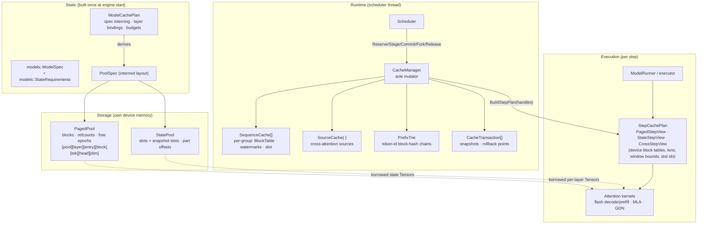
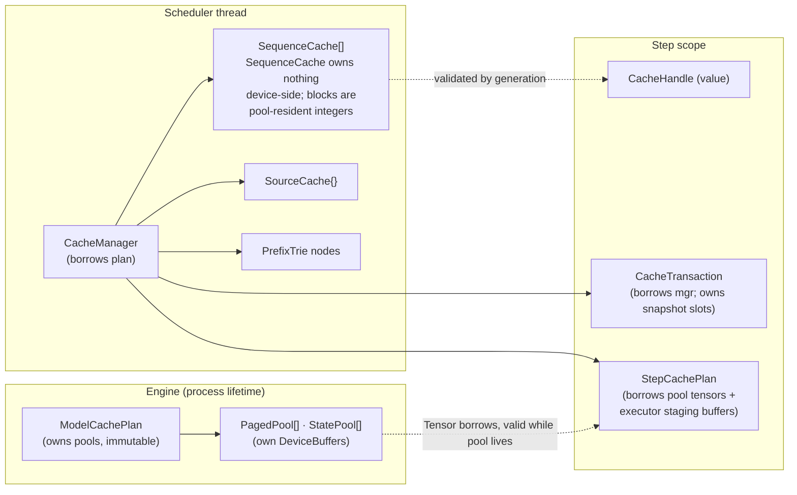
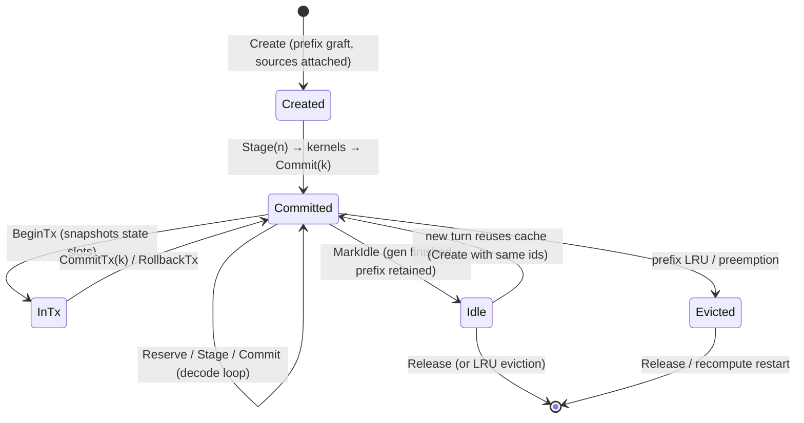
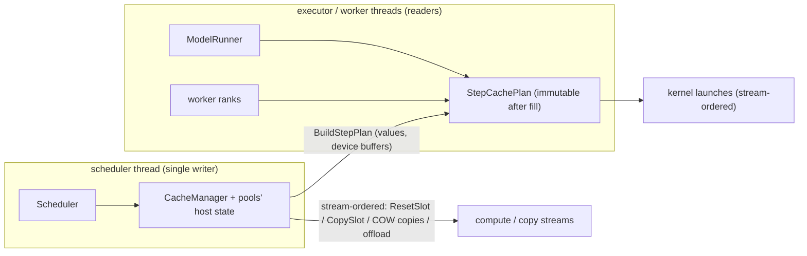

# Unified cache architecture

Status: architecture proposal, validated against vLLM and SGLang use cases
(Part II, §17–§21). This document specifies the cache
layer that replaces the current v0 components (`KvBlockPool`, `CacheManager`,
`RecurrentStatePool`, `BlockTable` in `include/inferx/cache/`) with a single
unified design. Section 15 maps each phase onto the existing code. No
implementation files accompany this document.

The design is self-contained: every type named here is defined here. It assumes
the repository's existing primitives — `StatusOr`/`Status`
(`inferx/core/status.h`), `Tensor` (`inferx/core/tensor.h`), `DeviceBuffer`
(`inferx/core/device_buffer.h`), `DataType` (`inferx/core/dtype.h`),
`Stream`/`DeviceEvent` (`inferx/core/stream.h`), `ops::OpContext`
(`inferx/ops/op_context.h`) — and the project conventions they carry: one
device allocation per pool at startup, no `cudaMalloc`/`cudaFree` in
the steady state, the scheduler as the sole allocator thread, and plain dense
`Tensor`s handed to kernels.

---

## 1. Design goals and constraints

### 1.1 Goals

1. **One architecture for every attention family.** MHA/GQA/MQA, sliding
   window, chunked-local, R-SWA, MLA (absorbed and decompressed), cross
   attention, bidirectional packs, sparse/DSA, linear attention, and
   Mamba-style SSM layers are all served by two storage families and one
   manager. No per-attention cache subsystems.
2. **Prefix caching, continuous batching, speculative decoding, and hybrid
   models as first-class citizens**, not bolt-ons.
3. **Low CPU overhead.** The scheduler path per step must be O(active
   sequences + new blocks), with no device synchronization and no pointer
   chasing per token.
4. **Kernel-friendly storage.** Every cache a kernel reads is a dense,
   statically-shaped `Tensor` plus an `int32` block table — the shape contract
   the existing flash-attention and GDN kernels already assume
   (`StepViews` in `include/inferx/engine/types.h`).
5. **Safe under asynchronous CUDA execution**: block reuse, slot reset, and
   prefix eviction never race with in-flight kernels.
6. **Bounded, predictable memory**: fixed blocks, fixed slots, sized once at
   startup, zero steady-state fragmentation.

### 1.2 Constraints (inherited from the engine)

- The scheduler is single-threaded and is the only mutator of cache metadata
  (`docs/cache_manager.md` §Execution contract). The design keeps that rule;
  concurrency is addressed by topology, not locks (§11).
- Tensor parallelism: rank 0's manager decides logical block IDs; all ranks
  apply identical decisions against their own rank-local storage (existing
  new-request/block-delta protocol). The cache layer must stay deterministic
  given the same request sequence.
- CUDA-graph decode requires device buffers at fixed addresses, refilled
  before replay; block tables are one `int32` indirection level, no deeper.
- `block_size` is a global constant (16) shared by all pools in v1; kernels
  and graph buckets are compiled against it.

### 1.3 Non-goals (v1)

- CPU offload of recurrent state beyond whole-slot swap (design hook only, §6.6).
- Distributed / remote KV through the provider ABI. That is the separate
  `docs/kvcache_plan.md` track; the pool interface here is the seam it binds
  to.
- Multi-level page tables, token-granularity COW, and page-fault-driven
  offload. Rejected in §12.

---

## 2. Core architectural principles

### 2.1 The six distinctions the type system must encode

| # | Distinction | How the design encodes it |
|---|---|---|
| 1 | **Static configuration vs runtime state** | `CacheSpec`/`PoolSpec`/`ModelCachePlan` are immutable after engine start; `SequenceCache`/`SourceCache`/`CacheTransaction` are per-request runtime state. The two never share structs. |
| 2 | **Logical positions vs physical addresses** | Kernels and callers use logical token positions; `BlockTable` maps position ranges to `BlockId`s; pools map `BlockId` to device memory. Two indirections, each owned by one layer. |
| 3 | **Cache visibility vs physical retention** | `committed_len` (published tokens) and the retention mask define what kernels may read; which blocks are *resident* is a separate, larger set (staged blocks, not-yet-evicted window blocks, idle prefix blocks). Eviction acts only on the difference (§7.8). |
| 4 | **Memory ownership vs kernel views** | Pools own `DeviceBuffer`s for their lifetime. Kernels receive borrowed `Tensor`s and per-step materialized views (`StepCachePlan`) that are valid until the next step's fill. |
| 5 | **Append-only vs mutable state** | `CacheDataKind::KVTensors`/`LatentVector`/`SparseIndex` are append-only and shareable; `RecurrentState` is mutated in place per step, is single-owner, and needs snapshots for fork/rollback. Different `AppendSemantics`, different pool family, different transaction rules. |
| 6 | **Sequence-scoped vs source-scoped** | `ScopeKind::Sequence` caches follow the request's token timeline; `ScopeKind::Source` caches (cross attention) are published once per encoder source and shared by reference across requests (`SourceCache`). |

### 2.2 Disposition of the candidate abstractions

The task brief offered eleven candidate names. The final architecture keeps
eight, merges two, and deletes one:

| Candidate | Decision | Why |
|---|---|---|
| `CacheSpec` | **Keep** — immutable, value-interned | Static per-cache semantics; deduplicated so layers with identical specs share one runtime group and one block table per sequence. |
| `PoolSpec` + `CachePool` (from *CacheStorage* + *MemoryPool*) | **Merge into one concept** | Storage layout and physical allocation are the same concern. Two concrete pools (`PagedPool`, `StatePool`) behind a minimal base. |
| `CacheManager` | **Keep** — sole runtime mutator | Owns sequences, sources, prefix index, transactions; the scheduler-facing API. |
| `BlockTable` | **Keep** — generalized to segments | Host-side logical→physical map; segments make sliding-window and R-SWA eviction representable without rings. |
| `RetentionPolicy` | **Delete as a type** | Retention is *data* (a `RetentionKind` + parameters on `CacheSpec`) evaluated by one pure function, not polymorphic behavior. A virtual policy hierarchy would add indirection to the hottest bookkeeping path and buy nothing: policies never gain new methods, only new parameters (§12). |
| `CacheView` | **Keep** as per-step materialized views | Non-owning kernel inputs built once per step (`StepCachePlan`), never persistent metadata. |
| `ModelCachePlan` | **Keep** | The static composition root: spec interning, layer bindings, pool construction, cross-pool budgeting. |
| `SequenceCache` | **Keep** | Per-sequence runtime state across all cache groups; the thing a `CacheHandle` names. |
| `CacheTransaction` | **Keep** — RAII | Rollback points for speculative decoding and fork; only object allowed to hold snapshots. |
| `CacheHandle` | **Keep** as a tiny value type | `{SeqId, generation}` — copyable, non-owning, validated by the manager; detects use-after-release. Not a pointer. |

### 2.3 Principles

1. **Semantics and storage are interned separately.** `CacheSpec` (semantics)
   and `PoolSpec` (geometry) are each deduplicated by value. Layers sharing a
   *spec* share a runtime group and one block table per sequence. Specs
   sharing a *pool* (identical geometry, different retention — e.g. full
   GQA and sliding-window GQA) share one physical free list, which saves
   per-pool headroom in hybrid models.
2. **Retention is a pure function, eviction is a policy.**
   `ResidentPositions(spec, committed_len)` answers "which logical positions
   *may* stay resident"; the manager frees the complement only under pressure
   or eagerly for windows. Visibility is a third question answered by
   `VisibleFrom(spec, committed_len)` for kernels.
3. **Everything an append-only cache writes beyond `committed_len` is private.**
   Staged (uncommitted) tokens live in blocks with refcount 1. Publication
   happens only at `Commit`, only at full-block granularity for sharing.
   This one rule makes speculative rollback, COW, and prefix sharing safe by
   construction.
4. **Mutable state caches never share storage.** Slots are single-owner;
   fork and rollback are physical copies (snapshots), never handle aliases.
5. **The manager never touches device memory contents.** It moves integers.
   All device traffic (resets, snapshots, table fills) is stream-ordered work
   issued through the executor's `OpContext`.
6. **No sync in the steady state.** Prefix identity is computed from token
   IDs on the host; block reuse is gated by recorded events, queried
   non-blockingly (§11.2).

---

## 3. Overall architecture



Component responsibilities in one line each:

- **`ModelCachePlan`** — built from `models::ModelSpec`; owns all pools;
  answers "which layers use which cache groups".
- **`PagedPool`** — one device allocation of fixed blocks for one geometry;
  block refcounts; epoch-safe free list; optional host mirror (§6.6).
- **`StatePool`** — one device allocation of fixed slots for one state
  geometry (conv ring + SSM matrix + scalars), plus reserved snapshot slots.
- **`CacheManager`** — the only object that mutates cache metadata; owns
  sequence caches, source caches, the prefix trie, and open transactions.
- **`StepCachePlan`** — per-step, immutable after fill; everything kernels
  read except the pool tensors themselves.

---

## 4. C++20 type definitions

Namespace `inferx::cache`. Snippets elide some private members; everything
shown is the contract. C++20 features used: designated initializers,
`std::variant`, `std::optional`, `absl::Span`/`absl::InlinedVector` (the
project's containers; `std::` equivalents are drop-in), defaulted comparison
for interning, `enum class` with explicit underlying types.

### 4.1 Fundamental ids and enums

```cpp
namespace inferx::cache {

using SeqId = uint64_t;      ///< Request/sequence identity (engine request id).
using SourceId = uint64_t;   ///< Cross-attention source identity (server-assigned).
using SnapshotRef = uint64_t;  ///< Id of a state snapshot owned by a transaction.

/// Interned index into ModelCachePlan::specs. Opaque; ordered by first use.
enum class SpecId : uint16_t { kInvalid = 0xFFFF };
/// Interned index into ModelCachePlan::pools.
enum class PoolId : uint16_t { kInvalid = 0xFFFF };
/// Block index within a PagedPool. Valid for every layer region of that pool.
enum class BlockId : int32_t { kInvalid = -1 };
/// Slot index within a StatePool.
enum class SlotId : int32_t { kInvalid = -1 };

inline uint16_t to_u16(SpecId s) { return static_cast<uint16_t>(s); }
inline uint16_t to_u16(PoolId p) { return static_cast<uint16_t>(p); }
inline int32_t  to_i32(BlockId b) { return static_cast<int32_t>(b); }
inline int32_t  to_i32(SlotId s) { return static_cast<int32_t>(s); }

/// What is stored per unit (token or sequence). Selects the pool family and
/// the transaction rules; it never changes after startup.
enum class CacheDataKind : uint8_t {
  KVTensors,       ///< Per-token K and V tensors (MHA/GQA/MQA/SW/chunk/R-SWA/cross/bidi).
  LatentVector,    ///< One per-token latent (MLA absorbed: kv_lora+rope; DSA compressed KV).
  SparseIndex,     ///< Per-token top-k selected positions (DSA indexer output).
  RecurrentState,  ///< Per-sequence mutable state (linear attention, Mamba: conv+SSM).
};

/// Which token positions must remain *resident* (physical retention).
/// Evaluated by ResidentLength()/ResidentRanges(); never by kernels.
enum class RetentionKind : uint8_t {
  Full,           ///< Everything: MHA/GQA/MQA, MLA, bidirectional.
  Sliding,        ///< Last `window` tokens (sliding window).
  ChunkBoundary,  ///< Current chunk + boundary blocks of past chunks (chunked local).
  PrefixWindow,   ///< First `prefix_len` + last `window` tokens (R-SWA).
  SourceLifetime, ///< Whole source while referenced (cross attention).
  Stateful,       ///< Not position-based: one state slot per sequence.
};

/// Whose token timeline the cache follows.
enum class ScopeKind : uint8_t { Sequence, Source };

/// How cached data may be written. This is the append-only vs mutable divide.
enum class AppendSemantics : uint8_t {
  TokenAppend,  ///< Causal autoregressive: token t's entry depends only on tokens <= t.
  PackWrite,    ///< One-shot whole-pack writes; a pack's entries depend on the whole
                ///< pack (bidirectional). Appending into a sealed pack is an error.
  Once,         ///< Written once, immutable afterwards (encoder source KV).
  UpdateInPlace ///< In-place state update each step (recurrent). Destructive.
};

/// Where a block's bytes currently live (offload tiering, §6.6; v1 = Device).
enum class Residency : uint8_t { Device, Host, InTransit };

/// One cache group = one interned CacheSpec. `kMaxCacheGroups` bounds the
/// per-sequence state array; 8 covers any hybrid in scope (KV/latent/index
/// per-layer families + state + cross).
inline constexpr int kMaxCacheGroups = 8;
/// Default tokens per block. Block size is per pool (`PoolSpec::block_size`):
/// MLA-class latent pools must use 64 because FlashMLA-family kernels page
/// the cache in 64-token blocks — the same constraint that makes vLLM size
/// MLA caches at block size 64 (validation §18, revision R1).
inline constexpr int64_t kDefaultBlockSize = 16;
```

`SparseIndex` and `LatentVector` reuse the token layout struct below with
different parameters — the pool never interprets entries (§4.2).

### 4.2 Static layout specs

```cpp
/// Per-token geometry of a paged cache. Extends the existing KvLayout
/// (include/inferx/cache/kv_block_pool.h); entries_per_token already
/// generalizes K+V (2) vs an MLA latent (1).
struct TokenLayout {
  int64_t entries_per_token = 2;  ///< 2 = K,V; 1 = latent or index vector.
  int64_t heads = 0;              ///< KV heads on this rank (1 for latent/index).
  int64_t width = 0;              ///< Per-head dim; head_dim, lora+rope, or top-k.
  DataType dtype = DataType::kBFloat16;

  int64_t ElementsPerToken() const { return entries_per_token * heads * width; }
  int64_t BytesPerToken() const { return DataTypeByteSize(dtype, ElementsPerToken()); }
  bool operator==(const TokenLayout&) const = default;  ///< interning key
};

/// One named part of a recurrent state slot. Kernels interpret parts; the
/// pool only sums sizes and computes offsets.
enum class StatePartKind : uint8_t {
  ConvRing,   ///< Causal-conv input ring [channels, kernel-1] (GDN, Mamba).
  SsmState,   ///< Recurrent matrix [vh, dk, dv] (GDN) or [n_groups, d_state, d_inner] (Mamba).
  Scalars,    ///< Trailing per-slot scalars (e.g. Mamba time-step index), fp32 rows.
};

struct StatePartSpec {
  StatePartKind kind;
  DataType dtype = DataType::kFloat32;
  int64_t rows = 0;   ///< Leading per-slot dimension (channels / value heads / groups).
  int64_t cols = 0;   ///< Trailing product of remaining dims (kernel-1, dk*dv, ...).
  int64_t NumElements() const { return rows * cols; }
};

/// Fixed geometry of one recurrent-state slot. Sum of parts = slot bytes.
struct StateLayout {
  std::vector<StatePartSpec> parts;  ///< Conv ring first (hot per step), then SSM.
  int64_t SlotElements() const;      ///< sum of parts[i].NumElements()
  size_t SlotBytes() const { return DataTypeByteSize(DataType::kFloat32, SlotElements()); }
  bool operator==(const StateLayout&) const = default;  ///< interning key
};

/// Storage family selector — the only thing pools need to know.
struct PoolSpec {
  enum class Family : uint8_t { Paged, State };
  Family family = Family::Paged;
  TokenLayout token;   ///< when family == Paged
  StateLayout state;   ///< when family == State
  /// Tokens per block (Paged only; power of two). Default 16; MLA-class
  /// latent pools use 64 for FlashMLA-family kernel paging (§18 R1). Part
  /// of the interning key: same geometry, different page size = different
  /// pool, because kernels and device tables are compiled per page size.
  int64_t block_size = kDefaultBlockSize;
  bool operator==(const PoolSpec&) const = default;  ///< interning key
};
```

### 4.3 `CacheSpec` — static semantics of one cache group

```cpp
/// Immutable description of one cache group. Value-interned by
/// ModelCachePlan; SpecId indexes the interned table. Layers bound to the
/// same spec share one runtime group: one BlockTable per sequence, one
/// committed watermark, one publication unit.
struct CacheSpec {
  std::string name;             ///< Diagnostic, e.g. "gqa.full", "mla.latent", "gdn.state".

  PoolId pool = PoolId::kInvalid;  ///< Storage (interned geometry).

  CacheDataKind data = CacheDataKind::KVTensors;
  ScopeKind scope = ScopeKind::Sequence;
  RetentionKind retention = RetentionKind::Full;
  AppendSemantics append = AppendSemantics::TokenAppend;

  // Retention parameters (read only when the matching RetentionKind is set).
  int64_t window = 0;        ///< Sliding / PrefixWindow: recent-window tokens.
  int64_t prefix_len = 0;    ///< PrefixWindow: preserved prefill prefix tokens.
  int64_t chunk = 0;         ///< ChunkBoundary: chunk length in tokens.

  /// True when prefix sharing may publish/graft this group's blocks
  /// (TokenAppend + Sequence scope only). Sliding-window groups may set
  /// this too: their published blocks stay graftable only while resident,
  /// and window trimming caps that group's graft boundary (§7.7, §18 R7).
  bool prefix_shareable = false;

  /// Stateful groups only: publish a slot snapshot into the prefix trie at
  /// every `state_snapshot_interval` committed tokens, so hybrid models can
  /// graft without replaying (SGLang MambaRadixCache precedent; §18 R7).
  /// 0 disables. Typical: 512 — snapshots are real slot copies, so the
  /// interval trades state-pool memory for hybrid prefix reuse.
  int64_t state_snapshot_interval = 0;

  /// True when the group needs a per-token device block table in the step
  /// plan (all paged, sequence-scoped kinds).
  bool IsPaged() const {
    return scope == ScopeKind::Sequence && data != CacheDataKind::RecurrentState;
  }
  bool IsStateful() const { return data == CacheDataKind::RecurrentState; }
};
```

*Why it exists:* it is the single place a new attention type registers its
needs. Adding a cache kind = a new `CacheDataKind` (rare) or, much more
commonly, a new combination of the existing fields (always).
*Ownership:* `ModelCachePlan`, immutable, shared by all threads.
*CPU/GPU:* host-only value type.
*Performance:* `sizeof` ≈ 80 bytes; looked up once per manager call, never in
kernels.

### 4.4 `ModelCachePlan` — static plan and pool composition root

```cpp
/// Which cache groups one model layer uses. Almost always one entry; DSA
/// layers use two (latent KV + sparse index), which is why it is a vector.
using LayerBinding = absl::InlinedVector<SpecId, 2>;

/// Built once at engine start from models::ModelSpec + CacheConfig; owns all
/// pools; never mutated afterwards. All runtime objects borrow it.
class ModelCachePlan {
 public:
  /// Interns specs and pool specs, partitions the memory budget across pools
  /// (§6.5), allocates all device memory in one pass. Deterministic: same
  /// ModelSpec + CacheConfig => same plan, on every rank.
  static StatusOr<ModelCachePlan> Build(const models::ModelSpec& model,
                                        const CacheConfig& config, Device device);

  const std::vector<CacheSpec>& specs() const { return specs_; }
  const std::vector<LayerBinding>& layers() const { return layers_; }  ///< per model layer
  SpecId SpecAt(int layer, int nth = 0) const;       ///< convenience for the 1-group case

  /// Every distinct spec used by any layer, in first-use order. The runtime
  /// group array of a SequenceCache is indexed exactly by this.
  absl::Span<const SpecId> ActiveGroups() const;

  CachePool* PoolFor(SpecId spec) const;   ///< specs_[i].pool -> pools[]
  PagedPool* PagedPoolFor(SpecId spec) const;
  StatePool* StatePoolFor(SpecId spec) const;

  int64_t num_layers() const;
  int64_t TokensCapacity() const;  ///< min over paged pools of blocks×block_size
  CacheStats Stats() const;        ///< aggregates pool stats

 private:
  std::vector<CacheSpec> specs_;               ///< interned (unique by value)
  std::vector<LayerBinding> layers_;           ///< model layer -> specs
  std::vector<std::unique_ptr<CachePool>> pools_;  ///< interned by PoolSpec
};
```

*Why it exists:* it is the answer to "which layers use which caches" and the
single place cross-pool budgeting happens; without it, every runner would
re-derive pool sizing. It also keeps `models::ModelSpec` free of engine
concerns: the model layer already declares *geometry*
(`models::StateRequirements`); the plan translates geometry + engine config
into semantics and storage.

### 4.5 Pools

```cpp
/// Minimal common interface for heterogeneous ownership, stats, and teardown.
/// Virtual dispatch happens once per step (stats, reclaim), never per block,
/// so the vtable cost is irrelevant; the base exists so CacheManager and
/// ModelCachePlan can hold `vector<unique_ptr<CachePool>>`.
class CachePool {
 public:
  virtual ~CachePool() = default;
  PoolSpec::Family family() const { return family_; }
  PoolId id() const { return id_; }
  virtual int64_t FreeUnits() const = 0;    ///< blocks or slots
  virtual int64_t TotalUnits() const = 0;
  virtual size_t Bytes() const = 0;
  virtual void Reclaim() = 0;               ///< §11.2: retire expired epoch frees.
 protected:
  explicit CachePool(PoolSpec::Family f) : family_(f) {}
  PoolSpec::Family family_;
  PoolId id_ = PoolId::kInvalid;
};

/// Fixed-size block pool for one TokenLayout across N sharing layers.
///
/// Device layout (one allocation, never grown, never freed):
///
///     [layer 0: entry K blocks | entry V blocks][layer 1: ...]...
///     entry-major within a layer: kv[layer][entry][block][tok][head][dim]
///
/// Entries outside a layer's region keep K contiguous across blocks and V
/// contiguous across blocks (the streaming pattern attention reads), matching
/// the existing KvBlockPool layout so current kernels work unchanged.
///
/// A BlockId is valid simultaneously in *every* layer region of this pool:
/// one id addresses a (layer, block) row, which is why one block table per
/// sequence serves all layers sharing the pool.
///
/// Thread model: mutated only by the scheduler thread (via CacheManager).
/// Not copyable; moves invalidate Tensor borrowings.
class PagedPool final : public CachePool {
 public:
  static StatusOr<std::unique_ptr<PagedPool>> Create(PoolId id,
      const TokenLayout& layout, int64_t num_sharing_layers, int64_t num_blocks,
      Device device);

  // -- Allocation (scheduler thread only) ---------------------------------
  StatusOr<BlockId> Alloc();                       ///< or ResourceExhausted
  void Free(BlockId b, DeviceEvent epoch);         ///< refcount already 0; retires via epoch
  void IncRef(BlockId b);                          ///< prefix graft / fork
  void DecRef(BlockId b, DeviceEvent epoch);       ///< to 0 => Free()
  uint32_t RefCount(BlockId b) const;

  // -- Kernel access (borrowed; pool must outlive) -------------------------
  /// K (or entry-0) region of one sharing layer:
  /// [num_blocks, block_size, heads, width]. For latent/index pools there is
  /// one entry; EntryCache(layer, 0) is the whole region.
  StatusOr<Tensor> EntryCache(int64_t sharing_index, int entry /*0=K,1=V*/) const;
  StatusOr<Tensor> KeyCache(int64_t sharing_index) const;    ///< EntryCache(i, 0)
  StatusOr<Tensor> ValueCache(int64_t sharing_index) const;  ///< EntryCache(i, 1)

  int64_t num_blocks() const;
  int64_t num_sharing_layers() const;
  int64_t block_size() const;                     ///< from PoolSpec (§18 R1)
  const TokenLayout& layout() const;
  int64_t BlocksForTokens(int64_t tokens) const;  ///< ceil(tokens / block_size())

  // -- Offload tiering (§6.6; v1 stubs returning Unimplemented) ------------
  Status Offload(absl::Span<const BlockId> cold_blocks, Stream copy_stream);
  Status Restore(absl::Span<const BlockId> blocks, Stream copy_stream);
  Residency residency(BlockId b) const;

 private:
  DeviceBuffer storage_;
  TokenLayout layout_;
  int64_t num_sharing_layers_ = 0, num_blocks_ = 0;
  std::vector<uint32_t> refcount_;      ///< SoA, one per block; 0 = free/retired
  std::vector<Residency> residency_;    ///< v1: all Device
  std::vector<BlockId> free_list_;      ///< LIFO (L2-warm reuse), no sync needed
  struct Epoch { DeviceEvent event; std::vector<BlockId> blocks; };
  std::deque<Epoch> retired_;           ///< §11.2
  Device device_;
};

/// Fixed-slot pool for one StateLayout, including reserved snapshot slots.
///
/// Layout: [part 0 of slot 0..S-1 | part 1 of slot 0..S-1 | ...] — parts are
/// contiguous per part across slots so a whole-batch snapshot or reset for a
/// step touches S-sized contiguous ranges per part (coalesced copies), and so
/// kernels addressing `state[part][slot, row, col]` get plain dense Tensors
/// (exactly the contract of GdnRecurrent / GdnCausalConv today).
///
/// Slots [0, max_live) serve sequences; [max_live, max_slots) are snapshot
/// slots handed to transactions. Reset and snapshot are stream-ordered
/// device work, never host writes.
class StatePool final : public CachePool {
 public:
  static StatusOr<std::unique_ptr<StatePool>> Create(PoolId id,
      const StateLayout& layout, int64_t num_sharing_layers, int64_t max_live,
      int64_t max_snapshot_slots, Device device);

  // -- Slot lifecycle (scheduler thread only) ------------------------------
  StatusOr<SlotId> Acquire();             ///< live slot; caller must ResetSlot first
  void Release(SlotId s, DeviceEvent epoch);
  /// Snapshot slots serve two callers from one reserved region: open
  /// transactions (§10) and published trie snapshots (§7.7, §18 R7). The
  /// budget split between the two is explicit at plan-build time — leaving
  /// it implicit is how SGLang issue #29034 double-allocated mamba memory.
  SlotId AcquireSnapshotSlot();           ///< either caller; no reset needed
  void ReleaseSnapshotSlot(SlotId s);

  // -- Stream-ordered device work (issued via the step's OpContext) --------
  /// Zeroes every part of slot s on `stream`. Fresh sequences must start from
  /// zero state; paged caches need no reset (fully overwritten).
  Status ResetSlot(ops::OpContext& ctx, SlotId s);
  /// dst <- src, all parts, both layers-sharing regions, device-to-device.
  /// This is Fork and snapshot-restore; it is a copy, never an alias.
  Status CopySlot(ops::OpContext& ctx, SlotId dst, SlotId src);

  // -- Kernel access -------------------------------------------------------
  /// Part region across all live slots: [max_live, rows, cols] (+ layer dim
  /// internally when num_sharing_layers > 1; see sharing_index overloads).
  StatusOr<Tensor> PartTensor(int64_t sharing_index, StatePartKind part) const;
  int64_t PartOffsetBytes(const StatePartSpec& part) const;

  int64_t max_live() const, max_slots() const;
  const StateLayout& layout() const;
  int64_t FreeLive() const;

 private:
  DeviceBuffer storage_;
  StateLayout layout_;
  int64_t num_sharing_layers_ = 0, max_live_ = 0, max_slots_ = 0;
  std::vector<int64_t> part_offsets_;
  std::vector<SlotId> free_live_, free_snapshots_;
  std::deque<Epoch> retired_;  ///< same epoch mechanism as PagedPool
  Device device_;
};
```

*Why two concrete pools and not one:* the two families differ in every
operation that matters — blocks are refcounted, shared, and append-only;
slots are exclusive and destructive. Forcing them through one interface
produces either a fat interface of half-meaningful methods or runtime
checks. The manager switches on `CacheDataKind`/`PoolSpec::Family` exactly
where it already knows the kind (it has the `CacheSpec`), so no dispatch is
added — a `std::variant` would be artificial here because the pool set is
open to future families (e.g. an offload-backed pool) and the base interface
(stats, reclaim, teardown) is genuinely shared.

### 4.6 `BlockTable` — logical→physical map with segments

```cpp
/// A contiguous run of blocks covering logical positions
/// [logical_start, logical_start + blocks.size() × the pool's block_size).
struct BlockSegment {
  int64_t logical_start = 0;                 ///< token position of blocks[0].
  absl::InlinedVector<int32_t, 24> blocks;   ///< BlockIds, logical order.
};

/// Per-sequence, per-group mapping from token positions to pool blocks.
/// Host-only metadata; kernels never see segments — BuildStepPlan flattens
/// the visible range into the dense device table.
///
/// Segment count in practice: 1 (normal), 2 (R-SWA prefix+window after the
/// middle was evicted; sliding window before compaction). The manager
/// compacts adjacent segments whenever eviction leaves them touching.
class BlockTable {
 public:
  /// \param block_size The owning pool's block size; fixes all position math.
  explicit BlockTable(int64_t block_size) : block_size_(block_size) {}

  /// Appends a block covering the next `block_size` positions.
  void Append(BlockId b);
  /// Ensures the table covers exactly `tokens` capacity: appends or
  /// returns tail blocks (caller frees). Returns freed ids.
  absl::InlinedVector<int32_t, 8> ResizeTo(int64_t tokens);
  /// Frees logical positions < keep_from at block granularity (eviction of
  /// out-of-window blocks). Returns freed ids. Never touches a block that
  /// straddles keep_from.
  absl::InlinedVector<int32_t, 8> DropBefore(int64_t keep_from);
  /// Physical block + slot for a position; false when not allocated.
  bool Locate(int64_t pos, BlockId* block, int64_t* slot) const;
  /// Dense ids covering [from_pos, to_pos), copied out for the device table.
  void CopyRange(int64_t from_pos, int64_t to_pos, std::vector<int32_t>* out) const;

  int64_t CapacityTokens() const;
  int64_t FirstPosition() const;   ///< logical_start of segment 0
  absl::Span<const BlockSegment> segments() const;
  bool operator==(const BlockTable&) const = default;  ///< test/diagnostic
 private:
  int64_t block_size_;
  absl::InlinedVector<BlockSegment, 2> segments_;
};
```

*Why segments instead of a flat vector:* sliding-window and R-SWA retention
evict *interior* position ranges (everything between the preserved prefix
and the recent window). With a flat table, eviction means an O(n) front-pop
per step or a ring buffer that breaks prefix sharing and graph-stable
addressing. Segments make eviction O(evicted blocks), keep the normal case
identical to today's flat table, and disappear entirely at the kernel
boundary because `CopyRange` re-densifies.

### 4.7 Runtime sequence state

```cpp
/// Per-group runtime state for paged caches (KV, latent, index, and — via
/// `source` — cross attachments are separate, see CrossGroupState).
struct PagedGroupState {
  SpecId spec = SpecId::kInvalid;
  BlockTable table;                 ///< capacity = table.CapacityTokens()
  int64_t shared_prefix = 0;        ///< tokens whose blocks have refcount > 1
                                     ///< (grafted or forked); COW boundary.
  // No watermark here: committed/staged are sequence-wide (below), because
  // Commit publishes all groups atomically.
};

/// Per-group runtime state for stateful caches.
struct StateGroupState {
  SpecId spec = SpecId::kInvalid;
  SlotId slot = SlotId::kInvalid;   ///< live slot; kInvalid until first Reserve
};

/// Per-group runtime state for source-scoped caches: no local blocks.
struct CrossGroupState {
  SpecId spec = SpecId::kInvalid;
  SourceId source = 0;              ///< borrowed from SourceCache (refcounted)
};

using GroupState = std::variant<PagedGroupState, StateGroupState, CrossGroupState>;

/// Everything the manager tracks for one sequence. Owned by CacheManager;
/// never touched by other threads. `groups` is indexed by position in
/// ModelCachePlan::ActiveGroups() — every sequence has the same shape.
struct SequenceCache {
  SeqId seq = 0;
  uint32_t generation = 0;          ///< bumped on Release; validates handles
  absl::InlinedVector<GroupState, kMaxCacheGroups> groups;

  int64_t committed = 0;            ///< published tokens (all groups, atomically)
  int64_t staged = 0;               ///< tokens in [committed, staged) being computed
  int64_t capacity = 0;             ///< reserved tokens (>= staged >= committed)

  bool idle = false;                ///< finished but retained for prefix reuse
  uint64_t last_use_step = 0;       ///< LRU for prefix eviction / preemption
};
```

*Why the watermarks live on the sequence, not per group:* `Commit` publishes
a token step for *all* groups at once — a token exists for the GQA layers,
the MLA layers, the DSA index, and the Mamba state or not at all. Per-group
watermarks would admit torn states that no kernel could consume. Per-group
state keeps only what genuinely differs: block tables, COW boundaries,
slots, source references.

### 4.8 `SourceCache` — cross-attention sharing unit

```cpp
/// Published, immutable cross-attention cache for one encoder source.
/// Built via CacheManager::CreateSource/SealSource; refcounted by attached
/// sequences plus optional server retention (multi-turn reuse).
struct SourceCache {
  SourceId id = 0;
  SpecId spec = SpecId::kInvalid;
  BlockTable table;                 ///< covers exactly `len` tokens, sealed
  int64_t len = 0;                  ///< source token count
  uint32_t refs = 0;                ///< attached sequences + server retentions
  bool sealed = false;              ///< true after SealSource; no further writes
  uint64_t last_use_step = 0;       ///< LRU among unreferenced sources
};
```

Sources are *not* in the prefix trie: encoder KV depends on the whole source
sequence, and identity is the `SourceId` the server already tracks
(document/version), not a token-prefix relationship.

### 4.9 `CacheHandle`

```cpp
/// Copyable, non-owning reference to a SequenceCache, validated by
/// generation. 16 bytes; passed by value. A stale handle (released sequence)
/// fails manager calls with NotFound rather than corrupting state.
struct CacheHandle {
  SeqId seq = 0;
  uint32_t generation = 0;
  bool operator==(const CacheHandle&) const = default;
};
```

*Why not a pointer:* handles cross the scheduler→executor boundary and live
in request objects; an id + generation detects use-after-release, survives
manager-internal rehashing, and is trivially serializable to worker ranks
(the TP delta protocol carries exactly these ids today).

### 4.10 `CacheManager`

```cpp
/// Attach a new sequence to existing sources (cross-attention groups).
struct SourceAttachment { SpecId spec; SourceId source; };

/// Initialization for a new sequence: how much capacity to reserve upfront
/// (prompt length for prefill admission) and which sources to attach.
struct SequenceInit {
  int64_t reserve_tokens = 0;
  absl::Span<const SourceAttachment> sources;  ///< may be empty
  PrefixKey prefix;  ///< Chain seed; domain-separated (§7.7, §18 R2). Default = base.
};

/// The sole mutator of runtime cache state. Single-threaded by contract:
/// called only from the scheduler thread (the engine loop already
/// serializes Schedule/UpdateFromOutput). All device work it triggers is
/// stream-ordered via the executor's OpContext.
class CacheManager {
 public:
  CacheManager(const ModelCachePlan* plan, Device device);  // plan must outlive
  ~CacheManager();                                            // releases everything

  // -- Sequence lifecycle ---------------------------------------------------
  /// Creates the sequence, grafts prefix-cache hits (§7.7 — the graft
  /// length is the minimum over ALL sequence-scoped groups, §18 R7),
  /// reserves capacity across all groups (all-or-nothing), attaches
  /// sources. A full-prompt hit rewinds one token so the first step still
  /// produces logits (vLLM-documented behavior). On ResourceExhausted the
  /// sequence is not created.
  StatusOr<CacheHandle> Create(SeqId seq, const SequenceInit& init,
                               absl::Span<const TokenId> prompt_ids);
  Status Release(CacheHandle h);                 ///< frees blocks/slots; idempotent
  void MarkIdle(SeqId seq);                      ///< finished; keep for prefix reuse

  // -- Capacity / staging / commit -------------------------------------------
  /// Grows capacity to target_tokens in every group, all-or-nothing (v0
  /// semantics preserved). Smaller targets never shrink.
  Status Reserve(CacheHandle h, int64_t target_tokens);
  /// Declares that [committed, committed + n) is about to be computed.
  /// Requires capacity; COWs any shared partial block at the write boundary
  /// (§7.4); snapshots nothing (state groups update in place).
  Status Stage(CacheHandle h, int64_t n);
  /// Publishes k of the staged tokens (k <= staged - committed), advancing
  /// `committed` atomically across all groups; publishes newly-full blocks
  /// to the prefix trie. Unpublished staged tokens remain allocated but
  /// invisible; their blocks stay private.
  Status Commit(CacheHandle h, int64_t k);
  /// Drops staged-but-uncommitted tokens without restoring anything. Valid
  /// for append-only groups by construction; ERROR if any stateful group
  /// would need its updates undone (use a transaction then).
  Status Discard(CacheHandle h);

  // -- Transactions (speculative decoding, beam checkpoints) ------------------
  /// Records a rollback point: saves committed/staged, and for every stateful
  /// group acquires a snapshot slot and issues CopySlot(slot -> snapshot)
  /// on `ctx`'s stream. RAII: destruction without Finish() = Rollback.
  StatusOr<CacheTransaction> BeginTx(CacheHandle h, ops::OpContext& ctx);
  /// == Commit(h, k) + releases snapshots. The single publish point of a
  /// speculative step.
  Status CommitTx(CacheTransaction& tx, int64_t k);
  /// Restores state snapshots (CopySlot back, stream-ordered), truncates
  /// append-only groups to the recorded committed length (staged blocks stay
  /// allocated for reuse; watermarks rewind).
  Status RollbackTx(CacheTransaction& tx);

  // -- Structure operations ----------------------------------------------------
  /// Forks `h`: paged groups share all committed blocks (IncRef, shared_prefix
  /// = committed), stateful groups get a fresh slot + physical CopySlot,
  /// cross groups attach to the same sources. Child starts at parent's
  /// committed length. Copying a handle is NOT a fork (§10.1).
  StatusOr<CacheHandle> Fork(CacheHandle h, SeqId child_id, ops::OpContext& ctx);
  /// Attaches/detaches a sequence to a published source (refcounts).
  Status AttachSource(CacheHandle h, SpecId spec, SourceId source);
  Status DetachSource(CacheHandle h, SpecId spec);

  // -- Source lifecycle (cross attention) ---------------------------------------
  /// Builder pattern: CreateSource reserves blocks; the executor computes the
  /// encoder pass; SealSource publishes immutably. Reserve/Stage/Commit are
  /// illegal on the builder handle after SealSource.
  StatusOr<CacheHandle> CreateSource(SourceId id, SpecId spec, int64_t tokens);
  Status SealSource(CacheHandle builder);
  /// Server-level retention so sources outlive individual requests
  /// (multi-turn reuse); released by RetainSource/LRU under pressure.
  Status RetainSource(SourceId id);
  Status ReleaseSource(SourceId id);

  // -- Step planning (per step, after scheduling decisions) ---------------------
  /// Materializes device block tables, lens, window bounds, and slot ids for
  /// the given active sequences into executor-owned staging buffers
  /// (fixed addresses; graph-safe). Immutable after fill.
  StatusOr<StepCachePlan> BuildStepPlan(absl::Span<const CacheHandle> active,
                                        const StepInput& shape, ops::OpContext& ctx);

  // -- Pressure / reclamation ----------------------------------------------------
  /// Reclaims expired epoch frees (non-blocking event queries), evicts
  /// LRU prefix blocks / idle sources to reach `target_free_blocks` in the
  /// given pool, compacts segment tables. Called at step start.
  Status Reclaim(const ReclaimRequest& req);
  /// Suggests preemption victims: longest idle-first, cheapest-recompute
  /// first (no stateful groups before those with state, shorter context
  /// first). The scheduler decides; the manager only ranks.
  std::vector<SeqId> PreemptionCandidates(int n) const;

  CacheStats Stats() const;
  const ModelCachePlan& plan() const;
};
```

### 4.11 `CacheTransaction`

```cpp
/// Rollback point owned by the caller (scheduler), enforced by the manager.
/// Copy is deleted: exactly one live object per open speculative step.
class CacheTransaction {
 public:
  CacheTransaction(CacheTransaction&&) noexcept;
  ~CacheTransaction();  ///< unfinished => RollbackTx (debug-fatal if manager gone)
  CacheTransaction(const CacheTransaction&) = delete;
  CacheTransaction& operator=(const CacheTransaction&) = delete;

  CacheHandle handle() const;
  int64_t committed_at_begin() const;
  bool finished() const;   ///< true after CommitTx / RollbackTx

 private:
  friend class CacheManager;
  CacheManager* mgr_ = nullptr;
  CacheHandle handle_{};
  int64_t committed_at_begin_ = 0;
  int64_t staged_at_begin_ = 0;
  struct Snap { SpecId spec; SlotId snapshot_slot; };
  absl::InlinedVector<Snap, 2> snapshots_;
};
```

### 4.12 Step views (kernel-facing)

```cpp
/// Kernel inputs for one paged group. All Tensors borrow pool storage or
/// executor staging buffers; valid until the next BuildStepPlan fill.
struct PagedStepView {
  SpecId spec = SpecId::kInvalid;
  int entry_count = 2;                 ///< 2 (K,V) or 1 (latent/index)
  Tensor cache[2];                     ///< per sharing layer is resolved by the
                                       ///< runner via pool->KeyCache(layer);
                                       ///< these are layer-0 aliases for
                                       ///  single-layer-per-spec plans.
  Tensor block_table;   ///< int32 [padded_seqs, stride]: dense ids covering
                        ///< [visible_from, committed) per sequence.
  Tensor seq_lens;      ///< int32 [padded_seqs]: visible token count.
  Tensor visible_from;  ///< int32 [padded_seqs]: first visible logical
                        ///< position (0, or window start; kernels mask).
  Tensor prefix_until;  ///< int32 [padded_seqs]: R-SWA preserved-prefix end
                        ///< (-1 when none); mask = [0,prefix_until) ∪ window.
  Tensor chunk_size;    ///< int32 scalar or per-seq; chunked-local masking.
};

/// Kernel inputs for one stateful group: everything kernels like
/// GdnRecurrent need — slot ids replace block tables entirely.
struct StateStepView {
  SpecId spec = SpecId::kInvalid;
  Tensor slot_ids;      ///< int32 [padded_seqs]: live slot per sequence.
  std::vector<Tensor> parts;  ///< one per StateLayout part, borrowed from the pool.
};

/// Kernel inputs for one cross group: sources are attended whole; rows map
/// sequences to source table rows.
struct CrossStepView {
  SpecId spec = SpecId::kInvalid;
  Tensor block_table;    ///< int32 [sources, stride]: sealed source tables.
  Tensor source_lens;    ///< int32 [sources].
  Tensor source_of_seq;  ///< int32 [padded_seqs]: row into the above.
};

/// Everything the step's kernels read about caches. Built once per step,
/// immutable after fill, destroyed before the next build.
struct StepCachePlan {
  uint64_t step_id = 0;
  std::vector<PagedStepView> paged;    ///< one per active paged group
  std::vector<StateStepView> state;    ///< one per active stateful group
  std::vector<CrossStepView> cross;    ///< one per active cross group
};
```

---

## 5. Ownership and lifetime model



Rules:

1. **Pools outlive everything.** Created by `ModelCachePlan::Build`, destroyed
   at engine shutdown after the final `cudaDeviceSynchronize`. All `Tensor`
   borrowings into views are valid for the pool's lifetime; per-step views
   are additionally valid only until the next `BuildStepPlan` (staging
   buffers are reused), matching `StepViews`' existing contract.
2. **The manager owns all runtime metadata** and is destroyed only after all
   device work completes (its destructor releases every sequence, which
   returns blocks to epoch retirement; a final drain syncs).
3. **`CacheHandle` owns nothing.** Copies are free; validity is checked by
   `(seq, generation)` lookup on every manager call — O(1) hash hit.
4. **`CacheTransaction` owns snapshot slots** for its lifetime and returns
   them on `CommitTx`/`RollbackTx`/destruction. A transaction pins its
   sequence against release.
5. **`SourceCache` lifetime** = max(attached sequences, server retention,
   LRU pressure). Sealed sources are immutable; eviction of an unreferenced
   source is always safe.
6. **Executor threads** see only `StepCachePlan` (immutable) and pool
   `Tensor`s (immutable shapes, mutated contents under stream order). They
   never call the manager.
7. **TP ranks**: each rank runs the full manager logic against its local
   pools with identical inputs, so allocation decisions agree. Rank 0's
   decisions are already broadcast via the block-delta protocol; the manager
   adds no new cross-rank state. (Determinism requirement recorded in §16.)

---

## 6. Physical memory layout and allocation strategy

### 6.1 One allocation per pool, forever

Each pool issues one device allocation at startup (`PagedPool::Create`,
`StatePool::Create`) sized from the budget (§6.5). There is no growth, no
shrink, no `cudaFree` in the steady state — the existing project rule
(`KvBlockPool`'s doc comment): a `cudaFree` implicitly synchronizes and
destroys the overlap pipeline. Exhaustion is handled by reclamation
(§7.8) and preemption (§4.10), never by allocation.

### 6.2 Paged layout

```
PagedPool (one TokenLayout, L sharing layers, B blocks):

  layer 0:  [ K: B × block_size × heads × width ][ V: same ]
  layer 1:  [ K ... ][ V ... ]
  ...
```

- Entry-major (all K blocks of a layer contiguous, then all V): attention
  streams every K of a sequence then every V; this is the existing
  `KvBlockPool` ordering and the reason `KeyCache`/`ValueCache` are plain
  dense 4-D tensors rather than strided views kernels must unpack.
- A `BlockId` b addresses block b of *every* sharing layer — one id, one
  refcount, N layer rows. This is the cross-layer memory planning win: all
  layers bound to specs sharing this pool consume blocks in lockstep, so
  one block table and one refcount serve them.
- No per-block headers on device: block metadata (refcount, residency,
  free/retired) is host-side SoA arrays indexed by id. Kernels see pure
  data.

### 6.3 State layout

```
StatePool (one StateLayout, L sharing layers, S slots):
  part 0 (ConvRing):  [ layer: S × rows × cols ][ layer: ... ]
  part 1 (SsmState):  [ layer: S × rows × cols ][ layer: ... ]
  part 2 (Scalars):   [ ... ]
```

Part-major across slots: a batched snapshot (`CopySlot` for many sequences)
becomes a few large contiguous device-to-device copies per part, and each
kernel-facing part tensor is dense `[slots, rows, cols]` — the exact shape
`GdnRecurrent`'s `state` and `GdnCausalConv`'s `state` take today.

### 6.4 Reference counting and copy-on-write

- `refcount_[b]` (host, `uint32`): number of *logical owners* (sequence
  table entries and trie nodes holding published blocks count as owners).
- Sharing happens in exactly two places: prefix graft (§7.7) and `Fork`
  (§10.1). Both `IncRef` whole blocks only.
- **COW rule:** a sequence may write into block b only while `refcount_[b]
  == 1`. `Stage` checks the boundary block: if the write range starts in a
  shared, partially-filled block, the manager allocates a fresh block,
  issues a device copy of the filled prefix (stream-ordered, one block),
  swaps the table entry, and `DecRef`s the old block. Full shared blocks
  are never written (append starts a new block), so COW cost is bounded at
  one block copy per graft/fork boundary — it happens once, not per token.
- `DecRef` to 0 frees via the epoch mechanism (§11.2), never inline reuse.

### 6.5 Cross-pool budgeting (hybrid models)

`ModelCachePlan::Build` partitions one cache budget (from `CacheConfig`:
explicit bytes, or `gpu_memory_utilization` after profiling weights +
activation peak, minimum across TP ranks — existing semantics) as follows:

1. State pools are sized first: `max_live = scheduler max_running_requests`
   plus `max_snapshot_slots = min(max_live, spec_max_concurrent_snapshots)`
   (default 1 per sequence: one open transaction each). Their bytes are
   independent of context length. The snapshot region is explicitly
   partitioned between open transactions and published trie snapshots
   (`CacheSpec::state_snapshot_interval`, §18 R7), so hybrid deployments
   cannot silently double-allocate state memory — SGLang issue #29034
   documents exactly that failure mode.
2. The remaining budget is split across paged pools **proportional to
   per-token demand** `Σ_layers layout.BytesPerToken()` so that every pool
   reaches the same token capacity:

   `capacity_tokens ≈ budget / Σ_pools (Σ_layers BytesPerToken_pool)`

   then `num_blocks_pool = ceil(capacity_tokens / pool.block_size)`, per
   pool — block sizes may differ across pools (MLA latent 64, GQA 16) without
   affecting the balance, because capacity is measured in tokens, not blocks
   — rounding remainder to the largest-demand pool. Balanced token capacity is
   the correctness-relevant invariant: a token step needs one block (or one
   slot-update) in *every* group, so an unbalanced split would strand memory
   in the over-provisioned pools.
3. Prefix-shareable pools reserve nothing extra — published blocks are
   ordinary allocated blocks; the trie only adds host metadata.

Worked example (the §9 hybrid): 38 GiB paged budget; demands 96 KiB/token
(GQA×24) and 4.5 KiB/token (MLA×4) → split 36.3 : 1.7 GiB → both ≈ 372k
tokens ≈ 23.3k blocks each. State: 256 live + 256 snapshot slots of
8 MiB ≈ 4 GiB. Numbers illustrative; the formula is the contract.

### 6.6 Offload tiering (design now, implement late)

- `PagedPool`: preallocated host mirror; victims are **full, committed,
  refcount ≤ 1, not visible in any active window** blocks (cold prefix
  blocks of idle sequences first). `Offload`/`Restore` are batched
  `cudaMemcpyAsync` on a dedicated copy stream, bracketed by events; block
  `residency_` flips at event completion (polled in `Reclaim`, no sync).
  A block in `Residency::Host` is addressable by id but not by kernels; a
  sequence whose visible range includes host blocks must be restored before
  `BuildStepPlan` includes it (the scheduler treats it as preempted).
- `StatePool`: whole-slot offload for idle sequences (swap-style
  preemption), same mechanism. This is what makes hybrid-model preemption
  affordable: replaying a Mamba layer from token 0 is O(context) compute,
  while a slot restore is one copy.
- v1 ships the interfaces returning `Unimplemented` so pool internals never
  need restructuring when tiering lands.

### 6.7 Fragmentation

There is none by construction: blocks and slots are fixed-size, never split,
never merged; the free list is a vector of ids. The only "fragmentation" is
*capacity slack* — allocated-but-invisible staged blocks and partial tail
blocks — bounded by one partial block (`block_size` tokens) per group per
sequence plus staged tokens, both reclaimed on `Discard`/`Release`.

---

## 7. Cache operations and state transitions

### 7.1 Sequence state machine



### 7.2 The operation set across cache families

| Operation | KVTensors / LatentVector (append-only, paged) | SparseIndex (append-only, paged) | RecurrentState (mutable, slotted) | Cross / Source |
|---|---|---|---|---|
| `Reserve` | allocate blocks to capacity (all-or-nothing across groups) | same blocks math, own pool | acquire slot; `ResetSlot` if new | `CreateSource` reserves source blocks |
| `Stage(n)` | declare write window; COW shared partial block at boundary | same | nothing to declare — update happens in kernel, snapshot happened in `BeginTx` | illegal after `SealSource` |
| write (kernels) | append K/V or latent rows into `[committed, staged)` | indexer writes top-k rows | `GdnRecurrent`-style in-place state update | one-shot encoder write |
| `Commit(k)` | advance watermark; publish newly-full blocks to trie | same, same trie chain | watermark advance; drop snapshots if in tx | `SealSource` |
| `Discard` | rewind staged watermark; blocks stay allocated (garbage, reusable) | same | **error** — needs `RollbackTx` | n/a |
| `RollbackTx` | rewind to `committed_at_begin`; staged blocks stay allocated | same | `CopySlot(snapshot → slot)` stream-ordered, then release snapshot | n/a |
| `Fork` | IncRef committed blocks; COW on next append | same (indices are logical positions — still valid) | **physical `CopySlot` to a new slot** | attach to same source (IncRef) |
| `Evict` | trie LRU of unreferenced full blocks; window-trim old blocks | same via same chain | slot offload (or drop = recompute) | unreferenced source LRU |
| `Release` | DecRef all blocks; retire | same | release slot (retired) | DetachSource (DecRef) |
| `GetView` (`BuildStepPlan`) | dense block table + lens + masks | same, own table | slot ids per sequence | source tables + `source_of_seq` |

### 7.3 Allocate/Reserve — all-or-nothing across groups

`Reserve(h, target)` must grow *every* paged group's block table and keep
state slots valid; failure leaves the sequence exactly as it was (v0
`CacheManager::Reserve` semantics, extended cross-group). Implementation:
compute the per-group block deficit, attempt all `Alloc`s into a scratch
vector, and on any `ResourceExhausted` return the partial ids to the free
list before returning the error. No partial states exist to roll back on
the device because reserve grants *capacity*, never writes.

### 7.4 Stage — the write boundary

`Stage(h, n)` requires `capacity >= committed + n` and does the one
metadata operation that keeps principle 3 true: for each paged group, if
position `committed` falls inside a block with `refcount > 1` (grafted
partial block), perform COW now (§6.4). For `PackWrite` groups it
validates that the pack is being written in one staging window
(`committed == 0` for the pack or the group is untouched), and that no
previous pack is open. Stateful groups need nothing: their in-place update
is covered by the transaction opened before staging (spec decode) or is
linear (normal decode: commit always follows).

### 7.5 Commit — the only publish point

`Commit(h, k)`:

1. Validates `committed + k <= staged`.
2. Atomically sets `committed += k` (one integer, one thread — atomicity is
   by construction; there is no device-side state to make consistent).
3. For every prefix-shareable paged group: for each block that became *full*
   and *committed*, extend the sequence's trie chain (§7.7) and publish
   (the block becomes graftable; its trie node owns one refcount).
4. Stateful groups: nothing (snapshots released by `CommitTx` if a
   transaction is open).

Partial-block residue beyond the accepted prefix of a speculative step
stays allocated and private; the next `Stage` writes over it in place —
no free, no copy.

### 7.6 Rollback — two mechanisms, one transaction

- **Append-only groups:** rewind watermarks only. KV content beyond
  `committed_at_begin` is garbage but harmless: it is unwritten-according-
  to-metadata, blocks are private (principle 3), and the next stage
  overwrites. This is why KV rollback is free.
- **Stateful groups:** in-place updates are destructive, so `BeginTx`
  snapshotted slots; `RollbackTx` issues `CopySlot` back on the compute
  stream *before* the next step's kernels are enqueued — stream order
  guarantees no kernel observes a half-restored state, and no host sync is
  needed. Mamba time-step scalars live in the `Scalars` part precisely so
  they roll back with the matrix, not separately.

### 7.7 Prefix caching (the trie)

```cpp
/// Domain-separated inputs to the prefix chain seed. Each field is hashed
/// behind a distinct domain tag so different semantic sources can never
/// collide — the failure mode vLLM tracks as issue #44701 (LoRA id,
/// multimodal hash, and salt sharing one hash domain).
struct PrefixKey {
  uint64_t adapter_id = 0;    ///< LoRA/adapter identity; 0 = base weights.
  uint64_t content_hash = 0;  ///< Multimodal content hash; 0 = text-only.
  uint64_t salt = 0;          ///< Engine cache salt / tenant tag.
  bool operator==(const PrefixKey&) const = default;
};
```

- **Identity:** a per-sequence chain of block hashes over *token ids*,
  seeded by the typed `PrefixKey`:
  `h_seed = H(tag₁‖adapter_id‖tag₂‖content_hash‖tag₃‖salt)`,
  `h_i = H(h_{i-1} ‖ H(tokens[iB..(i+1)B)))` — one chain shared by *all*
  sequence-scoped groups of the sequence (same tokens ⇒ same chain).
  Host-computed, zero device traffic, zero synchronization. The seed is the
  domain-separated equivalent of vLLM's `extra_hash`, which exists for the
  same reason: the same token ids under different adapters or multimodal
  content do not produce the same KV.
- **Trie:** nodes keyed by `h_i`, each storing `per_group_block[g]` for
  every prefix-shareable group, a last-use stamp, and children
  (`flat_hash_map<uint64_t, Node>`). The root is the empty chain.
- **Graft (`Create`):** walk the prompt's chain while trie nodes exist and
  compute, per group g, the longest boundary L_g where g's published blocks
  (or state snapshot, R7) are still resident. **The granted prefix is
  L = min over ALL sequence-scoped groups.** A group with nothing graftable
  contributes 0 and disables the whole graft: compute starting at L would
  replay tokens [0, L) through that group's layers and rewrite the very
  blocks the other groups just shared, violating publication immutability
  (I3). SGLang's MambaRadixCache arrives at the same rule — every component
  type must "vote" a safe reuse boundary. Granted blocks are `IncRef`ed
  into the new sequence's tables (`shared_prefix = L` per paged group);
  stateful groups with a trie snapshot at L copy it into the sequence's
  live slot. Prompt compute starts at L. A full-prompt hit (L == prompt
  length) rewinds one token and stages it, so the first step still produces
  logits — vLLM documents this exact behavior for whole-prompt hits.
  `shared_prefix` also seeds chunked-prefill and multi-turn reuse (an idle
  sequence's chain *is* its trie path).
- **Publish (`Commit`):** extend/create nodes for newly full committed
  blocks. If another sequence concurrently published the same hash chain
  position (same tokens), the manager keeps the resident blocks and
  `DecRef`s the loser's — deterministic under the single writer.
- **Evict:** LRU over nodes with zero sequence references; `DecRef` their
  blocks (feeds the epoch retire queue). Eviction pressure comes from
  `Reclaim`; idle-sequence blocks are the natural cold tier.
- **Eligibility (`prefix_shareable`):** `TokenAppend`, sequence-scoped,
  causal groups — GQA/MHA KV, MLA latent, DSA index — and, since R7,
  sliding-window groups, whose published blocks remain graftable only
  while resident: window trimming clears the node's blocks and caps that
  group's L_g at the trim boundary. Still excluded: sources (identified by
  `SourceId`, not token prefixes) and bidirectional packs (pack KV is not
  a function of the pack's token prefix). Stateful groups never share
  blocks but publish *snapshots* at `state_snapshot_interval` when enabled
  (R7). Suffix-keyed window matching (SGLang's
  `SlidingWindowRadixCache`) is deliberately deferred: it lifts hybrid
  reuse above the window bound at the cost of a second, position-relative
  key space (§21).

### 7.8 Eviction and reclamation

`Reclaim` (step start, non-blocking):

1. Drain epoch queues whose events have completed → blocks/slots to free
   lists (§11.2).
2. Trim retention: for each active sequence and each group with
   `Sliding`/`PrefixWindow`/`ChunkBoundary` retention, compute
   `ResidentRanges(spec, committed)` and `DropBefore` everything below the
   oldest resident position (block granularity, never a straddling block).
   Compacts adjacent segments.
3. If still below the requested free-block target: evict trie LRU leaves
   (§7.7), then idle unreferenced sources, then return
   `PreemptionCandidates` to the scheduler (which Releases them; stateful
   victims lose slots and must recompute — ranked last).

**Visibility vs retention, concretely:** a sliding-window sequence with
`window=1024, committed=9000` *sees* positions `[7968, 9000)` (kernel mask
via `visible_from`), *must retain* the blocks covering them, and *may
retain* older blocks until pressure (step 2 trims them; step 3 never
touches them because they are already gone). Staged blocks `[9000, staged)`
are invisible to every kernel and untouchable by every eviction path.

### 7.9 Cost summary (per step, N active sequences)

| Path | Work |
|---|---|
| Reserve (decode, +1 token) | ≤ 1 block per group per sequence that crosses a block boundary: amortized `1/16` |
| Stage | O(groups) COW checks, rare block copies |
| Commit | O(newly full blocks) trie extends = `N/16` hash inserts amortized |
| BuildStepPlan | one `CopyRange` + one H2D memcpy per group per step (graph-decode requirement, unavoidable) |
| Reclaim | O(evicted blocks) + non-blocking event polls |

No per-token host work anywhere; no device→host reads ever.

---

## 8. Attention-specific cache mappings

The full matrix. "Structure" names the storage family and `CacheDataKind`;
"Allocate/Write/Access" name the §7.2 row semantics specialized.

| Attention | Structure | Stores | Allocate | Write | Access | Retention/Eviction | Prefix share | Fork | Rollback | Kernel metadata |
|---|---|---|---|---|---|---|---|---|---|---|
| MHA / GQA / MQA | `PagedPool` · `KVTensors` | K,V per token: `entries=2, heads=kv_heads(tp), width=head_dim` | Reserve→blocks | append rows | dense K/V tensors + block table | Full | ✔ trie | ✔ ref+COW | ✔ watermark | `block_table, seq_lens, visible_from=0` |
| Sliding window | `PagedPool` · `KVTensors` | K,V | same | append | same | Sliding: trim `< committed-window` (§7.8) | ✘ (§7.7) | ✔ ref+COW (window blocks) | ✔ | `visible_from` per seq |
| Chunked local | `PagedPool` · `KVTensors` | K,V | same | append | same | ChunkBoundary: keep current chunk + boundary blocks | ✘ | ✔ | ✔ | `chunk_size` (+ boundary mask in kernel) |
| MLA absorbed | `PagedPool` · `LatentVector` | latent `(kv_lora+rope)` per token: `entries=1, heads=1, width=lora+rope` | same | append latent | latent tensor + block table; attention multiplies by absorbed `W_kc/W_vc` in-kernel (MQA-shaped) | Full | ✔ trie | ✔ | ✔ | as GQA, one entry |
| MLA decompressed | `PagedPool` · `KVTensors` | assembled K `(nope+rope)`, V via `AssembleMlaCaches` | same | assemble→append | standard MHA kernels | Full | ✔ (deterministic per token) | ✔ | ✔ | as MHA |
| R-SWA | `PagedPool` · `KVTensors` | K,V | same | append | same | PrefixWindow: keep `[0,prefix_len)` + last `window` → 2 segments | ✔ prefix segment only | ✔ (both segments) | ✔ | `prefix_until` + `visible_from` |
| Cross attention | `PagedPool` · `KVTensors`, `Scope=Source`, `Once` | encoder K,V per source | `CreateSource`→Reserve | one encoder pass | sealed source tables via `source_of_seq` | SourceLifetime: LRU when `refs==0` | by `SourceId` (server retention), not trie | attach (ref) | n/a | `source_of_seq, source_lens` |
| Bidirectional | `PagedPool` · `KVTensors`, `PackWrite` | K,V per pack | Reserve(pack) | one-shot pack write (no partial pack visible) | pack mask (non-causal) then immutable context | Full | ✘ (pack KV ≠ f(prefix)) | ✔ block IncRef (whole packs) | ✘ within pack — see below | pack boundary lens |
| Sparse / DSA latent | `PagedPool` · `LatentVector` | compressed KV latent per token | same as GQA | append | kernel decompresses/attends over latent | Full | ✔ | ✔ | ✔ | as latent |
| Sparse / DSA index | `PagedPool` · `SparseIndex` (`entries=1, heads=1, width=top_k, dtype=int32`) | top-k selected *logical positions* per token | own pool, same blocks math | indexer appends rows | gathered by kernels alongside latent | Full (indices reference positions) | ✔ same trie chain | ✔ indices are positions → valid after fork | ✔ watermark (truncate with KV, same tx) | own block table |
| Linear attention (GDN) | `StatePool` · `RecurrentState` | ConvRing `[ch, k-1]` + SsmState `[vh, dk, dv]` (fp32) | slot + `ResetSlot` | `GdnRecurrent` in-place | `slot_ids` + part tensors | Stateful (slot lifetime = sequence) | ✘ | ✔ **physical copy** | ✔ snapshot restore | `slot_ids, qo_indptr` (existing) |
| Mamba / SSM | `StatePool` · `RecurrentState` | ConvRing + SsmState `[groups, d_state, d_inner]` + `Scalars` (time-step) | slot + reset | in-place scan update | slot-indexed | Stateful | ✘ | ✔ copy (incl. scalars) | ✔ snapshot (atomic across parts) | `slot_ids` |
| Hybrid | `ModelCachePlan` composition | union of the above | per-group, one timeline | per-group | per-group views | per-group | per-group | cross-group atomic | cross-group atomic tx | per-group |

### 8.1 MLA — absorbed vs decompressed

Two specs over (usually) two pools:

- **Absorbed** (target): one latent per token
  (`width = kv_lora_rank + rope_dim`, `entries=1`). Decode kernels treat it
  as MQA of width `lora+rope` and apply the per-layer absorbed projections
  `W_kc`, `W_vc` inside the attention kernel (latent·W before/after the
  PV product — the DeepSeek weight-absorption trick). Memory per token is
  `(lora+rope)·2B` instead of `heads·(nope+rope+v)·2B` — typically 4–6×
  smaller — which is the entire reason prefix caching for MLA is worth it.
- **Decompressed**: `AssembleMlaCaches` (existing op) materializes per-head
  K (rope-slice-first) and padded V, stored as ordinary `KVTensors`.
  Kernels are the standard MHA path; memory is MHA-sized. This is the
  compatibility/fallback mode and the prefill mode for kernels that want
  dense heads.
- The two modes are *different specs on different pools*: a deployment
  picks one per engine start (a model does not mix them for its decoder).
  Both are `TokenAppend` + `Full` + prefix-shareable (KV is a deterministic
  function of token prefix in both), so the trie, fork, and transactions
  treat them identically — the only difference is which kernels read which
  pool.

### 8.2 Sparse / DSA — index ownership, versioning, invalidation

- **Ownership:** index rows are owned by the sequence like KV rows — same
  timeline, same block math, own pool (`int32` entries). The *content* is
  produced by the indexer kernel and interpreted by the sparse attention
  kernel; the cache layer treats rows as opaque integers.
- **Versioning:** rows reference **logical positions**, not block ids, so
  they survive block reassignment (COW, eviction-and-recompute) and forks
  without rewriting. The watermark pair (`committed`) is the version: a
  row for token t is valid iff t < committed.
- **Invalidation:** truncation (`RollbackTx`, `Discard`) rewinds the same
  committed watermark for index and latent groups in one transaction —
  there is no window where KV is rolled back but indices are not, because
  commit/rollback are cross-group atomic (§4.7). Eviction of an index
  block follows the block's refcount like KV.
- **Fork:** indices remain valid in the child (they point at positions the
  child shares). New rows the child appends go to its private blocks.

### 8.3 Mamba / SSM — convolution state, SSM state, snapshots, transactions

- A slot is the atomic unit: `ConvRing` (last `kernel-1` inputs), `SsmState`
  (the recurrent matrix), `Scalars` (time-step counter for models with
  input-dependent dt). A correct fork/rollback restores **all parts
  together** — a conv ring from step t with an SSM matrix from step t' is
  silently wrong, which is why parts live in one slot and one snapshot
  operation.
- **Snapshot:** `BeginTx` acquires a snapshot slot and issues one batched
  `CopySlot` per part across the pool's sharing layers. Restore is the
  reverse copy. Both are stream-ordered; the manager never reads state
  bytes.
- **Transactional update:** normal decode updates in place and commits
  trivially (`k=1`, no snapshot needed — the previous state is dead once
  the step is accepted). Speculative verify updates in place *after*
  `BeginTx`; `CommitTx(k)` releases the snapshot (accepted tokens keep the
  new state), `RollbackTx` restores it. Partial acceptance needs no
  intermediate state: the state after processing tokens `c..c+k` is exactly
  the state of the accepted prefix `c..c+a` because the scan is sequential
  — restoring anything other than the full rollback point is never
  required.
- **Cost honesty:** a snapshot is two slot copies per open transaction.
  For Qwen3-Next-class GDN (32 v-heads, 128×128, fp32) that is ~2 MiB per
  layer; a 24-GDN-layer model snapshots ~48 MiB per speculated sequence per
  step — at ~2 TB/s device bandwidth a few tens of microseconds, paid only
  while speculation is enabled (§13).

### 8.4 Bidirectional attention — why autoregressive append is invalid

In a bidirectional (non-causal) pack, the K/V of position i is a function
of **all** pack tokens, including positions `> i`. Therefore:

1. Appending token t and computing its K/V *changes the K/V of earlier
   positions in the same pack* — an append that leaves earlier entries in
   place computes the wrong attention for every subsequent query.
2. Kernels reading the pack mid-write would see a mask-defined-over-all-
   positions but a half-written cache.

`AppendSemantics::PackWrite` encodes the fix: a bidirectional group is
written in exactly one staging window covering the whole pack, becomes
visible only at `Commit`, and is immutable afterwards. Later causal tokens
(decoding after an infill prefix, or alternating bidirectional/causal
layers) *read* the sealed pack as context — that is valid, because they
only need the pack's final KV, which exists. Fork is block-refcount (whole
packs are immutable). Prefix sharing is disabled because a pack's KV is not
a function of its token prefix. Rollback of a pack = discard the whole
pack's staged tokens (packs are written inside one transaction when
speculation is active).

---

## 9. Hybrid model support

### 9.1 Mechanism

A hybrid model is just a `ModelCachePlan` whose `layers_` bind different
specs (§4.4). Everything downstream is generic:

- **Layer→spec mapping:** `layers_[l]` lists the groups layer l uses. Specs
  are interned; **immutable specifications are shared** by construction
  (one `CacheSpec` object per distinct semantics; layers reference it).
- **Per-layer runtime state:** runtime state is per *sequence per group*,
  not per layer — all layers bound to a spec share the group's block table
  and watermarks (the pool gives one block id N layer rows, §6.2). Layers
  with private geometry (e.g. one GQA layer with different kv_heads) intern
  to a different spec/pool and get their own group.
- **Heterogeneous pools + budgeting:** §6.5.
- **One logical timeline:** `committed` is sequence-wide; a token step
  advances every group together (a Mamba layer's state and a GQA layer's KV
  both correspond to token `committed`). This is the invariant that makes
  hybrid scheduling simple: the scheduler reasons about *tokens*, never
  about per-layer caches.
- **Graft agreement (R7):** hybrid prefix reuse uses the min-over-groups
  rule (§7.7). A sliding-window group caps the graft at its trim boundary;
  a stateful group caps it at its last published snapshot. A Qwen3-Next-
  class model therefore reuses exactly the prefix every layer can consume
  without replaying tokens through any layer.
- **Scheduling compatibility:** a step is schedulable iff every group can
  stage it: `Reserve` checks paged block availability in all groups *and*
  state-slot availability (every live sequence holds its slots for its
  lifetime, so slot admission happens at `Create`). Chunked prefill and
  graph buckets are unchanged: shapes depend on token counts, which are
  group-agnostic.

### 9.2 Worked example — a 32-layer hybrid

Model "HB-32" (Qwen3-Next-flavored, single rank, bf16):

| Layers | Attention | Group spec | Pool (geometry) | Per-token bytes |
|---|---|---|---|---|
| 0–15 | GQA full, kv_heads 8, head_dim 128 | `gqa.full` | P1: `entries=2, heads=8, width=128` | 24 layers × 4096 B = 96 KiB |
| 16–23 | GQA sliding, window 1024, same geometry | `gqa.sw` | **P1 (shared with `gqa.full`)** | — |
| 24–27 | MLA absorbed, lora 512 + rope 64 | `mla.latent` | P2: `entries=1, heads=1, width=576` | 4 × 1152 B = 4.5 KiB |
| 28–31 | Mamba-style GDN (vh 32, dk 128, dv 128, conv k 4) | `gdn.state` | P3: StateLayout{ConvRing, SsmState} | per-slot ≈ 8 MiB (4 layers) |

Notes the example is designed to show:

- `gqa.full` and `gqa.sw` are *different specs, one pool*: layout interning
  gives them a shared free list (no double headroom), while retention,
  eviction, and trie eligibility differ per spec — semantics stay in the
  spec, geometry in the pool.
- The per-sequence state array is exactly 3 groups; layers 0–23 read one
  block table, 24–27 another, 28–31 one slot id each (per layer row of one
  slot).
- Budget (§6.5, illustrative): 42 GiB cache budget → P3 = 256 live + 128
  snapshot slots ≈ 3.1 GiB → 38.9 GiB paged → P1 : P2 ≈ 36.7 : 1.7 GiB →
  ≈ 23k blocks each ≈ 372k tokens capacity, balanced across P1/P2 by
  construction.
- A decode step's plan carries: `PagedStepView(P1)` (visible_from masks
  layers 16–23 — the runner passes the same table with per-layer mask
  parameters), `PagedStepView(P2)`, `StateStepView(P3)`; the trie caches
  the `gqa.full` + `mla.latent` prefixes (not `gqa.sw` beyond the window,
  not `gdn.state`); a speculative step snapshots only P3 slots.

---

## 10. Fork, rollback, and speculative decoding

### 10.1 Fork is not a handle copy

`Fork` (beam search, n-gram/lookup speculation, tree branches) must be
correct per family:

- **Paged groups:** `IncRef` every committed block of the parent; child
  tables copy the parent's segment list; `shared_prefix = committed`.
  The child's *next* append COWs the boundary partial block (§6.4); full
  shared blocks are never written. Fork of a 100k-token parent: O(blocks)
  integer ops ≈ microseconds, zero device work — this is the cheap path,
  and it is cheap *because* principle 3 kept staged blocks private and
  published blocks immutable.
- **Stateful groups:** the parent's slot cannot be aliased — updates are
  in-place and destructive; two sequences writing one slot would corrupt
  both. `Fork` acquires a slot and issues `CopySlot` (one batched
  device copy per part per layer). **This is the case the task brief
  warns about: copying the handle copies nothing that makes the child
  independent.**
- **Cross groups:** attach to the same sources (`IncRef`).
- **Timeline:** child `Create`s at parent's `committed`; both sequences'
  trie paths coincide up to the fork point — later divergent commits
  extend different chain positions (their block hashes differ from the
  first divergent block), so the trie needs no special fork handling.

### 10.2 Speculative decoding end-to-end

Using the engine's K/K+1-anchor convention (`docs/speculative_decode.md`:
K proposed tokens, verification evaluates K+1 input rows):

```
scheduler (per speculated sequence):
  tx   = manager.BeginTx(h, ctx)          # snapshot state slots (stream-ordered)
  manager.Reserve(h, committed + K + 1)   # capacity across all groups
  manager.Stage(h, K + 1)                 # COW boundary blocks if prefix-grafted
  runner: enqueue draft/verify compute     # kernels write KV/latent/index rows
                                           # beyond committed, update state slots
  rejection sampling on device → accepted a ∈ [0..K]
  manager.CommitTx(tx, a + 1)             # publish a+1 (accepted + bonus/corrective)
     or manager.RollbackTx(tx)            # restore snapshots; rewind watermarks
```

Why each piece is safe:

- **KV-only models need no transaction:** with no stateful group,
  `BeginTx` acquires no snapshots (zero cost), and full rejection can use
  `Discard` directly — rollback of an append-only cache is a watermark
  rewind over private blocks (§18 R4). Transactions are load-bearing only
  for destructive state.
- **Partial acceptance:** accepted tokens' KV rows are exactly the rows
  the verify pass wrote (causal, `TokenAppend`); the corrective/bonus
  token's row was computed too (K+1 rows staged). Residue rows stay
  allocated-but-invisible and are overwritten next step — no free, no
  copy, no sync.
- **Atomicity:** all metadata transitions happen on the scheduler thread
  between steps; kernels consume only built plans, so no kernel can
  observe a mid-commit cache. Device-side, snapshot restore is enqueued
  before the next step's kernels on the same stream (§7.6).
- **State groups:** `CommitTx` releases snapshot slots; `RollbackTx`
  copies them back first. Mamba scalars ride along in the slot.
- **Draft-model caches:** a standalone draft model gets its own
  `ModelCachePlan` and manager shard on the same pools' seam — its
  sequences fork/rollback through the identical API. (EAGLE-style
  hidden-state proposers need no draft KV at all; the plan degrades to
  target-only.) Phase-gated per the speculative_decode roadmap.

### 10.3 Rollback of recurrent states — the invariants

1. A state slot is written by at most one step's kernels at a time (stream
   order on one compute stream; multi-stream execution must join before
   `CommitTx` — §11.3).
2. Restore-before-next-read is guaranteed by enqueue order, not by
   synchronization.
3. Snapshot slots are exclusive to one transaction and returned on every
   exit path (RAII).
4. A sequence with an open transaction cannot be Released (transaction
   pins it) — prevents freeing a slot whose snapshot is in flight.
5. `Fork` on a handle with an open transaction is an error (§18 R3): the
   live slot holds uncommitted updates and no committed-state image exists
   to copy. Fork happens between steps.
6. `BeginTx` may fail with `ResourceExhausted` when snapshot slots run
   out; the scheduler degrades that sequence to a plain
   `Reserve/Stage(1)/Commit(1)` step for that round. Speculation is an
   optimization; it never blocks or leaks.

---

## 11. Concurrency and GPU execution

### 11.1 Thread model



- All metadata mutation: scheduler thread only (existing engine rule; kept).
- Executors: read `StepCachePlan` and launch kernels; never call the
  manager. Views are immutable after fill and reused next step — the
  existing `StepViews` lifetime contract.
- Handles are values; no locks on the hot path; the manager needs no
  internal synchronization at all.

### 11.2 Asynchronous block/slot reuse — epoch retirement

Freeing a block whose data a possibly-incomplete kernel is still reading is
the classic paged-cache race. Rule: **a freed unit returns to the free list
only after every stream epoch that could still reference it completes.**

- `Free`/`DecRef→0` pushes the id onto an epoch entry with a
  `DeviceEvent` recorded on the compute stream *at free time*.
- `Reclaim` (step start) polls events non-blockingly (`cudaEventQuery`);
  completed epochs' ids join the free list. Under CUDA graphs, the event is
  recorded outside the captured region at step boundaries.
- Slots use the identical mechanism. `ResetSlot` and `CopySlot` are
  stream-ordered launches, so a reused slot is zeroed/copied before any
  subsequent kernel reads it — the pattern `RecurrentStatePool` already
  uses, generalized.
- Because frees happen between steps and the engine's next step is enqueued
  only after the plan is built, an epoch typically retires within one step
  of latency; the free-list drain never blocks the scheduler.

### 11.3 Streams and CUDA graphs

- One compute stream in v1 (the engine's model); state snapshots, COW
  block copies, resets, and restores are enqueued on it, so ordering is
  total and no cross-stream events are needed for correctness. A future
  multi-stream executor must bracket step kernels with join events; the
  epoch mechanism already provides the vocabulary.
- Graph-decode compatibility: all device cache inputs live at fixed
  addresses — the per-group `block_table`, `seq_lens`, `visible_from`,
  `prefix_until`, `slot_ids` staging tensors are allocated once per
  executor and refilled by `BuildStepPlan` before replay (exactly how
  `StepViews::block_table` works today). Pool tensors are static for the
  engine's lifetime. Nothing about prefix hits, forks, or window eviction
  changes addresses; only contents of the staging buffers change.
  Overlap scheduling (vLLM async scheduling; SGLang overlap scheduler)
  works because staging buffers are double-buffered by the executor: the
  scheduler fills step N+1's plan into the inactive set while the GPU
  still reads step N's. `BuildStepPlan` fills existing buffers, it never
  allocates (§18 R5).
- No `cudaDeviceSynchronize`/`cudaStreamSynchronize` anywhere in the
  manager's steady-state API surface. The only implicit syncs remaining in
  the system are pool creation and engine teardown.

### 11.4 Tensor parallelism

Managers run per rank against rank-local pools (kv heads already divided in
`TokenLayout`). Allocation is deterministic given the same request/admission
order, which the engine guarantees by driving all ranks from rank 0's
scheduler outputs (existing block-delta protocol). Where decisions depend
on pool occupancy (`num_blocks` differs per rank only if budgets were
sliced unevenly), the *minimum* capacity rule (§6.5, already in
`CacheConfig`'s utilization path) keeps ranks congruent. Fork snapshot
copies are rank-local; no collective is hidden inside the manager.

---

## 12. Critical design review

Each risk from the brief, checked against the final design:

| Concern | Assessment and mitigation |
|---|---|
| **Excessive abstraction** | Ten concrete types total; one virtual pair (`CachePool` base) whose methods are called per step, not per block; no policy objects, no visitors, no builder hierarchies. The candidate list collapsed 11 names to 8 (+2 merged, 1 deleted). Adding an attention type adds *data* (a `CacheSpec` value), not code, in every case in §8 except a genuinely new storage family. |
| **Runtime polymorphism overhead** | Virtual dispatch exists only at `CachePool` boundaries (stats/reclaim/teardown). Allocation, refcount, staging, commit, and trie paths are non-virtual. Kernel dispatch is by `CacheDataKind` switch at plan-build time, once per step per group. |
| **Metadata duplication** | One owner per fact: watermarks live once on `SequenceCache` (not per group, not per layer); refcounts once per block (pool-side, not in tables); block tables once per sequence per group; kernel tables are *derived per step*, never stored. Segment lists duplicate nothing — they replace flat arrays where flat arrays cannot represent eviction. |
| **Host/device synchronization** | Prefix identity from token ids on host (no D2H of KV ever); epoch retirement uses event *queries*; resets/snapshots/copies are stream-ordered launches; `BuildStepPlan` is H2D-only. The design's only syncs are startup and teardown. |
| **Block table update costs** | Host: amortized O(1) per new block (`1/16` per token); eviction is O(evicted). Device: one refill memcpy per group per step — the graph-decode floor; segments are re-densified only over the *visible* range, so long histories with small windows copy less, not more. |
| **Memory fragmentation** | Fixed blocks/slots, no split/merge, LIFO free lists; the only slack is ≤ one partial block per group per sequence plus staged tokens, both bounded and self-reclaiming (§6.7). |
| **Prefix-sharing correctness** | Only full+committed blocks published; staged writes private (principle 3); COW at graft boundaries; loser resolution deterministic under the single writer; determinism assumption (KV = f(tokens)) recorded with its adapter caveat (§16). Chains are per-sequence and shared across groups, so KV/latent/index grafts cannot disagree. |
| **Sliding-window eviction safety** | Eviction only at block granularity below the oldest *resident* position, never a straddling block, never staged/uncommitted range; visibility is a separate kernel mask, so over-retention is always safe and under-retention is impossible by construction of `ResidentRanges`. |
| **Speculative rollback correctness** | Append-only rollback = watermark rewind (private garbage blocks, provably invisible); state rollback = snapshot restore enqueued before next readers; cross-group atomic commit prevents KV/index/state tearing; transactions pin their sequences and own their snapshots. The one real cost — snapshot copies — is quantified (§8.3) and paid only when speculation is on. |
| **Recurrent state snapshot overhead** | ~2 MiB/layer GDN, batched contiguous per part (§6.3), tens of µs at device bandwidth, only while speculating. Journal/log-delta updates rejected for v1: they would move update semantics into the cache layer, which principle 5 forbids; revisit only with profiling evidence (§13). |
| **Concurrency/thread safety** | Single-writer by topology (no locks to get wrong); immutable plans for readers; generation-checked handles catch use-after-release; epoch queues are the only cross-thread state and are drained by the single writer. |
| **Efficient GPU kernel compatibility** | Pools expose dense per-layer tensors in the layout kernels already stream (`kv[layer][entry][block][tok][head][dim]`); one-level int32 block tables; state parts as `[slots, rows, cols]`. No kernel in the repo needs to change shape contracts to adopt this design — the GDN/MLA/flash ops' existing signatures are the intended consumers. |

### Alternatives considered and rejected

1. **Per-layer cache managers with template-dispatched storage**
   (FlashInfer-style layerwise managers). Rejected: N layers × metadata,
   no cross-layer block-table sharing (the biggest memory and CPU win here
   is one table serving all layers of a spec), and hybrid models multiply
   the problem. Interning gives the sharing without templates.
2. **Virtual `RetentionPolicy` hierarchy.** Rejected: retention is data
   (kind + 3 parameters) consumed by one pure function; a vtable per
   policy query would be pure overhead. New retention semantics = new enum
   value + one function case + (rarely) a kernel mask parameter.
3. **Ring buffers for sliding windows.** Rejected: rings break prefix
   sharing and graph-stable addressing, require per-step table rotation,
   and make R-SWA's two-region retention unrepresentable. Segments +
   eviction give the same steady-state memory with none of that; the cost
   is occasional segment compaction, O(evicted blocks).
4. **Persistent device page tables / multi-level indirection.** Rejected:
   one int32 indirection (block table) is what paged kernels want; deeper
   tables add memory and latency to serve only extremely long contexts,
   which chunked prefill + window retention already handle.
5. **Token-granularity COW / GPU page faults.** Rejected: no cheap GPU
   fault path; block-granularity COW costs at most one block copy per
   graft/fork boundary (§6.4).
6. **Byte-granular sub-allocation in one pool.** Rejected: reintroduces
   fragmentation and split/merge logic exactly where fixed blocks remove
   it; heterogeneous geometries are handled by multiple interned pools
   instead, with budget balancing (§6.5).
7. **State journaling instead of snapshots.** Deferred (not rejected):
   correct and cheaper per step, but it would make the cache layer
   interpret state-update kernels (breaking principle 5) and adds
   replay complexity. Snapshots are the simple, provably-correct base;
   journaling is a measured follow-up.
8. **Handles as pointers / `SequenceCache*`.** Rejected: use-after-release
   becomes UB instead of a `NotFound` status; ids+generations serialize
   across ranks for free.

**Decision:** the architecture above — two interned spec levels, two pool
families, one single-writer manager, watermark+snapshot transactions — is
the final design, not one alternative among several.

---

## 13. Performance trade-offs

Where the design deliberately spends, and what it buys:

| Spend | Amount | Buys |
|---|---|---|
| One H2D memcpy per group per step (block table + metadata) | ~N×stride×4B; e.g. 256 seqs × 64 blocks × 4B ≈ 64 KiB | Graph replay without recapture; the floor any paged system pays |
| Host refcount + trie per published block | ~40 B host per block, O(1) amortized ops | Prefix sharing and O(blocks) fork instead of O(tokens) copies |
| Snapshot slots (state pools sized +50–100%) | §6.5 formula; only when speculation is enabled | Correct rollback for destructive state at tens of µs/step |
| Partial-block COW on graft boundaries | ≤ 1 block copy per boundary, once | Immutability of shared data — the invariant all sharing rests on |
| Over-retention of window blocks until `Reclaim` | ≤ one step of lag | Eviction never on the critical append path |
| One pool per distinct geometry | a few KiB of host arrays each | Layout interning → shared free lists, balanced budgets |

CPU cost per decode step (N sequences, G groups): O(N·G) integer work +
amortized N·G/16 block ops + one memcpy per group — the same order as the
current v0 `CacheManager`, which this generalizes. The design adds *no*
device-side work to the steady-state step beyond what v0's block-table fill
already did.

Expected wins over v0: prefix-cache grafts eliminate prompt recompute
(often the single largest throughput lever); block-table sharing across
layers of a spec removes per-layer fill; watermark staging removes the
scheduler's need to trust that "reserved == computed"; snapshots make
hybrid-model speculation possible at all.

---

## 14. Example usage and execution flow

### 14.1 Engine start

```cpp
CacheConfig config;  // num_kv_blocks / kv_cache_memory_bytes / utilization
auto plan = INFERX_ASSIGN_OR_RETURN(
    ModelCachePlan::Build(model_spec, config, device));
CacheManager manager(plan.get(), device);
// Executor borrows plan for pool tensors: plan->PagedPoolFor(spec)->KeyCache(i)
```

### 14.2 Admission with a prefix hit (hybrid §9.2 model, 12000-token prompt)

```cpp
// Trie matched 700 blocks (11200 tokens) of "gqa.full" and "mla.latent".
// gdn.state has nothing to graft; sw blocks were trimmed long ago.
auto h = INFERX_ASSIGN_OR_RETURN(
    manager.Create(req_id, {.reserve_tokens = 12000}, prompt_ids, ctx));
// manager internals: gqa.full table   = [7 graft blocks][1 fresh] shared_prefix=11200
//                   mla.latent table  = same shape, own pool's graft blocks
//                   gqa.sw table      = [752 blocks] private (window spec, no graft)
//                   gdn.state slot    = acquired + ResetSlot(stream-ordered)
// Prefill computes only 800 tokens.
```

### 14.3 Decode step

```cpp
RETURN_IF_ERROR(manager.Reserve(h, committed + 1));   // +block every 16th token
RETURN_IF_ERROR(manager.Stage(h, 1));                 // COW if boundary block shared
// ... executor runs the step from BuildStepPlan; kernels read:
//   PagedStepView(P1): block_table rows [visible_from, committed)
//   StateStepView(P3): slot_ids[i] = the sequence's slot
RETURN_IF_ERROR(manager.Commit(h, 1));                // publishes newly-full blocks
```

### 14.4 Speculative verify with partial acceptance

```cpp
auto tx   = INFERX_ASSIGN_OR_RETURN(manager.BeginTx(h, ctx));  // P3 snapshot
RETURN_IF_ERROR(manager.Reserve(h, tx.committed_at_begin() + K + 1));
RETURN_IF_ERROR(manager.Stage(h, K + 1));
int a = runner.RunVerifyAndSample(/*out accepted*/);           // 0..K
RETURN_IF_ERROR(a >= 0 ? manager.CommitTx(tx, a + 1)
                       : manager.RollbackTx(tx));
```

### 14.5 Fork (beam branch)

```cpp
auto child = INFERX_ASSIGN_OR_RETURN(
    manager.Fork(parent, child_req_id, ctx));
// paged groups: ref++ all committed blocks (µs, no device work)
// gdn.state: new slot + stream-ordered CopySlot of conv+ssm+scalars
// cross groups: attach to parent's sources
```

### 14.6 Window trimming and pressure (R-SWA decode at position 50k)

```cpp
// Reclaim at step start:
//   gqa.sw  (window 1024): DropBefore(48960) -> frees ~3000 blocks
//   rswa    (prefix 256 + window 4096): table keeps [0,256) + [45904,50000)
//        -> 2 segments; middle evicted; kernel gets prefix_until=256
//   trie: LRU-evicts idle prefix leaves until target_free met
//   still short -> manager.PreemptionCandidates(1) -> scheduler Releases
```

---

## 15. Recommended implementation roadmap

Phases are independently shippable; each keeps the engine green. File
mappings reference current v0 code.

| Phase | Deliverable | Notes |
|---|---|---|
| **0. Types & plan** | `cache/spec.h` (§4.1–4.4): enums, `TokenLayout`/`StateLayout` (superseding `KvLayout`, `models::RecurrentStateSpec` in role), `CacheSpec`, `ModelCachePlan::Build` with budget partitioning. | Pure addition; `KvBlockPool`/`RecurrentStatePool` re-expressed as `PagedPool`/`StatePool` behind them (same device layout — kernels untouched). |
| **1. Manager core** | `SequenceCache`, `BlockTable` (segments), `CacheManager` Create/Reserve/Stage/Commit/Discard/Release/BuildStepPlan. Replaces v0 `CacheManager`; scheduler switches to watermark protocol (`Reserve`+`Commit` instead of implicit computed-progress). | Chunked prefill, graph refill, TP delta protocol unchanged in shape. |
| **2. Sharing** | Pool refcounts, COW, `PrefixTrie`, graft/publish/evict, `MarkIdle`, `Reclaim` LRU. | The throughput feature; flag-gated (`prefix_shareable`) per spec. |
| **3. Retention** | `ResidentRanges`, window/`PrefixWindow`/`ChunkBoundary` trimming, segment compaction, `visible_from`/`prefix_until` in step views + kernel masks. | Unblocks long-context SWA and R-SWA models. |
| **4. Transactions** | `StatePool` snapshot slots, `CacheTransaction`, `Fork`, spec-decode verify path per `docs/speculative_decode.md` phasing. | Snapshot sizing flag so non-speculating deployments pay nothing. |
| **5. Sources & sparse** | `SourceCache` create/seal/attach, `CrossStepView`; DSA `SparseIndex` spec + pool + kernel wiring. | Cross attention encoder-decoder serving; DSA models. |
| **6. Offload** | Host mirrors, `Offload`/`Restore`, residency tracking, swap-style preemption for state slots. | Design fixed now (§6.6); implement against measured pressure. |

Testing posture per phase: pool free/epoch semantics and COW under
`Cpu()` devices (the existing unit-test pattern); trie correctness against
brute-force token-prefix matching; transaction randomized orderings
(stage/commit/rollback interleavings) checking watermark invariants;
hybrid plan budget math property tests; TP determinism test replaying one
request stream on N mock ranks.

---

## 16. Assumptions and unresolved decisions

**Assumptions** (validated by design, enforced where stated):

1. **KV determinism:** decoder KV/latent/index entries are a pure function
   of (token ids, positions, weights). Token-id prefix hashing rests on
   it. Violations — per-request adapters (LoRAs), multimodal content — are
   handled by the typed `PrefixKey` chain seed (§7.7), the domain-separated
   equivalent of vLLM's `extra_hash`; vLLM issue #44701 documents the
   collision class the domain tags prevent.
2. **TP congruence:** all ranks derive identical manager decisions from
   identical request streams and capacities sized by the cross-rank
   minimum (existing `CacheConfig` rule).
3. **Single compute stream** in v1 (§11.3); multi-stream executors must add
   join events before `CommitTx`.
4. **Block size** — originally a global 16; **resolved during validation
   (§18 R1)**: block size is per `PoolSpec`. MLA-class latent pools use 64
   (FlashMLA-family kernel paging, matching vLLM's MLA cache sizing);
   others default 16. Device tables are materialized per group per step,
   so mixed page sizes never meet a kernel or a graph bucket.
5. **One spec per concern per layer** — a layer needing two caches uses a
   two-entry `LayerBinding` (DSA); nothing binds three today.
6. **Engine owns `SeqId`/`SourceId` namespaces**; the manager never
   mints ids.

**Unresolved decisions** (deliberately deferred, with defaults):

1. **Offload policy details** — victim scoring, host mirror sizing,
   restore scheduling (§6.6). Default: implement nothing until pressure
   metrics exist.
2. **State journaling** vs snapshot copies for high-depth speculation
   (§12.7). Default: snapshots; journaling only with profiling evidence.
3. **Draft-model cache sharing** — separate plan vs shared pools with a
   second token timeline. Default: separate plan (Phase 4), revisited when
   a draft model actually lands.
4. **Idle-sequence multi-turn reuse** — whether `MarkIdle` sequences keep
   full tables or trim to a retention-shaped skeleton. Default: keep;
   `Reclaim` trims under pressure anyway.
5. **Chunk-boundary retention granularity** — boundary *tokens* vs
   boundary *blocks* (§8 table). Default: blocks containing boundary
   positions; final choice belongs to the first chunked-local kernel.

---

# Part II — Validation against vLLM and SGLang

Part I is the design. Part II validates it: every attention mechanism,
cache operation, memory-management strategy, and inference workflow that
vLLM and SGLang serve in production is traced through this architecture
end to end. Where a real-world constraint exposed a gap, the design was
revised first (§18) and the affected cases re-run against the revised
interfaces. Every case demonstrates behavior with concrete API calls,
state transitions, and invariant arguments — support is shown, not
asserted.

## 17. Methodology and evidence base

### 17.1 Upstream subsystems validated against

| Capability domain | vLLM reference | SGLang reference | This design |
|---|---|---|---|
| Paged KV + refcounts + COW | V1 `BlockPool` (`ref_cnts`, CoW, `free_block_queue`) | radix node refcounts | `PagedPool` + `Stage` COW (§6.4) |
| Prefix caching | V1 hash chains: parent hash + block token ids + extra hash; blocks hashed only when full; `get_computed_blocks()` lookup; whole-prompt hit recomputes last token | `RadixCache` prefix matching, LRU eviction | `PrefixTrie` + `PrefixKey` seed (§7.7) |
| Extra prefix keys (LoRA, multimodal) | `extra_hash`; issue #44701 reports domain collisions between LoRA/multimodal/salt sources | LoRA-aware radix separation | typed `PrefixKey` with per-field domain tags (R2) |
| Layer grouping by identical spec | V1 `KVCacheGroup` (same-spec layers share blocks) | per-backend pools | spec + layout interning (§2.3, §4.4) |
| Hybrid coordination | `HybridKVCacheManager` (full + sliding + mamba specs) | `MambaRadixCache` (all component types vote a safe reuse boundary) | `ModelCachePlan` + min-over-groups graft (R7) |
| Sliding window | `SlidingWindowManager` frees out-of-window blocks | `SlidingWindowRadixCache` (suffix-keyed window reuse) | `RetentionKind::Sliding` + `DropBefore` (§7.8) |
| MLA | MLA backends; FlashMLA paged cache, block size 64; absorbed `w_kc`/`w_vc` path; ~latent per token | absorbed MLA decode | latent pool, block 64 (R1, §8.1) |
| Sparse/DSA | `flashmla_sparse` backend | DSA lightning indexer + top-k | `SparseIndex` pool (§8.2) |
| Mamba / linear | `MambaSpec` pools; recompute preemption | `MambaPool` + `MambaRadixCache`; state snapshotting for spec decode | `StatePool` + snapshots (§8.3) |
| Encoder / cross attention | V1 `EncoderCacheManager` (Whisper-class) | encoder-decoder support | `SourceCache` (§4.8) |
| Speculative decoding | V1 spec: n-gram, draft model, EAGLE/MTP | EAGLE-2/3, MTP, NGRAM | `CacheTransaction` (§10) |
| Preemption | recompute (V1); swap (legacy) | retract (recompute) | `Reclaim` + `PreemptionCandidates` (§7.8) |
| Chunked prefill | V1 scheduler budgeting | default-on chunked prefill | per-chunk `Reserve`/`Commit` (Case 2) |
| Graphs + async execution | async scheduling | overlap scheduler | fixed-address staging, epoch events (§11) |
| Offload | CPU-offload connector paths | HiCache (GPU→CPU→disk, write-through) | phase-6 pool hooks (§6.6) |

Upstream references are living code; subsystem *behavior* is cited, not
line-level detail. Where this design deliberately differs, the case says so
and §18/§21 record the reasoning.

### 17.2 Evidence labels

- **[U] verified upstream** — vLLM or SGLang ships the behavior; the case
  demonstrates mechanism-level parity (differences noted).
- **[A] adapted** — upstream ships the capability via a different
  mechanism; the case demonstrates this design's re-expression.
- **[P] proposed** — no direct upstream equivalent; validated by
  internal-consistency argument only.
- **[D] deferred** — upstream ships it; this design defers it with an
  explicit hook and rationale (§21).

### 17.3 Invariant register (cited by the proofs)

| Id | Invariant |
|---|---|
| I1 | Single writer: all metadata transitions are scheduler-thread sequential; no observer can see a torn commit. |
| I2 | Private staging: any block holding positions ≥ `committed` of its owning sequence has refcount 1 until published at `Commit`. |
| I3 | Publication immutability: a block with refcount > 1 is never written; replaying tokens through a layer never touches shared blocks. |
| I4 | Cross-group atomicity: `committed` advances for *all* groups in one call; kernels never see a mid-commit mix of group states. |
| I5 | Restore-before-read: state copies/restores are enqueued on the compute stream ahead of subsequent kernels; ordering, not synchronization. |
| I6 | Epoch safety: a freed block/slot reenters its free list only after its retire `DeviceEvent` completes. |
| I7 | Timeline identity: every group of a sequence addresses one token timeline; grafts across groups derive from one chain, and the granted length is the min over groups (R7). |
| I8 | Capacity ≠ visibility: `Reserve` grants capacity only; kernels read exactly `[visible_from, committed)`. |

## 18. Validation-driven revisions

Each revision below was forced by a real-world constraint found during
validation. The body of Part I already carries the revised text; this
register records the delta for review.

| Id | Gap found | Upstream evidence | Revision |
|---|---|---|---|
| **R1** | Global `kBlockSize = 16` cannot serve MLA: FlashMLA-family kernels page the cache in 64-token blocks. | vLLM sizes MLA caches at block size 64; FlashMLA's paged cache is defined at 64; vLLM-ascend issue #14479 shows per-model block-size overrides in practice. | `block_size` moved into `PoolSpec` (part of the interning key); `BlockTable` takes it at construction; budget formula balances in *tokens* so mixed sizes (GQA 16, MLA 64) stay capacity-balanced. §4.1–4.6, §6.5, §16.4. |
| **R2** | Token-id-only prefix identity is wrong for multi-LoRA and multimodal serving; a bare hash of mixed fields can collide across semantic sources. | vLLM `extra_hash` exists for exactly this reason; issue #44701 documents the collision class (LoRA id / multimodal hash / salt sharing one domain). | Typed `PrefixKey {adapter_id, content_hash, salt}` hashed with per-field domain tags as the chain seed. §4.10, §7.7. |
| **R3** | Fork during an open transaction has no defined semantics; snapshot-slot exhaustion had no failure path. | Upstream spec stacks fork only at step boundaries; snapshot budgeting is exactly where SGLang issue #29034 over-allocated. | Invariants 5–6 (§10.3): Fork/tx mutual exclusion; `BeginTx` → `ResourceExhausted` → scheduler degrades to a non-speculative step. Explicit tx/trie partition of the snapshot region at plan build (§4.5, §6.5). |
| **R4** | The transaction was the only rollback path, forcing snapshot machinery even on KV-only models. | vLLM V1 n-gram spec decode on attention-only models rolls back with no state. | `Discard` documented as the complete KV-only rollback (watermark rewind over private blocks, I2); `BeginTx` on a plan without stateful groups acquires nothing. §7.2, §10.2. |
| **R5** | Per-step staging-buffer refill is hostile to overlap scheduling (scheduler one step ahead of the GPU). | vLLM async scheduling; SGLang overlap scheduler. | Executor owns double-buffered staging sets; `BuildStepPlan` fills, never allocates. §11.3. |
| **R6** | Sliding-window prefix sharing deferred — SGLang's suffix-keyed `SlidingWindowRadixCache` proves it is valuable but requires a second, position-relative key space. | SGLang ships suffix-keyed window reuse. | Kept deferred with rationale (§21); position-aligned window-resident grafting added instead (R7), which is weaker but requires no second key space. |
| **R7** | The original graft rule could graft some groups but not others — replay for the un-grafted group would rewrite shared blocks (I3 violation). Hybrids with GDN layers could then never reuse *any* prefix. | SGLang `MambaRadixCache`: all component types vote a safe reuse boundary; state snapshotting makes Mamba reuse and spec decode possible (PyTorch "Hybrid Models Meet SGLang"). | (a) Graft length = min over ALL sequence-scoped groups; (b) sliding-window groups participate while blocks are resident (trim caps their boundary); (c) stateful groups publish trie snapshots at `state_snapshot_interval` so hybrids graft without replay. §4.3, §7.7, §9.1. |

## 19. Validation cases

Conventions: `h` is a `CacheHandle`; `c` is `committed`; API calls are the
Part I interfaces; state snapshots show the relevant fields after each
phase. All cases run on the scheduler thread (I1) unless stated.

---

### Case 1 — GQA decode under continuous batching **[U]**

1. **Scenario.** Llama/Qwen-class GQA model, continuous batching, plain
   decode — the vLLM V1 / SGLang core loop. Requirements: per-step block
   growth, dense kernel views, CUDA-graph decode, zero host↔device sync.
2. **Execution flow.**
   ```cpp
   // Admission (prompt 128 tokens):
   h  = manager.Create(1001, {.reserve_tokens = 128}, prompt, ctx).value();
   //   -> Reserve allocates 8 blocks (128/16) in group "gqa.full"; slot-free.
   manager.Stage(h, 128);                    // write window [0,128)
   runner.Run(step_plan);                     // prefill kernels
   manager.Commit(h, 128);                    // c=128; 8 full blocks published
   // Decode loop (token 129, 130, ...):
   manager.Reserve(h, c + 1);                 // +1 block every 16th token
   manager.Stage(h, 1);                       // boundary private (I2)
   manager.Commit(h, 1);                      // c++ ; publishes on boundaries
   manager.BuildStepPlan(active, shape, ctx); // refill staging, H2D only
   // Finish:
   manager.MarkIdle(1001);                    // prefix retained (Case 3)
   manager.Release(h);                        // or immediately
   ```
3. **Data structures.** Spec `gqa.full` (`KVTensors`, `Full`,
   `TokenAppend`, block 16, prefix-shareable); one `PagedGroupState` with
   a 1-segment `BlockTable`; pool layout
   `kv[layer][entry][block][16][kv_heads/rank][128]`; `PagedStepView`
   (`block_table`, `seq_lens`, `visible_from = 0`).
4. **Correctness proof.** Kernels read exactly `[0, c)` (I8). New tokens
   land in blocks with refcount 1 until the block fills and `Commit`
   publishes it (I2), so two sequences can never alias unwritten rows.
   `Commit` is one integer advance under I1 — kernels launched after the
   next `BuildStepPlan` see it; kernels of the current step were built
   against the previous plan, so no kernel ever reads past the watermark
   it was planned with. Parity with vLLM: blocks-per-request growth,
   publication on full blocks, single-level block table are all the V1
   `BlockPool` behavior.
5. **Performance.** Per step per sequence: O(1) integer work, a block
   `Alloc` every 16 tokens, one row in the device-table memcpy (shared
   across all layers of the spec — vLLM V1 `KVCacheGroup` equivalence).
   No D2H, no sync (I6 covers freed-block reuse).
6. **Edge cases.** `Reserve` exhaustion → all-or-nothing failure, sequence
   stays schedulable at current `c` (Case 22 escalates). Handle from a
   finished sequence → generation mismatch → `NotFound`. Batch grows past
   graph bucket → padding rows read slot 0 with `seq_len = 0`; kernels
   already handle empty rows.

---

### Case 2 — Chunked prefill of a long prompt **[U]**

1. **Scenario.** 32k-token prompt, 4096-token per-step prefill budget —
   vLLM V1 chunked prefill / SGLang default chunking. Requirements:
   incremental capacity, partial commits, publication of complete blocks
   per chunk, mid-prompt pressure survival.
2. **Execution flow.**
   ```cpp
   h = manager.Create(id, {.reserve_tokens = 4096}, prompt, ctx).value();
   for (chunk = 0; chunk < 8; ++chunk) {
     manager.Reserve(h, (chunk + 1) * 4096);   // grow by 256 blocks
     manager.Stage(h, 4096);                   // window [c, c+4096)
     runner.Run(plan);                          // chunk prefill kernels
     manager.Commit(h, 4096);                   // c += 4096; publish 256 blocks
   }
   // Chunk 5 fails Reserve under pressure:
   //   -> manager.Reclaim(...) retries; still short -> scheduler pauses this
   //      sequence, keeps c = 16384 and all published blocks; resumes later.
   //      No rollback: committed state is monotone and self-consistent.
   ```
3. **Data structures.** Same `gqa.full` group; `BlockTable` grows by
   `Append` per granted block; trie chain extends at each `Commit` (256
   nodes per chunk, hashes computed from the prompt slice on the host).
4. **Correctness proof.** Each chunk's kernels read `[0, c)` and write
   `[c, c+4096)` — the write range is staged-private (I2), so a paused and
   later-resumed chunk is bitwise identical to an uninterrupted one:
   `Stage` only COWs shared boundary blocks, and there are none (the
   boundary is always a full committed block). Kernels of chunk k+1 see
   chunk k's rows because `BuildStepPlan` runs after `Commit` on the same
   thread (I1) and the compute stream orders the launches (I5 ordering
   applies to all enqueued work).
5. **Performance.** Publication cost is amortized `4096/16 = 256` hash
   inserts per chunk — host-only. vLLM parity: identical chunk semantics;
   difference: vLLM re-queries `get_computed_blocks()` per chunk when
   prefix caching is on; here the chain is incremental per sequence, so a
   chunk commit extends the walk without rehashing.
6. **Edge cases.** Prompt head matches a cached prefix → `Create` grafts
   and the *first* chunk is shorter (Case 3). Prompt longer than total
   pool capacity → `Create` fails `ResourceExhausted` before any compute —
   vLLM equivalent behavior (unschedulable request). Partial final chunk
   (e.g. 32768 → 8×4096 exactly, or 33000 → last chunk 2968) publishes
   only full blocks; the tail partial block stays private until decode
   fills it.

---

### Case 3 — Prefix-cache hit, whole-prompt hit, and multi-turn reuse **[U]**

1. **Scenario.** Many requests share an 11,200-token system prompt
   (vLLM automatic prefix caching; SGLang radix cache). Also: a request
   whose prompt is *entirely* cached, and a chat session continuing an
   idle sequence.
2. **Execution flow.**
   ```cpp
   // Request B arrives after A (same system prompt, 12,000-token prompt):
   hB = manager.Create(B, {.reserve_tokens = 12000}, prompt_b, ctx).value();
   //   chain walk: 700 nodes matched, blocks resident -> L = 11200
   //   (min over groups: only "gqa.full", all matched).
   //   IncRef x700 blocks; shared_prefix = 11200; capacity = 12001 (staged
   //   token 11200 needs a fresh block); prompt compute starts at 11200:
   //   800 prefill tokens instead of 12,000. TTFT drops accordingly.
   manager.Stage(hB, 800); manager.Commit(hB, 800);

   // Whole-prompt hit (prompt == 11200 tokens exactly):
   //   L == prompt_len -> Create rewinds one token: graft 699 blocks,
   //   stage token 11199 so the step produces logits (vLLM-documented).

   // Multi-turn: turn 1 finishes -> MarkIdle(A); turn 2 arrives with
   // prompt = system + turn1 tokens:
   h2 = manager.Create(A2, {.reserve_tokens = len2}, prompt2, ctx).value();
   //   chain match includes A's generated blocks (they were published);
   //   graft L2 >> 11200; only new turn-2 tokens compute.
   ```
3. **Data structures.** `PrefixTrie` nodes `{h_i, per_group_block[700],
   last_use}`; B's `PagedGroupState.shared_prefix = 11200` (COW boundary
   is a *full* block, so the next append allocates fresh — no COW needed
   on the graft path).
4. **Correctness proof.** Published nodes hold only full+committed blocks
   (I2, I3): their content is a pure function of the token prefix (KV
   determinism assumption, seeded by `PrefixKey`), so B's graft is
   bitwise what B would have computed. The min-rule (I7) holds trivially
   (one group). Whole-prompt rewind preserves the invariant "every step
   computes ≥ 1 token,” matching vLLM's documented behavior. Idle reuse is
   the same mechanism — an idle sequence's chain *is* its trie path.
5. **Performance.** Graft cost: 700 `IncRef`s + table copy ≈ microseconds,
   zero device work. vLLM parity (`get_computed_blocks` +
   `inc_ref`); SGLang parity (radix match). Difference: our chain is
   per-sequence and incremental, so no rehash of the prompt on lookup.
6. **Edge cases.** Concurrent duplicate (two same-prompt admissions before
   either publishes) → Case 4. Eviction between walk and grant →
   impossible: walk and grant are one scheduler-thread critical section
   (I1). Idle sequence trimmed under pressure before turn 2 → L shrinks;
   correctness unaffected.

---

### Case 4 — Concurrent duplicates and divergent branches (COW) **[U]**

1. **Scenario.** Two requests with the same prompt are admitted in the
   same step (no cached copy yet); later, forked children diverge inside a
   partially-filled shared block — vLLM `BlockPool` CoW semantics.
2. **Execution flow.**
   ```cpp
   hA = manager.Create(A, {.reserve_tokens = N}, prompt, ctx).value(); // no hit
   hB = manager.Create(B, {.reserve_tokens = N}, prompt, ctx).value(); // no hit yet
   // both compute the same chunks; A commits first:
   manager.Commit(hA, 4096);   // publishes 256 nodes
   manager.Commit(hB, 4096);   // finds nodes exist with resident blocks:
                               //   adopt resident blocks, DecRef B's duplicates
                               //   -> B's table swaps to A's blocks (refcnt 2)
   // B continues generating (different sampling seed):
   manager.Stage(hB, 1);       // boundary block is FULL and shared ->
                               //   append allocates a fresh block; no COW copy
   // Fork divergence inside a PARTIAL shared block (Case 21 detail):
   //   child Stage hits refcount>1 partial block -> COW per §6.4:
   //   alloc fresh; device-copy filled prefix rows; swap; DecRef old.
   ```
3. **Data structures.** Pool `refcount_[b]`; trie node adoption; the
   loser's blocks flow to epoch retirement (I6) — they may still be read
   by in-flight B kernels from the pre-swap plan, which is exactly what
   the retire event guards.
4. **Correctness proof.** Adoption at `Commit` compares chains: identical
   `h_i` ⇒ identical token prefix ⇒ identical KV (determinism), so either
   copy is valid; keeping the resident one and retiring the loser is
   deterministic under I1 (first committer wins). Post-adoption, both
   sequences hold refcount-2 *full* blocks: appends never write full
   shared blocks — a new block starts — so I3 holds without any copy.
   COW only ever fires on a shared *partial* block, which can only arise
   from `Fork` (grafts land on full-block boundaries).
5. **Performance.** One wasted compute of the duplicated span (unavoidable
   upstream too); adoption is O(blocks) integer ops; the loser's blocks
   cost one retire epoch, not a sync. vLLM: same duplicate-compute and
   refcount adoption pattern.
6. **Edge cases.** Three+ concurrent duplicates → last committer adopts,
   its duplicates retire; refcounts fan out correctly. Adoption when the
   node's blocks were trimmed (window spec) → node treated as unmatched;
   L_g caps (I7).

---

### Case 5 — Multi-LoRA with identical tokens **[U, R2]**

1. **Scenario.** Two requests with byte-identical prompts under different
   LoRA adapters (vLLM multi-LoRA serving). KV differs per adapter; a
   token-id-only cache would silently cross-contaminate.
2. **Execution flow.**
   ```cpp
   hA = manager.Create(A, {.reserve_tokens = N, .prefix = {.adapter_id = 7}},
                       prompt, ctx).value();
   hB = manager.Create(B, {.reserve_tokens = N, .prefix = {.adapter_id = 9}},
                       prompt, ctx).value();
   // h_seed differs (domain-tagged) -> zero chain overlap -> no graft.
   hC = manager.Create(C, {.reserve_tokens = N, .prefix = {.adapter_id = 7}},
                       prompt, ctx).value();
   // same adapter as A -> full graft of A's published prefix.
   ```
3. **Data structures.** `PrefixKey` seed; two independent trie subtrees
   under the root; everything else identical to Case 3.
4. **Correctness proof.** The seed enters `h_seed` before any token
   hashing, so `h_i` equality implies same adapter *and* same tokens;
   conversely different adapters produce incomparable chains — false
   sharing is impossible by construction, not by convention. This is
   vLLM's `extra_hash` purpose; the domain tags additionally prevent the
   collision class of vLLM issue #44701 (distinct semantic sources hashed
   into one domain).
5. **Performance.** Zero overhead for base-model serving (`PrefixKey` all
   zero); LoRA deployments pay one subtree per adapter, mirroring vLLM.
6. **Edge cases.** Same adapter id, different multimodal content hash
   (image prompt) → seeds differ → no cross-contamination. Salt rotation
   (tenant wipe) → entire trie unreachable → LRU reclaims it lazily.

---

### Case 6 — MHA and MQA geometries; tensor-parallel sharding **[U]**

1. **Scenario.** (a) An MHA model (kv_heads == q_heads); (b) an MQA model
   (kv_heads == 1); (c) GQA at tp=2. Same engine, same kernels, rank-local
   storage — vLLM per-rank pools with driver-side scheduling.
2. **Execution flow.** Plan build per rank:
   ```cpp
   // MQA:  TokenLayout{entries=2, heads=1,     width=128}
   // MHA:  TokenLayout{entries=2, heads=32,    width=128}
   // GQA8 tp=2:       TokenLayout{entries=2, heads=4, width=128}  // per rank
   auto plan = ModelCachePlan::Build(model_spec, config, device).value();
   // Manager calls are issued identically on every rank (block-delta
   // protocol); each rank's pools are sized by the same minimum-capacity
   // rule, so Alloc decisions agree.
   ```
3. **Data structures.** One spec, one pool, per rank; `heads` is already
   rank-local in `TokenLayout` (Part I §4.2 note); block ids are logical
   and rank-uniform.
4. **Correctness proof.** MQA/MHA differ only in `TokenLayout` values —
   no code path branches on head count outside kernels, so MHA/MQA are
   validated by the Case 1 flow with different geometry. TP correctness
   rests on determinism (I1 per rank + identical inputs → identical
   `Alloc`/`IncRef`/`DecRef` sequences → identical tables); the budget's
   cross-rank minimum keeps capacities equal so no rank exhausts early
   (vLLM's utilization rule).
5. **Performance.** MQA's `heads=1` shrinks per-token bytes 8× vs MHA —
   the pool math consumes it; nothing else changes. Block tables are
   identical on all ranks → one broadcast serves every rank (existing
   delta protocol unchanged).
6. **Edge cases.** Uneven head sharding (kv_heads < tp) → plan-build
   error at startup (deterministic failure, not runtime). Rank crash →
   out of scope (engine-level failure domain), noted in §21.

---

### Case 7 — Sliding-window decode (Gemma-3-class) **[U]**

1. **Scenario.** window = 1024, decode at position 50,000 — vLLM
   `SlidingWindowManager` frees out-of-window blocks; kernels mask
   `visible_from`. Long-context memory must stay bounded at ~window, not
   ~context.
2. **Execution flow.**
   ```cpp
   // per step, at Reclaim (step start):
   manager.Reclaim({.target_free = 0});    // retention trim pass:
   //   spec gqa.sw: ResidentRanges -> keep [48976, 50000)
   //   DropBefore(48976): frees floor((50000-1024)/16)=3051 blocks
   //   (block straddling 48976 is kept); segments compact to 1.
   manager.Reserve(h, c + 1); manager.Stage(h, 1); manager.Commit(h, 1);
   // BuildStepPlan fills:
   //   block_table rows for [48976, 50000) — 65 blocks, not 3125
   //   visible_from[i] = 48976; kernels mask nothing extra
   ```
3. **Data structures.** `CacheSpec{retention=Sliding, window=1024,
   prefix_shareable=true(R7)}`; `BlockTable` trimmed to the window tail;
   `PagedStepView.visible_from` per sequence.
4. **Correctness proof.** Eviction frees only blocks whose *last* token is
   below `committed - window` and never a straddling block, so every
   position the kernel may read `[visible_from, c)` remains resident —
   under-retention is structurally impossible; over-retention is merely
   wasteful and bounded by one step of lag (trim runs at step start).
   Staged positions ≥ `committed` are never trimmed (I2/I8). Prefix
   grafting under this spec is capped by the trim boundary (I7): the
   donor's window-tail nodes may match; older nodes have no blocks and
   stop the walk.
5. **Performance.** Steady-state resident set = window + one partial
   block + staged row — the vLLM sliding manager's bound. Device table
   copy is O(window/16) rows, i.e. *smaller* for long contexts than the
   full table: sliding models get cheaper plans as they run.
6. **Edge cases.** Window not block-aligned (1025): `DropBefore` keeps the
   straddler; `visible_from` carries the exact mask — kernels handle
   non-aligned starts. Suffix-keyed reuse (SGLang
   `SlidingWindowRadixCache`) is deferred (R6/§21): position-aligned
   chains rarely align window tails, so hybrid reuse is bounded by the
   window; documented, not hidden. Prefill of a 40k prompt under a 1024
   window: only the last window's blocks are published with resident
   blocks; earlier nodes exist but graft nothing.

---

### Case 8 — R-SWA: preserved prefix + recent window **[A→P]**

1. **Scenario.** Retention = first 256 tokens (attention "sink" prefix) +
   last 4096 (window) — the R-SWA pattern in the requirements; upstream
   precedent is Gemma-2-style alternating attention plus sink-preserving
   variants; the two-region *retention* itself is this design's
   formalization.
2. **Execution flow.**
   ```cpp
   // committed = 50000; prefix_len=256, window=4096:
   manager.Reclaim({});   // ResidentRanges = [0,256) ∪ [45904,50000)
   //   DropBefore(45904) on the *second* segment start:
   //   table -> 2 segments: {0, 16 blocks} {45904, 256 blocks}
   //   middle 2859 blocks freed (epoch-retired)
   // BuildStepPlan: CopyRange per segment into one dense device row;
   //   prefix_until[i] = 256; visible_from[i] = 45904
   ```
3. **Data structures.** `BlockTable` with exactly 2 `BlockSegment`s;
   `PagedStepView.prefix_until` + `visible_from`; trie nodes for the
   prefix segment remain resident-and-graftable (their blocks are
   retained), window nodes as in Case 7.
4. **Correctness proof.** The mask is the union `[0,256) ∪ [45904,50000)`;
   both ranges are resident by construction of `ResidentRanges`, and
   eviction only ever removes blocks outside *both* ranges (block
   granularity, no straddlers) — the same argument as Case 7 applied
   twice, disjointly. Fork IncRefs both segments; COW/divergence logic is
   position-based and segment-agnostic.
5. **Performance.** Resident set = 256 + window + partial: bounded.
   Host-side two segments; device-side one dense row of 272 entries. The
   kernel mask (`prefix_until`) is one extra per-seq scalar.
6. **Edge cases.** `committed < prefix_len + window` → single segment, no
   eviction, `prefix_until = -1` equivalent (full mask). Prefix segment
   itself longer than one block but shorter than `prefix_len` rounding →
   keep whole blocks; mask hides the residue.

---

### Case 9 — Chunked-local retention **[P]**

1. **Scenario.** Chunked-local attention: queries attend to their own
   chunk plus boundary positions of earlier chunks (chunk = 2048). No
   direct vLLM/SGLang equivalent ships; this is a requirements-driven
   capability validated for internal consistency.
2. **Execution flow.** Identical to Case 7 with a different
   `ResidentRanges`: resident(pos) = pos ≥ floor(c/2048)·2048 OR pos
   within a boundary block of a past chunk (default granularity: blocks
   containing boundary positions, §16.5). `Reclaim` drops interior blocks
   of past chunks; `PagedStepView.chunk_size` informs the kernel mask.
3. **Data structures.** `CacheSpec{retention=ChunkBoundary, chunk=2048}`;
   `BlockTable` accumulates one small retained segment per past chunk
   (plus current) — segment count grows O(c/chunk); `BuildStepPlan`
   densifies to `O(retained)` device rows.
4. **Correctness proof.** Same skeleton as Case 7: eviction ⊆ complement
   of `ResidentRanges`, block granularity, no straddlers ⇒ every maskable
   position stays resident. The kernel's mask derives from the same
   `chunk` parameter the manager used, so metadata and mask cannot
   disagree (single source of truth on the spec).
5. **Performance.** Segment-list growth is the one cost: at 100k tokens /
   2048 chunk ≈ 49 retained segments of 1 block each — trivial vs 6250
   full blocks. A pathological chunk < block_size is rejected at plan
   build (chunk must be ≥ block_size).
6. **Edge cases.** Chunk boundary inside a block → whole block retained
   (default); final partial chunk → current-chunk segment covers it;
   interaction with prefix caching = excluded (`prefix_shareable=false`):
   retained sets are non-contiguous, so chains would pin freed interiors —
   conservative and documented.

---

### Case 10 — MLA, absorbed decode (DeepSeek-class) **[U, R1]**

1. **Scenario.** DeepSeek-V3-class MLA, absorbed mode: per-token latent
   (kv_lora 512 + rope 64 = 576 dims), decode kernels apply `w_kc`/`w_vc`
   inside attention (MQA-shaped at width 576). FlashMLA-family kernels
   page the cache at 64 tokens per block.
2. **Execution flow.**
   ```cpp
   // Plan: CacheSpec{name="mla.latent", data=LatentVector,
   //   TokenLayout{entries=1, heads=1, width=576, bf16}, block_size=64,
   //   retention=Full, prefix_shareable=true}
   // Pool: latent[layer][block][64][576] — one entry, no K/V split.
   h = manager.Create(id, {.reserve_tokens = P}, prompt, ctx).value();
   // graft: chain match on latent nodes (vLLM: prefix caching over the
   //   compressed latent — same eligibility)
   manager.Reserve/Stage/Commit as Case 1;   // block math at 64
   // Decode kernel: PagedStepView(block_table, seq_lens, visible_from=0)
   //   + per-layer latent tensor; q·(latent·W_kc)ᵀ absorbed product
   //   inside the kernel — no K/V materialization ever happens.
   ```
3. **Data structures.** Latent `PagedPool` with `block_size = 64` (R1);
   1152 bytes/token/layer bf16 — the 4–6× compression that motivates
   latent prefix caching; trie over latent blocks.
4. **Correctness proof.** Latent rows are a pure function of (token,
   position) — deterministic, so graft/publish/fork logic is Case 3
   verbatim on a different layout. Block-boundary publication happens at
   64-token granularity; the min-rule (I7) is single-group. Kernel
   contract: dense `[num_blocks, 64, 1, 576]` tensor + int32 table —
   exactly the FlashMLA paging vLLM's MLA backends use, so absorbed
   kernels drop in unmodified.
5. **Performance.** 1152 B/token/layer vs decompressed MHA ≈ 6–8 KB/token
   — prefix-hit grace and capacity both scale accordingly; block 64 keeps
   kernel paging native (no repack step). One entry per token halves the
   memcpy traffic of K/V pools at equal width.
6. **Edge cases.** Deployment that forces block 16 against a 64-paged
   kernel → plan-build validation error (pool/kernel contract), not a
   runtime fault. Rope-only slice split (future checkpoints) → new
   `TokenLayout`, no new code. FP8 latent (vLLM ships it): `dtype`
   change + per-block scales would extend `TokenLayout` — noted §21.

---

### Case 11 — MLA, decompressed (compatibility/prefill path) **[U]**

1. **Scenario.** Same model served decompressed: per-head K (nope+rope)
   and padded V materialized (vLLM's non-absorbed MLA path), e.g. for
   attention kernels that want dense heads, or prefill-time assembly.
2. **Execution flow.** Plan chooses `CacheSpec{data=KVTensors,
   TokenLayout{entries=2, heads=num_heads, width=nope+rope}, block 16}`;
   the runner calls the existing `ops::AssembleMlaCaches` before append;
   everything else (Create/graft/Reserve/Stage/Commit/Fork/Reclaim) is
   Case 1/3 mechanics on this layout.
3. **Data structures.** A *different spec and pool* from Case 10 (per
   engine start, never mixed for one decoder — §8.1); assembled K/V rows
   fill conventional blocks.
4. **Correctness proof.** Assembled K/V are still a pure function of the
   token prefix, so prefix sharing remains sound; the padded-V trick
   (zero rope-tail columns) is a kernel-level detail the cache never
   observes — it stores bytes.
5. **Performance.** Memory is MHA-sized (the cost of compatibility);
   publication/graft costs identical per block. vLLM keeps both paths for
   the same reason: absorbed for capacity, decompressed where kernels or
   numerics demand it.
6. **Edge cases.** A deployment switching modes requires restart (spec is
   per-start); documented in §8.1. Prefill decompressed + decode absorbed
   in one engine would need a conversion pass — out of scope, §21.

---

### Case 12 — Cross attention: encoder–decoder serving (Whisper-class) **[U+P]**

1. **Scenario.** Encoder–decoder model: the encoder's output KV is shared
   context for one or many decoder requests (vLLM V1
   `EncoderCacheManager`). Extension validated here: explicit multi-
   request source sharing and server retention.
2. **Execution flow.**
   ```cpp
   // Encoder pass for audio input src=42 (1536 frames):
   auto src = manager.CreateSource(42, spec_cross, 1536).value(); // builder
   manager.Reserve(src, 1536); manager.Stage(src, 1536);
   runner.RunEncoder(plan);                  // writes K/V rows once
   manager.SealSource(src);                  // immutable; SourceCache published
   // Decoder requests attach:
   manager.AttachSource(hA, spec_cross, 42);  // refs = 1
   manager.AttachSource(hB, spec_cross, 42);  // refs = 2 — same blocks, no copy
   // A finishes: Release -> refs = 1. Server keeps the source for the
   // session: RetainSource(42). Session ends: ReleaseSource(42) -> refs = 0
   // -> LRU-eligible; Reclaim frees the blocks when pressure demands.
   ```
3. **Data structures.** `SourceCache{id, spec, sealed table, len, refs}`;
   sequences hold `CrossGroupState{spec, source}` — zero local blocks;
   `CrossStepView{source tables, source_lens, source_of_seq}`.
4. **Correctness proof.** Sources are written under `Once` semantics: one
   `Stage` window, sealed at `SealSource`, after which Reserve/Stage fail
   — immutability is enforced by the state machine, so any number of
   attached readers is safe without locks (kernels read sealed tables;
   refcount prevents eviction while attached). Decoder timelines address
   their own tokens; source tokens live in the source's table — the two
   never alias (`ScopeKind::Source` groups are excluded from the
   sequence's chain and from I7's min-rule).
5. **Performance.** vLLM parity: encoder KV allocated per input, freed
   after use. The shared-source extension saves the re-encode for beam
   branches, multi-sample (temperature n>1), and multi-turn audio — [P],
   costs nothing when unused (`refs` bookkeeping only).
6. **Edge cases.** Encoder failure mid-`Stage` → builder Release, blocks
   retired, no sequence ever attached (attach requires sealed). Source
   evicted while a *retained* session expects it → refs==0 means no live
   expectation; a later attach re-encodes (correctness preserved,
   latency paid). Unsealed source at `BuildStepPlan` → build error,
   caught at schedule time.

---

### Case 13 — Bidirectional packs (PackWrite) **[U]**

1. **Scenario.** Bidirectional (non-causal) context — e.g. the encoder
   side of encoder–decoder models, or any layer whose K/V at position i
   depends on the *whole* pack. vLLM handles encoder-side bidirectionality
   via the encoder cache's one-shot write; decoder-only FIM (fill-in-the-
   middle) stays *causal* per token and is unaffected.
2. **Execution flow.**
   ```cpp
   // spec: CacheSpec{append=PackWrite, prefix_shareable=false}
   manager.Reserve(h, pack_len);        // capacity for the whole pack
   manager.Stage(h, pack_len);          // validated: one window, whole pack
   runner.Run(pack forward);            // non-causal mask inside the pack
   manager.Commit(h, pack_len);         // pack sealed; visible atomically
   // later causal decode steps attend the sealed pack as context:
   manager.Stage(h, 1); ...             // TokenAppend groups, or the same
                                        // group reading sealed positions
   ```
3. **Data structures.** `PagedGroupState` whose table grows once per pack;
   watermarks as usual; mask metadata = pack boundaries (`seq_lens`
   already carries them; kernels use the non-causal flag for query rows
   inside the current pack).
4. **Correctness proof.** Why append is invalid here: appending token t
   and computing its K/V leaves positions `< t` in the pack with K/V that
   do not account for t, but the mask says they attend t — every
   subsequent query in the pack reads wrong rows. `PackWrite` makes the
   invalid operation unrepresentable: `Stage` rejects a window that does
   not cover the pack from its start, and the pack becomes visible only
   at `Commit` (I4/I8: no kernel ever sees a half-written pack). Later
   tokens only *read* the sealed pack — valid, since the pack's final KV
   exists.
5. **Performance.** One-shot packs re-use the ordinary paged machinery;
   no copies, no special pools. Cost vs causal: none in the cache layer.
6. **Edge cases.** Two packs concatenated (segmented utterances) → the
   second pack's `Stage` window starts at the sealed boundary — allowed;
   the first pack stays immutable. Fork copies sealed packs by refcount
   (whole-pack granularity). Speculative decode inside a bidirectional
   pack → forbidden (`Stage` validation), matching the fact that
   speculation assumes causal factorization.

---

### Case 14 — Sparse / DSA: latent + index caches **[U]**

1. **Scenario.** DeepSeek-V3.2-class sparse attention (SGLang DSA, vLLM
   `flashmla_sparse`): the indexer selects top-k context positions per
   token; attention gathers those positions from a compressed latent.
2. **Execution flow.**
   ```cpp
   // Two specs on the SAME layer binding (LayerBinding size 2):
   //   "dsa.latent": LatentVector, block 64, prefix_shareable
   //   "dsa.index":  SparseIndex {entries=1, heads=1, width=top_k, int32},
   //                block 16 (own pool), prefix_shareable
   manager.Reserve(h, c + n);     // BOTH pools grow (all-or-nothing)
   manager.Stage(h, n);           // indexer writes top-k rows; latent appends
   manager.Commit(h, n);          // both watermarks advance; both publish
   // Spec-decode rollback:
   manager.RollbackTx(tx);        // BOTH truncate to committed_at_begin:
                                   // index rows past the watermark die with
                                   // the latent rows — one transaction.
   ```
3. **Data structures.** Two `PagedGroupState`s sharing one timeline; index
   rows are opaque `int32[top_k]` storing *logical positions*; the trie
   chain is shared, so latent nodes and index nodes graft together.
4. **Correctness proof.** Index validity = “row's token < `committed`”
   (versioning): logical positions are stable under COW, block
   reassignment, and fork, so no rewriting ever occurs. Invalidation is
   exactly watermark truncation, and I4 guarantees latent and index
   truncate together — there is no reachable state where kernels would
   gather positions the latent pool no longer holds. Fork: child shares
   parent's index blocks by refcount; positions the child shares remain
   valid by the same argument.
5. **Performance.** Index pool is tiny (`4·top_k` bytes/token, int32) —
   its block math amortizes like any paged group; per-step device fill is
   one extra table. Gather kernels receive the index table alongside the
   latent table (`PagedStepView` per group).
6. **Edge cases.** Indexer emits a position ≥ `committed` (kernel bug) →
   kernels must clamp; the cache cannot encode it (documented contract).
   top_k changes across checkpoint revisions → new spec/pool at plan
   build; old pools never reshape at runtime.

---

### Case 15 — Linear attention (GDN) slot lifecycle **[U]**

1. **Scenario.** Qwen3-Next-class gated-delta-net layers (SGLang
   `MambaPool` / hybrid support): fixed per-sequence state, in-place
   update each step, no sharing, recompute on preemption.
2. **Execution flow.**
   ```cpp
   h = manager.Create(id, {.reserve_tokens = P}, prompt, ctx).value();
   //   StateGroupState.slot acquired; ResetSlot enqueued (stream-ordered
   //   zero of ConvRing + SsmState) BEFORE any GDN kernel reads it.
   manager.Reserve(h, c + 1); manager.Stage(h, 1);
   runner.Run(plan);   // GdnCausalConv/GdnRecurrent update slot in place
   manager.Commit(h, 1);
   // Preemption under pressure (Case 22): slot released; sequence
   // restarts from token 0 — state is not derivable from KV alone.
   ```
3. **Data structures.** `StatePool` part tensors `[slots, rows, cols]`
   per part (ConvRing, SsmState); `StateStepView.slot_ids`; slot ids ride
   the existing kernel signatures (`slot_indices` in `GdnRecurrent`).
4. **Correctness proof.** Slots are exclusive (single owner), so in-place
   updates cannot cross-contaminate. Reset-before-first-read is enqueue
   ordering (I5). Commit needs no state work in the linear case: the
   update *is* the committed state once the step's tokens are accepted
   (sequential scan semantics); rollback is the only path that must undo
   — handled by snapshots (Case 19).
5. **Performance.** Reset: one zeroing launch per new sequence (amortized
   over its lifetime). Per step: zero manager work beyond `slot_ids` fill.
   vLLM/SGLang parity: same pool + reset + recompute-preemption model.
6. **Edge cases.** Slot exhaustion at Create → sequence not admitted
   (all-or-nothing, I1) — equivalent to vLLM mamba-pool admission limits.
   Chunked prefill with GDN: the sequential scan processes the chunk in
   order within the step (existing `qo_indptr` contract); state advances
   once per step at `Commit` — timeline stays consistent with KV groups.

---

### Case 16 — Mamba/SSM scalars ride the snapshot **[U]**

1. **Scenario.** Mamba-2-style layers whose state includes input-dependent
   time-step counters (`Scalars` part). Fork/rollback that restored the
   matrix but not the time index would be silently wrong — the failure
   mode SGLang's state snapshotting exists to prevent.
2. **Execution flow.**
   ```cpp
   auto tx = manager.BeginTx(h, ctx).value();
   //   AcquireSnapshotSlot + CopySlot(slot -> snap) over ALL parts:
   //   ConvRing, SsmState, Scalars — one atomic snapshot unit (I5 order).
   ... verify kernels update the live slot in place ...
   manager.RollbackTx(tx);
   //   CopySlot(snap -> slot): matrix AND time-step restored together.
   ```
3. **Data structures.** `StateLayout.parts = {ConvRing, SsmState,
   Scalars}`; one snapshot slot holds every part at the same token
   boundary; `CacheTransaction.Snap{spec, snapshot_slot}`.
4. **Correctness proof.** A snapshot is a single `CopySlot` set issued at
   one point on one stream: either every part reflects boundary `c`, or
   (mid-copy) no kernel is running between the copies (I5), so no
   observer can mix parts from different boundaries. Restore is the
   mirror image. Atomicity is by enqueue order, not locks.
5. **Performance.** Two slot-copies per open transaction (§8.3's ~2 MiB/
   layer GDN math; scalars are negligible). Batched across a speculating
   batch as per-part contiguous D2D ranges (§6.3 layout pays off here).
6. **Edge cases.** Snapshot-slot exhaustion → `BeginTx` fails, scheduler
   degrades to non-speculative step (R3/§10.3-6) — service continues at
   lower speculation rate, never stalls. Crash between BeginTx and
   CommitTx → transaction destructor rolls back; manager teardown after
   final sync releases slots (Case 25).

---

### Case 17 — Hybrid model step with mixed-graft prefix reuse **[U→A, R7]**

1. **Scenario.** Qwen3-Next-class hybrid: GQA sliding-window layers +
   GDN layers (plus optionally full-attention layers). SGLang's
   `MambaRadixCache` proves hybrid prefix reuse is the make-or-break
   feature; it requires *every* component to agree on the reuse boundary.
2. **Execution flow.**
   ```cpp
   // Specs: gqa.sw {window 1024, shareable}, gdn.state {snapshot_interval 512}
   // Donor idle sequence exists with committed = 11264, SWA trimmed at
   // 10240 (window), latest gdn snapshot at 10240.
   h = manager.Create(id, {.reserve_tokens = 12000}, prompt, ctx).value();
   //   chain walk: sw group matches to 10240 (nodes past trim have no
   //   resident blocks); gdn group has a snapshot at 10240.
   //   L = min(10240, 10240) = 10240. Grant:
   //     - sw: IncRef 640 window blocks [10240-1024, 10240)
   //     - gdn: CopySlot(trie snapshot -> new slot), stream-ordered
   //   Prompt compute starts at 10240: 1760 tokens through ALL layers,
   //   writing ONLY private blocks (boundary full, fresh block) — I3 holds.
   manager.Stage(h, 1760); manager.Commit(h, 1760);
   //   Decode: one PagedStepView (sw: visible_from) + one StateStepView.
   ```
3. **Data structures.** `LayerBinding` maps GDN layers to `gdn.state`,
   GQA layers to `gqa.sw`; one chain; trie nodes carry per-group blocks
   plus (for gdn) snapshot slot ids at 512-token boundaries.
4. **Correctness proof.** The min-rule (I7) is the crux: had we grafted
   the sw group to, say, 11200 while gdn had no snapshot there, compute
   from 11200 would replay nothing (compute *starts* at L) — wait, no:
   compute starts at L for *all* layers, so gdn's state must be valid at
   L; a gdn snapshot exists only at 10240, so L cannot exceed 10240.
   Conversely, if a group had *no* reuse mechanism, L = 0. Every value of
   L chosen this way leaves each layer with exactly the state its kernels
   need at token L: paged groups have resident blocks covering their
   visible ranges (sw: `[L-window, L)` resident; full: `[0, L)`), state
   groups have a snapshot at L. Replay never touches shared blocks
   because there is no replay. This reproduces SGLang's “all component
   types vote a safe reuse boundary” with position-aligned chains instead
   of a fused radix tree.
5. **Performance.** Graft = 640 IncRefs + one snapshot copy (~8 MiB D2D
   for 4 GDN layers, tens of µs) vs replaying 10,240 tokens through 36
   layers — orders of magnitude cheaper. The snapshot interval trades
   state-pool memory for granularity: at 512 with 8 MiB/snapshot the trie
   holds ⌊capacity/512⌋·8 MiB of snapshots — the §6.5 partition makes
   this explicit budget, not accidental (SGLang #29034's lesson).
6. **Edge cases.** Donor's snapshot evicted (LRU) but blocks resident →
   L caps at the previous surviving snapshot boundary. Interval boundary
   not block-aligned for the sw group → per-group boundaries are
   independent; min() absorbs misalignment. Hybrid without snapshot
   publication (`interval=0`) → hybrid prefix reuse degenerates to L=0:
   correct, slower — the documented conservative default.

---

### Case 18 — Speculative decoding, KV-only target, partial acceptance **[U, R4]**

1. **Scenario.** vLLM V1-style n-gram/lookup speculation on an
   attention-only model, K = 4: verify K+1 rows, accept a ∈ [0..4].
   Rollback must be free of state machinery.
2. **Execution flow.**
   ```cpp
   // No BeginTx — plan has no stateful group (R4); rollback = watermark.
   manager.Reserve(h, c + K + 1);
   manager.Stage(h, K + 1);         // 5 private rows past c
   runner.Run(verify);              // rejection sampling on device
   int a = ...;                     // accepted draft tokens (0..K)
   if (a >= 0)  manager.Commit(h, a + 1);   // accepted + corrective/bonus
   else         manager.Discard(h);          // full rejection: staged=committed
   ```
3. **Data structures.** `committed`, `staged`, `capacity` on
   `SequenceCache`; the staged rows' blocks are private (I2); no
   snapshots, no trie nodes (uncommitted blocks never publish).
4. **Correctness proof.** Causality: rows for draft positions `c..c+K`
   are exactly what verification computed; accepting the first `a` of
   them (plus the corrective token computed at `c+a`) publishes only rows
   whose inputs are the accepted prefix — a property of causal attention,
   which is why this case is restricted to `TokenAppend` groups. Residue
   rows (`c+a+1 .. c+K`) stay allocated but invisible (I8); the next
   `Stage` overwrites them in place — no free, no copy, no sync. Full
   rejection rewinds watermarks only; blocks are private garbage (I2).
   vLLM V1 parity: identical accept-length semantics against the same
   K/K+1 anchor convention the engine's speculative doc pins.
5. **Performance.** Overhead vs plain decode: `K` extra staged rows and
   their amortized block growth; zero transaction cost. Discard is O(1).
   The capacity slack is bounded by K+1 tokens per speculating sequence —
   reclaimed implicitly by later stages.
6. **Edge cases.** K+1 crossing a block boundary mid-verify → partial
   residue block reused next step. Speculating while the sequence holds
   grafted shared blocks → `Stage` COWs the boundary block once, then the
   sequence owns its speculation tail (§6.4). Two speculating sequences
   sharing a prefix never interact: staged regions are private by I2.

---

### Case 19 — Speculative decoding with stateful groups **[U→A]**

1. **Scenario.** Hybrid target (GDN layers) with MTP/EAGLE-style verify —
   SGLang ships this via mamba state snapshotting; vLLM via GDN state
   copies. Destructive state updates make rollback non-trivial.
2. **Execution flow.**
   ```cpp
   auto tx = manager.BeginTx(h, ctx).value();     // snapshot all state slots
   manager.Reserve(h, c + K + 1);
   manager.Stage(h, K + 1);
   runner.Run(verify);                            // KV rows + slot updates
   int a = ...;
   if (a >= 0) manager.CommitTx(tx, a + 1);       // publish; drop snapshots
   else        manager.RollbackTx(tx);            // CopySlot restores; KV rewinds
   // Partial acceptance (0 < a < K): NO intermediate restore. The scan is
   // sequential: state after tokens c..c+K is exactly the state after the
   // accepted prefix c..c+a — accepting it as-is is correct.
   ```
3. **Data structures.** `CacheTransaction{committed_at_begin, Snap[]}`;
   snapshot slots from the tx-partitioned reserved region (§4.5);
   state + paged groups both covered by the one transaction.
4. **Correctness proof.** Commit path: accepted-prefix state is the live
   slot's state (sequential-scan argument above — the same argument
   SGLang's snapshot design rests on); snapshots are released, never
   applied. Rollback path: `CopySlot` restores matrix + conv + scalars to
   `committed_at_begin` and is enqueued before the next step's kernels
   (I5); paged groups rewind watermarks exactly as Case 18. I4 holds:
   both families move in one `CommitTx`/`RollbackTx`. Invariants 4–6
   (§10.3) cover release-pinning, fork exclusion, and exhaustion.
5. **Performance.** §8.3's numbers: ~2 MiB/layer GDN per snapshot; with
   interval-batched contiguous copies, tens of µs per speculating
   sequence per step — paid only while speculation is on (sizing flag,
   roadmap Phase 4).
6. **Edge cases.** All-accept (a = K): bonus token consumes the staged
   K+1-th row — no extra reserve. Snapshot exhaustion mid-batch → some
   sequences speculate, others take the plain path (R3) — the batch
   still runs. `CommitTx` after the handle was marked idle →
   generation-guarded `NotFound`, transaction destructor still releases
   slots (RAII).

---

### Case 20 — Draft + target model (EAGLE/MTP-class) **[U]**

1. **Scenario.** Standalone draft model (extra KV of its own) alongside
   the target — vLLM V1 draft worker; SGLang EAGLE-2/3 and DeepSeek MTP.
   Draft KV must roll back per round; target follows Case 18/19.
2. **Execution flow.**
   ```cpp
   // Two plans, one per model; both managers driven from the same
   // scheduler thread, same token timeline per request.
   draft.Reserve(hd, c + K); draft.Stage(hd, K); ...   // autoregressive draft
   // draft rollback after verification:
   draft.Discard(hd);   // or RollbackTx if the draft itself has state layers
   // EAGLE-style hidden-state proposer: no draft KV group at all — the
   // draft plan simply has fewer specs; the machinery is identical.
   ```
3. **Data structures.** Two `ModelCachePlan`s (separate pools/budgets —
   the §16.5 default); per-request handles in both managers keyed by the
   same `SeqId`; no shared device state between them.
4. **Correctness proof.** Draft and target caches are disjoint pools, so
   draft rollback cannot perturb target state; both advance on the same
   logical timeline because the scheduler issues both `Commit`s for the
   same accepted length in one step (I1). The target's accept decision is
   computed from target logits only — the draft's cache never feeds
   verification outputs.
5. **Performance.** Draft pools are small (shallow model); budget split
   is explicit at build (§6.5), unlike implicit double allocation — the
   same class of bug SGLang #29034 describes, prevented by construction.
6. **Edge cases.** Draft model itself hybrid (MTP layer with state) →
   draft manager uses `BeginTx` (Case 19 mechanics) — the API composes
   because plans are independent. Draft/target spec mismatch (different
   block sizes) is fine: separate pools (R1).

---

### Case 21 — Beam search fork and divergence **[U]**

1. **Scenario.** Beam width 4 at a commit boundary: fork parent into 3
   children; beams diverge within one block; later collapse to the best
   beam — vLLM beam search semantics.
2. **Execution flow.**
   ```cpp
   for (child : 3) hc[i] = manager.Fork(h, id_i, ctx).value();
   //   paged: IncRef all committed blocks; copy segment list; µs, no device
   //   state: new slot + CopySlot per child (real device copies)
   //   cross: attach (refcount sources)
   // Children decode; first Stage each COWs the shared PARTIAL boundary
   // block (§6.4): fresh block, device-copy filled rows, DecRef old.
   // Collapse: Release(losers) -> their private/COW blocks DecRef to 0
   // (epoch-retired); shared prefix blocks drop back to refcount 1.
   ```
3. **Data structures.** Four `SequenceCache`s sharing trie paths; children
   `shared_prefix = committed_at_fork`; per-child private tails; slot per
   child in `StatePool`.
4. **Correctness proof.** Fork lands on a committed boundary (invariant
   5: no open tx), so paged sharing is whole-block and immutable (I3);
   the first divergent write COWs exactly once, after which beams are
   independent. Release correctness: every block's owners are enumerable
   (sequence tables + trie nodes), so DecRef-driven freeing cannot strand
   or double-free; the epoch guard (I6) protects in-flight readers of
   released blocks (the losing beams' last steps).
5. **Performance.** Paged fork: O(blocks) integer ops for a 100k-token
   parent ≈ tens of µs, zero device work. State fork is the honest cost:
   per child per layer one slot copy (~2 MiB GDN) — batched per part.
   With N beams the state cost scales O(N); documented, not hidden (§10.1).
6. **Edge cases.** Beams sharing a prefix *after* divergence (crossing
   paths) → chains differ from the first divergent block, so no further
   sharing arises naturally; identical re-convergence (rare) duplicates
   blocks harmlessly. Fork of an idle parent (multi-turn branch) works —
   idle sequences hold committed state only. `Fork` with open tx →
   error (invariant 5).

---

### Case 22 — Preemption and reclamation cascade **[U]**

1. **Scenario.** Memory pressure during decode — vLLM recompute-based
   preemption; SGLang retract. The cache must degrade gracefully through
   increasingly expensive reclamation before evicting running work.
2. **Execution flow.**
   ```cpp
   Status s = manager.Reserve(h, c + 1);          // ResourceExhausted
   manager.Reclaim({.pool = P1, .target_free = 64});   // escalation ladder:
   //  1. drain completed epoch frees (I6)      -> maybe enough
   //  2. trim retention (Cases 7-9 windows)    -> frees window exteriors
   //  3. evict trie LRU leaves (unreferenced)  -> frees cached prefixes
   //  4. evict idle unreferenced sources        -> Case 12 leftovers
   s = manager.Reserve(h, c + 1);                 // retry
   if (!s.ok()) {
     auto victims = manager.PreemptionCandidates(1);  // ranked: idle-first,
     //   cheapest-recompute-first (stateless & short context preferred)
     manager.Release(victim_handle);              // full teardown of victim
     manager.Reserve(h, c + 1);                   // proceeds
     // victim re-enters the queue; on re-admission its Create() re-grafts
     // whatever prefix survived step 3 (typically most of it).
   }
   ```
3. **Data structures.** Epoch queues; trie LRU order; `PreemptionCandidates`
   ranking over `SequenceCache{idle, last_use_step, groups}`; victim
   blocks/slots to retire queues.
4. **Correctness proof.** Every rung frees only unowned or
   retention-expendable units: epochs (completed), window exteriors
   (outside kernel-visible ranges), trie leaves (zero sequence refs),
   unreferenced sources, and finally whole victims (whose state
   consistency is restored by recompute on re-admission — the vLLM/SGLang
   contract). The evicted-prefix-then-regraft path is sound because
   grafting revalidates residency at `Create` (Case 3/17): whatever
   survived is reused, the rest recomputes; `committed` never rewinds for
   a *running* sequence.
5. **Performance.** Rung costs ascend: event polls (ns) → trim (µs) →
   LRU evict (µs) → preempt+recompute (seconds). Hybrid honesty: a
   preempted GDN sequence replays its whole context through state layers
   (slots are not checkpointed per-step); ranking deprioritizes stateful
   victims accordingly, and Phase-6 slot offload (Case 24) removes even
   that.
6. **Edge cases.** All sequences stateful and long → ranking is
   least-recompute-first (shortest context). Victim with open tx → tx
   pins it (§10.3-4); ranking skips it. Pressure while idle sequences
   hold everything → rungs 2–3 free prefixes first; preemption is last
   resort by construction.

---

### Case 23 — CUDA graphs and overlap scheduling **[U, R5]**

1. **Scenario.** Graph-captured decode with the scheduler one step ahead
   of the GPU — vLLM async scheduling; SGLang overlap scheduler. No
   address may change per step; buffers refill behind the GPU's back.
2. **Execution flow.**
   ```cpp
   // Executor owns two staging sets; graph replay reads set[n % 2].
   plan  = manager.BuildStepPlan(active, shape, ctx);  // fills set[(n+1)%2]
   runner.LaunchGraph();   // reads set[n%2] — the previous fill
   // At step start: Reclaim() records this step's retire DeviceEvents
   // OUTSIDE any captured region; freed units reuse only after completion.
   ```
3. **Data structures.** Double-buffered `PagedStepView`/`StateStepView`
   staging tensors at fixed addresses; pool tensors static for engine
   lifetime; per-group device block tables sized to `[max_seqs,
   max_blocks_per_group]` once.
4. **Correctness proof.** Graph replay reads only fixed addresses whose
   *contents* the manager prepared from committed state (I1 + I8: fill
   happens after `Commit`, before launch). Prefix hits, forks, window
   evictions, and COW change block ids *in tables*, never tensor
   addresses — so replay needs no recapture (the invariant that makes
   vLLM/SGLang graph decode work, preserved here by construction: views
   borrow, pools never reshape). Overlap safety: the GPU reads set A
   while the manager fills set B; the epoch mechanism (I6) ensures a
   block freed during fill isn't handed to a new sequence whose kernels
   could be ordered before the reader still draining set A.
5. **Performance.** One H2D memcpy per group per step regardless of graph
   replay — the floor (§13). Fill cost is O(active × table-stride), not
   O(capacity). Double buffering costs 2× staging memory (KiB–MiB), not
   2× pools.
6. **Edge cases.** Batch shrinks below the graph bucket → padding rows
   carry `seq_len = 0`; block-table rows for padding read block 0 with
   zero length (kernels no-op) — same convention as the existing
   `StepViews`. Step where `active` exceeds the largest bucket → falls
   back to eager launch for that step; pools don't care.

---

### Case 24 — Tiered offload (HiCache-class) **[D]**

1. **Scenario.** GPU→CPU (→disk) tiering of cold prefixes and idle state —
   SGLang HiCache in production; vLLM legacy swap. This design fixes the
   interfaces now (§6.6) and defers implementation to Phase 6 — validated
   here as a design, labeled [D].
2. **Execution flow (per the fixed interfaces).**
   ```cpp
   pool.Offload(cold_blocks, copy_stream);   // full+committed+refcnt<=1+
                                             // outside active windows
   // residency[b] = InTransit -> Host at event completion (polled in
   // Reclaim; never a sync). A sequence whose visible range includes a
   // Host block is not schedulable until Restore() completes — the
   // scheduler treats it as preempted.
   pool.Restore(blocks, copy_stream);        // before BuildStepPlan admits it
   // StatePool: whole-slot offload = swap-style preemption for hybrids —
   // replaces Case 22's expensive recompute-replay with one copy.
   ```
3. **Data structures.** `Residency` per block; host mirrors preallocated
   at pool creation (no steady-state allocation); block ids stable across
   tiers — *only* residency changes, so tables, trie, and handles are
   untouched.
4. **Correctness proof.** Victim predicate excludes: partial blocks
   (private by I2 could still be written), staged ranges (I8), blocks
   under active windows (kernel-visible), and shared blocks (refcount>1,
   other owners may not expect a tier change). Offload/restore are
   copy-stream-ordered and event-bracketed; scheduling gates on Host
   residency, so no kernel ever dereferences a host block. SGLang
   validates the demand (prefix TTFT); this design's contribution is that
   tier changes are metadata-only for everything above the pool.
5. **Performance.** Asynchronous, overlapped with compute on a dedicated
   stream; the L2-warm LIFO free list plus host mirrors avoid steady-
   state allocation. Disk tier: explicitly out of scope (§21) — host
   tier composes with the provider track (kvcache_plan.md) instead.
6. **Edge cases.** Restore slower than scheduling demand → sequence
   waits (preempted-equivalent); pressure accounting treats Host blocks
   as free-capacity-for-admission only when the policy allows host-backed
   grafts (config; default off).

---

### Case 25 — Failure handling and lifecycle edges **[U+P]**

1. **Scenario.** The unpleasant paths: allocation failure atomicity,
   stale handles, release-with-open-transaction, empty prompts, RAII
   teardown under in-flight GPU work.
2. **Execution flow / behavior (each independently checked).**
   - **Atomic Reserve failure:** multi-group growth attempts all `Alloc`s
     into scratch; any failure returns scratch to free lists — pools,
     tables, watermarks bit-identical to before (v0 semantics extended
     cross-group). The sequence remains schedulable at its old `c`.
   - **Stale handle:** `Release` bumps `generation`; later manager calls
     with the old handle → `NotFound` (no UB, no silent wrong-sequence
     mutation). Handles are values, safe to copy across threads.
   - **Release with open tx:** rejected (§10.3-4); the transaction pins
     the sequence. Tx destructor without `Finish` → `RollbackTx` (RAII);
     manager-gone-before-tx → debug-fatal, release-builds leak-check at
     teardown.
   - **Empty prompt (0 tokens):** `Create` reserves 1 token (the first
     sampled step needs logits from BOS forward); commit path unchanged.
   - **Engine teardown order:** stop scheduler → drain executors →
     final device sync → `~CacheManager` (releases all sequences; retire
     queues drain trivially post-sync) → `~ModelCachePlan` frees pool
     buffers. No implicit syncs were needed before this point (§11.3).
   - **Prefix publication OOM:** publication allocates no device memory
     (blocks already exist; nodes are host objects) — an OOM during
     commit is impossible by construction.
3. **Data structures.** Scratch `InlinedVector<BlockId>` per Reserve;
   generation counters; RAII transaction; teardown ordering per §5.
4. **Correctness proof.** Each behavior follows from the invariants:
   atomicity from scratch-then-commit under I1; stale-handle safety from
   generation checks on every manager call; teardown safety from the
   lifetime rules (§5: pools outlive everything; manager drains after
   final sync).
5. **Performance.** Failure paths are off the hot path by construction;
   generation check is one compare per manager call.
6. **Edge cases.** Double `Release` → idempotent (v0 behavior kept).
   `Release` of an unknown id → no-op. Requests abandoned mid-chunked-
   prefill → Release frees partial tail blocks + retire; published full
   blocks simply remain cached (they are correct).

---

## 20. Coverage matrix

Labels: **[U]** verified upstream · **[A]** adapted · **[P]** proposed ·
**[D]** deferred. "R#" marks a validation-driven revision the case
exercises.

### 20.1 Attention mechanisms

| Attention / cache type | Cases | Evidence | Notes |
|---|---|---|---|
| MHA | 6 | U | geometry-only variant of Case 1 |
| GQA | 1, 2, 3, 4, 17 | U | core path |
| MQA | 6 | U | `heads=1` layout; absorbed MLA reuses shape |
| Sliding window | 7, 17, 22 | U | trim + visible_from; suffix sharing D (R6) |
| Chunked local | 9 | P | no upstream equivalent; internal validation |
| MLA absorbed | 10 | U | block 64 (R1), latent trie |
| MLA decompressed | 11 | U | compatibility path |
| R-SWA | 8 | A→P | two-segment retention formalized here |
| Cross attention | 12 | U+P | vLLM encoder cache + proposed source retention |
| Bidirectional | 13 | U | PackWrite; append provably invalid |
| Sparse/DSA latent | 14 | U | latent pool |
| Sparse/DSA index | 14 | U | versioning, atomic invalidation |
| Linear attention (GDN) | 15, 17, 19 | U | slot lifecycle |
| Mamba / SSM | 16, 19 | U | scalars atomic snapshot |
| Hybrid | 17, 19, 20, 22 | U→A (R7) | min-rule graft + state snapshots |

### 20.2 Cache operations and memory-management strategies

| Operation / strategy | Cases | Evidence |
|---|---|---|
| Allocate / Reserve (all-or-nothing) | 1, 2, 25 | U |
| Stage (write window + COW boundary) | 1, 4, 13, 18, 21 | U |
| Append (paged rows) | 1, 2, 7, 10 | U |
| Update (in-place state) | 15, 16, 19 | U |
| GetView / BuildStepPlan | 1, 7, 8, 14, 23 | U |
| Commit (publish) | 1, 2, 3, 13, 18 | U |
| Discard (KV-only rollback) | 18, 20 | U (R4) |
| RollbackTx (snapshot restore) | 14, 16, 19 | U→A |
| Fork | 21 (deep), 4, 17, 20 | U |
| Evict (trie LRU / trim / source LRU) | 3, 7, 8, 9, 22 | U |
| Release | 1, 21, 22, 25 | U |
| Refcounting + COW | 3, 4, 21 | U |
| Prefix sharing | 3, 4, 5, 10, 14, 17 | U (seed: R2) |
| Publication dedup (concurrent dup) | 4 | U |
| Sliding-window eviction | 7, 8, 22 | U |
| Chunk-local retention | 9 | P |
| Latent cache allocation | 10, 14 | U |
| Recurrent state allocation + reset | 15, 16 | U |
| State snapshot publication (hybrid reuse) | 17 | A (R7) |
| Cross-layer reuse (one table, N layers) | 1, 17 | U (grouping parity) |
| Cross-pool budgeting | 6, 17, 20 | U+P (explicit partition; #29034 lesson) |
| Epoch-safe async reuse | 4, 22, 23 | U |
| Fragmentation control (fixed blocks) | 1, 2, 25 | U |
| GPU/CPU offload | 24 | D |

### 20.3 Inference workflows

| Workflow | Cases | Evidence |
|---|---|---|
| Continuous batching decode | 1, 6, 23 | U |
| Chunked prefill | 2, 15 | U |
| Prefix caching (shared prompts) | 3, 4, 5, 10 | U |
| Whole-prompt hit (recompute last token) | 3 | U |
| Multi-turn / idle reuse | 3, 17 | U |
| Multi-LoRA | 5 | U (R2) |
| Beam search | 21 | U |
| Spec decode, n-gram, KV-only | 18 | U |
| Spec decode, stateful/hybrid | 19 | U→A |
| Draft + target (EAGLE/MTP) | 20 | U |
| Preemption (recompute) | 22 | U |
| Preemption (swap/offload) | 24 | D |
| CUDA-graph decode | 23 | U |
| Overlap / async scheduling | 23 | U (R5) |
| Tensor parallelism | 6 | U |
| Encoder–decoder serving | 12, 13 | U+P |
| Hybrid-model serving | 17, 19, 22 | U→A (R7) |
| Tiered cache (HiCache-class) | 24 | D |
| Distributed / provider KV | — | D (separate track, `kvcache_plan.md`) |

### 20.4 Capability provenance summary

- **Mechanism-for-mechanism parity with vLLM/SGLang [U]:** paged blocks +
  refcounts + COW; full-block-only prefix hashing with extra keys;
  LRU eviction; sliding-window trimming; encoder cache; spec-decode
  accept semantics; recompute preemption; per-rank pools with driver-side
  determinism; graph-decode refill; mamba slot pools; state snapshotting
  for spec; MLA absorbed with 64-token pages; DSA latent+index caches.
- **Re-expressed with a different mechanism [A]:** hybrid reuse boundary
  (min-rule over position-aligned chains vs SGLang's fused
  MambaRadixCache); publication dedup at commit (vs free-queue adoption);
  typed domain-separated prefix key (vs `extra_hash`, fixing the #44701
  collision class); watermark staging (vs implicit computed-progress).
- **Proposed beyond upstream [P]:** segment block tables; PackWrite
  semantics for bidirectional packs; source retention across requests;
  chunk-boundary retention; explicit tx/trie snapshot budget partition;
  per-group block sizes under one plan (R1 generalizes vLLM's per-model
  override).
- **Deferred with hooks [D]:** suffix-keyed sliding-window prefix sharing;
  disk tier and swap preemption of running state; distributed provider
  KV; FP8 latent with per-block scales.

## 21. Gap register and final verdict

Gaps found during validation, and their disposition:

| # | Gap | Disposition |
|---|---|---|
| G1 | MLA kernels need 64-token pages; global block size 16 broke Case 10. | **Fixed (R1).** Per-pool block size; revalidated in Cases 10, 17, 20. |
| G2 | Token-id-only prefix identity broke multi-LoRA (Case 5); bare mixed-field hashing carries vLLM's #44701 collision class. | **Fixed (R2).** Typed `PrefixKey` seed. |
| G3 | Partial-group grafting violated publication immutability for hybrids (I3); Qwen3-Next-class reuse was impossible. | **Fixed (R7).** Min-over-groups rule + sliding-window resident grafting + state-snapshot publication; revalidated in Case 17 against SGLang's MambaRadixCache behavior. |
| G4 | Fork-during-transaction and snapshot exhaustion had no defined behavior (Cases 19, 21). | **Fixed (R3).** Invariants 5–6, explicit snapshot partition. |
| G5 | KV-only speculation paid transaction machinery it did not need (Case 18). | **Fixed (R4).** `Discard` path. |
| G6 | Staging refill conflicted with overlap scheduling (Case 23). | **Fixed (R5).** Double-buffered fill. |
| G7 | Sliding-window prefix reuse beyond the window (SGLang `SlidingWindowRadixCache`) does not fit position-aligned chains. | **Deferred (R6/§20.4).** Correctness unaffected; hybrid reuse bounded by window until a suffix key space is added. |
| G8 | Disk tier / Mooncake-style distributed reuse; swap of running state; FP8 latent scales. | **Deferred.** Interfaces fixed (§6.6, provider seam); tracked by the kvcache extensions plan. |
| G9 | Decompressed-prefill→absorbed-decode in one engine session. | **Deferred.** Per-start spec choice (§8.1); a conversion pass is possible later without metadata changes. |

**Verdict.** After revisions R1–R7, every attention mechanism in the
requirements, every runtime operation, and every vLLM/SGLang-verified
workflow traces through the architecture end to end with the stated
invariants holding at each step (Cases 1–25). The design's per-step CPU
cost stays O(active sequences + new blocks) with no steady-state device
synchronization, and its two genuinely novel elements — segment-based
retention and cross-family watermark transactions — carry correctness
arguments that reduce to invariants I1–I8 rather than to new mechanisms.
Remaining gaps (G7–G9) are capacity/efficiency extensions, not
correctness holes: each has a fixed seam and a documented default. The
architecture is complete for Phase 0–5 implementation as scoped in §15,
with Phase 6 (offload) designed but unimplemented by choice.

