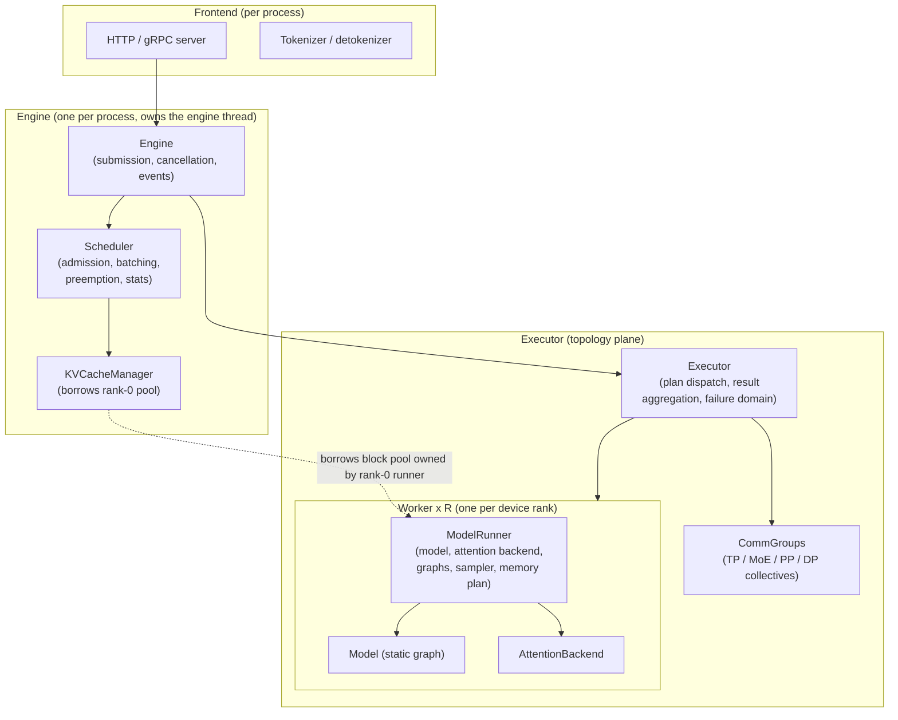
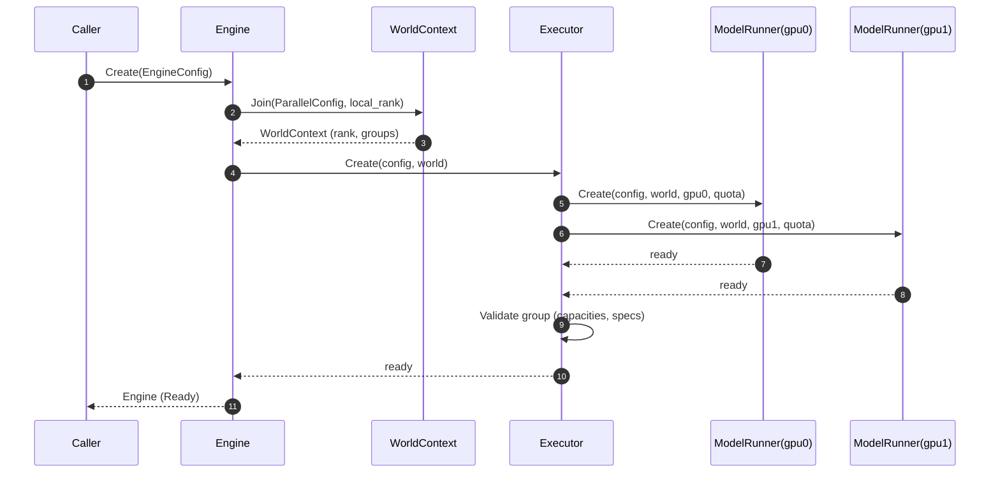
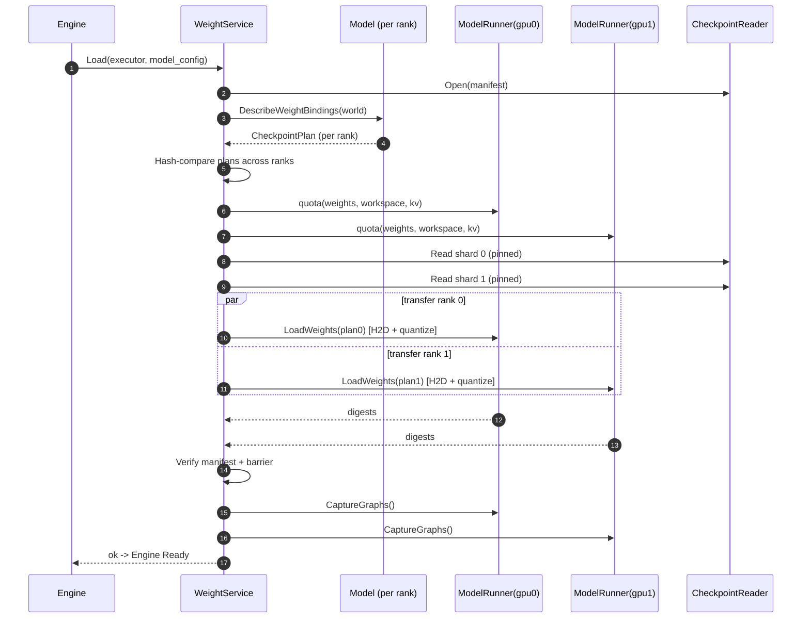
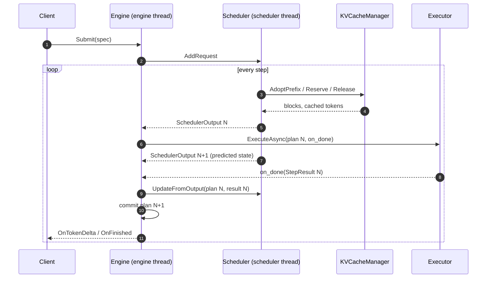
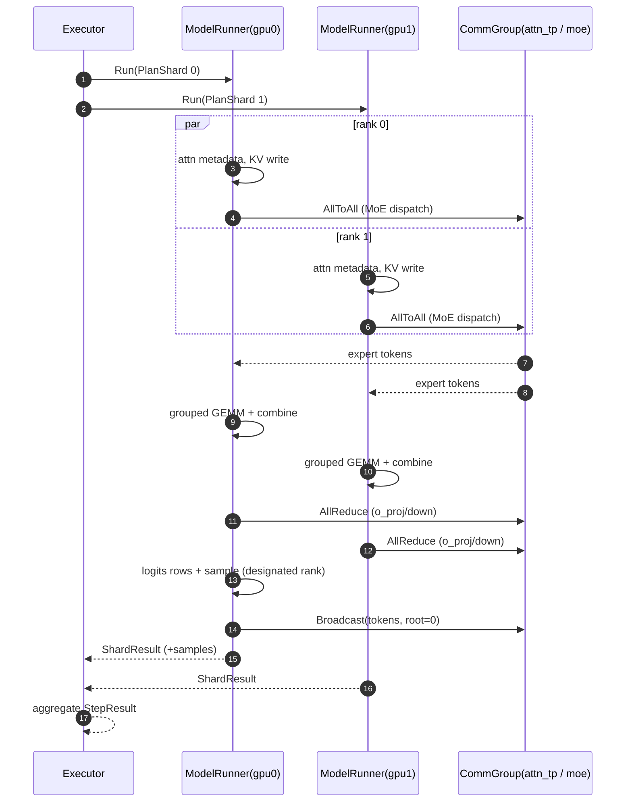
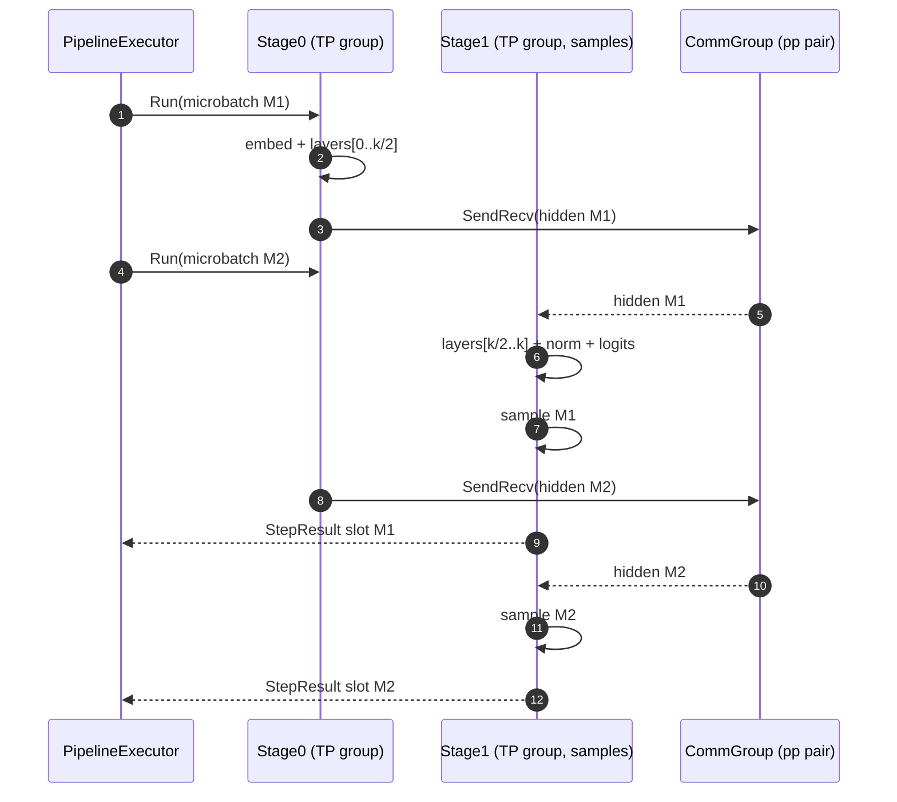
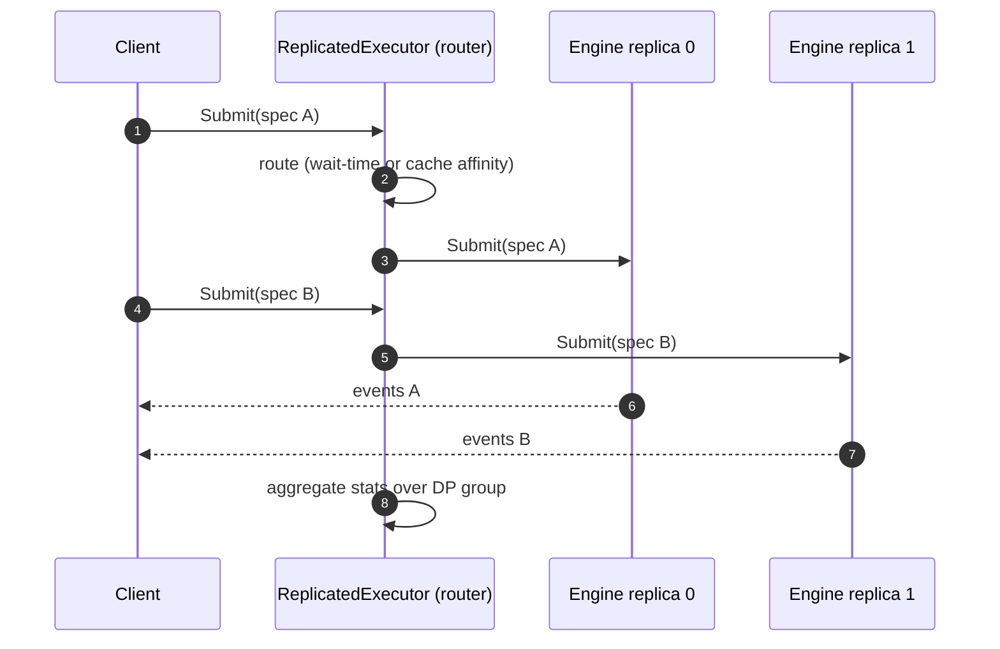
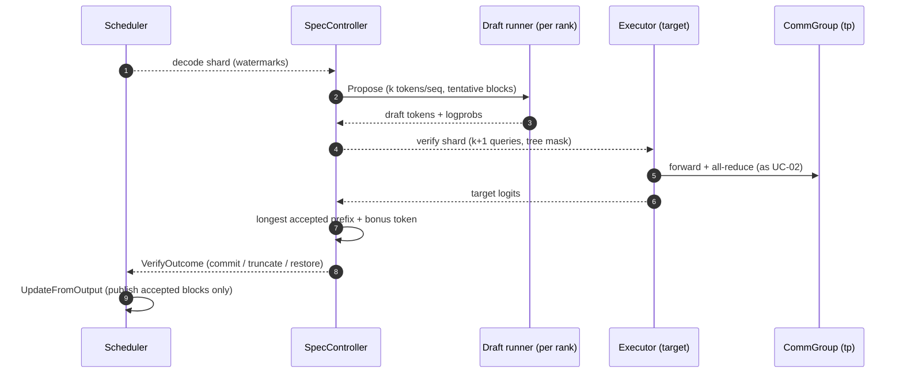
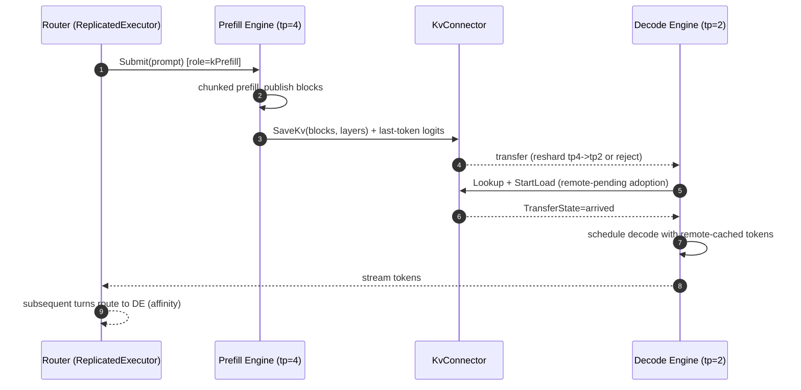
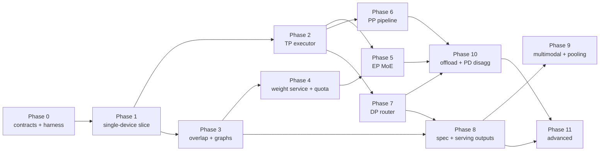

# InferX distributed execution architecture

**Status: architecture proposal — no implementation is included.** Written 2026-10-15 as a from-scratch redesign of the `ModelRunner` / `Executor` / `Scheduler` / `Model` layer. It is deliberately *not* constrained by the current tree; section 9 maps the proposal onto what exists only as a migration aid. **Updated 2026-10-15 (second pass):** sections 10–14 add a case-by-case feature-coverage validation against vLLM, a gap analysis with concrete API extensions, the phased implementation roadmap, per-phase test gates, and P0/P1/P2 priorities.

Reference systems studied (best practices adopted where cited, with trade-offs in section 8):

- **vLLM V1** — engine-core/frontend split, immutable `SchedulerOutput`, worker/group-coordinator layering, DP replication.
- **SGLang** — overlap scheduling, hybrid-parallel decomposition (attention TP vs MoE TP/EP), router-based DP, attention-backend abstraction.
- **TensorRT-LLM** — executor-session API with futures, C++ single-process multi-GPU worker model, world config + micro-batch pipeline scheduling for PP, inflight batching.

The cache-layer contract referenced throughout (`KVCacheManager`, cache groups, graphs) is specified by the `TODO.md` backlog (F05/F06, A07, A12); this document only defines the interfaces the executor touches.

---

## 1. Architecture overview

### 1.1 Layer diagram



### 1.2 Responsibilities and boundaries

| Component | Plane | Owns | Must never do |
| --- | --- | --- | --- |
| **Engine** | Service | request registry, engine thread, event fan-out, lifecycle (start/drain/shutdown) | touch tensors, know parallelism details |
| **Scheduler** | Control (CPU) | waiting/running queues, admission & budgets, continuous batching (chunked prefill), preemption policy, per-step **immutable plan**, scheduler stats | touch device memory, execute kernels, know model families (beyond `ModelSpec`) |
| **KVCacheManager** | Control (CPU) | logical block ownership, prefix index, admission headroom | own device memory (the pool belongs to the runner) |
| **Executor** | Topology | workers, communicator groups, plan sharding/dispatch, microbatch pipeline (PP), replica routing (DP), result aggregation, group failure handling | scheduling policy, request semantics |
| **ModelRunner** | Device (1 per GPU rank) | `Model` instance, attention backend, CUDA-graph pool, sampler, device memory plan (weights → workspace → KV pool) | request policy, cross-rank orchestration |
| **Model** | Graph | static architecture, weight bindings, `ModelSpec` (geometry, cache specs, shard rules) | allocation, scheduling, collectives beyond what `Forward` issues through `CommBackend` |
| **AttentionBackend** | Kernel | mask/layout contracts, plan metadata, graph-safe kernel state | cache policy |

Data flows **down** only: `Engine → Scheduler + Executor → ModelRunner → Model`. Results flow **up** as plain values (`StepResult`). The single deliberate shared resource is the KV block pool: the rank-0 `ModelRunner` owns the allocation; the scheduler's `KVCacheManager` borrows it and is the *only* allocator of block IDs; the runners of all ranks consume IDs read-only (they write bytes into blocks the plan names). This preserves the current system's best invariant (scheduler owns bookkeeping, runner owns bytes) while making it explicit and checked at init.

### 1.3 Process and threading model

- **One OS process per node** (C++ native; unlike vLLM/SGLang, no GIL forces process-per-rank). One *worker thread* per GPU, each pinned to its device and stream set. This is the TensorRT-LLM model.
- **Multi-node** is launched externally (`mpirun`/`srun`/container orchestrator); ranks rendezvous over a TCP/env store and use NCCL/UCX for data-plane collectives. A `LoopbackTransport` exists for unit tests (the current `LoopbackComm` pattern, kept as a first-class citizen).
- **Engine thread** runs the step loop. **Overlap scheduling** (SGLang): while the executor runs step *N* on GPU streams, the scheduler thread computes the plan for step *N+1* from the *predicted* state; the plan is committed only after step *N*'s result lands. Overlap is a runtime toggle, not a redesign — the non-overlapped loop is the degenerate case.
- **Frontend threads** (HTTP) never touch scheduler or runners; they communicate with the engine thread through mutex-guarded pending/cancel lists and lock-free event queues (the current `EngineGateway` threading contract, generalized).

### 1.4 Design invariants

1. **The plan is a message.** `SchedulerOutput` is immutable value data. Anything consuming it (executor, runners, graph replay, future debug tooling) sees the same bytes; no back-pointers into scheduler state.
2. **Single writer per resource.** Block IDs: scheduler (via `KVCacheManager`). Device bytes: the owning rank's stream. Sampling decisions: exactly one designated rank per engine.
3. **Determinism by construction.** Given identical requests and seeds, greedy/seeded output is bit-identical regardless of TP/PP/EP shape (rank-0 samples, tokens broadcast; collectives use deterministic reductions where kernels require it).
4. **Unsupported combinations fail at startup**, with an actionable error naming the constraint (the cache backlog's ground rule, applied to parallelism: e.g. CP with prefix caching, PP with sliding-window groups, EP a2a under CUDA graphs until validated).
5. **Fail-stop groups.** A rank failure poisons the smallest enclosing group; the engine drains pending requests with an explicit error rather than deadlocking. Every collective has a matching abort path (section 7.4).

---

## 2. Class API design

Conventions: Google C++ Style Guide; `Status`/`StatusOr<T>` for fallible operations; `absl::Span` for non-owning views; PascalCase methods; Doxygen `///` comments. All classes are non-copyable singletons-per-scope unless stated. Namespaces: `inferx::runtime` (engine/executor/scheduler), `inferx::models` (model layer), `inferx::dist` (communication), `inferx::cache` (cache subsystem).

### 2.1 Configuration and world topology

```cpp
namespace inferx::runtime {

/// \brief Parallel decomposition of the engine across ranks.
///
/// World math (validated by Validate(), section 3.1):
///
///     world_size = dp_size * pp_size * tp_size * cp_size
///     tp_size    = attn_tp_size * moe_ep_size * moe_tp_size
///
/// dp replicates whole pp x tp x cp engines; pp splits layers into stages;
/// tp splits each layer's heads and experts as above; cp splits sequences
/// (deferred, see 3.6). ep_size == moe_ep_size names the expert dimension
/// explicitly for readability at call sites.
struct ParallelConfig {
  int dp_size = 1;
  int pp_size = 1;
  int tp_size = 1;
  int cp_size = 1;
  /// Attention tensor-parallel degree (heads sharded over this many ranks).
  int attn_tp_size = 0;   // 0 -> derive: == tp_size when no MoE split.
  /// Expert-parallel degree inside the TP group (experts across ranks).
  int moe_ep_size = 0;    // 0 -> derive.
  /// Tensor-parallel degree *within one expert* (expert weight sharding).
  int moe_tp_size = 0;    // 0 -> derive.

  /// Expert token-dispatch transport. kAllToAll is the low-latency path for
  /// large worlds; kAllGather is simpler and fine for small worlds.
  enum class MoeDispatch { kAllToAll, kAllGather };
  MoeDispatch moe_dispatch = MoeDispatch::kAllToAll;

  /// Rendezvous for multi-process/multi-node launches; ignored when the
  /// engine is single-process (threads only).
  std::string rendezvous_endpoint;  // "host:port" or "env://" (MASTER_ADDR/PORT)

  int WorldSize() const;
  /// \brief Rejects impossible or unimplemented decompositions with the
  ///        constraint named (invariant 4).
  Status Validate() const;
};

/// \brief Coordinates of one rank in the parallel world, plus the communicator
///        groups it belongs to.
///
/// Decomposition order (row-major, so consecutive ranks are TP neighbors --
/// NCCL-friendly and matches SGLang's hybrid-parallel layout):
///
///     rank = ((dp * pp_size + pp) * tp_size + tp) * cp_size + cp
///
/// Derived inside a TP group: attn_rank = tp % attn_tp_size,
/// moe_rank = tp / attn_tp_size (in [0, moe_ep*moe_tp)).
class WorldMapping {
 public:
  static WorldMapping FromConfig(const ParallelConfig& config, int rank);

  int Rank() const;            // Global rank in [0, world_size).
  int WorldSize() const;
  RankCoord Coord() const;     // {dp, pp, tp, cp} for this rank.
  int DpRank() const;
  int PpRank() const;          // Stage index in [0, pp_size).
  int PpNext() const;          // -1 on last stage.
  int PpPrev() const;          // -1 on first stage.
  bool IsFirstStage() const;
  bool IsLastStage() const;    // Owns LM head + sampling.
  int AttnTpRank() const;
  int MoeRank() const;
  /// Global ranks of this rank's TP group (attn + moe), PP neighbors,
  /// DP peers, CP ring -- used to build communicators once.
  std::vector<int> TpGroupRanks() const;
  std::vector<int> AttnGroupRanks() const;
  std::vector<int> MoeGroupRanks() const;
  std::vector<int> DpGroupRanks() const;
};

/// \brief Aggregate of every user-facing configuration section.
struct EngineConfig {
  models::ModelConfig model;       // architecture, dtype, quantization.
  cache::CacheConfig cache;        // block size, prefix caching, budgets.
  SchedulerConfig scheduler;       // max_seqs, token budget, policy knobs.
  ParallelConfig parallel;
  ExecutionConfig execution;       // overlap on/off, graphs, capture sizes.
};

}  // namespace inferx::runtime
```

### 2.2 Requests, events, and the Engine

```cpp
namespace inferx::runtime {

using RequestId = std::uint64_t;

/// \brief What a client wants generated. Immutable after submission.
struct CompletionSpec {
  std::vector<TokenId> prompt_tokens;
  std::string cache_salt;                 // Prefix-cache namespacing (F04).
  sampling::SamplingParams sampling;
  std::vector<TokenId> stop_token_ids;
  int max_new_tokens = 0;
  bool ignore_eos = false;
  /// Requested intermediate outputs; non-empty forces cache-reuse bypass
  /// (A08 semantics).
  OutputSpec outputs;                     // Logprobs, embeddings, hidden.
};

/// \brief Streaming events for one request, delivered in order.
///        Implementations must be thread-safe (called from the engine thread,
///        consumed anywhere).
class EventSink {
 public:
  virtual ~EventSink() = default;
  virtual void OnTokenDelta(RequestId id, std::string_view utf8_delta) = 0;
  virtual void OnUsage(RequestId id, const UsageInfo& usage) = 0;
  virtual void OnFinished(RequestId id, FinishReason reason,
                          const FinalResult& result) = 0;
  virtual void OnError(RequestId id, const Status& error) = 0;
};

/// \brief Public entry point: one inference engine instance.
///
/// Thread-safe for Submit/Cancel/Stats from any thread; everything else
/// happens on the engine thread. Lifecycle: Create -> (running) -> Shutdown.
/// The destructor joins all threads after a graceful drain; it never blocks
/// indefinitely (drain deadline is configurable).
class Engine {
 public:
  /// \brief Builds the whole stack: communicators, workers, weights, caches,
  ///        scheduler. Performs startup validation (invariant 4) and the
  ///        distributed barriers of section 4; on failure every rank unwinds
  ///        and Create returns the same error on every rank.
  static StatusOr<std::unique_ptr<Engine>> Create(const EngineConfig& config,
                                                  std::shared_ptr<EventSink> sink);
  ~Engine();

  /// \brief Enqueues a request; returns after the request is registered,
  ///         before any scheduling decision. ResourceExhausted when the
  ///         waiting queue is full.
  Status Submit(CompletionSpec spec);
  /// \brief Cancels by id; unknown/finished ids are ignored. Returns the ids
  ///        actually cancelled. Blocks until the requests' blocks are freed.
  std::vector<RequestId> Cancel(absl::Span<const RequestId> ids);
  EngineStats Stats() const;   // Snapshot; safe concurrently.
  /// \brief Stops admitting, drains running requests up to a deadline,
  ///        then tears down workers and communicators in reverse order.
  Status Shutdown(absl::Duration drain_deadline);

 private:
  // Constructed only through Create; members are wired there.
};

}  // namespace inferx::runtime
```

The C++ API is callback-based (`EventSink`); a `FutureFacade` (`SubmitAndWait` returning `StatusOr<FinalResult>` futures, TensorRT-LLM executor style) is a thin adapter over the same engine, not a second path.

### 2.3 The Scheduler and its output

```cpp
namespace inferx::runtime {

/// \brief One request as the scheduler sees it: policy state only.
///
/// This is today's `inferx::Request`, retained under the same name and in
/// the same role as vLLM V1's `Request`. Mutable, scheduler-private
/// (single-threaded by contract, 1.3); it never leaves the scheduler --
/// NewRequestData/CachedRequestData are its read-only projections into
/// SchedulerOutput. Watermark ownership follows decision D2: *scheduled*
/// lengths live per-step in SchedulerOutput, *allocated* lengths live in
/// the KVCacheManager, *computed* (num_computed_tokens) and *accepted*
/// (output_tokens) live here. No tensors, no ranks, no block ids, no
/// compiled grammar, no draft state.
struct Request {
  // ---- Present today (include/inferx/engine/request.h). ----
  RequestId id = 0;
  absl::Span<const TokenId> prompt_tokens;
  std::vector<TokenId> output_tokens;      // Accepted tokens only (D2).
  sampling::SamplingParams sampling_params;  // Seed, min/max tokens.
  std::string_view cache_salt;             // Prefix-cache namespace (F04).
  RequestStatus status = RequestStatus::kWaiting;  // D3 state machine; the
                     // C05 fix restores kWaiting -> kRunning admission.
  FinishReason finish_reason = FinishReason::kStopped;
  int num_computed_tokens = 0;             // KV-backed watermark (D2).

  // Guard-railed transitions (scheduler thread only).
  Status Admit();          // kWaiting -> kRunning (C05 / D3).
  Status Preempt();        // kRunning -> kPreempted; watermark resets to hits.
  void MarkWaiting();      // kPreempted -> kWaiting (requeue at head).
  Status AppendAccepted(absl::Span<const TokenId> tokens);
  Status Finish(FinishReason reason);

  // ---- Extensions land with their owning phases, not up front: ----
  //   + fork_parent / fork_point_tokens / fork_children   (n>1, 11.6 / A02)
  //   + num_last_spec_tokens                              (speculation, 11.2)
  //   + priority / arrived_at / num_preemptions           (A10 policies)
  //   + mm_spans / GuidedSpec                             (F04, 11.3 / 11.5)
  //   + kWaitingRemote status                             (PD disagg, 11.1)
};

/// \brief A newly admitted request, resolved for the executors.
struct NewRequestData {
  RequestId request_id;
  absl::Span<const TokenId> prompt_tokens;  // Full prompt (chunking later).
  int num_cached_tokens;                    // Adopted prefix length.
  absl::Span<const int32_t> block_ids;      // Prompt blocks, logical order.
  sampling::SamplingParams sampling;
};

/// \brief A running request's delta for this step.
struct CachedRequestData {
  RequestId request_id;
  int num_new_tokens;          // 1 for decode; k for speculative verify.
  absl::Span<const int32_t> new_block_ids;  // Growth granted this step.
  int num_cached_tokens;       // Watermark after adoption/preemption replay.
};

/// \brief The scheduler's immutable step output (vLLM V1-aligned name).
///
/// Produced by Scheduler::Schedule(), consumed by exactly one
/// Executor::Execute(). Value semantics; every span points into storage
/// owned by the output. Contains *no* device pointers and *no* policy state,
/// so it can be logged, broadcast (DP), or replayed (graph debug) verbatim.
struct SchedulerOutput {
  std::vector<NewRequestData> new_requests;
  std::vector<CachedRequestData> running_requests;
  std::vector<RequestId> preempted_request_ids;
  std::vector<RequestId> finished_request_ids;   // Detected last step.
  int total_num_scheduled_tokens = 0;
  StepKind kind = StepKind::kMixed;              // Prefill/decode/mixed.
  /// DP routing hint when the executor fronts multiple replicas.
  int dp_replica = 0;
};

/// \brief The executor's answer to one plan.
struct StepResult {
  /// One sampled token per scheduled request that completed its prompt or
  /// continued decode; aligned with plan order (mid-prompt prefill chunks
  /// contribute no sample).
  std::vector<SampledTokens> samples;
  std::vector<RequestId> finished;         // Stop conditions detected on rank 0.
  std::vector<Status> request_errors;      // Per-request failures (OOM'd etc.).
  StepTiming timing;                       // Device-side, for overlap + stats.
};

/// \brief Continuous-batching scheduler. Pure control plane.
///
/// Single-threaded by contract: only the (engine or scheduler) thread that
/// calls Schedule()/UpdateFromOutput() touches it. The scheduler sees the
/// model only through ModelSpec (max context, cache-group geometry) and the
/// pool only through KVCacheManager.
class Scheduler {
 public:
  Scheduler(SchedulerConfig config, const cache::CacheConfig& cache,
            cache::KVCacheManager* kv);

  Status AddRequest(Request request);   // Queue admission.
  /// \brief Computes the next step's plan. Never blocks on the device.
  StatusOr<SchedulerOutput> Schedule();
  /// \brief Applies a finished step: advances watermarks, finishes requests,
  ///        frees blocks. Called with step N's result before N+1's plan is
  ///        committed (the only scheduler mutation point).
  Status UpdateFromOutput(const SchedulerOutput& plan, const StepResult& result);

  std::vector<RequestId> AbortRequests(absl::Span<const RequestId> ids);
  bool HasRequests() const;
  SchedulerStats Stats() const;

 private:
  /// Preemption policy hook: newest-first recompute victims (vLLM V1
  /// semantics), pluggable for cache-aware policies (backlog A10).
  virtual bool PreemptFor(int64_t block_shortfall, std::vector<RequestId>* victims);
};

}  // namespace inferx::runtime
```

`cache::KVCacheManager` is the backlog's subsystem (C01–C08, F01–F11); the executor-facing surface it must expose is: adoption/publish/release (as today), per-group allocation with a non-mutating capacity estimate, and graph-stable block-table access (A12). No executor code may call the pool directly.

*Alignment note (vLLM V1):* `SchedulerOutput`, `NewRequestData`, and `CachedRequestData` keep vLLM's names and shapes, so migration from the current tree (and comparison against vLLM sources) is a field-mapping exercise. Two deliberate differences: vLLM's `block_number_to_hash` is absent — the in-process `KVCacheManager` owns hash bookkeeping, so it never crosses the output boundary (§7.2) — and `kind` / `dp_replica` are added for step selection and DP routing. `StepResult` fills the role vLLM splits between `ModelRunnerOutput` (per-runner samples) and `EngineCoreOutput` (per-request events): the executor folds both into the single value the scheduler consumes. The scheduler keeps vLLM's `Request` name for its private request state; it never leaves the scheduler.

### 2.4 The Executor

```cpp
namespace inferx::runtime {

/// \brief Topology plane: turns one plan into distributed execution and one
///        aggregated result. Owns workers and communicators; knows nothing
///        about request policy.
///
/// Concrete compositions (section 3.7):
///   TensorParallelExecutor   -- one node's TP/EP/CP group of ModelRunners.
///   PipelineExecutor         -- pp_size stages, microbatch pipeline.
///   ReplicatedExecutor       -- dp_size child executors behind a router.
/// They compose: Replicated( Pipeline( TensorParallel(...) ) ).
class Executor {
 public:
  static StatusOr<std::unique_ptr<Executor>> Create(
      const EngineConfig& config, const dist::WorldContext& world,
      cache::KvBlockPool* rank0_pool /* borrowed for the scheduler's manager */,
      WorkerEventSink* events);

  /// \brief Executes one plan synchronously on the caller's (engine) thread;
  ///        returns when all streams and collectives for the step complete.
  StatusOr<StepResult> Execute(const SchedulerOutput& plan);

  /// \brief Overlap-mode entry: dispatches the plan, invokes `on_done` from a
  ///        completion thread when device work finishes. The caller commits
  ///        the plan (scheduler UpdateFromOutput) inside `on_done` or after.
  Status ExecuteAsync(const SchedulerOutput& plan, StepDoneCallback on_done);

  /// \brief Group-scoped abort: releases every rank from any in-flight or
  ///        blocked collective for these requests (invariant 5).
  Status Abort(absl::Span<const RequestId> ids);
  /// \brief Collective health probe + rank-liveness heartbeat result.
  ExecutorHealth Health() const;

  /// \brief The pool owned by the rank-0 runner (shared with the scheduler's
  ///        KVCacheManager; single-writer rule, 1.2).
  cache::KvBlockPool* Rank0KvPool() const;

 private:
  virtual StatusOr<StepResult> ExecuteOnWorkers(const PlanShard& shard) = 0;
};

}  // namespace inferx::runtime
```

`PlanShard` is the per-worker slice of a plan (its requests' token spans, block tables, sampling rows) — produced by pure functions so PP microbatch splitting and DP routing reuse the same code path.

### 2.5 The ModelRunner

```cpp
namespace inferx::runtime {

/// \brief One rank's device execution: everything that touches CUDA on this
///        GPU lives here. Created and driven by the Executor; one instance
///        per (device, cp_shard).
class ModelRunner {
 public:
  static StatusOr<std::unique_ptr<ModelRunner>> Create(
      const EngineConfig& config, const dist::WorldContext& world,
      Device device, const dist::CommGroupSet& comms,
      MemoryQuota quota /* weights, workspace, KV split; section 4.5 */);

  /// \brief Loads and partitions weights for this rank (section 4).
  Status LoadWeights(const models::CheckpointPlan& plan);
  /// \brief Captures decode graphs for the configured batch-size buckets
  ///        after the KV pool exists (A12 contract: stable device block
  ///        tables, delta updates between replays).
  Status CaptureGraphs();

  /// \brief Runs one shard: build attention metadata -> select graph or
  ///        eager -> Model::Forward -> (last stage) sample. The runner
  ///        issues collectives only through `comms` (TP all-reduce, EP
  ///        dispatch/combine) inside Forward's group calls.
  StatusOr<ShardResult> Run(const PlanShard& shard);

  /// \brief Device-side partial results for this rank; aggregated by the
  ///        executor. Only the sampling rank fills `samples`.
  struct ShardResult { /* partial logits ptrs, samples, timings */ };

  cache::KvBlockPool* KvPool();      // Owned; borrowed by the manager.
  const models::ModelSpec& Spec() const;
  Status Synchronize() const;        // Stream-ordered device sync.

  MemoryPlan ReportMemory() const;   // For F10-style diagnostics.
};

}  // namespace inferx::runtime
```

### 2.6 The Model layer

```cpp
namespace inferx::models {

/// \brief One static architecture, ready to load weights and run.
///
/// Immutable after LoadWeights. A model expresses *what* it needs (geometry,
/// cache specs, shard rules) and *how* to compute one step; it never
/// allocates persistent state, schedules, or orchestrates ranks -- those
/// belong to runner/executor/scheduler respectively.
class Model {
 public:
  virtual ~Model() = default;

  /// \brief Engine-facing facts: shapes, eos ids, per-layer cache/state
  ///        specs (typed groups per backlog F05/F06: attention kind,
  ///        window/sink params, cacheability, aliasing), expert layout
  ///        for EP planning, and the weight shard rules (section 4.3).
  virtual const ModelSpec& GetModelSpec() const = 0;

  /// \brief Describes every weight tensor this rank needs and how checkpoint
  ///        tensors map onto it (slice / replicate / transpose / quantize).
  virtual WeightBindingMap DescribeWeightBindings(
      const dist::WorldMapping& world) const = 0;

  /// \brief Runs the stack for one shard: embed (or take input_embeds),
  ///        decoder layers (attention through AttentionBackend, MoE through
  ///        the dispatch/combine ops), final norm.
  virtual Status Forward(ForwardContext& ctx, const StepInputs& inputs,
                         Tensor& hidden_out) const = 0;

  /// \brief Projects sampled rows onto the vocabulary (last PP stage only).
  virtual Status ComputeLogits(ForwardContext& ctx, const Tensor& hidden,
                               const Tensor& rows, Tensor& logits) const = 0;
};

}  // namespace inferx::models
```

`ModelSpec` evolves from today's flat `StateRequirements` into typed per-layer descriptors; the virtual-seam decision (keep one `GetModelSpec()`, load-time static, policy knobs excluded) is recorded with the backlog's D-series decisions. MoE layers additionally declare `ExpertLayout{num_experts, top_k, shared_experts}` so the executor's EP planner can place experts (3.4).

### 2.7 Attention backend

```cpp
namespace inferx::runtime {

/// \brief Kernel-side attention contract (SGLang backend analog).
///
/// One backend instance per runner, selected from ModelSpec cache-group
/// descriptors + backend capability table. Owns plan metadata, workspaces,
/// and graph-safe state; the runner calls BeginStep/Run/EndStep in order.
class AttentionBackend {
 public:
  virtual ~AttentionBackend() = default;
  static StatusOr<std::unique_ptr<AttentionBackend>> Select(
      const models::ModelSpec& spec, const ExecutionConfig& config, Device device);

  /// \brief Builds this step's metadata (queries per seq, block tables,
  ///        window/sink bounds) from the PlanShard. Must be callable on the
  ///        scheduler thread for overlap (CPU-only work).
  virtual StatusOr<AttentionMetadata> BuildMetadata(const PlanShard& shard) = 0;
  virtual Status Run(const AttentionMetadata& meta, const StepInputs& inputs,
                     Tensor& query_inout) = 0;  // Fused QKV-norm/RoPE hooks.
  /// \brief Graph contracts: which shapes are captureable, slot-mapping
  ///        deltas safe between replays (A12).
  virtual GraphSupport QueryGraphSupport() const = 0;
};

}  // namespace inferx::runtime
```

### 2.8 Checkpoint and weight loading

```cpp
namespace inferx::models {

/// \brief Where weights come from and how they reach device memory.
class CheckpointReader {
 public:
  static StatusOr<std::unique_ptr<CheckpointReader>> Open(
      const ModelConfig& config);
  /// \brief Metadata for one checkpoint tensor (shape, dtype, shard index).
  StatusOr<TensorMeta> LookupMeta(std::string_view name) const;
  /// \brief Streams one checkpoint tensor's bytes into `dst` (host staging).
  Status Read(std::string_view name, absl::Span<std::byte> dst) const;
};

/// \brief Per-rank weight plan produced once by the loader and consumed by
///        every ModelRunner (identical bytes -> identical models, invariant 3).
struct CheckpointPlan {
  struct Binding {
    std::string checkpoint_tensor;
    std::string model_tensor;
    ShardRule rule;          // kReplicate | kSliceRows(dim, begin, end) | ...
    QuantPlan quantize;      // Optional on-load quantization.
  };
  std::vector<Binding> bindings;
  std::vector<std::string> verify_hashes;  // Manifest digests (section 4.4).
};

/// \brief Orchestrates the loading phases of section 4 across workers.
class WeightService {
 public:
  /// \brief Plans (rank-local), stages (pinned host), transfers, verifies.
  ///        Barriers at the documented sync points; one rank's failure fails
  ///        the group (fail-stop, invariant 5).
  static Status Load(Executor* executor, const ModelConfig& config);
};

}  // namespace inferx::models
```

### 2.9 Communication

```cpp
namespace inferx::dist {

/// \brief Rank + world + transport after rendezvous.
class WorldContext {
 public:
  static StatusOr<WorldContext> Join(const runtime::ParallelConfig& config,
                                     int local_rank /* device index */);
  const runtime::WorldMapping& Mapping() const;
};

/// \brief One collective domain (a set of ranks + a transport instance).
class CommGroup {
 public:
  Status AllReduce(Tensor* t, ReduceOp op);      // NCCL / custom / loopback.
  Status ReduceScatter(Tensor* t, ReduceOp op);
  Status AllGather(Tensor* in, Tensor* out);
  Status Broadcast(Tensor* t, int root);
  Status SendRecv(Tensor* t, int peer, Channel ch);   // PP hidden handoff.
  Status AllToAll(const DispatchPlan& tokens);        // EP moe dispatch.
  /// \brief Non-blocking counterpart used by overlap mode; completion is
  ///        observed through the runner's event set.
  Status Enqueue(Collective c, StreamRef stream);
};

/// \brief The set of groups one rank belongs to, built once from
///        WorldMapping (TP/attn/moe/PP-pairs/DP/CP).
struct CommGroupSet {
  std::shared_ptr<CommGroup> attn_tp;   // Attention all-reduce domain.
  std::shared_ptr<CommGroup> moe;       // Expert dispatch/combine domain.
  std::shared_ptr<CommGroup> moe_tp;    // Intra-expert reduce domain.
  std::shared_ptr<CommGroup> pp_prev_next;  // Point-to-point stages.
  std::shared_ptr<CommGroup> dp;        // Router/stats/broadcast domain.
};

}  // namespace inferx::dist
```

### 2.10 Lifecycle state machines

```
Engine:     Created -> LoadingWeights -> CapturingGraphs -> Ready
            <-> Running -> Draining -> Shutdown
Executor:   matches Engine phase; workers transition Idle <-> Executing;
            any group error -> Aborting -> Terminal (engine restarts process).
Scheduler:  per-step cycle Schedule() -> [plan handed off] -> UpdateFromOutput()
            (strictly alternating; overlap mode schedules N+1 before applying N).
Model:      Constructed -> WeightsBound (immutable thereafter).
```

All constructors that do real work are `static Create(...)` factories returning `StatusOr`; constructors only wire trivial state. Destruction order is the reverse of creation: events -> scheduler -> executor (workers, then communicators) -> pools.

---

## 3. Parallelism design

### 3.1 World decomposition

```
world_size = dp_size x pp_size x tp_size x cp_size
tp_size    = attn_tp_size x moe_ep_size x moe_tp_size     (each factor optional = 1)
rank       = ((dp * pp_size + pp) * tp_size + tp) * cp_size + cp
attn_rank  = tp % attn_tp_size            (attention heads sharded here)
moe_rank   = tp / attn_tp_size            (experts + expert-internal TP)
```

Row-major order keeps TP neighbors on one node (consecutive CUDA devices), which is what NCCL and PCIe/NVLink P2P want. `WorldMapping` is the *only* place these formulas live; every component asks it for coordinates and group members. `ParallelConfig::Validate()` rejects at startup (invariant 4): `attn_tp * moe_ep * moe_tp != tp`, attention head counts not divisible by `attn_tp`, PP with cache groups that cannot keep per-stage consistency (until F05 lands), `cp_size > 1` entirely (deferred), worlds exceeding the device count of the node without a multi-process rendezvous.

### 3.2 Tensor parallelism (TP)

- **Attention**: query heads sharded over `attn_tp`; each rank holds `heads/attn_tp` query heads and the matching KV heads (replicating KV when `kv_heads < attn_tp` — MQA/MLA latents replicate, cost documented in the spec, not discovered at runtime). `o_proj` is row-parallel -> one `attn_tp` all-reduce per layer.
- **MLP / MoE dense parts**: gate/up column-parallel, down row-parallel, sharing the same all-reduce (sequence-parallel option folds the residual add into reduce-scatter/all-gather for large hidden sizes — a runtime toggle).
- **Embedding / LM head**: vocab-row sharded; last stage gathers sampled rows only (`ComputeLogits`' `[rows, vocab]` contract keeps the GEMM small).
- **KV pool**: rank-local per TP rank (current design, kept); block IDs are logical and identical on every rank — the executor validates pool capacity equality across the TP group at init (backlog A07's amendment).

### 3.3 Pipeline parallelism (PP)

- Layers are split into `pp_size` contiguous **stages** (balanced by per-layer compute estimate from `ModelSpec`, falling back to even counts). The first stage owns embedding; the last owns final norm, LM head, and sampling.
- The **scheduler emits microbatches**: one `SchedulerOutput` may contain several microbatch slots; `PipelineExecutor` drives a 1F1B schedule (TensorRT-LLM micro-batch scheduler pattern; vLLM V1's PP worker analog) over an in-flight window of `min(pp_size, num_microbatches)` slots.
- **Handoff**: hidden states cross stages with `SendRecv` on a dedicated channel, optionally BF16/FP8-compressed with a documented tolerance test; the *last* microbatch slot carries the sampled-row indices so the final stage projects only what it must.
- **KV**: each stage's runners own KV only for their layers; block tables are identical across stages, capacity must be equal on every stage (validated).
- Bubble: `1F1B` gives `(pp-1)/(m+pp-1)` for `m` microbatches; the scheduler biases toward more, smaller microbatches under PP (policy knob `microbatch_tokens`).
- Startup runs a warmup microbatch through the pipe before `Ready` so the first real request does not pay pipeline-fill latency.

### 3.4 Expert parallelism (EP)

- Experts of every MoE layer are distributed over the `moe_ep` ranks of the TP group by `ExpertPlacer` (round-robin default, frequency-balanced from `ModelSpec` hotness hints when present); each rank holds `experts/moe_ep` experts, optionally sharded further by `moe_tp`.
- **Dispatch**, two selectable modes (`ParallelConfig::moe_dispatch`):
  - `kAllToAll` — per-layer `AllToAll` of routed tokens (SGLang/DeepEP-style low-latency path), grouped-GEMM per expert, `AllToAll` combine. Best for large expert counts/worlds; requires capacity handling (drop-less by default, capacity-factor knob with explicit overflow accounting surfaced in stats).
  - `kAllGather` — gather routed tokens on all moe ranks, compute local experts, all-reduce combine (DeepSpeed-style). Simpler, graph-capture friendly, fine for small worlds.
- Shared experts compute on the attention ranks (no dispatch), per model family declaration.
- CUDA-graph capture with a2a dispatch is allowed only in the backend capability table says so (invariant 4); otherwise PP-free graphs run with `kAllGather` or eager MoE.

### 3.5 Data parallelism (DP)

Two modes, cleanly separated:

1. **Replicated DP (default)** — `dp_size` independent Engines (each with its own scheduler, cache, and pp x tp executor) fronted by a `ReplicatedExecutor` acting as an in-process router: lowest-projected-wait routing by default, optional cache-affinity hashing on `cache_salt`+prompt digest so multi-turn traffic reuses one replica's prefix cache (SGLang srt-router practice). Replicas share nothing; stats aggregate through the DP `CommGroup` (a cheap side-channel, not the data plane). This mode composes with everything (TP/PP/EP) because each replica is a full engine.
2. **DP-attention (deferred)** — one logical batch split across DP groups that share expert ranks (vLLM DP-attention). Deliberately *not* in the initial proposal: it couples scheduler output broadcast, per-group padding, and EP capacity in ways that deserve their own validated design. The `SchedulerOutput.dp_replica` field and the DP `CommGroup` are the reserved hooks; enabling it is a startup-rejected config until then (invariant 4).

### 3.6 Context parallelism (CP)

Deferred with hooks: `cp_size` stays in the world math, `CommGroupSet` reserves a CP ring, and `ModelSpec` cache groups reserve the DCP-sharded flag (backlog A07). Any `cp_size > 1` config fails validation today with the constraint named. The reason is honest scoping: CP changes retention/reuse semantics (the pinned upstream managers assert `DCP == 1` for windowed/local/mamba groups [V4]), and InferX should not ship a combination upstream itself restricts.

### 3.7 Hybrid configurations

| Config | World math | Executor composition | Notes |
| --- | --- | --- | --- |
| TP=8 | world=8, tp=8, attn_tp=8 | `TensorParallel` | Baseline dense path. |
| TP=4, EP=4 | world=4, tp=4 = attn 1 x ep 4 | `TensorParallel` | Attention un-sharded (each rank all heads); experts across ranks; a2a per layer. |
| TP=8 = attn 2 x EP 4 | world=8 | `TensorParallel` | SGLang-style hybrid: attention over 2 ranks, experts over 4. |
| TP=4, PP=2 | world=8 | `Pipeline(TensorParallel x2)` | Stages of 4-rank TP groups; microbatch 1F1B. |
| TP=2, PP=2, DP=2 | world=8 | `Replicated(Pipeline(TensorParallel))` | Router fronts two pipelines. |
| TP=4, PP=4, EP=2, DP=4 | world=64 | `Replicated(Pipeline(TensorParallel))` | Node-boundary placement via row-major rank order. |
| CP>1 | any | -- | Startup-rejected (deferred). |

Composability rule: **DP wraps PP wraps TP**. Exactly this nesting order is supported; other nestings are rejected by `Validate()` rather than half-working.

### 3.8 CUDA graphs and collectives

Graphs are captured per runner for decode buckets (`ExecutionConfig::graph_batch_sizes`), always with stable device block-table buffers and guarded padding (backlog A12). Collectives inside graphs use the graph-capturable NCCL mode; a2a dispatch under graphs only when the backend capability table allows it (3.4). Eager execution remains the fallback and the correctness oracle: every graph path has an eager twin, and the nightly test matrix diffs them token-for-token.

---

## 4. Model loading

### 4.1 Phases

```
1. Resolve        Open checkpoint, read manifest (architecture, tensor metas, digests).
2. Rendezvous     WorldContext::Join (TCP/env store); broadcast ParallelConfig
                  hash; every rank must agree or load aborts group-wide.
3. Plan           Model::DescribeWeightBindings(WorldMapping) -> CheckpointPlan
                  per rank (pure function of config + world: same inputs,
                  same plan on every rank -- verified by hash compare).
4. Allocate       ModelRunner::Create with MemoryQuota: weights (planned),
                  activation workspace (profiled), KV pool (remainder;
                  TP-min-reduced across the group so every rank derives the
                  same capacity; PP validates per-stage equality).
5. Stage          CheckpointReader::Read into pinned host buffers (double-
                  buffered stream; multi-threaded per shard file).
6. Transfer       H2D on each rank's stream; on-load quantization/dequant
                  fusion for quantized checkpoints; SendRecv reshards only
                  when the checkpoint's intrinsic shard shape differs from
                  the target world's (e.g. TP-4 checkpoint into TP-8 world) --
                  resharding is compute-at-load on the source ranks.
7. Verify         Per-tensor digests on a sampled basis + full digest option;
                  rank-0 manifest compare; collective barrier.
8. Barrier+Ready  NCCL barrier; executors run the warmup microbatch (PP) or
                  a dummy decode; Engine transitions to Ready.
```

### 4.2 Device assignment and distributed initialization

`local_rank` maps to the CUDA device ordinal within the process (multi-GPU, one worker thread each); multi-node ranks join through `rendezvous_endpoint`. Communicator groups are constructed in a fixed global order (TP, attn, moe, moe_tp, PP pairs, DP) so NCCL communicator IDs are created deterministically — this avoids the classic deadlock of ranks building comms in different orders. All of this happens inside `Engine::Create` before any request is accepted.

### 4.3 Weight partitioning rules

Per layer type, decided by `Model::DescribeWeightBindings` from the world mapping — the model declares *rules*, the loader materializes slices:

| Tensor kind | attn_tp | moe_ep / moe_tp | pp |
| --- | --- | --- | --- |
| Attention QKV / o | row/col split by heads | -- | stage-local |
| Attention norm | replicate | -- | replicate |
| Dense MLP gate/up/down | col / row split | -- | stage-local |
| Router gate | replicate | -- | replicate |
| Expert weights | -- | experts sharded over ep; per-expert split over moe_tp | stage-local |
| Embedding / LM head | vocab-row split (parallel vocab) | -- | first / last stage |
| Biases / scalars | replicate | replicate | replicate |

MLA latent KV is not a weight; its cache geometry rides `ModelSpec` cache groups. Quantized checkpoints quantize at transfer (phase 6) so host staging stays compressed.

### 4.4 Synchronization and verification

Sync points are exactly the barriers of phases 2, 7, 8 — nothing else blocks globally, so loading throughput is bounded by the slowest rank's H2D, not by lock-step staging. Verification: every rank computes its bound tensors' digests; the executor compares rank-0's collected manifest against the checkpoint manifest; any mismatch (or any rank's error) fails the whole group with the rank and tensor named (invariant 5: no partially-initialized engine ever serves).

### 4.5 Memory budgeting

Order of allocation inside each rank's `MemoryQuota`: reserved runtime buffers -> weights (known after phase 3) -> profiled activation workspace (one max-shape profile step, then frozen + margin) -> KV pool fills the remainder (utilization mode) or an explicit byte/block override (precedence validated per backlog F11). Budgets are min-reduced across the TP group before pool creation so all ranks derive identical capacity; heterogeneous per-layer layouts use the single-allocation heterogeneous pool (F11's no-double-peak rule).

---

## 5. Execution workflow

### 5.1 Request lifecycle

```
HTTP/gRPC -> tokenize -> Engine::Submit (registry, queue)
          -> Scheduler::AddRequest
          [engine loop]
   plan = Scheduler::Schedule()            -- admission (prefix adoption via
                                              KVCacheManager), chunked prefill,
                                              decode growth, preemption
   result = Executor::Execute(plan)        -- section 5.2
   Scheduler::UpdateFromOutput(plan, result) -- watermark advance, publication
                                              of computed blocks, finish/abort,
                                              block release
          [finish] -> EventSink::OnTokenDelta/OnFinished -> detokenize/stream
```

### 5.2 One step through the executor (TP+EP; PP in parentheses)

1. **Shard**: plan -> `PlanShard` per worker (pure); (PP: microbatch slots).
2. **Prepare** (scheduler thread, overlapped): attention metadata build, device block-table delta upload, sampling-row gather.
3. **Dispatch** (engine thread): each worker thread gets its shard; streams are recorded into a per-step event set.
4. **Forward per rank**: embed -> per layer: attention (backend; KV write into plan-named blocks) -> (attn_tp all-reduce) -> MoE dispatch (a2a or allgather), grouped GEMM, combine -> (moe reduce) -> norm. (PP: send/recv hidden to next stage per microbatch slot, 1F1B interleave.)
5. **Sample**: last stage's runner projects sampled rows -> vocab; the *designated sampling rank* runs the sampler once (greedy or seeded); tokens are broadcast on the TP group (determinism invariant 3).
6. **Aggregate**: executor collects ShardResults into one `StepResult` aligned with plan order; PP assembles per-microbatch results in slot order.
7. **Commit**: engine thread calls `Scheduler::UpdateFromOutput` (or the overlap callback does); cache publication happens here (computed-block watermark), finish/stop detection runs on the scheduler CPU, events fan out.

### 5.3 Overlap timeline

```
scheduler thread   [ plan N ]-----------[ plan N+1 ]-----------[ plan N+2 ]
engine thread      --------[ dispatch N ]----------------[ dispatch N+1 ]----
GPU streams        ------------[ forward N ][ sample N ]-[ forward N+1 ]-----
commit                      (on N done -> UpdateFromOutput(N) + commit N+1)
```

The plan for N+1 is computed from predicted state and **committed only after** result N applies (so preemption/finish decisions are never speculative in the committed state). This is SGLang's overlap event loop discipline with the commit point made explicit.

### 5.4 Preemption, abort, and failure handling

- **Preemption** (capacity): scheduler picks victims (newest-first), releases blocks through the manager (cached prefix survives), requeues at the waiting head with a zeroed watermark; resumption replays prompt+accepted output (backlog C05's contract).
- **Abort** (client): `Engine::Cancel` -> scheduler abort list -> next `Schedule()` emits the release; in-flight steps finish naturally (requests are not mid-kernel cancelled).
- **Rank/device failure**: the worker's error poisons the executor group; blocked collectives are released through `Executor::Abort` (every collective enrolled in an abort set); the engine fails all pending requests with `kUnavailable` and terminates the process (fail-stop; a supervisor/router reroutes). Engine-internal recovery is explicitly out of scope for v1 — the DP router makes process-level restart cheap.

### 5.5 Worked example (TP=4, EP=4 hybrid, chunked prefill)

Request R (prompt 4096 tokens, budget 2048): step 1 admits R with a 2048-token chunk -> plan.new_requests with 128 blocks; runners write KV for tokens 0..2047, a2a-dispatch the MoE tokens of chunk 1, return no sample (prompt incomplete). Step 2 schedules the 2048-token remainder + decode for other requests (mixed step). Step 3+: R decodes 1 token/step; each step's plan carries one new block occasionally; sampler rank emits token, broadcast, `UpdateFromOutput` publishes R's full blocks into the prefix cache as they complete. A second request with R's prompt as prefix adopts it (cached_tokens = 4095 under the n-1 cap) and decodes immediately.

---

## 6. Sequence diagrams

### 6.1 System initialization (single node, TP=2)



### 6.2 Distributed model loading (TP=2)



### 6.3 Request scheduling loop (with overlap)



### 6.4 Parallel inference execution (TP=2 + EP, one step)



### 6.5 Pipeline execution (PP=2, microbatches M1/M2)



### 6.6 Data-parallel routing (DP=2)



---

## 7. Component collaboration

### 7.1 Ownership graph

| Resource | Owner | Borrowers (read-only unless noted) |
| --- | --- | --- |
| Request registry / event fan-out | Engine | -- |
| Waiting/running queues, plan | Scheduler | Executor (per step, moved) |
| KV block pool (device bytes) | rank-0 ModelRunner | KVCacheManager (sole allocator of IDs, by contract), all runners (writers of bytes into plan-named blocks) |
| Model / attention backend / graphs / sampler | each ModelRunner | -- |
| Communicators | Executor | ModelRunner (through `ForwardContext`) |
| Checkpoint plan | WeightService (transient) | ModelRunners |

### 7.2 Communication protocols

- **SchedulerOutput** (Scheduler -> Executor): immutable value message, one per step, optionally broadcast verbatim to DP replicas (byte-identical routing decisions).
- **Shard** (Executor -> Runner): pure projection of the plan; no policy fields.
- **Result** (Runner -> Executor -> Engine): value aggregation; device pointers only inside `ShardResult` and only on the owning rank.
- **Events** (Engine -> client sink): ordered per request, lock-free queues, backpressure by slow-consumer policy (abort after bounded undelivered events).
- **Control** (Engine <-> Executor): health heartbeats, abort, shutdown — all collective-enrolled so a stuck rank cannot wedge the group.

### 7.3 Synchronization

- Engine thread is the single commit point (scheduler state changes only in `UpdateFromOutput`).
- Overlap mode adds one scheduler thread; the hand-off pair (plan, result) is double-buffered; the device boundary is a per-step CUDA event set recorded by workers and awaited by the completion path.
- Collective orderings are deterministic by construction (fixed group build order, per-layer call order from the static model graph), which is what makes CUDA-graph replay safe.
- Cross-rank block-ID agreement is validated once at init (pool capacity/spec equality), then assumed (single-writer invariant).

### 7.4 Error-handling responsibilities

| Failure | Detects | Contains | Reports |
| --- | --- | --- | --- |
| Invalid request (params) | Engine at Submit | rejected pre-queue | `Submit` Status |
| Admission/capacity | Scheduler | retry/preempt/fail-explicit | per-request event, stats |
| Kernel/allocator error on rank | ModelRunner | stream mark-error | Executor poisons group |
| Collective timeout / rank death | Executor (heartbeat + collective abort set) | releases all ranks from blocked collectives | Engine -> all requests `kUnavailable`, process exits |
| Scheduler bug (bad plan) | Executor validation of shard invariants | fail-stop group | engine error event + core dump hook |
| Client disconnect | EventSink | stop generation, schedule abort | -- |

Requests never observe partial steps: a step either lands in `StepResult` (and is committed) or fails atomically for the group.

---

## 8. Design trade-offs

### 8.1 System comparison

| Aspect | vLLM V1 | SGLang | TensorRT-LLM | InferX proposal |
| --- | --- | --- | --- | --- |
| Language/process model | Python; process per TP rank | Python; process per TP group | C++; single process multi-GPU, MPI multi-node | C++; single process multi-GPU, external launcher multi-node |
| Frontend/engine split | AsyncLLM + separate EngineCore proc | tokenizer-manager + scheduler procs | executor session in-process | in-process `Engine`, thread-isolated (C++ makes process split unnecessary for GIL) |
| Scheduler output | immutable `SchedulerOutput` msg | `ForwardBatch` built in scheduler | internal request scheduler | immutable `SchedulerOutput` msg (vLLM pattern) |
| Overlap | V1 default async output | overlap event loop (mature) | inflight batching + graphs | two-thread overlap with explicit commit point (SGLang pattern, vLLM message discipline) |
| DP | replication + DP-attention | router (srt-router) + dp attention | multi-instance + orchestrator | replication behind `ReplicatedExecutor` first; DP-attention deferred behind validated design |
| PP | stage workers, microbatching | supported (less central) | micro-batch scheduler (strongest) | 1F1B microbatch executor (TRT-LLM pattern) |
| EP | within TP (deepep a2a) | hybrid attn-tp/moe split, a2a + TBO | via plugins/world config | hybrid attn_tp x moe_ep x moe_tp world math (SGLang pattern) with ag/ar fallback |
| API style | async callbacks/queues | async server | futures (`Executor` API) | callbacks core + futures facade |
| CUDA graphs | per-bucket capture | aggressive (decode-mostly) | aggressive + strong PP integration | per-bucket with eager twin oracle |

### 8.2 Key decisions (alternative -> chosen -> why)

1. **Process-per-rank vs thread-per-rank.** Chosen: threads (TRT-LLM). Python systems need processes for GIL isolation; C++ gets the same isolation with shared-memory metadata for free, and makes the plan hand-off a pointer move instead of IPC. Multi-node still needs processes — handled by launcher + rendezvous, not by the engine.
2. **Scheduler in engine process vs per rank.** Chosen: one scheduler per engine (vLLM V1, TRT-LLM). Per-rank scheduling (vLLM V0-style worker autonomy) complicates determinism and cache coherence for little gain when the plan is cheap to broadcast.
3. **Immutable plan message vs shared batch state.** Chosen: message (vLLM V1). Enables overlap, DP broadcast, replay, and snapshot testing; costs one shallow copy per step — negligible next to a forward pass.
4. **Inheritance-based worker layer vs composed executors.** Chosen: composition (`Replicated(Pipeline(TensorParallel))`). vLLM's worker-class tree (`WorkerBase` -> distributed/PP/dp variants) grows combinatorially; three composable executors cover the same matrix with independently testable units.
5. **Hybrid TP/EP world math.** Chosen: SGLang-style factorization (`tp = attn_tp x moe_ep x moe_tp`). vLLM's "EP inside TP" is simpler but cannot express attention-shallow/expert-deep shapes (DeepSeek-class) without awkward config.
6. **PP microbatching vs macro-batch.** Chosen: microbatch 1F1B (TRT-LLM). Macro-batch (whole step per stage) is simpler but bubbles scale with step time; microbatches amortize. Cost: pipeline-aware scheduling complexity, contained inside `PipelineExecutor` + `microbatch_tokens` knob.
7. **EP a2a-only vs dual-mode.** Chosen: dual-mode with startup-validated graph interaction. a2a wins large worlds; allgather is the graph-safe small-world default. Single-mode would either forfeit perf or forfeit graphs.
8. **External DP router vs in-process.** Chosen: in-process `ReplicatedExecutor` (deployable behind an external LB too). Keeps cache-affinity routing co-located with cache state; avoids mandating a second deployable for the common 2-8 replica case; process-level restart stays trivial.
9. **Futures vs callbacks.** Chosen: callbacks core, futures facade. TRT-LLM proves futures ergonomics; vLLM/SGLang prove streaming callbacks. The facade gives both without a second execution path.
10. **Fail-stop vs in-engine recovery.** Chosen: fail-stop + supervisor reroute. Transparent rank recovery requires weight re-sharding and cache reconciliation protocols that dwarf their availability benefit at replica counts DP already provides (and upstream disagg designs solve separately — deferred like A06).

### 8.3 Risks and mitigations

- **NCCL + CUDA-graph + a2a interactions** are the classic footgun: mitigated by the capability-table gates and the eager-twin differential tests.
- **Overlap correctness** (speculative plans under preemption): mitigated by the explicit commit point; property tests replay random schedules against the non-overlapped oracle.
- **PP cache coherence** (per-stage pools, prefix across stages): blocked on cache groups (F05); PP ships with per-stage prefix caching *disabled* until its acceptance list (mirroring the backlog's honest-combination rule).
- **Memory budget drift** between ranks (workspace asymmetry under EP): min-reduce plus per-rank report in `ReportMemory()`; startup fails on derived KV capacity mismatch.

---

## 9. Relationship to the current tree (migration notes only)

| Proposal | Current tree |
| --- | --- |
| `Engine` | `server::EngineGateway` (threading contract kept, generalized) |
| `Scheduler` + `SchedulerOutput` | `engine::Scheduler` + `SchedulerOutput` (vLLM-aligned name kept; fields grow `kind`/`dp_replica`, microbatch slots with PP) |
| `KVCacheManager` (interface) | `cache::CacheManager` (backlog C/F items evolve it; interface extracted) |
| `Executor` composition | `engine::ModelExecutor` (single TP mode; vocabulary-only group checks today) |
| `ModelRunner` | `models::ModelRunner` (adds graphs, quota, backend selection; drops scheduler knowledge) |
| `Model` / `ModelSpec` | `models::Model` (kept; `StateRequirements` grows typed cache-group specs per F05/F06) |
| `dist::CommGroupSet` | `dist::CommBackend` + `LoopbackComm` (group semantics added) |

The landing order now lives in section 12, which expands these notes into a phased roadmap (phases 0–11) with per-phase API changes, deliverables, dependencies, and test gates (section 13).

---

## 10. Feature coverage vs vLLM

### 10.1 How to read this section

Each vLLM capability is judged **case by case** against the APIs of sections 2–9 (plus the extensions of section 11), with one of three verdicts:

- **● full** — the proposed APIs express the scenario as designed; only engineering remains.
- **◐ partial** — expressible once a named phase or section-11 extension lands; the blocking piece is named.
- **○ deferred** — deliberately out of scope for the initial architecture, with the reason and the upstream caveat (invariant 4: never "supported by analogy").

"vLLM" below means the V1 engine (the architecture this proposal benchmarks against); where V1 itself restricts a combination, the restriction is noted rather than inherited silently.

### 10.2 Coverage matrix

**A. Parallelism and placement**

| # | vLLM capability | Verdict | Where it lands |
| --- | --- | --- | --- |
| A1 | Tensor parallelism (dense GQA/MQA models) | ● | §3.2; Phase 2 |
| A2 | TP with replicated KV (MQA, MLA latent) | ● | §3.2 (replicate when `kv_heads < attn_tp`); spec-visible cost |
| A3 | Pipeline parallelism (contiguous stages) | ● | §3.3; Phase 6 |
| A4 | Virtual / interleaved PP | ○ | Upstream-partial; deferred (benefit concentrates in very-large-PP regimes); `WorldMapping` reserves the hook |
| A5 | DP replication + external router/LB | ● | §3.5 mode 1; Phase 7 |
| A6 | DP attention (batch split across DP groups) | ◐ | §11.8 `DpPlanSplit`; Phase 11 (upstream couples it with EP capacity; deserves its own validated design) |
| A7 | Expert parallelism (a2a dispatch) | ● | §3.4 `kAllToAll`; Phase 5 |
| A8 | EP fallback (allgather+allreduce) | ● | §3.4 `kAllGather`; graph-safe small-world default |
| A9 | Hybrid TP×EP (attention-shallow, expert-deep) | ● | §3.1 world math (`attn_tp × moe_ep × moe_tp`); Phase 5 |
| A10 | Context parallelism (long context) | ○ | §3.6 — deferred; upstream's own windowed/local/mamba managers assert `DCP == 1` [V4], so CP must not ship before its cache semantics exist |
| A11 | Multi-node (multi-process launch, NCCL/UCX) | ● | §1.3 launcher + rendezvous; Phase 2 (transport) / Phase 6 (multi-node PP value) |
| A12 | Combined TP+PP+DP topologies | ● | §3.7 composition rule `DP(PP(TP))`; Phases 2/6/7 |
| A13 | Custom all-reduce / fused collectives | ● | §2.9 `CommGroup` transport strategy; selection table per world size |

**B. Batching and scheduling**

| # | vLLM capability | Verdict | Where it lands |
| --- | --- | --- | --- |
| B1 | Continuous (inflight) batching | ● | §2.3 `Scheduler::Schedule/UpdateFromOutput`; Phase 1 |
| B2 | Chunked prefill (default on) | ● | §2.3 + `clip_chunk` semantics; backlog C03 watermark |
| B3 | Chunked prefill disabled (whole-prompt admission) | ◐ | Scheduler knob; backlog C08 amendment (honor or reject the flag explicitly) |
| B4 | Mixed prefill+decode steps | ● | `StepKind::kMixed`; Phase 1 |
| B5 | Async/overlap scheduling | ● | §5.3 two-thread overlap with explicit commit; Phase 3 |
| B6 | Preemption (V1: recompute-only) | ● | §5.4; backlog C05 owns the state-machine fix this depends on |
| B7 | Priority scheduling | ◐ | `Scheduler::PreemptFor` hook exists; policy + aging = backlog A10; Phase 8 |
| B8 | `max_num_seqs` / token budget / queue capacity knobs | ● | `SchedulerConfig`; edge cases = backlog C08 |
| B9 | Prefix-aware / cache-aware scheduling | ◐ | Non-mutating hit estimate API = backlog A10; Phase 8 |

**C. Speculative decoding**

| # | vLLM capability | Verdict | Where it lands |
| --- | --- | --- | --- |
| C1 | n-gram / prompt-lookup speculation | ● | §11.2 `SpecController` (CPU proposer, no draft weights); Phase 8 |
| C2 | EAGLE / EAGLE-3 (separate draft architecture) | ● | §11.2 draft+target runner pair, draft cache group; Phase 8 (cache side = backlog A01/A13) |
| C3 | MTP heads (DeepSeek-style) | ● | `SpecController` with in-model draft head (ModelSpec-declared); Phase 8 |
| C4 | Medusa / multi-head predictors | ◐ | Verify path identical; per-head tree scoring is Model-layer; Phase 8 partial |
| C5 | Spec × TP / PP | ● | Composes: draft lives on every rank like any model; Phase 8 gate |
| C6 | Spec × CUDA graphs | ◐ | Replays must include draft loop; gated by backlog A12 + Phase 3 |
| C7 | Spec × disagg | ○ | Upstream-partial too; deferred with PD disagg (Phase 10+1) |

**D. KV cache features**

| # | vLLM capability | Verdict | Where it lands |
| --- | --- | --- | --- |
| D1 | Hash-based prefix caching (V1 default on) | ● | Cache layer (backlog C/F); executor only transports block IDs |
| D2 | Prefix caching disabled (private KV only) | ● | `CacheConfig` |
| D3 | Cache salt / tenant namespacing | ● | `CompletionSpec.cache_salt`; backlog F04 |
| D4 | Fine-grained match unit / partial-block reuse | ◐ | Backlog A03; Phase 8+ |
| D5 | FP8 (quantized) KV cache | ◐ | Byte storage exists; full pipeline = backlog F09; Phase 4 load-time quant plan |
| D6 | Per-layer KV dtype overrides | ◐ | Backlog F09 mixed groups; `ModelSpec` cache groups carry it |
| D7 | KV offload to host (native / LMCache-style) | ◐ | Backlog A04; §11.1 `KvConnector` is the same interface; Phase 10 |
| D8 | Hybrid-attention cache groups (window/sink/local/recurrent) | ◐ | Backlog F05–F08 + T04 fixtures; scheduler-side capacity per group; Phases 1–5 as they land |
| D9 | Distributed / shared prefix cache across instances | ◐ | Backlog A05 external tier via `KvConnector`; Phase 10 |

**E. Serving features**

| # | vLLM capability | Verdict | Where it lands |
| --- | --- | --- | --- |
| E1 | Streaming tokens + usage events | ● | `EventSink`; Phase 1 |
| E2 | Sampled logprobs | ● | §11.5 `OutputSpec` extension; sampler emits logprobs rows; Phase 8 |
| E3 | Prompt logprobs / echo | ● | Output-bypass reuse (backlog A08); Phase 9 |
| E4 | `n > 1` / parallel sampling | ◐ | §11.6 fork on shared prefix = backlog A02; Phase 8 |
| E5 | Per-request seed determinism | ● | Invariant 3 (rank-0 sample + broadcast); Phase 2 gate |
| E6 | Stop tokens/strings, min_tokens, ignore_eos | ● | `CompletionSpec` + scheduler/detokenizer split (strings in detokenizer); Phase 1 |
| E7 | Structured output (guided grammar/regex/json) | ◐ | §11.3 `GrammarEngine` logit masking; Phase 8 |
| E8 | Multi-LoRA adapters | ◐ | §11.4 `AdapterService` + cache-identity epoch (backlog F04); Phase 11 |
| E9 | Multimodal inputs (VLM) | ◐ | §11.5 `MultimodalInputs` + F04 identity; Phase 9 |
| E10 | Encoder–decoder (Whisper-class) | ◐ | Cross-attention cache groups (backlog A08); Phase 9 |
| E11 | Pooling / embedding / classification / rerank | ◐ | §11.7 `PoolingOutput` runner mode; Phase 9 |
| E12 | Request cancellation / disconnect handling | ● | §5.4; Phase 1 |
| E13 | Metrics / stats API | ● | `EngineStats` + backlog F10 diagnostics; grows per phase |

**F. Memory and execution**

| # | vLLM capability | Verdict | Where it lands |
| --- | --- | --- | --- |
| F1 | Decode CUDA graphs (batch buckets) | ● | §3.8 + backlog A12; Phase 3 |
| F2 | Piecewise graph capture / torch.compile | ○ | N/A by construction: C++ kernels are compiled; the graph/eager twin discipline (§3.8) replaces it |
| F3 | Sleep/wake for colocation | ◐ | §11.9 `ElasticityController` = backlog X02; Phase 11 |
| F4 | Weight quantization families (GPTQ/AWQ/FP8/int8…) | ◐ | `WeightService::QuantPlan` is the seam; per-family kernel support tracks the models backlog; Phase 4+ |
| F5 | Utilization-based memory budgeting + overrides | ● | §4.5 quota order; backlog F11 validation |
| F6 | Sliding-window / hybrid-attention serving | ◐ | Cache groups (F05/F07) + T04 fixtures; retention owned by cache layer, masks by backend |
| F7 | `max_model_len` > KV capacity (queue/preempt) | ● | Backlog C08 admission policy; Phase 1 |

**G. Disaggregation and distributed serving**

| # | vLLM capability | Verdict | Where it lands |
| --- | --- | --- | --- |
| G1 | PD disaggregation (prefill/decode roles) | ◐ | §11.1 `RoleConfig` + `KvConnector`; Phase 10 |
| G2 | KV transfer connectors (NIXL/LMCache-class) | ◐ | Same `KvConnector` interface, transport-agnostic core (backlog A06); Phase 10 |
| G3 | Layerwise / partial KV transfer | ◐ | Connector contract includes per-layer completion; Phase 10 partial |
| G4 | Central router across heterogeneous instances | ● | `ReplicatedExecutor` policy (§3.5) or external LB; Phase 7 |
| G5 | Last-token/logits handoff in disagg | ◐ | `RoleConfig::kPrefill` final-step contract; Phase 10 |

**Totals:** of the 63 enumerated capabilities — 35 ●, 24 ◐ (each tied to a named phase or section-11 extension), and 4 ○ (virtual PP, context parallelism, piecewise compile, spec×disagg). The ○ set is either upstream-restricted or C++-mooted; every ◐ has a designed landing spot. This is the "vast majority" bar met by construction rather than claim.

### 10.3 Case-by-case validation

Representative scenarios; each names the config, then walks the four components and the wire.

**UC-01 — Single-GPU dense decode with CUDA graphs** (`tp=1, graphs=[1,2,4,8]`).
`Scheduler` emits a decode plan (one `CachedRequestData` per seq, occasional `new_block_ids`); `Executor` (trivial `TensorParallel` of one worker) forwards the shard; `ModelRunner` selects the bucket, replays the graph with a device block-table delta; `Model::Forward` never runs eagerly. Sampler on rank 0 = the only rank. Commit publishes completed blocks. *Gate: T-GRP, T-DET.*

**UC-02 — TP=8 dense serving** (`tp=8`).
Plan broadcast is intra-process (8 worker threads). Each `ModelRunner` computes `heads/8` attention heads, issues one `attn_tp` all-reduce per layer; embedding vocab-sharded; logits computed on sampled rows only. KV pool per rank; block IDs logical and identical (validated at init). *Gate: T-TP (2-rank Loopback logits ≈ single-rank), T-DET.*

**UC-03 — Chunked prefill with prefix cache, salted tenants** (`tp=2, chunk=2048, salt="tenant-b"`).
`Scheduler::Schedule` adopts the salted prefix via `KVCacheManager` (F04 identity), clips chunks to block boundaries, grants growth; runners write KV into plan-named blocks; `UpdateFromOutput` publishes full blocks at the computed watermark (C03). No executor involvement beyond TP dispatch. *Gate: T-VDX, cache-backlog suites.*

**UC-04 — PP=4 long-context pipeline** (`pp=4, microbatch_tokens=1024`).
`Scheduler` produces a plan with microbatch slots; `PipelineExecutor` runs 1F1B: stage 0 embeds and sends hidden via `SendRecv`; stages 1–2 forward; stage 3 norms, projects sampled rows, samples. Per-stage KV for per-stage layers; equal capacity validated. Warmup microbatch at startup fills the pipe. *Gate: T-PP.*

**UC-05 — Pure EP MoE** (`tp=4 = attn_tp 1 × moe_ep 4, dispatch=a2a`).
Attention un-sharded per rank (each rank holds all heads for its token shard — vLLM DP-attention-like shape expressed inside the TP group); MoE tokens cross ranks per layer with `AllToAll`, grouped-GEMM on local experts, combine. Capacity overflow surfaced in stats, not dropped silently. *Gate: T-EP.*

**UC-06 — Hybrid attention-TP × EP** (`tp=8 = attn_tp 2 × moe_ep 4`).
`WorldMapping` decomposes `tp` rank → (attn rank, moe rank); attention all-reduce over 2-rank group; experts over 4-rank group; dense layers use the attn group only. This is the SGLang hybrid-parallel shape for DeepSeek-class models. *Gate: T-EP (hybrid case), T-DET.*

**UC-07 — DP=4 replicated router with cache affinity** (`dp=4`).
Four full engines; `ReplicatedExecutor` routes on lowest projected wait; with `cache_affinity` enabled, hashes `salt+prompt-digest` onto a replica so multi-turn traffic hits warm prefix caches; stats aggregate over the DP side-channel. *Gate: T-DP.*

**UC-08 — DP attention** (`dp=2, shared expert ranks`) — **◐ Phase 11.** Requires `DpPlanSplit` (§11.8): one plan split into per-DP-group shards with padding accounting and EP capacity reconciliation. Explicitly not claimed before that phase ships its own acceptance list.

**UC-09 — EAGLE-3 speculation with TP=4 + graphs** (`spec=eagle3, num_speculative_tokens=4`).
`SpecController` (§11.2) drives: draft runner proposes k tokens from a small attention+head model (own cache group, tentative allocation per backlog A01); target executes the verify batch (k+1 queries, tree mask via backend); controller commits accepted prefix, truncates the rejected tail, restores recurrent state where present; never publishes draft-only hashes. Graph replays cover the fused propose-verify loop. *Gate: T-SPEC (accept none/some/all vs non-spec greedy reference).*

**UC-10 — n-gram speculation** (`spec=ngram`). Same controller, CPU proposer over the request's own text; no draft weights; identical verify path. Exercises the controller interface without a second model. *Gate: T-SPEC.*

**UC-11 — Multimodal VLM prefill→decode** (`tp=2, image input`).
`CompletionSpec.multimodal` carries preprocessed embeddings/span placeholders (§11.5); `Model::Forward` consumes `input_embeds` in place of token rows for the image span; cache identity binds the embedding digest (F04) so same-tokens-different-image never shares; scheduler otherwise unchanged — multimodality is an input-representation concern, not a scheduling one. *Gate: T-MM.*

**UC-12 — Encoder–decoder (Whisper-class)** (`tp=2, cross-attention groups`).
Encoder pass produces cross-KV into a separately sized group (backlog A08); decoder requests carry encoder-input identity; adoption skips the cross group (upstream semantics [V4]); beam/n>1 fork shares encoder blocks. *Gate: T-MM (enc-dec case).*

**UC-13 — Pooling / embedding / scoring** (`tp=2, mode=embed`).
`RoleConfig`-adjacent *model* mode: last-stage runner returns pooled hidden rows instead of logits; scheduler bypasses prefix reuse when exactness demands (A08); no sampling rank. `StepResult` carries `PoolingOutput`. *Gate: T-SERVE (pooling).*

**UC-14 — PD disaggregation** (`roles: prefill tp=4, decode tp=2`) — **◐ Phase 10.**
Prefill engine computes the prompt, `KvConnector.SaveKv` ships blocks (resharded or rejected across mismatched TP layouts, backlog A06), last token + logits hand off; decode engine's scheduler adopts "remote-pending" lengths as a distinct state and waits with deadline/recompute-fallback. *Gate: T-PD.*

**UC-15 — Pressure: preemption + priority** (`tp=2, pool undersized`).
Scheduler preempts newest-first via `PreemptFor` (priority-aware when Phase 8 lands), releases blocks through the manager (prefix survives, C05 replay), requeues at head; runner sees nothing but smaller plans. *Gate: T-FAULT (pressure case), T-VDX.*

**UC-16 — Multi-node TP=16 with a rank death** (`tp=16, 2 nodes`).
Rendezvous over TCP store; NCCL groups across nodes; heartbeat detects rank loss; `Executor::Abort` releases every rank from blocked collectives; engine fails pending requests `kUnavailable` and exits; supervisor/router (G4) reroutes. No partial steps committed. *Gate: T-FAULT.*

**UC-17 — Logprobs + structured output** (`tp=2, logprobs=5, grammar=json`).
Sampler returns top-k rows + logprobs (`OutputSpec`); `GrammarEngine` (§11.3) applies a token mask from the compiled FSM each step on the sampling rank before selection — determinism invariant unchanged (mask is a pure function of committed tokens). *Gate: T-SERVE.*

**UC-18 — `n=4` parallel sampling** (`tp=2, n=4`).
Scheduler admits one request; at first sampled token it forks four `Request`s sharing the prompt's full blocks (backlog A02 copy-on-write tails); the four decode independently; finish aggregates into one `FinalResult.choice[i]`. *Gate: T-SERVE (fork).*

**UC-19 — Sleep/wake colocation** (`dp=2, sleep between bursts`) — **◐ Phase 11.**
`ElasticityController.Sleep` quiesces (drain → stream sync → weights offload → pool release, X02's safe boundaries), `Wake` restores and re-validates capacity; prefix cache epoch survives across sleep (cache identity stable), requests are rejected while asleep. *Gate: T-ADV.*

**UC-20 — FP8 KV + GPTQ weights** (`tp=4, kv_dtype=fp8_e4m3, w=GPTQ`).
`WeightService` quant plan dequantizes-at-load or keeps GPTQ per kernel support; KV pool carries FP8 bytes with scale plane (F09); attention backend contract declares which geometries it dequantizes. Unsupported mixes (e.g. FP8 KV × window group without a kernel) fail at startup by name. *Gate: T-WGT, T-VDX (tolerance).*

---

## 11. Gap analysis and API extensions

The §10.2 matrix's ◐/○ rows reduce to eight architectural gaps. Each gets a concrete API addition (Google style, consistent with §2) and a phase. These extensions are *additive* — none reopens a §2 interface.

### 11.1 Engine roles and KV connectors (PD disaggregation, offload, external caches)

```cpp
namespace inferx::runtime {

/// \brief What this engine instance is for. kUnified is today's behavior;
///        split roles enable PD disaggregation (backlog A06).
struct RoleConfig {
  enum class Role { kUnified, kPrefill, kDecode };
  Role role = Role::kUnified;
  /// For kPrefill: where computed KV goes. For kDecode: where it comes from.
  std::string kv_connector;  // Transport name resolved by the factory.
};

}  // namespace inferx::runtime

namespace inferx::cache {

/// \brief Transfer-plane contract between an engine and an external KV store
///        or peer engine (vLLM's KV connector roles: lookup / async load /
///        save; SGLang's HiCache transfer engine). Transport-agnostic; the
///        cache core never sees a socket.
class KvConnector {
 public:
  virtual ~KvConnector() = default;
  /// \brief Lookup remote residency for a request's prefix; feeds the
  ///        scheduler's distinct "remote-pending" adoption state.
  virtual StatusOr<RemotePrefix> Lookup(const PrefixKey& key) = 0;
  /// \brief Starts an asynchronous load into reserved local blocks.
  virtual Status StartLoad(RequestId id, absl::Span<const int32_t> blocks,
                           const RemotePrefix& source) = 0;
  /// \brief Saves computed blocks for a finishing or migrating request.
  virtual Status SaveKv(RequestId id, absl::Span<const int32_t> blocks,
                        absl::Span<const LayerRange> layers) = 0;
  /// \brief Per-request transfer state polled at schedule time; carries
  ///        arrival, failure, and timeout so waits never become indefinite.
  virtual TransferState Poll(RequestId id) = 0;
};

}  // namespace inferx::cache
```

Scheduler integration: `KVCacheManager` gains a third length class — locally cached, **remotely pending**, newly computed — exactly A06's requirement. Resharding across differing TP layouts is a connector capability flag; absent it, mismatched role pairs are startup-rejected.

### 11.2 Speculation controller (n-gram, EAGLE-3, MTP, Medusa)

```cpp
namespace inferx::runtime {

/// \brief Drives propose -> verify -> commit for one step. Owns the draft
///        runner (when the proposer is a model) and the acceptance policy;
///        interacts with the cache through backlog A01's tentative
///        reservation/commit/rollback contract only.
class SpecController {
 public:
  static StatusOr<std::unique_ptr<SpecController>> Create(
      const SpecConfig& config /* proposer kind, k, tree shape */,
      Executor* target, std::unique_ptr<ModelRunner> draft /* optional */);

  /// \brief Proposes k tokens for each scheduled request (CPU n-gram or
  ///        draft-model batch), returning the verify shard the target runs.
  StatusOr<PlanShard> Propose(const PlanShard& decode_shard);
  /// \brief Applies the target's logits: longest accepted prefix per
  ///        request, plus the bonus token. Commits KV watermarks and
  ///        truncates rejected tails atomically.
  StatusOr<VerifyOutcome> Verify(const StepResult& target_result);
  /// \brief State restore for recurrent groups on rejection (backlog A08).
  Status RestoreRejected(RequestId id, int64_t accepted_tokens);
};

}  // namespace inferx::runtime
```

### 11.3 Structured output (grammar-constrained decoding)

```cpp
namespace inferx::sampling {

/// \brief Compiles a guided-decoding spec (json schema, regex, ebnf) into a
///        token FSM and produces per-step logit masks. Pure function of the
///        committed token prefix, so determinism invariant 3 is untouched.
class GrammarEngine {
 public:
  static StatusOr<GrammarEngine> Compile(const GuidedSpec& spec,
                                         const TokenizerView& tokenizer);
  /// \brief Applies the mask for `id`'s next token to logits on the
  ///        sampling rank, before selection. No-op for unconstrained ids.
  Status ApplyMask(RequestId id, absl::Span<const TokenId> committed,
                   Tensor* logits) const;
};

}  // namespace inferx::sampling
```

*Design note:* requests blocked on grammar compilation will need a
scheduler-visible wait state when this lands; the removed `kWaitingForFsm`
enum value is the reserved shape for it, to be reintroduced only with its
callers and tests (dead states drift — see the 2026-10-15 request review).

### 11.4 Adapter service (multi-LoRA)

```cpp
namespace inferx::runtime {

/// \brief Per-request adapter selection. Adapters are separate weight
///        regions (no hot kernel patching); activating one is a cache-epoch
///        event (backlog F04: adapter identity joins the cache hash).
class AdapterService {
 public:
  static StatusOr<std::unique_ptr<AdapterService>> Load(
      const AdapterConfig& config, ModelRunner* runner);
  /// \brief Pins `adapter` for the request's steps; empty = base model.
  Status Activate(RequestId id, std::string_view adapter);
  /// \brief Number of concurrently resident adapters (capacity gate).
  int ResidentAdapters() const;
};

}  // namespace inferx::runtime
```

### 11.5 Rich inputs and outputs (multimodal, logprobs, pooling)

```cpp
namespace inferx::runtime {

/// \brief Multimodal content resolved before the engine: embeddings plus
///        their token-span placeholders. Identity digests feed F04 hashing.
struct MultimodalInputs {
  struct Span { int64_t token_begin, token_end; std::array<std::byte, 32> digest; };
  std::optional<Tensor> input_embeds;   // Replaces the span's token rows.
  std::vector<Span> spans;
};

struct OutputSpec {
  int num_logprobs = 0;          // Top-k sampled logprobs.
  bool prompt_logprobs = false;  // Forces cache-reuse bypass (A08).
  bool embeddings = false;       // Pooling mode.
};

}  // namespace inferx::runtime
```

### 11.6 Parallel sampling (`n > 1`)

Scheduler-side fork on first sampled token, backed by backlog A02's shared-prefix copy-on-write: `Request` spawns `n` children sharing full blocks with private mutable tails; `FinalResult` aggregates choices. No executor change — children are ordinary requests from Phase 1 onward.

### 11.7 Pooling outputs

`StepResult` gains `std::optional<PoolingOutput>`; in pooling mode the last-stage runner skips the LM head and sampler, returning pooled rows; `Engine` maps them straight into `FinalResult`. Routing-only change.

### 11.8 DP attention (Phase 11)

```cpp
namespace inferx::runtime {

/// \brief Splits one logical plan into per-DP-group shards with identical
///        padding and reassembled sampling rows (vLLM DP-attention shape).
///        Blocked on: broadcast plan, per-group KV accounting, EP capacity
///        reconciliation across groups. Ships only with its own gate.
class DpPlanSplit {
 public:
  static StatusOr<std::vector<PlanShard>> Split(
      const SchedulerOutput& plan, const WorldMapping& world);
  static StatusOr<StepResult> Merge(absl::Span<const StepResult> group_results);
};

}  // namespace inferx::runtime
```

### 11.9 Elasticity (sleep/wake, colocation)

```cpp
namespace inferx::runtime {

/// \brief Yields and restores GPU memory at safe boundaries (backlog X02):
///        drain -> stream sync -> weights offload -> pool release; wake
///        reverses it and re-validates capacity before Ready.
class ElasticityController {
 public:
  Status Sleep(SleepLevel level /* kReleaseWeights, kReleaseAll */);
  Status Wake();
  bool Asleep() const;
};

}  // namespace inferx::runtime
```

**Sequence — speculative decoding (UC-09):**



**Sequence — PD disaggregation (UC-14, Phase 10):**



---

## 12. Step-by-step implementation plan

Phase graph (arrows are hard dependencies):



Each phase: **Goal / API changes / Tasks / Depends on / Deliverables / Gate** (test IDs from §13). Backlog IDs (C/F/A/X) are referenced, not duplicated; a phase's gate includes its backlog items' acceptance lists.

**Phase 0 — Contracts and test harness (P0).**
Goal: the §2 types exist and are testable before any behavior moves. API: `SchedulerOutput`, `PlanShard`, `StepResult`, `WorldMapping`, `Executor` interface, `Loopback` `CommGroup`. Tasks: (1) land value types with snapshot serialization; (2) `WorldMapping` + `ParallelConfig::Validate` with the §3.7 matrix as table tests; (3) plan round-trip + fuzz (random plans serialize/parse byte-stable). Depends on: nothing. Deliverables: `inferx::runtime` contracts lib + tests. Gate: T-CON green (debug + release).

**Phase 1 — Single-device vertical slice (P0).**
Goal: the current engine behavior rebuilt on the new seams, one GPU, feature parity with today's serving path. API: `Engine`, `EventSink`, `Scheduler` over the existing cache manager (interface extracted), `TensorParallelExecutor` degenerate case, `ModelRunner` wrapping the existing model layer. Tasks: (1) extract `KVCacheManager` interface; (2) evolve `engine::SchedulerOutput` into `runtime::SchedulerOutput` (add `kind`/`dp_replica`; microbatch slots arrive with PP); (3) wire the gateway to `Engine`; (4) golden-trace parity (existing Qwen3-0.6B expected tokens). Depends on: Phase 0 + backlog C03/C05 fixes (correct publication and preemption semantics ride along). Deliverables: end-to-end single-GPU engine. Gate: T-VDX.

**Phase 2 — TP executor and communicator groups (P0).**
Goal: real multi-GPU TP. API: `CommGroupSet`, worker-thread dispatch, rank-0 sampling + token broadcast. Tasks: (1) NCCL group construction in fixed order (§4.2); (2) head/vocab shard rules via `Model::DescribeWeightBindings`; (3) init-time cross-rank validation (pool capacity, spec digest — backlog A07's amendment); (4) determinism: seeded runs identical across TP shapes. Depends on: Phase 1. Deliverables: TP=N engine. Gate: T-TP, T-DET.

**Phase 3 — Overlap scheduling and CUDA graphs (P0).**
Goal: latency: SGLang-class overlap; vLLM-class decode graphs. API: `Executor::ExecuteAsync`, `AttentionBackend::QueryGraphSupport` (A12 contract), graph pool. Tasks: (1) two-thread loop with explicit commit point (§5.3); (2) stable device block tables + delta upload; (3) bucket capture + eager twin differential harness; (4) property tests: overlapped output == serial output under random schedules. Depends on: Phase 2 (graphs under TP eager until this phase). Deliverables: overlap + graphs on TP. Gate: T-OVL, T-GRP.

**Phase 4 — Weight service and memory quota (P1).**
Goal: the §4 loading pipeline as the only load path. API: `CheckpointPlan`, `WeightService`, `MemoryQuota`. Tasks: (1) per-rank plan pure function + hash-compare; (2) pinned double-buffered staging; (3) on-load quantization (`QuantPlan`) for the first supported family; (4) quota order + TP-min KV budget + F11 validation rules. Depends on: Phase 3. Deliverables: reshard-capable loader, budget governor. Gate: T-WGT.

**Phase 5 — Expert parallelism (P1).**
Goal: MoE a2a + hybrid worlds. API: `ExpertPlacer`, dispatch/combine ops, `moe_dispatch` modes. Tasks: (1) expert placement (round-robin + hotness); (2) `kAllGather` mode end-to-end; (3) `kAllToAll` with capacity accounting; (4) graph interaction gates (§3.4); (5) hybrid `attn_tp × moe_ep` worlds. Depends on: Phases 2, 4. Deliverables: EP engine + Qwen3-MoE-class serving. Gate: T-EP.

**Phase 6 — Pipeline parallelism (P1).**
Goal: PP microbatch executor. API: microbatch plan slots, `PipelineExecutor`, PP `SendRecv` channels. Tasks: (1) stage partition from `ModelSpec`; (2) 1F1B scheduler; (3) last-stage sampling contract; (4) per-stage KV capacity validation; (5) warmup pass; (6) prefix caching **disabled across stages** until F05 groups land (documented restriction, mirroring backlog honesty). Depends on: Phase 2. Deliverables: PP engine. Gate: T-PP.

**Phase 7 — DP replication router (P1).**
Goal: scale-out identical replicas. API: `ReplicatedExecutor`, routing policies, DP stats side-channel. Tasks: (1) wait-projection routing; (2) cache-affinity hashing; (3) graceful replica drain for rolling restart; (4) stats merge. Depends on: Phase 2. Deliverables: DP engine + router. Gate: T-DP.

**Phase 8 — Speculation and serving outputs (P1).**
Goal: the throughput/feature tier: spec decode, structured output, logprobs, n>1, priorities. API: `SpecController`, `GrammarEngine`, `OutputSpec` extension, fork (A02), `PreemptFor` policies (A10). Tasks: (1) controller with n-gram proposer; (2) draft-runner EAGLE-class path + draft cache group (A01/A13); (3) verify tree masks in backend; (4) grammar masks on sampling rank; (5) logprob plumbing; (6) fork/aggregate. Depends on: Phases 3, 7 (affinity for turn traffic). Deliverables: spec + structured-output engine. Gate: T-SPEC, T-SERVE.

**Phase 9 — Multimodal, encoder–decoder, pooling (P1).**
Goal: non-text-standard workloads. API: `MultimodalInputs`, cross-attention cache groups (A08), `PoolingOutput`. Tasks: (1) embed-span inputs through `Model::Forward`; (2) F04 identity for spans; (3) enc-dec group sizing + bypass rules; (4) pooling runner mode. Depends on: Phase 8 (output plumbing). Deliverables: VLM/enc-dec/embedding serving. Gate: T-MM, T-SERVE (pooling).

**Phase 10 — Offload, external caches, PD disaggregation (P2).**
Goal: the memory plane. API: `RoleConfig`, `KvConnector`, transfer states, A04 host tier. Tasks: (1) host offload + restore; (2) connector interface + one transport (A05's one-backend-first rule); (3) role engines + remote-pending adoption; (4) last-token handoff; (5) reshard-or-reject across layouts. Depends on: Phases 5–7 + backlog F02 leases. Deliverables: PD-disagg pair + offload tier. Gate: T-PD.

**Phase 11 — Advanced tier (P2).**
Goal: the remaining ○/long-tail ◐: DP attention (`DpPlanSplit`), CP (only with its cache semantics per A07), LoRA (`AdapterService`), sleep/wake (`ElasticityController`), virtual PP hook. Each ships behind its own startup gate and acceptance list — none enabled by default. Depends on: Phases 8, 10. Deliverables: per-feature opt-in modules. Gate: T-ADV.

---

## 13. Testing and validation

Suites are cumulative; every phase's gate runs in **debug and release** (assertions must not be load-bearing — the backlog's ground rule) and on the fixture families of the T04 matrix where a model shape is needed. Distributed tests use the `Loopback` transport first (deterministic, CI-cheap) and real multi-GPU runs as a nightly lane.

| Suite | Covers | Representative cases and acceptance criteria |
| --- | --- | --- |
| T-CON | Phase 0 contracts | `WorldMapping` coordinates for every §3.7 row; `Validate` rejects each illegal config **with the constraint named**; plan serialize/parse round-trip and fuzz (no device). |
| T-VDX | Vertical slice | Golden Qwen3-0.6B token trace reproduced byte-for-byte (existing `model_test.cc` baseline); cache on/off output equality; cancel/abort/eos/length; chunk-boundary cases from backlog C03; preemption replay equals uninterrupted reference (post-C05). |
| T-TP | TP executor | TP=2 Loopback logits ≈ TP=1 (existing pattern, ported); TP=8 real; head-divisibility rejects; replicated-KV byte equality across ranks; init validation catches induced capacity mismatch (T-FAULT-adjacent). |
| T-DET | Determinism | Greedy and seeded runs bit-identical across {TP shapes, overlap on/off, graphs on/off}; sampler-rank swap invariance; collective reduction order pinned where required. |
| T-OVL | Overlap | Overlapped == serial for randomized schedules (property test, fixed seeds); preemption during overlap commits exactly once; commit-point stress (finish/abort racing plan hand-off). |
| T-GRP | CUDA graphs | Graph == eager twin token-for-token per bucket; block-table delta replay across adoption/preemption/slot reuse (A12 cases); padded-batch guards never touch foreign blocks. |
| T-WGT | Weights | Per-rank plan hash equality; TP-4 checkpoint → TP-8 world reshard equals direct TP-8 load (logit tolerance); quantized-at-load tolerance; corrupted-shard detection names rank+tensor; budget precedence matrix (F11). |
| T-EP | Expert parallel | a2a == allgather outputs (tolerance) for small worlds; expert placement deterministic given hotness; capacity overflow accounted, not dropped; hybrid `attn_tp×ep` world correctness; graph gates fire where declared. |
| T-PP | Pipeline | Microbatch schedule conformance to 1F1B oracle; PP=4 == TP=1 outputs; bubble measurement within ` (pp-1)/(m+pp-1) ` ± tolerance; per-stage capacity mismatch rejected; stage-kill → clean group abort. |
| T-DP | Router | Affinity hashing keeps a session on one replica's cache (hit-token counters); rolling drain loses no requests; stats merge correctness; slow-consumer policy. |
| T-SPEC | Speculation | Accept none/some/all vs non-spec greedy reference (every fixture family); rejected-tail truncation leaks nothing (T01 oracle); recurrent-state restore exactness; draft-only hashes never published; spec+graphs twin. |
| T-SERVE | Serving outputs | Logprobs vs reference scorer; grammar-mask output validity (schema conformance 100%); `n>1` fork aggregation; fork/prune order matrix (A02 cases); pooling/embedding equivalence vs FP32 reference. |
| T-MM | Multimodal/enc-dec | Same tokens + different image digests never share (F04); enc-dec: different encoder inputs never share decoder prefix; encoder KV freed at completion; pooling-fraction models (P-08.7) or explicit rejection. |
| T-PD | Disagg | Mock-connector transfer; partial local + remote hit; connector failure → deadline → recompute fallback (never indefinite wait); tp4→tp2 reshard equality or rejection; producer death mid-transfer; decode-side remote-pending scheduling. |
| T-ADV | Advanced tier | Per-feature: DP-attention split/merge vs monolithic; sleep/wake round-trip (capacity re-validated, epoch stable); LoRA identity isolation; CP only if its cache-semantics acceptance exists. |
| T-FAULT | Fault handling (cross-cutting) | Rank kill at each collective site → all ranks exit within timeout, no hang (multi-rank no-hang test per backlog A07); abort releases blocked collectives; engine surfaces `kUnavailable` for all pending; supervisor reroute. |
| T-PARITY | vLLM parity | Scenario probes against recorded vLLM runs (extending the existing `tests/regression/vllm_parity_probe_test.cc` + `benchmarks/results` manifests): per UC-01…UC-20 a captured trace, divergence only at documented tolerance/ulps; new probe added with each phase. |

Acceptance rule: a phase is done when its gate suites pass in both build types, all prior gates still pass, and its T-PARITY probe is checked in. No suite may be weakened to make a gate pass.

---

## 14. Implementation priorities

| Priority | Phases | Rationale |
| --- | --- | --- |
| **P0** | 0–3 (contracts, vertical slice, TP, overlap+graphs) | Everything else composes on these; they carry the correctness invariants (plan-as-message, determinism, single-writer) that are expensive to retrofit. Also the largest coverage-per-effort step: dense TP + graphs + overlap is the vLLM baseline (UC-01…UC-03). |
| **P1** | 4–9 (weights, EP, PP, DP, spec/outputs, multimodal) | The feature tier: each unlocks a distinct vLLM scenario family (MoE, pipeline scale-out, replication, speculation, structured/logprob serving, VLM/enc-dec/pooling) and is independently shippable behind its gate. |
| **P2** | 10–11 (offload/PD disagg, advanced) | Highest coordination cost, lowest urgency for correctness of the core; depends on F02 leases and mature phases 5–7; each item (DP-attention, CP, LoRA, sleep/wake) is opt-in with its own acceptance list. |

Sequencing rules: (1) never start a phase whose gate-dependencies are unmet (the phase graph); (2) phases 5/6/7 may proceed in parallel after 2+4 — separate executors, no shared files beyond contracts; (3) backlog P0 correctness items (C03–C08) are *prerequisites inside* phases 1–3, not competitors to them; (4) one T-PARITY probe per phase, added in the same change as the feature — coverage debt is tracked as failing tests, not TODOs.

Coverage accounting (against §10.2): after **P0**, the dense single-GPU/TP + overlap + graphs baseline is live (rows A1–A2, A11, A13, B1–B6, B8, E1, E5–E6, E12–E13, F1, F5, F7 — the vLLM default serving shape, UC-01…UC-03). After **P1**, every remaining ● row plus the ◐ rows owned by phases 4–9 (chunked-disable, priorities and cache-aware scheduling, speculation C1–C6, fine match unit, the FP8-KV path, logprobs/grammar/n-sampling, multimodal, encoder–decoder, pooling, and hybrid-attention cache groups as the backlog items land). **P2** closes D7/D9/G1–G5/F3. The four ○ rows (A4, A10, F2, C7) remain documented deferrals, each carrying its reason and upstream caveat in the matrix.
