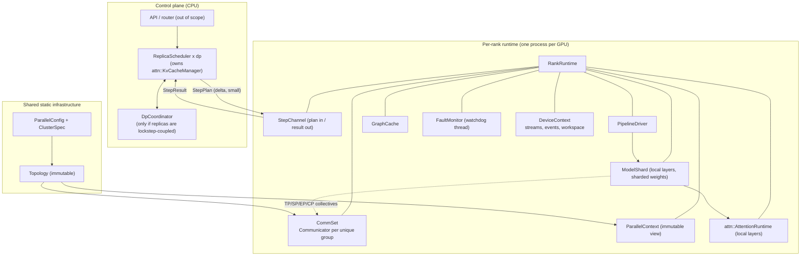
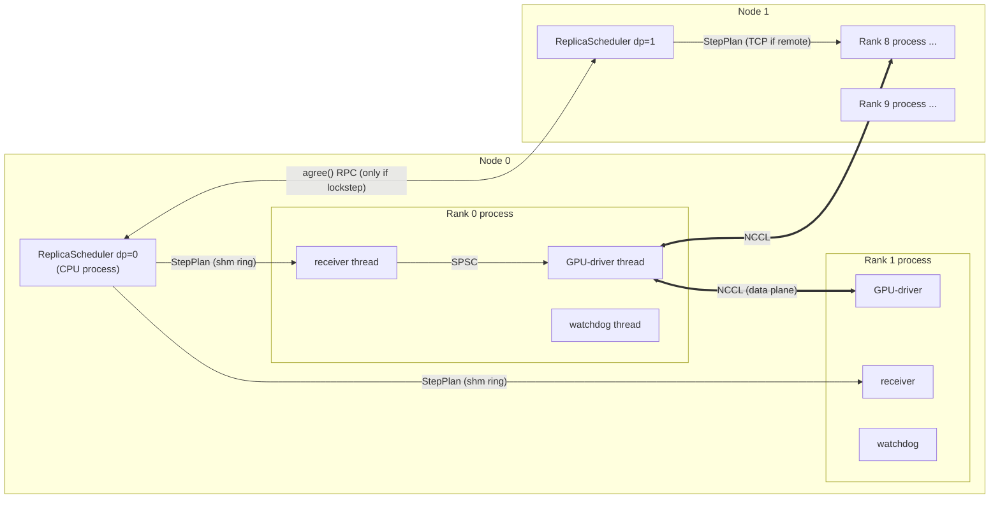
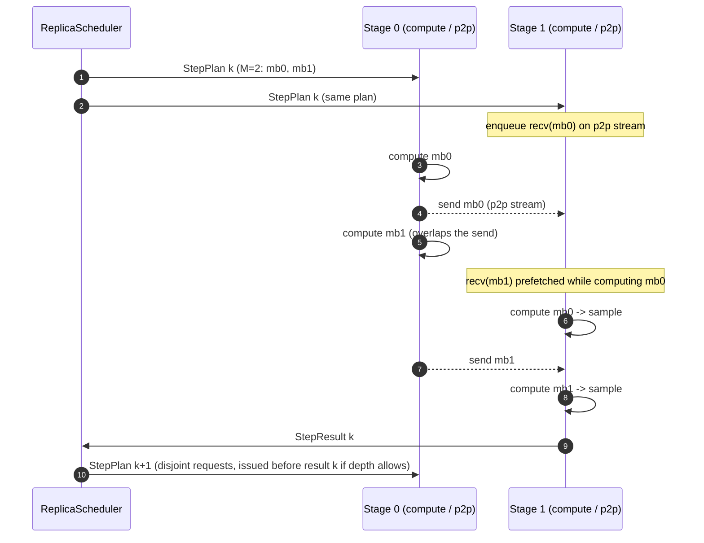
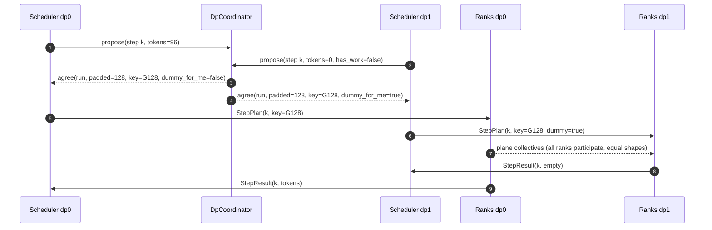
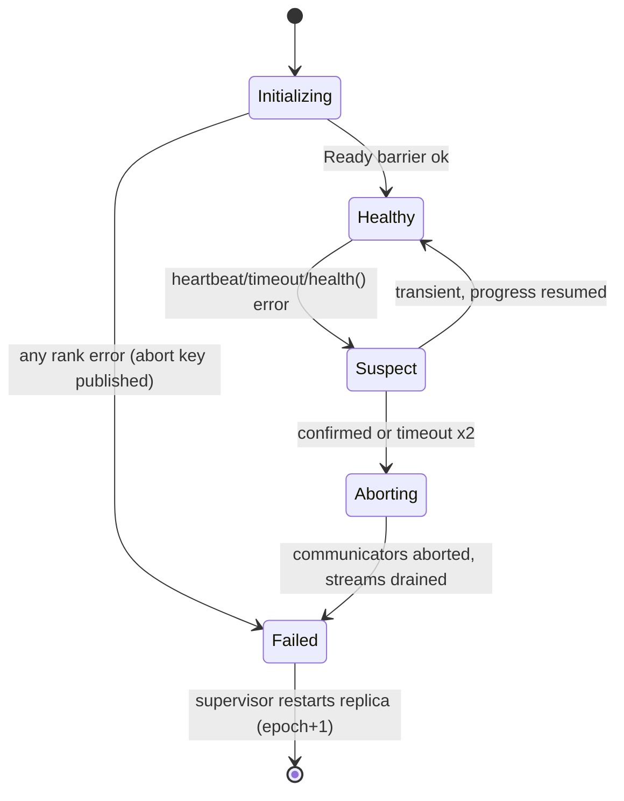

# Distributed Execution Architecture (C++20)

| | |
|---|---|
| **Status** | Proposed design, ready for implementation review |
| **Scope** | Per-rank execution runtime, parallel topology, communication, model partitioning and weight loading, step scheduling (incl. pipeline), control plane, CUDA streams/Graphs, failure handling |
| **Companion document** | [`docs/attention.md`](attention.md): the Attention/KV-cache design this document integrates with (referred to as **ATT**) |
| **Out of scope** | Request scheduling policy (what to batch), sampling algorithms, API server, kernel implementations, quantization formats |

---

## 0. Read this first: assumptions and provenance

**Repository.** As with ATT, no repository checkout was available in the working environment (no `CMakeLists.txt`, no `.git`; the only pre-existing artifact was `docs/attention.md`). The instruction to inspect "execution flow, model interfaces, runtime components, and conventions" could not be carried out. Consequently:

- The "existing Attention and KV cache implementation" this document integrates with is the **ATT design**, not code. Every ATT type referenced here (`attn::AttentionRuntime`, `attn::StepContext`, `attn::BatchDesc`, `attn::KvCacheManager`, `attn::AttentionSpec`, `attn::Status`, `attn::TensorView`, `attn::StreamHandle`) is used as defined in ATT. Where this design needs ATT to change, §11.4 lists the change explicitly.
- Conventions assumed (same as ATT): C++20; `namespace exec`; exceptions allowed at init, not on the step path; `Status` return codes on the hot path; one process per GPU.
- Any model-interface assumptions (§8) are stated as requirements on the model layer, to be reconciled with the real code on first review.

**Provenance of claims about other engines.** Tags:

- **[V]** seen in documentation or source snippets retrieved in this session. Several sources were third-party mirrors or forum posts rather than official docs; those are marked **[V-weak]**.
- **[M]** from prior knowledge, *not* re-verified. Treat as a pointer, not a fact.

| Engine | What was verified in this session |
|---|---|
| vLLM | A `GroupCoordinator` object "takes charge of all the communication operations among the processes in the group" and exposes broadcast, tensor-dict broadcast, send/recv, first/last-rank and next/previous-rank queries **[V]**. Groups are created with `initialize_model_parallel` and torn down with `destroy_model_parallel`; vLLM "takes over the control of the distributed environment from PyTorch" **[V]**. DP, TP, EP groups exist; `EP_SIZE` is computed automatically; with expert parallelism "attention layers still use tensor parallelism" **[V-weak]**. A Data Parallel Deployment guide and an EPLB state module exist **[V]** (contents not read). |
| TensorRT-LLM | A `Mapping(world_size, tp_size, pp_size, cp_size, …)` object; `world_size = tp_size × pp_size × cp_size` **[V]**. MoE parallel patterns: TP, EP, or hybrid, with `moe_tp_size × moe_ep_size == tp_size` **[V]**. Docs list TP, PP, EP, CP and an "Attention Data Parallelism" mode; "Helix" is MoE + CP **[V-weak]**. |
| SGLang | Scheduler → `TpModelWorker` → model runner pipeline; CPU-side `ScheduleBatch` reduced to a minimal forward-pass batch **[V-weak]**. Native DP "creates multiple worker processes … under the control of `DataParallelController`" **[V]**. **DP Attention (DPA)** = "data parallelism specifically to the attention component", "DP for attention, TP for FFN"; commonly paired with EP for MoE but does not require it; `--dp-size` must be set explicitly with `--enable-dp-attention` **[V]**. Docs mention DeepEP, Two-Batch Overlap and EPLB under expert parallelism **[V]** (contents not read). |

Everything else said about these engines is **[M]**, and the design does not *depend* on any **[M]** item being true: each design decision is justified from requirements (collective semantics, memory, latency), with the references used only as corroboration.

---

## 1. Goals, non-goals, principles

### 1.1 Goals

1. One runtime that executes single-GPU, multi-GPU, and multi-node inference from the same code path, differing only in configuration.
2. Represent TP, PP, DP, EP, CP, SP and their compositions *without* one interface per strategy.
3. Integrate with ATT: per-rank `AttentionRuntime`, per-replica KV management, graph-compatible metadata.
4. Minimal per-step overhead: no allocation, no host-side collective negotiation, no blocking on the GPU-driver thread.
5. Make deadlock-freedom a *structural* property (ordering rules enforced by construction and checked in debug builds), not a convention.
6. Failure is a first-class state: detect, abort, report, and keep the control plane alive.

### 1.2 Non-goals (v1)

Elastic resizing of a live deployment; heterogeneous GPUs within one replica; automatic parallelism-config search; speculative-decoding-specific parallelism; prefill/decode disaggregation between *deployments* (KV transfer hooks are noted in §18 but not designed here).

### 1.3 Principles

| # | Principle | Consequence |
|---|---|---|
| E1 | **Classify strategies by *where they act*, not by name.** | TP/EP/SP/CP act inside operators; PP and DP act on step orchestration; all share topology, communicators, and sharded weights. §3. |
| E2 | **Topology is data, resolved once, identical on every rank.** | `Topology` is immutable and deterministic. No rank computes groups differently. |
| E3 | **SPMD.** Every rank runs the same program; behavior differs only through `RankInfo`/`ParallelContext`. | One binary path to test; collective order is identical by construction. |
| E4 | **Operators receive a `ParallelContext`; the runtime does not call collectives on their behalf.** | TP/SP/EP/CP stay in model/operator code, where fusion and overlap opportunities live. |
| E5 | **The control plane sends *plans*, never tensors.** | Small deltas to all ranks; data-plane traffic is only NCCL-class transfers of activations. |
| E6 | **One program order of collectives per rank, derived from the plan.** | Every deadlock analysis in §13 reduces to "do all ranks issue the same sequence?" |
| E7 | **All sizes that affect collectives are decided by the scheduler/coordinator, not by individual ranks.** | Padded token counts, graph keys, microbatch splits arrive in the plan. |
| E8 | **Abstraction must pay rent.** | §16 lists interfaces deliberately not introduced (e.g. `ParallelStrategy`). |

---

## 2. Reference architecture analysis

### 2.1 Patterns observed

| Pattern | Seen in | Evidence | Adopt? |
|---|---|---|---|
| A **rank-ordered mesh** `world = tp × pp × (cp) [× dp]` resolved into per-axis groups | TRT-LLM `Mapping` **[V]**; vLLM groups per axis **[V]** | Yes: `Topology` (§5) |
| A **per-group communication object** wrapping the backend, with collective *and* point-to-point ops and "next/previous rank in group" helpers | vLLM `GroupCoordinator` **[V]** | Yes, as a concrete `Communicator` (§6); next/prev derived from `GroupDesc` |
| Explicit **init and destroy** entry points for model-parallel state | vLLM **[V]** | Yes, but RAII instead of global state: `Topology` + `Communicator` objects owned by `RankRuntime` |
| **EP as a refinement of TP** (`moe_tp × moe_ep == tp`) | TRT-LLM **[V]** | Partly: generalized to the DP×TP plane (below) |
| **DP attention + TP/EP FFN** hybrid for MoE and MLA models | SGLang **[V]**; TRT-LLM "Attention DP" **[V-weak]** | Yes: first-class `dp_attention` mode (§5.3, §10.3) |
| **Separate scheduler process(es)** feeding workers; **DP via multiple worker process groups under a controller** | SGLang **[V]**; vLLM **[M]** | Yes: per-replica scheduler (§9.2) |
| **Two-level batch representation**: CPU-rich scheduling batch → minimal device-oriented forward batch | SGLang **[V-weak]** | Yes: `StepPlan` → `attn::BatchDesc` |
| **Workers keep request state and receive deltas** | vLLM V1 **[M]** | Yes: `RequestTable` + delta `StepPlan` (§9.3). Justified independently by plan size. |
| **Two-batch overlap** (compute/communication overlap by splitting a batch) for MoE | SGLang mentions it **[V]** | Optional optimization (§12.3), enabled by the microbatch dimension of `StepPlan` |

### 2.2 What this design intentionally does differently

1. **No global parallel state.** vLLM-style module-level groups (**[V]** `initialize_model_parallel`/`destroy_model_parallel`) are convenient in Python; in C++ they hamper testing and make multi-runtime processes (tests, in-process simulation) impossible. Here the state lives in a `ParallelContext` passed explicitly.
2. **EP is defined over a *plane*, not over TP.** TRT-LLM's constraint `moe_tp × moe_ep == tp` **[V]** is the `dp = 1` special case. With DP attention, the FFN spans `dp × tp`. One definition (`MoeLayout`, §5.3) covers both.
3. **PP and DP are runtime concepts; TP/EP/SP/CP are not.** Many engines blur this by threading all of them through one worker class. See §3.
4. **Scheduler-chosen sizes** (E7). Engines that let each DP rank size its own padded batch need extra synchronization; here the plan carries the agreed size.

---

## 3. Key insight: strategies are not interchangeable

If "parallelism strategy" were an interface (`ParallelStrategy::forward(...)`) with TP/PP/DP/EP/CP/SP implementations, it would be wrong in a specific way: these strategies **compose**, and they act at **different levels**. Classification by the level at which each acts:

| Strategy | What is partitioned | Acts at | Needs from runtime | Lives in |
|---|---|---|---|---|
| **TP** | Weight matrices (heads, FFN width) | Operator (all-reduce / reduce-scatter+all-gather) | TP communicator; sharded weights | Model/operator layer + loader |
| **SP** | Activations along tokens *within TP region* | Operator (replaces all-reduce with RS+AG) | TP communicator; token padding to multiple of `tp` | Model/operator layer |
| **EP** | MoE expert weights and routed tokens | Operator (all-to-all dispatch/combine) | EP communicator; fixed-capacity buffers for graphs | MoE operator |
| **CP** | The sequence (KV and queries) | Attention operator (ring/LSE-merge) + KV placement | CP communicator; KV manager placement policy | Attention backend + KV manager |
| **PP** | Layers (stages) | **Step orchestration** (microbatches, send/recv of activations) | PP communicator; stage-local model; schedule | Runtime (`PipelineDriver`) |
| **DP** | Requests (independent replicas) | **Control plane** (routing); plus lockstep if replicas are coupled by cross-DP collectives | Per-replica scheduler; optional `DpCoordinator` | Runtime/control plane |

Consequences that shape everything below:

1. **Shared infrastructure** (needed by all): `Topology`, `Communicator`, `DeviceContext` (streams/events), sharded weight loading, `ParallelContext`.
2. **Runtime-owned strategies** are PP and DP only. They affect *what the runtime does each step*.
3. **Operator-owned strategies** are TP, SP, EP, CP. The runtime guarantees them infrastructure and an identical plan on every rank; the operators do the rest.
4. **Composition rules live in `Topology` validation**, not in strategy classes (e.g. `ep` must divide the FFN plane; `sp` requires `tp > 1`).
5. **Coupling between DP ranks** is a property of the *model's collectives* (does any layer communicate across DP?), not of the DP size. This yields the `LockstepGroup` concept (§10.3).

### 3.1 Decision log

| # | Question | Decision | § |
|---|---|---|---|
| D1 | Core execution abstraction | `RankRuntime`: the per-rank owner of device, communicators, model shard, `AttentionRuntime`, graphs. It executes `StepPlan`s. Not a hierarchy. | 9 |
| D2 | Organization across processes/devices | One process per GPU (SPMD), CPU-only scheduler process per DP replica, small control-plane transport. | 9.1 |
| D3 | Topology and groups | `ParallelConfig` → `Topology` (mesh + derived groups, deterministic order) → `Communicator` per group. | 5, 6 |
| D4 | Composition of TP/PP/DP/EP/CP/SP | Mesh axes `DP×PP×CP×TP`; EP/MoE-TP derived over the DP×TP plane; SP is a flag on TP. | 5 |
| D5 | Runtime vs operator | PP, DP in runtime; TP, SP, EP, CP in operators via `ParallelContext`. | 3 |
| D6 | Partitioning and loading | Declarative `ShardSpec` per parameter; each rank reads only its slice; PP loads only owned stages. | 7 |
| D7 | Request/result flow | Delta `StepPlan` to all ranks of a replica; `StepResult` from one designated rank. | 9 |
| D8 | Pipeline coordination | Microbatch-based `PipelineDriver`; per-pair FIFO P2P; in-flight depth ≤ `pp`. | 10 |
| D9 | Attention/KV interaction | Per-rank `AttentionRuntime` over *local* heads/layers; one KV manager per DP replica; page count agreed by min-reduce. | 11 |
| D10 | Async, streams, graphs | Three streams per rank; one ordered comm stream; graph keys chosen by the scheduler. | 12 |
| D11 | Failure | Watchdog + abort + failure domains; fail-fast per replica. | 13 |
| D12 | Evolution | New *operator-level* strategies need no runtime change; new *orchestration-level* ones add a `PipelineDriver`-like component. | 18 |

---

## 4. Proposed architecture

### 4.1 Layers and components



| Component | Kind | Lifetime | Thread | Responsibility |
|---|---|---|---|---|
| `ParallelConfig`, `ClusterSpec` | values | process | any | User/deployment description |
| `Topology` | immutable value | process | any | Rank↔coordinate↔device mapping; all groups, validated |
| `Communicator` | move-only RAII | engine | GPU-driver thread (+ `abort()` from watchdog) | One per *unique member set*; collectives and P2P |
| `CommSet` | owner | engine | GPU-driver | Owns the Communicators of this rank; resolves `GroupKind → Communicator&` |
| `DeviceContext` | RAII | engine | GPU-driver | Device, streams, event pool, workspace |
| `ParallelContext` | immutable view | engine | any (read-only) | What model code sees: sizes, ranks, communicators, MoE layout |
| `ModelShard` | polymorphic, 1 per rank | engine | GPU-driver | Local layers + weights; `forward` for one microbatch |
| `WeightLoader` | function object | init | init threads | Sharded, streaming weight load |
| `attn::AttentionRuntime` | from ATT | engine | GPU-driver | Local attention layers, KV pool, metadata |
| `PipelineDriver` | concrete class | engine | GPU-driver | Runs a `StepPlan`'s microbatches across stages |
| `GraphCache` | concrete class | engine | GPU-driver | Captures/replays CUDA Graphs per `GraphKey` |
| `StepChannel` | concrete class | engine | receiver thread → GPU-driver | Plan in, result out; bounded SPSC rings |
| `ReplicaScheduler` | control plane | engine | scheduler process | Batching, KV block accounting, plan production |
| `DpCoordinator` | control plane | engine | scheduler process(es) | Lockstep sizing across DP replicas |
| `FaultMonitor` | concrete class | engine | watchdog thread | Detect, abort, report |
| `RankRuntime` | composition root | process | owns all of the above | The per-rank executor |

### 4.2 Relationship rules

1. `RankRuntime` owns everything on its rank; no component holds an owning reference to a sibling. Siblings reference each other through `ParallelContext` (immutable) or constructor-injected non-owning pointers whose lifetimes are bounded by `RankRuntime`.
2. `ModelShard` depends on `ParallelContext`, `DeviceContext` and `attn::StepContext`, and on nothing in the control plane.
3. The control plane never touches CUDA. Ranks never touch scheduling policy.
4. `Topology` is the only place that knows how ranks map to groups; operators ask `ParallelContext`.
5. The GPU-driver thread is the only thread that enqueues work on streams or calls collectives. The watchdog thread may only call `Communicator::abort()` and read health state.

---

## 5. Topology

### 5.1 Configuration

```cpp
// exec/config.h
#pragma once
#include <array>
#include <chrono>
#include <cstdint>
#include <span>
#include <string>
#include <vector>

namespace exec {

enum class Axis : std::uint8_t { DP, PP, CP, TP, Count };

struct ParallelConfig {
  int dp = 1, pp = 1, cp = 1, tp = 1;

  // MoE FFN layout over the "FFN plane" (see 5.3). ep * moe_tp must equal plane_size().
  // ep == 1 means "no expert parallelism" (moe_tp == plane_size()).
  int  ep = 1;

  // true : attention is data-parallel across `dp` ranks (each has its own batch and KV),
  //        FFN/MoE spans the dp*tp plane. Replicas are therefore lockstep-coupled.
  // false: DP replicas are fully independent (no cross-DP communication).
  bool dp_attention = false;

  // Megatron-style sequence parallelism inside the TP region (needs tp > 1).
  bool sequence_parallel = false;

  // Mixed-radix order of mesh axes, outermost -> innermost. Innermost varies fastest in rank numbering,
  // so by default TP groups are contiguous ranks (intra-node, NVLink-friendly).
  std::array<Axis, 4> axis_order{Axis::DP, Axis::PP, Axis::CP, Axis::TP};

  // Layers per pipeline stage. Empty = balanced split. Size must equal pp when non-empty.
  std::vector<int> pp_layer_split;

  bool allow_cross_node_tp = false;      // otherwise Topology::build rejects TP groups spanning nodes

  [[nodiscard]] constexpr int world_size() const noexcept { return dp * pp * cp * tp; }
  // Number of ranks that share MoE FFN work for one (pp, cp) coordinate.
  [[nodiscard]] constexpr int plane_size() const noexcept { return dp_attention ? dp * tp : tp; }
};

struct ClusterSpec {
  int num_nodes = 1;
  int gpus_per_node = 1;
  std::string rendezvous_endpoint;                 // host:port of the bootstrap store
  std::chrono::seconds init_timeout{300};
};

}  // namespace exec
```

World size is `dp × pp × cp × tp`, extending the TRT-LLM relation `tp × pp × cp` **[V]** with `dp`. Note the convention difference from SGLang, whose `--tp-size` is the *total* with DPA carving out an attention-TP share **[M]**: here `tp` always means *tensor-parallel size within one DP rank's attention*.

### 5.2 Topology value

```cpp
// exec/topology.h
namespace exec {

enum class GroupKind : std::uint8_t {
  World, Dp, Pp, Cp, Tp,
  Ep,      // ranks exchanging routed tokens (all-to-all)
  MoeTp,   // ranks sharing one expert's weights (all-reduce of expert output)
  Plane    // ranks sharing the FFN plane when dp_attention (token all-gather / lockstep barrier)
};

struct RankCoord { int dp = 0, pp = 0, cp = 0, tp = 0; };

struct RankInfo {
  int global = 0;
  int node = 0;
  int local = 0;        // index within node
  int device = 0;       // CUDA device ordinal (== local by default)
  RankCoord c;
};

struct GroupDesc {
  std::uint32_t        id = 0;            // stable index in Topology::groups()
  GroupKind            kind{};
  std::vector<int>     members;           // global ranks, ascending; identical on every member rank
  [[nodiscard]] int size() const noexcept { return static_cast<int>(members.size()); }
};

class Topology {
 public:
  // Validates the configuration against the cluster; throws ConfigError with ALL violations listed.
  static Topology build(const ParallelConfig&, const ClusterSpec&);

  [[nodiscard]] const ParallelConfig& config() const noexcept { return cfg_; }
  [[nodiscard]] int world_size() const noexcept { return cfg_.world_size(); }
  [[nodiscard]] const RankInfo& rank(int global) const { return ranks_[global]; }

  // All distinct member sets, in a global canonical order (see 5.4). Same list on every rank.
  [[nodiscard]] std::span<const GroupDesc> groups() const noexcept { return groups_; }

  // The group of `kind` that contains `global`. Aliased kinds return the same GroupDesc
  // (e.g. Ep == Plane when ep == plane_size()). Size-1 groups exist but need no communicator.
  [[nodiscard]] const GroupDesc& group_of(int global, GroupKind kind) const;

  // Index of `global` within group_of(global, kind).members.
  [[nodiscard]] int rank_in_group(int global, GroupKind kind) const;

  // Layer range [first, last) owned by pipeline stage `pp` for a model of `num_layers`.
  [[nodiscard]] std::pair<int, int> stage_layers(int pp, int num_layers) const;

 private:
  ParallelConfig cfg_{};
  std::vector<RankInfo> ranks_;
  std::vector<GroupDesc> groups_;
  std::vector<std::array<std::uint32_t, 8>> group_index_;   // [global][GroupKind] -> groups_ index
};

}  // namespace exec
```

Rank numbering is mixed-radix over `axis_order`. With the default order `[DP, PP, CP, TP]`:

```
global = ((dp * PP + pp) * CP + cp) * TP + tp
```

### 5.3 Deriving MoE groups (EP, MoE-TP, Plane)

Let `plane_size = dp_attention ? dp*tp : tp`, `moe_tp = plane_size / ep` (validation: `ep | plane_size`). For a rank with coordinate `(dp, pp, cp, tp)`:

```
plane_index  = dp_attention ? dp * TP + tp : tp
ep_rank      = plane_index / moe_tp
moe_tp_rank  = plane_index % moe_tp
```

- **`Ep` group**: same `(pp, cp, moe_tp_rank)` and, if `!dp_attention`, same `dp`; varying `ep_rank`.
- **`MoeTp` group**: same `(pp, cp, ep_rank)` (and same `dp` if `!dp_attention`); varying `moe_tp_rank`.
- **`Plane` group** (only meaningful if `dp_attention`): same `(pp, cp)`; varying `(dp, tp)`.

Special cases fall out of the formula rather than being separate code paths:

| Configuration | Result |
|---|---|
| `ep = 1`, `dp_attention = false` | `MoeTp` = `Tp` (TP-only MoE); `Ep` groups have size 1 |
| `ep = tp`, `dp_attention = false` | Pure EP inside TP group; `Ep` == `Tp` group; `MoeTp` size 1. Matches TRT-LLM's EP-only pattern **[V]** |
| `1 < ep < tp`, `dp_attention = false` | Hybrid EP×TP for MoE, `ep × moe_tp = tp`. Matches TRT-LLM's constraint **[V]** |
| `dp_attention = true`, `tp = 1`, `ep = dp` | DPA + EP: attention fully data-parallel, experts spread across all DP ranks. The SGLang DPA+EP combination **[V]** |
| `dp_attention = true`, `ep = 1` | DPA without EP (FFN tensor-parallel over the plane). SGLang says DPA does not require EP **[V]** |

Aliased groups (identical member sets) share one `Communicator`: deduplication happens in `Topology`, so e.g. `Ep == Plane` costs one NCCL communicator, not two.

### 5.4 Canonical order and rank→device mapping

- `groups()` is sorted by `(members.front(), kind, size)`; every rank iterates the same list. This is the key to deadlock-free initialization (§13.1).
- `device = local rank` by default; `ClusterSpec`/environment may supply an explicit map (e.g. NUMA-aware or after `CUDA_VISIBLE_DEVICES` filtering). `Topology::build` validates that each node hosts exactly `gpus_per_node` ranks and that no device is used twice.
- With the default axis order, TP is innermost, so a TP group is `tp` consecutive ranks; `build` **rejects** TP groups that cross nodes unless `allow_cross_node_tp`. PP is outer to TP, so a PP chain naturally crosses nodes when `tp × cp × pp > gpus_per_node`.

### 5.5 Validation rules (`Topology::build`)

`build` collects *all* violations and throws one `ConfigError` listing them:

| Rule | Reason |
|---|---|
| `world_size == num_nodes × gpus_per_node` | One rank per GPU |
| `ep ≥ 1`, `plane_size % ep == 0` | MoE layout is well-defined |
| `sequence_parallel ⇒ tp > 1` | SP is a TP refinement |
| `dp_attention ⇒ dp > 1` | Matches SGLang's behavior (disabled when `dp == 1`) **[V]** |
| `pp_layer_split` empty or `size == pp`; sums checked against `num_layers` at model load | Stage layout |
| TP group within one node unless allowed | Latency |
| `cp > 1` ⇒ see §17 (constraints table) | CP is representable but gated by backend support |
| model-dependent checks (`tp | num_q_heads`, `ep | num_experts`) | Done by `ModelShard` construction using `ParallelContext`, reported with the same error type |

---

## 6. Communication

### 6.1 `Communicator`: one concrete class, one per unique group

```cpp
// exec/comm.h
#pragma once
#include "attn/types.h"        // attn::TensorView, attn::Status, attn::StreamHandle
#include "exec/topology.h"

namespace exec {

using attn::Status;
using attn::StreamHandle;
using attn::TensorView;

enum class ReduceOp : std::uint8_t { Sum, Max, Min };
enum class CommBackend : std::uint8_t { Nccl, Sim /* in-process simulation for tests, see 19 */ };

struct CommOptions {
  CommBackend backend = CommBackend::Nccl;
  std::chrono::milliseconds op_timeout{120'000};   // enforced by FaultMonitor, not by blocking calls
  bool enable_small_allreduce_fastpath = false;    // optional optimization O-e (§12.3)
};

// Bootstrap key/value store used to exchange backend unique-ids. Cold path only.
class Rendezvous {
 public:
  virtual ~Rendezvous() = default;
  virtual void put(std::string_view key, std::span<const std::byte> value) = 0;
  virtual std::vector<std::byte> get(std::string_view key, std::chrono::milliseconds timeout) = 0;
  virtual void barrier(std::string_view name, int participants, std::chrono::milliseconds timeout) = 0;
};

class Communicator {
 public:
  // Collective over `group.members`; every member must call it, in canonical group order (5.4).
  // Throws CommError on failure (init time).
  static Communicator create(const GroupDesc& group, const RankInfo& self, Rendezvous&, const CommOptions&);

  Communicator(Communicator&&) noexcept;
  Communicator& operator=(Communicator&&) noexcept;
  Communicator(const Communicator&) = delete;
  Communicator& operator=(const Communicator&) = delete;
  ~Communicator();                                     // releases backend resources; never throws

  [[nodiscard]] int size() const noexcept;
  [[nodiscard]] int rank() const noexcept;             // rank within the group
  [[nodiscard]] const GroupDesc& desc() const noexcept;

  // ---- Stream-ordered, asynchronous. No host synchronization. No allocation. noexcept. ----
  // All ranks of the group MUST issue the same sequence of these calls with matching shapes (rule R1, 13.2).
  [[nodiscard]] Status all_reduce(TensorView inout, ReduceOp, StreamHandle) noexcept;
  [[nodiscard]] Status all_gather(TensorView in, TensorView out, StreamHandle) noexcept;       // concat on dim 0
  [[nodiscard]] Status reduce_scatter(TensorView in, TensorView out, ReduceOp, StreamHandle) noexcept;
  [[nodiscard]] Status broadcast(TensorView inout, int root_in_group, StreamHandle) noexcept;
  // Equal-split all-to-all: dim 0 of `send`/`recv` is size()*slot. Graph-friendly (fixed shapes).
  [[nodiscard]] Status all_to_all(TensorView send, TensorView recv, StreamHandle) noexcept;
  // Variable counts known on the HOST (elements per peer). Not graph-capturable; eager only.
  [[nodiscard]] Status all_to_all_v(TensorView send, std::span<const std::int64_t> send_counts,
                                    TensorView recv, std::span<const std::int64_t> recv_counts,
                                    StreamHandle) noexcept;
  // Point-to-point; `peer` is a rank within the group. FIFO per (communicator, peer, direction).
  [[nodiscard]] Status send(TensorView, int peer, StreamHandle) noexcept;
  [[nodiscard]] Status recv(TensorView, int peer, StreamHandle) noexcept;

  // ---- Host-side control (init / capture / shutdown only; blocks the caller) ----
  void barrier_host(std::chrono::milliseconds timeout);

  // ---- Failure ----
  [[nodiscard]] Status health() const noexcept;        // backend async-error poll; cheap, thread-safe
  void abort() noexcept;                               // thread-safe; unblocks pending ops; communicator unusable after

 private:
  struct Impl;
  std::unique_ptr<Impl> p_;                            // backend handle + op table chosen at create()
};

}  // namespace exec
```

Design notes:

- **Concrete class with a pimpl op table**, not a virtual hierarchy: one pointer chase + one indirect call per collective. Collectives take 10s of µs and up; this is noise. The backend choice (`Nccl` / `Sim`) is fixed at `create()`.
- **The "async" in the API is stream ordering.** Nothing returns a future. Completion is expressed with events (§12.2). This avoids a second asynchrony model.
- **Collectives are in place or explicit-output**, never allocating; scratch/staging belongs to the backend and is allocated at `create()` (needed for CUDA Graph safety).
- **Equal-split all-to-all is the graph-friendly path.** EP dispatch uses fixed per-peer capacity with a device-side count array carried in the payload header or a side tensor; `all_to_all_v` exists for eager mode only (host counts require a sync).
- `abort()` and `health()` are the *only* cross-thread entry points (watchdog).
- vLLM's `GroupCoordinator` also bundles first/last-rank and next/prev-rank queries **[V]**. Here those are trivial functions of `rank()`/`size()` and `GroupDesc::members`, so they stay out of the class.

### 6.2 `CommSet`: ownership and lookup

```cpp
class CommSet {
 public:
  // Creates every *required* communicator this rank belongs to, in canonical order. Required kinds are derived
  // from the config: Tp (tp>1), Pp (pp>1), Cp (cp>1), Ep (ep>1), MoeTp (moe_tp>1), Plane (dp_attention).
  // Dp and World are host-side only in v1 (no communicator). Size-1 groups are skipped.
  static CommSet create(const Topology&, const RankInfo& self, Rendezvous&, const CommOptions&);

  [[nodiscard]] Communicator* find(GroupKind) noexcept;        // nullptr for size-1 groups
  [[nodiscard]] std::span<Communicator* const> all() noexcept; // for FaultMonitor
 private:
  std::vector<std::unique_ptr<Communicator>> owned_;           // deduped by member set
  std::array<Communicator*, 8> by_kind_{};                     // aliasing: several kinds may point to one
};
```

Lookup is by `GroupKind` into a fixed array: no hashing on the hot path, and `nullptr` for size-1 groups lets operators skip collectives with a single branch, without virtual dispatch or a null-object.

### 6.3 Which collective belongs to which strategy

| Strategy | Collectives (per layer unless noted) | Group |
|---|---|---|
| TP | all-reduce after row-parallel projections (attention out, FFN down) | `Tp` |
| TP+SP | reduce-scatter after row-parallel; all-gather before column-parallel | `Tp` |
| TP (vocab) | all-gather or reduce of logits (once per step) | `Tp` |
| EP | all-to-all dispatch, all-to-all combine | `Ep` |
| MoE-TP | all-reduce of expert output | `MoeTp` |
| DPA | all-gather of tokens/activations before FFN; reduce-scatter/slice after | `Plane` |
| CP | ring send/recv of KV chunks or all-gather + partial-LSE merge, inside attention | `Cp` |
| PP | send/recv of hidden (+residual) at stage boundaries | `Pp` |
| DP (independent) | none | – |
| Control | host barrier; min-reduce of KV pages at init | `World`/`Dp` |

---

## 7. Model partitioning and weight loading

### 7.1 Where partitioning decisions live

- **Which dimension is split and over which axis**: declared by the model layer, per parameter, in a `ShardSpec` (data).
- **Which slice this rank holds**: computed by one shared function from `ShardSpec` + `ParallelContext`, used by both the layer (to allocate local shapes) and the loader (to read the right bytes). This single source of truth prevents shape/loader drift.
- **Which layers a rank owns (PP)**: `Topology::stage_layers`.

```cpp
// exec/shard.h
namespace exec {

using Shape = std::array<std::int64_t, 4>;

// Split dimension `dim` over `axis`. If `replicate > 1`, the axis size is divided into groups of
// `replicate` ranks that hold the SAME piece (e.g. KV heads when tp > num_kv_heads).
struct SplitSpec {
  Axis axis = Axis::TP;
  int  dim = 0;
  int  replicate = 1;
};

struct FusedSegment {                   // for fused projections (QKV, gate_up) along `split.dim`
  std::int64_t size = 0;                // global extent of this segment
  bool         replicated = false;      // true: segment is whole on every rank
  int          replicate = 1;           // like SplitSpec::replicate for this segment
};

struct ShardSpec {
  enum class Kind : std::uint8_t {
    Replicated,   // full tensor on every rank of the stage
    Split,        // `split` over its axis
    Fused,        // `segments` concatenated along split.dim, each segment split/replicated independently
    Expert        // dim `expert_dim` indexes experts, partitioned over Ep; other dims by `split` over MoeTp
  } kind = Kind::Replicated;
  SplitSpec                      split{};
  std::span<const FusedSegment>  segments{};
  int                            expert_dim = 0;
};

enum class Owner : std::uint8_t { Layer, FirstStage, LastStage, AllStages };

struct ParamDecl {
  std::string_view name;                // checkpoint tensor name
  Shape            global_shape{};
  std::uint8_t     rank = 0;
  attn::DType      dtype = attn::DType::BF16;
  ShardSpec        shard{};
  Owner            owner = Owner::Layer;
  int              layer = -1;          // global layer index when owner == Layer
  attn::TensorView dst{};               // local storage, allocated by the model from local_shape()
};

class ParallelContext;
// Single source of truth: local shape of `p` on this rank.
[[nodiscard]] Shape local_shape(const ParamDecl&, const ParallelContext&);
// Does this rank hold `p` at all (PP ownership)?
[[nodiscard]] bool owned_here(const ParamDecl&, const ParallelContext&, int num_layers);

}  // namespace exec
```

Worked example (GQA model, `tp = 4`, `Hq = 32`, `Hkv = 2`, `D = 128`):

- Fused QKV weight along dim 0: segments `{Q: 4096 split}`, `{K: 256, replicate = 2}`, `{V: 256, replicate = 2}`. With `tp = 4` and `Hkv = 2`, K/V are split in 2 pieces, each held by 2 ranks (`replicate = tp / Hkv`). Each rank gets `Hq/4 = 8` Q heads and `1` KV head. `local_shape` gives `[8·128 + 128 + 128, hidden]`.
- This `replicate` factor is *also* what ATT needs: the layer's `DenseParams` uses **local** head counts (§11.1), so replication shows up as `num_kv_heads_local = max(1, Hkv/tp)` and a KV-memory multiplier that the pool planner sees through `StateSpec`.

### 7.2 Streaming, sharded loading

```cpp
// exec/weights.h
namespace exec {

struct TensorMeta { std::string file; std::uint64_t offset = 0; Shape shape{}; std::uint8_t rank = 0; attn::DType dtype{}; };

class CheckpointIndex {                          // memory-maps checkpoint shards; read-only; thread-safe
 public:
  static CheckpointIndex open(const std::filesystem::path& dir);       // throws LoadError
  [[nodiscard]] const TensorMeta* find(std::string_view name) const noexcept;
  [[nodiscard]] std::span<const std::byte> bytes(const TensorMeta&) const noexcept;  // mmap view
};

struct LoadOptions {
  std::size_t staging_bytes = 256u << 20;        // pinned double-buffer
  int         io_threads = 4;
};

// Each rank reads ONLY its slices: no rank-0 read + broadcast. Throws LoadError listing every
// missing / mismatching tensor (not just the first).
void load_weights(std::span<const ParamDecl>, const CheckpointIndex&, const ParallelContext&,
                  DeviceContext&, const LoadOptions&);

}  // namespace exec
```

Algorithm per parameter: compute the slice description (strided source region + destination) → copy from the mmap'd file into a pinned staging buffer (I/O threads) → `cudaMemcpyAsync` on the `copy` stream → optional post-processing hook (dtype conversion, repacking) → completion event. Staging is double-buffered so disk, PCIe, and (optional) repack overlap. Fused segments are gathered by issuing one strided copy per segment.

Rules:

1. **Only owned parameters are loaded** (`owned_here`). Pipeline stages therefore load disjoint layer subsets; each rank's checkpoint read is ≈ `1/(tp·pp)` of the model (≈ `1/(ep·moe_tp·pp)` for experts).
2. **Tied embedding/LM-head with PP**: stage 0 needs the embedding, the last stage needs the head; both load the tensor (`Owner::FirstStage` + `Owner::LastStage` declarations with the same checkpoint name). The duplicated memory is accepted and documented (alternative in §16).
3. **Experts**: `Kind::Expert` ranks load only their experts; combined with `MoeTp` split of each expert's matrices.
4. **Validation before bytes move**: all shapes/dtypes/ownership checked first; a failed validation on any rank is reported via the rendezvous store so that peers abort loading instead of hanging at the next barrier (§13.3).
5. **Pre-sharded checkpoints** (as TRT-LLM's per-rank conversion **[V-weak]**) are an optional `CheckpointIndex` variant where `find` returns rank-local tensors and `ShardSpec` is treated as already applied; no other component changes.

---

## 8. `ParallelContext` and the model interface

### 8.1 `ParallelContext`: what operators see

```cpp
// exec/parallel_context.h
namespace exec {

struct MoeLayout {
  int ep = 1, moe_tp = 1;
  int ep_rank = 0, moe_tp_rank = 0;
  [[nodiscard]] constexpr int experts_per_rank(int num_experts) const noexcept { return num_experts / ep; }
  [[nodiscard]] constexpr int first_expert(int num_experts) const noexcept { return ep_rank * (num_experts / ep); }
};

class ParallelContext {
 public:
  ParallelContext(const Topology&, const RankInfo&, CommSet&);

  // Sizes and ranks (all const, all O(1))
  [[nodiscard]] int dp_size() const noexcept; [[nodiscard]] int dp_rank() const noexcept;
  [[nodiscard]] int pp_size() const noexcept; [[nodiscard]] int pp_rank() const noexcept;
  [[nodiscard]] int cp_size() const noexcept; [[nodiscard]] int cp_rank() const noexcept;
  [[nodiscard]] int tp_size() const noexcept; [[nodiscard]] int tp_rank() const noexcept;
  [[nodiscard]] bool is_first_stage() const noexcept { return pp_rank() == 0; }
  [[nodiscard]] bool is_last_stage()  const noexcept { return pp_rank() == pp_size() - 1; }
  [[nodiscard]] bool sequence_parallel() const noexcept;
  [[nodiscard]] bool dp_attention() const noexcept;
  [[nodiscard]] const MoeLayout& moe() const noexcept;

  // Communicators. nullptr when the group has size 1 -> callers skip the collective.
  [[nodiscard]] Communicator* tp()     const noexcept;
  [[nodiscard]] Communicator* ep()     const noexcept;
  [[nodiscard]] Communicator* moe_tp() const noexcept;
  [[nodiscard]] Communicator* cp()     const noexcept;
  [[nodiscard]] Communicator* pp()     const noexcept;
  [[nodiscard]] Communicator* plane()  const noexcept;
  [[nodiscard]] Communicator* world()  const noexcept;

  [[nodiscard]] const Topology& topology() const noexcept;
  [[nodiscard]] const RankInfo& self() const noexcept;
  [[nodiscard]] std::pair<int,int> layer_range(int num_layers) const;      // this stage's [first,last)
  [[nodiscard]] int prev_stage_rank() const noexcept;                      // rank within pp(); -1 if first
  [[nodiscard]] int next_stage_rank() const noexcept;                      // -1 if last
};

}  // namespace exec
```

`ParallelContext` is a small immutable view over `Topology`, `RankInfo`, and `CommSet`; it is cheap to copy by reference and safe to read from any thread (it exposes `Communicator*`, but only the GPU-driver thread may *use* them for ops, §4.2 rule 5).

### 8.2 `DeviceContext`: streams, events, fork/join

```cpp
// exec/device.h
namespace exec {

struct Event { void* raw = nullptr; };

struct StreamSet {
  StreamHandle compute;    // all math kernels, attention, metadata H2D for the current microbatch
  StreamHandle comm;       // ALL collectives of ALL communicators except Pp, in program order (rule R4)
  StreamHandle p2p;        // Pp send/recv (separate, see 10.2); may alias `comm` via config
  StreamHandle copy;       // weight loading, host<->device bulk copies, result D2H
};

class DeviceContext {
 public:
  explicit DeviceContext(int device_ordinal, bool p2p_on_comm_stream = false);
  ~DeviceContext();
  DeviceContext(const DeviceContext&) = delete;
  DeviceContext& operator=(const DeviceContext&) = delete;

  StreamSet streams;
  [[nodiscard]] int device() const noexcept;

  // Pre-allocated pool; acquire/release are O(1), lock-free (single-owner).
  [[nodiscard]] Event record(StreamHandle s) noexcept;          // cudaEventRecord on a pooled event
  void wait(StreamHandle s, Event e) noexcept;                  // cudaStreamWaitEvent
  void release(Event) noexcept;

  // Fork-join pattern: make `side` wait for work already on compute; run f(side); make compute wait
  // for f's work. Capturable inside CUDA Graph capture (becomes a fork/join in the graph).
  template <class F>
  [[nodiscard]] Status on_stream(StreamHandle side, F&& f) noexcept;

  [[nodiscard]] attn::WorkspaceRef workspace() const noexcept;   // arena shared with ATT (§11)
  void synchronize() noexcept;                                    // init/shutdown/failure paths only
};

}  // namespace exec
```

### 8.3 `ModelShard`: the per-rank model segment

This is the one *polymorphic* interface models implement; it is called once per microbatch per step, so a virtual call is irrelevant. Everything inside is concrete.

```cpp
// exec/model_shard.h
namespace exec {

// Activations crossing a pipeline boundary. Fixed slots (no map, no allocation).
// With sequence_parallel the token dim is the LOCAL shard [T/tp, H]; hence PP messages shrink by tp.
struct StageIO {
  attn::TensorView hidden;      // [T or T/tp, H]
  attn::TensorView residual;    // [T or T/tp, H]; undefined if the model fuses residual into hidden
};

// Per-microbatch inputs resident on the device (built by the runtime from the plan, see 9.3).
struct MicrobatchInputs {
  attn::TensorView token_ids;    // [T] int32; valid on first stage
  attn::TensorView positions;    // [T] int32
  attn::TensorView logits_rows;  // [R] int32 indices of rows to sample; valid on last stage
  std::int32_t     num_tokens = 0;          // PADDED if graph/DP-padded (see 12.4)
  std::int32_t     num_real_tokens = 0;     // before padding
};

struct ForwardCtx {
  const ParallelContext&     par;
  DeviceContext&             dev;
  const attn::StepContext&   attn;      // metadata for THIS microbatch (ATT §6.4)
  const MicrobatchInputs&    in;
};

class ModelShard {
 public:
  virtual ~ModelShard() = default;

  // Parameters this rank must hold (already filtered to local shapes). Used by load_weights().
  [[nodiscard]] virtual std::span<const ParamDecl> params() const = 0;

  // Specs of the attention layers owned by this stage, in layer order (input to AttentionRuntime::create).
  [[nodiscard]] virtual std::span<const attn::AttentionSpec> attention_specs() const = 0;

  // Hot path. `in` is undefined on the first stage; `out` is undefined on the last stage
  // (the last stage instead writes logits to `logits_out`).
  [[nodiscard]] virtual Status forward(const ForwardCtx&, const StageIO& in, StageIO& out,
                                       attn::TensorView logits_out) noexcept = 0;

  // Activation shape contract for PP buffers, so the runtime can pre-allocate them.
  [[nodiscard]] virtual std::int64_t hidden_size() const noexcept = 0;
  [[nodiscard]] virtual attn::DType  activation_dtype() const noexcept = 0;
};

using ModelFactory = std::function<std::unique_ptr<ModelShard>(const ParallelContext&, DeviceContext&)>;

}  // namespace exec
```

**Requirement on the model layer** (to be reconciled with the actual repository): layers are built from a `ParallelContext` (so local shapes are right) and call collectives through `ctx.par.tp()` etc. A model written for single-GPU runs unchanged with all sizes `1` and all `Communicator*` null.

### 8.4 Operator example: row-parallel linear with optional SP

```cpp
Status RowParallelLinear::forward(const ForwardCtx& c, attn::TensorView x, attn::TensorView out) const noexcept {
  // 1. Local partial product on the compute stream.
  if (Status s = gemm_(c.dev.streams.compute, x, weight_, partial_); !s) return s;

  Communicator* tp = c.par.tp();
  if (tp == nullptr) return copy_or_alias(partial_, out);             // tp == 1: nothing to do

  // 2. Collective on the comm stream, fork/join so compute resumes after it.
  return c.dev.on_stream(c.dev.streams.comm, [&](StreamHandle comm) noexcept {
    return c.par.sequence_parallel()
        ? tp->reduce_scatter(partial_, out, ReduceOp::Sum, comm)      // out: [T/tp, H]
        : tp->all_reduce(partial_, ReduceOp::Sum, comm);              // in place; out aliases partial_
  });
}
```

This form is *correct* but does not overlap communication with compute by itself, because the compute stream waits at the join. Overlap comes from interleaving two microbatches (§12.3), not from complicating every operator.

---

## 9. Execution runtime and control plane

### 9.1 Process and thread model



| Decision | Choice | Why |
|---|---|---|
| Processes | **One process per GPU**, plus one CPU scheduler process per DP replica | Fault isolation; no GIL-like contention; NCCL's one-communicator-per-process-per-device model; CUDA Graph state is per process |
| Threads per rank | **GPU-driver** (only thread touching CUDA streams/collectives), **receiver** (blocking read of plans into an SPSC ring), **watchdog** (health polling, abort) | Keeps the hot path single-threaded and lock-free; the other two threads never enqueue GPU work |
| Plan transport | Shared-memory ring buffer on the same node, TCP otherwise; framed binary (no JSON) | Plans are the only per-step control traffic; latency matters (§15) |
| Result transport | Same channel in reverse, from one *result rank* per replica (or per DP rank under DPA) | Avoid N redundant results |
| Why not threads-in-one-process for multi-GPU | NCCL multi-GPU-per-process works but couples failure domains and complicates graph capture; rejected | – |

### 9.2 Replicas and lockstep domains

- A **replica** is the `pp × cp × tp` ranks at one DP coordinate. Each replica has its **own scheduler and own KV state**.
- A **lockstep domain** is a set of replicas that share a cross-DP collective somewhere in the model (`dp_attention = true` ⇒ one domain containing all `dp` replicas; otherwise every replica is its own domain). Membership is derived from `ParallelConfig`, not guessed.
- Replicas in the same lockstep domain must execute *the same number of collective-bearing steps*, each with compatible shapes (E7). That is the entire purpose of `DpCoordinator` (§10.3).

### 9.3 Plans and results

The plan is **delta-encoded**: each rank keeps a `RequestTable` (request id → tokens so far, block lists per cache group, state slot), so steady-state decode plans carry O(batch) small integers rather than full block tables.

```cpp
// exec/plan.h
namespace exec {

using attn::ReqId;
using attn::BlockId;

struct GraphKey {
  std::uint16_t padded_tokens = 0;          // 0 => eager
  std::uint16_t padded_reqs = 0;
  std::uint8_t  query_len = 1;
  std::uint8_t  num_microbatches = 1;
  std::uint8_t  flags = 0;                  // bit0: sequence_parallel padding, bit1: dummy/idle step
  friend bool operator==(const GraphKey&, const GraphKey&) = default;
  [[nodiscard]] constexpr bool eager() const noexcept { return padded_tokens == 0; }
};
inline constexpr GraphKey kEager{};

struct ReqDelta {
  ReqId          id = 0;
  std::int32_t   num_new_tokens = 0;                 // query_len for this step
  std::int32_t   num_computed = 0;                   // tokens already in cache before this step
  std::int32_t   state_slot = -1;                    // recurrent-state slot (if any group has one)
  bool           is_new = false;                     // first time this rank sees the request
  std::span<const std::int32_t> input_token_ids;     // prompt chunk / spec tokens; empty => token feedback (10.4)
  std::array<std::span<const BlockId>, attn::kMaxCacheGroups> new_blocks;   // blocks appended since last plan
};

struct MicrobatchPlan {
  std::span<const ReqDelta> reqs;                    // decode-like first, then prefills (ATT 6.3 invariant)
  std::int32_t num_decodes = 0;
  std::int32_t num_tokens = 0;                       // real tokens
  std::int32_t padded_tokens = 0;                    // agreed size (graph / DP lockstep / SP multiple)
};

struct StepPlan {
  std::uint64_t step_id = 0;
  std::uint32_t epoch = 0;                           // bumped on any failure/reconfiguration; stale plans are dropped
  GraphKey      graph_key = kEager;                  // chosen by scheduler/coordinator, never by a rank (E7)
  bool          dummy = false;                       // participate in collectives, produce no results (10.3)
  std::span<const MicrobatchPlan> microbatches;      // size 1 unless PP microbatching or TBO overlap
  std::span<const ReqId>          finished;          // ids to drop from RequestTable after this step
};

struct SampledToken { ReqId id; std::int32_t token; float logprob; };

struct StepResult {
  std::uint64_t step_id = 0;
  std::uint32_t epoch = 0;
  attn::Errc    status = attn::Errc::Ok;
  std::span<const SampledToken> tokens;
};

// Rank-local mirror of request state, updated by applying plans. No locking: GPU-driver thread only.
class RequestTable;

// Plan transport endpoint (receiver thread -> GPU-driver thread; bounded SPSC; zero-copy views).
struct ChannelEndpoint { std::string address; };      // shm path or host:port

class StepChannel {
 public:
  explicit StepChannel(const ChannelEndpoint&);
  // Blocks the GPU-driver thread only when idle (nothing to do). Returns nullptr on shutdown/abort.
  [[nodiscard]] const StepPlan* next_plan() noexcept;
  void release(const StepPlan&) noexcept;                       // frees ring slot
  void publish(const StepResult&) noexcept;                     // non-blocking; drops to error path if ring full
};

}  // namespace exec
```

All spans inside a `StepPlan` point into the channel's ring slot; the slot is held until `release()`, so plans are consumed **without copying**.

Per-rank specialization of plans is limited to CP (§11.5): TP ranks and PP stages of a replica receive byte-identical plans; this is what makes "same program order on every rank" (E6) checkable by hashing the plan.

### 9.4 `RankRuntime`: the central execution component

```cpp
// exec/rank_runtime.h
namespace exec {

struct RuntimeOptions {
  CommOptions                  comm{};
  LoadOptions                  load{};
  attn::EngineLimits           limits{};
  std::vector<GraphKey>        graph_keys;            // empty => no CUDA Graphs
  double                       gpu_memory_utilization = 0.9;
  std::filesystem::path        checkpoint_dir;
  bool                         debug_collective_trace = false;
  std::chrono::milliseconds    step_timeout{60'000};
};

class RankRuntime {
 public:
  // Collective over the whole deployment: every rank calls create() with the same config.
  // Performs the init sequence in 9.5. Throws on failure (after best-effort abort of peers via Rendezvous).
  static RankRuntime create(const ParallelConfig&, const ClusterSpec&, int global_rank,
                            std::unique_ptr<Rendezvous>, StepChannel&, ModelFactory, RuntimeOptions);

  RankRuntime(RankRuntime&&) noexcept;
  ~RankRuntime();                                       // orderly shutdown; see 13.4

  // Event loop on the GPU-driver thread: next_plan -> run_step -> publish -> repeat; returns on shutdown.
  void serve() noexcept;

  // One step. noexcept, no allocation, no blocking host sync except where documented (13).
  [[nodiscard]] attn::Status run_step(const StepPlan&) noexcept;

  [[nodiscard]] const ParallelContext& parallel() const noexcept;
  [[nodiscard]] attn::Status health() const noexcept;
};

}  // namespace exec
```

`RankRuntime` is deliberately **not a base class** and not a template over strategies: strategy differences appear as (a) `ParallelContext` values, (b) different `ModelShard` contents, (c) the number of microbatches in the plan, (d) whether communicators are null.

### 9.5 Initialization sequence

```mermaid
sequenceDiagram
  autonumber
  participant L as Launcher (per rank)
  participant R as RankRuntime::create
  participant RV as Rendezvous (TCP store)
  participant P as Peers
  participant S as ReplicaScheduler
  L->>R: config, cluster, global_rank
  R->>R: Topology::build (pure; identical on all ranks)
  R->>R: DeviceContext (cudaSetDevice, streams, event pool)
  R->>RV: put/get backend unique-ids, canonical group order
  R->>P: CommSet::create (collective, canonical order)
  R->>P: warm-up collective on each communicator (opens connections OUTSIDE graph capture)
  R->>R: ParallelContext; ModelFactory -> ModelShard (local shapes)
  R->>R: load_weights (owned slices only)
  R->>R: attn::AttentionRuntime::plan -> max_pages (after profiling peak activations incl. comm buffers)
  R->>S: InitReport{max_pages}
  S->>R: InitCommit{num_pages = min over replica ranks}
  R->>R: AttentionRuntime::commit(num_pages) -> KvPool, builders, workspace
  R->>P: capture CUDA Graphs for graph_keys (all ranks, same order)
  R->>RV: barrier("ready")
  R->>S: Ready
```

Ordering rationale: communicators first (their buffers consume GPU memory and must be in the profile); weights before page planning (they dominate memory); page agreement via the **control plane** (a `Replica` is not a topology group, and the scheduler needs the number anyway); graph capture last (it needs the final KV pool and workspace addresses).

### 9.6 The per-step path (rank view)

```cpp
attn::Status RankRuntime::run_step(const StepPlan& plan) noexcept {
  if (plan.epoch != epoch_) [[unlikely]] return {attn::Errc::Internal, "stale plan epoch"};
  requests_.apply(plan);                                    // O(B) updates of RequestTable
  if (dbg_trace_) trace_.begin_step(plan);

  const attn::Status s = pipeline_.run(plan, *this);        // §10.2: microbatches across stages
  requests_.retire(plan.finished);
  return s;
}
```

`PipelineDriver::run` with `pp == 1` and one microbatch reduces to: build `BatchDesc` → `attention.begin_step` → graph replay or `ModelShard::forward` → sample → publish. There is no separate "non-pipelined" runtime.

---

## 10. Scheduling and coordination

### 10.1 Who decides what

| Decision | Owner | Reason |
|---|---|---|
| Which requests run this step, microbatch split, KV block allocation | `ReplicaScheduler` | Policy; owns `attn::KvCacheManager` |
| Padded token/request counts, `GraphKey`, `dummy` | `ReplicaScheduler`, after `DpCoordinator::agree` if lockstep | E7: collective-affecting sizes must be agreed, not local |
| Stage execution order, send/recv posting | `PipelineDriver` (deterministic function of plan) | Same on every rank by construction |
| Operator-level collective order | Model code (deterministic function of plan + model) | E6 |
| Sampling inputs/parameters | Scheduler → plan (omitted in the sketch) | Policy |

### 10.2 `PipelineDriver` (PP orchestration)

```cpp
// exec/pipeline.h
namespace exec {

class PipelineDriver {
 public:
  PipelineDriver(const ParallelContext&, DeviceContext&, std::int64_t hidden_size, attn::DType, int max_microbatches,
                 std::int64_t max_tokens);
  // Executes every microbatch of `plan` on this stage in plan order.
  // `stage_fn(mb_index, in, out)` runs this stage's compute for one microbatch (graph replay or ModelShard::forward).
  template <class StageFn>
  [[nodiscard]] attn::Status run(const StepPlan&, StageFn&& stage_fn) noexcept;
 private:
  // Two pre-allocated activation buffers per direction (double-buffered): no allocation per step.
};

}  // namespace exec
```

**Semantics (stage `s` of `P`, microbatches `0..M-1` in plan order):**

```
for m in 0..M-1:
    if s > 0:     p2p.enqueue recv(hidden/residual[m % 2]) from stage s-1;  e_in  = record(p2p)
                  compute waits e_in
    out = stage_fn(m, in[m%2], out[m%2])                    // compute stream
    if s < P-1:   e_done = record(compute);  p2p waits e_done;  p2p.enqueue send(out) to stage s+1
    else:         sample on compute stream; D2H on copy stream into the result ring
```

Rules making this deadlock-free and overlap-friendly:

1. **FIFO pairing.** Stage `s` sends microbatches in index order; stage `s+1` receives in index order. NCCL P2P between a fixed pair is FIFO **[M]**, so no tags or matching logic are needed.
2. **Acyclic dependency.** Data flows `0 → 1 → … → P-1` only. Sampled tokens return to the *scheduler* (control plane), not to stage 0 over the data plane (optional device-side feedback in §10.4). Hence no cyclic wait among stages.
3. **Prefetch.** `recv(m+1)` is enqueued on the `p2p` stream before `stage_fn(m)` is launched, so the transfer overlaps compute. A recv blocks only the `p2p` stream.
4. **Buffers are double-buffered** (`m % 2`) and sized for `max_tokens` (or `/tp` under SP), allocated once, so addresses are stable (graph-safe).
5. **Pipeline fill.** Within one step the bubble is `(P-1)/(M+P-1)` of the step. To keep stages busy the scheduler runs **`P` steps in flight** with *disjoint request sets* (`max_inflight_steps = pp`): step `k+1`'s microbatch 0 enters stage 0 while step `k` is still in later stages. This is a scheduler policy supported by the plan carrying no dependency between in-flight steps.



If `p2p_on_comm_stream = true` (config knob), P2P is serialized onto the `comm` stream: simpler ordering, no cross-stream SM contention (§13.2 hazard H5), at the cost of head-of-line blocking behind TP collectives.

### 10.3 Data parallelism: independent replicas vs lockstep

**Independent DP** (`dp_attention = false`): replicas share nothing at runtime. Each has a scheduler, KV state, and ranks. A router (out of scope) assigns requests. No coordinator, no cross-DP collective, no lockstep. Failure of a replica affects only its requests.

**DP attention** (`dp_attention = true`): attention is data-parallel (per-replica batches and KV); the FFN/MoE spans the `Plane`. Every MoE layer contains a collective over the plane (e.g. all-gather/all-to-all). Therefore **every replica must run every step**, even with no requests.

```cpp
// exec/dp_coordinator.h  (control plane; runs inside / between ReplicaScheduler processes)
namespace exec {

struct DpProposal {
  int  replica = 0;
  int  tokens = 0, reqs = 0;           // real counts for the step this replica wants to run
  bool has_work = false;
};

struct DpAgreement {
  std::uint64_t step_id = 0;
  bool          run = false;           // false: all idle, nobody runs
  bool          dummy_for_me = false;  // I have no work but must participate
  std::int32_t  padded_tokens = 0;     // same on all replicas (max over proposals, rounded up to a GraphKey bucket)
  GraphKey      key = kEager;
};

class DpCoordinator {
 public:
  // Blocks the calling SCHEDULER thread (never a GPU-driver thread) until every replica in the domain
  // has proposed for `step_id`, or `timeout` elapses (-> failure, 13.3).
  [[nodiscard]] DpAgreement agree(const DpProposal&, std::chrono::milliseconds timeout);
};

}  // namespace exec
```



Properties and costs:

- **Rendezvous is on the control plane (CPU)**, so no GPU is blocked in a collective waiting for an idle peer. A dummy step runs the real model on padded zeros (or a single dummy token) and is cheap relative to the cost of stalling a collective.
- **Throughput cost**: the slowest replica paces the domain, and padding wastes compute up to `max_i tokens_i − tokens_j`. Mitigation: the scheduler can balance load across replicas (router-level), which is policy.
- The coordinator exchange (~ one control-plane round trip per step) is hidden by **asynchronous scheduling**: replicas propose for step `k+1` while step `k` runs on the GPU.
- **Dummy steps still consume KV-free paths**: attention for dummy requests uses the *null block* and `slot_mapping = −1` conventions from ATT §10, so no KV pages are touched.

### 10.4 Token feedback (optional optimization O-g)

Autoregressive decode needs the previous step's sampled token as this step's input. Baseline: the result goes to the scheduler, the next plan carries it (`input_token_ids`). Optimization: plans mark `input_token_ids` empty ("token feedback") and the token is read from a device-side buffer written by the previous step's sampling: on-device for `pp = 1`, via one extra small P2P last-stage → first-stage for `pp > 1`. This removes the control-plane round trip from the decode critical path at the price of a more complex ordering contract; it is **not required for correctness** and is deferred (§20, phase 6).

---

## 11. Integration with Attention (ATT) and KV cache

### 11.1 Per-rank view

| Aspect | Rule |
|---|---|
| Attention layers a rank builds | Only this stage's layers: `ModelShard::attention_specs()` is stage-local. |
| Heads in `AttentionSpec` | **Local** counts: `num_q_heads = Hq / tp`, `num_kv_heads = max(1, Hkv / tp)` (`replicate = tp / Hkv` if `tp > Hkv`). ATT then derives `StateSpec::bytes_per_token` from local heads, so each rank's pool sizing reflects its own memory. |
| MLA under TP | The latent KV cache is not head-sharded, so every TP rank caches the **full** latent (`kv_lora_rank + rope` per token). TP therefore multiplies KV memory for MLA by `tp`. DP attention avoids that duplication; it is the recommended layout for MLA models at scale (cf. SGLang noting DPA for MLA models **[V-weak]**). This is a design consequence, not a claim about any engine's defaults. |
| Backend selection | Per rank, per spec; deterministic ordering in ATT §7.3 plus a cross-rank **selection-hash check** during `InitReport` (ranks of one replica must pick identical backends and layouts). |
| `Env.sm` heterogeneity | Not supported within a replica (§17). |

### 11.2 KV cache ownership

- **One `attn::KvCacheManager` per DP replica**, living in the replica's scheduler. It allocates **logical block IDs**.
- Every rank in the replica uses the **same block IDs** for the same request: TP ranks store different head slices at the same block ID; PP stages store different layers at the same block ID. The pool on each rank is `num_pages` slabs, where `num_pages` is the **min over the replica's ranks** of what fits (agreed during init, §9.5). Cost: the stage or rank with more free memory leaves some unused. Alternative (per-stage managers with different page counts) is rejected in §16.
- Prefix caching, eviction, sliding-window release, recurrent slots: all remain in ATT's `KvCacheManager`; ranks only see block-ID deltas in `ReqDelta::new_blocks`.
- Under DPA each DP replica has an independent manager and KV state; prefix reuse is per replica (router affinity can improve hit rates; policy).

### 11.3 Metadata per microbatch

Per microbatch the rank builds a `BatchDesc` from the plan (spans into `RequestTable` and the plan), calls `attn::AttentionRuntime::begin_step(desc, compute_stream)` and obtains an `attn::StepContext` for `ForwardCtx`. Notes:

- `BatchDesc` is built identically on all TP ranks (same plan), so metadata is identical across TP ranks; each rank builds its own device copy (cheap, O(B), no communication).
- ATT's staging buffer is N-buffered with `N ≥ max_inflight_microbatches` (here `≥ 2`). Under CUDA Graphs ATT requires a **single fixed device copy** of metadata (ATT §9, §10); microbatches on one stage are sequential on the `compute` stream, and the H2D for microbatch `m+1` is enqueued on `compute` right before it, so one fixed copy suffices.
- Padded requests/tokens (graph, SP, DP) follow ATT §10 padding conventions (null block, `slot_mapping = −1`).

### 11.4 Required changes to ATT

These are requirements this design places on `docs/attention.md`; none are implemented yet.

| # | Change | Reason |
|---|---|---|
| C1 | Split `AttentionRuntime::create` into `plan(...) → AttentionPlan{max_pages, page_bytes, group_layout}` and `commit(AttentionPlan, num_pages)`; `create` = `commit(plan(...), plan.max_pages)` for single-rank use | Pages must be agreed across ranks before the pool is allocated (§9.5) |
| C2 | `AttentionRuntime::begin_step` may be called once per microbatch and must tolerate ≥ 2 outstanding microbatches (buffer N-buffering `N ≥ 2`) | PP / TBO |
| C3 | `AttentionSpec` construction takes local head counts; add helper `local_dense_params(Hq, Hkv, tp)` implementing the `replicate` rule | §11.1 |
| C4 | `attn::KvCacheManager` documented as living in the *scheduler process* and exposing delta block lists per request (`ReqDelta::new_blocks`) | §9.3 |
| C5 | For CP (later): `GroupMeta` extended with a CP placement map and `Kernel` contract for partial-LSE outputs (ATT already provides `Feature::ReturnLse`) | §11.5 |
| C6 | `StepContext` must expose a stable *selection hash* for cross-rank checking | §11.1 |

### 11.5 Strategy-by-strategy attention interaction

| Strategy | Attention/KV effect | Status in this design |
|---|---|---|
| TP | Local heads; per-rank KV slice; same block IDs | v1 |
| PP | Stage-local layers and pools; same block IDs; min-reduced pages | v1 |
| DP (independent) | Separate replicas, separate KV | v1 |
| DPA | Attention sees only the replica's tokens; MoE needs plane collectives; dummy steps | v2 (needs EP/Plane operators) |
| EP | No attention effect | v2 |
| SP | Attention input is full `[T, …]` after all-gather; **padding to a multiple of `tp`** applies to `num_tokens`, interacts with graph sizes | v2 |
| **CP** | KV tokens are partitioned across `cp` ranks in fixed-size interleaved chunks (`cp_chunk` tokens). Each CP rank allocates and stores only its tokens' KV (the manager returns per-CP-rank block lists, delivered in per-rank plan variants: the only per-rank plan specialization). Prefill: ring exchange of KV chunks with partial softmax merge using returned LSE. Decode: queries visible to all CP ranks, each computes partial `(out, lse)` over its KV shard, an all-gather on `Cp` and a merge kernel produce the result. | **Representable** (topology, communicator, plan variants, ATT `ReturnLse`); **not implemented in v1**, kernel and scheduler work is substantial (phase 7) |

CP is *not* claimed as supported in v1. The architecture reserves the necessary seams (a `Cp` group, per-rank plan variants, LSE-returning kernels); the semantics above are a design sketch to be validated.

---

## 12. Streams, overlap, and CUDA Graphs

### 12.1 Streams and ordering rules

| Stream | Work | Rule |
|---|---|---|
| `compute` | GEMMs, attention, norms, sampling, metadata H2D of the current microbatch | Program order = kernel order |
| `comm` | **All** collectives of **all** communicators except `Pp`, in program order | **R4: one comm stream ⇒ one total order of collectives per rank** |
| `p2p` | `Pp` send/recv | Separate unless `p2p_on_comm_stream` |
| `copy` | Weight loading, result D2H, bulk host copies | Never carries collectives |

Cross-stream dependencies are expressed only with events through `DeviceContext::on_stream` / `record` / `wait`. There is no host-side `cudaStreamSynchronize` on the step path; the only host waits are in init, capture, shutdown, and the result D2H completion (one event query/wait per step on the receiver side of the `copy` stream, off the compute path).

### 12.2 Why one comm stream

Two communicators (say `Tp` and `Ep`) whose collectives run on different streams can have their kernels interleaved differently on different ranks. If rank A's `Tp` all-reduce kernel waits for rank B, while rank B's `Ep` all-to-all kernel occupies the resources and waits for rank A's `Tp`-blocked schedule, no progress is possible. A single comm stream per rank makes the issue order the program order, which is the same on all ranks (E6), eliminating this class of deadlock. The cost is that `Tp` and `Ep` collectives never run *concurrently with each other* (they can still overlap with compute), which is acceptable.

### 12.3 Communication–computation overlap

Optional optimizations, in order of expected value and risk:

| ID | Technique | Mechanism | Requirement |
|---|---|---|---|
| O-a | **Async scheduling**: CPU plans step `k+1` and builds metadata while the GPU runs step `k` | Bounded SPSC ring; N-buffered staging | Already assumed |
| O-b | **PP recv prefetch** | §10.2 rule 3 | Already part of `PipelineDriver` |
| O-c | **Microbatch interleaving within a step (TBO)**: split the batch into two microbatches `A`,`B` on the *same* stage; while `A`'s collectives run on `comm`, `B`'s GEMMs run on `compute` | `plan.microbatches.size() == 2` with `GraphKey.num_microbatches = 2`; `ModelShard::forward` for TBO-capable models issues `A.layer_i` / `B.layer_i` interleaved. SGLang mentions Two-Batch Overlap for EP **[V]** (details not read). | Model support; scheduler decides to split; collectives of `A` and `B` still ordered by R4 |
| O-d | **Fused comm+compute kernels** (e.g., all-reduce + norm; GEMM + reduce-scatter) | Operator-level | Backend support; contained inside the operator |
| O-e | **Small-message all-reduce fast path** | `CommOptions::enable_small_allreduce_fastpath` | Registered buffers before graph capture |

None of these change the runtime's structure: O-c is the only one touching `StepPlan`, via the existing `microbatches` dimension.

### 12.4 CUDA Graphs in a distributed setting

ATT §10 covers the attention-specific rules. Distribution adds:

| Constraint | Rule |
|---|---|
| All ranks of any communicator used inside a graph must replay *compatible* graphs | `GraphKey` is chosen by the scheduler (after `DpCoordinator::agree` if lockstep) and delivered in the plan; ranks never choose. A rank missing a requested key reports an error and the replica fails fast (misconfiguration, not a recoverable condition). |
| Collectives inside capture need warm connections | Each communicator is exercised eagerly before capture (init step "warm-up"), so lazy backend setup happens outside capture **[M]** |
| Capture must be consistent across ranks | `GraphCache::capture_all` iterates `graph_keys` in sorted order on every rank; each key is first run eagerly (collective warm-up), then captured |
| Fixed shapes | `padded_tokens` is a multiple of `tp` when SP is on; MoE all-to-all uses fixed per-peer capacity (`all_to_all`, not `all_to_all_v`) when `GraphKey` is not eager |
| Input addresses | A persistent `StaticInputs` set (token ids, positions, logits rows) is overwritten before replay; graph reads fixed addresses |
| P2P | `Pp` send/recv are enqueued **outside** the graph, around its replay. This keeps graphs per-stage-local (a graph never depends on a peer rank's graph state) and lets the number of microbatches vary |
| Memory | One shared graph memory pool per rank; keys' count × activation size is accounted in the pre-commit memory profile |
| Fallback | Piecewise or eager execution per attention-group capability, as in ATT §10; the choice is part of `GraphKey` (eager = `padded_tokens == 0`) |

```cpp
// exec/graph_cache.h
namespace exec {

class GraphCache {
 public:
  using CaptureFn = std::function<attn::Status(const GraphKey&, StreamHandle capture_stream)>;

  // Collective-ordered: every rank calls this with the same keys. For each key (ascending):
  // eager warm-up -> capture -> instantiate. Throws on failure (init only).
  void capture_all(std::span<const GraphKey>, CaptureFn, DeviceContext&);

  [[nodiscard]] bool has(const GraphKey&) const noexcept;
  // Hot path: O(1) lookup in a flat sorted array; one cudaGraphLaunch.
  [[nodiscard]] attn::Status replay(const GraphKey&, StreamHandle) noexcept;
};

}  // namespace exec
```

---

## 13. Deadlocks, ordering, and failure

### 13.1 Initialization ordering (rule R0)

`ncclCommInitRank`-style creation is collective over the group's members **[M]**. If rank A creates group X then Y while rank B (a member of both) creates Y then X, both block forever. **R0:** every rank walks `Topology::groups()` (canonical order, §5.4) and creates the communicators it belongs to, in that order. `CommSet::create` is the only place communicators are created, and the order is a property of the `Topology` value, so it cannot differ between ranks. Rendezvous keys are derived from `GroupDesc::id`, not from creation order.

### 13.2 Runtime rules and hazards

| Rule | Statement | Enforced by |
|---|---|---|
| **R1** | Every member of a group issues the *same sequence* of collectives with *matching shapes and dtypes*. | Plan identity across ranks (§9.3) + deterministic model code; debug `CollectiveTrace` (hash of `(group, op, shape)` per step, compared across ranks at step end through the control plane) |
| **R2** | No collective is issued under a condition that depends on **rank-local data** (e.g. "this rank has zero tokens routed to experts"). Branch only on plan-derived values. | Code review rule; Sim backend detects divergence (§19) |
| **R3** | Every size that influences a collective (padded tokens, microbatch count, graph key, all-to-all capacity) comes from the plan. | E7; plan schema has no per-rank size fields |
| **R4** | All non-`Pp` collectives of a rank are issued on one `comm` stream. | `DeviceContext` exposes one `comm` stream; communicators are given only this stream by `ParallelContext` helpers |
| **R5** | P2P is FIFO per ordered pair and the pipeline dataflow is acyclic; sends and receives are never both blocking on the same stream between the same two ranks in opposite orders. | `PipelineDriver` structure (§10.2) |
| **R6** | No host synchronization (`cudaStreamSynchronize`, blocking event wait, host barrier) while collectives are in flight or while a graph capture is open. | API: host barriers are only on `Communicator::barrier_host`, documented init-only; debug assertion on step path |

| # | Hazard | Mitigation |
|---|---|---|
| H1 | A DP replica with no work stalls peers in a plane collective | `DpCoordinator` + dummy steps (§10.3) |
| H2 | Different graph keys chosen by different ranks | Keys chosen once by scheduler; plan carries them (R3) |
| H3 | Ragged all-to-all counts require a device→host sync | Graph path uses fixed capacity; eager `all_to_all_v` uses host counts known from a *prior, already-synchronized* routing step, or accepts a sync (documented cost) |
| H4 | A model branch skips a collective on some TP ranks (e.g. `if (rank == 0)` printing code touching a collective) | R2; Sim detects |
| H5 | NCCL kernels from `Pp` P2P (on `p2p` stream) and collectives (on `comm`) occupy SMs while waiting, starving compute kernels or each other **[M]** | Bounded channel counts for backend; stress test in CI; fallback knob `p2p_on_comm_stream` |
| H6 | Control-plane backpressure blocks a GPU-driver thread mid-step | Bounded SPSC rings; the driver blocks only when *idle* (`next_plan`), never between collectives; result publish is non-blocking |
| H7 | Stale plan after failure/restart mixes epochs | `epoch` in plan/result; ranks drop mismatching plans |
| H8 | A rank dies; peers spin in a collective forever | Watchdog + `abort()` (§13.3) |

### 13.3 Failure model

**Failure domain.** The unit that fails together: a replica (`tp×pp×cp` ranks) when independent, or the whole lockstep domain under DPA, because a missing rank breaks every plane collective. Single-rank loss inside a TP/PP/EP group is *not recoverable in place* in v1.

**Detection.** `FaultMonitor` (watchdog thread per rank):

1. polls `Communicator::health()` for every communicator (backend async-error query **[M: NCCL exposes an async error query and a communicator abort]**);
2. tracks step liveness: the GPU-driver thread updates a per-step heartbeat; no progress for `step_timeout` while a step is in flight ⇒ suspect;
3. watches control-plane heartbeats (scheduler ↔ ranks) and Rendezvous abort keys;
4. checks `cudaGetLastError`-class sticky errors surfaced through `Status` returns.



**Response (fail-fast).**

1. The detecting watchdog calls `abort()` on all communicators of its rank (thread-safe; unblocks pending kernels), publishes `abort` to the Rendezvous store, and posts `ReplicaFailed{epoch, reason}` to the scheduler.
2. Other ranks' watchdogs observe the abort key (or their own timeouts) and do the same, so the failure propagates in O(heartbeat).
3. The GPU-driver thread's pending `run_step` returns an error `Status`; the runtime publishes `StepResult{status}` where possible, then stops accepting plans.
4. The scheduler marks the domain `Failed`, fails or re-queues in-flight requests (KV state is lost, so retry means re-prefill), and the supervisor restarts the domain's processes with `epoch+1`. Independent replicas keep serving throughout.

Init-time failures use the same path: a rank that cannot load weights publishes `abort` before leaving, so peers blocked in `Rendezvous::get`/`barrier` wake up with an error rather than waiting out `init_timeout`.

**Error propagation in code:** hot path returns `attn::Status` (no exceptions); `RankRuntime::serve` converts a non-OK status into the failure protocol above. Init-time code throws typed exceptions (`ConfigError`, `CommError`, `LoadError`), caught at `RankRuntime::create`, which runs the abort protocol before rethrowing.

### 13.4 Ownership and shutdown order

| Resource | Owner | Destroyed after |
|---|---|---|
| Graphs (`GraphCache`) | `RankRuntime` | streams idle |
| `AttentionRuntime` (pool, workspace, staging) | `RankRuntime` | graphs, streams idle |
| `ModelShard` weights | `RankRuntime` | attention runtime (kernels may reference weights) |
| `CommSet` communicators | `RankRuntime` | **all streams idle and graphs destroyed** (communicators referenced by captured graphs must outlive them) |
| `DeviceContext` | `RankRuntime` | everything else |
| `StepChannel` | caller of `create` | `RankRuntime` |

`~RankRuntime`: (1) stop watchdog's use of communicators (join thread after final `health()` read), (2) synchronize streams, (3) destroy in the reverse of the table order. Abnormal exit paths call `abort()` first so destructors cannot block on peers.

---

## 14. Examples

Every example uses the same entry point; only configuration differs.

```cpp
// main.cpp (identical for every deployment shape)
int main() {
  const LaunchEnv env = LaunchEnv::from_environment();      // global rank, world size, endpoints (supplied by the launcher)
  exec::ParallelConfig pc = load_parallel_config(env);       // from a file or flags
  exec::ClusterSpec    cl = load_cluster_spec(env);

  exec::StepChannel chan{exec::ChannelEndpoint{env.scheduler_endpoint}};
  exec::RuntimeOptions opts{};
  opts.checkpoint_dir = env.model_dir;
  opts.limits = {.max_reqs = 256, .max_tokens = 8192, .max_seq_len = 32768,
                 .max_blocks_per_req = 2048, .max_kv_splits = 16};
  opts.graph_keys = decode_graph_keys(pc, opts.limits);      // respects tp multiples for SP, see 12.4

  exec::RankRuntime rt = exec::RankRuntime::create(
      pc, cl, env.global_rank, exec::make_tcp_rendezvous(env.rendezvous, env.global_rank, pc.world_size()),
      chan,
      [&](const exec::ParallelContext& p, exec::DeviceContext& d) {
        return std::make_unique<LlamaShard>(model_cfg, p, d);   // local layers + local shapes
      },
      opts);
  rt.serve();                                                    // returns on orderly shutdown
}
```

### 14.1 Single GPU

```cpp
exec::ParallelConfig pc{};                 // dp=pp=cp=tp=1, ep=1
exec::ClusterSpec cl{.num_nodes = 1, .gpus_per_node = 1};
```

`Topology`: one rank, all groups size 1, `CommSet` empty, `ParallelContext` returns `nullptr` for every communicator, so every operator skips collectives with one branch. `PipelineDriver` degenerates to single-stage. No code path differs from multi-GPU except these values.

### 14.2 8 GPUs, one node, TP = 8

```cpp
exec::ParallelConfig pc{.tp = 8};
exec::ClusterSpec cl{.num_nodes = 1, .gpus_per_node = 8};
```

| global rank | (dp,pp,cp,tp) | device | Groups containing it |
|---|---|---|---|
| 0..7 | (0,0,0,r) | r | `Tp` = {0..7}; `Ep`/`MoeTp` aliases as per §5.3 (dense model: unused) |

One replica, one scheduler, one `KvCacheManager`; all 8 ranks receive the same plan and hold `Hkv/8`-sliced KV (or replicated per §11.1 if `Hkv < 8`).

### 14.3 Hybrid: 16 GPUs, 2 nodes, TP 4 × PP 2 × DP 2 (independent replicas)

```cpp
exec::ParallelConfig pc{.dp = 2, .pp = 2, .tp = 4};
exec::ClusterSpec cl{.num_nodes = 2, .gpus_per_node = 8};
```

Axis order `[DP, PP, CP, TP]`, `global = (dp·2 + pp)·4 + tp`:

| Ranks | dp | pp | tp | Node | Holds |
|---|---|---|---|---|---|
| 0–3 | 0 | 0 | 0–3 | 0 | replica 0, stage 0 (layers `[0, L/2)`) |
| 4–7 | 0 | 1 | 0–3 | 0 | replica 0, stage 1 (layers `[L/2, L)`) |
| 8–11 | 1 | 0 | 0–3 | 1 | replica 1, stage 0 |
| 12–15 | 1 | 1 | 0–3 | 1 | replica 1, stage 1 |

Groups (only those with `size > 1` that are *required* get a communicator; `Dp` and `World` are never communicators in v1): `Tp` = {0–3}, {4–7}, {8–11}, {12–15}; `Pp` = {0,4}, {1,5}, {2,6}, {3,7}, {8,12}, {9,13}, {10,14}, {11,15}. Each node holds a whole replica, so TP *and* PP traffic stay on NVLink; DP replicas never communicate. Two schedulers, two `KvCacheManager`s, no `DpCoordinator`. Each replica runs `pp = 2` steps in flight.

Step on replica 0 (ranks 0–3 → 4–7): the plan arrives at all 8 ranks; stage 0 computes layers `[0, L/2)` with TP all-reduces on `Tp` = {0–3}, sends the hidden state (4 messages, one per TP rank, rank `i` → rank `i+4` over `Pp` = {i, i+4}) while stage 1 posts matching receives and computes the rest; ranks 4–7 gather logits over `Tp`; rank 4 (tp 0 of the last stage) publishes the `StepResult`.

*Variant (cross-node PP):* with `axis_order = {PP, DP, CP, TP}` the stage index becomes outermost: stage 0 = ranks 0–7 (node 0, two replicas), stage 1 = ranks 8–15 (node 1). TP stays intra-node; PP hops cross the network. Choose by measurement (§15).

### 14.4 MoE + MLA with DP attention + EP: 8 GPUs, `dp = 8`, `tp = 1`, `ep = 8`

```cpp
exec::ParallelConfig pc{.dp = 8, .tp = 1, .ep = 8, .dp_attention = true};
exec::ClusterSpec cl{.num_nodes = 1, .gpus_per_node = 8};
```

`plane_size = dp·tp = 8`, `moe_tp = 1`; for rank `r`: `plane_index = r`, `ep_rank = r`, `moe_tp_rank = 0`. `Ep` = `Plane` = {0..7} (one communicator via aliasing); `Tp` size 1 (no communicator). Each rank runs attention on its own requests with its own KV (full latent cache, no TP duplication); every MoE layer does all-to-all dispatch/combine over the 8 ranks. Eight `ReplicaScheduler`s + one `DpCoordinator` domain; idle replicas run dummy steps (§10.3).

---

## 15. Performance and scalability

All numbers below are **targets or standard formulas to validate by benchmark**, not measurements.

### 15.1 Per-step host overhead budget (rank)

| Stage | Budget / design |
|---|---|
| `next_plan` | Lock-free SPSC pop; zero-copy |
| `RequestTable::apply` | O(B) integer updates; flat arrays; no hashing on hot path (open addressing keyed by dense slot, one lookup per *new* request only) |
| `BatchDesc` + `begin_step` | ATT budget (one H2D per cache group) |
| `PipelineDriver::run` | O(M) per step; array indexing |
| Graph replay vs eager | One `cudaGraphLaunch` per microbatch (decode) instead of O(layers) launches |
| `publish` | Non-blocking ring write |

### 15.2 Communication volume (standard ring/tree cost models)

- **TP**: per layer, two all-reduces of `T·H·bytes`; ring all-reduce moves ≈ `2·(tp−1)/tp·T·H·bytes` per rank. TP therefore needs fast intra-node links; the default axis order and the cross-node TP rejection enforce that.
- **SP**: replaces each all-reduce with reduce-scatter + all-gather (same total volume) but shrinks norm/residual activations by `tp` and PP messages by `tp`.
- **PP**: per stage boundary one `T·H·bytes` (÷`tp` under SP) message per microbatch; low volume, tolerates slower links. Bubble fraction `(P−1)/(M+P−1)` per step, mitigated by in-flight steps (§10.2 rule 5).
- **EP**: all-to-all dispatch + combine per MoE layer, volume ≈ `T·top_k·H·bytes` each, across the `Ep` group; the dominant cost at scale; benefits from overlap (O-c) and from fixed-capacity buffers (graphs) at a memory cost (§21).
- **DPA**: all-gather/reduce-scatter of activations over the plane per layer pair, plus padding waste to the slowest replica.

### 15.3 Scaling levers and their costs

| Lever | Benefit | Cost / risk |
|---|---|---|
| Graphs | Removes launch overhead; key for decode latency | Memory per key; fixed-shape padding; capture complexity |
| Small-message all-reduce fast path (O-e) | Latency at small batch | Registered-buffer lifetime; capture constraints |
| TBO (O-c) | Hides EP/TP communication | Model-side interleaving complexity |
| Async scheduling | Hides CPU scheduling + control-plane RTT | Needs bounded staging N-buffers |
| Plan relay per node (O-f) | Reduces scheduler fan-out for large replicas | One more hop; deferred until profiles show scheduler fan-out cost |
| Pinning CPU threads / NUMA affinity per rank | Stabilizes GPU-driver latency | Platform-specific |

### 15.4 Memory overhead accounting

Per rank: weights slice + KV pool + activation/workspace + **communicator buffers** (backend-allocated at `create`) + graph pool. The init order (§9.5) places communicator creation before profiling so the KV budget is computed on what is actually left.

---

## 16. Design trade-offs and alternatives

| Decision | Chosen | Alternative | Why / cost |
|---|---|---|---|
| Strategy abstraction | No `ParallelStrategy` interface; `ParallelContext` + plan-driven runtime | Virtual `ParallelStrategy` with TP/PP/DP/EP/CP subclasses | Strategies compose and act at different levels (§3); an interface would force either a combinatorial product class (`TpPpDp…`) or a decorator stack that hides collective order. Cost: composition rules live in `Topology::build` validation and in model code. |
| Process model | 1 process per GPU | Threads-per-GPU in one process | Fault isolation and simpler capture vs. cheaper intra-node plan broadcast and shared host structures |
| TP/EP/SP/CP placement | Operator/model level | Runtime-driven (runtime wraps layers with collectives) | Operator-level allows fusion and overlap (O-d, O-c). Cost: model authors must follow R1/R2; mitigated by debug traces and Sim tests. |
| Topology | Single mesh with derived groups (EP/MoE-TP over the FFN plane) | Independent per-strategy group definitions | One definition covers TRT-LLM-style `moe_tp×moe_ep = tp` and DPA+EP. Cost: the `plane` concept needs explanation (§5.3). |
| Comm abstraction | Concrete `Communicator` with pimpl op table | Virtual `Communicator` interface | Same cost model; fewer layers. Cost: new backends are added inside the `Impl` switch, which is fine for two or three backends. |
| Plan | Delta-encoded, identical across TP ranks | Full state each step / per-rank custom plans | Small, cheap to hash and verify. Cost: `RequestTable` consistency must be maintained (epoch + checksum in debug). |
| KV pages across ranks | One manager per replica, min pages across ranks | Per-stage/per-rank managers with independent page counts | Simplicity and identical block IDs vs. wasted memory on larger stages/ranks. Revisit if PP stages are very unbalanced. |
| Comm streams | One `comm` stream for all non-PP collectives | One stream per communicator | Removes the cross-communicator interleaving deadlock class vs. lost concurrency between e.g. `Tp` and `Ep` collectives |
| PP data return | Sampled tokens go to scheduler; optional device feedback | Always feed tokens back stage-last → stage-0 | Control-plane round trip on critical path vs. extra P2P and tighter coupling |
| DP lockstep | CPU-side `DpCoordinator` | GPU-side all-reduce of token counts every step | CPU-side keeps GPUs out of collectives that wait for idle peers. Cost: one control-plane round trip per step (hidden by async scheduling) |
| Tied embeddings with PP | Duplicate on first and last stage | Send embedding rows over P2P / keep head on stage 0 | Duplicate costs memory (vocab × hidden) on one extra stage vs. extra communication per step |
| Weight loading | Each rank reads only its slice | Rank 0 loads and broadcasts | Parallel, scales with rank count; cost: every rank needs random access to checkpoint storage |

---

## 17. Supported combinations and constraints

Support levels: **v1** = implemented in phases 0–3; **v2** = phases 4–6; **v3** = phase 7+. "Representable" means the topology, communicators, plan, and APIs can express it, but execution semantics are not yet designed in full.

| Combination | Level | Notes / constraints |
|---|---|---|
| Single GPU | v1 | – |
| TP | v1 | `tp | Hq`; `Hkv` split or replicated (`replicate = tp/Hkv` requires `tp % Hkv == 0` if `tp > Hkv`) |
| PP | v1 | Layer split from config; tied embeddings duplicated |
| TP × PP | v1 | – |
| DP (independent) | v1 | Router out of scope |
| TP × PP × DP (independent) | v1 | – |
| EP (within TP group, `ep·moe_tp = tp`) | v2 | `ep | num_experts` |
| DPA (+EP) | v2 | Requires `dp > 1`; lockstep domain = all replicas; needs dummy steps; fixed-capacity all-to-all for graphs (§21) |
| DPA × PP | v2/v3 | Representable; lockstep per stage and interaction with in-flight steps not yet analyzed |
| SP | v2 | `tp > 1`; padded tokens multiple of `tp` |
| SP × PP | v2 | Smaller P2P messages; same `tp` required on both stages (always true here) |
| EP × PP | v2 | EP group lives within a stage |
| CP | v3 | **Representable, not implemented.** Needs attention-kernel LSE merge, CP-aware KV manager, per-rank plan variants |
| CP × PP | v3 | Representable |
| CP × SP | **Unsupported** (v1–v3 scope) | Both shard the token dimension; layouts conflict |
| CP × DPA | **Unsupported** (scope) | Same reason plus lockstep complexity |
| Cross-node TP | Allowed only with `allow_cross_node_tp` | Performance warning |
| Heterogeneous GPUs / SM versions within a replica | **Unsupported** | Backend selection must agree across ranks (§11.1) |
| Elastic resize of a live deployment | **Unsupported** | Restart with new config |
| Different `tp` per pipeline stage | **Unsupported** | Would break P2P shape contract and plan identity |
| Pipeline microbatch count ≠ plan's | – | Always from plan |

---

## 18. Extension guidelines

| You want to add… | Level | Touch | Do not touch |
|---|---|---|---|
| A new operator-level partitioning (e.g. vocabulary-parallel sampling, a different MLP split) | Operator | New `ShardSpec` kinds if needed; operator code using existing communicators | Runtime, plan, topology |
| A new collective backend (custom all-reduce, other library) | Comm | New `CommBackend` value + `Impl` op table; options | Operators (same `Communicator` API) |
| A new group kind needed by one operator (e.g. an "attention-TP vs FFN-TP" split) | Topology | `GroupKind`, derivation in `Topology::build`, `ParallelContext` accessor, validation rule | Everything else |
| A genuinely new **mesh axis** | Topology | `Axis` enum, `ParallelConfig` field, `axis_order` length, mixed-radix code, `world_size()`; propagate to `RankCoord` | Operators of unrelated strategies |
| A new orchestration-level strategy (e.g. a different pipeline schedule) | Runtime | A new driver beside `PipelineDriver` selected by config; plan fields via additive schema change | Operators; `ModelShard` interface |
| Disaggregated prefill/decode or KV transfer between deployments | Control plane + KV | Hooks around `KvCacheManager::commit/free` (ATT §16.7) and a new transport; *not* a new parallelism axis | `Topology` |
| A new model | Model | A `ModelShard` + `ParamDecl`s using `ParallelContext` | Runtime |

**Rules for operator/model authors:** obey R1, R2, R4; never call a collective from a thread other than the GPU-driver thread; derive shapes from `ParallelContext` and `local_shape`, never from environment variables; never allocate inside `forward`; prefer `DeviceContext::on_stream` for fork/join.

**Proposed source layout**

```
src/exec/
  config.h topology.{h,cpp} comm.{h,cpp} comm_nccl.cpp comm_sim.cpp comm_set.cpp
  device.{h,cpp} parallel_context.{h,cpp} shard.{h,cpp} weights.{h,cpp}
  model_shard.h plan.h request_table.{h,cpp} step_channel.{h,cpp}
  pipeline.h graph_cache.{h,cpp} fault_monitor.{h,cpp} rank_runtime.{h,cpp}
  control/ replica_scheduler.{h,cpp} dp_coordinator.{h,cpp} rendezvous_tcp.cpp
tests/exec/  (see 19)
docs/execution.md
```

---

## 19. Testing and validation

1. **Sim backend** (`CommBackend::Sim`): N ranks as threads in one process with in-memory collectives and P2P. Enables hermetic tests of topology, plans, `PipelineDriver`, `DpCoordinator`, and failure injection *without GPUs*. Includes a wait-for-graph **deadlock detector** and R1/R2 checkers (collective sequence divergence ⇒ test failure with both rank traces).
2. **Topology golden tests**: rank map, group lists, MoE derivation for a matrix of configs (including TRT-LLM-style `moe_tp×moe_ep = tp` and DPA+EP cases), and every rejection rule.
3. **Shard math tests**: for each `ShardKind`, slice on all ranks and reassemble; result must equal the original tensor. Covers GQA `replicate`, fused QKV, experts.
4. **Numerical equivalence**: model output under `tp = k`, `pp = k`, `sp`, `ep` vs. `tp = pp = 1`, within dtype tolerance, on random weights.
5. **Pipeline property tests**: random microbatch counts and in-flight depths; assert FIFO pairing, absence of deadlock, no buffer reuse hazards (poisoned buffers).
6. **Lockstep tests**: random per-replica loads including all-idle and one-active; assert every plane collective has all participants.
7. **Graph tests**: replay vs eager across ranks with padded batches (poisoning, as in ATT §15); capture determinism across ranks.
8. **Fault injection**: kill a rank at each lifecycle point (init, load, capture, mid-collective, mid-P2P); assert abort propagation time, no hung processes, scheduler sees `ReplicaFailed`, independent replicas unaffected.
9. **Soak**: long-running mixed traffic with periodic restarts; leak checks for events, graphs, ring slots.
10. **Collective trace comparison in CI** for all e2e tests (R1 check on real NCCL).

---

## 20. Implementation roadmap

| Phase | Scope | Exit criteria |
|---|---|---|
| 0 | `Topology`, `ParallelContext`, `DeviceContext`, `RankRuntime` single-GPU, `StepChannel`, `RequestTable`, plan → `BatchDesc` → ATT; `load_weights` (replicated only) | Single-GPU parity with the existing engine path; ATT integration tests pass |
| 1 | `Communicator` (NCCL), `CommSet`, TP operators, sharded loader, graphs with TP collectives, Sim backend | TP-k vs TP-1 equivalence; graph replay on all ranks; Topology/shard tests green |
| 2 | PP: `PipelineDriver`, delta plans across stages, min-reduce page agreement (ATT change C1/C2), `p2p` stream | PP-2 equivalence; no deadlock in property tests; in-flight steps = pp |
| 3 | Independent DP (replica schedulers, router hook), `FaultMonitor`, failure domains, shutdown | Fault-injection suite green; replica isolation verified |
| 4 | EP operators, `Plane`, `DpCoordinator`, dummy steps, DPA | Lockstep tests green; DPA+EP e2e on MoE model |
| 5 | SP | Equivalence; graph sizes multiple of `tp` |
| 6 | TBO overlap, small-message all-reduce, token feedback, plan relay | Measured gains per §15 |
| 7 | CP (ATT C5, KV manager CP placement, per-rank plan variants, LSE merge) | Long-context equivalence tests |
| 8 | Hardening: soak, observability, config advisor (warn on TP across nodes, imbalanced stages) | 7-day soak |

---

## 21. Open questions and unresolved decisions

| # | Question | Current leaning | What decides it |
|---|---|---|---|
| 21.1 | **Fixed-capacity all-to-all memory.** Worst-case per-peer capacity is `padded_tokens × top_k`, which is large. | Eager-only EP all-to-all in v2 with host-known counts; graphs only for non-EP layers or for small padded sizes where worst case is affordable | Measured memory/latency; whether overflow detection (device→host check) is acceptable |
| 21.2 | **Does `NCCL` P2P prefetch (`p2p` stream) contend with collectives for SMs** in practice (H5)? **[M]** | Keep the `p2p_on_comm_stream` knob | Stress benchmarks |
| 21.3 | **Per-stage vs min-pages KV sizing** under unbalanced stages | Min-pages | Memory waste measured on target models |
| 21.4 | **Recurrent/linear state with TP/CP** (state sharding by heads, prefix snapshots; ATT 16.1/16.2) | Out of v1; head-sharded recurrent state under TP | Target models |
| 21.5 | **CP semantics** (§11.5 sketch): chunk size, decode all-gather cost, interplay with prefix cache | Phase 7 prototype | Long-context workloads |
| 21.6 | **DPA × PP** step coordination and in-flight depth | Defer | Need for models of that scale |
| 21.7 | **EP load balancing (expert placement rebalancing)**: requires dynamic `ShardSpec::Expert` and weight migration | Out of scope for v1–v3; `Expert` placement is static | Production imbalance data. EPLB exists in vLLM and is mentioned by SGLang **[V]** (details not read) |
| 21.8 | **Control-plane transport details** (framing, versioning, shm vs gRPC-like) | Binary framed protocol, versioned by `epoch` and schema version | Repo conventions |
| 21.9 | **Token feedback with PP** (extra P2P) | Phase 6 prototype | Measured control-plane RTT on the decode path |
| 21.10 | **Supervisor/restart mechanism** (who restarts failed domains) | External (orchestrator); runtime only reports | Deployment environment |
| 21.11 | **Repository conventions and existing model/execution interfaces** (could not be inspected, §0) | Adopt on first review; reconcile `ModelShard`/`StepChannel` with actual code | Repository access |
| 21.12 | **All [M]-tagged behavior of other engines** | Do not rely on it | Reading the cited source files before implementation |