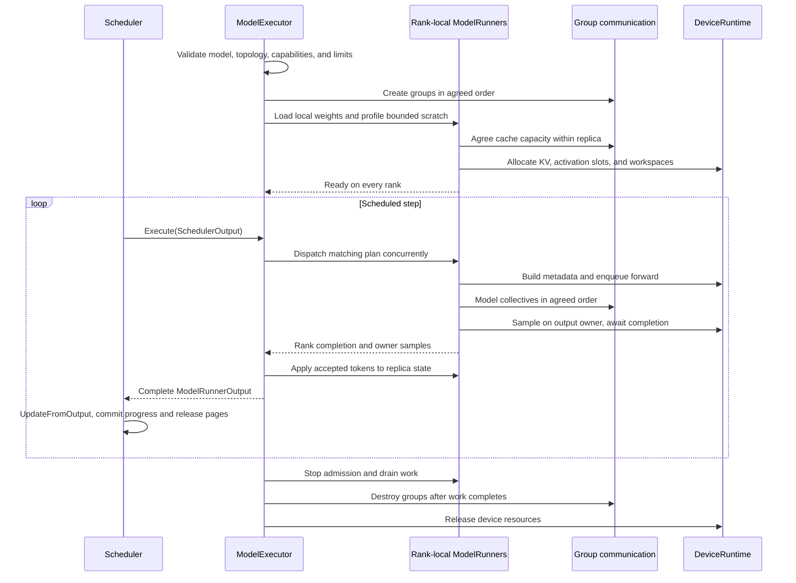
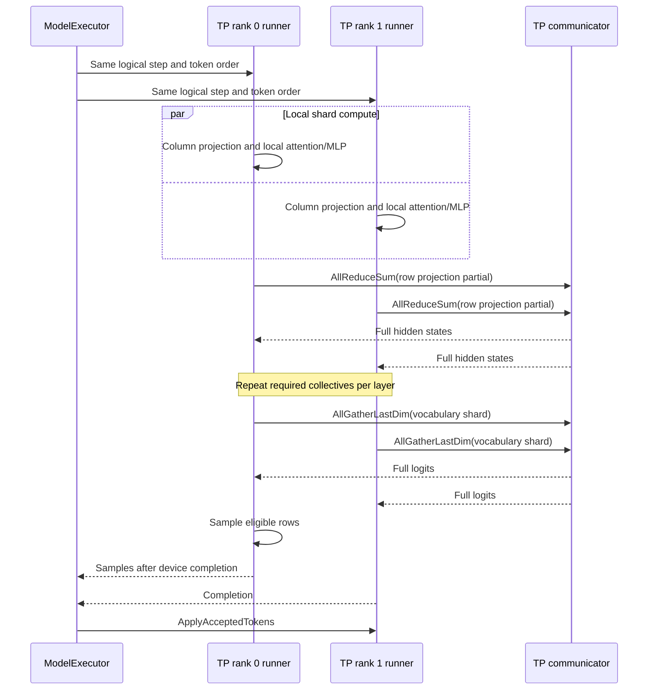
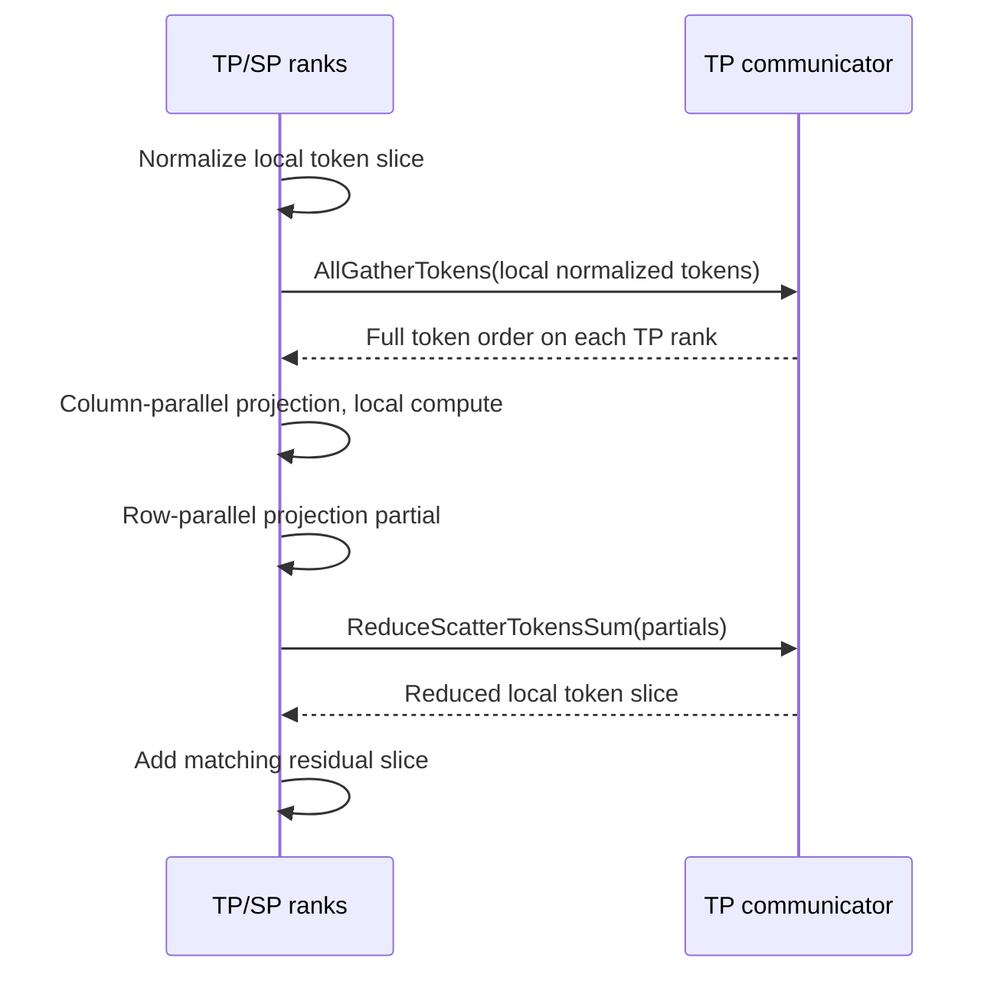
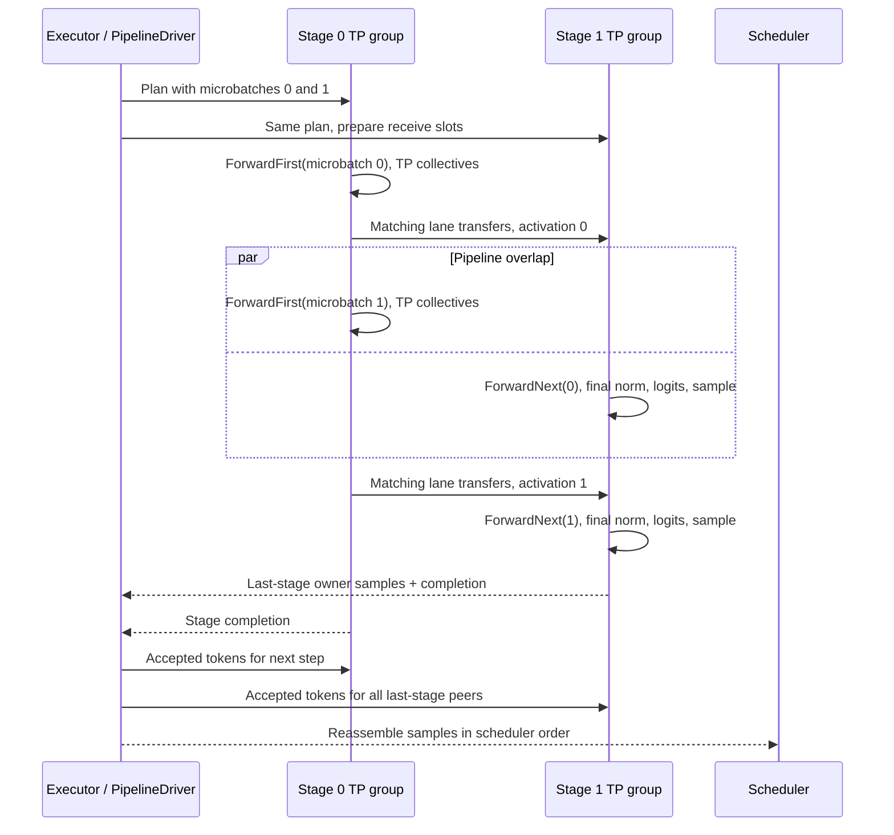
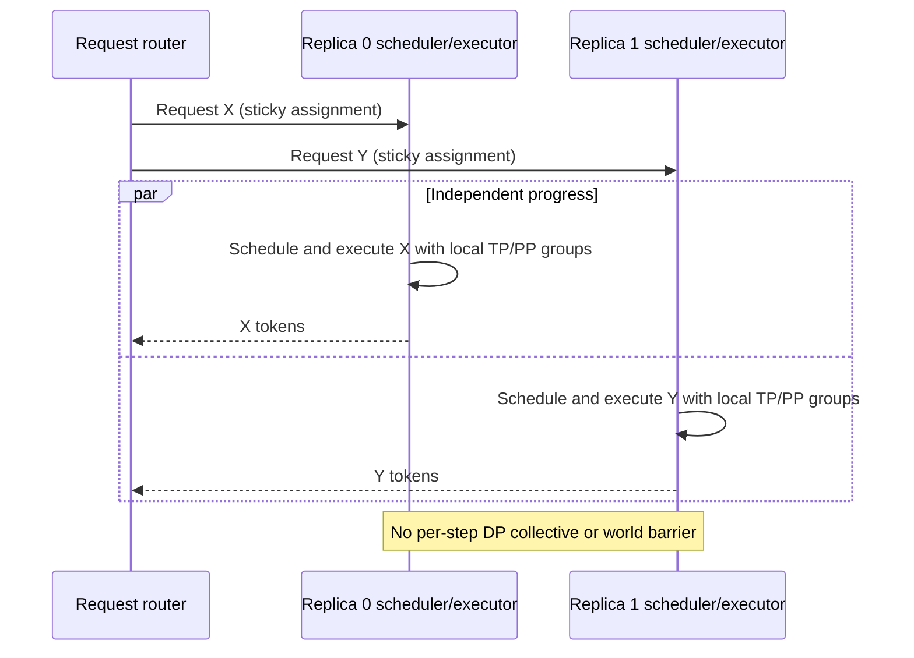
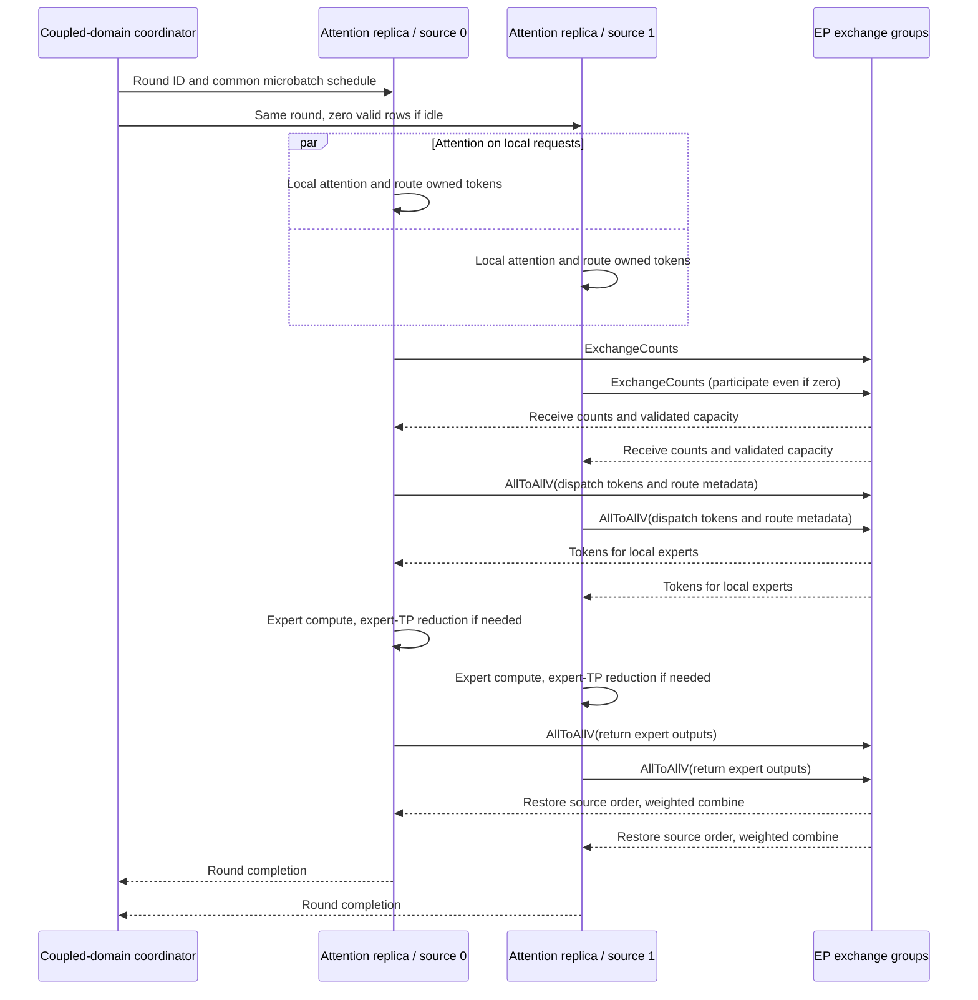
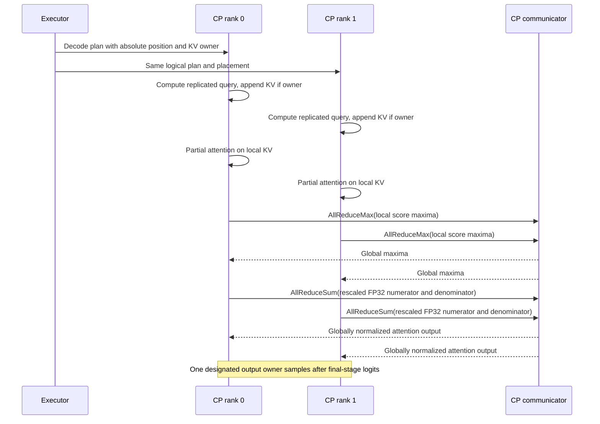
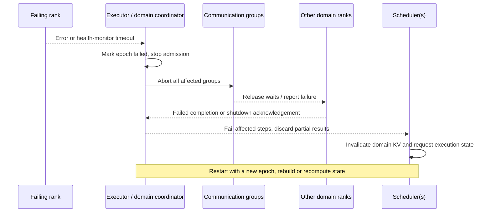

# Distributed Execution Architecture

**Status:** reviewed design proposal grounded in the current repository. Only
single-rank and tensor-parallel execution are established execution paths here;
configuration fields, kernels, and transport primitives alone do not establish
end-to-end support for another strategy. All extensions below are proposed, not
implemented by this document.

**Scope:** inference execution, topology, communication, model and weight
partitioning, pipeline scheduling, KV ownership, completion, and failure handling.
Request admission and batching policy remain in `Scheduler`; sampling algorithms,
training, elastic resizing, and prefill/decode disaggregation are out of scope.

## 1. Repository baseline and design decisions

The design extends the existing executor/runner boundary. It does not introduce a
second execution stack under `exec`, a replacement tensor type, or a parallelism
strategy class hierarchy.

| Repository component | Current behavior and implication |
|---|---|
| [`ModelExecutor`](../include/inferx/engine/model_executor.h), [implementation](../src/engine/model_executor.cc) | Coordinates rank-local runners. The normal multi-GPU path creates an `NcclWorld` across distinct CUDA devices in one process. `Execute` drives ranks concurrently, takes rank zero's samples, and applies accepted tokens to peers. Preserve this public boundary. |
| [`ModelRunner`](../include/inferx/models/model_runner.h), [implementation](../src/models/model_runner.cc) | Owns the model, request state, KV pool, scratch, and sampler. `Run` synchronizes before returning. Graph replay is explicitly unimplemented. Extend this owner rather than adding a competing `RankRuntime`. |
| [`SchedulerOutput`](../include/inferx/engine/scheduler_output.h) | Contains allocations, new requests, cached-request deltas, and finished/preempted IDs. Prompt spans borrow request memory. This is suitable for synchronous local execution, not directly for a wire protocol or asynchronous queue. |
| [`ParallelConfig`](../include/inferx/config/parallel_config.h) | Has TP, PP, DP sizes/ranks and an EP flag. Its world size is DP × PP × TP; EP size is DP × TP when enabled. Validation checks positive sizes and coordinate bounds, not model or execution support. |
| [`CommBackend`](../include/inferx/dist/comm.h) | One group per runner; BF16 sum all-reduce, last-dimension all-gather, and host scalar minimum. No token-axis gather/scatter, activation P2P, routed exchange, or CP reduction contract. |
| [`NcclWorld` / `NcclComm`](../include/inferx/dist/nccl_comm.h) | Local multi-device coordination and an explicit rank-join primitive exist. They are not a multi-node execution service. [`worker_ipc.h`](../include/inferx/dist/worker_ipc.h) carries fixed-size generate/shutdown messages, not scheduler plans; [`RunWorker`](../src/dist/worker_main.cc) constructs its own scheduler. |
| [`Model` / `ForwardContext`](../include/inferx/models/model.h) | `Forward` runs the whole stack and produces final-normalized hidden states; context exposes one TP communicator. `StepInputs::input_embeds` alone is not a pipeline stage contract. |
| [`WeightMap` / `WeightBinding`](../include/inferx/models/weight_loader.h) | Already describes row spans and column windows. Extend this loader for stage/expert ownership instead of creating another parameter-declaration system. |
| [`FusedExperts`](../include/inferx/models/layers/fused_moe.h) | Holds all experts, TP-shards their matrices, and reduces partial outputs. Local token grouping is not distributed EP dispatch. |
| [`DeviceRuntime`](../include/inferx/core/device_runtime.h), [`Tensor`](../include/inferx/core/tensor.h), [`Status`](../include/inferx/core/status.h) | Reuse device/stream/event ownership, tensor storage, and Abseil-backed status types. |

[`attention.md`](attention.md) is a companion proposal, not the implemented
attention API. Its hypothetical `attn` types are not dependencies of this design.
Implementation must adapt the actual `AttentionMetadata`, `KvBlockPool`, and
`ForwardContext`; future attention work can supply the CP contracts in §8.

The inspected CMake configuration selects C++23. Examples here use the C++20
subset (included repository headers still require C++23) and the
[Google C++ Style Guide](https://google.github.io/styleguide/cppguide.html):
`UpperCamelCase` types and functions, `snake_case` variables, trailing underscores
for private fields, `kCamelCase` enumerators/constants, two-space indentation,
explicit single-argument constructors, header guards, and explicit ownership.
Existing lowercase accessors such as `rank()` are valid accessor-style names.
Use `Status`/`StatusOr` for fallible operations, including factories; do not add
exception-based initialization. References to existing APIs retain their real
names. All new interface excerpts are labeled proposals and use `inferx` or
`inferx::models`.

**Decisions:** retain synchronous `ModelExecutor::Execute` initially; keep one
scheduler per independent replica; add immutable topology and named communicator
roles; introduce stage execution only for PP; implement eager correctness before
capture or overlap. Keep local multi-device execution as the first backend.
Process-per-device deployment is a later transport option, not a prerequisite.

## 2. Support assessment

Here, SP means TP-associated activation sequence parallelism, and CP means
persistent sequence/KV partitioning. They are distinct layouts, not synonyms.
NVIDIA's [context parallelism documentation](https://docs.nvidia.com/megatron-core/developer-guide/latest/user-guide/features/context_parallel.html)
also distinguishes CP from the sequence parallelism used around TP operators.
These definitions inform this inference design; training support elsewhere does
not imply InferX support.

| Strategy | Current architecture | Required extension and feasibility |
|---|---|---|
| TP | Working foundation: rank runners, weight slices, reductions, gathered logits, one sampling owner. | Strengthen configuration/capacity validation and persistent rank dispatch. GQA/MQA replication and model-specific divisibility must be validated by the loader. |
| PP | Configurable coordinates, but whole-model forward and synchronous full-step runner cannot execute a pipeline. | Stage-local weights/KV, explicit activation layouts, P2P, microbatch schedule, output ownership, and bounded buffers. Feasible without replacing the executor. |
| DP | Separate engine instances can serve independent requests. A DP size field does not create a router or replicas. | Route each request to one scheduler/executor and keep cache affinity. No per-step collective between independent replicas. |
| EP | Existing experts use TP, not expert ownership across ranks. | Expert placement, unique token ownership, variable-count dispatch/combine, inverse permutation, and expert TP subgroups. Feasible with a new MoE communication path. |
| CP | No CP configuration, distributed attention metadata, or KV placement contract. | Position-aware token/KV ownership and numerically correct distributed attention. This is attention/cache work as well as executor work. |
| SP | Existing gather is along hidden/vocabulary width; it cannot gather token shards. | Token-axis all-gather/reduce-scatter, residual layout tracking, masked padding. Feasible for prefill; decode padding can eliminate its benefit. |
| Hybrid | A single communicator and whole-model forward do not compose these strategies. | Validated groups, layouts, common operation order, and coupled failure domains. Enable only explicitly tested combinations (§10). |

Unsupported settings must fail before device allocation/collective initialization.
Do not silently rebuild a TP-only configuration from a requested PP/DP/EP one.
The current multi-device factory constructs rank configurations from TP fields;
future validation must guard that boundary. `CreateGroup` currently checks null
runners and vocabulary agreement; the proposed admission checks additionally
compare topology, shard identity, cache capacities, and execution limits.

## 3. Responsibilities and lifecycle

`ModelExecutor` owns coordination and the rank group. Each `ModelRunner` owns local
model state and device resources. `Scheduler` owns request/cache policy; it never
issues model collectives. Models choose collectives through a non-owning parallel
context, with no environment-variable lookups or global parallel state.

A future `PipelineDriver` is a concrete helper owned by the executor. A future
`ParallelContext` borrows topology and communicator owners, which outlive models
and all queued device work. Communicators are never owned by model layers.
`DeviceRuntime` remains the stream/event abstraction; no parallel `DeviceContext`
is needed. Single-rank groups provide identity operations instead of null pointers.



This diagram includes proposed group validation and allocation. Today `Run`
already returns completed work; preserve that guarantee. A successful enqueue
must never be mistaken for completed KV writes or permission to reuse scratch.
Shutdown drains successful work; failure follows the abort path in §11 instead.

Startup must reserve communication buffers, activation slots, and worst-case
workspace before choosing KV capacity. If graphs are enabled later, reserve their
memory before final KV sizing too. All participating ranks must enter blocking
initialization/profile collectives concurrently. Do not sequentially construct
runners if their constructors can wait for peers.

## 4. Topology and composition

### 4.1 Mesh and placement

Use a logical mesh `[DP, PP, CP, TP]`, with TP fastest varying by default:

`global_rank = (((dp_rank * pp_size + pp_rank) * cp_size + cp_rank) * tp_size + tp_rank)`.

`world_size = dp_size * pp_size * cp_size * tp_size`, checked for overflow before
conversion to backend integer types. EP and SP do not multiply world size.
A separate explicit placement table maps every logical rank to host and device;
logical adjacency must not imply NVLink, shared memory, or even the same host.

TP groups fix DP/PP/CP; CP groups fix DP/PP/TP; pipeline lanes fix DP/CP/TP.
An independent replica contains all PP/CP/TP ranks at one DP coordinate.
There is no inference DP gradient reduction. Default placement keeps TP and EP
on fast links, then places PP stages and independent DP replicas. Cross-node TP
is allowed only by explicit deployment policy and measured bandwidth/latency.

The following is a **proposed header excerpt**, not a replacement for the current
`ParallelConfig`. Once implemented, its fields should extend that configuration
through one validated conversion; do not keep two competing sources of truth.

```cpp
#ifndef INFERX_CONFIG_EXECUTION_TOPOLOGY_H_
#define INFERX_CONFIG_EXECUTION_TOPOLOGY_H_

#include <cstdint>
#include <vector>

#include "inferx/core/status.h"

namespace inferx {

enum class GroupKind {
  kTensor,
  kPipeline,
  kContext,
  kExpert,
  kExpertTensor,
};

struct TopologyOptions {
  int tensor_parallel_size = 1;
  int pipeline_parallel_size = 1;
  int data_parallel_size = 1;
  int context_parallel_size = 1;
  int expert_parallel_size = 1;
  bool enable_expert_parallel = false;
  bool enable_sequence_parallel = false;
  bool enable_attention_data_parallel = false;
};

struct RankPlacement {
  int global_rank = 0;
  int host_id = 0;
  int device_ordinal = 0;
};

struct GroupDescriptor {
  int group_id = 0;
  GroupKind kind = GroupKind::kTensor;
  std::vector<int> global_ranks;  // Ordered by group-local rank.
};

// Immutable after successful construction; owns metadata, not communicators.
class ExecutionTopology {
 public:
  static StatusOr<ExecutionTopology> Create(
      const TopologyOptions& options,
      const std::vector<RankPlacement>& placements);

  int world_size() const { return world_size_; }
  const std::vector<GroupDescriptor>& groups() const { return groups_; }

 private:
  ExecutionTopology(int world_size, std::vector<GroupDescriptor> groups);

  int world_size_;
  std::vector<GroupDescriptor> groups_;
};

}  // namespace inferx

#endif  // INFERX_CONFIG_EXECUTION_TOPOLOGY_H_
```

`Create` validates geometry, unique placements, and deterministic group membership.
Model/kernel support is checked separately before any groups are opened. Group
IDs are deterministic within a topology version; compare a topology fingerprint
at startup. Rank order matters for gathers and expert mapping. Do not deduplicate
communicators solely by an unordered member set: ordered membership, backend,
device binding, and independent ordering channels must also match. Initially keep
one owner per role; aliasing is an optional proven optimization.

### 4.2 Expert groups and attention DP

For ordinary replicas, the FFN plane is the TP group at fixed DP/PP/CP. With
attention DP enabled, the plane spans DP × TP at fixed PP/CP. Define:

- `plane_size = tp_size`, or `dp_size * tp_size` in attention-DP mode.
- `expert_parallel_size * expert_tensor_parallel_size = plane_size` when EP is
  enabled. All experts are replicated across independent planes.
- For plane index `q`, `expert_rank = q / expert_tensor_parallel_size` and
  `expert_tensor_rank = q % expert_tensor_parallel_size`.
- EP groups vary `expert_rank` at fixed `expert_tensor_rank`; expert-TP groups
  vary `expert_tensor_rank` at fixed `expert_rank`.

When EP is disabled, the normal FFN keeps its TP group. Initially reject
attention-DP mode without EP; dense FFN redistribution across DP is a separate
feature with no immediate need. A dense model rejects an enabled EP request
rather than silently claiming it was honored. Migrate the legacy EP boolean to
full-plane EP (`expert_tensor_parallel_size = 1`) unless an explicit new size is
provided. Normal DP remains independent unless attention DP is explicitly enabled;
a legacy DP+EP request must choose its coupling mode, not change it implicitly.

Static expert ownership requires `num_experts % expert_parallel_size == 0`
initially. Expert TP additionally requires divisible intermediate widths. Expert
replication/rebalancing and uneven ownership are deferred; do not hide them in
rank arithmetic.

## 5. Execution plans, ownership, and completion

Continue using `SchedulerOutput` at the public synchronous boundary. Build a
validated internal execution envelope with the following information:

| Information | Contract |
|---|---|
| Identity | Deployment epoch, topology version, replica ID, monotonically increasing step ID; coupled execution also has a domain round ID. |
| Scheduling payload | Owned copy of request deltas for queued/remote execution, including prompt tokens and sampling parameters. Never serialize a span, pointer, `Tensor`, or C++ object representation. |
| Microbatches | Stable IDs, explicit scheduled-row and flat-token ranges, real/padded counts, sample-row mapping, and absolute positions. All ranks in a TP group see the same logical ordering. |
| Cache state | Allocation/release deltas, per-request generation and committed watermark, and CP placement metadata when applicable. |
| Execution choice | Validated layout IDs, eager/graph choice, and bounded buffer slot; graph keys are not chosen independently by peers. |
| Completion | Step ID, status from all participating ranks, and exactly one sample per eligible request from its output owner. |

A synchronous local envelope can borrow `SchedulerOutput` until `Execute`
returns. An asynchronous or cross-process envelope must own token arrays and all
other payloads. Bound queue lengths and message sizes; apply backpressure before
accepting another plan. The current fixed-size worker protocol is insufficient:
a remote extension needs versioned framing, lengths, validation, deadlines, and
plan/result messages, not independent worker-side batching.

Apply each delta once in order. Reject stale epochs, duplicate steps, missing
predecessors, and inconsistent request generations before forward execution.
Do not retry a partially executed plan against mutated request/KV state. Results
must preserve `SchedulerOutput::scheduled` order even if microbatches complete
out of order. Only the output owner samples; derive RNG progress from request
identity and committed generation position, not rank or microbatch completion.

Maintain one outstanding logical step per replica initially. PP can overlap
microbatches within that step. Future overlap across steps requires disjoint
request sets or explicit per-request dependencies, per-slot scratch/metadata, and
scheduler lifetime changes. `pipeline_parallel_size` is not a safe automatic
limit on outstanding steps: decode token n+1 depends on token n being sampled
and accepted, regardless of the number of stages.

Preemption/cancellation takes effect at a coordinated step boundary. Do not free
KV or skip a collective locally while peers still use that request. A cancelled
request's result may be discarded after its issued work finishes; release pages
only after all users complete. Metadata-only steps still propagate finished and
preempted IDs even when there are no tokens to execute.

## 6. Communication contract

Extend `CommBackend` incrementally, keeping existing TP operations. Each instance
represents one ordered group, with group-local peer indices. A proposed
`ParallelContext` selects the appropriate backend for each role. Do not add a
virtual class for every TP/PP/EP combination.

| Proposed operation | Semantics and use |
|---|---|
| `AllGatherTokens` | `[local_tokens, hidden]` to `[group_size * local_tokens, hidden]`, in rank order; SP reconstruction. Distinct from `AllGatherLastDim`. |
| `ReduceScatterTokensSum` | Sum matching full token tensors and return the rank's contiguous token slice; SP row-parallel output. |
| `Exchange` | Batch of sends and receives with peer-local ranks and agreed tensor descriptors; PP, CP ring exchange, and sparse EP payload exchange. Enqueue matching operations together rather than blocking send-then-receive. |
| `ExchangeCounts` | Fixed-length integer counts, one per peer; host-visible completion is explicit for eager EP. |
| `AllToAllV` | Packed payloads plus per-peer counts and offsets, validated against receive capacity. May be implemented with grouped P2P; no assumption of a native variable-count backend primitive. |
| `AllReduceMax` and typed `AllReduceSum` | FP32 distributed attention statistics; BF16-only reductions are insufficient for CP. |
| `CheckHealth` / `Abort` | Backend-owned asynchronous error detection and idempotent failure propagation; abort must release waiting rank dispatch. |

These are semantic requirements, not implemented signatures. Use existing
`Tensor`, `ops::OpContext`, `DeviceStream`, and `Status`. Specify supported dtype,
layout, aliasing, zero-count behavior, and capture capability per backend. Reject
unsupported capabilities at startup. An identity backend still validates shapes
and performs required copies at size one.

Submission success means work was enqueued, not completed. Input/output storage,
count arrays, and tensor descriptors stay valid until the associated stream/event
completes. For a different consumer stream, record a producer event and make the
consumer wait. No scratch slot, plan payload, or KV block is recycled earlier.
Host-visible count exchange explicitly waits for counts before buffer offsets
are used; eager EP is allowed this synchronization cost.

### 6.1 Ordering and progress

1. Serialize communication submission on each rank. Matching group members issue
   matching operation kinds, counts, dtypes, roots, and sequence numbers.
2. Derive order from domain round, microbatch, layer, and operation index. For
   overlapping groups, use an agreed schedule consistent across all members;
   disjoint replicas need no shared order.
3. Begin with one ordered communication stream plus explicit compute events.
   This simplifies dependencies but does **not** prove deadlock freedom: ranks
   can still enter overlapping groups or P2P in incompatible orders.
4. Post matching pipeline transfers in a deterministic wavefront. Avoid a cycle
   in which all ranks wait for a receive whose send is behind that wait. Preserve
   FIFO per peer/channel; application step IDs validate matching but are not
   assumed to be transport-level message tags.
5. Never wait for a peer while holding an executor-wide mutex required by that
   peer. Multi-device backends must dispatch participating ranks concurrently.
6. Separate P2P/compute overlap is opt-in after dependency and backend-version
   tests. No claim that multiple streams automatically overlap efficiently.

NCCL has explicit ordering requirements for grouped operations and multiple
communicators; backend versions differ in available launch-order guarantees.
Use conservative ordering unless the selected backend is validated for more.
See NVIDIA's [group calls](https://docs.nvidia.com/deeplearning/nccl/user-guide/docs/usage/groups.html)
and [communicator documentation](https://docs.nvidia.com/deeplearning/nccl/user-guide/docs/usage/communicators.html).

## 7. Strategy execution flows

### 7.1 Tensor parallelism and sequence parallelism

TP splits projection weights, attention heads, and FFN width. Preserve existing
row/column weight bindings and vocab sharding. Validate query-head divisibility,
FFN width, vocabulary padding, and GQA mapping. When TP exceeds KV-head count,
replicate KV heads only with a validated integral replication factor; otherwise
reject the configuration. Replicated KV consumes real memory on every copy.



SP retains only a token slice for replicated elementwise operations such as
normalization/residual updates. Gather tokens before column-parallel projection;
reduce-scatter row-parallel partials afterward. Pair residual operands in the
same layout and preserve token order. This replaces a TP all-reduce with
reduce-scatter plus all-gather across adjacent regions; it does not simply remove
communication or shard persistent KV.



Pad each microbatch token count to a multiple of TP, carrying valid-row masks
through attention, MoE routing, logits, and sampling. Padding writes no real KV
and contributes no routed token. SP at a PP boundary is enabled only if both
stages agree on token slicing; otherwise gather to the canonical replicated
boundary layout. Decode batches smaller than TP may gain nothing from SP.

### 7.2 Pipeline parallelism

Partition layers into explicit contiguous ranges; nonuniform ranges are allowed
and need not divide the layer count evenly. Stage zero owns embeddings; the last
stage owns final norm, logits, and sampling. Duplicate tied embeddings at the
endpoints, accounting for their memory, unless a model-specific alternative is
implemented. Local layer indices must map to global checkpoint names and KV
regions. Intermediate stages must not run final norm or the language-model head.

The **proposed stage API** below is an additional model seam for PP. Existing
single-stage models continue to use `Model::Forward`. A PP model implements both
interfaces or supplies an adapter; the runner selects it during construction,
not by a per-layer dynamic cast. `ForwardContext` must gain the parallel context
and stage-local attention metadata before this API can support hybrid execution.

```cpp
#ifndef INFERX_MODELS_PIPELINE_STAGE_H_
#define INFERX_MODELS_PIPELINE_STAGE_H_

#include <cstdint>

#include "inferx/core/status.h"
#include "inferx/core/tensor.h"
#include "inferx/models/model.h"

namespace inferx::models {

enum class ActivationLayout {
  kReplicatedTokens,
  kTensorShardedTokens,
};

struct StageActivation {
  Tensor hidden;
  ActivationLayout layout = ActivationLayout::kReplicatedTokens;
  int64_t valid_tokens = 0;
  int64_t padded_tokens = 0;  // Total rows before any TP token slicing.
};

// The caller owns and preallocates output storage. Methods enqueue work on
// ctx's stream; all input/output storage must survive device completion.
class PipelineStage {
 public:
  virtual ~PipelineStage() = default;

  // First stage only: performs embedding and this stage's layer range.
  virtual Status ForwardFirst(ForwardContext& ctx, const StepInputs& inputs,
                              StageActivation* output) const = 0;

  // Later stages only: consumes the previous stage's activation.
  virtual Status ForwardNext(ForwardContext& ctx, const StageActivation& input,
                             StageActivation* output) const = 0;
};

}  // namespace inferx::models

#endif  // INFERX_MODELS_PIPELINE_STAGE_H_
```

Output pointers are non-null and refer to validated preallocated tensors. A
method used on the wrong stage returns `FailedPrecondition`. The last stage
applies final norm before the runner calls existing `Model::ComputeLogits`;
all other stages omit it. Absolute positions and per-request attention metadata
arrive in the plan, not just in the activation payload. A boundary descriptor
includes dtype, shape, layout, microbatch ID, CP token partition, and valid mask.
Uniform TP/CP sizes across stages are required initially.

For the first implementation, each request's scheduled tokens stay together in
one microbatch. Microbatches have disjoint request sets; their union is the step.
This avoids concurrent KV writes for the same request and ambiguous sampling
rows. A stage processes microbatches in FIFO order with a bounded send/receive
slot pool. Retire a slot only after both compute and outbound transfer complete.



The canonical replicated boundary sends a full activation on every TP lane;
this is simple but costs TP times the payload in aggregate. SP-compatible
boundaries send one token shard per lane. Sending once then broadcasting in the
next stage is another optimization, not the initial contract. PP bubbles depend
on useful microbatch count; adding stages does not speed up a lone dependent
decode request. With equal stage times and M independent microbatches over P
stages, the idealized fill/drain bubble fraction is `(P - 1) / (M + P - 1)`.

### 7.3 Independent data parallelism

DP routes requests across complete model replicas. Each has its own scheduler,
logical cache allocation, output owner, and progress clock. Pin an active request
to its replica; migration requires explicit KV transfer or recomputation and is
outside the initial implementation. Prefix-cache locality should inform routing.



### 7.4 Expert parallelism, including attention DP

At each MoE boundary, define exactly one source owner per logical routed token.
TP-replicated activations must not be dispatched once per replica copy. Either
partition source tokens among EP senders or choose a designated sender, then
explicitly replicate inputs within expert-TP subgroups. Count each top-k route
once; reduce expert-TP partial outputs before combining weighted routes back to
the original token. The combine path restores the layout required by attention
TP/SP. Router decisions must be identical for duplicated token views.



The coordinator is required only when experts span DP replicas. It chooses a
common microbatch/collective schedule from per-replica demand. Token counts may
vary in eager mode, but every member participates, including zero-count peers.
Idle replicas must process incoming expert tokens even if they have no attention
requests. Masked rows must not update KV, RNG, or request progress. If the whole
domain is idle, skip the round by common agreement.

Expert skew may send every route to one rank. Bound capacity by admitted tokens
and top-k, or negotiate capacity before payload submission. Never silently drop
routes. On overflow, reject the round before forward mutation or fail the domain;
mid-layer replay after KV mutation is not safe. Start with eager count exchange
and preallocated capacity buckets. Fixed-capacity graph routing is deferred until
its memory and overflow semantics are proven.

With PP, the coupled coordinator assigns one round and microbatch order across
all affected replicas and stages; it cannot independently advance a stage's EP
round. Pad absent microbatches with zero valid rows. Cross-DP EP plus PP remains
disabled until this schedule is implemented and failure-tested.

## 8. Context parallelism and KV ownership

CP requires more than a CP communicator. Start with a static block-to-CP-owner
mapping shared by all TP lanes, e.g. logical block index modulo CP size. Track
absolute sequence positions, local slots, and valid lengths explicitly. Weight
shards are replicated across CP ranks; KV is partitioned by token ownership and
then by TP head ownership. Do not treat the CP rank as another independent batch.

For prefill, each CP rank computes its local queries and exchanges remote K/V
chunks (or uses a correctness-first gather) to attend over all legal positions.
Apply causal/sliding-window masks using absolute positions. A ring algorithm
maintains an online softmax accumulator; averaging locally normalized outputs is
incorrect. For decode, replicate the new query across CP ranks, append new KV
only on its designated owner, and compute partial attention against local KV.

For local scores `s`, compute `m_i = max(s)`, `l_i = sum(exp(s - m_i))`, and
`u_i = sum(exp(s - m_i) * v)` per query/head. Reduce `m = max_i(m_i)`, then sum
`exp(m_i - m) * l_i` and `exp(m_i - m) * u_i`; divide the latter by the former.
Use FP32 accumulation. Empty/all-masked partitions contribute zero denominator
and numerator; handle the all-empty case without evaluating `exp(-inf - -inf)`.



During prefill, CP token shards persist through tokenwise FFNs. During decode,
replicated query/output views must not duplicate EP routes or samples. The plan
and model boundary must specify that change of layout. A prefill ring also needs
matching exchange order and double-buffer lifetimes, not just the reductions
shown for decode.

### 8.1 Cache allocation and consistency

For TP/PP without CP, retain shared logical block IDs per replica and use the
minimum supported page count across participating stages/ranks after local
memory profiling. PP stores only stage-local layers. This wastes capacity on
larger stages but is a practical first policy. Move to per-stage capacities only
if measurements justify more complex allocation.

CP requires an explicit translation from logical block to CP owner and physical
local page; the original flat block table is insufficient. Reserve capacity on
all relevant owners atomically before issuing a step. One logical request
watermark advances only when every required shard finishes its writes. Prefix
hits, copy-on-write, eviction, and preemption must agree across shards. Prefix
identity includes model/weight version and cache layout; a hit on one CP rank is
not a complete distributed hit. Never use independent per-rank LRU decisions
while the scheduler assumes globally valid blocks.

SP does not independently own KV. With CP+SP, CP first selects a token subset;
SP splits that subset across TP ranks around elementwise regions. A CP-local
SP gather reconstructs only that CP subset. These strategies are not inherently
incompatible, but nested mappings, padding, and attention boundaries must be
implemented and tested. Initially disable CP+SP and CP+cross-DP EP as scope
limits, not mathematical impossibilities. Recurrent/linear-attention state needs
its own partition/merge semantics and is rejected under CP until provided.

## 9. Weights, streams, graphs, and performance

Reuse `WeightMap` row spans and column windows for TP, fused QKV/gate-up, expert
subsets, and PP stage ranges. Stage-aware strict loading must explicitly classify
other stages' checkpoint tensors as intentionally unused while still rejecting
missing local weights and unexplained names. Validate local shapes against
attention-head replication, expert ownership, and quantization packing. There
is no generic slicing rule that automatically supports every quantized format.

Persistent rank-driving threads and bounded queues can replace per-step
`std::async` once correctness is retained. Each rank has one submission owner;
compute and communication use events for dependencies. Preallocate bounded
scratch and metadata per live microbatch slot. Existing scratch allocation
patterns need profiling before promising allocation-free execution.

CUDA Graphs are a later optimization: the current runner explicitly rejects them.
A future graph key includes topology/model version, stage, layout, padded token
and sequence counts, attention plan variant, and buffer slot. Captured addresses,
workspace sizes, and communication order must stay stable. Peers agree on
capture/replay versus eager execution before launch; a local graph-cache miss
must not switch only one rank to a different collective schedule. Keep dynamic
EP counts and unsupported CP kernels eager. Bound graph-cache memory and reserve
it during initialization; backend capture support must be tested explicitly.

Communication cost models guide placement; they are not performance promises.
For T tokens, H hidden width, b bytes per element, and p TP ranks, a ring
all-reduce moves approximately `2 * (p - 1) / p * T * H * b` bytes per rank.
SP's corresponding reduce-scatter plus all-gather has similar aggregate traffic
but lower retained activation memory. PP boundary traffic depends on replicated
versus sharded lanes (§7.2). EP dispatch and return each scale with routed tokens
× top-k × H × b, plus route metadata and any expert-TP replication. CP trades
KV capacity for attention communication and may worsen short-context latency.

Measure per-rank memory (weights, KV, scratch, activation slots, communicators,
graphs), useful versus padded tokens, stage idle time, routed-token skew,
collective latency, queue depth, prefill throughput, and decode tail latency.
Do not add plan relays, custom all-reduce, multi-stream overlap, or dynamic expert
placement until profiles identify a bottleneck. A shared process is also a
shared failure boundary for independent replicas; process isolation is needed
if host-process survival is a requirement.

## 10. Hybrid configurations and admission rules

Support must be gated by model, attention backend, communication backend, and
schedule capabilities together. Topology representability alone is insufficient.

| Combination | Design disposition | Key condition |
|---|---|---|
| TP | Existing path; harden | Matching local shapes, cache capacity, sampler ownership, eager mode. |
| Independent DP × TP | Compose separate executors | Sticky routing; no cross-replica collective. |
| PP × TP, with independent DP outside | First pipeline target | Uniform TP per stage, explicit layers, matching activation lanes, disjoint microbatches. |
| TP × SP | Planned | Token collectives, residual alignment, padding masks. |
| PP × TP × SP | After SP and PP parity | Identical boundary layout or explicit gather conversion. |
| EP within TP, optionally PP | Planned | Expert-TP factorization, unique route ownership; EP groups stay within stages. |
| Attention DP × EP | Planned, eager first | Coupled domain rounds, idle participants, capacity checks, shared failure fate. |
| Attention DP × EP × PP | Gated | One global round/microbatch schedule for the coupled domain. |
| CP × TP, optionally PP and independent DP | Later | CP attention/KV semantics; CP layout preserved across stage boundaries. |
| CP × SP or CP × cross-DP EP | Disabled initially | Nested layouts and route ownership require separate implementation and validation. |
| Different TP/CP widths per PP stage | Unsupported initially | Needs explicit repartitioning at stage boundaries. |
| Elastic topology, expert migration, heterogeneous kernels within a collective group | Unsupported initially | Requires state migration or an agreed mixed-backend execution contract. |

Example placement: 16 devices, DP=2, PP=2, CP=1, TP=4. Ranks 0–3 and 4–7 are
replica 0's stages; ranks 8–11 and 12–15 are replica 1's stages. TP groups are
those four ranges; pipeline lanes are `{0,4}`, `{1,5}`, ..., `{11,15}`. Two
schedulers progress independently. If each replica fits on a node, all its
traffic stays on that node, but link quality still comes from the placement
inventory rather than rank numbering.

Example EP refinement: TP=8, EP=4, expert-TP=2. Expert-TP groups are `{0,1}`,
`{2,3}`, `{4,5}`, `{6,7}`; EP exchange groups are `{0,2,4,6}` and `{1,3,5,7}`.
Replicated source tokens need explicit ownership and expert-TP input replication.
Example attention DP: DP=8, TP=1, EP=8 gives eight attention request streams and
one coupled expert plane at each stage. These are not eight independent failure
or scheduling domains.

Startup rejects nonpositive/overflowing sizes, missing/duplicate placements,
invalid coordinates, inconsistent topology fingerprints, unavailable operations,
unsupported model partitions, inconsistent TP/CP widths, unsafe buffer bounds,
and unimplemented combinations. Model validation covers layers, heads, experts,
intermediate width, tied weights, and cache format. Do not rely on the current
`ParallelConfig::Validate` to do these checks.

## 11. Failure handling and recovery

Derive a failure domain from transitive execution dependencies: a PP replica
includes its TP/CP ranks; cross-DP EP joins affected replicas and their stages.
Independent replicas remain logically separate, subject to shared-process/device
failure. An output owner's success alone is insufficient to commit a step.



Backend abort and health checks must be safe under their documented threading
contract; do not assume arbitrary NCCL methods can race on one handle. A
watchdog signals an owning backend/controller that provides the required safe
abort mechanism. Bound startup, collective progress, control transport, and
shutdown waits. Preserve the first failure and include epoch, rank, group,
step, microbatch, and operation sequence in diagnostics.

Normal shutdown stops admission, drains work, releases graphs and tensors, then
communicators and streams in dependency-safe order. On failure, abort first;
normal synchronization can hang. Do not destroy resources that a device may
still reference without backend-confirmed quiescence or process teardown.
Recovery recreates the domain and recomputes/reloads state; no automatic replay
against partially modified KV. Client retry/output deduplication is a separate
service policy, especially if earlier tokens have already been streamed.

## 12. Implementation sequence and validation

Keep changes in the existing `include/inferx/{config,dist,engine,models,cache}`
and corresponding `src` directories, with `.h`/`.cc` filenames. Add topology and
communication roles under `dist`, pipeline coordination under `engine`, and
stage execution under `models`. Avoid a parallel `src/exec` subsystem.

| Phase | Work | Required evidence before enabling |
|---|---|---|
| 1 | Validate actual capabilities, harden TP group construction, persistent rank dispatch, explicit completion/failure contracts. | Existing single-rank/TP parity remains; invalid PP/DP/EP requests fail clearly; aborted ranks release peers. |
| 2 | Named groups, stage-local weights/KV, activation P2P, FIFO microbatches; independent replica routing. | TP×PP output/logit parity, cache consistency, no buffer reuse races, replica progress independence. |
| 3 | Token-axis collectives and SP layouts. | Eager SP parity, uneven/padded batches, PP boundary conversions. |
| 4 | Static EP and expert TP; then attention-DP coordinator. | Top-k route conservation, skew/zero-token cases, expert-TP parity, idle-peer progress, coupled failure propagation. |
| 5 | CP metadata, placement, attention reductions/ring, distributed cache accounting. | Long-context prefill/decode parity, causal masks, empty partitions, GQA, chunked prefill, prefix reuse and eviction. |
| 6 | Gated hybrids, graph capture, overlap, and transport extensions. | Each enabled combination passes correctness/fault tests and demonstrates measured benefit. |

Extend existing [`tests/unit/dist`](../tests/unit/dist) communication tests and
[`tensor_parallel_test.cc`](../tests/integration/models/tensor_parallel_test.cc).
A CPU reference backend can validate collective matching and PP schedules; it
cannot establish CUDA stream or NCCL deadlock freedom. Test real devices too.

Validation must include:

- Topology/group golden cases, overflow/invalid configurations, ordered membership,
  and model-specific shard reconstruction using actual weight bindings.
- Single-rank versus distributed logits within dtype-appropriate tolerances;
  greedy-token parity where logits have a stable margin, and deterministic
  sampling ownership without assuming bitwise equality after reordered reductions.
- Randomized microbatch counts, imbalanced stages, delayed ranks, metadata-only
  steps, cancellation/preemption, slot poisoning, and duplicate/stale envelopes.
- EP all-zero and one-active-source rounds, every token selecting one expert,
  uneven counts, capacity exhaustion, and no duplicated/dropped top-k routes.
- CP partition boundaries, all-masked local blocks, sliding-window capability
  rejection, append ownership, full distributed prefix hits, and CP+TP head maps.
- Process/rank loss during initialization, forward, P2P, counts exchange, and
  shutdown; no stale success or partial cache commit after failure.
- Graph/eager parity and mixed cache-hit scenarios only after capture is
  implemented; memory accounting and long mixed-prefill/decode soaks.

Collective trace checks should compare group, sequence, kind, shape, dtype, and
peer pairing, with bounded diagnostic storage. The initial acceptance criterion
is correct eager execution with explicit unsupported errors. Performance
optimizations and broader hybrid support follow evidence, not configuration
fields alone.
