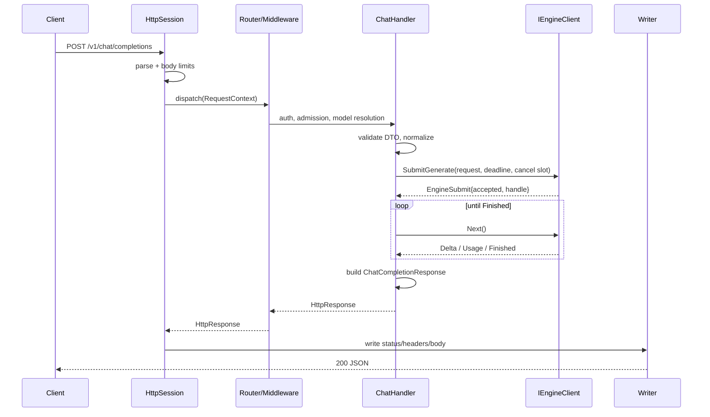
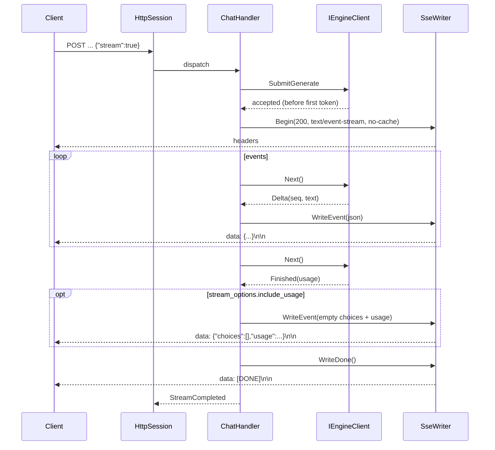

# Production-Grade Modern C++ Inference Server

> Historical proposal. For the redesign grounded in the current InferX server,
> see [Server architecture redesign](server_architecture.md), including UML,
> class APIs, ownership, lifecycle, and migration steps. The repository-state
> assumptions below predate the implementation and are not current facts.

**Design for an Asio-based OpenAI-compatible ingress/orchestration server inspired by vLLM**

| Item | Value |
|---|---|
| Status | Proposed design; no implementation started |
| Target language | C++20 baseline, selected C++23 enhancements behind feature tests |
| Networking | Boost.Asio + Boost.Beast, OpenSSL; one coroutine domain at the HTTP boundary |
| Primary vLLM reference | `main` commit `428cd0cb4a42750f5339d08bb67d534cf8051429` (checked out at `/tmp/vllm`, inspected 2026-10-20) |
| Compatibility reference | `v0.11.0`, commit `b8b302cde434df8c9289a2b465406b47ebab1c2d` (checked out at `/home/gc/vllm`) |
| Repository | `/home/gc/llm_research` |
| Existing documents | `docs/attention_design.md` only |
| Missing documents | `docs/tokenizer_design.md`, `docs/kvcache_design.md`, `docs/executor_design.md` |

> **Review gate.** This is a design and interface specification only. It does not modify implementation files. The repository contains no server, build system, scheduler, tokenizer, executor, or KV-cache code to conform to yet. Every repository-facing name and integration type below is therefore a proposal that must be reconciled with the real interfaces before Phase 1 is frozen.

**Evidence tags**

- **[V-main]** verified directly in the inspected `main` checkout.
- **[V-0.11]** verified directly in the pinned `v0.11.0` checkout.
- **[I]** inference from verified source or standard Asio/HTTP semantics.
- **[P]** proposed design decision for this repository, not a claim about vLLM.

---

## 1. Executive Summary and Verified vLLM Reference Version

### 1.1 Repository findings before design

The target workspace contains only `docs/`, and `docs/` contains only `attention_design.md`. There is no Git repository, `CMakeLists.txt`, source tree, or test harness. The attention document itself records the same finding and pins its reference to vLLM `v0.11.0`.

Consequences:

1. There are no existing server interfaces to preserve.
2. `docs/tokenizer_design.md`, `docs/kvcache_design.md`, and `docs/executor_design.md` are absent. Their ownership boundaries are inferred from the attention design and the vLLM source and are marked as assumptions.
3. The C++ names, package layout, error type, and engine transport below are proposals. In particular, `llm::server::Status`/`Result<T>` are not presumed to match the eventual repository-wide status type.
4. No implementation is claimed. The phases in §14 must produce compiling code and tests.

### 1.2 vLLM versions inspected

Two checkouts were inspected deliberately:

| Checkout | Revision | Role |
|---|---|---|
| `/tmp/vllm` | `428cd0cb4a42750f5339d08bb67d534cf8051429` (`main`, grafted) | Current server structure and endpoint split |
| `/home/gc/vllm` | `b8b302cde434df8c9289a2b465406b47ebab1c2d` (`v0.11.0`) | Stable reference used by `attention_design.md`; behavior cross-check |

Current `main` has refactored the server into `entrypoints/launchers`, per-endpoint routers, `serve/`, and renderer packages. `v0.11.0` still has the older monolithic `entrypoints/openai/api_server.py`. The design follows observed **behavior and boundaries**, not Python package layout. This is intentional: the C++ design must remain useful when upstream files move again.

Representative inspected sources:

- [main: launchers/app.py](https://github.com/vllm-project/vllm/blob/428cd0cb4a42750f5339d08bb67d534cf8051429/vllm/entrypoints/launchers/app.py) `build_app`
- [main: launchers/api_server/routers.py](https://github.com/vllm-project/vllm/blob/428cd0cb4a42750f5339d08bb67d534cf8051429/vllm/entrypoints/launchers/api_server/routers.py) `register_api_routers`
- [main: launchers/api_server/entry.py](https://github.com/vllm-project/vllm/blob/428cd0cb4a42750f5339d08bb67d534cf8051429/vllm/entrypoints/launchers/api_server/entry.py) `build_async_engine_client*`, `run_server_worker`
- [main: launchers/launcher.py](https://github.com/vllm-project/vllm/blob/428cd0cb4a42750f5339d08bb67d534cf8051429/vllm/entrypoints/launchers/launcher.py) `serve_http`, signal/shutdown handling
- [main: openai/chat_completion/api_router.py](https://github.com/vllm-project/vllm/blob/428cd0cb4a42750f5339d08bb67d534cf8051429/vllm/entrypoints/openai/chat_completion/api_router.py)
- [main: openai/completion/serving.py](https://github.com/vllm-project/vllm/blob/428cd0cb4a42750f5339d08bb67d534cf8051429/vllm/entrypoints/openai/completion/serving.py) streaming/usage/error handling
- [main: serve/utils/api_utils.py](https://github.com/vllm-project/vllm/blob/428cd0cb4a42750f5339d08bb67d534cf8051429/vllm/entrypoints/serve/utils/api_utils.py) `with_cancellation`, `validate_json_request`
- [main: serve/utils/sse_keep_alive.py](https://github.com/vllm-project/vllm/blob/428cd0cb4a42750f5339d08bb67d534cf8051429/vllm/entrypoints/serve/utils/sse_keep_alive.py)
- [main: serve/engine/protocol.py](https://github.com/vllm-project/vllm/blob/428cd0cb4a42750f5339d08bb67d534cf8051429/vllm/entrypoints/serve/engine/protocol.py) `ErrorInfo`, `ErrorResponse`, `UsageInfo`
- [main: engine/protocol.py](https://github.com/vllm-project/vllm/blob/428cd0cb4a42750f5339d08bb67d534cf8051429/vllm/engine/protocol.py) `EngineClient`
- [main: v1/engine/async_llm.py](https://github.com/vllm-project/vllm/blob/428cd0cb4a42750f5339d08bb67d534cf8051429/vllm/v1/engine/async_llm.py) `generate`, `abort`, `shutdown`
- [main: v1/engine/__init__.py](https://github.com/vllm-project/vllm/blob/428cd0cb4a42750f5339d08bb67d534cf8051429/vllm/v1/engine/__init__.py) `EngineCoreRequest`, `FinishReason`, `EngineCoreOutput`
- [main: serve/middleware/authenticate.py](https://github.com/vllm-project/vllm/blob/428cd0cb4a42750f5339d08bb67d534cf8051429/vllm/entrypoints/serve/middleware/authenticate.py)
- [main: serve/middleware/register.py](https://github.com/vllm-project/vllm/blob/428cd0cb4a42750f5339d08bb67d534cf8051429/vllm/entrypoints/serve/middleware/register.py)
- [main: serve/instrumentator/health.py](https://github.com/vllm-project/vllm/blob/428cd0cb4a42750f5339d08bb67d534cf8051429/vllm/entrypoints/serve/instrumentator/health.py)
- [main: serve/instrumentator/metrics.py](https://github.com/vllm-project/vllm/blob/428cd0cb4a42750f5339d08bb67d534cf8051429/vllm/entrypoints/serve/instrumentator/metrics.py)
- [main: openai/models/api_router.py](https://github.com/vllm-project/vllm/blob/428cd0cb4a42750f5339d08bb67d534cf8051429/vllm/entrypoints/openai/models/api_router.py)
- [main: pooling/embed/api_router.py](https://github.com/vllm-project/vllm/blob/428cd0cb4a42750f5339d08bb67d534cf8051429/vllm/entrypoints/pooling/embed/api_router.py)
- [main: renderers/online_renderer.py](https://github.com/vllm-project/vllm/blob/428cd0cb4a42750f5339d08bb67d534cf8051429/vllm/renderers/online_renderer.py) `render_chat`
- [main: multimodal/media/connector.py](https://github.com/vllm-project/vllm/blob/428cd0cb4a42750f5339d08bb67d534cf8051429/vllm/multimodal/media/connector.py) media URL/data/file loading and domain allowlist
- [0.11: entrypoints/openai/api_server.py](https://github.com/vllm-project/vllm/blob/b8b302cde434df8c9289a2b465406b47ebab1c2d/vllm/entrypoints/openai/api_server.py) lifecycle, routes, engine client
- [0.11: entrypoints/openai/serving_chat.py](https://github.com/vllm-project/vllm/blob/b8b302cde434df8c9289a2b465406b47ebab1c2d/vllm/entrypoints/openai/serving_chat.py) SSE, usage, cancellation
- [0.11: v1/engine/async_llm.py](https://github.com/vllm-project/vllm/blob/b8b302cde434df8c9289a2b465406b47ebab1c2d/vllm/v1/engine/async_llm.py) `generate` aborts on `CancelledError`/`GeneratorExit`
- [0.11: entrypoints/launcher.py](https://github.com/vllm-project/vllm/blob/b8b302cde434df8c9289a2b465406b47ebab1c2d/vllm/entrypoints/launcher.py) uvicorn lifecycle and shutdown

### 1.3 Verified vLLM behavior that shapes this design

1. **Server is an adapter, not an engine.** The HTTP layer creates one engine client, registers task-gated routers, validates and normalizes requests, and consumes async output generators. It does not schedule GPU work. **[V-main]** `routers.py::register_api_routers`, `entry.py::build_async_engine_client`.
2. **Engine communication is a typed asynchronous stream.** `EngineClient.generate(...)` returns an async generator of `RequestOutput`; cancellation/GC aborts the request; `abort` is an explicit operation. **[V-main]** `engine/protocol.py`, `v1/engine/async_llm.py::generate`.
3. **Request identity is an engine-visible string.** `EngineCoreRequest.request_id` is the identity used across frontend, output processor, and scheduler; vLLM prefixes API IDs (`chatcmpl-`, `cmpl-`, `embd-`). **[V-main]** `v1/engine/__init__.py::EngineCoreRequest`; serving handlers.
4. **Streaming is SSE with `data:` frames and `data: [DONE]`.** Usage is emitted as a final chunk with empty choices when requested. Errors after streaming starts are emitted as a JSON error object inside a `data:` frame, followed by `[DONE]`, not as a new HTTP status. **[V-main]** `completion/serving.py` streaming generator.
5. **Client disconnect cancels the request.** vLLM runs a disconnect listener concurrently with the handler; cancellation of `generate()` triggers `abort(request_id)`. **[V-main]** `api_utils.py::with_cancellation`; `async_llm.py::generate` `except (CancelledError, GeneratorExit)`.
6. **Admission is a frontend concern but queue limits belong to the engine.** `check_admission` raises a 429-class error before a response starts; the scheduler owns real GPU queueing. **[V-main]** `engine/protocol.py::check_admission`; `async_llm.py::check_admission`.
7. **Authentication is bearer API key with hashed, constant-time comparison.** CORS is configurable; only `/v1`, `/v2`, `/inference`, and `/cohere` prefixes are guarded. **[V-main]** `serve/middleware/authenticate.py`.
8. **Health is engine-aware; readiness is not a distinct vLLM route.** `/health` returns 200 or 503 based on `engine_client.check_health()`. vLLM also exposes `/ping`, `/load`, `/version`. **[V-main]** `instrumentator/health.py`, `instrumentator/basic.py`; **[V-0.11]** `api_server.py`.
9. **Metrics are Prometheus text; engine metrics already expose queueing, TTFT, token, and KV metrics.** The HTTP layer adds request instrumentation. **[V-main]** `instrumentator/metrics.py`, `v1/metrics/loggers.py`.
10. **Chat templates and multimodal preprocessing run on the frontend renderer side, before the engine core.** vLLM resolves templates, parses ordered content parts, fetches/decodes media, and passes rendered engine input. **[V-main]** `renderers/online_renderer.py`, `renderers/chat_utils/*`, `multimodal/media/connector.py`.
11. **Unknown OpenAI fields are accepted and ignored (with debug logging).** `OpenAIBaseModel` uses `extra="allow"`. **[V-main]** `serve/engine/protocol.py::OpenAIBaseModel`.
12. **HTTP serving is HTTP/1.1 in the inspected stack.** The server uses uvicorn/FastAPI; no HTTP/2 serving path was found. HTTP/2/TLS offload is a reverse-proxy concern in this design. **[V-main]** `launcher.py::serve_http`; **[I]** uvicorn's default HTTP protocol is HTTP/1.1.

### 1.4 Core design decisions

| Decision | Choice | Rationale |
|---|---|---|
| HTTP stack | Boost.Asio + Boost.Beast + Boost.JSON + OpenSSL | Beast supplies a production HTTP/1.1 parser/serializer; Boost.JSON gives `max_depth` and avoids a second JSON dependency. |
| Coroutine domain | `boost::asio::awaitable` everywhere in the HTTP boundary | One executor/cancellation model. No `folly::coro::Task` in HTTP handlers. |
| Initial deployment | One API process + one engine process over a framed Unix-domain socket (UDS) in production; `LocalEngineClient` for tests and development | Matches vLLM's frontend/engine split and prevents GPU work from blocking I/O threads. |
| HTTP/2 | Not supported natively in MVP | Beast is HTTP/1.1; terminate HTTP/2/TLS at Envoy/nginx. |
| Streaming | Direct async writes with engine-side bounded event buffering, not an unbounded SSE queue | Slow clients apply backpressure to the engine stream; memory is bounded. |
| Chat template/tokenization | Engine/tokenizer boundary; server sends structured messages plus render options | Server must not own tokenizer algorithms or model-specific templates. |
| Remote media | Prohibited in MVP | Avoid SSRF and unbounded fetch/decode work at the HTTP edge; add later with strict egress policy. |
| Request IDs | Client-facing ID and engine ID are distinct; server owns the mapping | Preserves tracing and prevents HTTP identity from becoming scheduler identity. |
| Error model | Stable `ApiError` with machine-readable `code` and explicit retryability | Avoids leaking engine exceptions and Python-specific error types. |

---

## 2. Source-to-Design Mapping and Explicit Deviations

Unless a table row is explicitly marked `[P]`, the vLLM responsibility in the second column is verified at one of the pinned revisions. The proposed C++ component and the differences column are design recommendations `[P]`; they are not claims that vLLM uses those types or boundaries.

| vLLM component / behavior | Source reference | Observed responsibility | Proposed C++ component | Deliberate difference |
|---|---|---|---|---|
| App composition | `launchers/app.py::build_app`; `launchers/api_server/routers.py` | Build FastAPI app, register task-gated routers, middleware, exception handlers | `HttpServer`, `Router`, `MiddlewareChain`, `EndpointRegistry` | Native typed composition; route availability is driven by `IModelCatalog` capabilities, not imports. |
| Lifecycle and engine client | `launchers/api_server/entry.py::build_async_engine_client*`, `run_server_worker` | Create `AsyncLLM`, build app state, serve socket, shutdown engine | `EngineClientFactory`, `IEngineClient`, `HttpServer::Start/Stop`, ordered service teardown | Server never constructs tokenizer/scheduler/executor objects. Engine process is a separate deployment unit. |
| Signal/graceful shutdown | `launchers/launcher.py::serve_http`; v0.11 `entrypoints/launcher.py` | uvicorn shutdown, watchdog on engine death | `ServerLifecycle`, `ConnectionRegistry`, `DrainPolicy` | Explicit `Draining` state, bounded stream grace, then idempotent cancellation. |
| Chat route | `openai/chat_completion/api_router.py::create_chat_completion` | Parse DTO, call serving handler, choose JSON vs SSE | `ChatCompletionsHandler`, `OpenAIRequestAdapter`, `OpenAIResponseAdapter` | DTOs are wire types; normalized engine requests are separate. |
| Completion route | `openai/completion/api_router.py::create_completion` | Same for legacy completions | `CompletionsHandler` | Same boundary; shared streaming core. |
| Embeddings route | `pooling/embed/api_router.py::create_embedding` | Pooling-model request/response; non-streaming JSON (plus optional formats) | `EmbeddingsHandler`, `EngineEmbedRequest` | MVP supports OpenAI float JSON; byte/base64 encodings are later optional tiers. |
| Models route | `openai/models/api_router.py`; `openai/models/serving.py` | List served aliases, resolve model names/LoRAs | `IModelCatalog`, `ModelResolution` | One process serves a configured model + aliases; runtime LoRA management is not MVP. |
| Health | `serve/instrumentator/health.py` | `/health` → 200/503 from engine health | `HealthService`, `/health`, `/livez`, `/readyz` | Adds distinct liveness/readiness; `/health` retains vLLM-compatible engine-aware semantics. |
| SSE framing | `openai/completion/serving.py::completion_stream_generator`; `chat_completion/serving.py` | `data: JSON\n\n`, terminal `[DONE]`, usage chunk, error chunk | `SseWriter`, `StreamingResponseWriter` | Writes are awaited directly; no generator-to-queue conversion; bounded engine buffer provides backpressure. |
| Keep-alive comments | `serve/utils/sse_keep_alive.py::with_sse_keep_alive` | Emit `: keep-alive\n\n` when idle | `SseWriter::WriteComment`, stream idle timer | Same wire behavior, implemented with Asio timers. |
| Client disconnect | `serve/utils/api_utils.py::with_cancellation`; `listen_for_disconnect` | Race handler against disconnect; cancel work | `ConnectionWatcher`, `RequestContext::RequestCancel`, `EngineRequestHandle::Cancel` | Disconnect cancels engine and closes, rather than returning an empty 200 response. |
| Engine protocol | `engine/protocol.py::EngineClient` | `generate`, `encode`, `abort`, `check_admission`, health, shutdown | `IEngineClient`, `EngineSubmission`, `IEngineEventStream` | Explicit transport vs engine acceptance; move-only request/event payloads; no Python generators. |
| Request state / IDs | `v1/engine/__init__.py::EngineCoreRequest`; `input_processor.assign_request_id` | Engine-visible request ID, prompt tokens, sampling params, arrival and trace metadata | `EngineGenerateRequest`, `EngineRequestId`, `EngineSubmission` | Server keeps `ClientRequestId` separate and owns the mapping; engine does not see HTTP IDs. |
| Cancellation/abort | `v1/engine/async_llm.py::generate` `CancelledError`/`GeneratorExit` → `abort`; `abort` | Abort request in output processor and engine core | `EngineRequestHandle::Cancel(CancelReason)`, exactly-once terminal state | Cancellation is explicit, idempotent, and observable; destructor never blocks. |
| Errors | `serve/engine/protocol.py::ErrorInfo/ErrorResponse`; `serve/exception_handling/error_response.py` | OpenAI-shaped error object with HTTP status as `code` | `ApiError`, `ApiErrorMapper` | Stable string codes plus HTTP status; engine-specific exception classes are not exposed. |
| Admission | `engine/protocol.py::check_admission`; `async_llm.py::check_admission` | Pre-response rejection based on queued requests/tokens | `AdmissionController`, engine `Submit` errors | Server limits are separate from engine queue limits; server never inspects scheduler internals. |
| Auth | `serve/middleware/authenticate.py` | Bearer key, SHA-256 + constant-time compare, guarded prefixes | `ApiKeyAuthenticator`, `AuthPolicy` | Adds key IDs, tenant/scopes, per-key quotas; supports file/env secrets. |
| CORS | `serve/middleware/register.py` | Starlette CORS middleware | `CorsPolicy` | Default disabled; explicit allowlists. |
| Metrics | `serve/instrumentator/metrics.py`; `v1/metrics/loggers.py` | Prometheus registry, HTTP instrumentation, engine histograms | `MetricsService`, registry exporter | Adds server-observed TTFT, SSE queue depth, write stalls, disconnect reasons; keeps labels low-cardinality. |
| Chat templates | `renderers/online_renderer.py::render_chat` | Resolve template, render messages, tokenize, parse tools | `EngineGenerateRequest::render`; engine-side `IRenderer` | Server does not render Jinja or tokenize; optional trusted per-request template only behind a flag. |
| Multimodal | `renderers/chat_utils/*`; `multimodal/media/connector.py` | Ordered content parts; URL/data/file media; domain allowlist | `ChatMessage::parts`, `MediaPart` | Ordered parts preserved; remote fetch disabled in MVP; no local paths from clients. |
| Unknown fields | `serve/engine/protocol.py::OpenAIBaseModel` `extra="allow"` | Accept and log unknown fields | `UnknownFieldPolicy` (`kIgnoreLog` default) | Same compatibility default, with an optional strict mode. |
| HTTP limits | uvicorn `h11_max_incomplete_event_size`, `h11_max_header_count`; `set_ulimit` | Header/request-line and FD limits | Beast parser header/body limits, `ConnectionRegistry` | In-process limits are always enforced, even behind a proxy. |

### 2.1 Statements that are not claims of parity

This design does **not** claim complete OpenAI API parity, complete vLLM endpoint parity, or wire-identical error strings. It implements a tested subset listed in §3.4 and returns explicit `unsupported_parameter`/`not_implemented` errors for the rest. Chat templates, tool-call parsers, reasoning parsers, and multimodal decoders are model-specific and live outside the HTTP server.

---

## 3. Goals, Non-Goals, Assumptions, and API Compatibility Matrix

### 3.1 Goals

1. Own HTTP/1.1 connection management, TLS termination (optional), routing, validation, admission, streaming, cancellation, and orderly shutdown.
2. Present a stable OpenAI-compatible surface for generation and embeddings while keeping wire DTOs separate from engine requests.
3. Enforce bounded memory and deterministic cleanup under slow clients, disconnects, engine failure, and shutdown.
4. Never block an Asio I/O thread with tokenization, media decode, JSON-heavy work, filesystem access, or synchronous engine RPC.
5. Make subsystem boundaries explicit: tokenizer, scheduler, executor, attention, and KV cache keep their ownership.
6. Be testable with a deterministic fake engine and observable in production.
7. Support incremental delivery: every phase compiles and has automated tests.

### 3.2 Non-goals

- Tokenization/detokenization algorithms, chat-template execution, and media decoding in the server process.
- Scheduler batching, KV-cache allocation, GPU kernel launch, model execution, or CUDA graph management.
- Reimplementing all vLLM endpoints (Responses, Anthropic/Cohere, audio, rerank, LoRA administration).
- HTTP/2 or HTTP/3 serving; WebSocket realtime API; gRPC public API in MVP.
- Automatic replay of interrupted generation.
- Multi-node routing/federated model serving; optional future extension only.
- A stable plugin ABI.

### 3.3 Assumptions

1. The engine boundary accepts structured messages and render options, or pre-rendered token IDs; it owns tokenizer and chat-template behavior.
2. The engine exposes an asynchronous submit/abort/event interface with bounded per-request buffering.
3. The model catalog is queryable at startup and is stable for the process lifetime for the MVP (no hot model swap).
4. One served base model per process is sufficient for MVP; aliases are supported.
5. The deployment target provides a Unix-domain socket or loopback TCP between API and engine on the same host.
6. Reverse proxies may terminate TLS and HTTP/2, but all in-process limits remain authoritative.
7. The repository will provide a shared status/error type; until then, the local types below are proposals.

### 3.4 Endpoint support matrix

Legend: **MVP** = required for first production cut; **Opt** = later optional; **No** = not exposed.

| Endpoint | Tier | Input | Normalized engine operation | Response | Streaming | Main statuses | Notes |
|---|---|---|---|---|---|---|---|
| `GET /health` | MVP | none | engine health probe (cached/fast) | empty 200 | no | 200, 503 | vLLM-compatible engine-aware health |
| `GET /livez` | MVP | none | none | JSON `{"status":"ok"}` | no | 200 | process event loop responsive |
| `GET /readyz` | MVP | none | readiness snapshot | JSON | no | 200, 503 | false during startup/drain/engine loss |
| `GET /v1/models` | MVP | none | catalog list | OpenAI `ModelList` | no | 200 | served aliases and task metadata extension |
| `POST /v1/chat/completions` | MVP | `ChatCompletionRequest` | `EngineGenerateRequest` (chat input + render options) | `ChatCompletionResponse` or chunks | SSE | 200, 400, 401, 404, 413, 422, 429, 500, 503 | `[DONE]`; final usage chunk when requested |
| `POST /v1/completions` | MVP | `CompletionRequest` | `EngineGenerateRequest` (text/token prompt) | `CompletionResponse` or chunks | SSE | same | legacy text completion |
| `POST /v1/embeddings` | MVP when model task is embed | `EmbeddingRequest` | `EngineEmbedRequest` | `EmbeddingResponse` | no in MVP | 200, 400, 401, 404, 413, 429, 500, 503 | float JSON only in MVP; base64/bytes later |
| `POST /tokenize`, `/detokenize` | Opt | tokenizer DTO | tokenizer service | tokenizer DTO | no | 200, 400, 404, 501 | vLLM-specific, not OpenAI |
| `POST /pooling`, `/classify`, `/score`, `/v1/score`, `/rerank`, `/v1/rerank`, `/v2/rerank` | Opt | task-specific | pooling/scoring | task-specific | no | as task | not OpenAI core |
| `POST /v1/responses` and response retrieval/cancel | Opt | Responses DTO | generate/responses adapter | Responses event schema | SSE/event stream | as route | large compatibility surface, not MVP |
| `POST /v1/audio/transcriptions`, `/translations` | Opt | multipart/audio | transcription engine | text/JSON | optional | as route | requires media/audio pipeline |
| `POST /v1/load_lora_adapter`, `/v1/unload_lora_adapter` | Opt admin | LoRA DTO | catalog/engine admin | JSON | no | 200, 400, 404, 501 | disabled by default |
| `GET /metrics` | Opt/MVP configurable | none | metrics registry | Prometheus text | no | 200 | enabled by config; never public by default |
| `GET /version`, `/ping`, `/load` | Opt | none | none / counters | JSON/empty | no | 200 | vLLM/SageMaker compatibility helpers |
| WebSocket `/v1/realtime` | Opt | audio frames | realtime engine | realtime protocol | yes | n/a | outside MVP |
| gRPC API | Opt | protobuf | engine/internal | protobuf | yes | n/a | internal-only option; not public MVP |

**Model/task gating.** A process either serves generation tasks or pooling/embedding tasks for its loaded model, matching vLLM's `supported_tasks` gating. Requests for an unsupported task return `501 Not Implemented` (vLLM behavior for a missing serving handler) or `400 unsupported_parameter` when the endpoint exists but a field is unsupported. The catalog, not router imports, determines registration.

### 3.5 OpenAI versus vLLM-specific behavior

**OpenAI-compatible core in MVP**

- `/v1/models`, `/v1/chat/completions`, `/v1/completions`, `/v1/embeddings`.
- `model`, `messages`/`prompt`, `stream`, `stream_options.include_usage`, `max_tokens`/`max_completion_tokens`, `n`, `temperature`, `top_p`, `stop`, `seed`, `response_format`, `logprobs`/`top_logprobs` where the engine advertises support.
- Finish reasons `stop`, `length`, `content_filter` (mapped if engine supports), `tool_calls` only when tool parsing is enabled; engine-only reasons such as `abort`, `error`, and `repetition` are mapped explicitly or converted to stream errors.
- OpenAI error envelope: `{"error":{"message":...,"type":...,"param":...,"code":...}}`.

**vLLM extensions (explicit, not OpenAI)**

- `request_id`, `session_id`, `priority`, `truncate_prompt_tokens`, `return_token_ids`, `return_tokens_as_token_ids`, `top_logprobs=-1`, `logprob_token_ids`, `prompt_logprobs`, structured-output extensions, `chat_template`/`chat_template_kwargs`.
- Tokenizer, pooling, scoring, classification, rerank, Responses, audio, and admin endpoints.
- `/health` engine-aware semantics and `/version`, `/ping`, `/load`.

Extensions are documented in the OpenAPI/JSON schema served by the process and are gated by `ServerConfig::api_extensions`. The server does not silently reinterpret an extension as an OpenAI field.

### 3.6 Unknown-field policy

Default: `UnknownFieldPolicy::kIgnoreAndLog` at the top level, matching vLLM's `extra="allow"`, because OpenAI clients routinely send newer fields. Inside security- or semantics-critical objects (`tools`, `tool_choice`, `response_format`, `stream_options`, media parts), unknown keys are rejected with `400 invalid_request_error` in strict mode and logged in compatibility mode. `ServerConfig::unknown_fields = kReject` makes the whole API strict. Unknown fields are never copied into engine requests unless they are inside an explicitly versioned `vllm_extra` object.

---

## 4. Architecture and Component Responsibilities

### 4.1 Architecture diagram

```text
Client (HTTP/1.1 or HTTPS; SSE)
   |
   v
[TLS listener / acceptor]  (optional native TLS; otherwise reverse proxy)
   |
   v
[HttpSession / ConnectionContext]  (per connection, strand affinity)
   |  HTTP parser + body limit + keep-alive
   v
[Router + MiddlewareChain]  (auth, CORS, request ID, rate limit, admission)
   |
   v
[OpenAI handlers]  ChatCompletions / Completions / Embeddings / Models
   |  wire DTO validation + normalization
   v
[OpenAIRequestAdapter]  -> EngineGenerateRequest / EngineEmbedRequest
   |
   v
[IEngineClient]  (LocalEngineClient | RemoteUdsEngineClient)
   |
   v
Engine process: Tokenizer/Renderer -> Scheduler -> Executor -> Attention -> KV cache
   |
   +--> EngineGenerateEvent stream (Accepted, Delta, Usage, Finished, Error)
   |
   v
[OpenAIResponseAdapter] -> JSON DTO or SseWriter
   |
   v
[HttpSession writer] -> socket
```

### 4.2 Component responsibilities, lifetime, and affinity

| Component | Responsibility | Owns | Lifetime | Executor/thread affinity |
|---|---|---|---|---|
| `ServerConfig` | Fully validated typed configuration | Values only | Process lifetime | Immutable after start |
| `HttpServer` | Lifecycle, drain, connection registry, owned listener | `Listener`, registry, io_context work guard | Process lifetime | Server control executor; methods posted there |
| `Listener` | Bind/listen/accept; transient accept error handling | Acceptor/socket and accept loop | `Starting`→`Draining` | Server executor |
| `ConnectionContext` | Per-connection immutable metadata and stop state | Peer info, connection ID, TLS flag, `shared_ptr<ShutdownState>` | Connection | Shared, read-only |
| `HttpSession` | HTTP parse/serialize, keep-alive, per-request serialization, disconnect watch | Socket/stream, flat buffer, current `RequestContext`, watchdog timer | One connection | Session `strand`; all state transitions on it |
| `Router` | Route matching and handler dispatch | Route table | Process lifetime | Immutable after start |
| `MiddlewareChain` | Auth, CORS, request ID, rate limit, admission wrappers | Ordered middleware objects | Process lifetime | Invoked on session strand; blocking parts offloaded |
| `RequestContext` | Per-HTTP-request cancellation, deadline, parsed route params, identity, engine handle, stream state | Client ID, cancel signal, timer, engine handle, usage counters | One request | Session strand only (except explicit thread-safe cancel entry points) |
| `OpenAIRequestAdapter` | Wire DTO → normalized engine request; model resolution | Nothing (may own resolved values) | Stateless/service | Session strand or CPU worker; no I/O |
| `OpenAIResponseAdapter` | Engine events → OpenAI DTO chunks | Per-response accumulation state | One request | Session strand |
| `ApiErrorMapper` | Internal errors → stable `ApiError` + JSON | Nothing | Process lifetime | Any; pure function |
| `IEngineClient` | Transport-neutral submit/abort/health/catalog | Transport connection/state | Process lifetime | Its own executor; completions may be arbitrary threads |
| `EngineRequestHandle` | RAII request handle; exactly-once cancel | Engine ID, event stream, weak client ref | One request | Movable; `Cancel` thread-safe |
| `IEngineEventStream` | Bounded asynchronous event pull | Transport buffer/queue and completion state | One request | `Next()` may complete on engine thread; resumption is on caller's executor |
| `IStreamWriter` / `SseWriter` | SSE framing and async socket writes | Write buffer scratch, committed flag | One request | Session strand |
| `IModelCatalog` | Alias resolution, task capabilities, model list | Catalog snapshot | Process lifetime | Thread-safe reads |
| `HealthService` | Liveness/readiness snapshots and engine probes | Atomic state, last probe | Process lifetime | Server executor; probe has timeout |
| `MetricsService` | Low-cardinality metrics | Metric handles | Process lifetime | Thread-safe |
| `AdmissionController` | Local active/queued/rate limits; leases | Counters, bounded waiter queue | Process lifetime | Server/strand-sharded |
| `ConnectionRegistry` | Track live sessions and active request count for shutdown | Weak refs/counts | Process lifetime | Server executor |

All cross-component dependencies are constructor-injected as interfaces or `shared_ptr` service handles. There are no mutable global singletons. `HttpServer` owns no request, tokenizer, scheduler, KV, or GPU state; its `Impl` owns only the listener, registry, lifecycle state, and injected services.

### 4.3 Three different "request states"

These must not be conflated:

| State | Owner | Contains | Not responsible for |
|---|---|---|---|
| `RequestContext` | HTTP server | Client request ID, trace context, deadline, cancel signal, route params, model resolution, engine ID mapping, stream writer, client-visible usage | Prompt tokenization, KV blocks, batching, GPU execution |
| Tokenizer/Engine `RequestState` | TokenizerManager / engine input processor | Prompt token IDs, detokenization state, template output, processed sampling params, engine arrival time | HTTP headers, SSE framing, client deadlines (except propagated metadata) |
| Scheduler `Req` | Scheduler | Waiting/running status, KV blocks, computed tokens, preemption, sequence state | HTTP identity, response JSON, client cancellation semantics beyond an abort signal |

**ID ownership.** The server generates `ClientRequestId` from `X-Request-Id` (validated) or a new UUIDv7/ULID. `OpenAIRequestAdapter` generates `EngineRequestId` with an API prefix (`chatcmpl-`, `cmpl-`, `embd-`, or `score-`) plus a random UUID. `RequestContext` owns the pair and the engine handle. Later phases may use a configurable ID factory. The engine never receives C++ pointers, HTTP header structures, or client-only IDs.

### 4.4 Why a per-request context is not a tokenizer or scheduler state object

`RequestContext` is an HTTP lifetime object. It is created before route dispatch, exists even for `/v1/models`, and dies when the response/socket is finished. Tokenizer state is created only after engine admission and may outlive the HTTP coroutine during abort cleanup; it owns token IDs and model-specific preprocessing state. Scheduler state owns physical resources and may be preempted, migrated, or batched with unrelated requests. Merging them would violate the required subsystem boundary and make cancellation/shutdown races unmanageable.

---

## 5. Concurrency, Coroutine, and Executor-Affinity Model

### 5.1 Thread inventory

- **One `asio::io_context`** for HTTP accept/read/write/timers, run by `ServerConfig::io_threads` threads (default `min(4, hardware_concurrency)`).
- **One strand per `HttpSession`**, created from the `io_context` executor. All session state, request state, writer state, and router/middleware execution for that connection run on that strand. This is the single-writer contract.
- **One `asio::thread_pool`** (`cpu_workers`, default 2) for bounded CPU work: JSON parse of large bodies, schema depth scans, request normalization that is not O(1), and optional local media base64 decode. It is not a general unbounded task pool.
- **Engine executor(s)** owned by the engine client implementation. The local engine may use its own thread(s); the remote client uses a dedicated transport `io_context`. Engine completion handlers may run on arbitrary threads.
- **No blocking calls on the HTTP `io_context`.** Filesystem, DNS, synchronous RPC, tokenization, and media decode are forbidden there.

### 5.2 Asio/Beast choice

Use **Boost.Asio + Boost.Beast + Boost.JSON** rather than standalone Asio:

- Beast's HTTP parser/serializer is mature and designed for Asio streams, including TLS (`beast::ssl_stream`).
- Boost.JSON provides strict parsing with `parse_options::max_depth`, serialization, and no additional JSON library.
- One Boost version simplifies ABI and CMake. Target Boost `>= 1.84`, CI-tested against 1.86 and the project's pinned version. OpenSSL `>= 3.0`.
- Standalone Asio would still require an HTTP parser (llhttp/nghttp2) and a JSON library, increasing integration and security surface.

C++23 enhancements are optional: `std::expected` can replace `Result<T>` behind a feature macro; `std::move_only_function` can replace copyable route closures only if the toolchain supports it; `std::byteswap` and `std::to_underlying` are convenience-only. C++20 must remain fully buildable.

### 5.3 Coroutine domain

Only `boost::asio::awaitable<T>` is used in HTTP sessions, handlers, middleware, adapters, and engine-client calls. Folly coroutines, if used elsewhere in the project, are integrated only through an explicit adapter:

- Run the Folly task on its own executor.
- Await completion via an `asio::steady_timer`/channel completion posted to the caller's executor.
- Bridge cancellation in both directions explicitly.
- Never `co_await` a `folly::coro::Task` directly from an `asio::awaitable`, and never share a coroutine frame across domains.

MVP does not link Folly. This keeps the HTTP boundary single-domain and cancellation analyzable.

### 5.4 Executor-affinity rules

1. A session coroutine is spawned with `co_spawn(session_strand, session->Run(), completion)`. Its resumption executor is the strand.
2. Any completion handler that touches session/request state is bound with `asio::bind_executor(session_strand, ...)`.
3. `IEngineEventStream::Next()` may resume on an engine thread if the caller's awaitable was not bound. The engine client must propagate the caller's associated executor; if it cannot, it must post resumption back with `asio::post(caller_executor, ...)`. The server also wraps every await in `co_await asio::post(strand, asio::use_awaitable)` where required.
4. `EngineRequestHandle::Cancel()` is thread-safe. It does not touch session memory; it only marks an atomic terminal state and schedules an abort on the engine client.
5. `RequestContext::RequestCancel()` is the only other thread-safe entry point. It atomically records the reason and posts a cancellation signal to the session strand.
6. No callback may assume it runs on the I/O thread. This is a documented contract on every async interface.

### 5.5 CPU offload pattern

For bounded, non-trivial CPU work:

```cpp
// Design sketch: run work on the CPU pool, resume on the caller's strand.
template <class Fn>
asio::awaitable<std::invoke_result_t<Fn>> offload(asio::thread_pool& pool, Fn fn) {
  auto ex = co_await asio::this_coro::executor;
  auto result = co_await asio::co_spawn(
      pool,
      [fn = std::move(fn)]() mutable -> asio::awaitable<std::invoke_result_t<Fn>> {
        co_return fn();
      },
      asio::bind_executor(ex, asio::use_awaitable));
  co_return result;
}
```

The actual implementation must preserve the caller's cancellation slot and propagate exceptions as `Result<T>`. Work items are bounded by the request body/media limits, and the pool has a fixed size; queue growth is itself an admission signal.

### 5.6 Listener and accept loop

- Bind before the engine is considered ready (matching vLLM's early-bind behavior) so port conflicts surface immediately.
- `SO_REUSEADDR`; optional `SO_REUSEPORT` is off by default.
- Accept loop:

```text
while serving:
  socket = co_await acceptor.async_accept(use_awaitable)
  if registry.size() >= max_connections: close(socket); metric++; continue
  session = make_shared<HttpSession>(socket, ...); registry.add(session); session->Start()
```

- Transient accept errors (`EINTR`, `ECONNABORTED`, `EMFILE`, `ENFILE`) are logged and retried with exponential backoff capped at 1s. `EMFILE`/`ENFILE` also increments an overload metric and pauses accepts briefly; it must not spin.
- Fatal errors (`EADDRINUSE`, `EACCES`) fail startup with a typed error.
- Accepted sockets set `TCP_NODELAY`; keep-alive and idle timeouts use `beast::tcp_stream::expires_after`.

### 5.7 Connection serialization and pipelining

- One outstanding request per connection. Responses are written sequentially.
- HTTP/1.1 keep-alive is supported up to `max_requests_per_connection` and `keep_alive_timeout`.
- Pipelining is **not** supported as a concurrency feature. For non-streaming requests, bytes already buffered are read as the next request only after the current response completes (serialized behavior). During a streaming response, any readable bytes or EOF trigger the disconnect/violation watcher: EOF means client disconnect; data means pipelining while streaming, which is a protocol violation and closes the connection after cancellation.
- This removes the need for multiple active request contexts per connection and makes cancellation/order deterministic.
- HTTP/1.1 limitations are explicit: no stream multiplexing, one active response per connection, and an SSE stream occupies its connection. Clients must use multiple connections for concurrency; HTTP/2 multiplexing is provided by a reverse proxy, not by Beast.
- Disconnect detection does not issue a concurrent Beast/SSL read while a response is being written. It waits for readability on the lowest TCP layer and performs a non-consuming peek (`async_wait(wait_read)` + `receive(..., message_peek)`). EOF is a disconnect; readable bytes during an active response are a pipelining violation and close the connection. For TLS, this operates on `lowest_layer()` so it does not race SSL read/write state; if peek is unavailable on a platform, fall back to write-error detection plus the stream idle timer.

### 5.8 Exception propagation

- Every `co_spawn` completion handler is `asio::redirect_error(asio::use_awaitable, ec)` or a typed completion that maps `std::exception_ptr` to `ApiError`.
- Exceptions never escape a session coroutine into `io_context::run()`.
- Before headers: map to a JSON error response with an appropriate status.
- After headers: map to a stream error event, then `[DONE]` if writable; otherwise close.
- `std::bad_alloc` and unknown exceptions map to a sanitized 500/stream error; details go to logs, not the client.
- Engine exceptions do not terminate the process. A global engine-death condition flips readiness and follows the drain policy.

### 5.9 Cross-executor handoff

Submit path:

1. Handler (session strand) validates and builds `EngineGenerateRequest`.
2. `IEngineClient::SubmitGenerate` is awaited. The engine client may execute transport work on its executor; the returned awaitable resumes on the session strand.
3. The submission carries an `IEngineEventStream`. The handler calls `Next()`; the stream implementation posts data/exception to the caller's executor if it cannot guarantee affinity.
4. SSE writes occur only on the session strand.

Output path never calls user code from an engine callback. A pull model is used deliberately to avoid callback reentrancy and unbounded producer queues.

### 5.10 Shutdown while work is active

`HttpServer::BeginDrain` is idempotent and posts to the server executor:

1. Transition to `Draining`; set readiness false.
2. Close the acceptor and stop accepting.
3. Mark every `ConnectionContext` draining; sessions stop reading new requests after the current response.
4. Wait `stream_grace_period` for active requests to finish.
5. Cancel remaining request contexts (`ServerShutdown` reason); each calls engine `Abort`.
6. Wait `cancel_grace_period` for sessions to deregister; close sockets.
7. Shut down `IEngineClient` and then services. The io_context is stopped only after active session count reaches zero.

No detached coroutine is permitted. Each session owns its `co_spawn` future; the registry holds a `shared_ptr` to the session. Service objects are `shared_ptr`-owned and remain alive until the server and all sessions release them.

---

## 6. State Machines and Sequence Diagrams

### 6.1 Server lifecycle

```text
Created --Start()--> Starting --bind/listen--> Serving
   |                     |                       |
   |                     +--bind fail--> Failed  |
   |                                             |
   +----------------------------------------> Draining --grace/cancel--> Stopped
                                                   ^
                                    SIGTERM/SIGINT/engine death/admin
```

Rules:

- `Start()` validates config, binds, starts the accept loop, and returns the bound endpoint; it does not report ready until `HealthService` says the engine is ready.
- `Serving` accepts new requests. `Draining` rejects new requests with `503` and `Connection: close`, keeps existing streams until grace expires.
- `SIGTERM`/`SIGINT` are delivered through `asio::signal_set`, which posts `BeginDrain`.
- Engine death sets readiness false. Default policy: fail in-flight requests, drain, exit. `keep_alive_on_engine_death` is an explicit non-default option for operators who want the process to stay up.

### 6.2 Session state

```text
Idle -> ReadingHeaders -> ReadingBody -> Handling -> Writing -> Idle
  |          |                 |            |          |
  +----------+-----------------+------------+----------+--> Closing -> Closed
```

- `ReadingHeaders` enforces request-line/header limits.
- `ReadingBody` enforces `Content-Length`/chunked body cap before allocation and while reading.
- `Handling` may transition to streaming; the writer becomes committed at headers.
- `Closing` is entered on error, timeout, disconnect, drain completion, or protocol violation.
- All transitions happen on the session strand.

### 6.3 Request state

```text
Created -> Validating -> Queued -> Submitting -> Accepted -> Streaming -> Completed
   |           |           |          |            |            |
   +-----------+-----------+----------+------------+------------+--> Cancelled
                                                                  --> Failed
```

Terminal states are `Completed`, `Cancelled`, and `Failed`; exactly one wins. Late engine events after a terminal state are counted and discarded. `Aborting` is internal to the cancellation path, not a separate client-visible state.

### 6.4 Non-streaming request



### 6.5 Streaming request



Acceptance is awaited before headers so engine admission/tokenization errors can still become real HTTP statuses. The only exception is a transport that cannot await an engine ack; then the first event must be `Accepted` or `Error` before `Begin`.

### 6.6 Client disconnect

```mermaid
sequenceDiagram
  participant C as Client
  participant S as HttpSession
  participant H as Handler
  participant E as Engine
  participant W as SseWriter

  C--xS: TCP FIN/RST while streaming
  S->>S: watcher sees EOF
  S->>H: cancellation slot + RequestCancel(ClientDisconnected)
  H->>E: handle.Cancel(ClientDisconnected)
  E-->>H: stream closed / abort ack
  H->>W: Abort() (no further writes)
  S->>S: terminal=Completed/Cancelled; close
  Note over S,E: final completion may race with cancel; first terminal wins
```

### 6.7 Race matrix

| Event A | Event B | Resolution | Exactly-once bookkeeping |
|---|---|---|---|
| Client disconnect | Normal completion | Terminal transition wins; if completion won, finish the already-written response; otherwise cancel and close. | `finalize()` on strand checks terminal. Cancel is idempotent. |
| Deadline fires | Delta/Finished arrives | Deadline posts cancel; if terminal already set, ignore. If deadline wins, abort engine and close with stream error/no headers. | `CancelReason` stored once. |
| Handler abort | Engine error event | First terminal wins; if abort won, ignore late error. | Late events counted as `late_event_total`. |
| Engine crash | Streaming | If headers not sent: 503/500 JSON. If sent: error data event if writable, then `[DONE]`, then close. Readiness false. | One engine-error terminal. |
| Server drain | Active stream | Drain sets deadline to grace end; stream may finish normally. At grace end, cancel with `ServerShutdown`. | Drain does not overwrite a completed terminal. |
| Slow client buffer full | Engine event | `Next()` is not called while a write is pending; engine buffer applies backpressure. If the engine cannot pause and its bound is exceeded, abort and close. | Stream failure terminal; no retry. |
| Duplicate/late engine event | Any state | Sequence must be strictly increasing. Gap/out-of-order is a protocol error. Duplicate after terminal is discarded. | Protocol error terminal once. |
| Cancellation before acceptance | Submit succeeds | Cancel immediately after acceptance; no response body is written. | Abort exactly once. |

### 6.8 Deadlines

| Deadline | Scope | Action |
|---|---|---|
| `header_read_timeout` | connection | 408 if no request, then close |
| `body_read_timeout` | connection | 408/413 if not committed, close |
| `keep_alive_timeout` | connection | close idle connection |
| `request_deadline` | request | cancel before headers → 504/503; after headers → stream error/close |
| `admission_queue_timeout` | request | 429 with `Retry-After` |
| `engine_accept_timeout` | request | 503 `engine_unavailable` if not committed |
| `stream_idle_timeout` | stream | emit keep-alive comment; after `max_idle`, terminate |
| `write_timeout` | socket write | abort request, close connection |
| `stream_grace_period` | server drain | allow active streams to finish |
| `cancel_grace_period` | server drain | wait for engine abort/session deregistration |

---

## 7. Public C++20 Interfaces

The following headers are design sketches with complete proposed signatures. Namespace and file names are proposals until the repository conventions are known. They are intentionally independent of `llm::attention` internals.

### 7.1 Common status, IDs, and errors

```cpp
// include/llm/server/status.h
#pragma once

#include <chrono>
#include <cstdint>
#include <optional>
#include <string>
#include <string_view>
#include <utility>
#include <variant>

namespace llm::server {

enum class ErrorCode : std::uint16_t {
  kOk = 0,
  kInvalidArgument,
  kInvalidJson,
  kUnsupportedMediaType,
  kPayloadTooLarge,
  kUnauthorized,
  kForbidden,
  kModelNotFound,
  kUnsupportedParameter,
  kContextLengthExceeded,
  kRateLimited,
  kOverloaded,
  kDeadlineExceeded,
  kClientDisconnected,
  kEngineUnavailable,
  kEngineError,
  kEngineProtocolError,
  kNotImplemented,
  kInternal,
  kShuttingDown,
};

// Stable machine-readable codes. These are part of the API contract.
enum class ApiErrorKind : std::uint8_t {
  kInvalidRequest,
  kAuthentication,
  kPermission,
  kNotFound,
  kUnsupported,
  kRateLimit,
  kOverloaded,
  kTimeout,
  kEngine,
  kInternal,
};

struct ApiError {
  int http_status = 500;
  ApiErrorKind kind = ApiErrorKind::kInternal;
  std::string type;        // e.g. "invalid_request_error"
  std::string code;        // e.g. "model_not_found", stable across releases
  std::string message;     // sanitized, client-safe
  std::optional<std::string> param;
  std::optional<std::chrono::seconds> retry_after;
  bool retryable = false;
};

struct Status {
  ErrorCode code = ErrorCode::kOk;
  std::string message;

  [[nodiscard]] bool ok() const noexcept { return code == ErrorCode::kOk; }
  static Status Ok() { return {}; }
  static Status Error(ErrorCode c, std::string m) {
    return Status{c, std::move(m)};
  }
};

template <class T>
class [[nodiscard]] Result {
 public:
  Result(T value) : value_(std::move(value)) {}                  // NOLINT
  Result(ApiError error) : value_(std::move(error)) {}           // NOLINT
  Result(Status status)
      : value_(ApiError{500, ApiErrorKind::kInternal, "internal_error",
                        "internal_error", std::move(status.message),
                        std::nullopt, std::nullopt, false}) {}

  [[nodiscard]] bool ok() const noexcept {
    return std::holds_alternative<T>(value_);
  }
  explicit operator bool() const noexcept { return ok(); }

  [[nodiscard]] T& value() & { return std::get<T>(value_); }
  [[nodiscard]] const T& value() const& { return std::get<T>(value_); }
  [[nodiscard]] T&& value() && { return std::get<T>(std::move(value_)); }
  [[nodiscard]] const ApiError& error() const& {
    return std::get<ApiError>(value_);
  }
  [[nodiscard]] ApiError&& error() && {
    return std::get<ApiError>(std::move(value_));
  }

 private:
  std::variant<T, ApiError> value_;
};

// Void specialization: success carries no value.
template <>
class [[nodiscard]] Result<void> {
 public:
  Result() = default;
  Result(ApiError error) : error_(std::move(error)) {}          // NOLINT
  Result(Status status)
      : error_(ApiError{500, ApiErrorKind::kInternal, "internal_error",
                        "internal_error", std::move(status.message),
                        std::nullopt, std::nullopt, false}) {}

  [[nodiscard]] bool ok() const noexcept { return !error_.has_value(); }
  explicit operator bool() const noexcept { return ok(); }
  [[nodiscard]] const ApiError& error() const& { return *error_; }
  [[nodiscard]] ApiError&& error() && { return std::move(*error_); }

 private:
  std::optional<ApiError> error_;
};

template <class Tag>
class StrongId {
 public:
  StrongId() = default;
  explicit StrongId(std::string value) : value_(std::move(value)) {}

  [[nodiscard]] const std::string& str() const noexcept { return value_; }
  [[nodiscard]] bool empty() const noexcept { return value_.empty(); }
  friend bool operator==(const StrongId&, const StrongId&) = default;

 private:
  std::string value_;
};

struct ClientRequestTag;
struct EngineRequestTag;
struct ConnectionTag;
struct TenantTag;

using ClientRequestId = StrongId<ClientRequestTag>;
using EngineRequestId = StrongId<EngineRequestTag>;
using ConnectionId = StrongId<ConnectionTag>;
using TenantId = StrongId<TenantTag>;

using Clock = std::chrono::steady_clock;
using Deadline = std::optional<Clock::time_point>;

}  // namespace llm::server
```

**Contract notes**

- `Result<T>` requires `T` to be movable and never throws on a successful value. Calling `value()` on an error is a precondition violation; assert in debug builds.
- `ApiError::code` is stable; `message` is not. Do not build client logic on `message`.
- `Status` is transitional. If the repository adopts a project-wide status type, replace it behind a single header; do not create a second incompatible convention in handlers.

### 7.2 HTTP and request context

```cpp
// include/llm/server/http_types.h
#pragma once

#include <cstddef>
#include <cstdint>
#include <string>
#include <string_view>
#include <utility>
#include <vector>

#include <boost/beast/http/fields.hpp>
#include <boost/beast/http/verb.hpp>

#include "llm/server/status.h"

namespace llm::server {

// Beast-native types: the parser already produces `http::verb`, and
// `http::fields` gives RFC 7230 case-insensitive header lookup, `set`
// (replace-once) semantics, and move-from-message ownership.
using HeaderMap = boost::beast::http::fields;
using HttpMethod = boost::beast::http::verb;  // allowlisted by the session
using Body = std::vector<std::byte>;

bool IsSupportedMethod(HttpMethod method) noexcept;

struct HttpRequest {
  HttpMethod method = HttpMethod::get;
  std::string target;                 // request-target, including query
  std::string path;                   // decoded path, without query
  std::string query;
  HeaderMap headers;
  Body body;                          // move-only use; body is never copied
  std::string peer_ip;
  std::uint16_t peer_port = 0;
  bool keep_alive = true;
};

struct HttpResponse {
  int status = 200;
  HeaderMap headers;
  Body body;
};

struct RouteParams {
  std::vector<std::pair<std::string, std::string>> values;
  [[nodiscard]] std::string_view get(std::string_view key) const noexcept;
};

}  // namespace llm::server
```

```cpp
// include/llm/server/request_context.h
#pragma once

#include <chrono>
#include <cstdint>
#include <memory>
#include <optional>
#include <string>

#include <boost/asio/any_io_executor.hpp>
#include <boost/asio/cancellation_signal.hpp>
#include <boost/asio/steady_timer.hpp>

#include "llm/server/engine_client.h"
#include "llm/server/http_types.h"
#include "llm/server/status.h"

namespace llm::server {

class IStreamWriter;

enum class RequestPhase : std::uint8_t {
  kCreated,
  kValidating,
  kQueued,
  kSubmitting,
  kAccepted,
  kStreaming,
  kCompleted,
  kCancelled,
  kFailed,
};

class RequestContext {
 public:
  RequestContext(ClientRequestId client_id,
                 ConnectionId connection_id,
                 TenantId tenant,
                 HttpRequest request,
                 boost::asio::any_io_executor executor,
                 Clock::time_point received_at,
                 Clock::time_point deadline,
                 IStreamWriter* writer);

  RequestContext(const RequestContext&) = delete;
  RequestContext& operator=(const RequestContext&) = delete;
  RequestContext(RequestContext&&) = delete;
  RequestContext& operator=(RequestContext&&) = delete;
  ~RequestContext();  // defined in request_context.cc; Impl is incomplete here

  [[nodiscard]] ClientRequestId client_request_id() const noexcept;
  [[nodiscard]] ConnectionId connection_id() const noexcept;
  [[nodiscard]] TenantId tenant() const noexcept;
  [[nodiscard]] const HttpRequest& request() const noexcept;
  [[nodiscard]] HttpRequest& request() noexcept;

  [[nodiscard]] boost::asio::any_io_executor executor() const noexcept;
  [[nodiscard]] Clock::time_point deadline() const noexcept;
  [[nodiscard]] bool expired() const noexcept;

  // Shared cancellation state for engine submit/stream and server timers.
  // The Asio cancellation_signal used for socket operations is private to the
  // session and is not exposed to handlers.
  [[nodiscard]] CancelToken cancel_token() const noexcept;
  void RequestCancel(CancelReason reason) noexcept;  // thread-safe, posts to strand
  [[nodiscard]] CancelReason cancel_reason() const noexcept;
  [[nodiscard]] bool cancelled() const noexcept;

  [[nodiscard]] IStreamWriter& stream() noexcept;    // valid for the request
  [[nodiscard]] bool response_committed() const noexcept;

  void set_route_params(RouteParams params);
  [[nodiscard]] const RouteParams& route_params() const noexcept;

  void set_engine_handle(EngineRequestHandle handle);
  [[nodiscard]] EngineRequestHandle* engine_handle() noexcept;
  [[nodiscard]] std::optional<EngineRequestId> engine_request_id() const noexcept;

  void set_usage_prompt_tokens(std::uint64_t value) noexcept;
  void set_usage_completion_tokens(std::uint64_t value) noexcept;
  [[nodiscard]] std::uint64_t prompt_tokens() const noexcept;
  [[nodiscard]] std::uint64_t completion_tokens() const noexcept;

  // Called exactly once on the session strand when the request reaches a
  // terminal state. Idempotent; returns false if another terminal already won.
  bool finalize(RequestPhase terminal) noexcept;
  [[nodiscard]] RequestPhase phase() const noexcept;

 private:
  struct Impl;
  std::unique_ptr<Impl> impl_;
};

}  // namespace llm::server
```

**Ownership and threading**

- `RequestContext` is created and destroyed only on the session strand. Its `Impl` owns the cancellation signal, phase, IDs, and engine handle.
- `RequestCancel` may be called from the connection watcher or a timer handler. It records the reason in the shared `CancelToken`, atomically latches it, and posts to the strand. On the strand it invokes `EngineRequestHandle::Cancel` (or the embedding handle's equivalent), which wakes a pending `Next()`; it never touches session memory from the caller's thread.
- Engine handles are moved into the context. No engine callback captures `RequestContext*`.
- The writer pointer is non-owning and outlives the context for the duration of the session request.
- `HttpRequest::body` is owned by the request and moved into the adapter; no handler retains a `std::string_view` or span into it after the request ends. `EngineGenerateRequest` and engine events are move-only. Media bytes are `shared_ptr<const std::vector<std::byte>>` because they may be cached or shared with the media subsystem; that is shared ownership, not zero-copy.

```cpp
// include/llm/server/api_error_mapper.h
#pragma once

#include <cstdint>
#include <exception>
#include <string>

#include "llm/server/http_types.h"
#include "llm/server/status.h"

namespace llm::server {

enum class ErrorOrigin : std::uint8_t {
  kHttp,
  kAuth,
  kAdmission,
  kEngine,
  kInternal,
};

class ApiErrorMapper {
 public:
  // Sanitizes messages; never exposes exception types, stack traces, file
  // paths, prompts, or engine internals to the client.
  [[nodiscard]] static ApiError FromException(std::exception_ptr error,
                                              ErrorOrigin origin);

  // Maps a normalized engine request error. Fatal engine errors additionally
  // trigger a readiness transition in the caller.
  [[nodiscard]] static ApiError FromEngine(const ApiError& engine_error,
                                           bool engine_fatal);

  // OpenAI-compatible error envelope; used for unary responses and for the
  // data frame after an SSE response has started.
  [[nodiscard]] static std::string ToJson(const ApiError& error);

  [[nodiscard]] static HttpResponse ToHttpResponse(const ApiError& error);
};

}  // namespace llm::server
```

### 7.3 Router, middleware, and stream writer

```cpp
// include/llm/server/router.h
#pragma once

#include <functional>
#include <memory>
#include <string>
#include <string_view>
#include <variant>
#include <vector>

#include <boost/asio/awaitable.hpp>

#include "llm/server/http_types.h"
#include "llm/server/request_context.h"
#include "llm/server/status.h"

namespace llm::server {

struct StreamCompleted {};

using RouteResult = std::variant<HttpResponse, StreamCompleted, ApiError>;
using RouteHandler =
    std::function<boost::asio::awaitable<RouteResult>(RequestContext&)>;

enum class HttpMethodMask : std::uint16_t {
  kGet = 1u << 0,
  kPost = 1u << 1,
  kPut = 1u << 2,
  kPatch = 1u << 3,
  kDelete = 1u << 4,
  kOptions = 1u << 5,
  kHead = 1u << 6,
};

struct RouteSpec {
  std::string pattern;      // "/v1/chat/completions"; ":" segments are params
  HttpMethodMask methods = HttpMethodMask::kPost;
  std::string operation_id; // OpenAPI / metrics label; low cardinality
  bool requires_auth = true;
  bool allows_streaming = false;
};

class Router {
 public:
  explicit Router(std::vector<RouteSpec> specs);
  ~Router();  // out-of-line: Route is incomplete in this header

  void Add(RouteSpec spec, RouteHandler handler);

  // Dispatches only; middleware is run by the session before this call.
  [[nodiscard]] boost::asio::awaitable<RouteResult> Dispatch(
      RequestContext& ctx) const;

  [[nodiscard]] bool HasRoute(HttpMethod method, std::string_view path) const;

 private:
  struct Route;
  std::vector<Route> routes_;
};

}  // namespace llm::server
```

```cpp
// include/llm/server/middleware.h
#pragma once

#include <functional>
#include <memory>
#include <string>
#include <variant>

#include <boost/asio/awaitable.hpp>

#include "llm/server/request_context.h"
#include "llm/server/router.h"

namespace llm::server {

struct MiddlewareContinue {};
using MiddlewareOutcome =
    std::variant<MiddlewareContinue, HttpResponse, ApiError>;

using Next = std::function<boost::asio::awaitable<MiddlewareOutcome>()>;
using Middleware = std::function<boost::asio::awaitable<MiddlewareOutcome>(
    RequestContext&, const Next&)>;

class MiddlewareChain {
 public:
  explicit MiddlewareChain(std::vector<Middleware> middleware);

  [[nodiscard]] boost::asio::awaitable<MiddlewareOutcome> Run(
      RequestContext& ctx, Next terminal) const;

 private:
  std::vector<Middleware> middleware_;
};

// Implementations proposed in later phases:
// - RequestIdMiddleware
// - CorsMiddleware
// - ApiKeyAuthMiddleware
// - RateLimitMiddleware
// - AdmissionMiddleware
// - MetricsMiddleware

}  // namespace llm::server
```

```cpp
// include/llm/server/sse_writer.h
#pragma once

#include <chrono>
#include <cstddef>
#include <string>
#include <string_view>

#include <boost/asio/awaitable.hpp>
#include <boost/beast/core/tcp_stream.hpp>

#include "llm/server/http_types.h"
#include "llm/server/status.h"

namespace llm::server {

class IStreamWriter {
 public:
  virtual ~IStreamWriter() = default;

  // Sends status line and headers exactly once. After this succeeds, the HTTP
  // status can no longer be changed.
  virtual boost::asio::awaitable<Result<void>> Begin(int status,
                                                     HeaderMap headers) = 0;

  // Writes one SSE data frame: "data: " + json + "\n\n".
  // `json` must be valid UTF-8 and must not contain raw newlines outside JSON
  // string escapes. The writer does not parse it.
  virtual boost::asio::awaitable<Result<void>> WriteEvent(
      std::string_view json) = 0;

  // Writes an SSE comment, e.g. ": keep-alive\n\n".
  virtual boost::asio::awaitable<Result<void>> WriteComment(
      std::string_view comment) = 0;

  // Writes the OpenAI terminal frame: "data: [DONE]\n\n".
  virtual boost::asio::awaitable<Result<void>> WriteDone() = 0;

  // Best-effort terminal cleanup. Never throws; no writes after Abort.
  virtual void Abort() noexcept = 0;

  [[nodiscard]] virtual bool committed() const noexcept = 0;
  [[nodiscard]] virtual std::size_t bytes_written() const noexcept = 0;
};

class SseWriter final : public IStreamWriter {
 public:
  // The stream must outlive the writer. All methods must be called on
  // `strand`. `write_timeout` applies to each async_write.
  SseWriter(boost::asio::any_io_executor strand,
            boost::beast::tcp_stream& stream,
            std::chrono::milliseconds write_timeout);

  boost::asio::awaitable<Result<void>> Begin(int status,
                                             HeaderMap headers) override;
  boost::asio::awaitable<Result<void>> WriteEvent(
      std::string_view json) override;
  boost::asio::awaitable<Result<void>> WriteComment(
      std::string_view comment) override;
  boost::asio::awaitable<Result<void>> WriteDone() override;
  void Abort() noexcept override;

  [[nodiscard]] bool committed() const noexcept override;
  [[nodiscard]] std::size_t bytes_written() const noexcept override;

 private:
  boost::asio::awaitable<Result<void>> WriteAll(std::string bytes);
  boost::asio::any_io_executor strand_;
  boost::beast::tcp_stream& stream_;
  std::chrono::milliseconds write_timeout_;
  bool committed_ = false;
  bool aborted_ = false;
  std::size_t bytes_written_ = 0;
};

}  // namespace llm::server
```

**Return-type rationale.** `awaitable<T>` preserves the single Asio coroutine domain, makes cancellation slots usable, and allows the caller to apply backpressure by not invoking the next operation. Callback APIs would require a second synchronization mechanism for session state. `Result<T>` makes error paths explicit without exceptions across the coroutine boundary.

### 7.4 Connection, listener, and session interfaces

```cpp
// include/llm/server/connection.h
#pragma once

#include <atomic>
#include <chrono>
#include <cstdint>
#include <functional>
#include <memory>
#include <string>

#include <boost/asio/awaitable.hpp>
#include <boost/asio/any_io_executor.hpp>
#include <boost/asio/ip/tcp.hpp>
#include <boost/beast/core/tcp_stream.hpp>

#include "llm/server/engine_client.h"
#include "llm/server/http_types.h"
#include "llm/server/middleware.h"
#include "llm/server/router.h"
#include "llm/server/server_config.h"
#include "llm/server/services.h"

namespace llm::server {

struct ShutdownState {
  std::atomic<bool> draining{false};
  std::atomic<bool> stop_accepting{false};
};

struct ConnectionContext {
  ConnectionId id;
  std::string peer_ip;
  std::uint16_t peer_port = 0;
  bool tls = false;
  std::shared_ptr<ShutdownState> shutdown;
};

struct SessionServices {
  std::shared_ptr<IEngineClient> engine;
  std::shared_ptr<IModelCatalog> models;
  std::shared_ptr<HealthService> health;
  std::shared_ptr<MetricsService> metrics;
  std::shared_ptr<AdmissionController> admission;
  std::shared_ptr<Router> router;
  std::shared_ptr<MiddlewareChain> middleware;
};

class HttpSession;

class ConnectionRegistry {
 public:
  virtual ~ConnectionRegistry() = default;
  virtual void Add(std::shared_ptr<HttpSession> session) = 0;
  virtual void Remove(ConnectionId id) noexcept = 0;
  [[nodiscard]] virtual std::size_t size() const noexcept = 0;
  [[nodiscard]] virtual std::size_t active_requests() const noexcept = 0;
  virtual void BeginDrainAll() noexcept = 0;
  virtual boost::asio::awaitable<void> WaitEmpty(
      std::chrono::milliseconds timeout) = 0;
};

class HttpSession : public std::enable_shared_from_this<HttpSession> {
 public:
  HttpSession(boost::beast::tcp_stream&& stream,
              ConnectionContext context,
              ServerConfig config,
              SessionServices services,
              ConnectionRegistry& registry);
  ~HttpSession();

  HttpSession(const HttpSession&) = delete;
  HttpSession& operator=(const HttpSession&) = delete;

  // Starts the session coroutine. Non-blocking; called by the acceptor.
  void Start();

  // Thread-safe/drain-safe: stops reading new requests and closes the socket
  // after the in-flight response terminates or the grace timer expires.
  void BeginDrain() noexcept;

  void Close() noexcept;
  [[nodiscard]] ConnectionId id() const noexcept;

 private:
  boost::asio::awaitable<void> Run();
  struct Impl;
  std::unique_ptr<Impl> impl_;
};

// The acceptor always produces a TCP stream. When TLS is enabled, the session
// wraps it in beast::ssl_stream<tcp_stream> and performs the handshake before
// HTTP parsing; ConnectionContext::tls records which path is active.
using SessionFactory = std::function<std::shared_ptr<HttpSession>(
    boost::beast::tcp_stream&&, ConnectionContext)>;

class Listener {
 public:
  Listener(boost::asio::any_io_executor executor,
           const ServerConfig& config,
           ConnectionRegistry& registry,
           SessionFactory factory);
  ~Listener();

  // Binds, listens, and starts the accept loop. The returned endpoint is the
  // actual bound address (useful when port 0 is requested).
  [[nodiscard]] boost::asio::awaitable<Result<boost::asio::ip::tcp::endpoint>>
  Start();

  void Close() noexcept;
  [[nodiscard]] bool listening() const noexcept;

 private:
  struct Impl;
  std::unique_ptr<Impl> impl_;
};

}  // namespace llm::server
```

**Session contract.** `Start()` spawns exactly one `Run()` coroutine on the session strand. The session owns that future and the request context; the registry owns a `shared_ptr` until deregistration. `BeginDrain` and `Close` are idempotent. The session must not outlive the services referenced by `SessionServices`; `HttpServer` destroys sessions before releasing services.

### 7.5 Engine interface

```cpp
// include/llm/server/engine_types.h
#pragma once

#include <atomic>
#include <cstdint>
#include <memory>
#include <optional>
#include <span>
#include <string>
#include <variant>
#include <vector>

#include "llm/server/status.h"

namespace llm::server {

enum class EngineTask : std::uint8_t { kGenerate, kEmbed, kScore };
enum class ModelTask : std::uint8_t { kGenerate, kEmbed, kScore, kClassify };

// Located in the engine types header so that engine_client.h does not depend on
// request_context.h (which includes engine_client.h).
enum class CancelReason : std::uint8_t {
  kNone = 0,
  kClientDisconnected,
  kClientTimeout,
  kServerDrain,
  kAdmissionTimeout,
  kStreamOverflow,
  kInternal,
};

struct CancelState {
  std::atomic<bool> requested{false};
  std::atomic<CancelReason> reason{CancelReason::kNone};
};

// A copyable, thread-safe cancellation token. It is deliberately not an
// asio::cancellation_slot: one slot can have only one handler, while a request
// has several observers (engine submit, engine stream, HTTP writer, timers).
// The Asio cancellation_signal remains private to each local socket operation.
class CancelToken {
 public:
  CancelToken() : state_(std::make_shared<CancelState>()) {}

  void Request(CancelReason reason) noexcept {
    if (reason == CancelReason::kNone) return;
    state_->reason.store(reason, std::memory_order_relaxed);
    state_->requested.store(true, std::memory_order_release);
  }
  [[nodiscard]] bool requested() const noexcept {
    return state_->requested.load(std::memory_order_acquire);
  }
  [[nodiscard]] CancelReason reason() const noexcept {
    return state_->reason.load(std::memory_order_relaxed);
  }

 private:
  std::shared_ptr<CancelState> state_;
};

enum class Role : std::uint8_t {
  kSystem, kDeveloper, kUser, kAssistant, kTool, kFunction
};

enum class MediaKind : std::uint8_t { kImage, kAudio, kVideo };

struct TextPart {
  std::string text;
};

struct MediaPart {
  MediaKind kind = MediaKind::kImage;
  std::string mime_type;
  // Inline bytes after base64 decode. Shared because the media subsystem may
  // retain immutable bytes for caching; it is not a zero-copy claim.
  std::shared_ptr<const std::vector<std::byte>> bytes;
  // Set only when remote media is enabled and accepted by policy.
  std::string source_uri;
  std::optional<std::uint32_t> width;
  std::optional<std::uint32_t> height;
  std::optional<std::uint32_t> duration_ms;
};

using ContentPart = std::variant<TextPart, MediaPart>;

struct ToolCall {
  std::string id;
  std::string name;
  std::string arguments_json;
};

struct ChatMessage {
  Role role = Role::kUser;
  std::vector<ContentPart> parts;  // order is semantically significant
  std::optional<std::string> name;
  std::vector<ToolCall> tool_calls;
  std::optional<std::string> tool_call_id;
};

struct ChatPrompt {
  std::vector<ChatMessage> messages;
};

struct TextPrompt {
  std::string text;
};

struct TokenIdPrompt {
  std::vector<std::int32_t> token_ids;
};

struct SamplingParams {
  std::uint32_t n = 1;
  std::optional<std::int32_t> max_tokens;
  std::optional<double> temperature;
  std::optional<double> top_p;
  std::optional<double> top_k;
  std::optional<double> min_p;
  std::optional<double> presence_penalty;
  std::optional<double> frequency_penalty;
  std::optional<double> repetition_penalty;
  std::uint64_t seed = 0;
  bool has_seed = false;
  std::vector<std::string> stop_strings;
  std::vector<std::int32_t> stop_token_ids;
  bool include_stop_str_in_output = false;
  bool ignore_eos = false;
  std::optional<std::int32_t> logprobs;
  std::optional<std::int32_t> prompt_logprobs;
  bool echo = false;
  std::optional<std::string> structured_outputs_json;
  // Opaque, versioned extension object. The server does not interpret it.
  std::optional<std::string> extension_json;
};

struct RenderOptions {
  std::optional<std::string> request_chat_template;  // only if trusted
  std::optional<std::string> chat_template_kwargs_json;
  bool add_generation_prompt = true;
  bool continue_final_message = false;
  bool return_token_ids = false;
  bool return_tokens_as_token_ids = false;
};

struct TraceContext {
  std::string traceparent;   // W3C traceparent if present
  std::string tracestate;
  std::string request_id;    // client ID for logs, not engine identity
};

struct EngineGenerateRequest {
  EngineTask task = EngineTask::kGenerate;
  std::string model;         // resolved catalog ID, not raw user alias
  std::variant<ChatPrompt, TextPrompt, TokenIdPrompt> input;
  RenderOptions render;
  SamplingParams sampling;
  TraceContext trace;
  std::int32_t priority = 0;
  bool stream = false;
  bool include_usage = false;
  bool continuous_usage = false;

  EngineGenerateRequest() = default;
  EngineGenerateRequest(const EngineGenerateRequest&) = delete;
  EngineGenerateRequest& operator=(const EngineGenerateRequest&) = delete;
  EngineGenerateRequest(EngineGenerateRequest&&) = default;
  EngineGenerateRequest& operator=(EngineGenerateRequest&&) = default;
  ~EngineGenerateRequest() = default;
};

struct EngineEmbedRequest {
  EngineTask task = EngineTask::kEmbed;
  std::string model;
  std::vector<std::string> inputs;
  std::optional<std::uint32_t> dimensions;
  std::optional<std::string> input_type;
  TraceContext trace;
  std::int32_t priority = 0;
  bool normalize = true;

  EngineEmbedRequest() = default;
  EngineEmbedRequest(const EngineEmbedRequest&) = delete;
  EngineEmbedRequest& operator=(const EngineEmbedRequest&) = delete;
  EngineEmbedRequest(EngineEmbedRequest&&) = default;
  EngineEmbedRequest& operator=(EngineEmbedRequest&&) = default;
};

enum class FinishReason : std::uint8_t {
  kStop, kLength, kAbort, kError, kRepetition, kContentFilter, kToolCalls
};

struct Usage {
  std::uint64_t prompt_tokens = 0;
  std::uint64_t completion_tokens = 0;
  std::uint64_t total_tokens = 0;
  std::uint64_t cached_tokens = 0;
};

struct AcceptedEvent {
  std::uint64_t prompt_tokens = 0;
  std::string engine_model;
  std::string system_fingerprint;
};

struct DeltaEvent {
  std::uint32_t sequence_index = 0;
  std::string text;                    // valid UTF-8, complete code points
  std::vector<std::int32_t> token_ids;
  std::optional<std::string> logprobs_json;
  std::optional<FinishReason> finish_reason;
  std::optional<std::string> stop_reason;
};

struct UsageEvent {
  Usage usage;
};

struct FinishedEvent {
  std::uint32_t sequence_index = 0;
  FinishReason reason = FinishReason::kStop;
  std::optional<std::string> stop_reason;
  Usage usage;
  std::optional<std::uint64_t> engine_ttft_us;
};

struct EngineErrorEvent {
  ApiError error;
  bool fatal = false;  // fatal => engine/readiness transition
};

struct EngineGenerateEvent {
  EngineRequestId request_id;
  std::uint64_t seq = 0;  // strict +1 within one request
  std::variant<AcceptedEvent, DeltaEvent, UsageEvent, FinishedEvent,
               EngineErrorEvent>
      payload;

  EngineGenerateEvent() = default;
  EngineGenerateEvent(const EngineGenerateEvent&) = delete;
  EngineGenerateEvent& operator=(const EngineGenerateEvent&) = delete;
  EngineGenerateEvent(EngineGenerateEvent&&) = default;
  EngineGenerateEvent& operator=(EngineGenerateEvent&&) = default;
};

enum class SubmitDisposition : std::uint8_t {
  kEngineAccepted,                 // execution admitted; first event may be Accepted
  kTransportAcceptedAwaitingEngine // first event MUST be Accepted or Error
};

struct EngineSubmission {
  EngineRequestId id;
  SubmitDisposition disposition = SubmitDisposition::kEngineAccepted;
  std::unique_ptr<class IEngineEventStream> events;
  Usage estimated_usage;
};

struct EmbeddingItem {
  std::uint32_t index = 0;
  std::vector<float> values;
};

struct EmbedFinishedEvent {
  Usage usage;
};

struct EngineEmbedEvent {
  EngineRequestId request_id;
  std::uint64_t seq = 0;
  std::variant<AcceptedEvent, EmbeddingItem, EmbedFinishedEvent,
               EngineErrorEvent>
      payload;

  EngineEmbedEvent() = default;
  EngineEmbedEvent(const EngineEmbedEvent&) = delete;
  EngineEmbedEvent& operator=(const EngineEmbedEvent&) = delete;
  EngineEmbedEvent(EngineEmbedEvent&&) = default;
  EngineEmbedEvent& operator=(EngineEmbedEvent&&) = default;
};

struct EngineEmbedSubmission {
  EngineRequestId id;
  SubmitDisposition disposition = SubmitDisposition::kEngineAccepted;
  std::unique_ptr<class IEngineEmbedStream> events;
  Usage estimated_usage;
};

}  // namespace llm::server
```

```cpp
// include/llm/server/engine_client.h
#pragma once

#include <chrono>
#include <memory>
#include <optional>
#include <span>
#include <string>
#include <string_view>
#include <vector>

#include <boost/asio/awaitable.hpp>
#include <boost/asio/cancellation_slot.hpp>

#include "llm/server/engine_types.h"
#include "llm/server/status.h"

namespace llm::server {

class EngineRequestHandle;

struct EngineCallContext {
  std::chrono::steady_clock::time_point deadline;
  CancelToken cancel;
  TraceContext trace;
  bool allow_streaming = true;
};

class IEngineEventStream {
 public:
  virtual ~IEngineEventStream() = default;

  // Pulls the next event. Completion may occur on an arbitrary engine thread;
  // the implementation must honor the caller's associated executor when it
  // resumes the coroutine. Returns an error only for transport/protocol
  // failures; engine request failures are delivered as EngineErrorEvent.
  // A pending Next() must wake and return an error when the handle is
  // cancelled or the stream is closed.
  virtual boost::asio::awaitable<Result<EngineGenerateEvent>> Next() = 0;

  // Closes the stream and releases transport buffers. Idempotent.
  virtual void Close() noexcept = 0;

  [[nodiscard]] virtual std::size_t buffered_events() const noexcept = 0;
};

class IEngineEmbedStream {
 public:
  virtual ~IEngineEmbedStream() = default;

  virtual boost::asio::awaitable<Result<EngineEmbedEvent>> Next() = 0;
  virtual void Close() noexcept = 0;
  [[nodiscard]] virtual std::size_t buffered_events() const noexcept = 0;
};

struct EngineHealth {
  bool running = false;
  bool ready = false;
  bool draining = false;
  std::string detail;
};

struct EngineModelInfo {
  std::string id;
  std::string owned_by;
  std::vector<ModelTask> tasks;
  std::optional<std::uint64_t> max_model_len;
  std::vector<std::string> aliases;
  bool supports_streaming = true;
  bool supports_tools = false;
  bool supports_vision = false;
  bool supports_audio = false;
  bool supports_video = false;
};

class IEngineClient {
 public:
  virtual ~IEngineClient() = default;

  // Completes with an engine acceptance, or with a transport acceptance when
  // `disposition == kTransportAcceptedAwaitingEngine`. In the latter case the
  // caller must not commit HTTP headers until `Accepted` is received, and must
  // treat a first `Error` event as an HTTP error. Failures use a sanitized
  // ApiError (400/429/503).
  virtual boost::asio::awaitable<Result<EngineSubmission>> SubmitGenerate(
      EngineGenerateRequest request,
      const EngineCallContext& call) = 0;

  virtual boost::asio::awaitable<Result<EngineEmbedSubmission>> SubmitEmbed(
      EngineEmbedRequest request,
      const EngineCallContext& call) = 0;

  // Idempotent. Safe to call from any thread. After this returns, no new
  // events are produced, though a final event may already be in flight.
  virtual void Abort(EngineRequestId id, CancelReason reason) noexcept = 0;

  virtual boost::asio::awaitable<Result<std::vector<EngineModelInfo>>>
  ListModels() = 0;

  virtual boost::asio::awaitable<EngineHealth> CheckHealth() = 0;

  // Stops accepting work and waits for outstanding transport work up to
  // `grace`. Active generation is not replayed. Returns an error only for
  // transport teardown failures; the server logs it and continues shutdown.
  virtual boost::asio::awaitable<Result<void>> Shutdown(
      std::chrono::milliseconds grace) = 0;
};

class EngineRequestHandle {
 public:
  EngineRequestHandle() = default;
  EngineRequestHandle(std::weak_ptr<IEngineClient> client,
                      EngineRequestId id,
                      std::unique_ptr<IEngineEventStream> events);
  ~EngineRequestHandle();

  EngineRequestHandle(const EngineRequestHandle&) = delete;
  EngineRequestHandle& operator=(const EngineRequestHandle&) = delete;
  EngineRequestHandle(EngineRequestHandle&& other) noexcept;
  EngineRequestHandle& operator=(EngineRequestHandle&& other) noexcept;

  [[nodiscard]] const EngineRequestId& id() const noexcept;
  [[nodiscard]] IEngineEventStream& events() const;
  [[nodiscard]] bool valid() const noexcept;

  // Exactly-once per handle. Non-blocking; schedules an abort if the stream is
  // not already terminal. Safe from any thread.
  void Cancel(CancelReason reason) noexcept;

  [[nodiscard]] bool cancel_requested() const noexcept;

 private:
  struct State;
  std::shared_ptr<State> state_;
};

class EngineEmbedHandle {
 public:
  EngineEmbedHandle() = default;
  EngineEmbedHandle(std::weak_ptr<IEngineClient> client, EngineRequestId id,
                    std::unique_ptr<IEngineEmbedStream> events);
  ~EngineEmbedHandle();

  EngineEmbedHandle(const EngineEmbedHandle&) = delete;
  EngineEmbedHandle& operator=(const EngineEmbedHandle&) = delete;
  EngineEmbedHandle(EngineEmbedHandle&& other) noexcept;
  EngineEmbedHandle& operator=(EngineEmbedHandle&& other) noexcept;

  [[nodiscard]] const EngineRequestId& id() const noexcept;
  [[nodiscard]] IEngineEmbedStream& events() const;
  [[nodiscard]] bool valid() const noexcept;
  void Cancel(CancelReason reason) noexcept;
  [[nodiscard]] bool cancel_requested() const noexcept;

 private:
  struct State;
  std::shared_ptr<State> state_;
};

}  // namespace llm::server
```

**Engine contract details**

- `SubmitGenerate` and `SubmitEmbed` consume move-only requests. Large media blobs are shared immutably, not copied, within one process; a remote transport must serialize them, which is a copy.
- `IEngineEventStream::Next()` is a pull interface. It returns `Accepted` exactly once, then zero or more `Delta`/`Usage`, then exactly one `Finished` or `EngineError`. Events for a request have strictly increasing `seq`. A pending `Next()` must wake and return an error when `Cancel()` is called or the stream is closed.
- `IEngineEmbedStream::Next()` has the same discipline: `Accepted`, zero or more `EmbeddingItem`, then one `EmbedFinishedEvent` or `EngineErrorEvent`. Embeddings are unary at the HTTP layer in MVP, but the engine stream allows incremental transport and cancellation.
- `EngineCallContext::cancel` is the shared `CancelToken`. `SubmitGenerate` must observe it before completing; after acceptance, `Cancel()` on the handle is the authoritative wakeup path.
- `Cancel` does not block and does not wait for the engine. The handler may await stream closure separately with a bounded timer.
- `Abort` is idempotent. Late events after abort are discarded by the server and counted.
- `Shutdown` must not hang indefinitely. It cancels or fails outstanding requests according to policy and returns within `grace`.
- No ABI-dependent C++ type crosses a process boundary. The remote implementation encodes the types above with length-delimited JSON/CBOR or protobuf.

### 7.6 HTTP server and services

```cpp
// include/llm/server/http_server.h
#pragma once

#include <cstdint>
#include <memory>
#include <string>

#include <boost/asio/awaitable.hpp>

#include "llm/server/engine_client.h"
#include "llm/server/router.h"
#include "llm/server/server_config.h"

namespace llm::server {

class HealthService;
class MetricsService;
class AdmissionController;
class IModelCatalog;
class ConnectionRegistry;
class MiddlewareChain;

struct BoundEndpoint {
  std::string host;
  std::uint16_t port = 0;
  bool tls = false;
};

enum class DrainPolicy : std::uint8_t {
  kFinishActive,
  kCancelImmediately,
};

class HttpServer {
 public:
  HttpServer(ServerConfig config,
             std::shared_ptr<IEngineClient> engine,
             std::shared_ptr<IModelCatalog> models,
             std::shared_ptr<HealthService> health,
             std::shared_ptr<MetricsService> metrics,
             std::shared_ptr<AdmissionController> admission,
             std::shared_ptr<Router> router,
             std::shared_ptr<MiddlewareChain> middleware);
  ~HttpServer();

  HttpServer(const HttpServer&) = delete;
  HttpServer& operator=(const HttpServer&) = delete;
  HttpServer(HttpServer&&) = delete;
  HttpServer& operator=(HttpServer&&) = delete;

  // Validates config, binds, starts accepting, and returns the bound address.
  // Must be called once on the server executor.
  [[nodiscard]] boost::asio::awaitable<Result<BoundEndpoint>> Start();

  // Waits until BeginDrain completes and all sessions are gone.
  [[nodiscard]] boost::asio::awaitable<void> Run();

  // Thread-safe; idempotent. Stops accepting, marks readiness false, and
  // applies the drain policy to active requests.
  void BeginDrain(DrainPolicy policy) noexcept;

  // Idempotent. Call after Run() or BeginDrain().
  [[nodiscard]] boost::asio::awaitable<void> Stop();

  [[nodiscard]] BoundEndpoint local_endpoint() const;
  [[nodiscard]] bool serving() const noexcept;
  [[nodiscard]] std::size_t active_connections() const noexcept;
  [[nodiscard]] std::size_t active_requests() const noexcept;

 private:
  struct Impl;
  std::unique_ptr<Impl> impl_;
};

}  // namespace llm::server
```

```cpp
// include/llm/server/services.h
#pragma once

#include <chrono>
#include <cstdint>
#include <memory>
#include <optional>
#include <string>
#include <string_view>
#include <vector>

#include <boost/asio/awaitable.hpp>
#include <boost/asio/cancellation_slot.hpp>

#include "llm/server/engine_types.h"
#include "llm/server/request_context.h"
#include "llm/server/status.h"

namespace llm::server {

struct ModelInfo {
  std::string id;
  std::string owned_by;
  std::vector<ModelTask> tasks;
  std::optional<std::uint64_t> max_model_len;
  std::vector<std::string> aliases;
  bool supports_streaming = true;
  bool supports_tools = false;
  bool supports_vision = false;
  bool supports_audio = false;
  bool supports_video = false;
};

class IModelCatalog {
 public:
  virtual ~IModelCatalog() = default;
  virtual boost::asio::awaitable<Result<ModelInfo>> Resolve(
      std::string_view requested_model, const TenantId& tenant) const = 0;
  virtual boost::asio::awaitable<Result<std::vector<ModelInfo>>> List(
      const TenantId& tenant) const = 0;
};

enum class HealthState : std::uint8_t { kStarting, kReady, kDraining, kStopped };

struct HealthSnapshot {
  HealthState state = HealthState::kStarting;
  bool engine_running = false;
  bool engine_ready = false;
  std::string detail;
};

class HealthService {
 public:
  virtual ~HealthService() = default;
  [[nodiscard]] virtual HealthSnapshot Snapshot() const noexcept = 0;
  [[nodiscard]] virtual boost::asio::awaitable<HealthSnapshot> Probe(
      std::chrono::milliseconds timeout) = 0;
};

struct AuthPrincipal {
  std::string key_id;       // opaque, safe for logs
  TenantId tenant;
  std::vector<std::string> scopes;  // "generate", "embed", "admin"
};

class IAuthenticator {
 public:
  virtual ~IAuthenticator() = default;

  // Returns 401/403 as ApiError. Must use constant-time comparison and must
  // not log the credential.
  virtual boost::asio::awaitable<Result<AuthPrincipal>> Authenticate(
      const HttpRequest& request, boost::asio::cancellation_slot cancel) = 0;
};

class IRateLimiter {
 public:
  virtual ~IRateLimiter() = default;

  // Acquires one request permit. Returns 429 with Retry-After when exhausted.
  // Token-based quotas may use an estimate supplied by the caller; the engine
  // remains authoritative for usage.
  virtual boost::asio::awaitable<Result<void>> Acquire(
      const AuthPrincipal& principal, std::string_view route_operation_id,
      std::optional<std::uint64_t> estimated_tokens,
      boost::asio::cancellation_slot cancel) = 0;
};

struct AdmissionLimits {
  std::size_t max_connections = 4096;
  std::size_t max_active_requests = 1024;
  std::size_t max_queued_requests = 256;
  std::chrono::milliseconds max_queue_wait{5000};
  std::size_t max_body_bytes = 8u * 1024u * 1024u;
  std::size_t max_media_bytes = 16u * 1024u * 1024u;
  std::size_t max_media_items = 8;
};

struct AdmissionRequest {
  TenantId tenant;
  std::string api_key_id;
  std::size_t body_bytes = 0;
  std::size_t media_bytes = 0;
  std::size_t media_items = 0;
  std::uint32_t sequences = 1;
  std::optional<std::uint64_t> estimated_prompt_tokens;
  std::string route_operation_id;
};

// Move-only lease. Destruction releases the active slot exactly once.
class AdmissionLease {
 public:
  AdmissionLease() = default;
  ~AdmissionLease();
  AdmissionLease(const AdmissionLease&) = delete;
  AdmissionLease& operator=(const AdmissionLease&) = delete;
  AdmissionLease(AdmissionLease&&) noexcept;
  AdmissionLease& operator=(AdmissionLease&&) noexcept;
  void Release() noexcept;

 private:
  struct State;
  std::shared_ptr<State> state_;
};

class AdmissionController {
 public:
  virtual ~AdmissionController() = default;

  // May wait in a bounded FIFO for `max_queue_wait`, honoring request
  // cancellation. Returns 429 when full/expired, 503 when draining.
  virtual boost::asio::awaitable<Result<AdmissionLease>> Acquire(
      const AdmissionRequest& request, RequestContext& ctx) = 0;

  [[nodiscard]] virtual std::size_t queued() const noexcept = 0;
  [[nodiscard]] virtual std::size_t active() const noexcept = 0;
};

struct HttpRequestMetrics {
  std::string route;
  std::string method;
  int status = 0;
  std::chrono::microseconds duration{0};
  std::size_t request_bytes = 0;
  std::size_t response_bytes = 0;
  bool streamed = false;
};

class MetricsService {
 public:
  virtual ~MetricsService() = default;
  virtual void ObserveHttpRequest(const HttpRequestMetrics& metrics) = 0;
  virtual void ObserveAdmissionRejected(std::string_view reason) = 0;
  virtual void ObserveGenerationStarted(std::string_view model) = 0;
  virtual void ObserveGenerationFinished(std::string_view model,
                                         FinishReason reason) = 0;
  virtual void ObserveCancelled(std::string_view reason) = 0;
  virtual void ObserveTtft(std::string_view source,
                           std::chrono::microseconds value) = 0;
  virtual void ObserveStreamBufferedBytes(std::size_t bytes) = 0;
  virtual void ObserveStreamWriteStall() = 0;
  virtual void ObserveClientDisconnect() = 0;
  virtual void SetQueueDepth(std::size_t value) = 0;
  virtual void SetActiveRequests(std::size_t value) = 0;
};

}  // namespace llm::server
```

### 7.7 Configuration

```cpp
// include/llm/server/server_config.h
#pragma once

#include <chrono>
#include <cstdint>
#include <optional>
#include <string>
#include <vector>

#include "llm/server/status.h"

namespace llm::server {

struct TlsConfig {
  bool enabled = false;
  std::string cert_file;
  std::string key_file;
  std::string ca_file;                 // optional client CA
  bool require_client_cert = false;
  std::string min_version = "TLS1.2";
  std::string ciphers;                 // OpenSSL cipher list, optional
  bool reload_on_sighup = false;
};

struct HttpLimits {
  std::size_t max_request_line_bytes = 8u * 1024u;
  std::size_t max_header_bytes = 32u * 1024u;
  std::size_t max_header_count = 100;
  std::size_t max_body_bytes = 8u * 1024u * 1024u;
  std::size_t max_json_depth = 64;
  std::size_t max_json_string_bytes = 1u * 1024u * 1024u;
  std::size_t max_url_bytes = 8u * 1024u;
  std::size_t max_media_items = 8;
  std::size_t max_media_bytes = 16u * 1024u * 1024u;
  std::size_t max_connections = 4096;
  std::size_t max_requests_per_connection = 1000;
};

struct StreamLimits {
  std::size_t engine_event_buffer_events = 256;
  std::size_t engine_event_buffer_bytes = 1u * 1024u * 1024u;
  std::size_t engine_low_watermark_bytes = 256u * 1024u;
  std::size_t coalesce_max_bytes = 32u * 1024u;
  std::chrono::milliseconds keep_alive_interval{15'000};
  std::chrono::milliseconds max_idle{120'000};
};

struct TimeoutConfig {
  std::chrono::milliseconds header_read{10'000};
  std::chrono::milliseconds body_read{30'000};
  std::chrono::milliseconds keep_alive{5'000};
  std::chrono::milliseconds request_total{600'000};
  std::chrono::milliseconds queue_wait{5'000};
  std::chrono::milliseconds engine_accept{30'000};
  std::chrono::milliseconds stream_write{30'000};
  std::chrono::milliseconds engine_cancel_ack{2'000};
  std::chrono::milliseconds drain_grace{30'000};
  std::chrono::milliseconds cancel_grace{5'000};
};

struct AuthConfig {
  bool enabled = false;
  // Keys may come from a file or environment. Plaintext in process config is
  // hashed at startup and never logged.
  std::vector<std::string> api_keys;
  std::string api_keys_file;
  std::vector<std::string> guarded_prefixes{"/v1", "/v2", "/inference"};
};

struct CorsConfig {
  bool enabled = false;
  std::vector<std::string> allow_origins;
  std::vector<std::string> allow_methods{"GET", "POST", "OPTIONS"};
  std::vector<std::string> allow_headers{"Authorization", "Content-Type",
                                         "X-Request-Id"};
  bool allow_credentials = false;
  std::chrono::seconds max_age{600};
};

enum class EngineTransport : std::uint8_t { kLocal, kUnixDomainSocket, kGrpc };

struct EngineConfig {
  EngineTransport transport = EngineTransport::kUnixDomainSocket;
  std::string uds_path = "/run/llm/engine.sock";
  std::string grpc_target = "127.0.0.1:50051";
  std::chrono::milliseconds connect_timeout{5'000};
  std::chrono::milliseconds rpc_timeout{30'000};
  std::chrono::milliseconds health_timeout{1'000};
  std::chrono::milliseconds reconnect_backoff_min{100};
  std::chrono::milliseconds reconnect_backoff_max{10'000};
  std::size_t max_inflight = 4096;
  bool reject_on_engine_death = true;
};

enum class UnknownFieldPolicy : std::uint8_t { kIgnoreAndLog, kReject };

struct ObservabilityConfig {
  std::string log_level = "info";
  bool json_logs = true;
  bool log_prompts = false;             // off by default
  bool metrics_enabled = true;
  bool metrics_require_auth = true;
  std::string otlp_endpoint;            // empty disables tracing
  double trace_sample_ratio = 0.01;
};

struct ServerConfig {
  std::string bind_host = "0.0.0.0";
  std::uint16_t bind_port = 8000;
  std::size_t io_threads = 4;
  std::size_t cpu_workers = 2;
  std::size_t max_inflight_bytes = 256u * 1024u * 1024u;

  TlsConfig tls;
  HttpLimits http;
  StreamLimits stream;
  TimeoutConfig timeouts;
  AuthConfig auth;
  CorsConfig cors;
  EngineConfig engine;
  ObservabilityConfig observability;

  std::string model_id;
  std::vector<std::string> served_model_names;
  bool allow_runtime_lora = false;
  bool trust_request_chat_template = false;
  UnknownFieldPolicy unknown_fields = UnknownFieldPolicy::kIgnoreAndLog;
  bool enable_legacy_completions = true;
  bool enable_embeddings = true;
  bool enable_tokenize = false;
};

// Validates ranges, mutually exclusive options, TLS file readability, auth
// material, stream watermarks, and positive timeouts. Must be called before any
// socket is bound.
[[nodiscard]] Result<void> ValidateConfig(const ServerConfig& config);

// Precedence: CLI > environment > config file > defaults.
[[nodiscard]] Result<ServerConfig> LoadConfig(int argc, char** argv);

}  // namespace llm::server
```

### 7.8 DTO sketch and realistic handler

The full OpenAI schema is large. The following shows the normalized boundary and a realistic streaming handler. It is illustrative, not production-ready.

```cpp
// include/llm/server/openai_types.h
#pragma once

#include <cstdint>
#include <optional>
#include <string>
#include <variant>
#include <vector>

#include "llm/server/engine_types.h"

namespace llm::server {

struct ChatCompletionRequest {
  std::string model;
  std::vector<ChatMessage> messages;  // ordered content parts
  std::optional<std::uint32_t> n;
  std::optional<std::int32_t> max_tokens;
  std::optional<std::int32_t> max_completion_tokens;
  std::optional<double> temperature;
  std::optional<double> top_p;
  std::vector<std::string> stop;
  bool stream = false;
  bool include_usage = false;
  bool continuous_usage = false;
  std::optional<std::string> response_format_json;
  std::optional<std::string> tools_json;
  std::optional<std::string> tool_choice_json;
  std::optional<std::string> logprobs_json;
  std::optional<std::uint64_t> seed;
  std::optional<std::string> user;
  std::optional<std::string> request_id;
  std::optional<std::string> chat_template;
  std::optional<std::string> chat_template_kwargs_json;
  std::optional<std::int32_t> truncate_prompt_tokens;
  // Preserved unknown top-level fields when policy is kIgnoreAndLog.
  std::optional<std::string> extension_json;
};

}  // namespace llm::server
```

```cpp
// src/server/openai_handlers.cc
// Illustrative handler. `ctx.stream()` is owned by the session and is always
// valid. All code runs on the session strand.

boost::asio::awaitable<RouteResult> ChatCompletionsHandler::Handle(
    RequestContext& ctx, ChatCompletionRequest dto) {
  auto model = co_await models_->Resolve(dto.model, ctx.tenant());
  if (!model) co_return model.error();

  if (!HasTask(model->tasks, ModelTask::kGenerate)) {
    co_return ApiError{501, ApiErrorKind::kUnsupported, "not_implemented_error",
                       "model_not_supported",
                       "The model does not support chat completions", std::nullopt,
                       std::nullopt, false};
  }

  auto normalized = co_await adapter_.NormalizeChat(std::move(dto), *model, ctx);
  if (!normalized) co_return normalized.error();

  const bool wants_stream = normalized->stream;
  const bool include_usage = normalized->include_usage;
  EngineCallContext call{ctx.deadline(), ctx.cancel_token(), normalized->trace,
                         wants_stream};
  auto submitted = co_await engine_->SubmitGenerate(std::move(*normalized), call);
  if (!submitted) co_return submitted.error();

  EngineRequestHandle handle(engine_, submitted->id, std::move(submitted->events));
  ctx.set_engine_handle(std::move(handle));
  auto* engine_request = ctx.engine_handle();
  if (!engine_request) co_return MakeInternalError("engine handle missing");

  // Wait for the explicit Accepted event before committing HTTP headers, unless
  // the engine client already guarantees acceptance. This keeps admission and
  // tokenization failures as real HTTP errors.
  auto first_result =
      co_await engine_request->events().Next();
  if (!first_result) co_return first_result.error();
  EngineGenerateEvent first = std::move(first_result).value();
  if (std::holds_alternative<EngineErrorEvent>(first.payload)) {
    co_return std::get<EngineErrorEvent>(first.payload).error;
  }
  if (!std::holds_alternative<AcceptedEvent>(first.payload)) {
    co_return ProtocolError("first engine event was not Accepted");
  }
  auto& accepted = std::get<AcceptedEvent>(first.payload);
  ctx.set_usage_prompt_tokens(accepted.prompt_tokens);

  if (!wants_stream) {  // non-streaming: consume to completion
    co_return co_await response_.ConsumeUnary(ctx, *engine_request, accepted);
  }

  HeaderMap headers;
  headers.set("Content-Type", "text/event-stream; charset=utf-8");
  headers.set("Cache-Control", "no-cache, no-transform");
  headers.set("X-Accel-Buffering", "no");
  headers.set("X-Request-Id", ctx.client_request_id().str());
  auto begun = co_await ctx.stream().Begin(200, std::move(headers));
  if (!begun) co_return begun.error();

  std::uint64_t expected_seq = first.seq + 1;
  bool terminal = false;
  try {
    while (!ctx.cancelled()) {
      auto next = co_await engine_request->events().Next();
      if (!next) {
        co_await WriteStreamError(ctx, next.error());
        co_await ctx.stream().WriteDone();
        co_return StreamCompleted{};
      }
      if (next->seq != expected_seq) {
        co_await WriteStreamError(ctx, ProtocolError("non-monotonic engine event"));
        co_await ctx.stream().WriteDone();
        co_return StreamCompleted{};
      }
      ++expected_seq;
      if (std::holds_alternative<EngineErrorEvent>(next->payload)) {
        co_await WriteStreamError(ctx,
                                  std::get<EngineErrorEvent>(next->payload).error);
        co_await ctx.stream().WriteDone();
        co_return StreamCompleted{};
      }
      if (std::holds_alternative<DeltaEvent>(next->payload)) {
        auto& delta = std::get<DeltaEvent>(next->payload);
        auto json = response_.MakeChatChunk(ctx, delta);
        auto written = co_await ctx.stream().WriteEvent(json);
        if (!written) {
          engine_request->Cancel(CancelReason::kClientDisconnected);
          co_return written.error();
        }
        continue;
      }
      if (std::holds_alternative<FinishedEvent>(next->payload)) {
        auto& finished = std::get<FinishedEvent>(next->payload);
        if (include_usage) {
          auto usage_json = response_.MakeUsageChunk(ctx, finished.usage);
          co_await ctx.stream().WriteEvent(usage_json);
        }
        co_await ctx.stream().WriteDone();
        ctx.set_usage_completion_tokens(finished.usage.completion_tokens);
        terminal = true;
        break;
      }
    }
  } catch (...) {
    engine_request->Cancel(CancelReason::kInternal);
    co_return MakeInternalError("stream failure");
  }

  if (!terminal) engine_request->Cancel(CancelReason::kClientDisconnected);
  co_return StreamCompleted{};
}
```

### 7.9 SSE writer example

```cpp
// src/server/sse_writer.cc (illustrative)

boost::asio::awaitable<Result<void>> SseWriter::Begin(int status,
                                                       HeaderMap headers) {
  if (committed_) co_return ApiError{500, ApiErrorKind::kInternal,
                                     "internal_error", "response_committed",
                                     "response already started", std::nullopt,
                                     std::nullopt, false};

  boost::beast::http::response<boost::beast::http::empty_body> res{
      static_cast<boost::beast::http::status>(status), 11};
  for (const auto& field : headers) {
    if (!IsValidHeaderName(field.name_string()) ||
        !IsValidHeaderValue(field.value())) {
      co_return ApiError{500, ApiErrorKind::kInternal, "internal_error",
                         "invalid_response_header", "invalid response header",
                         std::nullopt, std::nullopt, false};
    }
  }
  res.base() = std::move(headers);
  // Chunked framing (RFC 9112 §7.1) keeps the persistent connection valid and
  // lets HTTP/1.1 proxies stream instead of buffering; every frame below is a
  // real chunk and WriteDone emits the zero-length last chunk.
  res.chunked(true);
  res.keep_alive(true);

  boost::system::error_code ec;
  stream_.expires_after(write_timeout_);
  co_await boost::beast::http::async_write_header(
      stream_, serializer_for(res),
      boost::asio::redirect_error(boost::asio::use_awaitable, ec));
  if (ec) co_return MapTransportError(ec);

  committed_ = true;
  co_return Result<void>{};
}

boost::asio::awaitable<Result<void>> SseWriter::WriteEvent(
    std::string_view json) {
  if (!committed_ || aborted_ || finished_) co_return ClosedStreamError();
  if (!IsValidUtf8(json)) co_return ProtocolError("engine emitted invalid UTF-8");

  std::string frame;
  frame.reserve(json.size() + 8);
  frame.append("data: ");
  frame.append(json);
  frame.append("\n\n");
  // One coalesced chunk per await. No unbounded queue exists here: the caller
  // cannot produce the next frame until this write completes, which is the
  // backpressure contract.
  co_return co_await WriteAll(std::move(frame));
}

boost::asio::awaitable<Result<void>> SseWriter::WriteAll(std::string bytes) {
  std::vector<boost::asio::const_buffer> buffers;
  AppendChunk(buffers, boost::beast::http::make_chunk(
                           boost::asio::buffer(bytes)));
  boost::system::error_code ec;
  stream_.expires_after(write_timeout_);
  co_await boost::asio::async_write(
      stream_, buffers,
      boost::asio::redirect_error(boost::asio::use_awaitable, ec));
  if (ec) {
    aborted_ = true;
    co_return MapTransportError(ec);
  }
  bytes_written_ += bytes.size();
  co_return Result<void>{};
}

// WriteDone coalesces the "data: [DONE]" chunk with
// http::make_chunk_last() so a slow peer sees the stream end atomically.
```

The actual `SseWriter` must also handle TLS streams (templated on the stream type or type-erased via a small `IByteStream`), keep-alive comments, and cancellation of a pending write. It must never buffer an unbounded number of events; if output coalescing is added, it must be bounded by `StreamLimits::coalesce_max_bytes`.

---

## 8. HTTP/OpenAI Endpoint Contracts and Validation

### 8.1 Validation pipeline

Validation is layered; errors from earlier layers never reach later ones.

1. **Connection syntax**: HTTP version/method, request-line and header limits, `Content-Length` vs `Transfer-Encoding`, chunked framing, `Content-Type: application/json` for JSON routes. Malformed chunked input is rejected and the connection closed.
2. **Body limits**: declared length checked before allocation; chunked read stops at `max_body_bytes`; compressed bodies are not accepted in MVP (`Content-Encoding` rejected).
3. **JSON parsing**: UTF-8 validity, depth <= `max_json_depth`, string length, duplicate keys in security-sensitive objects, and total node budget. Parse on a CPU worker for bodies above a small threshold.
4. **API normalization**: model alias resolution, default values, `max_tokens` vs `max_completion_tokens`, `n`, stop count, `stream_options` only with `stream`, `logprobs`/`top_logprobs` rules, media part normalization, unknown-field policy.
5. **Semantic validation**: model task/capability, model max length when known, prompt/media size, incompatible options, structured-output schema size/depth, tool usage when unsupported, per-tenant quotas.
6. **Engine validation**: context length after tokenization, template errors, sampling constraints, KV capacity, admission. These map to 400/422/429/503 with sanitized messages.

Stable error examples:

| Code | HTTP | Meaning |
|---|---|---|
| `invalid_json` | 400 | malformed JSON/depth/UTF-8 |
| `invalid_request_error` | 400 | general schema violation |
| `unsupported_parameter` | 400 | known field unsupported by model/endpoint |
| `model_not_found` | 404 | unknown alias |
| `context_length_exceeded` | 400 | prompt + max tokens exceed model limit |
| `payload_too_large` | 413 | body/media limit |
| `unsupported_media_type` | 415 | non-JSON content type |
| `rate_limit_exceeded` | 429 | tenant/key limit; set `Retry-After` |
| `server_overloaded` | 503 | local/engine capacity; set `Retry-After` |
| `engine_unavailable` | 503 | no healthy engine |
| `deadline_exceeded` | 504 | request deadline before headers |
| `not_implemented` | 501 | endpoint/task unavailable |
| `client_disconnected` | n/a | internal only; no response |
| `internal_error` | 500 | sanitized unexpected failure |

### 8.2 Endpoint contracts

#### `GET /health`, `/livez`, `/readyz`

- `/health`: engine-aware; returns empty 200 when health is running/ready, 503 when dead/starting. Matches vLLM semantics. Use a cached snapshot updated by a probe loop; optional synchronous probe with `health_timeout`.
- `/livez`: 200 if the event loop is responsive; does not check the engine.
- `/readyz`: 200 only in `Serving` with an engine ready and not draining; JSON body includes a reason on 503. This is an intentional addition; vLLM lacks a distinct `/ready` route in the inspected source.

#### `GET /v1/models`

- Response: `{"object":"list","data":[{"id":...,"object":"model","created":...,"owned_by":"...","max_model_len":...}]}`.
- Resolve aliases from `IModelCatalog`; include task/capability extensions only under a versioned `metadata` object, not as OpenAI fields that clients may misinterpret.
- `created` is process/config-derived, stable for the model lifetime.

#### `POST /v1/chat/completions`

Input:

- Required: `model`, non-empty `messages` with roles and ordered content parts.
- Core: `stream`, `stream_options.include_usage`, `max_tokens`/`max_completion_tokens`, `n`, `temperature`, `top_p`, `stop`, `seed`, `response_format`, `logprobs`, `top_logprobs`.
- vLLM extensions: `request_id`, `session_id`, `priority`, `truncate_prompt_tokens`, `return_token_ids`, `return_tokens_as_token_ids`, `chat_template`, `chat_template_kwargs`, `include_stop_str_in_output`, `ignore_eos`, `min_p`, `top_k`, repetition penalties.
- `tools`/`tool_choice`: only if the model advertises `supports_tools` and a tool parser is configured; otherwise `400 unsupported_parameter`. Tool-call stream assembly is an output adapter feature, not an HTTP parser feature.

Normalization: resolve model; merge server defaults; require `stream_options` only with `stream`; reject `n` outside configured bounds; reject `max_tokens <= 0` where the engine requires positive output; enforce stop count/bytes; convert ordered messages to `ChatPrompt` without reordering; pass render options; map `response_format` to the engine's structured-output parameters by opaque JSON, not by reimplementing schemas.

Response: `chat.completion` or `chat.completion.chunk` with `choices[].delta`, `finish_reason`, `usage` in the final chunk when requested. `id` is the engine/API ID (`chatcmpl-...`), `created` is Unix seconds, `model` is the resolved served name.

#### `POST /v1/completions`

Input: `model`, `prompt` (string, array of strings, token IDs, or array of token IDs), `stream`, `max_tokens`, sampling fields, `echo`, `logprobs`, `suffix` only if the model advertises FIM support. Response is `text_completion`; stream chunks use `choices[].text`. `suffix` unsupported returns `400 unsupported_parameter`.

#### `POST /v1/embeddings`

Input: `model`, `input` (string, array of strings, token IDs, or array of token arrays), `encoding_format` (`float` in MVP), `dimensions`, `user`. Response: `{"object":"list","data":[{"object":"embedding","index":i,"embedding":[...]}],"model":...,"usage":...}`. Stream is not part of OpenAI embeddings and is rejected; byte/base64 formats are Phase 5.

### 8.3 Model name resolution

- The catalog resolves exact served names and aliases; it does not perform prefix matching.
- Unknown model => 404 `model_not_found` (vLLM behavior).
- Capability mismatch (e.g. chat on an embedding-only model) => 501 `not_implemented` or 400 `unsupported_parameter`; the rule is fixed per endpoint.
- LoRA/runtime adapters are out of MVP; `allow_runtime_lora` is false. If enabled later, resolution must be a separate catalog operation with explicit authorization and engine support.

### 8.4 Sampling, stop, response format, tools, and logprobs

- Sampling parameters are passed through after validation. The server does not clamp silently; out-of-range values are rejected. Engine defaults are applied only where the API defines an optional value.
- Stop strings and stop token IDs are forwarded as separate fields. The engine owns stop-string matching and whether the stop text is included.
- `response_format`: pass a bounded JSON object to the engine when the model advertises structured outputs. The server validates JSON schema depth/size but does not compile grammars.
- Tools: MVP returns `unsupported_parameter` unless the engine/model advertises tools. Future tool parsing lives in an injected model adapter and uses incremental, ordered deltas; it does not tokenize independently.
- Logprobs: only when advertised by the engine. Streaming logprobs are emitted per delta; prompt logprobs are non-streaming in MVP. `return_tokens_as_token_ids` is an explicit vLLM extension.
- `usage`: engine-reported counts are authoritative. The server never estimates prompt tokens in the response; pre-admission estimates are advisory only.

### 8.5 Chat templates

- Template selection: server-configured template (file or inline) > model tokenizer config; a request-supplied template is accepted only when `trust_request_chat_template` is true, matching vLLM's explicit trust flag.
- Rendering and tokenization occur on the engine/tokenizer side. The server sends `ChatPrompt` + `RenderOptions` and receives token counts/errors. This preserves the tokenizer boundary and avoids a second Jinja implementation.
- Template errors map to 400 with a sanitized message and no template source in the response. Template source may be logged only at debug level with a redaction policy.

---

## 9. SSE, Flow Control, Cancellation, Deadlines, and Shutdown

### 9.1 SSE framing

For chat/completions:

```text
HTTP/1.1 200 OK
Content-Type: text/event-stream; charset=utf-8
Cache-Control: no-cache, no-transform
X-Accel-Buffering: no
Connection: keep-alive

data: {"id":"chatcmpl-...","object":"chat.completion.chunk",...}\n\n
: keep-alive\n\n
data: {"id":"...","choices":[],"usage":{...}}\n\n
data: [DONE]\n\n
```

Rules:

- Every JSON event is one `data:` line followed by a blank line. JSON is compact UTF-8; no raw newlines inside the JSON.
- No SSE `event:` field for OpenAI chat/completions. Internal event sequence numbers are not exposed by default; if exposed, use the SSE `id:` field only under an explicit extension flag.
- `[DONE]` is written exactly once after the final event, including after a stream error object. It is not written if headers were never sent.
- `WriteDone` is idempotent. No bytes are written after it except connection close.
- Content type is exactly `text/event-stream; charset=utf-8`. Do not use `application/json` for streams.
- Keep-alive comments are `: keep-alive\n\n`, emitted when idle for `keep_alive_interval`; comments are not events and must not reset the event sequence.
- Compression (gzip) is disabled for SSE to avoid proxy buffering and stream corruption. Reverse proxies must disable buffering.

### 9.2 Incremental text and UTF-8

- The engine boundary guarantees `DeltaEvent::text` contains complete UTF-8 code points. The server validates with a streaming UTF-8 validator and never splits a code point across events.
- If an engine emits invalid UTF-8, the stream fails with `engine_protocol_error`; the server does not silently replace bytes.
- Token-to-text boundaries are the engine's responsibility (or its tokenizer/detokenizer). The server does not join token pieces or repair bytes.
- `finish_reason` belongs to a choice. For `n > 1`, events carry `sequence_index`; the response adapter maintains per-choice state and emits chunks in engine order. A choice's terminal finish reason is emitted exactly once.

### 9.3 Ordering and duplicates

- `EngineGenerateEvent::seq` is strictly increasing by one within a request. Any gap, duplicate with a different payload, or decrease is a protocol error; the server aborts and records `engine_protocol_error`.
- Late events after a terminal state are discarded and counted; they never mutate the response.
- SSE writes are serialized on the session strand, so client-observed ordering matches engine event order.
- `UsageEvent` may precede `FinishedEvent`; if both are present, the final usage is the one in `FinishedEvent`, and a separate usage chunk is emitted only when requested.

### 9.4 Bounded output, coalescing, and backpressure

- There is **no unbounded SSE queue**. The handler pulls one event at a time and awaits the socket write. If the client is slow, the handler stops pulling.
- The engine stream has a bounded buffer (`StreamLimits::engine_event_buffer_events` and `..._bytes`). When the buffer reaches the high watermark, the engine transport must stop reading from the engine or apply its own flow control. When it reaches the hard limit, the request fails with `stream_overflow`/`server_overloaded`.
- The low watermark is used by transports that can resume reading (e.g. a remote UDS client). The server does not silently drop tokens.
- Optional write coalescing may combine ready frames into one buffer of at most `coalesce_max_bytes`, but only on the session strand and only before the next await. Coalescing must flush before a keep-alive comment, finish, or deadline.
- A slow-client write uses `stream_write` timeout. On timeout, cancel the engine request, abort the writer, and close the connection. No retry.
- If the engine cannot pause and its bounded buffer is exceeded, the only correct behaviors are: abort the request, or (before headers) reject with 503. Memory must not grow without bound.

### 9.5 Cancellation and exactly-once terminal bookkeeping

- Each request has one `CancelReason` latch and one terminal transition, both on the session strand (the latch itself is atomic for cross-thread posting).
- `EngineRequestHandle::Cancel` is idempotent and non-blocking. It schedules `IEngineClient::Abort`; the handle destructor also requests cancellation if no terminal was reached.
- The server does not wait indefinitely for engine abort acknowledgment. It waits up to `engine_cancel_ack` for stream closure, then finalizes and closes.
- Completion vs cancellation: whichever sets the terminal first wins. If completion wins, the final frame is written and `[DONE]` is completed; a concurrent disconnect may prevent the write, in which case the connection closes without corrupting other requests.
- No request callback may outlive its `RequestContext`. Engine callbacks are not registered; the pull loop owns the handle and exits before context destruction.
- Engine-initiated cancellation (pause, fault handling, scheduler abort) arrives as a terminal `FinishedEvent` with `kAbort` or as an `EngineErrorEvent`. Either is terminal; the server never retries and never treats it as a client cancellation metric.
- `Suspend`/`resume` of engine generation is not exposed in MVP. If added later, it must be an explicit engine capability with clear semantics; the server must not fake it with buffering.

### 9.6 Errors after headers

Once `SseWriter::Begin` succeeds, the HTTP status is fixed. The server must not attempt to send a new status line. It emits one JSON error object in a `data:` frame:

```text
data: {"error":{"message":"...","type":"server_error","param":null,"code":500}}\n\n
data: [DONE]\n\n
```

If even that write fails, it aborts the connection. The error object uses the same `ApiErrorMapper` schema as unary responses, but `http_status` is informational only after commit. This matches vLLM's observable stream-error behavior.

### 9.7 Shutdown details

- `BeginDrain` stops accepts, marks readiness false, and sets a drain deadline.
- Sessions in `ReadingHeaders` are closed after the current read completes; no new request is dispatched.
- Active requests may finish until `drain_grace`. At expiry, `RequestCancel(ServerShutdown)` is called; handlers abort engine work and return.
- `HttpServer::Stop` waits for `ConnectionRegistry` to reach zero, then shuts down the engine client. It never destroys services while a session coroutine is suspended on them.
- The process exits with a non-zero code only for startup failure or a fatal invariant violation; a clean drain exits zero.

---

## 10. Multimodal, Security, Admission Control, and Fault Isolation

### 10.1 Multimodal request model

Content is ordered:

```json
{"role":"user","content":[
  {"type":"text","text":"Compare these:"},
  {"type":"image_url","image_url":{"url":"data:image/png;base64,..."}},
  {"type":"text","text":"and summarize."}
]}
```

`ChatMessage::parts` preserves this order exactly. There is no side map of attachments. Supported kinds are text, image, audio, video, subject to model capability. Each media part has a MIME type, decoded bytes, optional dimensions/duration, and a source URI only when remote media is explicitly enabled.

### 10.2 Ownership and lifetime

- Inline base64 is decoded once on a CPU worker into `shared_ptr<const std::vector<std::byte>>`.
- Immutable shared bytes may be retained by the media cache; this is shared ownership, not zero-copy.
- A remote transport serializes the bytes (copy). The interface does not claim zero-copy across processes.
- The engine/tokenizer owns decoding into tensors and the resulting multimodal features. The server never decodes images/audio/video into model tensors.
- The server enforces byte/count/MIME limits; the model subsystem enforces decode dimensions, duration, frame count, and token expansion. A capability failure is a 400/422 with `unsupported_media` or `context_length_exceeded`.

### 10.3 Limits

| Limit | Default | Enforced by |
|---|---|---|
| request body | 8 MiB | HTTP parser/server |
| media items per request | 8 | adapter |
| media bytes per item | 5 MiB | adapter |
| total media bytes | 16 MiB | adapter |
| image dimensions | 8192 x 8192 | media subsystem |
| audio duration | 60 s | media subsystem |
| video duration | 30 s | media subsystem |
| base64 expansion | reject if decoded size exceeds limit | adapter |
| JSON depth | 64 | JSON parser |

### 10.4 Remote media and SSRF

**MVP decision: remote media URLs are rejected** with `400 unsupported_parameter` (`remote_media_disabled`). Local filesystem paths are also rejected. Only `data:` URLs and, later, an explicit upload endpoint are accepted. This is a deliberate difference from vLLM, which supports HTTP/data/file media with an optional domain allowlist.

If remote media is enabled later, all of the following are mandatory:

- HTTPS only; allowlisted hostnames; reject userinfo in URLs.
- Resolve DNS and reject loopback, link-local, private, multicast, and cloud metadata ranges; pin the validated IP for the connection.
- No redirects by default; if enabled, revalidate every hop and cap at 2.
- Per-fetch connect/read timeouts, total request budget, `Content-Length` and streaming byte caps, and decompression ratio caps.
- Separate egress proxy/network namespace; no access to the engine management network.
- Reject non-image/audio/video MIME types and mismatched magic bytes.
- Fetch off the I/O thread; never hold a connection slot while waiting on a slow origin.

### 10.5 Authentication and authorization

- Bearer token from `Authorization: Bearer <key>`; parse exactly one scheme/space.
- Keys are hashed at startup (SHA-256 or stronger) and compared with `CRYPTO_memcmp`/constant-time equality. Never compare plaintext.
- Key records may carry `key_id`, tenant, scopes (`generate`, `embed`, `admin`), and quotas.
- Guarded prefixes are configurable; `/health`, `/livez`, `/readyz` are public by default; `/metrics` is protected by default.
- `401` for missing/invalid credentials with `WWW-Authenticate: Bearer`; `403` for insufficient scope/tenant.
- Never log `Authorization`, API keys, prompts, or media URLs with credentials. Redact at the logging boundary.

### 10.6 CORS, headers, and proxy trust

- CORS is disabled by default. When enabled, use an explicit origin allowlist; `*` with credentials is rejected at config validation. Handle `OPTIONS` without authentication, matching vLLM.
- Enforce request-line/header/body limits in-process. A reverse proxy may enforce smaller limits, but the server must not rely on it.
- Reject `Content-Encoding` in MVP. Reject conflicting `Content-Length`/`Transfer-Encoding`. Limit chunk extensions and trailer handling.
- Generate response headers from typed values; never echo a client header into a response header. This prevents response splitting.
- `X-Forwarded-For`/`Forwarded` are honored only when the immediate peer is in `trusted_proxies`; otherwise use the socket peer address. Validate IP syntax.
- `X-Request-Id` is accepted only if it matches `[A-Za-z0-9._:-]{1,128}`; otherwise generate a new one.

### 10.7 TLS

- Native TLS is optional. When enabled, use OpenSSL 3.x with TLS 1.2 minimum (TLS 1.3 preferred), strong cipher suites, and explicit certificate/key file permissions.
- Default deployment terminates TLS at Envoy/nginx and serves HTTP/1.1 on loopback or a private Unix socket. Native TLS is for small/edge deployments.
- Certificate reload: not in MVP. If `reload_on_sighup` is enabled later, reload atomically and keep the old context until in-flight handshakes finish. Never reload per connection.
- HTTP/2 is not implemented by Beast; use the proxy for HTTP/2. Document that HTTP/1.1 clients are supported end-to-end.

### 10.8 Admission order and limits

Order:

1. Connection limit (acceptor/registry).
2. Request-line/header limit; body size limit.
3. Authentication and tenant resolution.
4. Per-IP/per-key rate limit (token bucket or sliding window).
5. Route/task/model existence and capability.
6. Media count/byte/MIME limits.
7. Estimated workload limit (prompt chars/bytes, `max_tokens`, media), if an estimator is configured.
8. Local active-request slot or bounded FIFO wait (pre-engine only).
9. Engine submission/admission.
10. Stream establishment.

Limits are separate:

| Limit | Enforcement | Overload response |
|---|---|---|
| max connections | accept/registry | close TCP or 503 if a request was read |
| max active requests | AdmissionController | wait up to queue timeout, then 429 |
| max queued pre-engine requests | AdmissionController | 429 `server_overloaded`, `Retry-After` |
| max body/media bytes | parser/adapter | 413 `payload_too_large` |
| max buffered stream bytes | engine stream/SSE | abort/503 before headers, error after |
| per-key/IP rate | auth middleware | 429 `rate_limit_exceeded` |
| token quota | quota store/estimator | 429 |
| engine queue | engine admission | 429/503 from engine, mapped |

The server does not implement GPU batching, KV admission, or preemption. It may reject earlier using conservative estimates, but it never claims a request is schedulable. Engine `check_admission`/submit errors are authoritative and are mapped without inventing scheduler state.

### 10.9 Fairness

- Tenant fair queuing is a bounded-FIFO with per-tenant active caps in MVP; no weighted fairness.
- Per-key and per-tenant limits prevent one client from consuming all active slots.
- Engine priority is passed only if configured and supported; the server does not reorder engine work.
- When the engine reports overload, the server sheds new requests first (429/503) rather than canceling already-streaming work. Active streams are canceled only for shutdown, client disconnect, or resource safety.

### 10.10 Engine failure isolation

- Before submission: engine unavailable => 503 `engine_unavailable`, readiness false.
- After transport acceptance but before engine acceptance: first event must be `Accepted` or `Error`; errors before headers become a real HTTP status.
- After headers: engine error/dies => stream error object + `[DONE]` if writable; readiness false; no replay.
- Generation is non-idempotent. Never automatically replay a streaming request after partial output. Embeddings are also not retried automatically under load; the client may retry.
- Reconnect/backoff applies to new requests only. `IEngineClient` tracks readiness and suppresses submissions while reconnecting. `reject_on_engine_death` defaults to true; if false, the process stays up for diagnostics but continues returning 503.
- An engine restart invalidates in-flight request IDs. The client fails them explicitly with `engine_restarted`; it never reuses IDs silently.

---

## 11. Integration Contracts with Tokenizer, Scheduler, Executor, Attention, and KV Cache

### 11.1 TokenizerManager / renderer

The server sends:

- `ChatPrompt` with ordered `ChatMessage` and content parts.
- `TextPrompt` or `TokenIdPrompt` for completions.
- `RenderOptions` (template, add-generation-prompt, continue-final-message, token-ID return flags).
- Sampling parameters, model ID, trace headers, deadline, cancellation.

The tokenizer/renderer owns:

- Chat-template selection/execution and model-specific formatting.
- Tokenization, special tokens, truncation, context-length validation.
- Multimodal feature extraction/decoding and prompt-token accounting.
- Engine `RequestState` creation and detokenization for streaming text.

The server owns only validation that does not require tokenizer internals (bytes, counts, model limits if exposed) and response serialization. It never includes tokenizer headers or constructs token IDs.

### 11.2 Scheduler

The engine client submits a normalized request to the engine; the scheduler owns waiting/running state, batch composition, chunked prefill, preemption, sequence groups, priorities, and KV allocation. The server:

- Does not read or mutate scheduler queues.
- Uses engine admission errors as the authoritative capacity signal.
- Passes `priority` and `n`; does not make scheduling decisions.
- Cancels via engine abort only.

### 11.3 Executor and attention

The executor/model runner owns input tensors, positions, block tables, streams, graph capture, and attention execution. The server sees only token/text deltas, finish reasons, usage, and optional engine timing. No GPU handle, stream, event, or tensor type appears in `llm::server` headers.

The attention design’s contract is respected:

- `AttentionBackend`/`AttentionExecutor` consume scheduler-provided metadata and KV views; they do not allocate KV.
- `AttentionPlan`, `PreparedAttention`, `StreamHandle`, and `EventHandle` remain engine-internal.
- Completion semantics (“enqueued on a stream” vs “finished”) are engine-internal; the server’s `FinishedEvent` means the engine has produced the terminal result, not that a GPU kernel completed.

If a future feature needs a server-visible timing (e.g. engine TTFT), the engine reports a scalar duration, not a device handle.

### 11.4 KV cache

The KV-cache manager owns physical blocks, block tables, prefix caching, eviction, and copy-on-write. The server has no KV types, no block IDs, no cache configuration, and no allocation calls. Server admission must not assume a block budget; it uses engine admission/readiness. KV-cache telemetry is exported by the engine and aggregated by `MetricsService` only as low-cardinality metrics.

### 11.5 Contract freeze checklist (Phase 0)

Before implementation:

1. Confirm the repository-wide status/error type and namespace.
2. Confirm the engine transport and whether engine acceptance can be awaited before headers.
3. Confirm the tokenizer/renderer boundary and who owns `ChatPrompt` → token IDs.
4. Confirm request-ID policy and whether the engine can accept a server-generated ID.
5. Confirm scheduler/task capabilities exposed by the catalog.
6. Confirm metrics/logging/tracing libraries already in use.
7. Confirm build system, Boost/OpenSSL versions, and compiler support.
8. Resolve the missing tokenizer, KV-cache, and executor design documents or record new assumptions.

---

## 12. Build, Configuration, Deployment, and Observability

### 12.1 CMake dependency plan

```cmake
cmake_minimum_required(VERSION 3.24)
project(llm_inference_server LANGUAGES CXX)

set(CMAKE_CXX_STANDARD 20)
set(CMAKE_CXX_STANDARD_REQUIRED ON)
set(CMAKE_CXX_EXTENSIONS OFF)

find_package(Boost 1.84 REQUIRED COMPONENTS system json)
find_package(OpenSSL 3.0 REQUIRED)
find_package(Threads REQUIRED)

# Header-only: Boost.Asio, Boost.Beast, Boost.JSON.
# Optional:
#   LLM_SERVER_ENABLE_TLS      (OpenSSL)
#   LLM_SERVER_ENABLE_OTLP     (opentelemetry-cpp)
#   LLM_SERVER_BUILD_TESTS     (GoogleTest)
#   LLM_SERVER_ENABLE_ASAN/UBSAN/TSAN
#   LLM_SERVER_USE_FOLLY       (off by default; adapter-only target)

add_executable(llm-inference-server
  src/server/main.cc
  src/server/http_server.cc
  src/server/http_session.cc
  src/server/router.cc
  src/server/middleware.cc
  src/server/openai_handlers.cc
  src/server/request_adapter.cc
  src/server/response_adapter.cc
  src/server/sse_writer.cc
  src/server/services.cc
)
target_link_libraries(llm-inference-server PRIVATE
  Boost::system Boost::json OpenSSL::SSL OpenSSL::Crypto Threads::Threads)
```

Compatibility notes:

- Boost 1.84+ includes the required `awaitable`, cancellation slot, Beast, and JSON depth options. Pin one Boost version across the repository; do not mix standalone Asio and Boost.Asio.
- OpenSSL 3.x is required for current security fixes. If the platform provides 1.1.1, treat it as a portability build, not the production baseline.
- Folly is optional and never appears in the HTTP boundary headers. If linked, its coroutine bridge is a separate translation unit.
- Tests use GoogleTest/GoogleMock; fuzz targets use libFuzzer with ASan/UBSan.

### 12.2 Configuration precedence and validation

Precedence: **CLI flags > environment variables > config file > defaults**.

- Config file format: JSON parsed with Boost.JSON (same limits as requests, but a higher config depth cap).
- Environment variables: `LLM_SERVER_*` (bind, port, io threads, body limits, engine endpoint, log level, metrics). Secrets may come from `LLM_SERVER_API_KEYS_FILE` or the config file; CLI secrets are discouraged because they appear in process listings.
- Reject unknown config keys by default (unlike API requests). Reject both TLS disabled with cert paths and TLS enabled without readable cert/key.
- Validate stream low/high watermarks, positive timeouts, body/media ceilings, queue limits, CORS `*` + credentials, auth prefixes, OTLP endpoint scheme, and engine transport fields.
- Bind only after validation. Print the bound endpoint and effective non-secret config at startup.

### 12.3 Executable layout and startup

```text
main
  -> LoadConfig(argc, argv)
  -> ValidateConfig
  -> construct MetricsService, HealthService, ModelCatalog, AdmissionController
  -> EngineClientFactory::Create(config.engine)  // local or UDS
  -> construct Router + MiddlewareChain + handlers
  -> construct HttpServer
  -> asio::signal_set(SIGINT, SIGTERM)
  -> co_spawn(server.Start(); server.Run(); signal-driven BeginDrain)
  -> run io_context on N threads, join
  -> server.Stop(); engine->Shutdown(); services reset
```

Startup ordering is deliberate:

1. Parse/validate config.
2. Initialize logging/metrics/tracing.
3. Connect or start the engine client and query models/capabilities.
4. Build the catalog and register routes.
5. Bind the socket and start accepting.
6. Mark ready only after the engine health probe succeeds.
7. On failure, close everything in reverse order and exit non-zero.

### 12.4 Reverse-proxy deployment

Recommended production topology:

```text
Client --HTTPS/HTTP2--> Envoy/nginx --HTTP/1.1 over UDS or loopback--> llm-inference-server
                                                              |
                                                              +--> engine process (UDS)
```

- Proxy terminates TLS/HTTP/2, enforces IP allowlists and coarse body limits, and forwards `X-Forwarded-For` and `X-Request-Id`.
- Disable proxy buffering for SSE (`proxy_buffering off`, `X-Accel-Buffering: no`, long read timeout).
- Configure upstream keep-alive and a drain-aware health check (`/readyz`).
- The server still enforces auth, per-tenant quotas, body/media limits, cancellation, and engine admission. The proxy cannot cancel engine work or bound SSE buffering.
- Use a Unix socket for the engine when possible; if TCP, bind loopback only and use mTLS or a network policy.

### 12.5 Observability

**Structured logs** (JSON): timestamp, level, service, request_id, engine_request_id, trace_id, route template, method, status, model, tenant/key ID (hashed or opaque), latency, TTFT, bytes, cancel reason, engine error class. Never log prompts, completions, authorization headers, media URLs with credentials, or raw API keys. Sampling and redaction are configured centrally.

**Tracing** (OpenTelemetry-compatible): extract W3C `traceparent`; create spans for HTTP request, auth/admission, engine submit, first event, stream completion, and engine abort. Propagate trace headers to the engine. If OTLP is disabled, use no-op spans.

**Metrics** (Prometheus, low cardinality):

- `inference_http_requests_total{route,method,status}`
- `inference_http_request_duration_seconds{route,method}`
- `inference_http_active_connections`
- `inference_http_inflight_requests`
- `inference_http_request_bytes_total`, `inference_http_response_bytes_total`
- `inference_admission_rejections_total{reason}`
- `inference_request_queue_depth{tenant_class}` (bounded classes, not tenant IDs)
- `inference_request_queue_wait_seconds`
- `inference_generation_active{model}`
- `inference_generation_cancelled_total{reason}`
- `inference_engine_errors_total{kind}`
- `inference_engine_ready`
- `inference_time_to_first_token_seconds{source="server"|"engine"}`
- `inference_output_tokens_per_second`
- `inference_sse_events_total{result}`
- `inference_stream_buffer_bytes`
- `inference_stream_write_stalls_total`
- `inference_client_disconnects_total{phase}`

Distinguish **server-observed TTFT** (time from request accepted by the server to first SSE delta written) from **engine-computed TTFT** (reported in `FinishedEvent`/engine metrics). They answer different questions and must not be merged. Avoid labels: request ID, trace ID, user prompt, raw IP, raw API key. Model label is acceptable only if the catalog cardinality is bounded.

**Health semantics**:

- Liveness (`/livez`): process/event loop responsive.
- Readiness (`/readyz`): serving, engine ready, not draining.
- `/health`: vLLM-compatible engine health.
- Readiness must not depend on a single slow engine RPC without a timeout; use a background probe and a cached snapshot, with a hard synchronous timeout on explicit probes.

---

## 13. Tests, Benchmarks, and Acceptance Criteria

### 13.1 Unit tests

1. **JSON/DTO parsing**: valid chat/completion/embedding fixtures; unknown-field policy; duplicate keys; invalid UTF-8; depth 65 rejected; 8 MiB + 1 rejected before full allocation.
2. **Normalization**: aliases resolve; `max_tokens`/`max_completion_tokens` conflict; `stream_options` without `stream` → 400; `n=0`/`n>max` → 400; stop count; temperature/top_p ranges; tools unsupported → 400 `unsupported_parameter`.
3. **Error mapping**: engine validation → 400; engine overload → 429; engine dead → 503; unknown exception → 500 with sanitized message; no stack traces or internal paths.
4. **DTO round-trips**: golden JSON for responses, including `usage`, finish reasons, and optional fields omitted when unset.
5. **Media normalization**: ordered parts preserved; MIME allowlist; base64 size validation; remote URL rejected in MVP.

### 13.2 Route tests with a deterministic fake engine

- `GET /v1/models` returns exactly the configured aliases; unknown model route returns 404.
- Non-streaming chat returns a single JSON body with `id`, `object`, `choices`, `usage`; the fake asserts the received `EngineGenerateRequest` has the expected model, messages, and sampling values.
- Engine rejection before acceptance returns the mapped status and a JSON error envelope, no partial success body.
- `HEAD`/`OPTIONS` behavior is explicit; unsupported methods return 405 with `Allow`.

### 13.3 HTTP/1.1 tests

- Two sequential requests on one keep-alive connection succeed and use distinct client request IDs.
- Malformed request line, too many headers, oversized header block → 400/431 and close.
- `Content-Length` larger than limit → 413 without reading the body.
- Malformed chunked encoding → 400 and close; no request smuggling across connections.
- Premature EOF mid-body does not crash or dispatch a handler.
- Idle keep-alive closes after the configured timeout.

### 13.4 SSE tests

- Exact bytes: `data: {...}\n\n` and final `data: [DONE]\n\n`; content type and cache headers.
- Multiple choices with `n=2`: per-choice ordering and one finish reason each.
- Usage chunk appears only with `stream_options.include_usage`; empty `choices`; totals equal engine usage.
- UTF-8: a multi-byte code point split across TCP writes remains byte-identical; invalid engine UTF-8 fails the stream.
- Duplicate, late, gap, and out-of-order engine events produce the protocol-error path and no corrupted body.
- Error after headers emits a JSON error data frame and `[DONE]`, never a second HTTP status.
- Keep-alive comments occur during idle gaps and do not create extra JSON events.

### 13.5 Backpressure and slow clients

- A client that stops reading causes the server to stop pulling engine events; engine buffer reaches its high watermark and the fake engine observes pause/backpressure.
- When the hard bound is reached, the request is canceled, memory returns to baseline, and the connection closes within the configured timeout.
- Run with 100 slow clients and a fixed event budget; assert RSS and buffered bytes stay below the configured ceiling.
- No blocking write is executed on an I/O thread; a watchdog detects event-loop stalls > 100 ms.

### 13.6 Cancellation, deadlines, shutdown, and failures

- Disconnect during prefill, mid-stream, and after the final token; assert exactly one abort and no double terminal.
- Deadline before headers → 504; after headers → cancellation and close.
- Server drain with active streams: new requests get 503; active streams finish within grace; expired streams are canceled; process exits, sockets closed, no ASan/TSan reports.
- Engine death before acceptance, after acceptance, and mid-stream; assert correct status/error chunk and readiness transition.
- Completion vs cancellation race repeated 10k times; exactly one response and one engine terminal.
- Shutdown while a request is queued, while submitting, and while writing; no use-after-free and no callback into destroyed services.

### 13.7 Security tests

- Missing/invalid API key → 401 with `WWW-Authenticate`; insufficient scope → 403.
- Constant-time comparison is used (code inspection plus timing smoke test).
- CORS preflight allowed/denied; `*` + credentials rejected at config validation.
- TLS handshake, certificate validation, and minimum version; optional client cert.
- Oversized JSON/header/body, deeply nested JSON, huge string, duplicate keys, media bombs.
- Response splitting attempts via headers/params are rejected or escaped.
- Forwarded headers ignored unless the peer is trusted; spoofed `X-Request-Id` sanitized.
- Logs and metrics contain no API keys or prompts.

### 13.8 Integration and compatibility

- Run against a real engine with a deterministic model/seed and compare unary/stream responses to golden fixtures (normalize `id`, `created`, and timing fields).
- Validate media ordering end-to-end with a model that supports images.
- Cancellation reaches the engine and frees request resources (observable via engine metrics).
- Test `n>1`, stop strings, length limits, seed reproducibility, and usage accounting against the engine's reported counts.

### 13.9 Load, soak, and regression

Reproducible benchmark conditions:

- Record server commit, engine commit, model, quantization, hardware, driver, Boost/OpenSSL versions, CPU affinity, and kernel settings.
- Fixed prompt/output length distributions; warm up 5 minutes; measure 30 minutes at concurrency levels 1, 8, 32, 128.
- Report throughput, p50/p95/p99 latency, TTFT (server and engine), output tokens/s, event-loop stall histogram, RSS, open FDs, engine buffer depth, and shutdown time.
- Regression gate: >10% p99/TTFT degradation or any memory/FD growth over soak fails the build. Store results as CI artifacts with the exact command line.

### 13.10 Sanitizers, fuzzing, and fault injection

- ASan/UBSan in CI for all tests; TSan for concurrency and cancellation suites where dependencies permit.
- libFuzzer targets: JSON adapter/validator, SSE frame formatter, URL/X-Request-Id validators, and header normalization. Do not fuzz Beast internals; fuzz the server’s configuration/parsing layer.
- Fault injection in the fake engine: delay, drop, duplicate, reorder, split UTF-8, return error after N deltas, hang abort, disconnect transport, and close during write.
- Verify every injected fault ends in a bounded terminal state with no leaked engine request or pending timer.

---

## 14. Repository File Plan, Milestones, Risks, and Open Decisions

### 14.1 Proposed repository layout

```text
include/llm/server/
  status.h                 # Result, error codes, strong IDs
  server_config.h          # typed config + validation
  http_types.h             # method, headers, request/response
  request_context.h        # per-request lifetime, cancellation, IDs
  connection.h             # listener, session, registry, shutdown state
  router.h                 # routes, dispatch, route specs
  middleware.h             # middleware chain and outcomes
  engine_types.h           # normalized engine request/event DTOs
  engine_client.h          # IEngineClient, IEngineEventStream, handle
  sse_writer.h             # IStreamWriter / SseWriter
  services.h               # catalog, health, admission, metrics
  http_server.h            # server/lifecycle/connection registry
  openai_types.h           # wire DTOs (chat/completion/embedding)
  openai_handlers.h        # endpoint handlers
  api_error_mapper.h       # ApiError -> JSON/status

src/server/
  main.cc                  # config, DI, signals, threads
  http_server.cc           # acceptor, registry, drain, lifecycle
  http_session.cc          # Beast session, parser, disconnect watcher
  router.cc                # route matching, parameter parsing
  middleware.cc            # request ID, CORS, auth, rate, admission
  openai_handlers.cc       # endpoint orchestration
  request_adapter.cc       # DTO -> EngineGenerateRequest/EmbedRequest
  response_adapter.cc      # events -> OpenAI chunks/unary responses
  sse_writer.cc            # SSE framing + async writes
  api_error_mapper.cc      # stable error mapping
  services.cc              # catalog/health/metrics/admission implementations
  engine_client_local.cc   # development/test in-process adapter
  engine_client_uds.cc     # production framed UDS transport
  config.cc                # file/env/CLI parsing + validation

tests/server/
  unit_*.cc
  http_session_test.cc
  sse_test.cc
  fake_engine.h/.cc
  cancellation_test.cc
  shutdown_test.cc
  security_test.cc
  integration_*.cc
  fuzz_*.cc
```

Dependencies point downward only: HTTP/session → router/handlers → adapters → `IEngineClient`; services are injected. `engine_client_uds.cc` is the only file that knows the wire framing. `llm::server` headers never include engine, attention, scheduler, or KV-cache headers.

### 14.2 Milestones

#### Phase 0 — Verify references and freeze contracts

- Re-read `attention_design.md` and obtain/record the missing tokenizer, KV-cache, and executor documents.
- Confirm namespace, status type, engine transport, tokenizer boundary, and ID policy.
- Write interface ADRs and a compile-only header smoke test.
- **Acceptance:** contracts approved; no contradictory ownership; header-only target compiles under C++20; Phase 1 can implement against fakes.

#### Phase 1 — HTTP foundation and lifecycle

- CMake, config loading/validation, Boost.Asio/Beast server, TLS optional, router, middleware skeleton, JSON codec, request IDs, `/health`, `/livez`, `/readyz`, `/v1/models` with a static catalog.
- Connection limits, timeouts, keep-alive, malformed-request handling, graceful stop.
- **Acceptance:** route and HTTP/1.1 suites pass; malformed input never crashes; clean SIGTERM shutdown; ASan/UBSan clean.

#### Phase 2 — Engine client and non-streaming completions

- `IEngineClient`, local fake implementation, deterministic tests, non-streaming `/v1/completions` and `/v1/embeddings`, error mapping, model catalog from engine capabilities.
- **Acceptance:** fake-engine route tests assert normalized requests and exact JSON; engine failures map correctly; no blocking on I/O threads.

#### Phase 3 — SSE, cancellation, backpressure, deadlines

- `IEngineEventStream`, `SseWriter`, chat/completion streaming, keep-alive comments, usage chunk, `[DONE]`, disconnect watcher, engine abort, bounded buffers, write timeouts, drain.
- **Acceptance:** exact SSE bytes; slow-client memory bound; disconnect/deadline/race suites pass under TSan where feasible; no unbounded queue.

#### Phase 4 — Chat, embeddings, normalization, usage, compatibility

- Chat templates passed to the engine boundary, ordered multimodal parts (inline only), embeddings float JSON, `n>1`, stop/usage accounting, compatibility fixtures, unknown-field policy.
- **Acceptance:** golden fixtures for unary/stream; usage matches engine; unsupported fields return `unsupported_parameter`; context-length errors are stable.

#### Phase 5 — Multimodal, auth, rate limiting, observability, TLS, hardening

- Media bases/limits, optional remote media with SSRF controls if approved, API keys/tenants/scopes, rate limits/quotas, CORS, metrics, tracing, TLS, optional tokenize/detokenize, optional rerank/score.
- **Acceptance:** security suite passes; metrics labels bounded; TLS test matrix; media limits and ordering verified; no secrets in logs.

#### Phase 6 — Performance, fault injection, production readiness

- CPU/allocator profiling, write coalescing if measurements justify it, event-loop stall detection, UDS transport hardening, reconnect/backoff, soak/load tests, runbooks, SLO dashboards.
- **Acceptance:** p99/TTFT regression gates pass; 30-minute soak has flat RSS/FDs; shutdown < configured grace; fault-injection suite has no hangs or leaks; production checklist signed off.

Every phase must compile, pass existing tests, and add tests before moving on. A phase is not complete because interfaces exist.

### 14.3 Risks

| Risk | Impact | Mitigation |
|---|---|---|
| Missing tokenizer/KV/executor design docs | Interface drift and duplicated ownership | Phase 0 gate; inject interfaces; do not implement tokenization/scheduling in server |
| Engine transport semantics unavailable | Cannot distinguish transport vs engine acceptance | Require first event `Accepted`/`Error`; await acceptance before headers where possible |
| Boost.Beast HTTP parser edge cases | Request smuggling/DoS | Strict limits, fuzz/config tests, battle-tested Beast, close on ambiguity |
| SSE backpressure through engine | Unbounded memory or canceled streams | Bounded engine stream, direct writes, hard cancel policy |
| OpenAI compatibility scope creep | Endless schema work | Explicit matrix, versioned extensions, tested subset, `not_implemented` |
| Chat template/tool parser placement | Duplicated model logic | Engine/tokenizer owns rendering; injected output adapters only |
| Remote media SSRF | Network compromise | Disabled in MVP; full SSRF checklist before enabling |
| Reference drift | Design becomes stale | Cite symbols, not line numbers; behavioral mapping; re-verify each phase |
| HTTP/2 expectation | Deployment mismatch | Document HTTP/1.1; reverse proxy for h2/TLS |
| Metrics cardinality | Prometheus overload | Fixed label sets; no request/tenant IDs in labels |

### 14.4 Open decisions requiring repository inspection

1. **Target namespace and status type.** `llm::server` and `Result<T>` are proposals; `attention_design.md` defines a different `llm::attention::Status`. A shared project status type should be adopted before Phase 1.
2. **Engine transport.** Decide UDS framing (length-delimited JSON/CBOR) vs gRPC vs in-process adapter. The interface supports all; the default production choice is UDS for locality and simplicity.
3. **Tokenizer boundary.** Confirm whether the engine accepts structured messages or pre-rendered token IDs. This design assumes structured messages + render options.
4. **Chat-template trust.** Confirm whether per-request templates are allowed in production. Default is no.
5. **Tool-call/reasoning parsers.** Confirm whether they belong to the model adapter, tokenizer subsystem, or a separate postprocessor. MVP disables tools.
6. **Model catalog source.** Confirm config-driven aliases vs engine-reported capabilities, and whether runtime LoRA/model loading is required.
7. **Observability stack.** Confirm logging, tracing, and metrics libraries already used; avoid duplicating registries.
8. **Build constraints.** Confirm Boost/OpenSSL/compiler versions and whether Folly is present.
9. **Deployment mode.** Confirm single-process vs separate engine process; this design recommends separate processes for the production path.
10. **SSE usage/error contract.** Confirm whether clients require vLLM-compatible error data frames or a distinct `event: error` schema; this design defaults to the vLLM-observed behavior for compatibility.

---

## Appendix A — Verified Behavioral Notes and Non-Claims

- vLLM's current `main` has moved routers out of `api_server.py`; `v0.11.0` has the older layout. This document cites symbols so the mapping survives file moves.
- vLLM's `EngineClient.generate` is an async generator, and `abort` is explicit. The C++ design uses a pull-based event stream with an RAII handle; it does not transliterate Python generators.
- vLLM emits a final `[DONE]` marker for chat/completions and a usage chunk with empty choices when usage is requested. This design preserves that observable contract.
- vLLM's `with_cancellation` returns an empty response when the client disconnects; this design instead cancels engine work and closes, which is safer for resource accounting.
- vLLM supports remote and local media with allowlists/limits; this design disables remote media in MVP for SSRF safety.
- vLLM accepts unknown OpenAI fields (`extra="allow"`); this design defaults to ignore-and-log, with strict mode available.
- No claim is made that every field, endpoint, finish reason, or error message of OpenAI or vLLM is implemented. The endpoint matrix in §3.4 is the authoritative scope.
