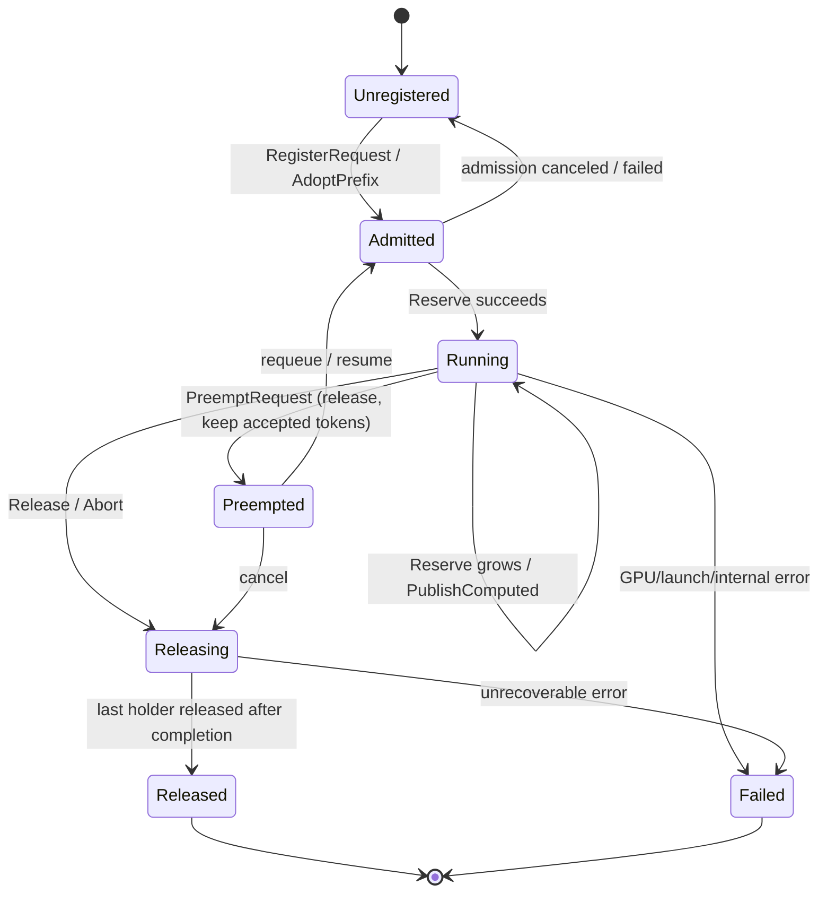
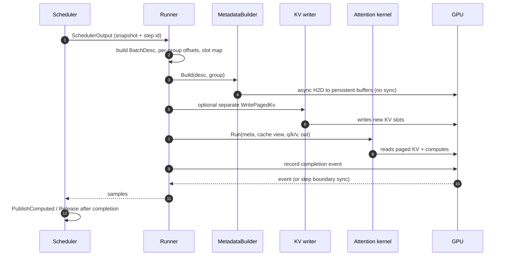

# InferX KV Cache Subsystem — Production Design

**Status:** engineering design; implementation is intentionally out of scope for this
document. The repository already contains a working host-side cache subsystem and
its scheduler/runner integration. This document records what exists, what was
verified upstream, and the target design needed to make the subsystem safe and
productive under asynchronous CUDA execution, prefix caching, pressure, and
optional heterogeneous models.

**Research date:** 2026-10-20

**Repository revision examined:** `0f6af60` (`add configuration`) plus the
working-tree cache/attention code described below.

**Primary vLLM reference:** local checkout at tag `v0.11.0`, commit
`b8b302cde434df8c9289a2b465406b47ebab1c2d` (2025-10-10). The detailed scheduler,
worker, block-table, and coordinator behavior in this document was verified
against that checkout.

**Current-upstream spot check:** `vllm-project/vllm` `main` at
`39568e2ec76aa9107718d1be8adf43cebd84e83c` (2026-10-20). The current
`kv_cache_interface.py`, `kv_cache_utils.py`, `block_pool.py`,
`kv_cache_manager.py`, and `single_type_kv_cache_manager.py` were fetched and
compared. Current upstream has moved substantially; differences are called out
explicitly in §2.8. Claims about scheduler/worker internals remain anchored to
`v0.11.0` unless marked otherwise.

> **Evidence convention.** “Verified” means the behavior was read in the named
> source. “Proposed” means an InferX design decision, not an upstream fact.
> “Assumption” means the source was not available or the behavior is
> version-dependent. This distinction is load-bearing: vLLM’s internal APIs are
> not stable across releases.

---

## 1. Executive summary and design goals

### 1.1 Decision

Keep InferX’s existing decomposition, which is already the right shape:

```
model specs -> CacheRequirements -> CachePlan -> per-group retention managers
            -> one block pool + one recurrent-state pool -> CacheManager facade
            -> Scheduler (logical ownership) -> ModelRunner / attention kernels
```

The production design makes five substantive changes without duplicating the
existing ownership model:

1. **Separate backing storage from block allocation.** `KvCacheStorage` owns the
   single device allocation, per-layer regions, alignment, dtype/layout metadata,
   and generation. `KvBlockPool` owns block ids, the free/reusable queues,
   reference counts, and the prefix index. The pool holds storage; no second
   allocator or second ledger is introduced.
2. **Make hot-path capacity accounting O(1).** The current `EvictableBlocks()`
   scans every block, and `CacheManager::NumFreeBlocks()` calls it on every
   reservation. Add incrementally maintained counters and never scan the whole
   pool on a decode step.
3. **Make lifetime explicit across CUDA asynchrony.** Reservation, dispatch,
   commit, and release become distinct phases. Blocks referenced by an in-flight
   step cannot be reused until that step’s completion event. Block generation
   counters protect external handles from ABA reuse.
4. **Make cache identity complete and versioned.** Prefix keys include model,
   tokenizer, KV layout/dtype, positional-encoding configuration, adapter
   identity, multimodal content identity where applicable, and tenant salt. Model
   reload or incompatible configuration changes invalidate the index rather than
   silently serving wrong KV.
5. **Make the runner contract graph-safe.** The runner consumes an immutable
   per-step snapshot with explicit per-group offsets, an explicit slot mapping,
   stable device metadata addresses, and no synchronous H2D copies in the steady
   state.

### 1.2 Required capabilities and where they live

| Capability | Owner | Status in this design |
|---|---|---|
| Paged KV with configurable block size | `KvCacheStorage`, `KvBlockPool` | Required; current pool already byte-paged |
| Logical token → physical block mapping | `CacheManager` / group managers | Required; exists |
| Incremental allocation, partial tail blocks | group managers, `KvBlockPool` | Required; exists for full-attention/window/chunk |
| Reference-counted sharing | `KvBlockPool` ledger | Required; exists |
| Collision-safe prefix caching | `PrefixCacheIndex` inside pool + facade hash chain | Required; exists, identity must be extended |
| Safe reclamation after completion/abort/preemption/failure | `CacheManager` + deferred reclaim queue | Required; must become event-aware |
| Capacity estimation, reservation, admission, recovery | `KvCachePlanner`, `CacheManager`, `Scheduler` | Required; planner split is proposed |
| GPU block tables, slot mappings, storage descriptors | `CacheManager`, `ModelRunner`, attention metadata | Required; slot mapping must be explicit |
| Multi-layer and heterogeneous cache groups | `CacheSpec` / `CachePlan` / group managers | Required; exists at host level, model wiring is incomplete |
| Deterministic tests, concurrency, stress, benchmarks | `tests/unit/cache`, `tests/unit/engine`, `benchmarks/kvcache` | Required; test plan in §15 |

### 1.3 Non-goals

Unless a repository consumer exists or a phase is explicitly prioritized:

- implementing CUDA attention kernels;
- replacing the scheduler;
- writing a new GPU allocator from scratch;
- copying every optional vLLM feature at once;
- a new RPC/connector protocol;
- per-group page sizes in the first production milestone;
- partial-block prefix reuse (current upstream supports it; InferX defers it);
- offload/remote KV transfer as a v1 requirement.

### 1.4 Design principles

1. **Correctness before optimization.** A cache hit that returns the wrong KV is
   worse than a miss. Every sharing path is reference-counted and every
   invalidation is explicit.
2. **One owner per resource.** Logical block ownership is in `KvBlockPool`; device
   bytes are in `KvCacheStorage`; request state is in `CacheManager`; policy is in
   the scheduler; kernels borrow descriptors.
3. **Bounded memory.** The pool is sized once at startup and never grows. There is
   no steady-state `cudaMalloc`/`cudaFree`.
4. **Explicit state transitions.** Registration, reservation, dispatch, commit,
   release, preemption, and abort are separate operations with distinct
   postconditions.
5. **No implicit GPU synchronization.** Synchronization is a deliberate step
   boundary or an event wait, never hidden in a block lookup or a metadata fill.
6. **Separation of policy and mechanism.** Retention and admission policy live in
   managers/scheduler; block queues, storage, and hashing are mechanism.
7. **CPU-testable bookkeeping.** All ledger logic runs on `Device::Cpu()` pools in
   unit tests; CUDA only changes the storage backend.
8. **Observable by construction.** Cheap counters are maintained on every
   transition; expensive diagnostics are explicit, debug-only scans.

---

## 2. Verified vLLM source study and mapping

### 2.1 Revision and evidence

| Reference | Commit/tag | Use in this document |
|---|---|---|
| Local checkout | `b8b302cde4` / `v0.11.0` (2025-10-10) | Primary, detailed algorithms and integration |
| Upstream `main` spot check | `39568e2ec7` (2026-10-20) | Current structure, partial caching, hash granularity, spec proliferation |

Links use the immutable commit:

- `https://github.com/vllm-project/vllm/tree/b8b302cde434df8c9289a2b465406b47ebab1c2d/vllm/v1`
- `https://github.com/vllm-project/vllm/tree/39568e2ec76aa9107718d1be8adf43cebd84e83c/vllm/v1`

**Limitation:** the 2026-10-20 spot check fetched only the five core cache files
listed in §2.2. Scheduler/worker claims are therefore verified at `v0.11.0` and
labeled as such. Other current-main behavior is explicitly an assumption.

### 2.2 File map and responsibilities

Paths below are relative to `vllm/v1/` at `v0.11.0`.

| vLLM file | Verified responsibility |
|---|---|
| `kv_cache_interface.py` | `KVCacheSpec` hierarchy: `AttentionSpec`, `FullAttentionSpec`, `MLAAttentionSpec`, `SlidingWindowSpec`, `ChunkedLocalAttentionSpec`, `MambaSpec`, `CrossAttentionSpec`, `EncoderOnlyAttentionSpec`, `UniformTypeKVCacheSpecs`; `KVCacheTensor`, `KVCacheGroupSpec`, `KVCacheConfig` |
| `core/kv_cache_utils.py` | `KVCacheBlock`, `FreeKVCacheBlockQueue`, block hashing, `PrefixCachingMetrics`, memory/block helpers |
| `core/block_pool.py` | `BlockPool`, `BlockHashToBlockMap`, free queue, null block, get/cache/free/evict/reset |
| `core/kv_cache_manager.py` | `KVCacheManager`, `KVCacheBlocks`; request-facing computed-block lookup, slot allocation, caching, free |
| `core/kv_cache_coordinator.py` | `UnitaryKVCacheCoordinator`, `HybridKVCacheCoordinator`, no-prefix coordinator |
| `core/single_type_kv_cache_manager.py` | `FullAttentionManager`, `SlidingWindowManager`, `ChunkedLocalAttentionManager`, `MambaManager`, `CrossAttentionManager` |
| `core/sched/scheduler.py` | Admission, token budgeting, preemption, allocation call sites, finish/free |
| `worker/block_table.py` | `BlockTable` / `MultiGroupBlockTable`; block-table and slot-mapping buffers |
| `worker/gpu_model_runner.py` | `_prepare_inputs`, per-group metadata, block tables, slot mappings |
| `worker/gpu_worker.py` | `determine_available_memory`, profiling, cache initialization |

### 2.3 Block pool and queue semantics (verified at `v0.11.0`)

Observed in `core/kv_cache_utils.py` and `core/block_pool.py`:

- `KVCacheBlock` carries `block_id`, `ref_cnt`, `_block_hash`, and intrusive
  `prev_free_block`/`next_free_block` links.
- `FreeKVCacheBlockQueue` is an intrusive doubly linked list with fake head/tail.
  Blocks are allocated from the front. The docstring states the order is LRU, and
  ties are broken so the block with more hash tokens (the tail of a chain) is
  earlier. vLLM’s manager frees a request’s blocks in reverse order so tails are
  evicted before shared prefixes.
- `BlockPool` reserves one `null_block` (`block_id=0`) from the queue; the null
  block has special refcount handling and is used for skipped positions.
- `get_new_blocks(n)` pops from the free queue, evicts any cached hash entry for
  each popped block (`_maybe_evict_cached_block`) when caching is enabled, then
  sets `ref_cnt=1`.
- `touch(blocks)` removes a block with `ref_cnt==0` from the free queue and
  increments its refcount. This is the adoption/pin operation.
- `free_blocks(ordered_blocks)` decrements refcounts and appends blocks whose
  refcount reaches zero back to the queue.
- `reset_prefix_cache()` succeeds only when every non-null block is free; it
  drops the hash map and clears each block’s hash.
- `BlockHashToBlockMap` may hold multiple blocks for one hash; duplicate blocks
  coexist. Adoption takes the first. This differs from InferX’s single-binding
  index; see §8.5.

**InferX mapping:** `KvBlockPool` + `BlockRecord` (single ledger) + intrusive
free/LRU queues. The current implementation uses a LIFO free queue for never-cached
blocks and a separate LRU for cached-but-unreferenced blocks. That preserves
vLLM’s eviction intent while keeping L2-friendly reuse of ordinary blocks. The
difference is documented in §7.6.

### 2.4 Prefix hashing (verified)

At `v0.11.0`, `core/kv_cache_utils.py`:

- `BlockHash` is bytes; `BlockHashWithGroupId` appends a 4-byte big-endian group
  id. This keeps one flat index key and avoids tuples.
- `NONE_HASH` is the parent of the first block. At `v0.11.0` it is random unless
  `PYTHONHASHSEED` is set.
- `hash_block_tokens(hash_fn, parent, tokens, extra_keys)` hashes the tuple
  `(parent, tuple(tokens), extra_keys)`. `extra_keys` may contain LoRA identity,
  multimodal feature identifiers, and `cache_salt` (first block only).
- `get_request_block_hasher(block_size, hash_fn)` only hashes full blocks and
  chains each digest through the previous one.
- `Request.block_hashes` is extended when output tokens are appended; the request
  owns the chain, not the block pool.
- At `v0.11.0`, only full blocks are hashed and the partial tail is never
  published.

At current `main` (`39568e2e`):

- `hash_block_size` may be smaller than a cache group’s `block_size`;
  `resolve_block_hashes` and `BlockHashListWithBlockSize` map hashes to coarser
  blocks.
- Partial prefix entries are supported for fine-grained lookup. `KVCacheBlock`
  gained `_block_hash_num_tokens`, and `BlockPool.cache_partial_block`/
  `_get_partial_block_hash` register a prefix that ends inside a cache block.
- SHA-256 uses a deterministic default seed; non-cryptographic hash functions
  keep a random per-process seed. Current extra keys are tagged and include
  prompt-embeddings digests as well as LoRA, multimodal, and salt.
- The default hash path is not a reason to treat vLLM’s hashes as stable across
  versions. They are an internal cache key, not a wire format.

**InferX mapping:** `ChainHash` in `include/inferx/cache/block_hash.h`, implemented
in `src/cache/cache_manager.cc`. It uses a domain separator, a zero parent, length
framing, full-block-only hashing, and salt in the first link. This is
deterministic across processes (good for tensor-parallel ranks and future
distributed reuse). The current C++ API does not yet include model/adapter/
multimodal identity; §8 closes that gap.

### 2.5 Per-group managers and coordinator (verified at `v0.11.0`)

Observed in `core/single_type_kv_cache_manager.py` and
`core/kv_cache_coordinator.py`:

- `SingleTypeKVCacheManager` owns per-request block lists and a per-request
  `num_cached_block` cursor. It exposes:
  - `get_num_blocks_to_allocate(request_id, num_tokens, new_computed_blocks)`
  - `save_new_computed_blocks`
  - `allocate_new_blocks`
  - `cache_blocks`
  - `free`
  - `find_longest_cache_hit`
  - `remove_skipped_blocks`
  - `get_num_common_prefix_blocks`
- `FullAttentionManager.find_longest_cache_hit` walks hashes from left to right
  and stops at the first miss.
- `SlidingWindowManager` needs `cdiv(window - 1, block_size)` contiguous blocks;
  it searches right to left, keeps null placeholders for skipped blocks, and
  frees blocks below `num_computed_tokens - window + 1`.
- `ChunkedLocalAttentionManager` starts at the current chunk boundary, marks
  earlier blocks null, and keeps the last cached block for hash continuity.
- `MambaManager` returns no prefix hit and holds one state block per request.
- `CrossAttentionManager` does not prefix-cache; it allocates from encoder length.
- `UnitaryKVCacheCoordinator` takes one manager’s hit. `HybridKVCacheCoordinator`
  supports full attention plus exactly one other spec type at `v0.11.0`; it
  computes the full-attention hit, then the other hit within that length, and
  truncates/merges. It assumes full-attention block size divides the other block
  size.

**InferX mapping:** `CacheGroupManager` and its subclasses, plus the fixed-point
agreement loop currently private to `CacheManager::FindAgreedHit`. The C++ design
supports more than one non-full group by shrinking the agreed cap, but it still
requires a uniform per-layer page size across token-wise groups. This is stricter
than current upstream’s `UniformTypeKVCacheSpecs`/page-size packing and is
documented as a v1 limit in §6.4.

### 2.6 Memory planning (verified)

At `v0.11.0`:

- `gpu_worker.determine_available_memory()` runs a profile forward pass and
  computes available KV bytes as requested memory minus non-KV peak memory.
- `get_num_blocks(vllm_config, num_layers, available_memory, page_size)` computes
  `available_memory // page_size // num_layers`; a user override may replace the
  result.
- `get_kv_cache_config_from_groups` builds `KVCacheTensor` regions and
  `KVCacheConfig`.
- `check_enough_kv_cache_memory` and `estimate_max_model_len` validate that at
  least one request at `max_model_len` fits.

Current `main` keeps the profile-based approach but has more spec-aware
`max_memory_usage_bytes`, admission caps, and page-size/alignment handling.

**InferX mapping:** `ModelRunner::ProfileRun` / `InitializeKVCache` and
`AttentionRuntime::Create`. Current InferX splits recurrent state first, then
computes `num_blocks = remaining / bytes_per_block`; there is no explicit safety
margin or max-model-length admission check in the cache layer. §6.6 proposes a
planner result with those fields.

### 2.7 Runner and kernel contract (verified at `v0.11.0`)

Observed in `worker/gpu_model_runner.py` and `worker/block_table.py`:

- The runner keeps a persistent `InputBatch`/`CachedRequestState`; block tables are
  per group.
- `BlockTable.compute_slot_mapping(req_indices, positions)` maps each scheduled
  token to `block_id * block_size + offset` using the request row and position.
- `commit_block_table` and `commit_slot_mapping` copy pinned host arrays to GPU.
- `_prepare_inputs` builds `query_start_loc`, `seq_lens`, positions, block tables,
  and slot mappings; `CommonAttentionMetadata` carries them to backends.
- Padding uses `NULL_BLOCK_ID=0` and `PAD_SLOT_ID=-1`; kernels skip padded tokens.
- CUDA graph capture uses persistent buffers; metadata is built for a capture
  shape and replay overwrites buffer contents, not pointers.

**InferX mapping:** `SchedulerOutput::group_block_ids`, `attn::BatchDesc`,
`attn::GroupMeta`, `attn::MetadataBuilder`, `WritePagedKv`. Current InferX builds
CSR arrays per step and derives slots from positions; it does not yet have an
explicit slot map or graph-safe device counts. §10 specifies the target.

### 2.8 Current-upstream deltas that matter

| Area | `v0.11.0` | Current `main` (2026-10-20) | InferX decision |
|---|---|---|---|
| Partial prefix reuse | Full blocks only | Partial entries, hash granularity below block size | Defer; full-block-only v1, design keeps hash granularity field |
| Hash seed | Random `NONE_HASH` unless seeded | Deterministic default for SHA-256 | Keep deterministic C++ chain; salt provides isolation |
| Extra keys | LoRA, MM, salt | Tagged LoRA/MM/salt/prompt-embeds | Add model/layout namespace + adapter + salt; MM deferred |
| Specs | Full, MLA, SW, chunked, Mamba, cross, encoder-only | Sink, RSWA, HiSparse, hidden-state, circular buffer, more quant modes | Adopt only implemented families; reject unknown specs |
| Groups | Full + one other in hybrid | More general, page-size packing | Keep any-token-wise-group fixed point with uniform page size |
| Duplicate hashes | Multiple blocks per hash | Still multi-binding | Keep single binding v1; document hit-efficiency trade-off |
| Free queue | One LRU queue, tail-first frees | More elaborate tiers/eviction | Keep free LIFO + cached LRU; equivalent policy, easier to test |
| KV quant | fp8 per-tensor | Many quant modes and layouts | Storage-only v1; per-tensor scales; reject unsupported |
| Offload/transfer | Experimental connectors | Connector hooks exist; current-main tiering not re-verified in this pass | Deferred; explicit seams only |

### 2.9 Assumptions and source limitations

- vLLM’s Python object lifetimes differ fundamentally from C++ RAII; vLLM’s
  refcount behavior was taken as semantic guidance, not as a lifetime model to
  copy.
- The 2026-10-20 spot check did not inspect every backend/worker file. Claims
  about graph capture, connector behavior, and current scheduler ordering beyond
  the fetched core files are assumptions and are not relied on for correctness.
- “Current upstream supports X” in §14 means the examined file/feature exists; it
  does not mean InferX should implement it now.
- vLLM block hashes are not a stable interop format. InferX’s hash chain is its
  own versioned format and must never be mixed with vLLM’s without an explicit
  compatibility layer.

---

## 3. Existing repository integration points and assumptions

### 3.1 Verified repository assets

| Component | Path | What it does today |
|---|---|---|
| `CacheSpec` / `CacheComponent` / `Retention` | `include/inferx/cache/cache_spec.h`, `src/cache/cache_spec.cc` | Byte-denominated per-layer components, retention policy variant, grouping/planning |
| `KvBlockPool` | `include/inferx/cache/kv_block_pool.h`, `src/cache/kv_block_pool.cc` | One device allocation, per-layer byte regions, int32 block ids, null block, free/LRU queues, refcounts, absorbed prefix index |
| `BlockHash` / `ChainHash` | `include/inferx/cache/block_hash.h`, `src/cache/cache_manager.cc` | Chained SHA-256 over full blocks, salt in first link |
| `BlockTable` | `include/inferx/cache/kv_block_pool.h` | Host-side logical position → `(block, slot)` helper |
| `CacheGroupManager` | `include/inferx/cache/cache_group_manager.h`, `src/cache/cache_group_manager.cc` | Full/window/chunk/cross/recurrent retention, hit search, growth, fork, release |
| `CacheManager` | `include/inferx/cache/cache_manager.h`, `src/cache/cache_manager.cc` | Request registration, prefix adoption, atomic multi-group reserve, publish, release, fork, stats |
| `RecurrentStatePool` | `include/inferx/cache/recurrent_state_pool.h`, `src/cache/recurrent_state_pool.cc` | Fixed slots for recurrent state, stream-ordered reset |
| `AttentionRuntime` | `include/inferx/ops/attention/runtime.h`, `src/ops/attention/runtime.cc` | Composition root: specs → plan → pools → cache facade → backends → metadata buffers |
| `CacheView` | `include/inferx/ops/attention/cache_view.h`, `src/ops/attention/cache_view.cc` | Non-owning flattened per-layer view for kernels |
| `GroupMeta` / `BatchDesc` | `include/inferx/ops/attention/metadata.h` | CSR page tables, per-token positions, per-group scalars |
| `Scheduler` | `include/inferx/engine/scheduler.h`, `src/engine/scheduler.cc` | Admission, chunking, reserve, publish, preempt, abort, finish |
| `ModelRunner` / `InputBatch` | `include/inferx/engine/model_runner.h`, `src/engine/model_runner.cc`, `src/engine/input_batch.*` | Persistent per-request state, step flattening, attention execution |
| `SchedulerOutput` | `include/inferx/engine/scheduler_output.h` | Immutable per-step snapshot: scheduled requests, per-group block ids, finished/preempted ids |
| Core primitives | `include/inferx/core/device_buffer.h`, `device_runtime.h`, `stream.h`, `status.h` | RAII device allocations, async copies, streams/events, `absl::Status`/`StatusOr` |

### 3.2 Verified integration facts and gaps

These are as-built observations, not aspirations.

1. **The scheduler owns logical KV lifetime.** `Scheduler::Schedule()` calls
   `AdoptPrefix`, `Reserve`, and `PublishComputed`; `UpdateFromOutput`,
   `PreemptNewestAfter`, `AbortRequests`, and the destructor call `Release`.
   The model runner does not allocate logical blocks.
2. **The runner consumes a snapshot, not live request state.** `SchedulerOutput`
   carries `group_block_ids`; `ModelRunner::RunStep` reads it. This is the correct
   direction for asynchronous execution.
3. **The snapshot lacks per-group offsets and skipped-token scalars.** The runner
   reconstructs page counts from `seq_lens / block_size` and `AttentionRuntime::
   BeginStep` reads `CacheManager::GroupSkippedTokens` on the runner thread. The
   design adds per-group offsets and publishes `window_left` in the snapshot so
   the runner never touches mutable cache state.
4. **Metadata upload currently synchronizes per array.** `FillCommonMetadata`
   calls `SynchronizeStream` after each H2D copy (`src/ops/attention/fill_common.cc`).
   That makes current release-after-step safe but serializes the step and blocks
   graph capture.
5. **CUDA graphs are not implemented.** `ModelRunner::CaptureGraphs` returns
   `UnimplementedError`; graph flags are accepted by config but cannot be honored.
6. **Slot mapping is implicit.** `WritePagedKv` derives the slot from
   `positions` and the CSR page table. This is adequate for eager, unpadded
   batches but insufficient for padded graph replay, where an explicit
   `slot_mapping` with `-1` is required.
7. **Prefix identity is incomplete.** `AdoptPrefix` accepts only a `cache_salt`.
   Model weights, tokenizer identity, adapter identity, KV layout/dtype, and
   positional-encoding configuration are not part of the key. Today this is
   handled by operator discipline (call `ResetPrefixCache` on reload) rather than
   by a versioned namespace.
8. **Hot-path capacity queries scan the pool.** `KvBlockPool::EvictableBlocks()`
   and `NumCachedBlocks()` iterate all blocks; `NumFreeBlocks()` includes
   `EvictableBlocks()`, and `CacheManager::Reserve` calls `NumFreeBlocks()` every
   step. This violates the O(1) decode budget.
9. **Sliding-window models are still rejected at config load.** The manager and
   spec exist and are unit-tested, but `qwen3_config.cc` and `llama_config.cc`
   return `UnimplementedError` for `use_sliding_window`. The implementation is
   therefore “host-ready, model-unwired.”
10. **Recurrent state and cross-attention are host-ready but not end-to-end.**
    `RecurrentStatePool` and the recurrent manager exist; the scheduler/runner
    path for state slots and encoder tokens is not complete. Hybrid prefix
    adoption deliberately returns zero because state sharing is absent.
11. **Fork/COW exists at the facade and manager level, with no scheduler
    consumer.** `Fork` shares blocks and queues copy-on-write work, but beam
    decoding/speculative branching does not call it yet.
12. **Folly is vendored but not built or used.** `cmake/InferXDependencies.cmake`
    does not add Folly; the server uses Boost.Asio coroutines. Adding Folly would
    be a new build dependency for no hot-path benefit.
13. **The current implementation has no explicit deferred-free queue.** Safety
    relies on `ModelRunner::RunStep` synchronizing the stream before
    `UpdateFromOutput` may release. That is correct today but not a design that
    survives pipelined execution, graph replay, or offload.
14. **Stale tests exist outside the build.** Some working-tree test files under
    `tests/unit/cache` reference an older API and are not listed in
    `tests/unit/cache/CMakeLists.txt`. The design treats the CMake-listed suites
    as the baseline and expects stale files to be removed or ported.

### 3.3 Assumptions

- The engine is single-process/single-scheduler-thread per replica for the
  mutable cache state. Tensor-parallel ranks each own a local `KvBlockPool` and
  `AttentionRuntime`, but only the driver rank’s `CacheManager` performs
  allocation. Non-driver caches are passive storage plus read-only views.
- The cache layer is host C++ and calls `DeviceBuffer`/`DeviceRuntime`; it does
  not include CUDA headers.
- `absl::Status`/`StatusOr` is the project error convention. No exceptions cross
  API boundaries. `std::expected` is available with C++23 but is not used because
  the repository standardized on Abseil.
- One scheduler block size applies to every token-wise group in v1. The planner
  rejects configurations requiring different per-layer page sizes.
- The model’s maximum sequence length is known at startup and the tokenizer ID
  space is fixed for the lifetime of a loaded model.
- The current engine step is synchronous at the scheduler/runner boundary. The
  design specifies the event-driven contract needed to relax that, but does not
  require pipelining in P0/P1.

---

## 4. Architecture and component ownership

### 4.1 Component diagram

```text
┌──────────────────────────────────────────────────────────────────────────────┐
│                                  Scheduler                                   │
│  admission · token budget · chunking · preemption · completion               │
│  owns RequestCacheState, never owns device bytes                             │
└───────────────┬───────────────────────────────────────────────┬──────────────┘
                │ Register/Adopt/Reserve/Publish/Release         │ immutable
                │ (scheduler thread)                             │ SchedulerOutput
                v                                                v
┌───────────────────────────────────────────────┐   ┌──────────────────────────┐
│                CacheManager                   │   │       ModelRunner        │
│  request → per-group state, hash chain,       │   │  InputBatch, step flatten │
│  prefix agreement, atomic multi-group ops,    │   │  builds BatchDesc, slot   │
│  deferred reclaim, stats                      │   │  map, per-group metadata  │
│  owns RequestState; borrows pools             │   └────────────┬─────────────┘
└───────┬───────────────────────┬───────────────┘                │ descriptors
        │ owns/borrows          │ owns/borrows                   v
        v                       v                     ┌──────────────────────────┐
┌───────────────────┐   ┌────────────────────┐        │    AttentionBackend      │
│ CacheCoordinator  │   │ CacheGroupManager  │        │  kernels read/write KV   │
│ (internal helper) │   │  per retention     │        │  never allocate blocks   │
│ fixed-point hits  │   │  full/window/chunk │        └──────────────────────────┘
└─────────┬─────────┘   │  cross/recurrent   │
          │             └─────────┬──────────┘
          │                     │ borrows
          v                     v
┌──────────────────────────────────────────────────────────────────────────────┐
│                              KvBlockPool                                     │
│  block ids · free queue · reusable LRU · refcounts · generation ·             │
│  PrefixCacheIndex (private subobject)                                        │
│  owns/borrows: KvCacheStorage (device bytes), RecurrentStatePool (slots)     │
└───────────────────────────────┬──────────────────────────────────────────────┘
                                │ owns
                                v
┌──────────────────────────────────────────────────────────────────────────────┐
│                             KvCacheStorage                                   │
│  one DeviceBuffer · per-layer regions · alignment · dtype/layout metadata     │
│  generation · storage descriptor factory                                     │
└──────────────────────────────────────────────────────────────────────────────┘

Planning path (init only):
  ModelSpec.cache → CacheRequirements → KVCachePlanner/PlanCacheGroups → CachePlan
  CachePlan + MemoryBudget → KvCacheStorage + KvBlockPool + RecurrentStatePool
```

### 4.2 Responsibilities and ownership

| Component | Owns | Borrows | Thread | May block? | May allocate? |
|---|---|---|---|---|---|
| `KVCachePlanner` (`PlanKvCache`) | planning result only | model specs, memory budget | init thread | No | Yes, init only |
| `KvCacheStorage` | one `DeviceBuffer`, region table, storage generation | `DeviceRuntime` via allocation | any read-only after construction | Init/free only | Init only |
| `KvBlockPool` | block records, free queue, LRU, refcounts, prefix index | its `KvCacheStorage` | scheduler thread (mutating); read-only snapshots elsewhere | No on hot path | No after construction |
| `RecurrentStatePool` | state slots, region views | its `DeviceBuffer` | scheduler + runner reset path | `ResetSlot` enqueues GPU work only | Init only |
| `CacheGroupManager` | per-request per-group token/block bookkeeping | `KvBlockPool`, `RecurrentStatePool` | scheduler thread | No | `Reserve` allocates from pool |
| `CacheManager` | request registry, per-group states, hash chains, pending reclaim, stats | pools, group managers | scheduler thread | No | Yes, request-state growth |
| `Scheduler` | request lifecycle, admission/preemption policy, token budgets | `CacheManager` | scheduler/event-loop thread | May wait on request completion only at step boundary | Host allocations for requests/metadata |
| `ModelRunner` | persistent per-request runner state, device metadata buffers, kernels, graphs | snapshot from `SchedulerOutput`, storage descriptors, cache views | runner thread(s) | Step boundary sync today; event wait in target | Init only; step uses preallocated buffers |
| `AttentionBackend` / `Kernel` | bound view/executor | `KVStorageDescriptor`, `GroupMeta`, input tensors | runner thread | Host enqueue only | Init only |
| `TransferCoordinator` (optional) | host/remote tiers, transfer state | pool handles, streams | separate control plane | Yes, async | Yes, offload only |

**Rules:**

1. Only the scheduler-owned `CacheManager` may mutate logical cache state.
   Kernels and runner code may read block ids/descriptors and write/read KV bytes,
   but may not allocate, release, publish, or rewrite a block table.
2. Device backing memory is owned exactly once by `KvCacheStorage`. A
   `KVStorageDescriptor` is a borrowed view and never frees.
3. The runner consumes an immutable per-step snapshot. It must not call back into
   live `CacheManager` state while a step is in flight.
4. `CacheManager` never holds a pointer that outlives the pool; the runtime owns
   both, and destruction order is runtime → cache manager → pools → storage.
5. A block referenced by an in-flight step is logically owned until completion.
   The scheduler may mark a request finished, but physical reclamation is
   deferred.

### 4.3 Request lifecycle sequence

```mermaid
sequenceDiagram
    autonumber
    participant Client
    participant S as Scheduler thread
    participant CM as CacheManager
    participant P as KvBlockPool
    participant R as ModelRunner
    participant G as GPU stream
    participant E as Completion event

    Client->>S: AddRequest(prompt, params, salt)
    S->>CM: RegisterRequest(id, prompt, PrefixIdentity)
    S->>CM: AdoptPrefix(id, prompt, identity, n-1)
    CM->>P: LookupCached / AcquireBlock(hit blocks)
    CM-->>S: PrefixAdoption{tokens, per-group blocks}
    S->>CM: Reserve(id, {computed, computed+chunk})
    CM->>P: AllocateBlocks / pin cached / rollback on failure
    CM-->>S: Granted{new blocks, state slot, COW copies}
    S->>S: Publish immutable SchedulerOutput snapshot
    S->>R: ExecuteModel(snapshot)
    R->>R: Build BatchDesc, slot mapping, per-group metadata
    R->>G: async H2D metadata; KV writer; attention kernels
    R->>E: record step completion
    R-->>S: samples after required host sync
    S->>CM: PublishComputed(id, prompt, output, computed)
    S->>CM: Release(id) or defer until completion event
    CM->>P: ReleaseBlock / LRU or free queue
    CM->>E: wait for event before physical reuse
```

### 4.4 Transaction boundary

There are four distinct moments. Conflating them is the primary source of cache
bugs.

| Phase | Operation | Postcondition | Failure behavior |
|---|---|---|---|
| Plan | `CanReserve` / `PlanAllocation` | No state change; an estimate only | Return false/error; request unchanged |
| Reserve | `Reserve` / `AllocateOrReserve` | Blocks/slots are owned by the request, refcounts incremented, no tokens computed | All-or-nothing rollback across groups |
| Dispatch | `SchedulerOutput` snapshot + GPU launch | Immutable block ids/metadata are in flight | Cancel/fail request; no publish; release after safe point |
| Commit | `PublishComputed` after KV writes complete | Full blocks become discoverable; computed watermark advances | Do not advance watermark; report error |
| Release | `Release` / deferred release | Request ownership dropped; blocks become reusable only after completion | Idempotent at request level; block double-release is a bug |

**Reservation is not computation.** A reserved block may contain stale data until
a kernel writes it. Prefix publication must never use a reservation as evidence
that KV contents are valid.

---

## 5. Core types, invariants, and state machines

### 5.1 Fundamental types

The existing repository defines some of these. The target design extracts shared
types into `include/inferx/cache/kv_cache_types.h` and keeps existing names as
aliases so current call sites do not change.

```cpp
namespace inferx {

using RequestId       = std::uint64_t;   // 0 reserved invalid
using BlockId         = std::int32_t;    // 0 = null, usable 1..N
using LayerId         = std::int32_t;
using CacheGroupId    = std::uint16_t;
using TokenPosition   = std::int64_t;    // host; device form is int32
using DeviceId        = std::int8_t;     // matches core::Device
using CacheGeneration = std::uint64_t;

inline constexpr RequestId kInvalidRequestId = 0;
inline constexpr BlockId kInvalidBlockId = -1;
inline constexpr BlockId kNullBlockId = 0;
inline constexpr CacheGroupId kInvalidCacheGroup = 0xFFFF;

struct BlockHash {
  std::array<std::uint8_t, 32> bytes{};
  friend bool operator==(const BlockHash&, const BlockHash&) = default;
};

struct BlockKey {
  BlockHash hash;
  CacheGroupId group = 0;
  // namespace id is part of the hash chain seed; kept here for debuggability
  // and future multi-tenant indexes. It is not a second source of truth.
  std::uint64_t namespace_id = 0;
  friend bool operator==(const BlockKey&, const BlockKey&) = default;
};

struct BlockHandle {
  BlockId id = kNullBlockId;
  std::uint32_t generation = 0;
  friend bool operator==(const BlockHandle&, const BlockHandle&) = default;
};

struct KVStorageDescriptor {
  std::byte* base = nullptr;          // borrowed; storage-owned
  std::int64_t page_stride_bytes = 0; // distance between block rows
  std::int32_t page_bytes = 0;        // live bytes per page
  std::int32_t block_tokens = 0;
  std::int32_t num_pages = 0;         // usable pages; null row exists
  DataType dtype = DataType::kBFloat16;
  attn::KvPageLayout layout = attn::KvPageLayout::kKvPlanarNhd;
  Device device{};
  CacheGeneration generation = 0;
  std::uint16_t group = 0;
  LayerId layer = 0;
};

struct PrefixMatch {
  std::int64_t cached_tokens = 0;                  // whole blocks only
  std::vector<std::vector<BlockId>> group_blocks;  // per token-wise group
};

struct AllocationPlan {
  std::int64_t blocks = 0;
  std::int64_t state_slots = 0;
  bool may_evict_cached = false;
};

struct AllocationResult {
  std::vector<BlockId> new_blocks;   // in logical order
  std::optional<std::int64_t> state_slot;
  std::vector<BlockCopy> copies;
  CacheGeneration generation = 0;
};

struct CacheMetrics {
  std::int64_t total_blocks = 0;
  std::int64_t free_blocks = 0;
  std::int64_t used_blocks = 0;
  std::int64_t cached_blocks = 0;
  std::int64_t evictable_blocks = 0;
  std::int64_t pinned_cached_blocks = 0;
  std::int64_t in_flight_blocks = 0;
  std::int64_t allocation_failures = 0;
  std::int64_t evictions = 0;
  std::int64_t prefix_queries = 0;
  std::int64_t prefix_hits = 0;
  std::int64_t prefix_queried_tokens = 0;
  std::int64_t prefix_hit_tokens = 0;
  std::int64_t high_water_blocks = 0;
  std::int64_t device_bytes = 0;
};

}  // namespace inferx
```

`RequestCacheState` is facade-private, but its observable states are:

```cpp
enum class RequestCacheState : std::uint8_t {
  kUnregistered,
  kAdmitted,     // registered, possibly with an adopted prefix
  kRunning,      // holds a live reservation
  kPreempted,    // reservation released, accepted tokens retained elsewhere
  kReleasing,    // release requested; physical reclaim may be deferred
  kReleased,
  kFailed,
};
```

### 5.2 Units and conversions

| Unit | Representation | Conversion/check |
|---|---|---|
| Tokens | `int64_t` host / `int32_t` device | Must be non-negative; device positions checked against `max_model_len` |
| Blocks | `int64_t` counts, `BlockId` ids | `BlocksForTokens(t) = ceil(t / B)`, only for `t > 0` |
| Bytes | `int64_t`/`size_t` | Overflow-checked in planner; regions fit `size_t` |
| Pages per request | `ceil(seq_len / B)` | Partial tail is valid |
| Logical block index | `pos / B` | `pos >= 0`; `slot = pos % B` |
| Block table row | `[max_seqs, max_blocks_per_seq]` int32 | Row stride fixed for graphs |
| Slot mapping entry | int32 | `block * B + offset`, or `-1` for padding |

Integer overflow rules:

- `RequestId` allocator starts at 1 and checks wraparound; never reuses a live id.
- `BlockId` is int32. Capacity must satisfy `num_blocks + 1 <= INT32_MAX`; the
  planner rejects larger pools.
- Byte computations use checked `int64_t` multiplication in the planner. The
  runtime stores `size_t`.
- `TokenPosition` is int64 host-side; conversion to int32 requires
  `<= INT32_MAX` and is part of the max-model-length validation.

### 5.3 Full vs partial blocks

- A **full block** contains exactly `B` tokens whose KV has been computed.
- A **partial block** is the tail of a live sequence; it contains fewer than `B`
  computed tokens and is private to the writing request.
- Only full blocks are hashed and published to the prefix index in v1.
- A block may be *allocated* for a partial tail; allocation capacity is
  `ceil(tokens / B)`.
- A partial block becomes full exactly when its last token is computed. The
  publish cursor advances only over full blocks.
- Sliding-window and chunked-local groups may contain null entries for positions
  below the retention floor. A null entry is never written or read.

### 5.4 Block ownership invariants

The ledger is the single source of truth. For every usable block id `b`:

1. `ref_count[b] >= 0`.
2. `ref_count[b] == 0` iff `b` is in exactly one of the free queue or the
   reusable LRU. It is never in both and never in neither.
3. `ref_count[b] > 0` means `b` is owned by at least one holder (request, prefix
   adoption, fork child, or deferred in-flight guard). It is on neither queue.
4. A discoverable cached block with `ref_count == 0` is on the LRU. It remains
   findable until evicted or forgotten.
5. A tombstoned cached block (`discoverable == false`, `cached == true`) may have
   `ref_count > 0`; it is not findable and is freed when the last holder releases.
6. The null block id 0 is never allocated, never written, never hashed, and never
   returned by an allocator. Its refcount is not part of normal accounting.
7. `AllocateBlock` returns an id with `ref_count == 1`, `cached == false`, and no
   index key.
8. A block can be in at most one cache group’s table for a given request at a
   time. Prefix keys include the group.
9. The total number of blocks handed out plus free plus reusable plus tombstoned
   equals `num_blocks`.
10. Every generation increment happens on a transition from free/reusable to
    allocated, so a stale `(id, generation)` handle is rejected.

### 5.5 State machines

**Request cache state:**



**Block state:**

```mermaid
stateDiagram-v2
    [*] --> Free
    Free --> Allocated: AllocateBlock (ref=1)
    Allocated --> Allocated: AcquireBlock (ref++)
    Allocated --> Reusable: last Release of a discoverable block
    Allocated --> Free: last Release of an uncached block
    Allocated --> Tombstone: ClearCachedEntries on a pinned cached block
    Reusable --> Allocated: AcquireBlock (pin; remove from LRU)
    Reusable --> Free: EvictCached / allocation pressure
    Reusable --> Free: ForgetBlock
    Tombstone --> Free: last Release
    Free --> Allocated: AllocateBlock (new generation)
```



**In-flight extension (target):**

```text
Allocated --(step snapshot publishes block)--> InFlight
InFlight --(completion event)--> Allocated
Allocated --(last holder release while InFlight)--> DeferredFree
DeferredFree --(completion event)--> Reusable or Free
```

The in-flight state may be implemented as a per-step pin/guard rather than a
persistent block field. The invariant is what matters: no free/reusable
transition while a GPU operation can still access the block.

### 5.6 Invariant ownership and tests

| # | Invariant | Owner / enforcement point | Test |
|---|---|---|---|
| I1 | Free xor ref>0 | `KvBlockPool` queue transitions | `kv_block_pool_test` |
| I2 | Refcount equals holders | `Allocate/Acquire/Release`; no scheduler direct mutation | property/model-based allocator test |
| I3 | Cached unreferenced is evictable, not free | `ReleaseBlock`; `EvictCached` | `PublishedBlocksAreDiscoverableAndEvictable` |
| I4 | Tombstone frees on last release | `ClearCachedEntries` + `ReleaseBlock` | `ClearCachedEntriesReclaims...` |
| I5 | Null block never used as data | pool `Usable`, manager table writers, kernel skip | block-table tests + GPU null-row test |
| I6 | Only full blocks published | `PublishComputed` cursor and `full = computed/B` | prefix tests |
| I7 | Hit is contiguous/valid for retention | group manager hit search + facade agreement | full/window/chunk hit tests |
| I8 | Reserve is atomic across groups | `CacheManager::Reserve` + `Rollback` | multi-group rollback test |
| I9 | Release is exactly once / idempotent | request registry + block refcount | release/double-release tests |
| I10 | Snapshot is immutable during step | `SchedulerOutput` copy; runner does not read live facade | scheduler/runner test |
| I11 | No reuse while in flight | deferred reclaim / step guard | CUDA event test |
| I12 | Stale handle rejected | `(id, generation)` check | stale-handle test |
| I13 | Counters equal scanned truth in debug | O(1) counters + debug reconciliation | `DebugCountersMatchScan` |
| I14 | Cross-layer groups agree on hit length | `FindAgreedHit` fixed point | hybrid hit test |
| I15 | State slot at most one request | `RecurrentStatePool::in_use_` | recurrent tests |

### 5.7 Generation and ABA protection

Raw `BlockId` values are reused. Three contexts need protection:

1. **Scheduler hot path:** request tables store raw ids and request ownership is
   exactly-once. Reuse cannot occur while the request holds a ref. This is
   sufficient and avoids a generation check per token.
2. **External/control-plane handles:** offload, transfer, diagnostics, and future
   connectors use `BlockHandle{id, generation}`. `KvBlockPool::AcquireHandle` and
   `ReleaseHandle` verify generation; a mismatch returns `kFailedPrecondition`
   and performs no mutation.
3. **Request-level stale release:** `CacheManager::Release(RequestId,
   CacheGeneration)` may verify the request generation. Duplicate release of an
   already-released request remains a no-op for compatibility; releasing a
   recycled request id with an old generation is rejected.

The pool increments a block’s generation when it is allocated from free/reusable
state. It does not increment on ordinary refcount changes. Device block tables do
not carry generations; their lifetime is bounded by the step snapshot and the
completion event.

Generation width: use a 32-bit per-block generation plus a 64-bit storage
generation. If the 32-bit counter would wrap, the pool must bump the storage
generation and force offload/diagnostic handle invalidation rather than silently
reusing an old `(id, generation)` pair. In debug builds, an increment to zero is a
fatal assertion.

### 5.8 Committed, computed, scheduled, allocated

These quantities are distinct and must never be collapsed:

| Quantity | Meaning | Owner |
|---|---|---|
| `num_prompt_tokens` | immutable prompt length | `Request` |
| `num_tokens` | prompt + accepted output (+ draft tokens if speculative) | `Request` |
| `num_computed_tokens` | contiguous prefix whose KV is valid in cache | `Request` / scheduler |
| `num_cached_tokens` | prefix adopted from cache at admission, recorded once | `Request` metric |
| `num_scheduled_tokens` | tokens granted by the scheduler this step | `SchedulerOutput` |
| `allocated_blocks` | blocks currently owned by the request | `CacheManager` |
| `num_published_blocks` | full blocks already inserted into the prefix index | group state |
| `num_in_flight_tokens` | tokens dispatched but not yet known committed | target step state |

Invariant: `num_cached_tokens <= num_computed_tokens <= allocated capacity`.
Speculative draft tokens may make `num_tokens` exceed `num_computed_tokens`; they
must not be published until accepted.

### 5.9 Cross-layer consistency and heterogeneous groups

- A `CacheGroupSpec` contains only layers with identical `CacheSpec`; all layers
  in a group share one block table and one retention policy.
- Different groups may have different retention and different block contents, but
  v1 requires the same per-layer page size so one block id has one meaning across
  the pool.
- A logical block id held by group A occupies a page in every token-wise layer’s
  region, including layers of other groups. Only group A’s layers for that id are
  written; the other regions are unused for that id. This is the cost of one
  shared id space and is reflected in `bytes_per_block`.
- A layer alias (`SharedCache`) resolves to its source layer’s group. It does not
  allocate or own storage.
- Cross-attention groups are sized by encoder length and are not prefix-cacheable.
- Recurrent groups use slots, not block ids; they never enter a block table.

---

## 6. Memory layout, capacity formulas, and storage lifecycle

### 6.1 No universal physical layout

A KV page is not universally `[B, Hkv, D]`. Attention kernels differ:

- FlashInfer/FlashAttention dense kernels typically want planar K and V,
  token-major within a page.
- Some backends want head-major or interleaved K/V.
- MLA caches a compressed latent plus RoPE dimension, not per-head K/V.
- Quantized caches add scales/zero-points either per tensor, per head, per token,
  or per block.
- Recurrent state is opaque per-sequence state, not tokens.

Therefore the cache subsystem owns **opaque bytes** and exposes a
`KVStorageDescriptor` declaring:

```
base, page_stride_bytes, page_bytes, block_tokens, num_pages,
dtype, layout, device, generation, group, layer
```

The attention backend validates `layout`, `dtype`, `block_tokens`, `page_stride`,
head geometry, and quantization support against its `Capability`. The cache
manager never reshapes bytes into kernel geometry. A model layer may reshape a
borrowed region into its own tensor view, but that view is not an allocation and
must not outlive the storage generation.

### 6.2 Current physical layout

For token-wise layers, `KvBlockPool` currently lays out one region per layer:

```
layer_region[l] = [num_blocks + 1, block_size, bytes_per_token_l]  // uint8
```

Row 0 is the reserved null block. Block id `b` maps to row `b` in every layer.
The region is contiguous and byte-addressed; `CacheView` exposes:

```
base              = region[l].data
page_bytes        = block_size * bytes_per_token_l
page_stride_bytes = page_bytes
num_pages         = num_blocks
```

This layout is simple, backend-neutral, and makes block ids uniform. Its
limitation is that each layer’s page stride is not independently aligned. The
target storage adds `page_stride = align_up(page_bytes, A)` where `A` is the
maximum alignment required by any backend for that layer (at least 128 bytes,
possibly more for vectorized/quantized kernels). Padding bytes are not part of
the logical page and must never be read as KV.

### 6.3 Formulas

Let:

- `B` = `block_size` (tokens).
- `L_tw` = token-wise layers.
- `L_rec` = recurrent layers.
- `C_l` = `Σ_c bytes_per_token(l, c)` for token-wise layer `l`.
- `P_l = B * C_l` (logical page bytes).
- `S_l = Σ_c bytes_per_slot(l, c)` for recurrent layer `l`.
- `A_l` = required page alignment for layer `l`.
- `P'_l = align_up(P_l, A_l)` (physical page stride).
- `N` = usable block count; physical storage includes one null row per layer.
- `M` = number of recurrent state slots (≥ `max_num_seqs`).

Token-wise storage:

```
M_kv = Σ_{l ∈ L_tw} (N + 1) * P'_l
```

Recurrent storage:

```
M_rec = M * Σ_{l ∈ L_rec} align_up(S_l, A_state)
```

Logical bytes per allocated block id (all token-wise layers):

```
bytes_per_block = Σ_{l ∈ L_tw} P'_l
```

Capacity:

```
N = floor((available_kv_bytes - M_rec - M_aux) / bytes_per_block)
```

where `M_aux` includes device metadata (block tables, slot mappings, CSR buffers,
graphs), alignment loss, and a safety margin. The null row overhead is
`Σ P'_l`, negligible for realistic N but visible in small tests.

#### GQA / MQA / MHA

For dense attention with local KV heads `H_kv` and head dimension `D`:

```
C_l = 2 * H_kv * D * dtype_bytes     // K and V
```

- MHA: `H_kv = H_q`.
- GQA: `1 < H_kv < H_q`, `H_q % H_kv == 0`.
- MQA: `H_kv = 1`.
- TP: `H_kv` is the rank-local count after sharding. MLA latents are not sharded
  across TP ranks in the current design.

#### MLA

```
C_l = (kv_lora_rank + qk_rope_dim) * dtype_bytes
```

If a backend pads the latent to a fixed stride, that padding belongs in `C_l` or
in `A_l`.

#### Quantized KV

```
C_l = packed_payload_bytes + scale_bytes + zero_point_bytes
```

Per-tensor scales contribute `O(1)` per layer, not per token. Per-block/per-head
scales must be sized explicitly and aligned. The planner must reject a quantized
configuration unless the selected backend declares support and the exact scale
layout.

#### Cross-attention

Use encoder length `E` instead of `num_tokens`:

```
P_cross = B * C_cross
blocks  = ceil(E / B)
```

Cross-attention is write-once per request and is not prefix-cacheable.

#### Retention bounds (fixed vs peak)

For capacity planning, distinguish the *current* blocks a request holds from the
*peak* bound used to price concurrency:

```
full attention:  peak = ceil(L / B)
sliding window:  peak = ceil((W - 1) / B) + 1 + ceil(sink_tokens / B)
chunked local:   peak = ceil((C - 1) / B) + 1       // C must be a multiple of B
cross-attention: peak = ceil(E / B)
recurrent:       peak = 1 state slot (per request)
```

The `+1` in the window bound covers a window that starts mid-block. Example:
`W=32`, `B=16`, window `[17,48]` touches blocks 1, 2, 3. The current
`CacheSpec::MaxBlocks` implementation returns `ceil(W/B)` and therefore
undercounts this case; P0 must correct it (and use the peak bound consistently in
startup sizing/admission checks). The live manager still computes the exact
number of held blocks for a specific target.

#### Block tables and metadata

For `G` groups:

```
device_block_table = G * max_seqs * max_blocks_per_seq * sizeof(int32)
slot_mapping       = max_batch_tokens * sizeof(int32)
csr metadata       = G * (2 * (max_seqs + 1) + max_seqs) * sizeof(int32)
                     + G * max_seqs * max_blocks_per_seq * sizeof(int32)
```

Graph capture adds persistent buffers for each captured shape; those are part of
`M_aux`, not `M_kv`.

### 6.4 Heterogeneous groups and page-size constraint

v1 keeps one scheduler block size and one per-layer page size across token-wise
groups. The planner rejects a plan whose groups require different per-layer page
sizes. Reasons:

- one block id maps to one row in every layer region;
- one `BlockTable::Locate` and one slot formula apply everywhere;
- graph buffers and CSR builders stay single-shaped;
- per-group page sizes introduce fragmentation and a second block-id namespace.

Current upstream has explored page-size packing/`UniformTypeKVCacheSpecs`; this
design treats that as a later extension (§14). The extension seam is
`CacheGroupSpec::BytesPerBlock(B)` and the planner’s per-group metadata.

### 6.5 Why one shared block id space

All token-wise groups draw from one `KvBlockPool`. A block id is unique at a
time across groups. This gives:

- one free/LRU policy;
- one capacity number the scheduler can reason about;
- one null block;
- simple eviction and refcounts.

The cost is that a block id reserves a page in every token-wise layer, even if
only one group uses it for a particular logical position. With uniform page sizes
and hybrid models this is the same overlay model vLLM uses. If per-group storage
efficiency becomes critical, a future design can allocate per-group sub-pools
while keeping a single logical id map; that is not free and is not v1.

### 6.6 Capacity negotiation and planning

The planner takes a `MemoryBudget` rather than a raw byte count:

```cpp
struct MemoryBudget {
  std::int64_t available_kv_bytes = 0;  // after weights/activations/profile
  std::int64_t safety_margin_bytes = 0;
  std::int64_t metadata_reserve_bytes = 0;
  std::int64_t graph_reserve_bytes = 0;
  std::int64_t max_model_len = 0;
  std::int64_t max_num_seqs = 0;
  std::int64_t max_batch_tokens = 0;
};
```

Algorithm:

1. Validate specs and group them (`PlanCacheGroups`).
2. Compute `bytes_per_block` and `M_rec`.
3. Subtract recurrent state, metadata reserve, graph reserve, and safety margin.
4. Compute `N` with checked arithmetic.
5. Validate `N >= ceil(max_model_len / B)` (at least one maximum-length request)
   unless the operator explicitly allows a smaller `max_model_len`; otherwise
   return `kResourceExhausted` with the estimated max length.
6. Return `CachePlan` plus `KvCachePlanMetrics{num_blocks, bytes_per_block,
   device_bytes, max_concurrency_estimate}`.

The worker obtains `available_kv_bytes` from the profile run:
`requested_memory - non_kv_peak`. The cache planner must not infer it from total
device memory, because weights, activations, NCCL buffers, CUDA graphs, and
allocator caches all consume memory.

### 6.7 Initialization, OOM, rollback, shutdown

**Initialization order:**

1. Profile/model load complete; `non_kv_peak` known.
2. Build `CacheRequirements` from attention specs.
3. `PlanCacheGroups`; validate.
4. Compute `KvCachePlan` (capacity, storage layout, state slots).
5. Allocate recurrent state pool (if any).
6. Allocate one `KvCacheStorage` for all token-wise layers.
7. Construct `KvBlockPool` over that storage; initialize queues/counters.
8. Construct `CacheManager` over pools and plan.
9. Construct attention backends and validate storage descriptors.
10. Allocate device metadata buffers/graph buffers.

**OOM/rollback:** every step is RAII. If storage allocation fails, the state pool
and any temporary buffers are destroyed; no partially constructed pool escapes.
The target `KvCacheStorage::Create` must allocate once, not probe-allocate a
second pool (the current heterogeneous `KvBlockPool::Create` probe allocates and
then replaces storage; fix in P0).

**Graceful shutdown:**

1. Stop admission.
2. Finish or abort outstanding requests; mark them `kReleasing`.
3. Wait for the last step completion event / synchronize the runner stream.
4. `CacheManager` releases all request holdings.
5. Destroy manager, pools, storage, metadata, graphs.
6. `DeviceBuffer` free happens only after no GPU work can access the bytes.

Device free is synchronizing; it must be visible and intentional, not hidden in a
destructor during a serving loop.

### 6.8 Worked capacity example

Assume a 2-layer GQA model, BF16, `H_kv = 4`, `D = 128`, `B = 16`, no TP, no
recurrent layers, no quantization.

```
C_l = 2 * 4 * 128 * 2 = 2048 bytes/token
P_l = 16 * 2048 = 32768 bytes/block/layer
bytes_per_block = 2 * 32768 = 65536 bytes
```

With 1 GiB available for KV:

```
N = floor(1,073,741,824 / 65,536) = 16,384 blocks
tokens = 16,384 * 16 = 262,144 token slots across layers
```

At 4096-token requests, that is roughly 64 concurrent maximum-length requests
before fragmentation/prefix sharing, ignoring the null row and metadata.

If the model instead uses MLA with `kv_lora_rank=512`, `qk_rope_dim=64`, BF16:

```
C_l = (512 + 64) * 2 = 1152 bytes/token
P_l = 16 * 1152 = 18432 bytes/block
bytes_per_block = 2 * 18432 = 36864
N = floor(1 GiB / 36864) = 29,127 blocks
```

This illustrates why the planner must be spec-driven rather than assuming
dense K/V.

---

## 7. Block allocation and reclamation algorithms

### 7.1 Data structures

`KvBlockPool` holds:

```
KvCacheStorage storage;                  // one allocation, layer regions
std::vector<BlockRecord> records;        // index 0 = null; 1..N = usable; plus LRU sentinel
absl::flat_hash_map<BlockKey, BlockId> index; // PrefixCacheIndex
int32_t free_head, free_tail; int64_t free_depth;
int32_t lru_sentinel;                    // intrusive circular list
int64_t cached_count, evictable_count, pinned_cached_count;
CacheGeneration generation;
```

`BlockRecord`:

```cpp
struct BlockRecord {
  std::uint32_t ref_cnt = 0;
  std::uint32_t generation = 0;
  BlockKey key{};          // valid iff cached
  bool cached = false;
  bool discoverable = false;
  bool in_flight = false;  // or a per-step pin count
  int32_t prev_free = -1, next_free = -1;
  int32_t lru_prev = -1, lru_next = -1;
};
```

`PrefixCacheIndex` is a private subobject of the pool, not a second owner of
blocks. Keeping the index and refcounts under one mutex/thread makes
lookup+pin+eviction a coherent operation. The public surface remains
`LookupCached`, `PublishBlock`, `ForgetBlock`, `ClearCachedEntries`.

### 7.2 Allocate N blocks atomically

```text
AllocateBlocks(n):
  if n < 0: return InvalidArgument
  if n == 0: return []
  if n > free_depth + evictable_count: return ResourceExhausted
  out = []
  for i in 0..n-1:
    b = FreePopBack()                    // LIFO for uncached locality
    if b == null:
      b = LruPopFront()                  // LRU eviction
      if b == null: rollback(out); return ResourceExhausted
      EraseIndex(b); ClearCachedFlags(b); Evictions++
    TakeForAllocation(b)                 // ref=1, gen++, flags clear
    out.push_back(b)
  return out
```

Rollback releases only blocks taken by this call. It is O(n), and `n` is the
delta for one request in one step, not the pool size.

### 7.3 Grow a request

```text
Reserve(request, target):
  // target.num_computed_tokens and target.target_tokens are validated
  ReleaseSkipped(request, target.num_computed_tokens)  // window/chunk only
  need = Σ_group NumNewBlocksNeeded(group_state, target)
  if need > NumFreeBlocks() or need_slots > NumFreeSlots():
      return ResourceExhausted
  granted = []
  for each group:
      g = group.Reserve(state, target)   // allocates, pads nulls, CoW
      if g fails:
          rollback previous groups in reverse order
          return g.status()
      granted.push(g)
  queue slot resets and COW copies
  return OK
```

`NumNewBlocksNeeded` must account for cached hit blocks that are currently
evictable: pinning them removes them from the free/reusable capacity. Existing
code does this. The capacity check must use O(1) counters, not `EvictableBlocks()`.

### 7.4 Partial tail block

- `blocks_for(tokens) = ceil(tokens / B)`.
- The tail block is allocated when the first token in it is scheduled.
- The tail block is written slot-by-slot as tokens are computed.
- It is never published until full.
- On preemption/release, it is released like any other owned block.
- On fork, a shared *partial* block triggers copy-on-write on the child’s next
  write; full blocks remain shared.

### 7.5 Reference acquire/release

```text
Acquire(block):
  validate usable and not free/null
  if ref == 0 and discoverable: LruErase(block)
  ref++
  if ref == 1 and discoverable: pinned_cached_count++ / evictable_count--

Release(block):
  validate usable and ref > 0
  ref--
  if ref > 0: return
  if discoverable:
    LruPushBack(block); evictable_count++
  else:
    EraseIndexIfAny; FreePushBack(block); free_depth++
```

`Release` never trusts a caller-supplied refcount. It decrements exactly once per
ownership unit. Double release is an error, not a silent no-op, at the block API.
Request-level release is idempotent.

### 7.6 Eviction policy and deviations from vLLM

- **Uncached/free blocks:** LIFO. This keeps recently touched blocks hot in L2 and
  is equivalent to vLLM’s tail-first free order for ordinary blocks.
- **Cached unreferenced blocks:** LRU. The least recently released/used cached
  block is evicted first.
- **Tail-first request release:** release the request’s blocks from tail to head,
  so a private tail is evicted before a shared prefix.
- **Pinned blocks:** never victims. A block with `ref > 0` is not in the LRU.
- **Explicit eviction:** `EvictCached(n)` pops n LRU entries; it does not touch
  pinned blocks.
- **Clear vs reset:** `ClearCachedEntries` tombstones pinned entries and reclaims
  evictable ones; `ResetPrefixCache` refuses while any block is held.

vLLM uses one free list ordered for eviction; InferX uses two structures. The
observable eviction preference (LRU over reusable cached blocks, tail-first on
release) is the same. The two-structure design makes the LIFO locality benefit
explicit and is simpler to test.

### 7.7 Lookup, publish, forget, reset

```text
LookupCached(key):
  it = index.find(key); if absent -> nullopt
  r = records[it->second]
  if !r.discoverable -> nullopt
  return id             // advisory; caller must Acquire/pin

PublishBlock(key, block):
  require usable, ref > 0, full-block evidence supplied by manager
  if key already bound:
    if same block and discoverable: return OK
    old = bound block
    old.discoverable = false; old.cached = false; erase old key
    if old.ref == 0: LruErase(old); FreePushBack(old)
    else: old remains a held tombstone
  r.key = key; r.cached = true; r.discoverable = true
  index[key] = block

ForgetBlock(block):
  erase key from index; discoverable=false
  if ref==0: free now; else tombstone

ClearCachedEntries():
  for each cached record O(N), cold path only:
    if ref==0: reclaim
    else: discoverable=false
  index.clear()

ResetPrefixCache():
  if any non-null block has ref>0: return FailedPrecondition
  ClearCachedEntries()
```

`PublishBlock` should return `Status`, not `void`, so an invalid block or a
non-full publish is reported at the boundary.

### 7.8 Deferred release and in-flight use

Target API:

```cpp
struct StepId { std::uint64_t value = 0; };

// Called by the scheduler after it has built the immutable step snapshot.
Status CacheManager::BeginStep(StepId step);

// Called after the step's completion event has fired.
Status CacheManager::CompleteStep(StepId step);

// Release logical ownership; physical reclamation may wait for completion.
Status CacheManager::Release(RequestId id);
Status CacheManager::ReleaseAfter(RequestId id, StepId after);
```

Rules:

- `ReleaseAfter(id, after)` removes the request from the live registry
  immediately and marks it `kReleasing`. Its block refs are not dropped until
  `after` completes.
- `Release(id)` is the synchronous form; it is valid only when the runner has
  completed all work that touched the request.
- `CompleteStep` drains the deferred request list and calls the group managers’
  `Release`.
- No block can enter free/reusable state while a step that referenced it is
  incomplete.
- An abort while a step is in flight is allowed; the request never publishes and
  its buffers are reclaimed at completion.

### 7.9 Complexity targets

| Operation | Target | Notes |
|---|---|---|
| `AllocateBlock` | O(1) | pop queue/LRU |
| `AllocateBlocks(n)` | O(n) | n = per-step delta |
| `Acquire/Release` | O(1) | intrusive queues |
| `LookupCached` | O(1) average | hash map |
| Publish one full block | O(1) average | map insert/rebind |
| Full-attention hit | O(prompt_blocks) | stops at first miss |
| Window hit | O(max prompt blocks) | right-to-left contiguous run; future optimization |
| `Reserve` capacity check | O(groups) | must use counters, not scans |
| `NumFreeBlocks` | O(1) | free + evictable counters |
| `EvictCached(n)` | O(n) | n victims |
| `ResetPrefixCache` | O(N) | cold path; requires drained requests |
| `BuildSlotMapping` | O(new_tokens) | no pool scan |
| `BuildBlockTable` | O(request_blocks) | copy or borrow snapshot |

### 7.10 Worked allocation example

Pool: `N=8`, `B=4`, null id 0. Free queue initially `[1..8]` (pop back gives 1).
Request A needs 10 tokens, no cache hit.

```
Reserve(A, {0, 10})
blocks_for(10) = ceil(10/4) = 3
AllocateBlocks(3) -> [1, 2, 3], ref=1 each
A.table = [1, 2, 3]
free_depth = 5
```

Request B shares A’s first two full blocks (8 tokens) and has a different suffix:

```
AdoptPrefix(B) -> hit {tokens: 8, blocks: [1,2]}
Acquire(1): ref 1->2
Acquire(2): ref 1->2
B.table = [1,2]
Reserve(B, {8, 12})  // 12 tokens -> 3 blocks, already holds 2
AllocateBlocks(1) -> [4]
B.table = [1,2,4]
```

Cancel A:

```
Release(A): tail-first [3,2,1]
Release(3): ref 1->0, uncached -> free
Release(2): ref 2->1
Release(1): ref 2->1
free_depth = 5 (blocks 3,5,6,7,8); B still owns 1,2,4
```

Evict/reuse: if B later releases block 1 and it is discoverable, it joins the LRU
instead of the free queue. A subsequent allocation under pressure can evict it
only after its refcount is zero. A stale `BlockHandle{1, gen_old}` is rejected
after block 1 is reallocated with a new generation.

---

## 8. Prefix caching, hashing, sharing, eviction, and isolation

### 8.1 Identity inputs

The cache key must describe everything that makes KV contents interchangeable.
The target `PrefixIdentity` is:

```cpp
struct PrefixIdentity {
  std::uint64_t model_fingerprint = 0;      // weights/config identity
  std::uint64_t tokenizer_fingerprint = 0;  // token-id space
  std::uint64_t layout_fingerprint = 0;     // KV dtype/layout/quant/rope config
  std::uint64_t adapter_id = 0;             // 0 = base model
  std::string_view cache_salt;              // tenant/policy namespace
  // MM feature identities are block-scoped; see below.
};
```

Fingerprints should be computed once at model load from canonical config
serialization, tokenizer files/metadata, and the cache plan (dtype, layout,
quantization scales layout, positional-encoding settings). Hashing full weights is
not required on every start; a model reload must increment a
`cache_generation` and clear the index. If two processes must share a cache, they
must agree on the fingerprints; otherwise they intentionally see separate
namespaces.

### 8.2 Hash chain

Target chain, deterministic and length-framed:

```
seed = SHA256("inferx.kv.chain.v2" || model_fp || tokenizer_fp ||
              layout_fp || adapter_id || salt_len || salt)

digest_0 = SHA256(seed || u64(block_index=0) || u64(token_count) ||
                  u64le(token_0) ... u64le(token_{B-1}) || extra_0)
digest_i = SHA256(digest_{i-1} || u64(block_index=i) || u64(token_count) ||
                  u64le(tokens) || extra_i)
```

Notes:

- Including `block_index` is redundant given the chain but makes accidental
  concatenation bugs detectable and keeps the framing self-describing.
- `salt` and identity belong in the seed, not in every link; the chain carries
  them forward. This matches the existing C++ “salt in first link” behavior while
  making model identity explicit.
- Adapter identity is request-scoped. If a future design permits adapter changes
  mid-request, the adapter id must move into every link; v1 rejects such changes.
- `extra_i` is a deterministically serialized list of block-scoped extras:
  multimodal content hashes/offsets for blocks they intersect. It is empty when
  no extras exist. Never hash pointer values, object addresses, or unordered
  container iteration order.

The current API `AdoptPrefix(id, prompt, salt, max)` remains as a compatibility
overload that builds a `PrefixIdentity` with a default model namespace. The
production caller should pass the full identity.

### 8.3 Collision handling

- Use SHA-256 (32 bytes) plus group id. Treat a collision as cryptographically
  negligible.
- Never truncate the digest for the actual key. Truncation is acceptable only for
  a non-authoritative sketch/debug display.
- In debug builds, store a secondary 64-bit token fingerprint per cached block and
  verify it on hit; mismatch is a fatal internal error. This catches accidental
  digest aliasing and index corruption without a per-token comparison.
- Do not use a 64-bit non-cryptographic hash as a cache key for shared/tenant
  caches; if a faster hash is desired, keep the full key and use the fast hash
  only as a prefilter.
- `BlockKey` includes the group; two groups cannot accidentally share a block
  whose bytes mean different things.

### 8.4 Matching is sequential

The chain makes the prefix dependency explicit: a digest identifies the entire
prefix ending at that block. Matching starts at block 0 and walks forward.
Full-attention stops at the first miss. A window group may search right-to-left
for a contiguous run because only the retained window matters, but the returned
table still has null entries below the floor. Chunked-local starts at the current
chunk boundary. Cross-group agreement takes the longest length every group can
supply; the current facade shrinks the cap until all groups agree.

**Partial blocks are not reusable in v1.** The final prompt token must be
recomputed to obtain logits (n-1 rule), and a partial block has no full-block key.
The caller caps adoption at `total_tokens - 1`, then truncates to whole blocks.
Current upstream’s partial-entry support is a later optimization (§14).

### 8.5 Index binding policy

InferX keeps **one binding per key**: `BlockKey -> BlockId`. If a second writer
publishes the same key, the binding moves to the new block and the old block loses
discoverability. The old block’s data is not freed while held; if idle it returns
to the free queue.

Consequences:

- Correctness: a hit always points at a block whose key was bound to it; no
  duplicate ambiguity.
- Hit efficiency: if the new binding is later evicted while the old duplicate is
  still held, the old duplicate is not findable, so the prefix is a miss even
  though bytes survive. This is a performance loss, not a correctness bug.
- Memory: no multi-block values in the index; simpler and smaller.

vLLM allows duplicates and picks the first. The design can upgrade to a
multi-binding small-vector index later without changing the public contract. The
single-binding choice is recorded as a deliberate deviation (§18).

### 8.6 Insertion, eviction, and pinning coherence

Single scheduler thread plus one ledger gives this sequence atomicity:

```
lookup(key) -> id (advisory)
Acquire(id) -> pins or fails if it became free
```

Between lookup and acquire there is no other mutator on the scheduler thread, so
the common path cannot race. If a future offload/eviction thread exists, the
lookup+acquire must become one operation under the pool’s ownership. The design
keeps `LookupCached` advisory and requires `AdoptCached` to pin; a failed pin is a
clean miss, never a partial adoption.

Eviction removes the index entry and the LRU membership in one ledger mutation.
A cached-but-unreferenced block is the only eviction victim. A block referenced by
a request or an in-flight step is never a victim.

### 8.7 Invalidation

The index must be invalidated when any of these changes:

- model weights or model configuration;
- tokenizer/token-id space or special-token policy;
- KV dtype, layout, quantization mode, or scale layout;
- RoPE/positional-encoding configuration (including scaling and base);
- adapter identity or adapter weights;
- cache-plan block size, group definitions, or retention policy;
- model hot reload / process generation.

Policy:

- A normal reload increments `cache_generation`, stops admissions, drains or
  aborts live requests, and calls `ResetPrefixCache`.
- `ResetPrefixCache` fails while blocks are held; the caller must drain first.
- For an emergency reset that cannot drain, `ClearCachedEntries` removes
  discoverability but preserves live ownership; live requests continue with
  their pinned blocks, and no new hit can observe pre-reset entries.
- Never silently reuse a pre-reload entry. A generation check on lookup is the
  safety net.

### 8.8 Tenant isolation and side channels

- `cache_salt` namespaces the whole chain. Empty salt means the default namespace;
  the deployment policy decides whether cross-tenant sharing is allowed.
- Default for multi-tenant serving: do not share across tenants unless explicitly
  authorized. Use a high-entropy salt per tenant or a per-tenant pool.
- Hashing does not by itself prevent timing disclosure: hit length and eviction
  timing can reveal whether another tenant used a prefix. If that is in the threat
  model, use per-tenant pools or disable prefix caching for untrusted tenants.
- Never log token ids, prompt text, multimodal identifiers, or raw salts on the
  hot path. Metrics may log aggregate counts and hashed tenant ids.

### 8.9 Metrics and their limits

| Metric | Definition | Limit |
|---|---|---|
| Prefix queries | admissions that consulted the index | Counts requests, not probes |
| Prefix hits | admissions with `cached_tokens > 0` | A hit may be partially evicted before use |
| Queried tokens | sum of prompt lengths behind queries | Not comparable across different prompt mixes |
| Hit tokens | sum of adopted token counts | Token-weighted hit rate, not request hit rate |
| Saved prefill tokens | hit tokens minus recomputed tokens | Recompute may be required for n-1/logits |
| Evictions | reusable blocks reclaimed | Not the same as hit loss |
| High-water blocks | peak used blocks | Sampling interval affects accuracy |

The scheduler and cache manager must not both increment the same counter. Choose
one owner: `CacheManager` owns cache-internal counters; the scheduler snapshots
them. Current code increments both `CacheManager::stats_` and
`SchedulerStats`; unify in P0/P3.

### 8.10 Worked prefix-sharing examples

**Two requests share two full prefix blocks.**

```
B = 4
A prompt: [10,11,12,13,14,15,16,17, 90]  // 2 full blocks + tail
B prompt: [10,11,12,13,14,15,16,17, 91]

A Reserve -> [1,2,3]; Publish full blocks key(K0)->1, key(K1)->2
After A release: blocks 1,2 stay discoverable and on LRU; block 3 frees

B AdoptPrefix(cap=8) -> hit 8, blocks [1,2]
Acquire(1): 0->1 (remove from LRU)
Acquire(2): 0->1
B Reserve(8->9) -> allocates block 4 for its private tail
B.table = [1,2,4]
```

Cancel A before B: only block 3 frees; blocks 1/2 stay alive through B’s refs.
Cancel B: blocks 1/2 become reusable (LRU), 4 frees. A later request with the same
prefix can adopt 1/2 again until eviction.

**Divergence in a later block.**

```
A: K0 -> 1, K1 -> 2, K2 -> 3
B: same first two blocks, different third block token
B AdoptPrefix -> hit 2 blocks, table [1,2]
B Reserve -> new block 4 for the divergent block
```

**Repeated identical request.**

```
Hit is capped at total_tokens - 1 and truncated to 8 tokens in the example,
so the last prompt token recomputes. If the prompt is one block, the cap (3)
yields zero whole blocks and the request recomputes the block.
```

**Eviction of an inactive cached block.**

```
Block 1 is cached with ref=0 and sits at LRU front.
AllocateBlock under pressure pops it, erases key K0 from the index, frees row 1.
A subsequent lookup(K0) misses; a new request recomputes that block.
```

---

## 9. Scheduler contracts and transactional semantics

### 9.1 Scheduler-facing operations

| Operation | Purpose | When | State change |
|---|---|---|---|
| `RegisterRequest` | Create request cache state and hash namespace | admission | Adds registry entry |
| `AdoptPrefix` | Look up and pin reusable whole blocks | admission, before first reserve | Pins blocks; sets `num_cached_tokens` |
| `CanReserve` | Read-only capacity estimate | scheduling decision | None |
| `Reserve` | Allocate/pin blocks and state slots | before dispatch | All-or-nothing ownership |
| `PublishComputed` | Publish full blocks whose KV is valid | after step completion | Index insertion; publish cursor |
| `Release` / `ReleaseAfter` | Drop request ownership | finish/abort/preempt | Refcounts, deferred if in flight |
| `PreemptRequest` | Release and retain replay state | pressure | Same as release plus request state |
| `AbortRequest` | Cancel and fail | client/engine | Release, no publish |
| `EvictCached` | Reclaim reusable blocks | pressure/admin | LRU eviction |
| `ResetPrefixCache` | Invalidate all entries | reload/admin | Requires no held blocks |

### 9.2 Admission

```cpp
// Pseudo-contract
auto adoption = cache.AdoptPrefix(req_id, request.AllTokenIds(),
                                  identity, request.NumTokens() - 1);
if (!adoption.ok()) return adoption.status();
int64_t computed = adoption->cached_tokens;
int64_t chunk = min(budget, request.NumTokens() - computed);
if (prefix_caching) chunk = align_chunk_end(computed, chunk);
auto granted = cache.Reserve(req_id, GrowthTarget{computed, computed + chunk});
if (!granted.ok()) {
  cache.Release(req_id);       // undo adoption pins
  requeue_at_head(request);
  return;
}
request.SetNumComputedTokens(computed + chunk);
```

The n-1 cap guarantees at least one token is computed on the first scheduling,
so logits exist. It is applied before whole-block truncation. The scheduler
records `num_cached_tokens` once; later preemption/re-adoption must not overwrite
the request’s historical metric.

### 9.3 Running, chunked prefill, decode

- `remaining = request.NumTokens() - request.NumComputedTokens()`.
- If `remaining > 0`, the step is prefill/replay; chunk = min(budget, remaining),
  clipped to a block boundary when prefix caching is on and the chunk is not the
  final one.
- If `remaining == 0`, the step is a decode of one token: target =
  computed + 1.
- `Reserve` is called for every scheduled request before dispatch.
- `SchedulerOutput` carries the immutable block-table snapshot, per-group offsets,
  skipped-token scalars, and the request’s target computed watermark.
- `PublishComputed` is called only after the step’s KV writes are known complete
  (after the runner’s completion event or synchronous step boundary).

### 9.4 Speculative decoding (target)

- Reserve for `accepted + lookahead` tokens; the extra tail is provisional.
- Draft tokens may be written to allocated slots, but they are never published.
- On acceptance, advance `num_computed_tokens` by accepted tokens and publish only
  full blocks up to the accepted sequence.
- On rejection, roll back the watermark and either keep or release the provisional
  tail blocks. They remain private and unpublishable.
- A rejected token must never change a cached block’s key or publish cursor.
- The cache contract is: `CommitComputedTokens(id, accepted_computed)` is the only
  operation that advances publication; reservation alone never does.

### 9.5 Preemption and recomputation

Current scheduler policy (FCFS, newest-first victim) is sound for v1:

1. A running request cannot reserve.
2. Preempt the newest running request after the requester.
3. `Release` victim cache holdings; cached prefix blocks remain discoverable
   because their refcount may drop to zero only after the in-flight step
   completes.
4. Keep accepted output tokens in the `Request`; reset `num_computed_tokens` to 0.
5. Requeue at the waiting head.
6. On resumption, `AdoptPrefix` over prompt+retained output; the replayed sequence
   recomputes the uncached tail.

If no victim can help, stop scheduling the requester this step; do not overcommit
and do not deadlock. Preemption must be bounded and counted; a request that is
repeatedly preempted should surface a metric/backpressure signal.

### 9.6 Completion, abort, and exactly-once release

- Finish: `PublishComputed` for the final full blocks, then `ReleaseAfter` the
  last step. Mark request finished and remove its runner state.
- Abort while waiting: remove from queue; no cache state or a clean release.
- Abort while running: mark `kReleasing`; do not publish; release after completion.
- Abort while preempted: release cached pins immediately (no GPU work in flight
  for that request in the current model).
- Duplicate abort/release: request-level no-op; block-level double release is a
  programmer error and must be detected in debug/tests.

### 9.7 Capacity exhaustion

`Reserve` returns `kResourceExhausted` only when eviction cannot help. The
scheduler responds by preemption, waiting, or rejecting admission. It must not:

- ignore the error and dispatch;
- partially allocate across groups;
- count evictable blocks twice;
- assume a cache hit will still be alive after an eviction.

`CanReserve` is conservative: it must not count blocks that a roll-off would free,
because roll-off happens inside `Reserve` and the request may not yet be in the
post-roll state.

### 9.8 Worked concurrency example

Pool: 10 blocks, B=4. Requests A, B, C share a 2-block prefix; A and B are
running, C is waiting.

```
t0: A reserve 12 tokens -> blocks [1,2,3], publishes K0,K1 only when full
t1: B adopt [1,2] (ref 1,2 = 2), reserve tail [4] -> 12 tokens
t2: C wants 16 tokens: CanReserve says 4 free + evictable
    Reserve(C) needs 4 blocks; if free count is 4, succeeds using [5,6,7,8]
t3: A finishes; releases [3,2,1] tail-first. 3 frees; 2/1 stay held by B.
t4: B finishes; 4 frees; 1/2 become LRU-reusable (still discoverable).
t5: D admits with same prefix: adopts [1,2] if not evicted.
```

If memory is tighter and C needs a block while only cached blocks are available,
`Reserve` evicts the LRU victim. If all blocks are pinned by running requests, C
cannot be admitted; the scheduler either waits or preempts the newest running
request. The shared prefix remains referenced by the surviving sharer and is
never reused.

---

## 10. Attention backend and model-runner contract

### 10.1 What the backend receives

Per layer/group, the cache subsystem exposes a descriptor or a bound view:

```cpp
struct KVStorageDescriptor {
  std::byte* base;                 // storage-owned, runtime lifetime
  std::int64_t page_stride_bytes;  // block row stride (may include padding)
  std::int32_t page_bytes;         // live page bytes
  std::int32_t block_tokens;       // B
  std::int32_t num_pages;          // usable blocks; row 0 is null
  DataType dtype;
  attn::KvPageLayout layout;
  Device device;
  CacheGeneration generation;
  std::uint16_t group;
  LayerId layer;
};
```

The backend must validate:

- `block_tokens` satisfies its `BlockSizeRule` (multiple-of/max-tokens);
- `layout` is in its `Capability.layouts`;
- `dtype` and quantization mode are supported;
- head geometry and GQA ratio are valid;
- `page_stride_bytes >= page_bytes` and alignment are sufficient;
- window/chunk/cross-attention semantics match its mask support;
- graph support level meets the configured execution mode.

`BindTokenWiseView` already cross-checks the pool’s bytes per token against the
spec. The target descriptor makes that check explicit and adds alignment and
generation.

### 10.2 Block table and slot mapping

Canonical device representation:

```
block_table[group][row][page] : int32
  - row = request row in the batch
  - page = logical block index
  - unused row entries = 0 (null block)
  - row stride fixed to max_blocks_per_seq for graphs

slot_mapping[token] : int32
  - token's write slot = block_id * B + offset
  - -1 for padding / no-write
```

The CSR arrays (`kv_indptr`, `kv_indices`, `last_page_len`) are a backend view
derived from the block table for kernels that prefer CSR. They are not a second
source of truth. The runner may build either representation, but both must agree
in debug validation.

Logical position vs physical slot:

- Logical position is the token’s index in the sequence (`0..seq_len-1`).
- Physical slot is `block_id * B + (position % B)`.
- A null/rolled-off position has no valid physical slot and is never read or
  written.
- `last_page_len` is `((seq_len - 1) % B) + 1`, not zero for a non-empty request.

### 10.3 Lengths and scalars

The batch descriptor must carry, unambiguously:

| Name | Definition |
|---|---|
| `query_len` | tokens scheduled for this request this step |
| `context_len` | tokens already valid before this step |
| `seq_len` | `context_len + query_len` |
| `num_computed_tokens` | valid KV prefix before the step (alias of context_len in eager paths) |
| `num_cached_tokens` | tokens adopted from prefix cache at admission (metric) |
| `max_seq_len` | max over the batch |
| `window_left` | tokens below the group’s retention floor to skip |
| `encoder_len` | cross-attention encoder length, 0 otherwise |
| `num_prefill_tokens` / `num_decode_tokens` | batch composition |

Under graph replay, kernels must read device-resident counts, not host scalars.
Host scalars may be used only for grid sizing/dispatch in eager mode.

### 10.4 Runner sequence



The KV writer and attention read must be ordered on the same stream or by an
explicit event. A `kFused` backend performs the write inside the attention kernel;
a `kSeparate` backend must run the writer first. The cache subsystem does not
launch either.

### 10.5 Graph capture and replay

Rules:

1. All pointers read by the graph are persistent for the runtime lifetime:
   storage base, page stride, metadata buffers, block-table buffers, slot-mapping
   buffers, workspace.
2. Per-step values change by overwriting buffer contents, never by changing
   pointers.
3. No host `SynchronizeStream`, no allocation, no logging, no cache-manager lookup
   inside capture.
4. Batch shape is a capture key. Padding uses null block id 0 and slot `-1`.
5. Block-table entries for padded requests are 0; slot mapping for padded tokens
   is -1; kernels skip them.
6. Device counts (`num_tokens`, `num_reqs`) are read from device memory when the
   graph is replayed with a smaller real batch.
7. A graph is invalidated by a cache generation change, storage reallocation,
   layout/dtype change, block-size change, or metadata-buffer address change.

The cache subsystem guarantees stable storage addresses for its lifetime. It does
not capture or replay graphs; the runner owns that. If a future feature reallocates
storage, it must bump `CacheGeneration` and invalidate all graphs before the
reallocation.

### 10.6 Safe reclamation point

A block may return to free/reusable state only when:

- no request owns a reference, and
- no step that referenced the block is in flight.

The current runner synchronizes at the end of `RunStep`; therefore
`UpdateFromOutput` release is safe today. The target design replaces the implicit
sync with an explicit completion event. A CPU-side “request finished” notification
is not sufficient evidence that the GPU has finished reading a block.

---

## 11. Concurrency, CUDA synchronization, and coroutine policy

### 11.1 Threading model

| State | Owner | Access |
|---|---|---|
| `KvBlockPool`, queues, index, refcounts | scheduler thread | mutating API; not thread-safe |
| `CacheManager` request registry/hash chains | scheduler thread | mutating API; not thread-safe |
| `RecurrentStatePool` slot ledger | scheduler thread | mutating API |
| `KvCacheStorage` bytes/regions | runtime | immutable after construction; read-only descriptors |
| `SchedulerOutput` snapshot | scheduler produces, runner consumes | immutable after publication |
| `GroupMeta`/device metadata | metadata builder (runner thread) | write before launch; read by kernels |
| `CacheView`/`KVStorageDescriptor` | attention | read-only; must not outlive storage generation |
| Graph exec | runner | replay only while addresses valid |

No locks are needed in v1 because there is one mutating owner. A read-only
descriptor is safe to copy to runner threads **after** the scheduler has published
the step snapshot and before it mutates the cache for the next step. If the engine
is changed to pipeline steps, the scheduler must not mutate a block referenced by
an incomplete step; the deferred-release mechanism enforces this.

If sharding or offload later introduces a second mutator, the minimum lock is a
per-pool mutex around lookup+pin+evict+release. The design does not add a
fine-grained lock hierarchy before there is a measured need.

Lock ordering, if that second mutator ever arrives: (1) manager/request mutex,
(2) pool mutex, (3) index mutex, never the reverse; never hold any cache lock
across a GPU synchronization or a blocking allocation. Today there are no cache
locks to order because ownership is by thread topology.

### 11.2 CUDA streams and events

- All writes to a layer’s KV region must be ordered before reads of that region on
  the same stream, or by an event.
- Metadata H2D copies are asynchronous on the step stream and must complete before
  kernels read them.
- The step completion event is recorded after all cache-touching work is enqueued.
- Reclamation waits on that event. No `cudaFree` in the steady state.
- Device-to-host copies needed for sampling may force a host sync at the step
  boundary; that sync also acts as the completion point for cache reclamation
  while graphs are not used.
- Under graph replay, the completion event must be recorded outside or at the end
  of the graph, and no host-side per-step metadata copy may be captured.

Current InferX `FillCommonMetadata` synchronizes after each H2D. The target
replaces this with one async staging copy per group and a completion event. Until
then, the current synchronous path is safe but serialized.

### 11.3 Coroutines

- The cache layer is synchronous O(1)/O(delta) host code. It must not return
  `folly::coro::Task` for block allocation, lookup, release, or slot mapping.
- Folly is vendored but not linked in `cmake/InferXDependencies.cmake`.
  Introducing it would add build and runtime complexity for no hot-path benefit.
- The server’s existing Boost.Asio coroutines are the control-plane model for
  HTTP/streaming. They must not block an executor waiting for CUDA completion;
  use events or a dedicated completion thread.
- If offload/restore is implemented later, an asynchronous adapter may use
  `folly::coro::Task` **only** if Folly is already linked for another measured
  reason. Cache initialization and remote transfer are legitimate coroutine
  candidates; per-token block operations are not.

### 11.4 Cancellation and shutdown

- Cancellation is cooperative at the scheduler boundary; a request marked
  `kReleasing` must not be scheduled again.
- A canceled request’s in-flight step may still write KV; its blocks are not
  reused until completion, then released without publishing.
- Shutdown stops admission first, then aborts/finishes, then waits for completion,
  then releases. Destroying a pool while a stream still references it is a bug,
  not a supported race.
- CUDA asynchronous errors are detected at event/sync boundaries. The engine
  enters a fail-stop state for the affected rank group; it must not recycle cache
  blocks after an unrecoverable device error.

### 11.5 Error policy

- All fallible APIs return `absl::Status` or `StatusOr<T>`.
- No exceptions for control flow. Allocation failure is `kResourceExhausted`.
- `Reserve` exhaustion is a scheduling input, not a fatal error.
- Invalid IDs, stale generations, and double releases are `kInvalidArgument` or
  `kFailedPrecondition`; they indicate a caller bug.
- Hot-path functions (`AllocateBlock`, `ReleaseBlock`, `LookupCached`,
  `BuildSlotMapping`) should be `noexcept` where they do not allocate/grow.
  `Reserve` and request registration may allocate host vectors.

---

## 12. Proposed C++ headers and key implementation sketches

The existing headers remain the implementation baseline. The following is the
target public shape; it refactors internals and adds the contracts above without
creating a parallel subsystem. Names match the repository style: `PascalCase`
types/methods, `snake_case_` members, `absl::Status`/`StatusOr`, `absl::Span`.

### 12.1 `include/inferx/cache/kv_cache_types.h`

```cpp
#pragma once

#include <array>
#include <cstddef>
#include <cstdint>
#include <cstring>
#include <optional>
#include <string_view>
#include <vector>

#include "absl/types/span.h"
#include "inferx/core/device.h"
#include "inferx/core/dtype.h"
#include "inferx/core/status.h"
#include "inferx/ops/attention/spec.h"  // KvPageLayout

namespace inferx {

using RequestId       = std::uint64_t;
using BlockId         = std::int32_t;
using LayerId         = std::int32_t;
using CacheGroupId    = std::uint16_t;
using TokenPosition   = std::int64_t;
using CacheGeneration = std::uint64_t;

inline constexpr RequestId kInvalidRequestId = 0;
inline constexpr BlockId kInvalidBlockId = -1;
inline constexpr BlockId kNullBlockId = 0;

struct BlockHash {
  std::array<std::uint8_t, 32> bytes{};
  friend bool operator==(const BlockHash&, const BlockHash&) = default;
  template <typename H>
  friend H AbslHashValue(H h, const BlockHash& k) {
    std::uint64_t word = 0;
    std::memcpy(&word, k.bytes.data(), sizeof(word));
    return H::combine(std::move(h), word);
  }
};

struct BlockKey {
  BlockHash hash;
  CacheGroupId group = 0;
  std::uint64_t namespace_id = 0;
  friend bool operator==(const BlockKey&, const BlockKey&) = default;
  template <typename H>
  friend H AbslHashValue(H h, const BlockKey& k) {
    return H::combine(std::move(h), k.hash, k.group, k.namespace_id);
  }
};

struct BlockHandle {
  BlockId id = kNullBlockId;
  std::uint32_t generation = 0;
  friend bool operator==(const BlockHandle&, const BlockHandle&) = default;
};

struct KVStorageDescriptor {
  std::byte* base = nullptr;
  std::int64_t page_stride_bytes = 0;
  std::int32_t page_bytes = 0;
  std::int32_t block_tokens = 0;
  std::int32_t num_pages = 0;
  DataType dtype = DataType::kBFloat16;
  attn::KvPageLayout layout = attn::KvPageLayout::kKvPlanarNhd;
  Device device{};
  CacheGeneration generation = 0;
  CacheGroupId group = 0;
  LayerId layer = 0;
};

struct PrefixIdentity {
  std::uint64_t model_fingerprint = 0;
  std::uint64_t tokenizer_fingerprint = 0;
  std::uint64_t layout_fingerprint = 0;
  std::uint64_t adapter_id = 0;
  std::string_view cache_salt;
};

struct PrefixMatch {
  std::int64_t cached_tokens = 0;
  std::vector<std::vector<BlockId>> group_blocks;
};

struct AllocationPlan {
  std::int64_t blocks = 0;
  std::int64_t state_slots = 0;
  bool may_evict_cached = false;
};

struct BlockCopy {
  BlockId src = kNullBlockId;
  BlockId dst = kNullBlockId;
};

struct SlotCopy {
  std::int64_t parent_slot = -1;
  std::int64_t child_slot = -1;
};

struct AllocationResult {
  std::vector<BlockId> new_blocks;
  std::optional<std::int64_t> state_slot;
  std::vector<BlockCopy> copies;
  CacheGeneration generation = 0;
};

struct CacheMetrics {
  std::int64_t total_blocks = 0;
  std::int64_t free_blocks = 0;
  std::int64_t used_blocks = 0;
  std::int64_t cached_blocks = 0;
  std::int64_t evictable_blocks = 0;
  std::int64_t pinned_cached_blocks = 0;
  std::int64_t in_flight_blocks = 0;
  std::int64_t allocation_failures = 0;
  std::int64_t evictions = 0;
  std::int64_t prefix_queries = 0;
  std::int64_t prefix_hits = 0;
  std::int64_t prefix_queried_tokens = 0;
  std::int64_t prefix_hit_tokens = 0;
  std::int64_t high_water_blocks = 0;
  std::int64_t device_bytes = 0;
};

}  // namespace inferx
```

`CacheSpec`, `CachePlan`, and `CacheRequirements` remain in
`include/inferx/cache/cache_spec.h`. Add these aliases there (not duplicate types):

```cpp
using KVCacheSpec = CacheSpec;
using KVCacheConfig = CachePlan;
```

They keep the vLLM vocabulary available to reviewers and future APIs without
creating a second type system.

When `kv_cache_types.h` lands, remove the duplicate `using RequestId` from
`include/inferx/engine/request.h` and the duplicate `using BlockId` from
`include/inferx/cache/kv_block_pool.h`; both headers include the shared type
header. Do not leave two definitions of the same alias in the same namespace.

### 12.2 `include/inferx/cache/kv_cache_storage.h`

```cpp
#pragma once

#include <cstddef>
#include <cstdint>
#include <vector>

#include "absl/types/span.h"
#include "inferx/cache/kv_cache_types.h"
#include "inferx/core/device.h"
#include "inferx/core/device_buffer.h"
#include "inferx/core/status.h"

namespace inferx {

struct KVLayerRegion {
  LayerId layer = 0;
  CacheGroupId group = 0;
  std::int64_t offset = 0;
  std::int64_t page_bytes = 0;
  std::int64_t page_stride_bytes = 0;
  std::int64_t bytes_per_token = 0;
  DataType dtype = DataType::kBFloat16;
  attn::KvPageLayout layout = attn::KvPageLayout::kKvPlanarNhd;
};

/// Owns the one device allocation backing token-wise KV.
/// Not thread-safe during construction; immutable afterwards.
class KvCacheStorage {
 public:
  static StatusOr<KvCacheStorage> Create(
      std::int64_t num_blocks, std::int64_t block_size,
      absl::Span<const KVLayerRegion> regions, Device device,
      std::int64_t alignment = kTensorAlignment);

  KvCacheStorage(KvCacheStorage&&) noexcept = default;
  KvCacheStorage& operator=(KvCacheStorage&&) noexcept = default;
  KvCacheStorage(const KvCacheStorage&) = delete;
  KvCacheStorage& operator=(const KvCacheStorage&) = delete;

  [[nodiscard]] KVStorageDescriptor Descriptor(LayerId layer) const;
  [[nodiscard]] absl::Span<const KVLayerRegion> Regions() const;
  [[nodiscard]] std::int64_t NumBlocks() const;
  [[nodiscard]] std::int64_t BlockSize() const;
  [[nodiscard]] std::int64_t Bytes() const;
  [[nodiscard]] Device GetDevice() const;
  [[nodiscard]] CacheGeneration Generation() const;

 private:
  DeviceBuffer buffer_;
  std::vector<KVLayerRegion> regions_;
  std::int64_t num_blocks_ = 0;
  std::int64_t block_size_ = 0;
  Device device_{};
  CacheGeneration generation_ = 1;
};

}  // namespace inferx
```

**Contract:** `Create` computes `page_stride = align_up(page_bytes, alignment)`,
lays out regions without overlap, and allocates exactly once. `Descriptor` returns
a borrowed view valid until the storage is destroyed or replaced; replacement must
bump generation and invalidate graphs.

### 12.3 `include/inferx/cache/prefix_cache_index.h` (private seam)

```cpp
#pragma once

#include <optional>

#include "absl/container/flat_hash_map.h"
#include "inferx/cache/kv_cache_types.h"

namespace inferx {

/// Non-owning index over block ids. The pool owns block lifetime and refcounts;
/// the index only maps content identity to a block that the pool still tracks.
/// Single-threaded with the scheduler. Kept as a private subobject today; this
/// interface exists so eviction and diagnostics can be tested independently.
class PrefixCacheIndex {
 public:
  std::optional<BlockId> Find(const BlockKey& key) const;
  // Returns the previously bound block, if any. The pool updates its ledger
  // flags; the index never frees a block.
  std::optional<BlockId> Insert(const BlockKey& key, BlockId block);
  bool Erase(const BlockKey& key, BlockId block);
  void Clear();
  std::size_t Size() const;

 private:
  absl::flat_hash_map<BlockKey, BlockId> map_;
};

}  // namespace inferx
```

### 12.4 `include/inferx/cache/kv_block_pool.h` (delta surface)

Existing public methods stay. Add counters, handles, storage injection, and a
status-returning publish:

```cpp
class KvBlockPool {
 public:
  static constexpr BlockId kNullBlockId = 0;

  // Existing creation helpers remain; target overload takes prebuilt storage so
  // allocation and ledger construction are separately testable.
  static StatusOr<KvBlockPool> Create(KvCacheStorage storage,
                                      std::int64_t num_blocks);

  // Allocation
  StatusOr<BlockId> AllocateBlock();
  StatusOr<std::vector<BlockId>> AllocateBlocks(std::int64_t n);
  Status AcquireBlock(BlockId block);
  Status ReleaseBlock(BlockId block);
  Status ReleaseBlocks(absl::Span<const BlockId> blocks);
  Status AcquireHandle(BlockHandle handle);
  Status ReleaseHandle(BlockHandle handle);
  StatusOr<BlockHandle> HandleOf(BlockId block) const;

  // Prefix index
  Status PublishBlock(const BlockKey& key, BlockId block);
  std::optional<BlockId> LookupCached(const BlockKey& key) const;
  void ForgetBlock(BlockId block);
  void ClearCachedEntries();
  Status ResetPrefixCache();

  // Capacity and diagnostics (O(1) except where noted)
  std::uint32_t RefCount(BlockId block) const;
  std::int64_t NumBlocks() const;
  std::int64_t FreeBlocks() const;
  std::int64_t EvictableBlocks() const;
  std::int64_t NumCachedBlocks() const;
  std::int64_t NumFreeBlocks() const;  // free + evictable
  std::int64_t EvictCached(std::int64_t count);

  // Kernel views
  StatusOr<Tensor> LayerCache(LayerId layer) const;
  StatusOr<KVStorageDescriptor> Descriptor(LayerId layer) const;

  [[nodiscard]] const CacheMetrics& metrics() const;
  // Debug-only: scans and compares against counters.
  Status ValidateCounters() const;

  CacheGeneration generation() const;

 private:
  // Records, intrusive free/LRU queues, index, counters, generation...
};

// Existing value types stay source-compatible:
using BlockTable = /* existing host table */;
```

`PublishBlock` returning `Status` is a deliberate change from the current `void`:
publishing a block with no reference or an invalid id is a caller bug.

### 12.5 `include/inferx/cache/kv_cache_planner.h`

```cpp
#pragma once

#include <cstdint>
#include <optional>
#include <vector>

#include "inferx/cache/cache_spec.h"
#include "inferx/core/status.h"

namespace inferx {

struct MemoryBudget {
  std::int64_t available_kv_bytes = 0;
  std::int64_t safety_margin_bytes = 0;
  std::int64_t metadata_reserve_bytes = 0;
  std::int64_t graph_reserve_bytes = 0;
  std::int64_t max_model_len = 0;
  std::int64_t max_num_seqs = 0;
  std::int64_t max_batch_tokens = 0;
};

struct KvCachePlanMetrics {
  std::int64_t num_blocks = 0;
  std::int64_t block_size = 0;
  std::int64_t bytes_per_block = 0;
  std::int64_t token_wise_bytes = 0;
  std::int64_t recurrent_bytes = 0;
  std::int64_t metadata_bytes = 0;
  std::int64_t max_concurrency_estimate = 0;
  std::int64_t null_block_bytes = 0;
};

struct KvCachePlan {
  CachePlan groups;
  KvCachePlanMetrics metrics;
};

/// Plans groups and capacity from model requirements and a memory budget.
/// Pure and init-only; no device allocation.
StatusOr<KvCachePlan> PlanKvCache(const CacheRequirements& requirements,
                                  const MemoryBudget& budget,
                                  std::int64_t block_size,
                                  std::optional<std::int64_t> max_model_len);

}  // namespace inferx
```

### 12.6 `include/inferx/cache/cache_manager.h` (target facade)

Existing methods remain; add snapshot, identity, slot/table building, deferred
release, and metrics.

```cpp
struct CacheCapacity {
  std::int64_t total_blocks = 0;
  std::int64_t free_blocks = 0;
  std::int64_t evictable_blocks = 0;
  std::int64_t pinned_blocks = 0;
  std::int64_t free_state_slots = 0;
  std::int64_t block_size = 0;
  std::int64_t device_bytes = 0;
};

class CacheManager {
 public:
  // Create is the initialization contract: it validates the plan/pools and
  // builds group managers. Shutdown is explicit and idempotent.
  static StatusOr<std::unique_ptr<CacheManager>> Create(
      KvBlockPool* pool, RecurrentStatePool* state_pool,
      const CachePlan& plan, bool enable_prefix_caching);

  ~CacheManager();
  CacheManager(const CacheManager&) = delete;
  CacheManager& operator=(const CacheManager&) = delete;

  // Registration and prefix lookup
  Status RegisterRequest(RequestId id);
  StatusOr<PrefixMatch> AdoptPrefix(
      RequestId id, absl::Span<const TokenId> prompt,
      const PrefixIdentity& identity, std::int64_t max_cached_tokens);
  // Compatibility overload: builds a default identity from salt.
  StatusOr<PrefixMatch> AdoptPrefix(
      RequestId id, absl::Span<const TokenId> prompt,
      std::string_view salt, std::int64_t max_cached_tokens);

  // Planning and growth
  AllocationPlan PlanAllocation(RequestId id, const GrowthTarget& target) const;
  bool CanReserve(RequestId id, const GrowthTarget& target) const;
  Status Reserve(RequestId id, const GrowthTarget& target);
  Status PublishComputed(RequestId id, absl::Span<const TokenId> prompt,
                         absl::Span<const TokenId> output,
                         std::int64_t num_computed_tokens);

  // Runner-facing views (borrowed; validity window documented below)
  StatusOr<std::int64_t> BuildBlockTable(
      RequestId id, CacheGroupId group,
      absl::Span<BlockId> out) const;  // returns entries written
  StatusOr<std::int64_t> BuildSlotMapping(
      RequestId id, CacheGroupId group,
      TokenPosition first_position, absl::Span<std::int32_t> out) const;
  StatusOr<KVStorageDescriptor> GetStorageDescriptor(
      CacheGroupId group, LayerId layer) const;
  absl::Span<const BlockId> GroupBlocks(RequestId id,
                                        CacheGroupId group) const;
  std::int64_t GroupSkippedTokens(CacheGroupId group,
                                  std::int64_t num_computed_tokens) const;
  std::int64_t StateSlot(RequestId id) const;

  // Ownership
  Status Release(RequestId id);
  Status ReleaseAfter(RequestId id, StepId step);
  Status PreemptRequest(RequestId id, StepId after);
  Status AbortRequest(RequestId id, StepId after);
  Status Fork(RequestId parent, absl::Span<const RequestId> children);

  // Step lifetime
  Status BeginStep(StepId step);
  Status CompleteStep(StepId step);

  // Cache control and lifecycle
  Status EvictReusableBlocks(std::int64_t count);
  Status ResetPrefixCache();
  Status Shutdown();                 // idempotent; caller has completed in-flight steps
  CacheCapacity Capacity() const;    // snapshot; O(1)
  bool PrefixCachingEnabled() const;
  std::int64_t BlockSize() const;
  std::int64_t NumFreeBlocks() const;
  std::int64_t NumBlocks() const;
  double Usage() const;
  const CacheMetrics& metrics() const;

 private:
  // request registry, per-group state, hash chains, pending reclaim...
};
```

Naming equivalents: `Reserve` is the `AllocateOrReserve` operation,
`AdoptPrefix` is `FindReusablePrefix` + registration, `PublishComputed` is
`CommitComputedTokens`, and `metrics()`/`Capacity()` are the `Stats`/capacity
snapshots. Keep the existing names for source compatibility.

**Borrowed-view validity:**

- `GroupBlocks` returns a span valid until the next `Reserve`, `Fork`, `Release`,
  `BeginStep`, or manager destruction. It must be copied into the scheduler
  snapshot before dispatch.
- `BuildBlockTable`/`BuildSlotMapping` write into caller storage and return a
  count; the caller owns the storage.
- `GetStorageDescriptor` returns a value with a borrowed `base`; valid until the
  storage generation changes (which must not happen while graphs or steps are
  live).
- `metrics()` returns a reference valid until the next mutation; snapshot before
  publishing stats across threads.

### 12.7 Attention metadata delta

```cpp
struct GroupBlockTableView {
  std::span<const BlockId> pages;       // concatenated, request after request
  std::span<const std::int32_t> offsets; // [num_reqs + 1]
  std::int32_t num_pages = 0;
};

struct BatchDesc {
  // existing fields...
  std::array<GroupBlockTableView, kMaxCacheGroups> group_tables{};
  std::span<const std::int32_t> slot_mapping;  // [num_tokens], -1 = pad
  std::array<std::int32_t, kMaxCacheGroups> window_left{};
  std::uint64_t step_id = 0;
  CacheGeneration cache_generation = 0;
};
```

`slot_mapping` is produced once per step by the runner from the snapshot; it is
not a second block table. Kernels may still derive slots in eager mode, but the
derived value must match the explicit map in debug builds.

### 12.8 Key implementation sketches

**O(1) free/evictable accounting:**

```cpp
void KvBlockPool::TakeForAllocation(BlockId b) {
  auto& r = records_[b];
  if (r.cached) {
    if (r.discoverable) --cached_count_;
    if (r.ref_cnt == 0) --evictable_count_;
    else if (r.discoverable) --pinned_cached_count_;
  }
  r = BlockRecord{};          // preserves nothing; generation handled below
  r.generation = next_generation_++;
  r.ref_cnt = 1;
  ++used_count_;
  high_water_ = std::max(high_water_, used_count_);
}

void KvBlockPool::ReleaseLast(BlockId b) {
  auto& r = records_[b];
  if (r.discoverable) {
    LruPushBack(b);
    ++evictable_count_;
  } else {
    index_.Erase(r.key, b);
    FreePushBack(b);
    ++free_depth_;
    --used_count_;
  }
}
```

`NumFreeBlocks()` becomes `free_depth_ + evictable_count_`, O(1).

**Atomic multi-group reserve:**

```cpp
Status CacheManager::Reserve(RequestId id, const GrowthTarget& target) {
  auto& req = registry_.at(id);
  for (auto& mgr : managers_)
    INFERX_RETURN_IF_ERROR(mgr->ReleaseSkipped(req, target.num_computed_tokens));

  const Need need = ComputeNeed(req, target);
  if (need.blocks > pool_->NumFreeBlocks() || need.slots > state_pool_->NumFreeSlots())
    return ResourceExhaustedError(...);

  std::vector<Granted> granted;
  granted.reserve(managers_.size());
  for (auto& mgr : managers_) {
    auto g = mgr->Reserve(req, target);
    if (!g.ok()) {
      for (auto it = granted.rbegin(); it != granted.rend(); ++it)
        static_cast<void>(mgr->Rollback(req, *it));
      return g.status();
    }
    granted.push_back(std::move(*g));
  }
  QueueRunnerWork(granted);
  return OkStatus();
}
```

**Slot mapping:**

```cpp
StatusOr<std::int64_t> CacheManager::BuildSlotMapping(
    RequestId id, CacheGroupId group, TokenPosition first,
    absl::Span<std::int32_t> out) const {
  auto blocks = GroupBlocks(id, group);
  if (first < 0) return InvalidArgumentError("negative token position");
  for (std::size_t i = 0; i < out.size(); ++i) {
    const TokenPosition pos = first + static_cast<TokenPosition>(i);
    const std::size_t page = static_cast<std::size_t>(pos / BlockSize());
    if (page >= blocks.size() || blocks[page] == kNullBlockId) {
      out[i] = -1;  // padding or rolled-off position: never written
    } else {
      out[i] = blocks[page] * static_cast<std::int32_t>(BlockSize()) +
               static_cast<std::int32_t>(pos % BlockSize());
    }
  }
  return static_cast<std::int64_t>(out.size());
}
```

**Prefix lookup + pin (single-threaded):**

```cpp
StatusOr<PrefixMatch> CacheManager::AdoptPrefix(...) {
  // build chain over whole blocks up to max_cached_tokens
  auto hit = coordinator_.FindAgreedHit(hashes, max_tokens);
  if (hit.cached_tokens == 0) return PrefixMatch{};
  // Adopt each group's blocks; all-or-nothing.
  for (group ...) {
    Status s = manager.AdoptCached(state, hit.group_blocks[g]); // pins
    if (!s.ok()) { release previously adopted groups; return s; }
  }
  return hit;
}
```

### 12.9 API execution and blocking table

| API | Thread | Mutates | May block on GPU? | Complexity | Error semantics |
|---|---|---|---|---|---|
| `RegisterRequest` | scheduler | registry | No | O(1) + alloc | invalid/duplicate |
| `AdoptPrefix` | scheduler | refs/index read | No | O(prompt blocks) | invalid, exhausted |
| `CanReserve` | scheduler | none | No | O(groups) | false on invalid |
| `Reserve` | scheduler | blocks/slots | No | O(delta + groups) | all-or-nothing |
| `PublishComputed` | scheduler | index/cursor | No (call only after completion) | O(new full blocks) | invalid request |
| `BuildBlockTable` | scheduler/runner after snapshot | none | No | O(blocks) | out-of-range |
| `BuildSlotMapping` | runner | none | No | O(tokens) | invalid position |
| `GetStorageDescriptor` | runner | none | No | O(1) | invalid layer/group |
| `Release` | scheduler | refs | No | O(blocks) | idempotent request |
| `ReleaseAfter` | scheduler | deferred list | No | O(1) + later O(blocks) | invalid step |
| `BeginStep`/`CompleteStep` | scheduler | step guard/reclaim | No | O(released requests) | invalid/duplicate step |
| `EvictReusableBlocks` | scheduler/admin | index/queues | No | O(count) | none when empty |
| `ResetPrefixCache` | admin | index | No | O(N), cold | FailedPrecondition if held |
| `Shutdown` | engine owner | drains registry | No; caller must have completed steps | O(outstanding requests) | idempotent |
| `Capacity` / `metrics` | any (snapshot) | none | No | O(1) | none |
| `Fork` | scheduler | refs/slots | No | O(blocks + children) | all-or-nothing |
| `AllocateBlock` | scheduler | ledger | No | O(1) | ResourceExhausted |
| `LookupCached` | scheduler | none | No | O(1) avg | advisory miss |

### 12.10 Extension seams (control plane only)

The production hot path uses the concrete classes above. The following
interfaces exist so tests, a future CPU/mock backend, or an offload coordinator
can substitute an implementation without changing the scheduler. They are
**not** called per token, and the default implementation keeps them out of the
decode kernel path. They do not own device bytes or block lifetime.

```cpp
class IKVCacheStorage {
 public:
  virtual ~IKVCacheStorage() = default;
  virtual KVStorageDescriptor Descriptor(LayerId layer) const = 0;
  virtual std::int64_t NumBlocks() const = 0;
  virtual std::int64_t BlockSize() const = 0;
  virtual std::int64_t Bytes() const = 0;
  virtual Device GetDevice() const = 0;
  virtual CacheGeneration Generation() const = 0;
};

class IBlockPool {
 public:
  virtual ~IBlockPool() = default;
  virtual StatusOr<BlockId> AllocateBlock() = 0;
  virtual StatusOr<std::vector<BlockId>> AllocateBlocks(std::int64_t n) = 0;
  virtual Status AcquireBlock(BlockId block) = 0;
  virtual Status ReleaseBlock(BlockId block) = 0;
  virtual std::optional<BlockId> LookupCached(const BlockKey& key) const = 0;
  virtual std::int64_t NumFreeBlocks() const = 0;
  virtual std::int64_t NumBlocks() const = 0;
};

class IPrefixCacheIndex {
 public:
  virtual ~IPrefixCacheIndex() = default;
  virtual std::optional<BlockId> Find(const BlockKey& key) const = 0;
  virtual Status Insert(const BlockKey& key, BlockId block) = 0;
  virtual Status Erase(const BlockKey& key, BlockId block) = 0;
  virtual void Clear() = 0;
  virtual std::size_t Size() const = 0;
};

class IKVCachePlanner {
 public:
  virtual ~IKVCachePlanner() = default;
  virtual StatusOr<KvCachePlan> Plan(const CacheRequirements& requirements,
                                     const MemoryBudget& budget,
                                     std::int64_t block_size,
                                     std::optional<std::int64_t> max_model_len) const = 0;
};

class IKVCacheManager {
 public:
  virtual ~IKVCacheManager() = default;
  virtual StatusOr<PrefixMatch> AdoptPrefix(RequestId id,
                                            absl::Span<const TokenId> prompt,
                                            const PrefixIdentity& identity,
                                            std::int64_t max_cached_tokens) = 0;
  virtual bool CanReserve(RequestId id, const GrowthTarget& target) const = 0;
  virtual Status Reserve(RequestId id, const GrowthTarget& target) = 0;
  virtual Status PublishComputed(RequestId id,
                                 absl::Span<const TokenId> prompt,
                                 absl::Span<const TokenId> output,
                                 std::int64_t num_computed_tokens) = 0;
  virtual Status Release(RequestId id) = 0;
  virtual Status ResetPrefixCache() = 0;
  virtual std::int64_t NumFreeBlocks() const = 0;
  virtual const CacheMetrics& metrics() const = 0;
};
```

`KvCacheStorage`, `KvBlockPool`, `PrefixCacheIndex`, `PlanKvCache`, and
`CacheManager` are the concrete implementations. `CacheManager` remains the
scheduler-facing type; virtual dispatch is not used in `AllocateBlock`,
`ReleaseBlock`, `LookupCached`, `BuildSlotMapping`, or kernel execution.

---

## 13. Error handling, cancellation, and shutdown

### 13.1 Failure-mode matrix

| Failure | Detection | Cleanup | Retry safe? | Request fate |
|---|---|---|---|---|
| Admission cannot reserve first chunk | `Reserve` returns `kResourceExhausted` | Release adopted pins, push request to waiting head | Yes, later step | Remains waiting |
| Mid-prefill cancellation | Scheduler abort | Mark `kReleasing`; no publish; release after completion | No | Aborted |
| Decode growth OOM | `Reserve` fails | Preempt newest victim; retry | Yes, after preemption | May resume/recompute |
| Preemption | Scheduler policy | Release victim; keep accepted output; reprepare on resume | Yes | Requeued |
| Prefix index eviction while request references block | Refcount > 0 | Not evicted; only `ref==0` victims | N/A | Continues |
| `ClearCachedEntries` while pinned | Admin clear | Tombstone; discoverability off, ownership kept | N/A | Continues |
| GPU kernel launch failure after reservation | Launch status | Abort step; release request ownership; no publish | Usually no; device may be poisoned | Failed/aborted |
| CUDA asynchronous error | Event/sync/health check | Fail-stop rank group; no block recycling; abort outstanding | No | Failed |
| Shutdown with outstanding requests | Shutdown path | Stop admission, abort/finish, sync, release, destroy | N/A | Terminal |
| Allocation failure during pool construction | `StatusOr` | RAII destroys partial storage/state | Yes (fix config) | Startup fails |
| Fragmentation / budget too small | Planner check | Report estimated max len | Yes (config) | Admission rejects |
| Stale `BlockHandle` | Generation mismatch | No mutation | Yes (re-lookup) | Caller bug |
| Double block release | Refcount check | Error; no mutation | No | Caller bug |
| Duplicate request release | Registry check | No-op | Yes | Idempotent |
| Publish after reset/reload | Epoch/generation check | Reject publication or drop entry | Yes, after re-register | Request may fail |

### 13.2 Idempotency and exactly-once ownership

- `Release(request_id)` is idempotent: unknown/already-released ids return OK.
- `AbortRequest` follows the same rule.
- `CompleteStep` is idempotent for an already-completed step; duplicate completion
  must not double-release deferred requests.
- A block reference is released exactly once per owner. A second block-level
  release is an error, not a no-op.
- A request must never publish after its release/abort epoch. Keep an epoch or
  generation in the request state, and compare on `PublishComputed`.

### 13.3 Cancellation details

- Waiting: remove from queue; release any adopted pins (usually none).
- Running, step not dispatched: release immediately; no GPU work.
- Running, step in flight: mark releasing; the step may complete and write KV, but
  no publish occurs; reclaim at completion.
- Preempted: release immediately; cached prefix remains for other requests.
- If cancellation races with finish, first terminal transition wins; the second
  is a no-op.

### 13.4 Shutdown ordering

```
1. Admission closed.
2. Requests aborted or allowed to finish.
3. Last step completion event / stream synchronize.
4. Scheduler releases all request holdings (manager drain).
5. Attention runtime destroys graphs, metadata, kernels.
6. CacheManager destroyed (drains any remaining requests).
7. KvBlockPool destroyed (queues/index).
8. KvCacheStorage/DeviceBuffer freed.
9. RecurrentStatePool freed.
10. DeviceRuntime destroyed.
```

The current `CacheManager` destructor releases outstanding requests, which is a
useful safety net, but production shutdown must not rely on destructor ordering
while GPU work is outstanding.

---

## 14. Optional features and compatibility matrix

Status vocabulary:

- **Required:** part of the production baseline in this design.
- **Optional:** supported if the repository/model needs it; interface only otherwise.
- **Deferred:** explicitly not v1; seam documented.
- **Upstream:** behavior observed at the examined vLLM revision (or current spot
  check where marked).

| Feature | InferX status | vLLM evidence | Decision/rationale |
|---|---|---|---|
| Full attention MHA/MQA/GQA | Required | `FullAttentionManager`, `AttentionSpec` | Keep; already exercised |
| MLA latent cache | Optional | `MLAAttentionSpec`, backend support | Storage/bridge exists; end-to-end wiring P4 |
| Sliding window/local | Required host, deferred model wiring | `SlidingWindowManager` (`v0.11.0`) | Manager exists; configs reject today; enable in P3 |
| Attention sinks | Optional | `SinkFullAttentionSpec` (current main), sink mask | Retention floor `sink_tokens`; kernel support required |
| Chunked local | Optional | `ChunkedLocalAttentionManager` | Manager exists; no family config yet |
| Hybrid token-wise groups | Required host, partial model wiring | `HybridKVCacheCoordinator` | Fixed-point agreement; uniform page size v1 |
| Recurrent/linear state | Optional | `MambaManager` | `RecurrentStatePool`; no cross-request state sharing/preemption resume yet |
| Cross-attention / encoder-decoder | Deferred | `CrossAttentionManager`, `EncoderOnlyAttentionSpec` | Spec vocabulary exists; scheduler/runner encoder path absent |
| Prefix caching full blocks | Required | `BlockPool.cache_full_blocks` | Existing; add identity and metrics |
| Partial-block prefix reuse | Deferred | Current main partial entries | Requires hash granularity and partial metadata; not v1 |
| Duplicate hash bindings | Optional | Multi-block `BlockHashToBlockMap` | v1 single binding; upgrade in P2/P4 if hit loss measured |
| KV dtype quantization | Deferred | fp8/int8/4-bit layouts current main | Storage bytes only; per-tensor scales seam; reject unsupported |
| Speculative decoding | Deferred | Scheduler/spec decode in vLLM | Reserve lookahead; commit accepted only; no publish of drafts |
| CPU offload / prefetch | Deferred | Reported tiering/offload work in current main; **not re-verified** in this pass | Needs event-aware lifetime and tier coordinator |
| KV transfer / disaggregated P/D | Deferred | Connector protocol reported in current main; **not re-verified** in this pass | Out of scope; no protocol invention |
| Tensor parallel | Required | `num_kv_heads` local; DCP handling | Local heads; logical ids shared via scheduler snapshot |
| Pipeline parallel | Optional | vLLM supports PP; per-stage cache details not examined here | Each stage owns its layers; no cross-stage cache handle |
| LoRA / multi-adapter identity | Required for correctness when adapters exist | LoRA extra hash keys | Adapter id in `PrefixIdentity`; hot reload invalidates |
| Multimodal prefix caching | Deferred | MM extra hash keys | Needs block-scoped content identities; reject if unimplemented |
| Prompt embeddings | Deferred | Prompt-embeddigest keys current main | Same identity problem as MM |
| Prefix-cache salting / multi-tenant isolation | Required | `cache_salt` first block | Existing; default no cross-tenant sharing |
| Per-group page sizes / packing | Deferred | `UniformTypeKVCacheSpecs`, current main | Planner rejects differing page sizes |
| KV events / observability stream | Deferred | `BlockStored`/`BlockRemoved` events | Metrics first; event stream later |

---

## 15. Metrics, benchmarks, and correctness tests

### 15.1 Metrics

**Cheap hot-path metrics (increment on transition):**

- total/free/used/reusable-cached/pinned-cached blocks;
- allocations, releases, evictions, allocation failures;
- prefix queries/hits/queried tokens/hit tokens;
- high-water used blocks;
- device bytes and bytes per block;
- per-group used blocks and hit lengths.

**Expensive diagnostics (not per step):**

- full ledger dump/invariant scan;
- per-block age/refcount histogram;
- fragmentation/alignment padding;
- block-to-request ownership graph;
- token-content debug fingerprints.

Tracing spans (OpenTelemetry or project equivalent):

```
scheduler.schedule
  kv.adopt_prefix      (request id hash, prompt blocks, hit blocks)
  kv.reserve           (need blocks, free, evictable, evictions)
  kv.publish           (new blocks)
  kv.release           (blocks, deferred?)
  attn.metadata_build  (group, tokens, pages)
  gpu.step             (step id, batch shape)
  kv.reclaim           (step id, requests)
```

Do not log prompts, token ids, raw multimodal identities, or salts by default.

### 15.2 Benchmark scenarios

| Scenario | Configuration | Measures |
|---|---|---|
| Cold prefill | unique prompts, no cache | prefill throughput, step latency, allocation overhead |
| Repeated-prefix prefill | identical long prompts | hit tokens, saved prefill time, adoption latency |
| Decode-only growth | many sequences, 1 token/step | p50/p99 step latency, block allocation overhead, counter cost |
| Mixed lengths | short/long prompts + decodes | scheduling fairness, preemption rate, tail latency |
| Memory pressure | pool sized near working set | eviction rate, preemption count, hit-rate degradation |
| High prefix churn | many overlapping/divergent prompts | index ops/s, eviction accuracy, stale-entry safety |
| Long context | max-model-length prompts | capacity fit, block-table size, slot mapping cost |
| Hybrid groups | SW + full or attention + recurrent | agreement overhead, per-group table growth |
| Graph replay | uniform decode buckets | host overhead, graph launch, metadata copy cost |
| Abort/cancel storm | many mid-prefill cancels | deferred reclaim correctness, leak count |

Baselines must record hardware, driver, CUDA version, model, block size, pool
bytes, `max_num_seqs`, `max_num_batched_tokens`, prefix-caching setting, and graph
mode. Report throughput, p50/p95/p99 latency, allocation latency, hit rate, saved
prefill tokens, evictions, preemptions, and peak device bytes.

### 15.3 Layered test plan

1. **Pure CPU unit tests** (existing targets):
   - block accounting, null block, free/LRU order, refcounts, generation;
   - hash chain determinism, salt/model/adapter isolation, length framing;
   - group managers: full, window, chunk, cross, recurrent;
   - atomic reserve/rollback, fork/COW, release idempotency;
   - O(1) counters equal scanned truth in debug.
2. **Property/model-based tests:**
   - random alloc/acquire/release/evict sequences against a simple reference model;
   - invariants: free xor ref>0, no negative refcount, no double allocation, all
     blocks accounted for;
   - random prefix chains: hit length never exceeds common prefix; no false hit
     across salts/groups/adapters.
3. **Concurrency/race tests:**
   - single scheduler-owner model: cancellation interleavings;
   - deferred release vs completion event;
   - duplicate completion/abort;
   - TSan where applicable (host-only paths).
4. **GPU integration tests:**
   - block table + slot mapping vs host oracle;
   - `WritePagedKv` followed by attention read matches reference;
   - null rows are skipped;
   - delayed reclamation: release before event, allocate before event must not
     reuse the block;
   - graph capture/replay with padded batches (`slot=-1`, block 0).
5. **End-to-end serving tests:**
   - prefill, decode, streaming, abort, preemption, prefix reuse, mixed lengths;
   - chunked prefill with block-aligned boundaries;
   - repeated prompts with different salts/adapters.
6. **Differential tests vs vLLM:**
   - block hash chain over fixed token sequences (InferX format, not vLLM bytes);
   - hit lengths for full/SW/chunk fixtures;
   - allocation/eviction sequences under a fixed operation trace;
   - only where a stable, comparable fixture exists; do not compare internal
     Python object ids or unstable APIs.
7. **Sanitizers/stress:**
   - ASan/UBSan on CPU cache/engine tests;
   - TSan on documented concurrency seams;
   - Compute Sanitizer / CUDA memcheck on GPU integration;
   - long-running randomized stress with cancellation and pressure.
8. **Performance regression:**
   - fixed hardware/configuration baselines;
   - allocation overhead and p99 decode latency gates;
   - counter scans must not appear on the hot path.

### 15.4 Required concrete test cases

- **Two requests share two full prefix blocks:** hit blocks equal; refcounts 2;
  cancel one leaves the other’s blocks alive; cancel both makes them reusable.
- **Divergence in a later block:** hit covers the common blocks only; divergent
  block is allocated privately.
- **Cancellation of one sharer:** other sharer continues; no use-after-free.
- **Eviction of an inactive cached block:** LRU victim loses index entry; next
  lookup misses; no live request is affected.
- **Block reuse with stale handle:** reallocate block; old `(id, generation)`
  acquire/release fails without mutation.
- **Capacity exhaustion:** reserve fails atomically; preemption frees enough;
  no overcommit.
- **In-flight CUDA read during release:** release is deferred; a new allocation
  cannot receive the block until the completion event; verify with an event delay.
- **Salted/model-scoped isolation:** same tokens, different salt/model/adapter
  fingerprint -> no hit.
- **Counter reconciliation:** random workload; every O(1) counter equals its
  debug scan.
- **Reset safety:** reset fails while held; clear tombstones pinned blocks; live
  requests continue; fresh requests cannot see pre-clear entries.

---

## 16. Repository file layout and build integration

### 16.1 Target layout

Keep the existing tree and add files only where the responsibility is new:

```
include/inferx/cache/
  kv_cache_types.h          # new: IDs, handles, descriptors, metrics
  cache_spec.h              # existing: CacheSpec/Retention/CachePlan
  kv_cache_storage.h        # new: device storage + regions
  kv_block_pool.h           # existing: ledger/queues/index (updated)
  prefix_cache_index.h      # new: private index seam
  cache_group_manager.h     # existing: retention managers
  cache_manager.h           # existing: facade (extended)
  kv_cache_planner.h        # new: plan + capacity
  recurrent_state_pool.h    # existing
  block_hash.h              # existing

src/cache/
  cache_spec.cc
  kv_cache_storage.cc       # new
  kv_block_pool.cc
  prefix_cache_index.cc     # new (or folded into pool .cc)
  cache_group_manager.cc
  cache_manager.cc
  kv_cache_planner.cc       # new
  recurrent_state_pool.cc
  sha256.cc

tests/unit/cache/
  kv_block_pool_test.cc
  cache_group_manager_test.cc
  cache_manager_test.cc
  cache_spec_test.cc
  sha256_test.cc
  kv_cache_storage_test.cc        # new
  prefix_cache_index_test.cc      # new
  cache_property_test.cc          # new
  cache_async_test.cc             # new (host-level deferred release)

tests/unit/attn/
  cache_view_test.cc
  cache_spec_bridge_test.cc
  attention_runtime_test.cc
  attention_flash_gpu_test.cc

benchmarks/kvcache/                # new
  allocator_bench.cc
  prefix_bench.cc
  step_overhead_bench.cc

docs/kvcache_design.md             # this document
```

Do not create a second `KvBlockPool`/`PrefixCache` ownership layer. New files
either split existing internals (`KvCacheStorage`, `PrefixCacheIndex`) or add
planning/metrics.

### 16.2 CMake targets

Current targets (from `src/cache/CMakeLists.txt`):

```
inferx::sha256
inferx::cache_spec
inferx::kv_block_pool
inferx::recurrent_state_pool
inferx::cache_group_manager
inferx::cache_manager
```

Proposed additions:

```
inferx::kv_cache_storage   (new, DEPS: inferx::core, absl::span)
inferx::prefix_cache_index (new, header-only or small .cc; DEPS: absl::flat_hash_map)
inferx::kv_cache_planner   (new, DEPS: inferx::cache_spec, inferx::core)
```

Dependency direction:

```
core -> cache_spec -> kv_cache_storage -> prefix_cache_index -> kv_block_pool
     -> recurrent_state_pool -> cache_group_manager -> kv_cache_planner
     -> cache_manager -> engine/ops/attention
```

`inferx::cache_manager` remains the only target the scheduler needs. `engine`
links `inferx::cache_manager`; `ops/attention` links cache types/storage, not the
manager’s mutable internals. CUDA translation units remain under `src/ops/cuda`;
the cache library is CUDA-header-free.

Feature flags:

- `INFERX_ENABLE_CUDA` controls the runtime/backend, not cache logic.
- Prefix caching is a runtime boolean (`CacheConfig::enable_prefix_caching`).
- Graph execution is an execution-config flag and must validate backend
  `GraphSupport`; it does not change cache ownership.
- Quantization is per spec/capability; unsupported configurations fail at init.

Testing targets:

- `inferx_cache_spec_test`, `inferx_kv_block_pool_test`,
  `inferx_cache_group_manager_test`, `inferx_cache_manager_test`,
  `inferx_sha256_test` (existing);
- add `inferx_kv_cache_storage_test`, `inferx_prefix_cache_index_test`,
  `inferx_cache_property_test`, `inferx_cache_async_test`;
- GPU tests stay `GPU`-labeled and are skipped when CUDA is unavailable;
- no new third-party dependency. Use Abseil containers/status/spans already in
  the build; use `fmt` only at diagnostic boundaries. Do not add Folly solely for
  this subsystem.

### 16.3 Build/test commands

```bash
cmake -S . -B build -DINFERX_BUILD_TESTS=ON
cmake --build build --target inferx_cache_manager_test inferx_cache_property_test
ctest --test-dir build -L unit --output-on-failure
ctest --test-dir build -L gpu --output-on-failure   # GPU available
```

The exact target names follow `inferx_add_test` (`inferx_<name>` target, `<name>`
CTest entry). Keep the existing CMake helper style; do not introduce a second
build system.

---

## 17. Phased implementation roadmap

The repository already implements much of P0/P1 at the host level. The phases
below close correctness and production gaps rather than rewriting the subsystem.

### P0 — Correct foundation and accounting (highest priority)

**Goals:** one storage owner, O(1) counters, explicit types/handles, identity
fields, deterministic tests.

Scope:

1. Extract `KvCacheStorage`; make `KvBlockPool` own it. Allocate once; remove the
   probe-then-reallocate path in the heterogeneous `Create`.
2. Add incrementally maintained free/cached/evictable/pinned counters; make
   `NumFreeBlocks()` and `Reserve` O(1). Add `ValidateCounters()` debug checks.
3. Add `BlockHandle` generation checks at control-plane seams; request-level
   release remains raw-id fast path.
4. Add `PrefixIdentity` to `AdoptPrefix` (compatibility overload keeps salt).
5. Make `PublishBlock` return `Status`; add full-block evidence checks.
6. Remove/port stale tests not in CMake; ensure current suites pass.
7. Add property-based allocator/index tests and counter reconciliation.

**Stable interfaces:** existing `KvBlockPool`/`CacheManager` method names and
`CachePlan`/`CacheSpec` semantics. **Internal changes:** storage ownership,
counter fields, handle representation.

**Acceptance:** existing `tests/unit/cache` and `tests/unit/engine/scheduler*`
pass; new property tests pass; no O(N) call in `Reserve` or `NumFreeBlocks`; CPU
pools need no CUDA.

**Risk:** medium (ledger refactor); mitigate by porting tests first and running
existing scheduler prefix/preempt suites as regression gates.

### P1 — GPU integration, slot mapping, and step lifetime

**Goals:** graph-safe metadata, explicit slot mapping, event-aware reclamation.

Scope:

1. Add `StepId`, `BeginStep`/`CompleteStep`, deferred release queue.
2. Add `slot_mapping` to `BatchDesc`/`GroupMeta`; build it once per step; use `-1`
   for pads; validate derived slots in debug.
3. Add per-group offsets and `window_left` to `SchedulerOutput`; stop reading
   mutable facade state in `AttentionRuntime::BeginStep`.
4. Keep all metadata buffers persistent; change H2D fills to async (no per-array
   `SynchronizeStream`); record a step completion event.
5. Wire `CacheView`/`KVStorageDescriptor` generation checks at kernel creation.
6. Implement graph capture/replay for uniform decode buckets once metadata is
   stable; reject graph mode for backends declaring `kNever`.
7. CUDA integration tests: delayed reclamation, null rows, padded graph slots.

**Stable interfaces:** `SchedulerOutput` may gain fields but keeps backward
semantics; `CacheManager` release remains callable synchronously. **Internal
changes:** metadata builders, deferred reclaim, graph buffers.

**Acceptance:** GPU eager and graph tests pass; a released block is never reused
before its event; no host sync inside metadata fill; scheduler/runner still pass
CPU tests.

**Risk:** high (CUDA lifetime/graph correctness). Do not enable graphs by default
until differential and stress tests pass.

### P2 — Prefix caching identity and performance

**Goals:** correct namespace, complete identity, efficient hit accounting.

Scope:

1. Add model/tokenizer/layout/adapter fingerprints to `PrefixIdentity`; wire
   model reload to `cache_generation` + `ResetPrefixCache`.
2. Add block-scoped extra keys for multimodal/prompt embeddings when those
   features are enabled; reject unsupported cacheable requests otherwise.
3. Unify prefix metrics ownership (manager vs scheduler); add token-weighted hit
   rate and saved-prefill estimates.
4. Optional: multi-binding index if measurements show duplicate-write hit loss.
5. Differential tests for hash chains/hit lengths on fixed fixtures.

**Stable interfaces:** `AdoptPrefix` compatibility overload; `BlockKey` layout;
index remains private. **Internal changes:** hash seed/serialization, metrics
counters.

**Acceptance:** salted/model/adapter isolation tests; no false hit across
namespaces; hit metrics agree with adopted tokens; prefix workload benchmarks
show expected savings.

**Risk:** medium (hash format/change management). Version the hash domain
(`inferx.kv.chain.v2`) and never mix with old entries.

### P3 — Pressure, preemption, cancellation, and failure recovery

**Goals:** no deadlock/overcommit; predictable recovery.

Scope:

1. Make `CanReserve`/`PlanAllocation` use O(1) counters and account for pin cost.
2. Harden atomic multi-group reserve/rollback and preemption paths.
3. Add failure injection: launch failure, completion error, abort storm, pool
   exhaustion, duplicate release.
4. Enable sliding-window model configs only after manager + kernel null-skip tests.
5. Wire recurrent state resets/copies into the runner (host path) and document
   no-prefix-sharing semantics.
6. Add end-to-end abort/preempt/chunked-prefill tests.

**Stable interfaces:** scheduler-facing `Reserve`/`AdoptPrefix`/`Release`
semantics; `SchedulerOutput` snapshot format. **Internal changes:** deferred
reclaim, preemption bookkeeping, failure handling.

**Acceptance:** stress tests leak no blocks; preemption recovers; canceled
requests do not publish; no deadlock under capacity exhaustion.

**Risk:** medium-high (state transitions). Use model-based tests for request
lifecycle.

### P4 — Optional features and optimizations

Prioritize only with measured demand:

1. CUDA graph buckets beyond uniform decode; full-step graphs.
2. Heterogeneous per-group page sizes/packing.
3. Quantized KV write/read path with backend capability checks.
4. Speculative decoding commit/rollback.
5. Recurrent boundary-state sharing.
6. Offload/prefetch/tiering and KV transfer connectors.
7. Distributed cache ownership (TP/PP/DP) and remote reuse.
8. LoRA hot reload and multimodal identity completeness.

Each feature must preserve the P0 invariants and the P1 lifetime contract. Do not
introduce a universal tier abstraction that makes basic paged allocation harder
to understand; add explicit opt-in components.

### P5 — Performance and operations (continuous)

- Benchmark and tune block size, eviction order, queue contention, metadata
  build, and graph buckets.
- Add tracing/metrics dashboards and SLO alerts.
- Run long-duration soak tests with mixed workloads and cancellation.

---

## 18. Open questions, trade-offs, and explicit decisions

### 18.1 Decisions

| # | Decision | Alternative | Rationale |
|---|---|---|---|
| D1 | Keep spec → group → manager → facade decomposition | One monolithic manager | Proven heterogeneity boundary; avoids rewriting scheduler |
| D2 | One block pool, one id space, uniform page size v1 | Per-group sub-pools/page sizes | Simpler ledger, eviction, block tables, graphs |
| D3 | Full blocks only for prefix caching v1 | Partial-block entries | Correct n-1/logits semantics; upstream partial support is version-dependent and more complex |
| D4 | Single binding per hash key | Multi-binding (vLLM) | Simpler index; correctness preserved; hit-efficiency loss documented |
| D5 | SHA-256 chained keys, deterministic domain-separated seed | xxhash/non-crypto | Collision resistance and cross-process reproducibility; measured as noise next to GPU work |
| D6 | Identity (model/tokenizer/layout/adapter) in chain seed | No identity, operator resets manually | Prevents wrong-cache reuse on reload/adapter change |
| D7 | Scheduler-thread mutable ownership, no locks | Sharded/locked cache | Removes races and lock overhead; measured need required to shard |
| D8 | Deferred release tied to step completion event | Immediate release after CPU finish | Required for async CUDA safety |
| D9 | Explicit slot mapping for graph/padding | Derive only from positions | Handles padding and graph replay; keep derivation as eager optimization |
| D10 | O(1) counters, no whole-pool scans on hot path | `EvictableBlocks()` scan | Current scan violates decode latency budget |
| D11 | No Folly dependency for cache | Folly coroutines | Vendored but not built; synchronous cache ops need no coroutine |
| D12 | `absl::Status`/`StatusOr`, no exceptions | `std::expected`/exceptions | Repository convention; consistent error handling |
| D13 | Keep device storage allocated for runtime lifetime | Grow/shrink pool | Avoid steady-state `cudaFree` synchronization and fragmentation |
| D14 | Reject unsupported specs/configs at init | Silent fallback | Correctness over claimed coverage |

### 18.2 Trade-offs

- **Single binding vs multi-binding.** Single binding can lose a hit when a
  duplicate block is evicted while another duplicate survives. It avoids a
  variable-sized index value and ambiguous adoption. Revisit if benchmark data
  shows meaningful loss.
- **Full-block-only prefix caching.** Recomputes the last partial block and
  cannot reuse sub-block prefixes. This is simpler and preserves the n-1 rule.
  Current upstream’s partial entries may be adopted later with a versioned hash
  granularity.
- **Uniform page size.** Restricts hybrid models with different per-layer bytes.
  The supported model set fits this assumption; the planner rejects rather than
  mis-prices.
- **One shared pool.** A block id consumes a page in every token-wise layer, even
  for groups that do not use it. This is the cost of one id space; it is accepted
  in v1.
- **SHA-256 cost.** Chaining every full block costs more than xxhash but is small
  relative to prefill compute and gives deterministic cross-process keys. Keep
  the hash function behind a versioned interface.
- **Synchronous step boundary.** Current safety relies on a full-step sync. The
  target event model preserves correctness while allowing future overlap; do not
  enable pipelining before deferred reclamation is proven.
- **No per-tenant pools by default.** Salt isolates content but not timing. A
  strict multi-tenant threat model needs per-tenant pools or caching disabled.

### 18.3 Open questions

1. Where should the model/tokenizer fingerprint be computed, and how expensive may
   it be at startup? Proposed: canonical config/tokenizer metadata hash, not full
   weights.
2. Do we need cross-process prefix sharing in v1? If yes, the hash seed and
   namespace must be identical across processes, and salting policy must be
   explicit.
3. Should the scheduler pipeline steps (schedule N+1 while N runs)? Deferred; the
   deferred-release contract is designed to allow it, but no current consumer.
4. Is a multi-binding index worth the complexity? Decide after P2 benchmarks.
5. Can graph capture share metadata buffers across groups or must each group own
   its own? Current runtime allocates per group; keep unless memory measurement
   says otherwise.
6. How should non-driver TP ranks validate that they are passive? Proposed:
   construct their `CacheManager` in a `kMirrorReadOnly` mode that rejects
   mutation; scheduler remains the only mutator.
7. Should prefix-cache metrics live only in `CacheManager`? Proposed: yes, and
   `SchedulerStats` copies the snapshot rather than incrementing its own cache
   counters.
8. What is the policy for `ResetPrefixCache` during live traffic? Proposed:
   require drain; `ClearCachedEntries` is the emergency tombstone path.

### 18.4 Definition of done

A design review is complete when:

- every vLLM claim above is traceable to the pinned sources or labeled an
  assumption;
- the scheduler/cache/runner boundaries and borrowed-view lifetimes are explicit;
- shared prefix blocks cannot be reclaimed while referenced or in flight;
- stale handles, cancellation, and deferred reclamation have tested semantics;
- block accounting and capacity formulas include partial blocks, null rows,
  alignment, and heterogeneous groups;
- the proposed APIs are implementable and testable without inventing behavior;
- hot-path complexity and memory overhead are analyzed;
- optional features are marked required/optional/deferred and are not presented
  as universally supported by vLLM;
- the implementation fits the existing `inferx::cache`/`inferx::engine`
  structure rather than creating a parallel subsystem.

---

## Appendix A — vLLM → InferX concept map

| vLLM (`v0.11.0` unless noted) | InferX target |
|---|---|
| `KVCacheSpec` family | `CacheSpec` + `Retention` variant |
| `KVCacheBlock` / `FreeKVCacheBlockQueue` | `KvBlockPool::BlockRecord` + intrusive queues |
| `BlockPool` / `BlockHashToBlockMap` | `KvBlockPool` + private `PrefixCacheIndex` |
| `KVCacheManager` | `CacheManager` facade |
| `UnitaryKVCacheCoordinator` / `HybridKVCacheCoordinator` | facade fixed-point hit agreement |
| `SingleTypeKVCacheManager` subclasses | `CacheGroupManager` subclasses |
| `KVCacheGroupSpec` / `KVCacheConfig` | `CacheGroupSpec` / `CachePlan` |
| `KVCacheTensor` | `KvCacheStorage` per-layer regions |
| `BlockHash` chain + group id + extra keys | `ChainHash` + `BlockKey` + `PrefixIdentity` |
| `null_block` | `kNullBlockId = 0` |
| `BlockTable.compute_slot_mapping` | `CacheManager::BuildSlotMapping` + runner metadata |
| `CommonAttentionMetadata` | `attn::BatchDesc` / `GroupMeta` |
| `determine_available_memory` | profile budget + `PlanKvCache` |
| `KVConnectorBase_V1` / offload | deferred `TransferCoordinator` seam |
| partial entries (current main) | deferred; full-block-only v1 |

## Appendix B — Source anchors

- InferX block pool: `include/inferx/cache/kv_block_pool.h`,
  `src/cache/kv_block_pool.cc`.
- InferX prefix chain: `include/inferx/cache/block_hash.h`,
  `src/cache/cache_manager.cc`.
- InferX group managers: `include/inferx/cache/cache_group_manager.h`,
  `src/cache/cache_group_manager.cc`.
- InferX facade: `include/inferx/cache/cache_manager.h`,
  `src/cache/cache_manager.cc`.
- InferX scheduler: `src/engine/scheduler.cc`.
- InferX runner: `src/engine/model_runner.cc`.
- InferX attention runtime/metadata: `src/ops/attention/runtime.cc`,
  `src/ops/attention/fill_common.cc`, `include/inferx/ops/attention/metadata.h`.
- vLLM block pool: `vllm/v1/core/block_pool.py` at
  `b8b302cde434df8c9289a2b465406b47ebab1c2d`.
- vLLM cache utils/hash: `vllm/v1/core/kv_cache_utils.py` at the same commit.
- vLLM KV manager: `vllm/v1/core/kv_cache_manager.py` at the same commit.
- vLLM managers/coordinator: `vllm/v1/core/single_type_kv_cache_manager.py`,
  `vllm/v1/core/kv_cache_coordinator.py` at the same commit.
- vLLM scheduler: `vllm/v1/core/sched/scheduler.py` at the same commit.
- vLLM runner/block table: `vllm/v1/worker/gpu_model_runner.py`,
  `vllm/v1/worker/block_table.py` at the same commit.
- Current upstream spot check: `vllm/v1/core/kv_cache_utils.py`,
  `vllm/v1/core/block_pool.py`, `vllm/v1/core/kv_cache_manager.py`,
  `vllm/v1/kv_cache_interface.py`,
  `vllm/v1/core/single_type_kv_cache_manager.py` at
  `39568e2ec76aa9107718d1be8adf43cebd84e83c`.
