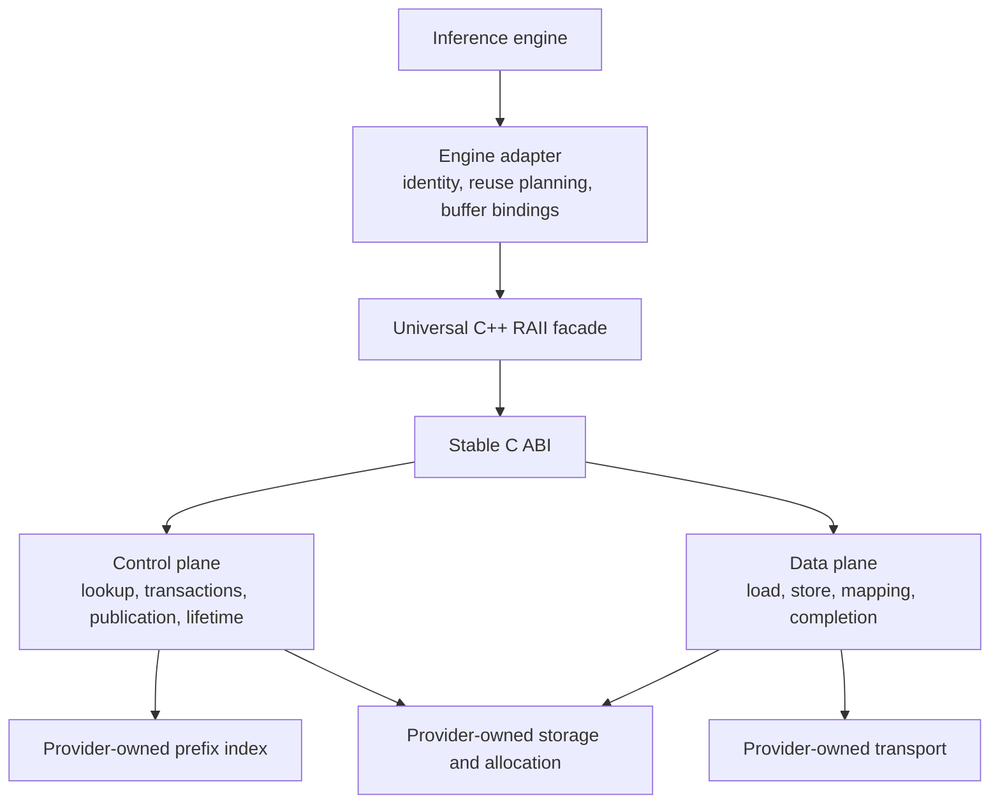
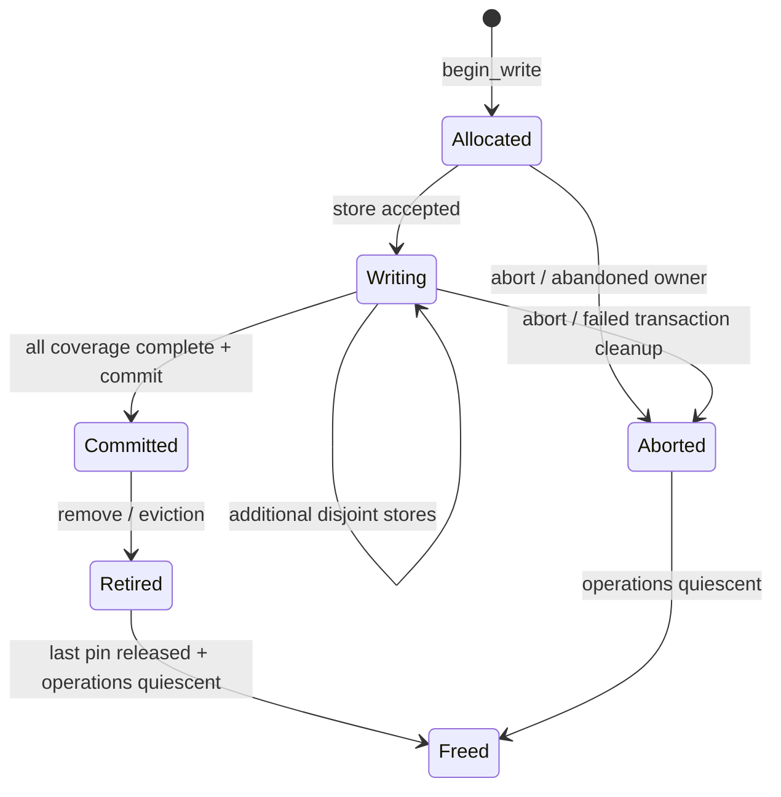
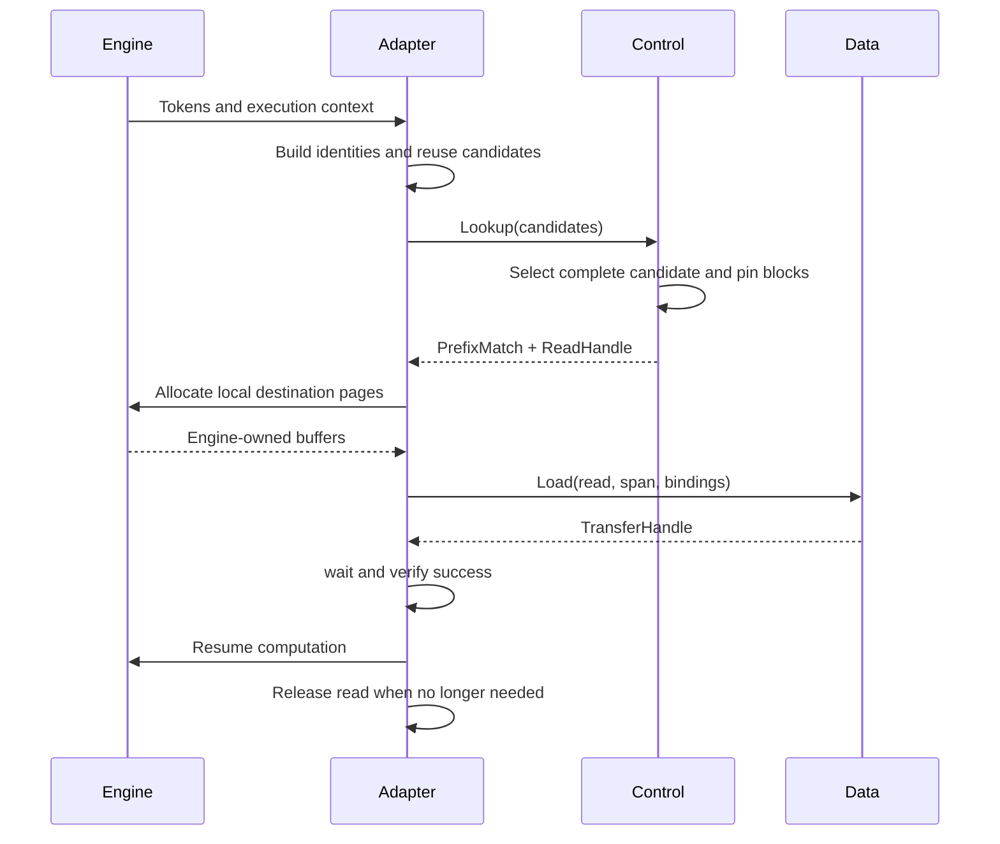
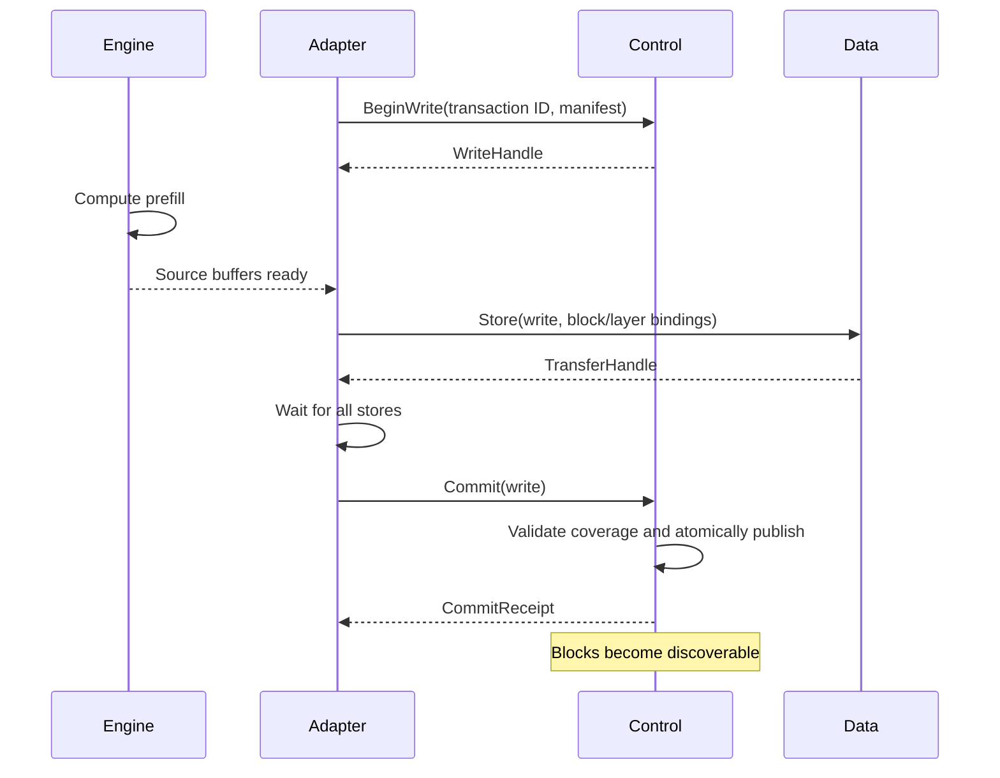
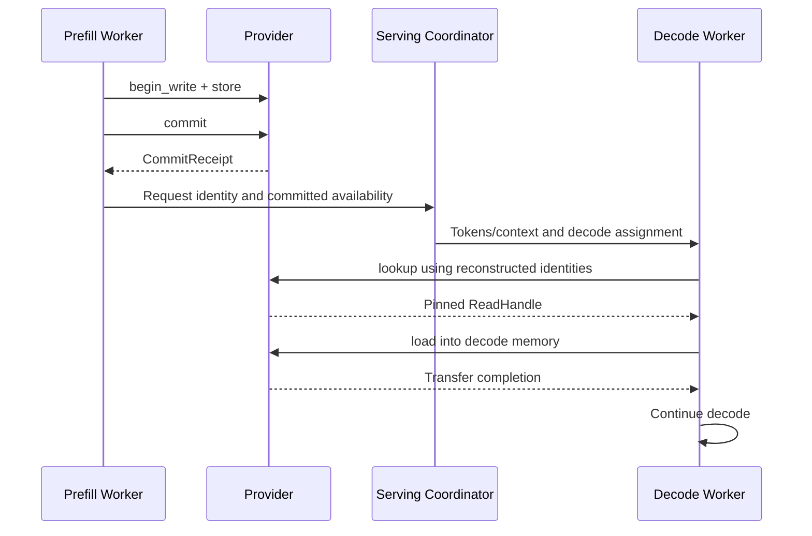
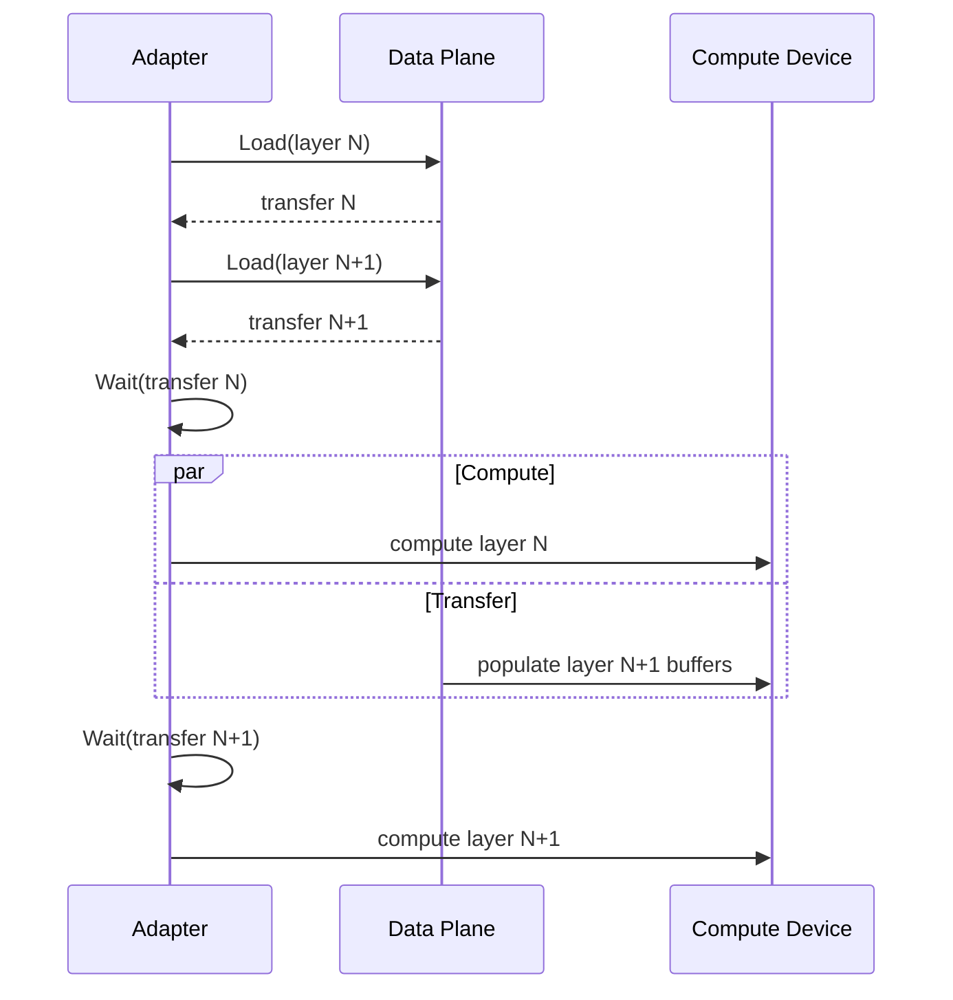

## 1. Design principles

Implementation note: the initial provider SDK, dynamic loader, host reference
plugin, and InferX allocation adapter are now implemented. See
[KV-cache provider extensions](docs/extensions/kvcache.md) for the directory
layout, installed SDK, ABI contracts, supported opaque-component profile, and
remaining work. The full declarations and schema families below remain the
target design; SDK 0.1 does not yet implement all of them.

**Recommendation:** define a stable C ABI for providers, with a source-level C++ RAII facade. Separate control operations from data transfer, while presenting both through one configured provider session.

The API has five central rules:

1. **Semantic identity precedes storage.** Matching tensor shapes never establish cache compatibility.
2. **Blocks are immutable publication units.** Transfers may address smaller slices, but incomplete blocks remain private to a write transaction.
3. **A lookup hit includes a lifetime guarantee.** Successful lookup returns a read handle that pins the selected state against eviction.
4. **Memory is a capability, not necessarily a pointer.** Remote memory and GPU memory do not require CPU-dereferenceable addresses.
5. **Adapters own engine integration.** Scheduling, physical page tables, request objects, compute streams, and engine allocation policies stay outside the provider interface.

The design takes inspiration from vLLM’s separation of cache specifications and cache groups, without adopting its allocator or scheduler objects. [vLLM cache interface](https://docs.vllm.ai/en/latest/api/vllm/v1/kv_cache_interface/)

This is the revised design. Section 24 records the critical review and resulting changes.

## 2. Overall architecture diagram



The engine adapter translates physical engine pages into memory views. Providers translate logical block identities into their own allocations, storage keys, and transport operations.

Neither translation crosses the interoperability boundary.

## 3. Core object model

There are nine fundamental abstractions. Supporting records describe their inputs and outputs.

| Abstraction | Responsibility |
|---|---|
| `CacheSpec` | Meaning and component schema of cached state |
| `CacheGroupSpec` | Layers sharing logical allocation and block semantics |
| `KVCacheProvider` | Configured session and capability negotiation |
| `KVCacheControl` | Discovery, transactions, publication, retirement |
| `KVCacheData` | Movement and optional mapping of cached state |
| `ReadHandle` | Immutable, pinned set of committed blocks |
| `WriteHandle` | Exclusive ownership of an unpublished transaction |
| `MemoryRegion` | Retained access to a physical memory resource |
| `TransferHandle` | Completion and lifetime of an accepted transfer |

The requested conceptual hierarchy describes successive concerns:

```text
Token identity
    ↓ identifies dependencies of
Logical block
    ↓ belongs to
Cache group
    ↓ interpreted according to
Cache specification
    ↓ represented in
Memory regions
```

It is **not** an ownership tree. A group references a specification; a block may occupy multiple regions; multiple views may reference the same region.

There is no mandatory `LayerKV` class and no generic cache-handle superclass.

## 4. Public enums and primitive types

Use:

- Fixed-width integer IDs for configuration-local layers, groups, and components.
- Cryptographic digests for portable identities.
- Explicit ranges with `first` and `count`.
- Explicit memory kinds, data types, transfer states, and transaction states.
- Namespaced, versioned descriptors for extensible semantics.

Important distinctions:

| Type | Meaning |
|---|---|
| `TokenId` | Model input identity |
| `LayerId` | Stable layer identifier within a model configuration |
| `CacheGroupId` | Group identifier within a configuration |
| `LogicalBlockId` | Position within a group’s logical sequence |
| `BlockKey` | Globally reproducible cache object identity within a namespace |
| `TransactionId` | Caller-generated mutation identity |
| `PrefixIdentity` | Input dependency identity at a token boundary |

**No universal `PhysicalBlockId` is defined.** Engine page numbers, allocator offsets, and provider object addresses remain implementation details.

All declarations appear together in section 23.

## 5. CacheSpec hierarchy/design

Use a **tagged value representation with an extensible alternative**:

```text
CacheSpec
    ├── AttentionCacheSpec
    ├── MLACacheSpec
    ├── HiddenStateCacheSpec
    └── CustomCacheSpec
```

These are value records, not subclasses.

| Approach | Benefit | Cost |
|---|---|---|
| Virtual class hierarchy | Natural implementation polymorphism | Poor serialization and shared-library ABI stability |
| Closed `variant` | Explicit, inspectable, convenient in C++ | Cannot independently add alternatives |
| Fully opaque descriptor | Extensible and easy to transport | Weak common validation and discoverability |
| Tagged records plus custom descriptor | Common semantics remain inspectable; extensions remain possible | Requires a schema registry and validation rules |

**Recommend the last option.**

`AttentionCacheSpec` contains:

- Self-attention versus cross-attention.
- MHA, GQA, or MQA head organization.
- Query-head and KV-head counts.
- Independent K and V head dimensions.
- Optional sliding-window size.

Separate `FullAttentionCacheSpec` and `SlidingWindowCacheSpec` classes are unnecessary: absence or presence of a window expresses that distinction without changing ownership or transfer behavior.

`MLACacheSpec` describes latent and positional state. Its components need not be named K and V.

`HiddenStateCacheSpec` identifies the meaning of the hidden state through a versioned descriptor.

Each specification also declares named components. A component is either:

- A logical tensor.
- A schema-defined opaque block payload.

Examples:

```text
Attention:
    key   → [tokens, kv_heads, key_head_dim]
    value → [tokens, kv_heads, value_head_dim]

MLA:
    latent         → [tokens, latent_width]
    positional_key → [tokens, positional_key_width]

Hidden state:
    hidden → [tokens, hidden_width]

Custom:
    state → opaque schema-defined bytes
```

Unknown semantic schemas must be explicitly negotiated. They must never silently fall back to ordinary attention semantics.

Derived or auxiliary state rides as ordinary components: sparse-attention index keys, attention-sink state, and compressor buffers (vLLM's DSA index cache, circular-buffer specs) are schema-defined components with schema-defined dependency rules. State that cannot resume execution — per-request scratch, ephemeral hot caches — is simply never published.

## 6. CacheGroup design

A `CacheGroupSpec` contains:

- Group ID.
- Canonically ordered layer IDs.
- Cache specification.
- Logical tokens per block.

For example:

```text
Group 0:
    layers = [0, 2, 4]
    spec = self-attention, full context
    tokens_per_block = 16

Group 1:
    layers = [1, 3, 5]
    spec = self-attention, window 4096
    tokens_per_block = 32
```

A group means that its members share:

- Block indexing.
- Valid-token interpretation.
- Component schema.
- Allocation granularity.
- Publication completeness rules.

It does **not** require physically contiguous allocation.

Layers with incompatible component shapes or block semantics use different groups. An engine adapter may translate its native grouping into these interoperable groups.

`KVCacheConfig` contains the groups. It does not contain engine page tables or a universal physical block count.

A layer may participate in multiple groups when it has different kinds of state, such as self-attention and cross-attention. Its identity within a payload is therefore `(group, layer, component)`.

Two degenerate cases are intentional:

- Layers without reusable state — encoder-only layers, attention-free blocks — belong to no group. A configuration covers exactly the layers that carry publishable state.
- Cross-layer KV sharing (vLLM `kv_sharing`, YOCO-style): a group lists only the KV-source layers. Reader layers that alias the source tensors are an engine mapping concern and never appear in bindings or manifests.

## 7. ModelFingerprint

`ModelFingerprint` must cover everything that can change the meaning or values of reusable state.

| Field | Compatibility role |
|---|---|
| Architecture digest | Mandatory |
| Weights digest | Mandatory; hashes actual selected weights or a canonical weight manifest |
| Attention configuration digest | Mandatory |
| Position encoding/RoPE digest | Mandatory |
| Active adapters/LoRA digest | Mandatory; explicit canonical “none” when absent |
| Input semantics digest | Mandatory; token-ID interpretation, embedding conventions, preprocessing |
| Execution semantics digest | Mandatory; agreed numerical/cache-generation compatibility profile |
| Cache semantic version | Mandatory |
| Interchange format version | Mandatory |
| Display name | Informational only |

The execution profile prevents accidental reuse across materially different weight quantization or computation conventions. It need not fingerprint every compiler flag; implementations must agree on the profile’s compatibility contract.

There are three levels of identity:

1. **Model compatibility:** the mandatory fingerprint fields.
2. **Block compatibility:** model compatibility plus group schema, logical dtype, format, block geometry, and logical partition.
3. **Cache object identity:** block compatibility plus namespace and input dependencies.

Request-dependent influences belong in input identity:

- Multimodal inputs.
- Encoder outputs or source inputs.
- Prompt embeddings.
- Attention masks and segment boundaries.
- Per-token positions.
- Per-request cache salt or tenant-scoped namespace selection.
- Request-scoped adapter (LoRA) selection within the negotiated adapter set.
- Other conditioning that changes cached state.

A human-readable model name, repository revision label, or matching shape is insufficient.

For v1, logical partitioning must match exactly. A partition describes canonical tensor slices, not worker rank numbers. Cross-partition resharding is an extension.

Fingerprinting prevents accidental aliasing under its producer contract. It cannot prove that an untrusted producer actually used the declared weights.

## 8. Block identity and BlockSpan

### Portable identities

Use SHA-256 over domain-separated, canonically encoded records. Do not hash raw C++ struct memory.

The identity encoding profile should fix:

- Field identifiers and ordering.
- Integer representation.
- String encoding.
- Explicit absence values.
- Descriptor canonicalization.
- Hash algorithm and domain versions.

A suitable v1 profile is deterministic CBOR restricted to integers, byte strings, text strings, arrays, and maps, with no floating-point values in identity records.

A token-level prefix chain avoids making prefix identity depend on block size:

```text
P0 = H("kvc.prefix", namespace, model_identity, invariant_context)

P(i+1) = H(
    "kvc.token",
    Pi,
    token_id[i],
    position[i],
    auxiliary_input_digest[i]
)
```

A logical block key is:

```text
BlockKey = H(
    "kvc.block",
    namespace,
    model_identity,
    canonical_group_spec,
    logical_partition,
    logical_block_index,
    token_range,
    dependency_digest
)
```

For causal attention, `dependency_digest` is the prefix digest at the block’s valid end.

For cross-attention, it includes the complete encoder/source dependency identity. For custom state, the negotiated schema defines its dependency rule.

Sliding-window state still depends on earlier computation. Hashing only the current window is generally insufficient.

### Partial blocks

A block’s valid token extent is immutable and part of its key.

Appending to an engine’s mutable tail produces a new cache object identity. It never mutates a previously published block.

### Selection

`BlockSpan` selects:

- One group.
- Explicit layers.
- Explicit block keys and token slices.

`BlockRange` is a compact range over a lookup request’s block catalog. It is not a physical address range.

This distinction keeps identity, control-plane coverage, and data-plane selection separate.

### Identity edge cases

- The seed `P0` identifies the empty prefix, so empty prompts and prompts shorter than one block participate in lookup without any published block.
- Per-request salts and request-scoped adapter selections extend `invariant_context`. A salt therefore invalidates from the seed, matching vLLM's block-0 salt key.
- Multimodal placeholders are auxiliary-input digests at their token positions; the position keeps the same item at different offsets distinct, which is why vLLM hashes `("mm", identifier, offset_in_block)` into block keys.
- Positions beyond plain causal offsets — packed segments, jump-forward decoding — are carried by `TokenIdentity.position`.
- Encoding is deterministic and cryptographic. Independent processes must compute identical keys for sharing to work, which rules out vLLM's per-process seeding of its non-crypto hash algorithms; SHA-256 collision resistance carries that defense instead.

## 9. Prefix lookup API

The provider receives **candidate reuse plans**, not engine request objects.

```cpp
Result<LookupResult>
Lookup(const LookupRequest&, Timeout) const noexcept;
```

A request contains:

- A deduplicated catalog of logical block records.
- Candidate prefix boundaries.
- The catalog ranges required to resume at each boundary.

The result contains either:

- No match: a normal miss.
- The longest satisfiable supplied candidate and a pinned `ReadHandle`.

Why supply reuse plans?

A reusable prefix is not always “all blocks from zero to N”:

- Full attention may need all historical KV.
- Sliding-window attention may need only a suffix.
- Cross-attention requires the encoder-side cache.
- Recurrent or custom state may require a checkpoint at a particular boundary.

The adapter or a reusable semantic planner constructs these requirements. The provider determines which complete candidate is available and pins its blocks.

The API contract requires plans to include **all state needed for the claimed resume point**. Providers validate structural consistency and the semantic rules they implement. Custom-schema planners are responsible for their schema-specific completeness rules.

Lookup must not assume candidate availability is monotonic. With windowed or checkpointed state, a longer candidate can be available while a shorter one is absent.

Hybrid models make multi-group candidates concrete. Resuming a full-plus-window hybrid, or a full-plus-recurrent hybrid, at one boundary needs the full-attention prefix, the windowed suffix state, and a recurrent checkpoint simultaneously. A candidate's `required` ranges may therefore reference catalog records from several groups, and lookup still returns one boundary whose complete requirement is satisfied. The engines already reconcile divergent per-type hit lengths this way — vLLM's hybrid manager shrinks candidate lengths to a fixed point and repins the uncached junction, SGLang truncates to the shallowest component validator — and the candidate structure carries that reconciliation without a dedicated API.

### PrefixIndex decision

`PrefixIndex` is a **conceptual provider-side service**, not a mandatory public interface in v1.

The provider may compose an independently developed index with its storage implementation, but public lookup remains responsible for:

1. Finding a candidate.
2. Validating committed availability.
3. Atomically acquiring its read lifetime.

Exposing separate public `index.lookup()` and `storage.open()` operations would introduce an eviction race and another mandatory protocol.

An advisory discovery/index extension can be added later. Its results must still pass through authoritative acquisition.

## 10. Memory and Tensor abstractions

Both are required.

| Abstraction | Describes |
|---|---|
| `MemoryRegion` | Retained physical allocation or imported memory capability |
| `MemoryView` | Byte interval within a region |
| `TensorView` | Interpretation of a memory view as a logical tensor |

A region can represent:

- Host DRAM.
- Pinned host memory.
- Device HBM.
- Remote host memory.
- Remote device memory.
- Fabric-attached memory.

Its locator is either:

- A local address associated with a device and memory kind.
- A namespaced opaque import descriptor.

A local GPU address is not a CPU-dereferenceable pointer. An opaque remote locator need not contain any address meaningful to the caller.

### Paged and scattered memory

A transfer accepts multiple buffer bindings. Each binding maps a logical block slice, layer, and component to a tensor or byte view.

Consequently, one external 64-token block can bind directly to four engine 16-token pages. No contiguous staging buffer is required by the interface.

This enables direct scatter/gather transfers when supported. It does not guarantee that every backend can avoid packing.

### Lifetime

`ImportMemory()` receives an allocation-owner reference. The C++ wrapper retains that owner while any region, view, mapping, or accepted transfer needs the allocation.

The C ABI expresses this through retain/release callbacks; `std::shared_ptr` never crosses the provider boundary.

### Zero-copy

Optional `MapRead()` returns read-only bindings into committed provider storage and a readiness handle.

Every returned region independently retains the relevant cache pin. Copying a binding out of the mapping result must remain safe.

Engine mutation requires copy-on-write or separate engine-owned storage.

## 11. Control-plane interface

The control plane has seven operations:

```text
lookup
begin_write
commit
abort
query_write
remove
```

The seventh responsibility—metadata access—is satisfied by immutable configuration and handle manifests, without a separate remote operation.

| Operation | Input and output | Ownership and execution | Expected failures |
|---|---|---|---|
| `lookup` | Reuse candidates → optional pinned match | Borrows request during call; synchronous; concurrent-safe | Invalid plan, resource exhaustion, unavailable, timeout |
| `begin_write` | Transaction ID and complete manifest → write handle | Copies manifest; reserves private storage; synchronous | Invalid/incompatible manifest, conflict, already exists, exhausted, uncertain outcome |
| `commit` | Write handle → receipt | Does not consume handle; synchronous publication barrier | Busy, incomplete, aborted, data loss, uncertain outcome |
| `abort` | Transaction ID → status | Idempotent logical abort; transfer resources drain separately | Already committed, unavailable, uncertain outcome |
| `query_write` | Transaction ID → authoritative state | Synchronous; concurrent-safe | Not found, unavailable, timeout |
| `remove` | Block key → status | Retires discoverability; synchronous; does not revoke existing readers | Unavailable, uncertain outcome |
| Handle/configuration metadata | Handle/session → immutable records | Borrowed for owner lifetime; local and nonblocking | Valid-object precondition |

`begin_write` combines reservation and provider allocation. A separate allocator API would expose unnecessary backend structure.

Exact existence checks use a lookup containing one candidate. This also allows callers to acquire the object instead of relying on a potentially stale boolean.

`begin_write` against an already-committed key fails with `AlreadyExists`. The adapter treats that outcome as success and skips storing — the committed-dedup fast path for deterministic recomputation. It does not attach to another writer's in-flight transaction; concurrent first-publication is catalog item 28.

## 12. Data-plane interface

```cpp
Result<TransferHandle> Load(...);
Result<TransferHandle> Store(...);
Result<MemoryRegion> ImportMemory(...);
Result<MappedRead> MapRead(...); // Optional.
```

| Operation | Purpose | Ownership and execution | Expected failures |
|---|---|---|---|
| `load` | Committed blocks → caller memory | Copies descriptors and retains handles/regions before returning; asynchronous completion | Invalid range, incompatible view, unsupported format, stale handle, later transport/data failure |
| `store` | Caller memory → private transaction | Retains source allocation and transaction; asynchronous completion | Invalid coverage, overlapping write, closed transaction, later transport failure |
| `import_memory` | Establish usable access to external allocation | Retains allocation owner on success; synchronous setup | Unsupported locator, permission failure, resource exhaustion |
| `map_read` | Expose provider memory without a required copy | Returns retained read-only regions plus readiness; optional | Unsupported, incompatible placement/layout, resource exhaustion |

A submission failure means no transfer was accepted and no asynchronous access will follow. Once a transfer might have been accepted, the caller must receive a handle whose eventual status resolves it.

After any failed or cancelled load, the selected destination is invalid until overwritten or recomputed. Partial success is not exposed in v1.

### Transport decision

Transport stays inside the provider.

The high-level API neither needs nor exposes a public `Transport` class. Providers may internally compose memcpy, GPU runtimes, IPC, RDMA, NVLink, or other transport libraries.

This keeps transport registration, connection management, and routing out of the core contract.

## 13. Provider SPI

A third-party provider implements:

1. Session creation, capability discovery, and configuration.
2. The six control operations.
3. `load`, `store`, and memory import.
4. Object retention/release.
5. Transfer polling and waiting.
6. Shutdown.

Optional operations:

- Read mapping.
- Transfer cancellation.
- Registered extension interfaces.

Unsupported optional operations return `Unsupported`.

Provider-specific policy and implementation objects remain behind the SPI. The C++ classes in section 23 are consumer-side facades over that SPI, not exported C++ virtual base classes.

### Session operations

| Method | Contract |
|---|---|
| `open_provider` | Creates a session; returns sole facade ownership; may perform provider initialization |
| `capabilities` | Returns an owned capability snapshot; thread-safe; may fail if provider discovery fails |
| `configure` | One successful configuration per session; validates the complete combination of requested semantics and formats |
| `control`, `data` | Return borrowed plane facades tied to provider-facade lifetime |
| `configuration` | Returns immutable negotiated configuration |
| `shutdown` | Begins closing, drains admitted work within the timeout, and reports outstanding owners |

The minimal provider can implement host-memory storage, strided tensors, blocking copies that return already-completed transfer handles, and no mapping or cancellation.

## 14. Read/write handles and lifecycle

### Write lifecycle



`Committed` is the publication point.

A transaction manifest declares every block to be published. Commit requires:

- All required layers and components.
- Complete valid-token coverage.
- Successful completion of all accepted stores.
- No failed, cancelled, or outstanding store.
- No conflicting publication.

Commit atomically publishes the entire manifest. A provider whose backend lacks transactions must supply a manifest/publication mechanism above it.

Large requests can use multiple small transactions. Request-wide publication is not mandatory.

Unpublished transactions are also the rollback mechanism for compute that must never become visible: discarded speculative-draft tokens, preempted requests, and failed verification abandon their transactions instead of publishing.

### Read lifecycle

A `ReadHandle`:

- Is copyable and reference-counted.
- Contains an immutable block manifest.
- Pins the exact object generations acquired by lookup.
- May outlive removal from the index.
- Is retained independently by accepted loads and mappings.

Eviction first retires discoverability. Physical reclamation waits for all readers, mappings, and operations.

Recreating the same key after retirement does not redirect an existing read handle to the new allocation.

### Failure and uncertainty

`Commit()` returning `OutcomeUnknown` does not mean failure or success.

The caller resolves it through `QueryWrite(transaction_id)` or retries commit with the same live transaction. Duplicate successful commit returns the same receipt.

The provider retains transaction results for the session’s lifetime. Cross-session recovery requires an extension or an advertised provider guarantee. `NotFound` after session loss is not proof that publication never happened.

A write-handle destructor requests abandonment of an unfinished transaction without blocking. It never rolls back a completed commit.

## 15. TransferHandle / async model

```cpp
bool ready() const noexcept;
Status Wait(Timeout) const noexcept;
TransferStatus Poll() const noexcept;
Status Cancel() const noexcept;
```

`TransferHandle` is a copyable reference to an accepted operation.

Its states are:

```text
Pending → Succeeded
Pending → Failed
Pending → Cancelled
```

Contracts:

- `ready()` means terminal, including failure or cancellation.
- `Wait()` returns `Ok` only for successful completion.
- A wait timeout leaves the operation running.
- `Poll()` is a nonblocking snapshot.
- Dropping a handle does not cancel the operation.
- Runtime progress does not depend on polling.
- Terminal status means the transfer no longer accesses its source or destination.

Cancellation is optional and best-effort. A successful cancellation request does not imply immediate completion. The caller must still observe terminal status before reusing memory.

Successful completion includes the required memory visibility, not merely NIC submission or local queue completion.

For GPU buffers, the provider must establish the visibility required by the negotiated memory contract. In portable v1, the engine establishes producer readiness before submission and launches consumers after a successful wait.

Native stream/event dependency import and export belong to an optional synchronization extension. No CUDA types are required in the core.

## 16. Capability negotiation

Negotiation occurs once, before generating storage keys or submitting operations:

```text
open
  → capabilities
  → Configure(model configuration, engine capabilities)
  → negotiated configuration
  → lookup and transfer
```

Capabilities advertise possibilities. `Configure()` validates the actual combination; independent lists do not imply a supported Cartesian product.

The negotiated result fixes:

- Cache schemas and semantic versions.
- Logical block sizes per group.
- Component dtypes.
- Accepted source and destination layouts.
- Memory kinds.
- Alignment requirements.
- Partial-transfer support.
- Layerwise-transfer support.
- Read mapping and cancellation support.

### Conversion ownership

- The adapter exposes the engine’s memory using an accepted interchange layout.
- The provider owns conversion between that interchange layout and its private storage.
- If the engine cannot expose an accepted layout, the adapter owns staging or conversion.
- v1 performs no implicit lossy conversion.

Provider-private lossless compression is transparent. Quantized representations require explicit component schemas, including scales and interpretation.

### v1 versus extensions

| Core v1 | Optional or future |
|---|---|
| Exact cache schemas and dtypes | New quantization schemas |
| Host/device/remote memory classification | CUDA IPC import schema |
| Strided tensors and opaque blocks | Native GPU synchronization |
| Block sizing and alignment | Explicit GPUDirect capability details |
| Partial and layerwise transfer flags | Device-specific tiled layouts |
| Asynchronous completion contract | Cross-partition resharding |
| Optional immutable mapping | Compression controls |

“RDMA supported” is not sufficient to establish transfer compatibility. The provider must negotiate usable memory-import and transfer contracts.

## 17. Error model

Use `Status`, `StatusCode`, and `Result<T>`. No exception crosses the C boundary.

| Code | Meaning |
|---|---|
| `NotFound` | Explicitly queried transaction/object metadata is absent |
| `InvalidArgument` | Malformed descriptor or request |
| `IncompatibleModel` | Fingerprint, specification, or partition mismatch |
| `InvalidRange` | Invalid block, layer, component, or byte selection |
| `Unsupported` | Unsupported capability or schema |
| `ResourceExhausted` | Allocation, registration, pin, or queue capacity exhausted |
| `TransportError` | Transfer failed |
| `Unavailable` | Provider or required service unavailable |
| `DataLoss` | Data absent or corrupted despite its committed identity |
| `StaleHandle` | Invalid, fenced, or foreign-session handle |
| `AlreadyExists` | An immutable object already occupies the requested key |
| `Conflict` | Another transaction owns an overlapping reservation |
| `AlreadyCommitted` | Operation, such as abort, conflicts with committed state |
| `Aborted` | Transaction has been aborted |
| `Busy` | Outstanding work prevents the operation |
| `Incomplete` | Required write coverage is missing |
| `DeadlineExceeded` | Waiting ended before a result was available |
| `OutcomeUnknown` | Mutation may have taken effect; authoritative resolution required |
| `Cancelled` | Transfer terminated through cancellation |
| `ShuttingDown` | Session no longer admits the operation |
| `Internal` | Provider contract or implementation failure |

A normal lookup miss is:

```text
successful Result<LookupResult>
    with match = absent
```

It is not `NotFound`.

A transfer error is not converted into a cache miss. An engine may choose recomputation, but it retains the failure information.

## 18. Thread-safety contract

| Object | Contract |
|---|---|
| Specifications and configurations | Immutable after successful configuration |
| Provider | Thread-safe after configuration; configuration is exclusive |
| Control plane | Concurrent lookup, begin, query, and removal supported |
| Data plane | Concurrent loads and operations on independent transactions supported |
| Read handle | Copyable; independently owned copies safe across threads |
| Write handle | Move-only; one externally synchronized owner |
| Memory region | Copyable retained resource; metadata immutable |
| Transfer handle | Copyable; polling, waiting, and cancellation thread-safe |
| Buffer contents | Access synchronization remains the caller’s responsibility |

For one write transaction, store submissions and commit/abort decisions are externally serialized. Previously submitted disjoint stores may execute concurrently.

Concurrent destruction or assignment of the same C++ wrapper object is not supported. Separate copies referring to the same underlying read, memory, or transfer object are supported.

### Shutdown

The session progresses:

```text
Open → Configured → Closing → Closed
```

After entering `Closing`:

- New lookups, writes, imports, mappings, and transfers are rejected.
- Completion observation, transaction resolution, abort, and finalization of admitted writes remain available.
- Existing references continue retaining their resources.
- Shutdown can report `Busy` or `DeadlineExceeded`; it does not forcibly free live memory.

Provider code remains loaded until its last object and operation is released.

Remote leases are provider implementation details. Lease expiry or process failure must fence access and quiesce operations before allocation reuse. A provider unable to guarantee that property must not advertise the corresponding mapping capability.

## 19. ABI strategy

**Use a stable C ABI with a C++ facade compiled for the application’s toolchain.**

Do not export the section-23 C++ classes directly as the binary provider ABI.

| C++ construct | Shared-library risk |
|---|---|
| `std::string`, `std::vector` | Standard-library layout and allocator differences |
| `std::shared_ptr` | Control-block and runtime differences |
| `std::function` | Opaque implementation and allocation behavior |
| Virtual classes | Vtable, compiler ABI, and interface-evolution coupling |
| Exceptions | Unwinder and runtime compatibility |
| RTTI | Type identity and compiler/runtime coupling |

### Conceptual C object model

Use opaque, type-checked objects with explicit retain/release and versioned function tables:

```c
typedef struct KvcObject KvcObject;

typedef struct KvcBytes {
    const unsigned char* data;
    uint64_t size;
} KvcBytes;

typedef struct KvcStatus {
    uint32_t code;
    KvcBytes diagnostic;
    void* diagnostic_owner;
    void (*release_diagnostic)(void*);
} KvcStatus;

typedef struct KvcOwner {
    void* context;
    void (*retain)(void*);
    void (*release)(void*);
} KvcOwner;
```

The ABI exposes distinct versioned tables:

```text
provider_v1:
    capabilities
    configure
    shutdown
    query_extension

control_v1:
    lookup
    begin_write
    commit
    abort
    query_write
    remove

data_v1:
    import_memory
    load
    store
    map_read

object_v1:
    retain
    release
    object_kind

transfer_v1:
    poll
    wait
    cancel
```

Representative declarations:

```c
/* Request/result records are versioned C records with pointer/count fields. */
typedef struct KvcLookupRequest KvcLookupRequest;
typedef struct KvcLookupResult KvcLookupResult;
typedef struct KvcTransferRequest KvcTransferRequest;
typedef struct KvcTransferStatus KvcTransferStatus;

typedef struct KvcControl {
    uint32_t struct_size;
    uint32_t abi_major;
    uint32_t abi_minor;

    KvcStatus (*lookup)(
        KvcObject* session,
        const KvcLookupRequest* request,
        uint64_t timeout_ns,
        KvcLookupResult* result);

    /* Remaining control entries follow the contracts in section 11. */
} KvcControl;

typedef struct KvcData {
    uint32_t struct_size;
    uint32_t abi_major;
    uint32_t abi_minor;

    KvcStatus (*load)(
        KvcObject* session,
        KvcObject* read_handle,
        const KvcTransferRequest* request,
        KvcObject** out_transfer);

    KvcStatus (*store)(
        KvcObject* session,
        KvcObject* write_handle,
        const KvcTransferRequest* request,
        KvcObject** out_transfer);
} KvcData;
```

ABI rules:

- Fixed-width integers; no ABI-level C++ enums or `bool`.
- Explicit calling convention and supported platform ABI.
- `struct_size` permits append-only record/table evolution.
- Input pointer/count arrays are borrowed for the call.
- Accepted asynchronous operations retain referenced objects before returning.
- Returned objects own one reference.
- Every provider-owned allocation has a provider-owned release path.
- Imported allocation owners use `KvcOwner`.
- C++ exceptions are caught within each implementation.
- Extension lookup uses namespaced schema IDs and versioned tables.
- Canonical identity serialization is separate from in-process call marshalling.

The snippets define the conceptual C object model; a ratified standard would additionally publish the mechanical C mirrors of all section-23 records.

## 20. vLLM adapter mapping

The connector lifecycle distinguishes prefix matching, load initiation, layer readiness, saving, and request completion. Those are useful integration points, but they remain adapter methods. [vLLM connector interface](https://docs.vllm.ai/en/latest/api/vllm/distributed/kv_transfer/kv_connector/v1/base/)

| vLLM-style operation | Universal mapping |
|---|---|
| `get_num_new_matched_tokens` | Construct candidate plans; call `lookup`; retain the returned read handle |
| `start_load_kv` | Translate allocated engine pages into bindings; submit `load` calls |
| `wait_for_layer_load` | Wait on transfers containing the requested layer |
| `save_kv_layer` | Establish compute completion; submit that layer’s bindings to `store` |
| `wait_for_save` | Wait for store completion; commit only when the transaction is complete |
| `request_finished` | Finalize or abort writes; release request-owned references after outstanding uses are safe |
| `update_state_after_alloc`, `build_connector_meta` | Adapter-internal planning; no provider call |
| Async-load indication, `get_transfer_results` | The async boolean maps to polling `TransferHandle` completion; upstream removed the older `async_lookup` entry points in favor of this state machine |
| `get_block_ids_with_load_errors` | Failed loads keep their failure status (never a miss, section 17); the adapter removes the corrupted key and recomputes or rejects per its load-failure policy |
| `handle_preemptions` | Abort or abandon affected transactions and release read references before pages are reused |
| `request_finished_all_groups` (hybrid manager) | Per-group finalization; a group whose state is not publishable is never written |
| `get_required_kvcache_layout`, `register_kv_caches` | Negotiated transfer formats and imported regions |

The adapter must distinguish:

- Reusable cached tokens.
- Tokens already computed locally.
- Tokens requiring recomputation for engine-specific output/logit needs.
- Transfers admitted versus transfers completed.

It must not simply return the entire cached prefix as “newly matched.”

For SGLang, token-pool slots and page indices become buffer bindings. They never become `BlockKey` values. Its distinct MLA token-pool representation further supports keeping component schemas independent of an assumed K/V pair. [SGLang memory-pool source](https://raw.githubusercontent.com/sgl-project/sglang/main/python/sglang/srt/mem_cache/memory_pool.py)

SGLang's serving hooks map just as directly: `match_prefix` is one lookup, per-finished-chunk `checkpoint` is a store-plus-commit per completed block, `retract_decode` releases pins and may back rows up through host-tier transfers, HiCache write-through is block-granular commit, and the disaggregation bootstrap queue exchanges exactly the portable identities of Scenario C.

Role-based composition (vLLM `MultiConnector` loads from the first connector reporting a hit and saves to all of them) is adapter policy over several provider sessions. The ABI needs no composition operator; cross-provider dedup does not exist and is not implied.

## 21. LMCache/Mooncake provider mapping

### LMCache provider

| Universal concept | Adapter responsibility |
|---|---|
| Block key | Translate to an LMCache key with the complete universal identity |
| Cache group/components | Translate to supported cache representations |
| Read pin | Retain the relevant storage objects until universal readers finish |
| Transaction | Keep staged data undiscoverable until a complete manifest is published |
| Transfer handle | Aggregate underlying copy/retrieval completion |
| Provider policy | Leave tier placement and eviction inside LMCache |

LMCache’s architecture separates engine integration, indexing, allocation, and tiered storage. The universal interface can sit above those components without exposing their internal objects. [LMCache architecture](https://docs.lmcache.ai/developer_guide/architecture.html)

### Mooncake provider

| Universal concept | Adapter responsibility |
|---|---|
| Block key | Translate to distributed object identity |
| Memory import | Establish provider-private memory registration |
| Load/store | Submit appropriate transfer-engine operations |
| Transfer completion | Convert underlying completion and visibility into universal terminal status |
| Publication | Publish committed manifests through a metadata authority |
| Read lifetime | Pin or lease storage while preserving universal lifetime guarantees |

Mooncake’s Transfer Engine supports asynchronous movement between non-contiguous memory spaces. That fits the binding model; its segment and transport details stay inside the provider. [Mooncake Transfer Engine](https://kvcache-ai.github.io/Mooncake/design/transfer-engine/index.html)

A transfer engine alone is not a complete cache provider. It still needs identity, publication, discovery, and lifetime management.

The same mapping covers the rest of the current connector and storage ecosystem: NIXL pull and push, the Mooncake transfer engine and object store, LMCache including its out-of-process daemon, filesystem backends (HF3FS, SGLang `file`), FlexKV, and MoRI. Pull-mode decode is `load`; push-mode prefill — writing into pre-imported decode-side memory — is `store` over the same published identities. SGLang's pluggable storage-backend factory shows how these live behind one provider boundary.

## 22. Sequence diagrams

### Scenario A: Prefix cache hit



### Scenario B: Prefill and publish



### Scenario C: P/D disaggregation



Process-local handles are never sent between workers. Workers exchange portable identities through the serving system.

Distributed tensor-parallel workers must also agree on the required partition set. v1 does not provide a multi-writer cross-partition transaction.

### Scenario D: Layerwise overlap



## 23. Complete consolidated public C++ header declarations

This is the complete proposed **source-level C++ facade**. It contains declarations only. STL types remain on the application side of the stable C ABI.

```cpp
#pragma once

#include <array>
#include <chrono>
#include <cstddef>
#include <cstdint>
#include <memory>
#include <optional>
#include <span>
#include <string>
#include <variant>
#include <vector>

namespace kvc {

// -----------------------------------------------------------------------------
// Primitive types and errors
// -----------------------------------------------------------------------------

using TokenId = std::int64_t;
using LayerId = std::uint32_t;
using CacheGroupId = std::uint32_t;
using ComponentId = std::uint32_t;
using ByteBuffer = std::vector<std::byte>;
using Timeout = std::chrono::nanoseconds;

// Timeout::max() means unbounded. Other negative timeouts are invalid.

struct Digest {
    std::array<std::byte, 32> bytes;
};

struct NamespaceId {
    Digest value;
};

struct TransactionId {
    std::array<std::byte, 16> bytes;
};

struct Version {
    std::uint32_t major;
    std::uint32_t minor;
};

struct CacheFormatVersion {
    std::uint32_t major;
    std::uint32_t minor;
};

struct SchemaId {
    std::string name;
    Version version;
};

struct Descriptor {
    SchemaId schema;
    ByteBuffer canonical_payload;
};

enum class StatusCode : std::uint32_t {
    Ok,
    NotFound,
    InvalidArgument,
    IncompatibleModel,
    InvalidRange,
    Unsupported,
    ResourceExhausted,
    TransportError,
    Unavailable,
    DataLoss,
    StaleHandle,
    AlreadyExists,
    Conflict,
    AlreadyCommitted,
    Aborted,
    Busy,
    Incomplete,
    DeadlineExceeded,
    OutcomeUnknown,
    Cancelled,
    ShuttingDown,
    Internal
};

struct Status {
    StatusCode code;
    std::string diagnostic;
};

// The Status alternative always contains a non-Ok code.
template<class T>
using Result = std::variant<T, Status>;

// -----------------------------------------------------------------------------
// Logical cache schemas
// -----------------------------------------------------------------------------

enum class DType : std::uint32_t {
    UInt8,
    Int8,
    Int32,
    Float16,
    BFloat16,
    Float32,
    Float64,
    Float8E4M3FN,
    Float8E5M2
};

enum class AxisExtent : std::uint32_t {
    Fixed,
    BlockTokens
};

struct AxisSpec {
    AxisExtent extent;
    std::uint64_t fixed_size;  // Used only for Fixed.
};

struct TensorComponentSpec {
    DType dtype;
    std::vector<AxisSpec> axes;
};

struct OpaqueComponentSpec {
    SchemaId encoding;
    std::uint64_t bytes_per_block;
};

struct ComponentSpec {
    ComponentId id;
    std::string semantic_name;

    std::variant<
        TensorComponentSpec,
        OpaqueComponentSpec
    > representation;
};

enum class AttentionDomain : std::uint32_t {
    Self,
    Cross
};

enum class HeadOrganization : std::uint32_t {
    MHA,
    GQA,
    MQA
};

struct AttentionCacheSpec {
    AttentionDomain domain;
    HeadOrganization organization;

    std::uint32_t query_heads;
    std::uint32_t kv_heads;
    std::uint32_t key_head_dimension;
    std::uint32_t value_head_dimension;

    // Absent means full attention.
    std::optional<std::uint64_t> sliding_window_tokens;
};

struct MLACacheSpec {
    std::uint32_t latent_width;
    std::uint32_t positional_key_width;
    std::optional<std::uint64_t> sliding_window_tokens;
};

struct HiddenStateCacheSpec {
    Descriptor meaning;
};

struct CustomCacheSpec {
    ByteBuffer canonical_parameters;
};

using CacheSemantics = std::variant<
    AttentionCacheSpec,
    MLACacheSpec,
    HiddenStateCacheSpec,
    CustomCacheSpec
>;

struct CacheSpec {
    // Must agree with the selected semantics alternative.
    SchemaId schema;
    CacheSemantics semantics;
    std::vector<ComponentSpec> components;
};

struct CacheGroupSpec {
    CacheGroupId id;
    std::vector<LayerId> layers;
    CacheSpec cache;
    std::uint32_t tokens_per_block;
};

struct KVCacheConfig {
    std::vector<CacheGroupSpec> groups;
};

// -----------------------------------------------------------------------------
// Model and execution identity
// -----------------------------------------------------------------------------

struct ModelFingerprint {
    Digest architecture;
    Digest weights;
    Digest attention_configuration;
    Digest position_encoding;
    Digest active_adapters;
    Digest input_semantics;
    Digest execution_semantics;

    Version cache_semantic_version;
    CacheFormatVersion cache_format_version;

    // Excluded from identity.
    std::string display_name;
};

struct ModelCacheConfig {
    NamespaceId cache_namespace;
    ModelFingerprint model;
    KVCacheConfig cache;

    // Canonical tensor slices, not runtime rank numbers.
    Descriptor logical_partition;
};

struct TokenIdentity {
    TokenId token;
    std::int64_t position;
    Digest auxiliary_input;
};

struct SequenceDescriptor {
    Digest invariant_context;
    std::vector<TokenIdentity> tokens;
};

struct PrefixIdentity {
    Digest digest;
    std::uint64_t token_count;
};

// -----------------------------------------------------------------------------
// Logical blocks and selections
// -----------------------------------------------------------------------------

struct LogicalBlockId {
    std::uint64_t index;
};

struct BlockKey {
    Digest value;
};

struct TokenRange {
    std::uint64_t first;
    std::uint64_t count;
};

struct BlockRecord {
    BlockKey key;
    CacheGroupId group;
    LogicalBlockId logical_id;

    // Valid immutable extent in the schema-defined token coordinate space.
    TokenRange tokens;

    // Prefix digest or schema-defined complete dependency digest.
    Digest dependency;
};

// Range over LookupRequest::catalog, not physical memory.
struct BlockRange {
    std::uint64_t first;
    std::uint64_t count;
};

struct BlockSlice {
    BlockKey key;
    std::uint32_t first_token;  // Relative to BlockRecord::tokens.
    std::uint32_t token_count;
};

struct BlockSpan {
    CacheGroupId group;
    std::vector<LayerId> layers;
    std::vector<BlockSlice> blocks;
};

// -----------------------------------------------------------------------------
// Memory and interchange formats
// -----------------------------------------------------------------------------

enum class MemoryType : std::uint32_t {
    Host,
    PinnedHost,
    Device,
    RemoteHost,
    RemoteDevice,
    FabricAttached
};

enum class MemoryAccess : std::uint32_t {
    ReadOnly,
    ReadWrite
};

struct Device {
    // Examples: "cpu", "cuda", "hip", or a registered vendor namespace.
    std::string runtime;

    // Opaque to the core; interpreted by the runtime/import schema.
    std::string identifier;
};

struct LocalAddress {
    // Meaningful only in the importing process and declared device domain.
    std::uintptr_t value;
};

struct ExternalMemory {
    Descriptor import_descriptor;
};

using MemoryLocator = std::variant<
    LocalAddress,
    ExternalMemory
>;

struct MemoryRegionInfo {
    Device device;
    MemoryType type;
    MemoryAccess access;
    std::uint64_t byte_size;
    MemoryLocator locator;
};

struct MemoryImport {
    MemoryRegionInfo region;

    // Mandatory allocation-lifetime owner.
    // The C++ bridge translates this into C retain/release callbacks.
    std::shared_ptr<void> allocation_owner;
};

enum class LayoutKind : std::uint32_t {
    StridedTensor,
    OpaqueBytes
};

struct TransferFormat {
    MemoryType memory;
    LayoutKind layout;
    std::uint64_t required_alignment;
};

struct FeatureSet {
    bool partial_reads;
    bool partial_writes;
    bool layerwise_transfer;
    bool read_mapping;
    bool cancellation;
};

struct ProviderCapabilities {
    std::vector<SchemaId> cache_schemas;
    std::vector<DType> dtypes;
    std::vector<TransferFormat> load_formats;
    std::vector<TransferFormat> store_formats;
    std::vector<std::uint32_t> preferred_block_tokens;
    FeatureSet optional_features;
    std::vector<SchemaId> extensions;
};

struct GroupBlockChoices {
    CacheGroupId group;
    std::vector<std::uint32_t> acceptable_tokens_per_block;
};

struct EngineCapabilities {
    std::vector<TransferFormat> load_destinations;
    std::vector<TransferFormat> store_sources;
    std::vector<GroupBlockChoices> block_choices;

    FeatureSet required_features;
    std::vector<SchemaId> required_extensions;
};

struct GroupTransferContract {
    CacheGroupId group;
    std::vector<TransferFormat> load_formats;
    std::vector<TransferFormat> store_formats;
    FeatureSet enabled_features;
};

struct NegotiatedConfiguration {
    ModelCacheConfig model;
    std::vector<GroupTransferContract> transfers;
    std::vector<SchemaId> enabled_extensions;
};

// -----------------------------------------------------------------------------
// Transfer status
// -----------------------------------------------------------------------------

enum class TransferState : std::uint32_t {
    Pending,
    Succeeded,
    Failed,
    Cancelled
};

struct TransferStatus {
    TransferState state;

    // Ok for Pending or Succeeded; non-Ok for Failed or Cancelled.
    Status result;
};

namespace detail {
class ObjectRef;
class FacadeAccess;
}

class KVCacheProvider;
class KVCacheControl;
class KVCacheData;

// -----------------------------------------------------------------------------
// Retained memory region
// -----------------------------------------------------------------------------

class MemoryRegion final {
public:
    MemoryRegion(const MemoryRegion&) noexcept;
    MemoryRegion& operator=(const MemoryRegion&) noexcept;

    MemoryRegion(MemoryRegion&&) noexcept;
    MemoryRegion& operator=(MemoryRegion&&) noexcept;

    ~MemoryRegion() noexcept;

    bool Valid() const noexcept;

    // Requires Valid().
    const MemoryRegionInfo& Info() const noexcept;

private:
    explicit MemoryRegion(detail::ObjectRef*) noexcept;

    detail::ObjectRef* object_;

    friend class detail::FacadeAccess;
};

struct MemoryView {
    MemoryRegion region;
    std::uint64_t byte_offset;
    std::uint64_t byte_count;
};

struct TensorLayout {
    std::vector<std::uint64_t> shape;
    std::vector<std::uint64_t> byte_strides;
};

struct TensorView {
    MemoryView storage;
    DType dtype;
    TensorLayout layout;
};

using PayloadView = std::variant<
    TensorView,
    MemoryView
>;

struct BufferBinding {
    BlockSlice block;
    LayerId layer;
    ComponentId component;
    PayloadView view;
};

// -----------------------------------------------------------------------------
// Transfer handle
// -----------------------------------------------------------------------------

class TransferHandle final {
public:
    TransferHandle(const TransferHandle&) noexcept;
    TransferHandle& operator=(const TransferHandle&) noexcept;

    TransferHandle(TransferHandle&&) noexcept;
    TransferHandle& operator=(TransferHandle&&) noexcept;

    ~TransferHandle() noexcept;

    bool Valid() const noexcept;
    bool ready() const noexcept;

    TransferStatus Poll() const noexcept;
    Status Wait(Timeout) const noexcept;

    // Optional, best-effort request. Does not itself imply quiescence.
    Status Cancel() const noexcept;

private:
    explicit TransferHandle(detail::ObjectRef*) noexcept;

    detail::ObjectRef* object_;

    friend class detail::FacadeAccess;
};

struct TransferOptions {
    // Accepted operation retains these until their dependency is resolved.
    // A failed dependency prevents payload access and fails the operation.
    std::vector<TransferHandle> dependencies;
};

// -----------------------------------------------------------------------------
// Read handle and lookup
// -----------------------------------------------------------------------------

class ReadHandle final {
public:
    ReadHandle(const ReadHandle&) noexcept;
    ReadHandle& operator=(const ReadHandle&) noexcept;

    ReadHandle(ReadHandle&&) noexcept;
    ReadHandle& operator=(ReadHandle&&) noexcept;

    ~ReadHandle() noexcept;

    bool Valid() const noexcept;

    // Requires Valid(); reference remains valid while this owner is retained.
    const std::vector<BlockRecord>& Blocks() const noexcept;

private:
    explicit ReadHandle(detail::ObjectRef*) noexcept;

    detail::ObjectRef* object_;

    friend class detail::FacadeAccess;
};

struct PrefixCandidate {
    PrefixIdentity prefix;
    std::vector<BlockRange> required;
};

struct LookupRequest {
    std::vector<BlockRecord> catalog;
    std::vector<PrefixCandidate> candidates;
};

struct PrefixMatch {
    PrefixIdentity prefix;
    ReadHandle read;
};

struct LookupResult {
    std::optional<PrefixMatch> match;
};

// -----------------------------------------------------------------------------
// Write transaction
// -----------------------------------------------------------------------------

enum class WriteState : std::uint32_t {
    Allocated,
    Writing,
    Committed,
    Aborted
};

struct WriteRequest {
    TransactionId transaction;
    std::vector<BlockRecord> blocks;
};

struct CommitReceipt {
    TransactionId transaction;
    std::vector<BlockKey> published;
};

struct WriteStatus {
    WriteState state;
    std::optional<CommitReceipt> receipt;
};

class WriteHandle final {
public:
    WriteHandle(const WriteHandle&) = delete;
    WriteHandle& operator=(const WriteHandle&) = delete;

    WriteHandle(WriteHandle&&) noexcept;
    WriteHandle& operator=(WriteHandle&&) noexcept;

    ~WriteHandle() noexcept;

    bool Valid() const noexcept;

    // Require Valid().
    TransactionId transaction() const noexcept;
    const std::vector<BlockRecord>& Blocks() const noexcept;

private:
    explicit WriteHandle(detail::ObjectRef*) noexcept;

    detail::ObjectRef* object_;

    friend class detail::FacadeAccess;
};

struct MappedRead {
    // Every region in every binding independently retains its cache pin.
    std::vector<BufferBinding> bindings;
    TransferHandle readiness;
};

// -----------------------------------------------------------------------------
// Control plane
// -----------------------------------------------------------------------------

class KVCacheControl final {
public:
    KVCacheControl(const KVCacheControl&) = delete;
    KVCacheControl& operator=(const KVCacheControl&) = delete;

    ~KVCacheControl() noexcept;

    Result<LookupResult> Lookup(
        const LookupRequest&,
        Timeout) const noexcept;

    Result<WriteHandle> BeginWrite(
        const WriteRequest&,
        Timeout) const noexcept;

    Result<CommitReceipt> Commit(
        WriteHandle&,
        Timeout) const noexcept;

    // Supports cleanup even when begin_write's outcome was uncertain.
    Status Abort(
        const TransactionId&,
        Timeout) const noexcept;

    Result<WriteStatus> QueryWrite(
        const TransactionId&,
        Timeout) const noexcept;

    // Idempotent retirement. Existing readers remain valid.
    Status Remove(
        const BlockKey&,
        Timeout) const noexcept;

private:
    explicit KVCacheControl(detail::ObjectRef*) noexcept;

    detail::ObjectRef* object_;

    friend class detail::FacadeAccess;
};

// -----------------------------------------------------------------------------
// Data plane
// -----------------------------------------------------------------------------

class KVCacheData final {
public:
    KVCacheData(const KVCacheData&) = delete;
    KVCacheData& operator=(const KVCacheData&) = delete;

    ~KVCacheData() noexcept;

    Result<MemoryRegion> ImportMemory(
        const MemoryImport&) const noexcept;

    Result<TransferHandle> Load(
        const ReadHandle&,
        const BlockSpan&,
        std::span<const BufferBinding> destinations,
        const TransferOptions&) const noexcept;

    Result<TransferHandle> Store(
        WriteHandle&,
        const BlockSpan&,
        std::span<const BufferBinding> sources,
        const TransferOptions&) const noexcept;

    // Optional. Returned memory is immutable to the engine.
    Result<MappedRead> MapRead(
        const ReadHandle&,
        const BlockSpan&) const noexcept;

private:
    explicit KVCacheData(detail::ObjectRef*) noexcept;

    detail::ObjectRef* object_;

    friend class detail::FacadeAccess;
};

// -----------------------------------------------------------------------------
// Provider session
// -----------------------------------------------------------------------------

struct ProviderOpen {
    // Platform loading is a facade concern, not part of cache identity.
    std::string library_path;
    Descriptor provider_options;
};

class KVCacheProvider final {
public:
    KVCacheProvider(const KVCacheProvider&) = delete;
    KVCacheProvider& operator=(const KVCacheProvider&) = delete;

    ~KVCacheProvider() noexcept;

    Result<ProviderCapabilities> Capabilities() const noexcept;

    // Exclusive operation; exactly one successful configuration per session.
    Result<NegotiatedConfiguration> Configure(
        const ModelCacheConfig& proposed,
        const EngineCapabilities&,
        Timeout) noexcept;

    // Require successful Configure().
    const NegotiatedConfiguration& Configuration() const noexcept;

    // Borrowed facades remain valid for this provider facade's lifetime.
    KVCacheControl& Control() noexcept;
    KVCacheData& Data() noexcept;

    Status Shutdown(Timeout) noexcept;

private:
    explicit KVCacheProvider(detail::ObjectRef*) noexcept;

    detail::ObjectRef* object_;

    friend class detail::FacadeAccess;
};

Result<std::unique_ptr<KVCacheProvider>> OpenProvider(
    const ProviderOpen&,
    Timeout) noexcept;

// -----------------------------------------------------------------------------
// Portable identity helpers
// -----------------------------------------------------------------------------

// Returns identities for boundaries [0, token_count], including the seed.
// Does not perform storage lookup or infer schema-specific reuse requirements.
Result<std::vector<PrefixIdentity>> compute_prefixes(
    const ModelCacheConfig&,
    const SequenceDescriptor&) noexcept;

// Validates geometry and computes the canonical portable block key.
// The caller supplies the schema-correct complete dependency digest.
Result<BlockRecord> describe_block(
    const NegotiatedConfiguration&,
    CacheGroupId,
    LogicalBlockId,
    TokenRange,
    const Digest& dependency) noexcept;

} // namespace kvc
```

### Normative declaration-level constraints

The header relies on these contracts:

- IDs, descriptors, and manifests must be validated before use.
- Empty layer selections do not mean “all layers”; they are invalid.
- Block slices in one span must not overlap.
- Buffer bindings must exactly cover the requested layers, components, and token slices.
- Bindings may subdivide a selected token interval across several memory regions.
- v1 does not subdivide head or feature axes.
- Strided tensor views must fit entirely within their memory views.
- Destination tensor elements must not alias.
- Partial operations require a negotiated schema whose selected components can be sliced safely.
- Fixed-size or opaque state may require whole-block transfer.
- Failed or cancelled stores poison that transaction; abort and start a new transaction.
- Pending stores cause commit to return `Busy`; missing coverage causes `Incomplete`.
- Handles from another session return `StaleHandle`.
- Methods receiving descriptors copy any metadata needed after return.
- `Result<T>` is an owned result; references exposed by handles remain borrowed.
- Invalid or moved-from handles are accepted only by destruction, assignment, and validity inspection; operational methods report `StaleHandle` where they return status.
- No public method has a method body in this proposal.

## 24. Design tradeoffs

The critical review produced the following revisions.

| Review question | Finding and final decision |
|---|---|
| Does it leak vLLM internals? | No scheduler output, request, block pool, or native page-table type crosses the boundary. |
| Does it leak LMCache or Mooncake internals? | No memory-object, segment, registration, QP, GID, or rkey type appears. |
| Is a block the right transfer unit? | It is the identity/allocation/publication unit. Transfers use slices and scatter/gather bindings. |
| Can MLA and custom caches fit? | Yes; components are schema-defined tensors or opaque bytes. K/V is one schema. |
| Can paged KV fit without copying? | Yes when negotiated layouts and transport support its bindings; packing is not mandatory. |
| Can remote GPU memory fit? | Yes; imported memory capabilities do not require local addresses. |
| Can GPUDirect fit later? | Yes; import and synchronization extensions can add native paths without changing logical identities. |
| Can indexing evolve independently? | Yes internally or through optional advisory extensions; authoritative lookup retains acquisition responsibility. |
| Can layerwise transfer pipeline? | Yes; each selected layer can have independent completion. |
| Can eviction coexist with readers? | Yes; lookup pins exact generations and retirement precedes reclamation. |
| Is ownership explicit? | Results own handles; parameters borrow during submission; accepted operations retain dependencies and memory owners. |
| Are there unnecessary classes? | Separate full/sliding subclasses, `PhysicalBlockId`, public transport, generic cache handle, and mandatory public index were removed. |
| Is policy encoded? | No eviction, replication, routing, admission, or scheduling policy is specified. |
| Does it work outside vLLM? | The adapter needs only logical state semantics and accessible memory bindings. |

Four less obvious tradeoffs remain deliberate:

1. **Lookup includes acquisition.** This costs pinning during discovery but removes the hit-to-read eviction race.
2. **Reuse plans are explicit.** This keeps custom state possible and avoids pretending that every group needs an identical historical prefix.
3. **Portable v1 synchronization is conservative.** Native stream interoperability remains an extension; ordinary asynchronous overlap still works.
4. **Publication is stronger than storage completion.** A provider adapter may need metadata coordination even when its storage backend already supports fast writes.

## 25. Features intentionally excluded from v1

- Eviction and admission algorithms.
- Replication and durability policies.
- Topology, NUMA, and transport routing.
- Scheduler and prefetch strategy.
- Compression and tier-migration controls.
- Mutable committed blocks.
- In-place append to a published tail.
- Multi-writer transactions.
- Cross-partition atomic publication.
- Automatic tensor resharding.
- Implicit lossy dtype conversion.
- Portable CUDA stream/event objects.
- Public RDMA connection or registration structures.
- Callback-based completion.
- Push-style event and notification channels.
- Runtime storage attach/detach and bulk cache administration.
- Cross-session transaction recovery guarantees.
- General variable-size opaque records.
- A public allocator for engine physical pages.

A provider may implement these internally or expose them through negotiated extensions.

## 26. Open questions

Before standardization, resolve:

1. **Canonical schema registry:** exact attention, MLA, hidden-state, partition, and input-context schemas.
2. **Numerical compatibility:** which execution profiles permit safe reuse across different kernels or hardware.
3. **Distributed lookup consistency:** required metadata authority and publication visibility across sessions.
4. **Transaction recovery:** optional retention horizons and reconnect/fencing protocol.
5. **Native synchronization:** a vendor-neutral extension for producer fences and consumer stream waits.
6. **Custom-state reuse planning:** how independently developed schema modules communicate complete resume requirements.
7. **Resharding:** whether to add feature-axis slices or a separate redistribution extension.
8. **C ABI packaging:** finalized platform conventions, complete C record mirrors, extension registry, and ownership conformance requirements.
9. **Management and notification extension:** enumeration, bulk clear, runtime storage attach/detach, retention hints, and a publication event feed for cache-aware routers (catalog items 34, 35, 37, 54, 55, 57; section 28 items 5, 9, 11).
10. **Fine-grained prefix boundaries:** whether sub-block resume points — vLLM's partial-block hashing and its hash/scheduler granularity split — justify an extension beyond group `tokens_per_block` (section 28 item 10).

## 27. Use-case catalog

Status legend: **solved** = ABI, reference provider, and conformance tests all
cover it; **designed** = expressible through the current ABI with no provider
implementation yet; **gap** = not expressible without ABI or semantic changes;
**engine-side** = the ABI can carry it but InferX's serving path does not use
it yet; **intentional** = deliberately excluded (see section 25). Compound
statuses combine these. Section 29 reviews each case one at a time against how
vLLM and SGLang implement it.

| # | Use case | Status |
|---|---|---|
| 1 | Shared system-prompt reuse across requests, one session | solved |
| 2 | Non-monotonic candidate availability (hybrid/windowed layers) | solved |
| 3 | Incremental publication during decode (block-by-block commit) | solved |
| 4 | Prefix retirement and recomputation with pinned old generations | solved |
| 5 | Multi-tenant namespace isolation | solved |
| 6 | Abandoning in-flight compute/store pipelines | solved |
| 7 | GQA/MQA attention K and V components | solved (opaque profile) |
| 8 | MLA latent + RoPE components | designed (schema-carried; kernel exists engine-side) |
| 9 | Sliding-window and hybrid layer groups | designed |
| 10 | Cross-attention / encoder-side cache (multimodal) | designed |
| 11 | Layer-streamed transfer readiness (pipelined loads) | designed (LAYERWISE; engine-side wiring absent) |
| 12 | CPU offload of cold KV with reload on hit | solved (`kvc.cuda` tiered provider) |
| 13 | NVMe tiering | designed (async transfers; unimplemented) |
| 14 | Copy-free paged-KV bindings | designed (needs strided/page-granular bindings) |
| 15 | Prefill-to-decode handoff via engine staging buffer | designed |
| 16 | KV-aware request routing to the worker holding a prefix | designed + engine-side |
| 17 | Cross-session sharing through a common backend | designed (reference provider is session-local) |
| 18 | Cross-process sharing (daemon or shared memory) | designed, unimplemented |
| 19 | Cross-machine sharing (LMCache/Mooncake-style) | designed vocabulary (remote/fabric), unimplemented |
| 20 | Persistence across engine restart | designed, unimplemented; blocked on identity helper |
| 21 | TP with per-rank providers and exact partition match | designed |
| 22 | Quantized KV storage (FP8 and similar) | designed (opaque; dtype codes await the tensor profile) |
| 23 | Crash recovery within a session (query by transaction id) | solved |
| 24 | Cross-session transaction recovery | intentional exclusion |
| 25 | Automatic prefix caching in the serving loop | engine-side (scheduler does not consult providers) |
| 26 | Storage ownership bridge into engine allocations | solved at unit level, engine-side wiring |
| 27 | CUDA-graph-stable decode over provider-loaded blocks | engine-side |
| 28 | Concurrent writers of the same prefix (dedup/attach) | gap |
| 29 | In-flight write coalescing across processes | gap |
| 30 | Cross-block-size reuse (16-token provider serving 32-token consumer) | gap |
| 31 | Recurrent/linear-attention state beyond checkpoint granularity | gap |
| 32 | TP with one shared remote provider, consistent multi-rank lookup | gap (tracked, section 26.3) |
| 33 | Elastic resharding / rebalancing between ranks | gap (tracked, section 26.7) |
| 34 | Entry expiry (TTL) requested by the consumer | gap |
| 35 | Eviction priority or cost hints beyond pinning | gap |
| 36 | Hit-rate and byte metrics through the ABI | solved (kvc.stats extension, single session) |
| 37 | Administrative enumeration and inspection of stored state | gap |
| 38 | Cross-format reuse (FP8 producer, BF16 consumer) | intentional exclusion |
| 39 | Native GPU stream/event interop for readiness | intentional exclusion (tracked, section 26.5) |
| 40 | Zero-copy provider-to-provider transfer | gap |
| 41 | Copy-on-write extension of shared or partial tail blocks (parallel sampling, beam) | engine-side (immutability keeps COW out of the ABI) |
| 42 | Preemption: recompute path | solved (abort/abandon); engine-side loop |
| 43 | Preemption swap / decode retraction with host backup | designed (host-tier round trip); engine-side |
| 44 | Chunked prefill, partial-block publication, prefix-invariant chunking | designed; engine-side |
| 45 | Speculative decoding: draft KV, verification, rollback | designed; engine-side |
| 46 | Hybrid multi-group hit reconciliation (fixed-point shrink) | designed |
| 47 | Cross-layer shared KV payload (kv_sharing, YOCO) | designed; engine-side reader mapping |
| 48 | Zero-KV, encoder-only, attention-free layers | designed (vacuous: no groups) |
| 49 | Encoder-output cache with cross-request sharing | designed |
| 50 | Multimodal placeholder identity (offset-sensitive) | designed |
| 51 | Per-request cache salt | designed (invariant context) |
| 52 | Request-scoped LoRA selection | designed |
| 53 | Load-failure policy and corrupt-block eviction | designed; engine-side |
| 54 | Publication event feed for cache-aware routers | gap (polled stats only) |
| 55 | Session-affinity retention (soft references) | gap (pins only) |
| 56 | Pluggable eviction policies (LRU/LFU/priority/…) | intentional (policy stays provider-internal) |
| 57 | Tiering policies and runtime storage attach/detach | tiering designed (provider-internal); attach/detach gap |
| 58 | Decode-side prefix cache in P/D | engine-side |
| 59 | P/D admission, reservation, bootstrap, rebootstrap | designed + engine-side |
| 60 | Retraction KV backup round trip through host tier | designed |
| 61 | Transfer integrity verification (checksums) | designed (provider-internal) |
| 62 | Role-based multi-provider composition | designed + engine-side |
| 63 | Streaming-input sessions | designed + engine-side |
| 64 | Fine-grained sub-block boundaries and last-token recompute | gap (sub-block reuse); rules adapter-side |
| 65 | Position-sharded (DCP) partitions | designed (exact partition match) |
| 66 | TP-replicated KV and replica publication dedup | designed; dedup gap |
| 67 | Destination zeroing and in-flight write protection | engine-side (buffer contract) |
| 68 | Derived-state caches (index keys, compressor/sink state) | designed (opaque components) |

## 28. Gap analysis: what the current design cannot solve

Findings from walking section 27 against the shipped ABI, the reference
provider, and the engine. "Tracked" means an existing section already
acknowledges the limitation; the rest are newly identified here.

1. **Zero-copy provider-to-provider transfer (new).** Load and store move
   bytes only between provider storage and consumer-imported regions of the
   same session. A mapping from session A cannot feed a store into session B:
   the reference provider requires binding regions to belong to the target
   session, mapping is unimplemented, and no ABI path grants one provider's
   pinned memory to another. Disaggregated prefill-to-decode between two
   providers therefore costs an engine-mediated staging copy today. Fix
   direction: a region-grant or peer-transfer extension.

2. **Cross-block-size reuse (new).** Prefix identity is token-level in the
   hashing scheme, but publication and transfer units are blocks of a
   group-fixed `tokens_per_block`. A provider storing 16-token blocks cannot
   serve a consumer configured for 32; no re-blocking operation exists.

3. **Recurrent state beyond checkpoints (sharpened; tracked as 26.6).**
   Linear-attention recurrent state is a single evolving tensor, not a token
   prefix. It can ride as an opaque component at block checkpoints, but the
   dependency-digest chain assumes prefix structure, so finer-grained reuse
   is undefined for it.

4. **Multi-rank consensus over shared providers (tracked as 26.3).** Each
   rank holds its own session; lookup and publication are per-session
   atomic. Ranks can disagree on hits, and nothing publishes atomically
   across partitions. The adapter can only approximate (rank 0 decides).

5. **Manageability surface (new).** Pins are the only lifetime control.
   There is no way to request expiry, deprioritize cold entries, observe hit
   rates, or enumerate stored keys; `remove` works per exact digest only.
   Acceptable while every provider is private to one engine; insufficient
   for shared or persistent deployments where consumers need different
   policies over one cache.

6. **In-flight write dedup (new).** Concurrent writers of the same prefix
   race: the second `begin_write` returns Conflict and must recompute or
   poll. There is no attach-to-in-flight-transaction or
   subscribe-on-publish. A single-process scheduler can dedup; cross-process
   deployments cannot.

7. **Format conversion on load (intentional).** Stored FP8 cannot be loaded
   as BF16: bindings carry bytes with no conversion negotiation. Excluded
   deliberately in section 25; recorded here because it constrains
   quantized-cache reuse to same-format pairs.

8. **Native GPU synchronization (tracked as 26.5).** Readiness is a
   host-visible fence with no stream/event interop, forcing extra sync
   points for future GPU-native providers.

9. **Runtime administration (new; extends item 5).** SGLang attaches and
   detaches L3 storage backends mid-session over HTTP and exposes
   `/flush_cache`; vLLM exposes `reset_prefix_cache` for weight updates and
   benchmarks. The ABI configures once per session and removes keys one
   digest at a time: bulk clear, namespace reset, and storage reattachment
   are not expressible. Fix direction: a management extension or an explicit
   session-recreation protocol.

10. **Sub-block prefix boundaries (new; sharpens catalog items 30 and 31).**
    vLLM separates hash granularity from scheduler block size and registers
    partial-block prefix boundaries inside a full block; SGLang truncates
    radix keys at page size. The immutable full-block publication rule
    leaves adapters only the coarse lever of smaller `tokens_per_block`,
    which amplifies metadata and per-block transfer overhead.

11. **Publication events for routing (new; extends catalog items 16 and 36).**
    Cache-aware routers in both engines consume event feeds — vLLM's
    `KVEventsConfig` ZMQ publisher with replay, SGLang's `kv-events` feeding
    `sgl-kv-indexer`. The ABI offers polled lifetime counters only. Fix
    direction: an event extension with namespaced filtering that buffers
    behind polling instead of callbacks.

12. **Replica publication dedup (new; extends catalog item 28).**
    TP-replicated KV — MLA ranks holding identical partitions, vLLM
    `kv_tp_replicas` — makes several sessions publish identical keys.
    Concurrent first publication degenerates into Conflict/AlreadyExists
    retries: benign but wasteful. SGLang dedups by letting one rank write
    the host tier. Fix direction: single-writer election in the adapter or
    an attach-to-committed fast path.

Two blockers outside the ABI compound all sharing and persistence cases
(17-20): the engine does not yet call providers from its serving loop, and
the canonical CBOR/SHA-256 identity helper does not exist, so callers
cannot safely generate the stable digests those cases require.

## 29. Use-case walkthroughs

One-at-a-time review of every section-27 catalog entry against how vLLM and
SGLang implement it, how this design covers it (or why it does not), and the
edge cases the engines have already met. Engine API names are precedents as of
late 2026, not normative references; both projects rename these surfaces often.

### 1. Shared system-prompt reuse across requests, one session

**Engines:** vLLM automatic prefix caching over a per-block hash chain; SGLang radix tree `match_prefix` with LRU touch.
**Mapping:** token-chain prefix identity (section 8), lookup returning a pinned read handle (section 9), block-by-block commit (section 14).
**Edge cases:** the last prompt token is recomputed for logits, so the resume boundary sits at n−1 tokens; identical finished prefixes collapse onto identical block keys.
**Status holds:** solved by the host provider, the CUDA provider, and conformance tests.

### 2. Non-monotonic candidate availability

**Engines:** vLLM sliding-window sparse retention and Mamba align checkpoints publish only some boundaries; SGLang component validators truncate a match to the shallowest component.
**Mapping:** explicit candidates with `required` ranges; lookup never assumes monotonic availability (section 9).
**Edge cases:** a longer candidate available while a shorter one is absent — window state retained while its checkpoint was evicted.
**Status holds:** solved by contract and tested.

### 3. Incremental publication during decode

**Engines:** vLLM registers each completed block's hash during decode; SGLang `checkpoint` inserts each finished chunk into the radix tree.
**Mapping:** one transaction per completed block; commit is the publication point (section 14).
**Edge cases:** a request finishing mid-block never publishes the tail; re-inserted prefixes must not double-count hits (SGLang `inserted_len`).
**Status holds:** solved.

### 4. Prefix retirement and recomputation with pinned old generations

**Engines:** vLLM `unpin_blocks`, `evict_blocks`, and reuse watchers let readers finish before reuse; SGLang `evict` respects per-node `lock_ref`.
**Mapping:** `remove` retires discoverability; read handles pin exact generations; recreating a key never redirects existing handles (section 14).
**Edge cases:** eviction under pressure skips pinned blocks — the CUDA provider mirrors this exactly, failing reservations rather than dropping pinned data.
**Status holds:** solved.

### 5. Multi-tenant namespace isolation

**Engines:** vLLM keys blocks by hash plus group id and supports per-request `cache_salt` against timing side channels; SGLang namespaces radix keys through `extra_key` and `cache_salt`.
**Mapping:** `NamespaceId` participates in every identity level (sections 7–8); salt is invariant context, so it invalidates from the seed.
**Edge cases:** salted and unsalted versions of one prefix share nothing, by design.
**Status holds:** solved.

### 6. Abandoning in-flight compute/store pipelines

**Engines:** vLLM preemption frees blocks and `handle_preemptions` acts before overwrite; SGLang retraction frees whole rows immediately.
**Mapping:** write-handle destruction abandons nonblocking; accepted transfers drain without publishing (sections 14, 18).
**Edge cases:** abandonment after commit is a no-op and never rolls back a completed commit.
**Status holds:** solved and conformance-tested with failure injection.

### 7. GQA/MQA attention K and V components

**Engines:** both engines store `[tokens, kv_heads, dim]` per K and V; SGLang supports asymmetric value head dimensions.
**Mapping:** attention schema carries head organization, kv-head count, and independent K/V dimensions (section 5); the shipped opaque profile carries the bytes whole.
**Edge cases:** asymmetric `v_head_dim` is representable in the schema but not in any packed engine layout assumption.
**Status holds:** solved for the opaque profile; the tensor profile remains future work.

### 8. MLA latent + RoPE components

**Engines:** DeepSeek `MLATokenToKVPool` stores one fused latent+rope buffer; vLLM `MLAAttentionSpec`; SGLang DSA pools add index-key state.
**Mapping:** `MLACacheSpec` latent and positional components (section 5); kernels stay engine-side by rule 5.
**Edge cases:** FP8/FP4 latent variants ride the quantization-schema rules; DSA index state is catalog item 68.
**Status holds:** designed; schema-carried, engine kernels exist outside the ABI.

### 9. Sliding-window and hybrid layer groups

**Engines:** vLLM's hybrid coordinator runs per-type managers and shrinks hit lengths to a fixed point; SGLang's unified radix cache keeps FULL and SWA component subtrees with cascade eviction.
**Mapping:** one group per semantics, window size in the spec; block identity keeps the full dependency chain even for windowed blocks (section 8).
**Edge cases:** window rotation below the window; extra tokens retained below the window for speculative re-prefill; all-SWA models need only window state.
**Status holds:** designed.

### 10. Cross-attention / encoder-side cache (multimodal)

**Engines:** vLLM `CrossAttentionManager` (never prefix-cached) plus a separate mm-hash-keyed encoder cache; SGLang disaggregates encoder outputs over mooncake/zmq.
**Mapping:** cross-domain attention spec; the dependency digest covers the complete encoder/source identity (section 8); encoder outputs can also ride as an opaque group (item 49).
**Edge cases:** encoder cache freed on preemption and finish; vLLM currently disallows encoder-decoder together with KV connectors.
**Status holds:** designed.

### 11. Layer-streamed transfer readiness (pipelined loads)

**Engines:** vLLM `wait_for_layer_load` gates each layer; SGLang `LayerDoneCounter` overlaps layer transfers with compute.
**Mapping:** per-layer transfers with independent completion; Scenario D (section 22).
**Edge cases:** partial-layer completion must not be mistaken for partial-block completion; `Incomplete` versus `Busy` keeps them distinct at commit.
**Status holds:** designed (layerwise negotiation exists); engine wiring absent.

### 12. CPU offload of cold KV with reload on hit

**Engines:** vLLM OffloadingConnector CPU tier and native `kv_offloading`; SGLang HiCache L2 host tier.
**Mapping:** the `kvc.cuda` tiered provider implements exactly this — LRU write-back to host, promotion on load, pin-aware victim selection.
**Edge cases:** host budget smaller than device pool; write failures under host pressure must not lose device data.
**Status holds:** solved.

### 13. NVMe tiering

**Engines:** vLLM `fs` and object-store offload tiers, HF3FS connector; SGLang L3 storage backends (file, mooncake, nixl, hf3fs, …).
**Mapping:** asynchronous transfers plus opaque payloads suffice; the storage layout is provider-internal.
**Edge cases:** SGLang's storage format tags make cross-layout pages miss rather than load corrupt — block compatibility already embeds format (section 7), giving the same behavior by construction.
**Status holds:** designed; async transfers specified, no disk provider yet.

### 14. Copy-free paged-KV bindings

**Engines:** both engines expose paged pools with page sizes from 1 to 64 tokens.
**Mapping:** strided/scattered bindings map external blocks directly onto engine pages (section 10) — a 64-token provider block onto four 16-token pages.
**Edge cases:** sub-page token slices within a binding; head-axis subdivision is excluded in v1; the shipped profile requires whole components, so this needs the tensor profile.
**Status holds:** designed.

### 15. Prefill-to-decode handoff via engine staging buffer

**Engines:** NIXL pull registers decode-side destination buffers; SGLang `staging_buffer` mediates when direct placement is impossible.
**Mapping:** import destination memory then `load`; push mode is `store` into pre-imported decode memory (section 21).
**Edge cases:** destination slots reserved before prefill completes (SGLang early admission) must be released on failure.
**Status holds:** designed.

### 16. KV-aware request routing to the worker holding a prefix

**Engines:** vLLM's production stack consumes KV events; SGLang's router `cache_aware` policy ranks workers through `sgl-kv-indexer`.
**Mapping:** identities are portable, so an external index can route — Scenario C (section 22); the feed itself is item 54.
**Edge cases:** minimum matched-token and load-fallback gates are router policy.
**Status holds:** designed + engine-side.

### 17. Cross-session sharing through a common backend

**Engines:** LMCache shared store; Mooncake metadata authority.
**Mapping:** provider-side shared metadata; remote memory kinds and opaque locators (sections 10, 21). Blocked on the identity helper and engine integration (section 28 tail).
**Edge cases:** two sessions committing the same key converge through `AlreadyExists`, not merge.
**Status holds:** designed; the reference provider is session-local.

### 18. Cross-process sharing (daemon or shared memory)

**Engines:** vLLM `LMCacheMPConnector` talks to an out-of-process LMCache daemon; SGLang lists a `shm` storage backend.
**Mapping:** the provider multiplexes processes behind one daemon; handles remain process-local, so the daemon must key by portable identity only.
**Edge cases:** process crash must fence leases before allocation reuse (section 18 shutdown rules).
**Status holds:** designed, unimplemented.

### 19. Cross-machine sharing (LMCache/Mooncake-style)

**Engines:** Mooncake transfer engine and store; NIXL RDMA peer sharing (`p2p` offload tier with `remote_prefiller`/`remote_decoder` roles).
**Mapping:** remote/fabric memory kinds, opaque locators (section 10); publication through a metadata authority (section 21). Zero-copy between two providers is item 40.
**Edge cases:** unbound-store timeouts, registration leases, and partial-network failure map to `TransportError` and `OutcomeUnknown` resolution.
**Status holds:** designed vocabulary, unimplemented.

### 20. Persistence across engine restart

**Engines:** vLLM's deterministic sha256 seed lets independent instances share offload files; SGLang persists L3 storage across restarts.
**Mapping:** deterministic canonical identity (section 8) makes stored keys stable across processes and time; the canonical helper is the blocker.
**Edge cases:** weights changed between runs (RLHF) must invalidate — the weights digest in the fingerprint does this without a cache clear, though bulk clear would help (item 37).
**Status holds:** designed, unimplemented, blocked on the identity helper.

### 21. TP with per-rank providers and exact partition match

**Engines:** vLLM TP-keyed connector handshakes with rank-0 output aggregation; SGLang keeps a pipeline-parallel consensus store.
**Mapping:** canonical tensor-slice partition descriptors in the identity (section 7); one session per rank; no cross-partition transaction (section 22 C).
**Edge cases:** ranks must agree on the partition set before any publication.
**Status holds:** designed.

### 22. Quantized KV storage (FP8 and similar)

**Engines:** vLLM `KVQuantMode` family (per-tensor, per-token-head, NVFP4, TurboQuant) with mixed per-layer precision; SGLang fp8/fp4/MXFP8 pools where scale factors move with the data.
**Mapping:** quantized representation is an explicit component schema including scales; implicit lossy conversion is forbidden by the conversion-ownership rule (section 16).
**Edge cases:** mixed precision across groups is per-group schema selection; blocks reused across reinterpretations need engine zeroing (item 67).
**Status holds:** designed; dtype codes await the tensor profile.

### 23. Crash recovery within a session

**Engines:** engines restart requests on worker failure; connectors track pending sends/receives.
**Mapping:** `QueryWrite` by transaction id resolves `OutcomeUnknown` (section 14); transaction metadata is retained for the session lifetime.
**Edge cases:** duplicate commit returns the same receipt; `NotFound` after session loss is not proof of anything (why item 24 is excluded).
**Status holds:** solved.

### 24. Cross-session transaction recovery

**Engines:** both handle this out-of-band (bootstrap re-issue, request retry) rather than in the cache layer.
**Mapping:** deliberately excluded (section 25); reconnect and fencing remain an open question (26.4).
**Status holds:** intentional.

### 25. Automatic prefix caching in the serving loop

**Engines:** vLLM's scheduler consults the block hash map every step; SGLang's `lpm`/`dfs-weight` policies pre-match the waiting queue and touch matched nodes to keep LRU fresh, switching policies on queue state.
**Mapping:** the adapter calls lookup before admission (section 20); scheduling policy itself is out of scope by design principle 5.
**Edge cases:** pre-touching affects eviction recency — the provider sees lookups, so hits double as recency signals (a provider policy choice).
**Status holds:** engine-side; scheduler does not consult providers yet.

### 26. Storage ownership bridge into engine allocations

**Mapping:** `KvCacheBridge` imports owned `Storage`, binds per-layer K/V tensors, publishes prompt KV block-by-block, and resumes on hits; unit-tested, serving loop pending (extensions doc).
**Edge cases:** borrowed storage is rejected — allocation ownership must be retained across regions and transfers (section 10).
**Status holds:** solved at unit level, engine-side wiring.

### 27. CUDA-graph-stable decode over provider-loaded blocks

**Engines:** vLLM marks connectors that require piecewise capture (`requires_piecewise_for_cudagraph`); SGLang captures graphs over its static pools.
**Mapping:** loads target engine-owned, graph-stable addresses; the provider only ever sees imported regions.
**Edge cases:** loads overlapping captured compute need piecewise capture — an engine decision the ABI does not influence.
**Status holds:** engine-side.

### 28. Concurrent writers of the same prefix (dedup/attach)

**Engines:** SGLang's in-process radix insert naturally dedups concurrent identical prefixes; nothing dedups across processes.
**Mapping:** second `begin_write` gets `Conflict`; the committed-dedup fast path (section 11) only helps after publication. No attach-to-in-flight or subscribe-on-publish exists.
**Edge cases:** a single-process scheduler can serialize writers itself; distributed deployments cannot.
**Status holds:** gap, confirmed by both engines' behavior.

### 29. In-flight write coalescing across processes

Same deficiency as item 28 at multiprocess scope: no subscriber can wait on another process's open transaction.
**Status holds:** gap.

### 30. Cross-block-size reuse

**Engines:** vLLM re-views hash chains at coarser group block sizes (`BlockHashListWithBlockSize`); SGLang page-truncates keys.
**Mapping:** token-level prefix identity is size-independent, but publication units are not re-blockable: a 16-token provider cannot serve a 32-token consumer.
**Status holds:** gap (section 28 item 2).

### 31. Recurrent/linear-attention state beyond checkpoint granularity

**Engines:** vLLM `MambaSpec` "align" mode checkpoints state only at block boundaries; SGLang `MambaPool` keeps state slots with a checkpoint pool and ping-pong decode slots.
**Mapping:** recurrent state rides as an opaque component at block boundaries, but the dependency-digest chain assumes prefix structure, so finer-grained reuse is undefined.
**Edge cases:** inserting an unfinished request's state would fork it — SGLang asserts against exactly that.
**Status holds:** gap (section 28 item 3).

### 32. TP with one shared remote provider, consistent multi-rank lookup

**Engines:** vLLM aggregates connector output at rank 0; SGLang reaches min-consensus for storage prefetch.
**Mapping:** each rank holds its own session; ranks can disagree on hits and nothing publishes atomically across partitions; rank-0-decides is the adapter approximation.
**Status holds:** gap (tracked, 26.3).

### 33. Elastic resharding / rebalancing between ranks

**Mapping:** v1 requires exact logical-partition match; redistribution would be an extension.
**Status holds:** gap (tracked, 26.7).

### 34. Entry expiry (TTL) requested by the consumer

**Engines:** neither engine exposes consumer-requested TTL over a shared cache; SGLang's T-LRU is recency-based, not time-based.
**Mapping:** pins are the only lifetime control; no expiry hint exists.
**Status holds:** gap.

### 35. Eviction priority or cost hints beyond pinning

**Engines:** SGLang ships pluggable eviction policies including per-request `priority` ordering, T-LRU, and SLRU; vLLM uses LRU free lists with tail-first ordering.
**Mapping:** not expressible — the ABI carries no priority or cost signals; engines that need them keep the policy engine-side.
**Status holds:** gap.

### 36. Hit-rate and byte metrics through the ABI

**Engines:** vLLM `PrefixCacheStats` and per-`CacheHitSource` counters; SGLang Prometheus hit-rate gauges.
**Mapping:** the `kvc.stats` extension exposes lifetime counters (lookups, hits, blocks, bytes, tier movement) — both bundled providers implement it.
**Edge cases:** per-request and per-source splits (device/host/p2p/disk) are adapter-computed, not provider-reported.
**Status holds:** solved for single sessions.

### 37. Administrative enumeration and inspection of stored state

**Engines:** SGLang exposes hicache storage attach/detach/list endpoints and `/flush_cache`; vLLM exposes `reset_prefix_cache`.
**Mapping:** `remove` works per exact digest only; there is no enumeration, bulk clear, or namespace reset (section 28 item 9).
**Status holds:** gap.

### 38. Cross-format reuse (FP8 producer, BF16 consumer)

**Engines:** SGLang storage format tags make mismatched pages miss rather than load corrupt.
**Mapping:** excluded deliberately (section 25); block compatibility embeds format, so a mismatched load is a miss by construction, never a corrupt load.
**Status holds:** intentional.

### 39. Native GPU stream/event interop for readiness

**Mapping:** portable host-visible fences only; native synchronization is an extension (26.5, section 28 item 8).
**Status holds:** intentional.

### 40. Zero-copy provider-to-provider transfer

**Mapping:** mapping from session A cannot feed a store into session B; no region-grant or peer-transfer path exists (section 28 item 1).
**Edge cases:** disaggregated prefill-to-decode between two different provider implementations costs an engine-mediated staging copy today.
**Status holds:** gap.

### 41. Copy-on-write extension of shared or partial tail blocks

**Engines:** vLLM `_apply_cow` copies a shared block when `n>1` parallel sampling children diverge; SGLang beam groups share prefixes the same way.
**Mapping:** provider blocks are immutable, so extension never mutates anything: the shared prefix stays a pinned read or a committed block, and the diverging tail is new private state with a new identity (section 8). COW of engine pages remains engine-side by rule 5.
**Edge cases:** a partial last block shared between cache and local writes is either republished as a longer block or kept private; vLLM truncates the local sub-block tail when a remote hit exceeds it, precisely to avoid COW racing an async load.
**Status holds:** engine-side; immutability removes COW from the ABI entirely.

### 42. Preemption: recompute path

**Engines:** vLLM V1 preempts by recompute only — free blocks, reset computed tokens, requeue; requests with pending connector transfers are skipped as victims, and a waiting queue for block-holders drains first. SGLang `retract_decode` keeps at least one request, aborts beam groups rather than retracting them, and evicts tree tokens immediately.
**Mapping:** abort or abandon affected transactions and release read references before pages are reused (section 14); recomputation naturally republishes identical keys, which the committed-dedup fast path absorbs (section 11).
**Edge cases:** deferred block frees under async scheduling; in-flight output tokens delivered but not yet counted.
**Status holds:** solved (abort semantics); engine-side loop.

### 43. Preemption swap / decode retraction with host backup

**Engines:** vLLM V0 CPU-swap preemption is gone in V1; the live precedent is SGLang's retraction backup (`cpu_tensor` or `host_pool`, else abort) with resume reloading from host.
**Mapping:** store rows to host-destination bindings before freeing device pages, then `load` them back on resume — a host-tier round trip the CUDA provider already performs for its own tiers.
**Edge cases:** host exhaustion aborts the request; pure-SWA and Mamba state are unsupported in SGLang's backup today.
**Status holds:** designed; engine-side.

### 44. Chunked prefill, partial-block publication, prefix-invariant chunking

**Engines:** vLLM stops chunks at block boundaries ("a refused junction costs a forward pass"), fences frees on processed tokens, reserves blocks for async loads, and gates admission on the whole sequence fitting; SGLang checks truncation alignment against chunk size (a mis-set alignment starves long prompts forever) and offers mixed chunks.
**Mapping:** only completed blocks publish; the partial tail stays private to the running request (section 8); the adapter plans resume at chunk boundaries through candidates.
**Edge cases:** prefix-invariant versus prefix-aware chunking — non-causal local attention (Prefix-LM) breaks prefix invariance, and both engines disable caching/chunking there; the adapter must likewise never publish non-causal segments.
**Status holds:** designed; engine-side publication policy.

### 45. Speculative decoding: draft KV, verification, rollback

**Engines:** vLLM gives EAGLE groups their own flag, never caches draft tokens, and counts only verified tokens as computed; SGLang shares one radix tree between draft and target through a bigram key view, keeps K-only draft pools, and ping-pongs Mamba state slots.
**Mapping:** draft KV lives in unpublished private transactions or a separate group; the verified suffix publishes only after verification; discarding wrong drafts is transaction abandonment (section 14).
**Edge cases:** draft and target key spaces must never collide — separate groups or namespaces; look-ahead token slots must not leak into published extents.
**Status holds:** designed; engine-side.

### 46. Hybrid multi-group hit reconciliation

**Engines:** vLLM's hybrid manager shrinks candidate lengths iteratively to a fixed point and returns the uncached common-prefix junction to pin; SGLang's `best_match_node` truncates to the minimum across FULL, SWA, and MAMBA component validators.
**Mapping:** one candidate's `required` ranges span catalog records of several groups; lookup returns the longest candidate whose complete multi-group requirement is satisfied (section 9).
**Edge cases:** divergent per-type hit lengths must shrink to a common boundary; junction tokens are recomputed; more than two attention types participate in the same loop.
**Status holds:** designed.

### 47. Cross-layer shared KV payload

**Engines:** vLLM `kv_sharing` lets sharing layers alias KV-source-layer tensors — the manager allocates only for source layers, and a fast-prefill mode skips computing readers; SGLang has adjacent K-only pools.
**Mapping:** the group lists only KV-source layers (section 6); reader-layer aliasing is an engine mapping concern that never appears in bindings or manifests, so identity and transfer stay per source layer.
**Edge cases:** publication covers only source layers — reader layers contribute no stores and no coverage obligations.
**Status holds:** designed; engine-side reader mapping.

### 48. Zero-KV, encoder-only, attention-free layers

**Engines:** vLLM `EncoderOnlyAttentionSpec` reports zero memory usage; attention-free models run a coordinator with no prefix cache at all.
**Mapping:** layers without reusable state belong to no group; a model whose layers all lack state configures zero groups and never opens transactions.
**Edge cases:** none — vacuous by construction.
**Status holds:** designed (vacuously).

### 49. Encoder-output cache with cross-request sharing

**Engines:** vLLM `EncoderCacheManager` keys encoder outputs by mm hash, shares them across requests, frees them per step and on preemption; SGLang `MultimodalCache` (LRU) and paged embedding offload, with a mooncake-backed cross-encoder cache for disaggregation.
**Mapping:** encoder outputs ride as a hidden-state or opaque group whose dependency digest covers the complete source identity (sections 5, 8); per-item eviction is `remove`; sharing is ordinary key identity.
**Edge cases:** encoder compute budget scheduling is engine-side; read of a corrupt external copy falls back to re-encoding (vLLM's cross-encoder-cache behavior), consistent with retaining failure information rather than converting it to a miss (section 17).
**Status holds:** designed.

### 50. Multimodal placeholder identity

**Engines:** vLLM hashes `("mm", identifier, offset_in_block)` into the block hash for every block containing placeholders, and hashes prompt embeddings per block; SGLang keys the mm cache by combined and per-item hashes.
**Mapping:** placeholders are auxiliary-input digests at their token positions, and the position inside the chain keeps the same item at different offsets distinct (section 8).
**Edge cases:** prompt-embedding inputs (`prompt_embeds`) are the same mechanism — digest the embeddings into `auxiliary_input`.
**Status holds:** designed.

### 51. Per-request cache salt

**Engines:** vLLM adds `("cache_salt", salt)` to the first block's hash to defeat cross-tenant timing side channels; SGLang carries `cache_salt` inside the radix key namespace.
**Mapping:** salt extends `invariant_context`, invalidating identity from the seed (section 8) — strictly stronger than vLLM's block-0 key, with the same sharing consequence.
**Edge cases:** p2p sharing handshakes must agree on the empty-prefix seed; deterministic encoding makes salted prefixes share nothing across tenants, which is the point.
**Status holds:** designed.

### 52. Request-scoped LoRA selection

**Engines:** vLLM adds `("lora", name, path)` to every block of a LoRA request — the path so rebinding a name invalidates; SGLang isolates adapters through the radix `extra_key`.
**Mapping:** the session fingerprint pins the negotiated adapter set (`active_adapters`, section 7); which adapter a request selected is input identity, not model identity.
**Edge cases:** include enough of the adapter binding (weights digest or path) that renaming or rebinding invalidates.
**Status holds:** designed.

### 53. Load-failure policy and corrupt-block eviction

**Engines:** vLLM `kv_load_failure_policy` picks recompute-versus-reject; failed receives are reported per block, evicted, and the span re-zeroed; the cross-encoder cache falls back to encode on read error.
**Mapping:** a failed load keeps its failure status — never converted to a miss (section 17); the adapter then removes the corrupted key and recomputes or rejects per policy; destination validity after failure follows section 12.
**Edge cases:** partial success is not exposed, so the whole loaded destination is invalid until overwritten; engine re-zeroing is item 67.
**Status holds:** designed; engine-side policy.

### 54. Publication event feed for cache-aware routers

**Engines:** vLLM `KVEventsConfig` publishes BlockStored/BlockRemoved/AllBlocksCleared events over ZMQ with a replay endpoint — the production-stack router's input; SGLang `kv-events` feeds `sgl-kv-indexer` for its `cache_aware` routing.
**Mapping:** the ABI has only polled `kvc.stats` counters; no push or buffered feed exists. Callbacks are excluded (section 25), but a polling-buffered event extension fits the model.
**Edge cases:** event replay after router restart; per-group and per-namespace filtering.
**Status holds:** gap (section 28 item 11).

### 55. Session-affinity retention

**Engines:** SGLang session radix cache keeps soft per-session references — evictable under pressure, preferred per component, released on close but still reusable; vLLM tags events with `session_id`.
**Mapping:** pins are hard and lookup-scoped only; a soft retention preference (evict last, not never) is not expressible.
**Edge cases:** soft references must decay or close explicitly, or they quietly become pins.
**Status holds:** gap, adjacent to items 34–35.

### 56. Pluggable eviction policies

**Engines:** SGLang ships lru, lfu, fifo, mru, filo, per-request `priority`, T-LRU, and SLRU; vLLM uses LRU free lists with tail-first ordering and LIFO reuse for locality.
**Mapping:** eviction policy is provider-internal by design (section 25); the ABI is deliberately silent, and engines keep policy where it belongs.
**Edge cases:** none at the ABI level — but priority inputs to those policies are item 35's gap.
**Status holds:** intentional.

### 57. Tiering policies and runtime storage attach/detach

**Engines:** SGLang HiCache selects write-back / write-through / write-through-selective, buffer-only host mode, host layouts, and attaches/detaches L3 storage backends at runtime over HTTP; vLLM OffloadingConnector configures tier chains (fs, object store, p2p), eviction (lru/arc), store thresholds, prompt-only offload, and per-request load/offload caps.
**Mapping:** all policies are provider-internal — `kvc.cuda` implements one fixed LRU write-back pair. Per-request load/offload limits are adapter planning over candidate lengths. Runtime attach/detach conflicts with once-per-session `Configure` and is inexpressible (section 28 item 9).
**Edge cases:** write-back must not drop a subtree whose backup failed; unbacked evictions tracked under write-through.
**Status holds:** tiering designed (provider-internal); runtime attach/detach gap.

### 58. Decode-side prefix cache in P/D

**Engines:** SGLang `--disaggregation-decode-enable-radix-cache` caches received prefixes on decode workers to avoid re-transfer for repeated prompts.
**Mapping:** identical to item 25 on the decode role — the decode worker's adapter publishes what it loads.
**Edge cases:** decode-side admission must not evict entries mid-transfer (pins cover it).
**Status holds:** engine-side.

### 59. P/D admission, reservation, bootstrap, rebootstrap

**Engines:** vLLM producer/consumer roles with deferred frees for pending transfers; SGLang bootstrap rooms with timeouts and failure handling, optimistic prefill attempts, early-versus-complete decode allocation (matching on both sides), reserved decode slots for in-transfer requests, and rebootstrap that re-prefills only the missing part.
**Mapping:** Scenario C (section 22): bootstrap exchanges portable identities, never handles; reserved destinations are imported before commit visibility; rebootstrap is a lookup of the subset that actually arrived.
**Edge cases:** bootstrap failure aborts; room reuse across retraction recovery; requests exceeding decode KV capacity are rejected, not transferred.
**Status holds:** designed + engine-side.

### 60. Retraction KV backup round trip through host tier

**Engines:** SGLang `--disaggregation-decode-retraction-backup cpu_tensor|host_pool|none`, aborting with 503 when host memory is exhausted; vLLM has no V1 swap path.
**Mapping:** store to host bindings, reclaim device pages, and reload on resume — the same movements the CUDA provider performs between tiers, exercised by `run-bench` under pressure.
**Edge cases:** backup failure must not destroy the request's ability to recompute.
**Status holds:** designed.

### 61. Transfer integrity verification

**Engines:** SGLang `--disaggregation-enable-kv-checksum` computes Adler-32 per page during P/D transfer and aborts on mismatch.
**Mapping:** verification is provider-internal; a detected mismatch surfaces as a terminal `TransportError`/`DataLoss` and follows item 53's recovery. Note `BlockKey` hashes identity, not payload — end-to-end payload verification is a provider guarantee, not a key property.
**Edge cases:** cross-provider verification (two implementations agreeing on a checksum) would need a negotiated extension.
**Status holds:** designed.

### 62. Role-based multi-provider composition

**Engines:** vLLM `MultiConnector` loads from the first configured connector reporting a hit and saves to all of them; hybrid-manager support must hold for every child.
**Mapping:** adapter policy over several provider sessions (section 20): try lookups in configured order, publish to all. Per-session atomicity only; cross-provider dedup does not exist.
**Edge cases:** providers may disagree on the longest match — the adapter reconciles exactly like hybrid groups (item 46); double-store of identical keys converges via `AlreadyExists`.
**Status holds:** designed + engine-side.

### 63. Streaming-input sessions

**Engines:** vLLM streaming-input sessions recompute block hashes as chunks arrive, truncating to the computed prefix; SGLang streaming sessions use virtual nodes and let a session claim its KV row without freeing.
**Mapping:** recompute identities at each chunk boundary, look up at the new boundary, publish each newly completed block; the never-complete tail stays private until the session closes.
**Edge cases:** a multimodal item arriving in a later chunk changes earlier auxiliary digests only where it actually lands — the per-token chain keeps unaffected blocks reusable.
**Status holds:** designed + engine-side.

### 64. Fine-grained sub-block boundaries and last-token recompute

**Engines:** vLLM caps hits at `num_tokens − 1` (logits need the last token), separates hash granularity from scheduler block size (`--prefix-match-unit`), and registers partial-block boundaries inside a full block; SGLang truncates keys at page size.
**Mapping:** the n−1 rule and granularity choice are adapter planning — candidates simply stop at the right boundary. Sub-block resume points are not expressible: publication is whole-block, so a provider cannot serve a boundary inside its `tokens_per_block`.
**Edge cases:** fine-grained hashing raises metadata cost; engines judged the tradeoff worth it for short prompts.
**Status holds:** gap for sub-block reuse (section 28 item 10); boundary rules are adapter-side.

### 65. Position-sharded (DCP) partitions

**Engines:** vLLM decode-context-parallel shards token positions across ranks with scaled block sizes; SGLang packs DeepSeek context-parallel transfers (`dcp_pack`).
**Mapping:** canonical tensor-slice partition descriptors express which positions a shard owns (section 7); v1 requires exact partition match, so cross-shape reuse is item 33.
**Edge cases:** SWA under DCP is unsupported upstream; shards must agree on the partition set.
**Status holds:** designed.

### 66. TP-replicated KV and replica publication dedup

**Engines:** vLLM `kv_tp_replicas` holds identical KV on consecutive TP ranks (MLA is TP-replicated); SGLang dedups host write-back by letting a single rank write the tier.
**Mapping:** replicated ranks compute identical partitions and therefore identical keys — identity just works. Simultaneous publication from N sessions produces Conflict/AlreadyExists storms that the dedup fast path eventually resolves, wastefully.
**Edge cases:** elect one publishing rank, or accept retry convergence; nothing in the ABI coordinates the election.
**Status holds:** designed; dedup policy gap (section 28 item 12).

### 67. Destination zeroing and in-flight write protection

**Engines:** vLLM zeroes reused blocks for Mamba and mixed-precision KV (`needs_kv_cache_zeroing`) and excludes groups an async connector load is about to write from concurrent zeroing (`skip_zeroing_group_ids`); failed loads re-zero their span.
**Mapping:** engine-side; the provider contract that matters is section 12's — after any failed or cancelled load the destination is invalid until overwritten, and terminal status means the transfer no longer touches the buffer. The adapter orders zeroing before submission and consumes only after a successful wait (section 15).
**Edge cases:** stale-block reads after rejected spec tokens are fenced by processed-token accounting, engine-side.
**Status holds:** engine-side.

### 68. Derived-state caches: index keys, compressor and sink state

**Engines:** vLLM IndexCache reuses DeepSeek sparse-attention top-k indices across layers; its circular-buffer compressor state is per-request and explicitly not prefix-cacheable; SGLang maintains DSA index-key caches and compression-tail buffers alongside the latent pool.
**Mapping:** derived state rides as schema-defined components with schema-defined dependency rules (sections 5, 8). Replayable state (index keys) chains on its own dependency rule and can publish; non-replayable state (per-request scratch, compressor rings) is simply never published.
**Edge cases:** index-state validity depends on the retrieval pattern that produced it — publish only under the conservative rule the schema defines.
**Status holds:** designed.
