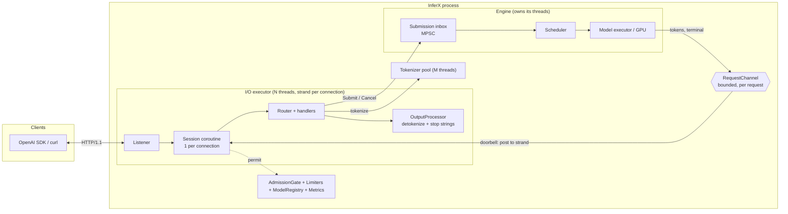
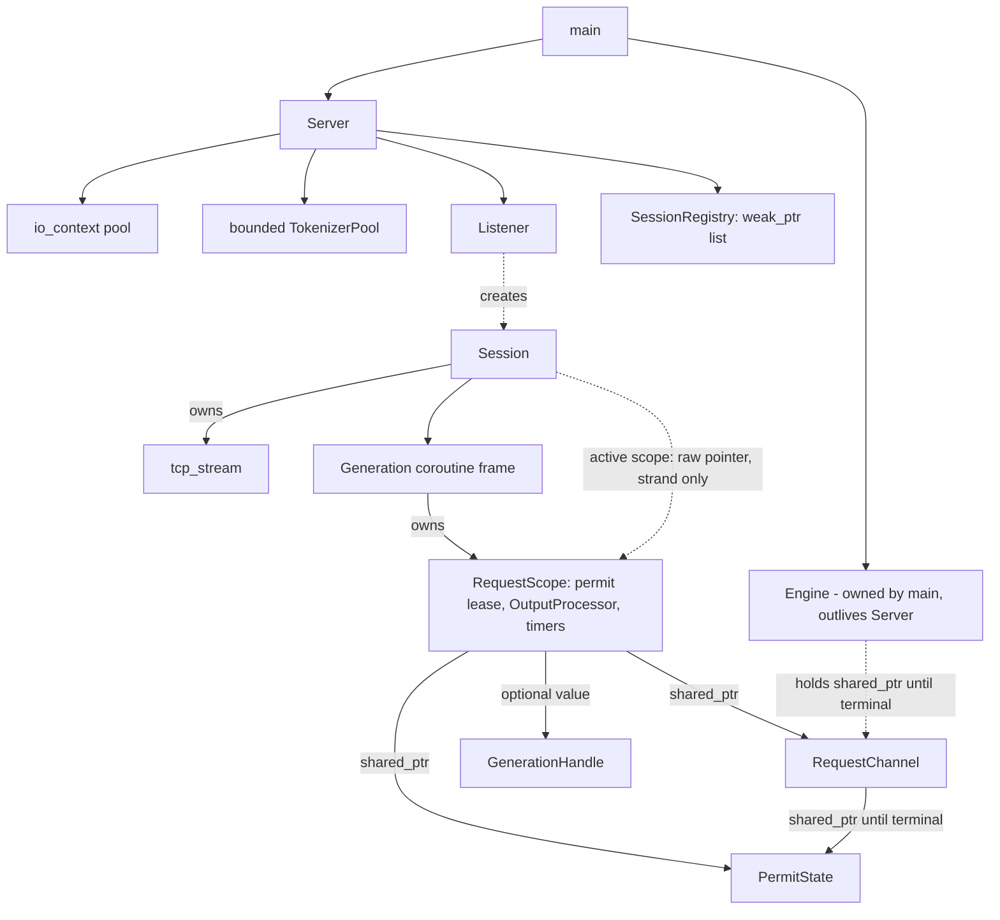
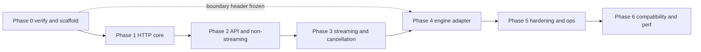
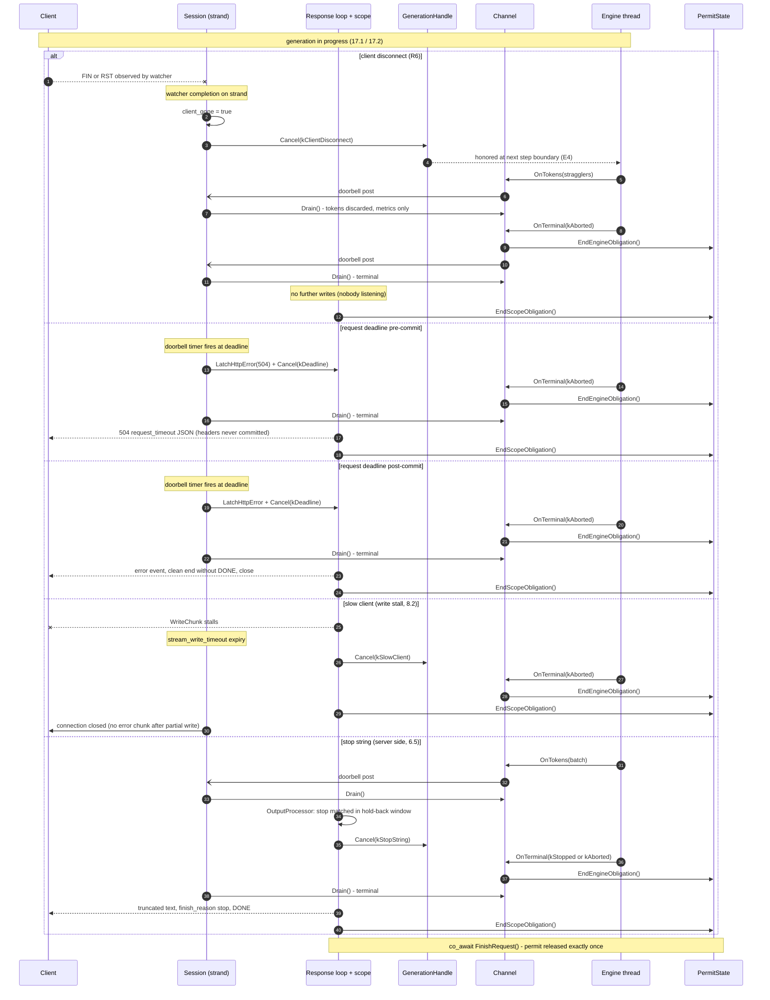
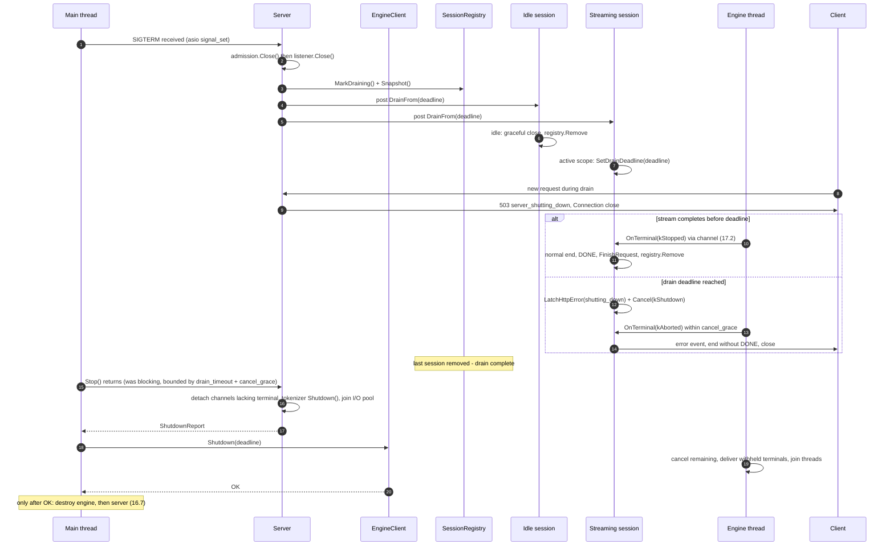
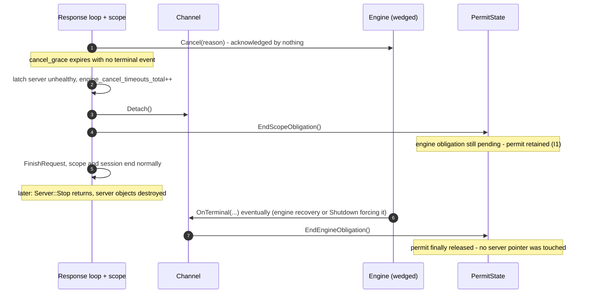

# InferX HTTP Inference Server — Architecture and Technical Design

| | |
|---|---|
| Status | Draft for review |
| Scope | In-process, text-only, OpenAI-compatible HTTP frontend for the InferX engine |
| Language / build | C++20 API subset (repository builds as C++23), CMake, Google C++ Style Guide |

> **Design status.** The original architecture was based on owner-reported facts. This revision
> defines the proposed public contracts in §16 and validates their interactions in §17–18; it does
> not implement them. Limited tree inspection confirms `inferx::Status` / `StatusOr` alias Abseil,
> the build selects C++23, and `inferx::Tokenizer` exposes `Encode`, `Decode`, and `ApplyChatTemplate`
> without a general thread-safety or incremental-decoding guarantee. The APIs below use the C++20
> subset. Other engine behavior remains an assumption requiring §15.1 integration verification.
> Existing-system claims in §2 retain their original reported/assumed labels unless noted otherwise.
> **Update:** Phase 0 (§14.1) has since executed — §15.1 is answered from the engine source
> (assumptions A1–A10 re-tagged in §1.5), and the boundary header, server configuration,
> mock engine, and their tests are landed and green.

---

## 1. Overview

### 1.1 Motivation

InferX is a C++ inference engine (continuous batching, paged KV cache, pluggable KV cache provider). It has no
production network frontend. The goal is an HTTP server that lets stock OpenAI SDK clients talk to it for text
generation, with correct behavior under long-lived streams, client disconnects, overload and shutdown.

### 1.2 Goals

- OpenAI-compatible `GET /v1/models`, `POST /v1/chat/completions`, `POST /v1/completions`, streaming and non-streaming.
- HTTP I/O threads never block on model execution, tokenization of large prompts, or GPU work.
- Every request reaches exactly one terminal state, and every resource (admission permit, engine request, KV blocks,
  socket, timers) is released on every path: success, error, timeout, disconnect, shutdown, engine failure.
- Bounded memory and bounded GPU-resource hold time per client, including slow or stalled clients.
- Graceful drain with deadlines; a wedged in-process engine requires supervisor-enforced process termination.
- Simple enough to reason about: strand-confined HTTP state and a shared permit lease that outlives both HTTP cleanup and engine work.

### 1.3 Requirements

| ID | Requirement |
|---|---|
| R1 | OpenAI SDK (Python/JS) works for chat and completions, streaming and not, for the supported parameter subset |
| R2 | Unsupported parameters fail loudly (`400`) when ignoring them would change semantics |
| R3 | Time-to-first-token overhead of the server < 1 ms p99 excluding tokenization at moderate load (target, to be measured) |
| R4 | Thousands of concurrent idle/streaming connections on a handful of I/O threads |
| R5 | No unbounded queue anywhere between socket and engine |
| R6 | Observable transport disconnect triggers cancellation within one strand turn; engine acknowledges at the next step boundary (§8.3) |
| R7 | Shutdown: stop accepting, drain in-flight up to a deadline, cancel the rest, confirm engine released everything |

### 1.4 Non-goals

- Multimodal anything (images, audio, video, multimodal content parts, preprocessing). Content parts other than
  `{"type":"text"}` are rejected.
- Tool/function calling, structured outputs (`response_format` other than text), logprobs, `n > 1`, `best_of`,
  `echo`, `suffix`, batch prompts, Assistants/Responses/Embeddings/Files APIs.
- HTTP/2, HTTP/3, in-process TLS (terminate at a reverse proxy; see §3.5), multi-tenant rate limiting, billing.
- Multi-process or multi-node serving, IPC, RPC between frontend and engine. (Rationale in §9.1, trigger conditions
  for revisiting in §14.)

### 1.5 Key assumptions (to be validated; see §15.1)

| ID | Assumption | If false |
|---|---|---|
| A1 | **[verified false, Phase 0]** The scheduler is single-threaded and caller-driven; there is no engine-owned thread and no thread-safe inbox (`Scheduler`, `src/dist/worker_main.cc` is the loop template) | Confirmed mitigation: the adapter owns a thread + bounded MPSC inbox running the worker_main loop shape (§9.3); no server redesign |
| A2 | **[verified]** Per-step outputs are host-copied inside `ModelRunner::RunStep` before the step returns; completion is surfaced by `PopFinished()` polling | Adapter fans out step results and terminals per request (§9.3) |
| A3 | **[verified better than assumed]** `Scheduler::AbortRequests` already exists, releases KV via the cache manager, and surfaces an aborted `Request` — but only on the engine thread | `GenerationHandle::Cancel`'s atomic control record is polled by the adapter, which calls `AbortRequests` at the step boundary; no engine change required (E4) |
| A4 | **[verified with gaps]** Waiting-queue admission rejects `ResourceExhausted` at AddRequest; KV exhaustion is preempt-and-recompute, not reject; **prompt length is not checked at admission** (an over-long prompt poisons a step) | Adapter pre-validates prompt length against `ModelSpec::max_position_embeddings`; the server context check (§6.1) is defense in depth; sustained KV pressure never becomes a Submit rejection |
| A5 | **[verified]** Prompts are submitted as token ids (`Request(id, prompt_token_ids, params)`); the engine does not tokenize | — |
| A6 | **[verified]** EOS (engine-wide id set, `ignore_eos`), per-request stop-token ids after `min_tokens`, and `max_tokens → kLengthCapped` are decided in `Scheduler::UpdateFromOutput`; stop *strings* are declared but matched nowhere | Stop strings stay in the server `OutputProcessor` (§6.5) |
| A7 | C++20 features are available (verified: build selects C++23); Boost ≥ 1.81 and nlohmann/json are acceptable dependencies | **[verified]** Boost.Asio subset + Beast + minja already pinned in `third_party` |
| A8 | Tokenizer API exists (verified); usable per-worker backend and incremental-decoding semantics need validation | Backend (HFTokenizer over tokenizers-cpp) verified present; per-worker instances remain the plan; incremental decode still blocks Phase 2 |
| A9 | One engine instance serves one model at a time (multi-model routing = future work) | `ModelRegistry` already keyed by name; extension is additive |
| A10 | The project compiles server TUs with exceptions enabled | **[verified]** The build sets no `-fno-exceptions` flags; the server library keeps exceptions while domain code returns `Status` (R-3 posture) |

---

## 2. Existing System Analysis

### 2.1 What is known

| Item | Tag | Note |
|---|---|---|
| Namespace `inferx`; ops layer `inferx::ops` | [reported] | Server code goes in `inferx::server`; boundary types are plain `inferx` members in `inferx/engine/engine_client.h` |
| `inferx/models/model.h`: abstract `Model` with `Load`, config, `Forward`, `ComputeLogits`; `ModelInput` = token ids + `AttentionBatch`; uses `KvBlockPool` and `ComputeBackend`; outputs borrow model workspace until the next call | [reported] | Confirms a **step-synchronous executor with borrowed output buffers**: sampled results must be copied out on the engine thread before the next step. The server must never hold pointers into executor workspace |
| KV cache is intended to be pluggable (spec/plan/storage/allocation/manager separation, provider SPI) | [reported] | KV capacity is an *engine-internal* resource. The HTTP layer must not model KV blocks; it only observes engine rejections |
| `inferx/server/sse_writer.h/.cc`: `ResponseWriter` over `beast::tcp_stream`, with `WriteJson/WriteEmpty/BeginStream/WriteRaw/WriteDone`, manual chunk framing, errors returned not thrown | [reported] | Evaluation in §2.3 |
| `inferx/server/http_types.h` being reworked onto Beast types + Boost.URL, keeping only `RouteParams` and a per-request context | [reported] | Consistent with this design's choices (§3) |
| A previously requested async `InferenceEngine` boundary with a mock engine behind it | [reported] | Becomes the formal `EngineClient` boundary (§9) |
| A planned `Tokenizer` on `tokenizers-cpp`; a planned SGLang-style `TokenizerManager` (Folly coroutines, centralized output dispatch) | [reported] | Evaluation in §2.4 |
| CMake build, GoogleTest style tests (`tests/norm_test.cc` exists) | [reported] | Server tests go in `tests/server/` |

### 2.2 What is not known (and drives §15.1)

The scheduler API and its request/sequence state machine; whether an engine loop thread already exists; how
completion, failure and cancellation are currently reported; how engine configuration and model loading are
exposed; how the existing code handles errors (the owner reported "errors returned not thrown" for the writer,
and a no-exceptions-across-ABI rule for the KV cache API, suggesting `Status`-style returns are the norm).
**This document therefore defines the engine boundary as a contract (§9.2) rather than describing an existing one.**

### 2.3 Evaluation of the existing `ResponseWriter` [reported, unverified]

- Manual chunk framing duplicates what Beast provides (`http::make_chunk`, `make_chunk_last`, chunked serializer).
  Bugs here (chunk size hex formatting, trailing CRLF, interaction with keep-alive after `0\r\n\r\n`) are
  protocol-correctness risks with no upside.
- A writer that owns the stream *and* knows SSE couples transport and protocol. Proposed split: Beast owns framing;
  a small `SseEncoder` (pure functions: JSON/sentinel → SSE bytes) owns SSE text format; the session owns sequencing.
- Returning errors rather than throwing is correct and is kept (`boost::system::error_code` / `Status`).
- **Decision:** retire `ResponseWriter` as a class; keep its tests as protocol golden tests against the new path.

### 2.4 Evaluation of the planned TokenizerManager

The SGLang-style TokenizerManager is a Python-process-boundary pattern: tokenizer process → scheduler process →
detokenizer process, with a central dispatcher correlating outputs by request id. In an in-process C++ engine the
process-boundary justification disappears. A centralized output dispatcher adds a global shared map, a global
lock/queue and a routing hop per token. **This design uses per-request channels instead (§6, §9.3):** correlation
is by pointer ownership, not by id lookup. Folly coroutines are not adopted for the server (§3.4); if the
TokenizerManager exists for other reasons its tokenization function can still be called from the server's
tokenizer pool. Reuse is limited to the tokenizer/chat-template library, not the manager.

### 2.5 Reusable infrastructure

`Tokenizer` (tokenizers-cpp wrapper), `Model::config` [reported] (context length, vocabulary, EOS ids — for `/v1/models`
and validation), the mock engine (becomes the primary test double), the existing CMake/GoogleTest setup.

### 2.6 Missing capabilities (all [proposed] in this document)

Thread-safe submission and cancellation boundary; per-request output events; incremental detokenization and
stop-string matching; chat-template rendering; HTTP server; admission/limits; metrics; graceful shutdown protocol.

---

## 3. Technology Selection

### 3.1 Requirements that discriminate between options

1. Control over the write path of a long-lived chunked response (per-write completion, per-write timeout).
2. Ability to detect peer disconnect while idle (before first token, between tokens).
3. Explicit executor/strand model so engine-thread → I/O-thread handoff is reasoned about, not guessed.
4. Graceful close and cancellation of every in-flight operation.
5. Small dependency footprint compatible with C++20/CMake; stable APIs.

### 3.2 Candidates

| Option | Fit | Assessment |
|---|---|---|
| **Boost.Asio + Beast** (+ Boost.URL) | Excellent | Full control of reads/writes/timeouts; `tcp_stream` has per-operation expiry; chunked serializer helpers; C++20 coroutines (`awaitable`); strands give a precise concurrency model. Cost: we write the server loop, router, session — scope to estimate after the lifecycle contracts are implemented. Already the stack the project is moving toward [reported]. HTTP/1.1 only |
| **Drogon** | Good for REST, uncertain for this | Mature, fast, batteries included (router, filters, JSON, HTTPS). But: owns its event loops (Trantor), pulls in a large dependency set and its own conventions (controller registration macros/codegen, callback or coroutine handlers). Streaming responses and disconnect notification exist in recent versions, but **the exact semantics for per-write completion, bounded buffering and mid-stream disconnect callbacks must be verified against the pinned version** — these are the exact properties this design depends on. Its internal write buffering is not under our control, which conflicts with R5/§8 |
| **uWebSockets** | Strong performance, explicit backpressure (`tryEnd`, `onWritable`) | Own event loop and C-style lifetime rules (use-after-free if a response outlives its callback), no coroutines, HTTP/1.1 only. Raw performance exceeds what an LLM server needs; lifetime hazards cost more than they save |
| **Proxygen** | Powerful | Folly dependency chain and build weight are out of proportion. Rejected |
| **cpp-httplib** | Simplest | Blocking, thread-per-connection; a slow SSE client occupies a thread; no async write completion. Rejected for streaming |
| **Crow / Oat++ / Pistache** | Adequate for REST | Weaker streaming and cancellation control, smaller or less active ecosystems. Rejected |
| **gRPC frontend + proxy** | n/a | Not OpenAI-compatible; adds a hop. Rejected |

### 3.3 Decision

**Boost.Asio + Beast + Boost.URL**, plus:

| Concern | Library | Why |
|---|---|---|
| JSON | nlohmann/json [reported as already selected] | Ubiquitous; request volume is small relative to generation time. Use non-throwing parse (`allow_exceptions=false`) and type-check before `get<T>`; see R-3 |
| Logging | spdlog (async sink) | Mature, fast, structured key=value via fmt. Async sink so I/O threads never block on log I/O |
| Metrics | prometheus-cpp **core only** (registry + text serializer), exposed via our own `/metrics` route | Avoids hand-rolled exposition format and avoids its embedded HTTP server. Fallback if the dependency is undesirable: ~150 LOC of atomic counters/histograms with a text writer; decide in Phase 5 |
| Chat templates | A Jinja-subset renderer. Candidate: `minja` (header-only, nlohmann/json based, used by llama.cpp) | Chat templates are Jinja2; writing a renderer is a trap. Risk R-5 |
| Status type | Existing `inferx::Status` / `inferx::StatusOr` aliases of Abseil (verified in `include/inferx/core/status.h`) | Google-style, no exceptions in the domain layer |
| Tests | GoogleTest [reported] | — |

Rejected as unnecessary: Folly (heavy; the server needs no executor features Asio lacks), Boost.Fiber, Boost.Cobalt
(promising but newer; C++20 `awaitable` is sufficient), a plugin/middleware framework, a DI container, a message bus.

### 3.4 Callbacks vs. coroutines

Session logic is inherently sequential (read request → validate → submit → loop { wait event → write } → finish).
Coroutines (`asio::awaitable`) express this without callback pyramids and make every suspension point explicit.
Rules to keep it safe:

- Use `asio::as_tuple(asio::use_awaitable)` (or `redirect_error`) for I/O so expected failures (EOF, reset,
  timeout) are values, not exceptions.
- A root `try { … } catch (...)` at each session coroutine entry; pool workers and the engine loop
  also have entry boundaries
  (needed because Asio/Beast/nlohmann can throw `bad_alloc` or logic errors).
- Coroutine frames own their state via `std::shared_ptr<Session>` captured at `co_spawn`; no raw `this` escapes
  into handlers.
- The engine→session doorbell (§7.3) uses `asio::post`; timer/watcher callbacks are small
  state notifications, while the response flow remains coroutine-driven.

Where coroutines would add nothing (the router table, codecs, `OutputProcessor`) code is plain synchronous C++.

### 3.5 Build and operations implications

- Boost ≥ 1.81 (Boost.URL). Header-mostly; link `Boost::system`, `Boost::url`. Link platform thread support; OpenSSL is not needed.
- TLS is **not** terminated in-process in v1. Deploy behind nginx/Envoy/cloud LB. (If in-process TLS is later required,
  Beast `ssl_stream` fits the same session design; adds OpenSSL.)
- Reverse-proxy requirements: disable response buffering for `text/event-stream`, idle timeout > request deadline;
  the server also sends `X-Accel-Buffering: no`.
- New CMake targets: `inferx_server` (library), `inferx_server_main` (binary), `inferx_server_tests`.
  The boundary header is not a separate target — it lives in the engine's public include tree
  (`inferx/engine/engine_client.h`) and is consumed header-only. The engine library does **not**
  depend on `inferx_server` (enforced at configure time).

---

## 4. Proposed Architecture

### 4.1 High-level view



### 4.2 Components and responsibilities

| Component | Responsibility | Owns | Thread |
|---|---|---|---|
| `Server` | Config, wiring, start/stop, drain orchestration | io pool, tokenizer pool, listener, `SessionRegistry`, limiters | main |
| `Listener` | Accept loop; connection-limit gate; creates `Session` | acceptor | I/O |
| `Session` | One connection: keep-alive loop, parse, timeouts, dispatch, write, close | socket (`beast::tcp_stream`), read buffer, strand | I/O (its strand) |
| `Router` | Static table `(method, path) → Handler`; 404/405 | nothing | I/O |
| `Handler`s | `ModelsHandler`; one `GenerationHandler` parameterized by `ApiKind {kChat, kCompletion}` (they differ only in codec and prompt construction) | creates session-owned `RequestScope` | I/O |
| `openai::Codec` | Parse+validate JSON → `GenerationParams`; serialize responses/chunks/errors. Pure functions, no I/O | — | any |
| `PromptBuilder` | Chat template render + tokenize; runs on bounded tokenizer pool for all prompts | worker-owned tokenizer | pool |
| `OutputProcessor` | Per request: incremental detokenizer, stop-string matcher, usage counters, finish-reason resolution | per-request state | I/O (session strand only) |
| `RequestChannel` | Per-request output bridge between engine and HTTP (§7.3); implements `EventSink` | pending events, state flags | producer: engine; consumer: session strand |
| `EngineClient` (interface, defined in `inferx/engine/engine_client.h`) | `Submit`, `Shutdown`; cancellation through `GenerationHandle`. Data in, events out — intake control is the frontend's, teardown is Shutdown's, liveness is observed through the event stream (no polled health/stats) | — | thread-safe |
| `Limiters` | Connection counter, in-flight permit pool | atomics | any |
| `Metrics`, `Logger` | Counters/histograms; async structured logs | — | any (bounded; library internals may lock) |
| `ModelRegistry` | Served model names/aliases → config (context length, ids) | immutable after start | any (read-only) |
| `AdmissionGate`, `PermitState`, `ConnectionPermit` | Close admission atomically; release leases exactly once | shared counter storage | thread-safe |
| `SessionRegistry`, `RequestScope` | Track connections; own per-request timers, cancellation and cleanup | weak sessions / request state | registry locked / scope strand |
| `TokenizerPool`, `IncrementalDecoder` | Bounded preparation; stable incremental text decoding | worker/per-request tokenizer instances | pool / session strand |
| `EngineAdapter`, `MockEngine` | Real and scripted implementations of the serving contract | engine runtime / test worker | engine-owned |

Deliberately absent: dynamic middleware chain, handler base-class hierarchy, per-endpoint classes with virtuals,
event bus, generic pipeline framework. Cross-cutting steps are a fixed ordered sequence inside the session
(request-id → auth → route → handler → error mapping), written as ordinary function calls.

### 4.3 Ownership graph



Key invariants:

- **I1 (permit lease outlives scope and engine work).** A `RequestScope` normally remains until terminal and HTTP cleanup. On bounded abandon (§10.7),
  it detaches its channel before destruction; the shared permit lease outlives both scope and engine work.
  Weak, epoch-tagged wakes never dereference destroyed sessions, and permits cannot release before terminal.
- **I2 (single-writer state).** `OutputProcessor`, socket, timers and response state are touched only on the
  session strand.
- **I3 (engine never blocks on HTTP).** Engine → HTTP calls take one short mutex, append, maybe `post`, return.
- **I4 (exactly one terminal event per accepted request).** Contract on the engine (§9.2), enforced and asserted by `RequestChannel`.

---

## 5. HTTP Request Lifecycle

### 5.1 Connection acceptance

1. `Listener` accepts on the I/O executor. Each connection gets its own strand (`make_strand(io)`), sets `TCP_NODELAY`.
2. Atomically acquire a `ConnectionPermit` only if the current count is below `max_connections`.
   On failure, close (optionally one best-effort nonblocking preformatted 503); count
   `connections_rejected_total`. Never queue unaccepted work in user space.
3. `Session` is created with `std::make_shared`, registered (weak) in `SessionRegistry`, and `Start()`ed.
   Registration rejects a racing drain before starting the coroutine.

### 5.2 Keep-alive loop (per connection)

```
loop:
  read headers   (deadline: header_read_timeout on first request after idle: keepalive_idle_timeout)
  read body      (deadline: body_read_timeout; body_limit enforced by parser)
  dispatch → exactly one response (buffered or streamed)
  if response requests close, draining, parse error, or stream aborted: break
  else continue (HTTP/1.1 keep-alive)
close: shutdown(send) → bounded lingering read for graceful close → close
```

Beast `http::request_parser<http::string_body>` with `header_limit` (default 16 KiB) and `body_limit`
(default 4 MiB; chat requests with long prompts are the largest legitimate bodies). `Expect: 100-continue` handled explicitly by `Session`: validate headers, route, auth and declared
length before writing the interim response, then read the body. Unsupported expectations return `417`. Pipelined requests are not processed concurrently: the next request is read only after the previous
response completes.

Beast's `tcp_stream::expires_after` provides the per-operation timeouts; the expiry is set before each
read/write operation and cleared at completion.

### 5.3 Parsing, validation, admission, dispatch (non-inference routes first)

| Step | Failure → response |
|---|---|
| Malformed HTTP / oversize header | `400`/`431`, `Connection: close` |
| Body over limit | `413`, close |
| Unknown path / wrong method | `404` / `405` + `Allow` |
| Draining | `503` `server_shutting_down`, `Connection: close` |
| Auth (optional static bearer keys, constant-time compare) | `401` `invalid_api_key` |
| Content-Type not `application/json` on POST | `415` |
| JSON parse / schema / range validation | `400` with `param` set where possible |

### 5.4 Admission control and handler entry (inference routes)

Order matters — cheapest rejection first, and **before** any expensive work:

1. Acquire an in-flight **permit** from `Limiters` (`max_inflight_requests`). On failure: `503` +
   `Retry-After: 1`, error `server_overloaded`. The permit moves into the `RequestScope` (RAII).
2. Validate JSON (cheap, synchronous).
3. Tokenize / render template (bounded pool, §6.1).
4. `EngineClient::Submit` (non-blocking). Engine admission failures map per §11.2.

`429` is reserved for per-key rate limiting, which is out of scope; capacity exhaustion is `503`. (Documented so
SDK retry behavior is predictable: the OpenAI SDKs retry on 429/5xx.)

### 5.5 Response generation and connection reuse

- **Buffered response:** `http::response<http::string_body>` with `Content-Length`, `X-Request-Id`; keep-alive honored.
- **Streamed response:** `http::response<http::empty_body>` header written with `async_write_header` using a
  `response_serializer` over a response configured with `chunked(true)`; each subsequent write is `asio::async_write(stream,
  http::make_chunk(buffers))`; terminator `http::make_chunk_last()`. Beast does chunk framing — no hand-rolled
  framing. After a cleanly terminated stream the connection **may** be reused.
- A stream that ended abnormally (write error, stall, abort) closes the connection; there is no safe
  resynchronization.

---

## 6. Inference Request Lifecycle

### 6.1 Normalization

`GenerationHandler` converts a validated API request into an internal `GenerationRequest`:

| Field | Source |
|---|---|
| `external_id` | `chatcmpl-<ulid>` / `cmpl-<ulid>`, also the response `id` — server-side only (StreamEnvelope, §16.6); never crosses the boundary, where `RequestId` identifies the request. The HTTP `X-Request-Id` is separate and echoed |
| `prompt_tokens` | chat: template(messages, `add_generation_prompt=true`) → tokenize; completions: tokenize `prompt` (or accept an int array) |
| `sampling` | temperature, top_p, top_k, min_p, repetition/presence/frequency penalties, seed |
| `max_new_tokens` | `min(requested, model_context − prompt_len)`; if `prompt_len >= model_context` → `400 context_length_exceeded` |
| `stop_token_ids` | model EOS set (engine) |
| `deadline` | `now + request_timeout` (server config; also passed to the engine as a hint) |

Tokenization policy: all prompts go through `TokenizerPool::Prepare` (§16.4), including chat rendering,
vocabulary validation of supplied token IDs, and prompt encoding. The pool has a bounded waiting queue and
worker-owned tokenizer instances; `co_spawn` on an unbounded `thread_pool` alone is insufficient. Completion
resumes on the requesting strand. The request permit remains held until the job finishes, even if cancellation
arrives first. Recheck absolute deadline, cancellation, and the server admission gate before `Submit`.

Chat-template/tokenization boundary: the server renders the template with the model's `chat_template`, then
tokenizes the resulting string **without adding special tokens a second time** (template already contains BOS where
required). Role/content validation precedes rendering: roles ∈ {system, user, assistant}; content must be a string
or an array of `{"type":"text","text":…}` parts (concatenated); anything else → `400 unsupported_content`.

### 6.2 Submission and acceptance semantics

The complete submission, rejection and buffered-response sequence is §17.1; streaming continues in §17.2.

- `Submit` is **non-blocking** and returns immediately (A1). It either enqueues to the engine inbox or returns a
  rejection `Status`.
- **Acceptance** means the engine owns the request and **will** emit a terminal event. After acceptance the server's
  only obligations are: consume events, call `Cancel` if the client goes away or a deadline fires, wait for the
  terminal event.
- Engine-side rejection that can only be detected when the scheduler examines the request (e.g. cannot ever fit in
  KV capacity) arrives as a **terminal `Failed` event with no tokens**. This is why streaming headers are not
  committed at acceptance (§6.4).

### 6.3 Non-streaming completion

The session loop drains the channel into `OutputProcessor` until the terminal event, then serializes one JSON body
(`choices[0].message.content` / `.text`, `finish_reason`, `usage`). No partial text is sent. Detokenization of the
token list is incremental in both modes so stop strings, UTF-8 handling and usage semantics are identical. A client disconnect during the wait cancels the request (§6.6).

### 6.4 Streaming completion

- **Header commit point:** after acceptance, the session waits for the **first engine event** (first tokens or a
  terminal event) and only then writes headers (`200`, `Content-Type: text/event-stream`, `Cache-Control: no-cache`,
  `X-Accel-Buffering: no`, chunked). A zero-token `Finished` terminal still commits the stream:
  headers, role chunk, final chunk, `[DONE]` (§18.2 V6). Consequences: errors detectable before the first token (engine-side
  rejection, queue timeout, deadline) still produce a **proper HTTP status**; time-to-first-byte equals TTFT, so
  there is no latency cost. Trade-off: a long queue wait yields no bytes (proxies with short header timeouts may
  cut the connection); bounded by `queue_wait_timeout` (default 30 s → `503`). A deployment that needs earlier
  headers can set `sse_early_headers=true` (commit at acceptance and use `:` keep-alive comment lines every
  15 s); this is a configuration option, default off.
- **Event formatting** (OpenAI-compatible):
  1. First data chunk: `delta: {"role":"assistant","content":""}` (chat only).
  2. Content chunks: `data: {"id":…,"object":"chat.completion.chunk","created":…,"model":…,"choices":[{"index":0,"delta":{"content":"…"},"finish_reason":null}]}\n\n`. Completions use `object:"text_completion"`, `choices[].text`.
  3. Final chunk: empty delta with `finish_reason` (`stop` | `length`).
  4. If `stream_options.include_usage`: one more chunk with `choices: []` and `usage`.
  5. `data: [DONE]\n\n`, then `make_chunk_last()`.
- **Incremental text:** only complete UTF-8 sequences and text that cannot be a prefix of a stop string are emitted
  (hold-back in `OutputProcessor`, §6.5). At termination the hold-back is flushed (unless truncated by a stop string).
- **Coalescing:** the session drains pending events and encodes them into batches capped at
  `max_write_batch_bytes`, writing one owned batch at a time. It splits text at UTF-8 boundaries, accounts
  for JSON escaping overhead, and never queues an unbounded set of serialized chunks (§8).
- **Errors after commit:** HTTP status can no longer change. Emit one `data: {"error":{…}}\n\n` event, then end
  the chunked body cleanly **without** `[DONE]`, and close the connection. SDKs treat an `error` object in the
  stream as failure. Cancelled-by-disconnect streams emit nothing (no one is listening).

### 6.5 `OutputProcessor`

Per-request, strand-confined. Responsibilities:

1. **Incremental detokenization** through a validated backend-specific prefix/read-offset strategy (§16.4).
   Emit only stable text, preserve legitimate U+FFFD characters, and withhold incomplete UTF-8 rather than
   blindly suppressing all replacement characters. A fixed sliding window is not valid for every tokenizer.
2. **Stop strings** (`stop` ≤ 4 strings): match on the emitted text with a hold-back of `max_stop_len − 1`
   bytes (with UTF-8 boundary handling). On match: truncate text, return `stop_matched` so the handler calls `Cancel(kStopString)`, and keep consuming
   until terminal (a racing Finished is also valid; Failed still means error).
3. **Usage:** `prompt_tokens`, `completion_tokens` (authoritative terminal engine count, including stop-token and
   stop-string overshoot tokens; byte cuts cannot reliably be converted back into token counts), `total_tokens`.
4. **Finish reason resolution** (table in §8.4).

Stop *token ids*/EOS and `max_new_tokens` are engine-side (A6).

### 6.6 Cancellation and failure paths (summary; races in §7.5)

| Trigger | Detector | Action | Client observes |
|---|---|---|---|
| Client disconnect | disconnect watcher / write error | `Cancel(kClientDisconnect)`; wait terminal; release | nothing |
| Request deadline | strand timer | `Cancel(kDeadline)`; pre-commit → `504`; post-commit → error event | `504` / error event |
| Slow/stalled client | write stall timeout / channel overflow | `Cancel(kSlowClient)`; close | connection closed |
| Stop string | `OutputProcessor` | `Cancel(kStopString)`; finish `stop` | normal completion |
| Server shutdown | drain coordinator | `Cancel(kShutdown)` after grace | error event / `503` |
| Engine failure | terminal `Failed` / health flag | map per §11 | `5xx` / error event |

---

## 7. Concurrency and Execution Model

### 7.1 Threads and executors

| Executor | Threads | Runs | May block? |
|---|---|---|---|
| I/O `io_context` pool | `io_threads` (default `min(4, hw)`) | accept, all session coroutines, parsing, validation, serialization, `OutputProcessor`, timers | **Never** (no blocking calls, no locks held across suspension) |
| Tokenizer `thread_pool` | `tokenizer_threads` (default 2) | tokenization/chat-template of all prompts | CPU only |
| Engine thread(s) | owned by engine (A1) | scheduling, model execution, sampling, event emission | GPU waits (engine-internal) |
| Log writer thread | spdlog async | log I/O | yes (isolated) |
| Signal handling | `asio::signal_set` on the I/O pool | SIGINT/SIGTERM → drain | no |

Sessions are strand-bound (`make_strand`), so multiple I/O threads never run two handlers of the same session
concurrently. **No session state needs a mutex.** Short locks also protect the bounded tokenizer queue, registry and admission gate; third-party
metrics/logging internals may lock. None waits for GPU or network progress.

### 7.2 What can block

- I/O threads: nothing. JSON parsing and serialization are bounded CPU work, not a sub-millisecond guarantee.
  Body/output caps and measurement are required; tokenization never runs on I/O threads.
- `Submit`/`Cancel` must be non-blocking (inbox push). If the engine inbox were bounded and full, `Submit` returns
  `kQueueFull` rather than waiting.

### 7.3 `RequestChannel`: per-request output bridge

`RequestChannel` implements the API in §16.3. A short mutex protects a preallocated bounded token buffer,
a separate terminal slot, a sticky overflow flag, the attached executor/weak session target, and the coalesced
wake flag. Per-request sink calls are serialized by the engine. `OnTokens` copies borrowed input and returns
`kOverflow` without appending a batch that exceeds capacity; the adapter marks cancellation independently of
HTTP progress. Terminal storage is reserved and cannot be starved by token overflow.

Producer append and posting the weak doorbell are serialized with `Detach` under the same mutex. `asio::post`
never invokes the callback inline. `Detach` clears the target and executor before returning; no producer may
subsequently use the executor. A queued callback carries a request epoch and only a weak session pointer.
The callback calls `Session::OnWake(epoch)`, which ignores old epochs, sets a strand-local `signaled_` latch,
and cancels the request's doorbell timer.

`Drain` swaps out tokens and consumes the terminal, resetting the wake flag **under the same mutex**.
The consumer clears its signal latch before draining, checks all state before waiting, and never suspends
between the latch check and initiating the timer wait. Producers after the drain post a new wake. The
single response coroutine owns this drain/wait loop; timer callbacks only set state, cancel generation,
and ring the doorbell. An empty drain after a redundant wake is harmless.

`OnTerminal` marks the engine obligation complete in `PermitState`, even when detached. `Detach` drops token
storage but never drops that obligation. Duplicate terminals or tokens after terminal are adapter bugs;
production rejects them and records a diagnostic rather than releasing resources twice.

### 7.4 Lifetime guarantees

- `Session` is kept alive by its own coroutine frame (`shared_ptr` captured in `co_spawn`). `SessionRegistry`
  holds `weak_ptr` only.
- Timers belong to `RequestScope`; the watcher belongs to `Session`. `FinishRequest` cancels and joins
  their completions before scope destruction or connection reuse. Destructors do not initiate asynchronous cleanup.
- The engine may call a detached channel after scope destruction; the channel has no executor dependency then.
- `GenerationHandle` is a move-only value holding an ID and a shared executor-independent control record.
  `Cancel` is allocation-free and remains safe after terminal or engine shutdown (a no-op then).

### 7.5 Race analysis

| Race | Resolution |
|---|---|
| **Disconnect vs token generation** | Disconnect is observed on the strand (watcher completion or write error). It calls `Cancel` (idempotent, thread-safe) and sets `client_gone_`. Tokens arriving afterwards are drained and **discarded** (still counted for metrics) until the terminal event. No writes after `client_gone_`. Engine may emit a few more tokens before honoring cancel — bounded by one step |
| **Cancel vs normal completion** | Terminal event is single-assignment inside the channel. Engine and HTTP outcomes are separate: terminal kind reflects engine ordering; a latched HTTP deadline/shutdown error still wins until response completion. A stop-string latch yields success only for a non-failed terminal. Either way: one terminal, one release |
| **Request timeout vs engine acceptance** | `Submit` runs synchronously on the session strand and is non-blocking, and the deadline timer is armed on that same strand. They cannot interleave. If the deadline expires *before* `Submit` returns (strand was busy), the continuation after `Submit` compares `steady_clock::now()` with the absolute deadline (not just a queued timer flag) and immediately cancels the new handle; the terminal event still arrives and releases everything |
| **Server shutdown vs in-flight streaming** | `Server::Drain` posts a `DrainFrom(deadline)` to each session strand via the registry; sessions never get mutated from the draining thread. Streaming sessions continue until completion or the drain deadline; then `Cancel(kShutdown)`, final error event, close. Handlers started after drain begins get `503` |
| **Engine failure vs response delivery** | Engine failure delivers `Failed` terminals to all live channels (A2), and further `Submit`s reject kUnavailable. Pre-commit → `503/500` JSON; post-commit → error event. A *wedged* engine that delivers nothing is handled by the deadline timer + bounded cancel-wait + abandon path (§10.7) |
| **Two simultaneous cancels** | `Cancel` is idempotent; first reason wins (recorded for metrics) |
| **Doorbell post after session ended** | Already queued wakes use weak pointers and epochs; `Detach` serializes with posting and clears the executor; later token pushes are dropped but terminal still releases the engine obligation |

### 7.6 Locking discipline

No lock is ever held across `co_await`, a socket operation, a log call, or a call into the engine. `RequestChannel::mu_`
protects bounded buffer state, terminal storage and post/detach coordination. `SessionRegistry` mutex is taken only on session
add/remove and drain enumeration. Do not nest these locks; copy strong session references before posting outside the registry lock.

---

## 8. Streaming and Backpressure

### 8.1 Three distinct things (kept separate)

1. **Engine generation progress** — governed by the engine's scheduler; one decode step produces ≤ 1 token (or a
   few with speculation) per running request.
2. **Event buffering** — `RequestChannel::pending_tokens_` between steps and session drains.
3. **Socket write completion** — `async_write` completion on the session strand; reflects kernel send buffer
   (TCP window), not client consumption.

### 8.2 Policy: bounded buffering, no engine stall, cancel on stall

The engine decode batch is a shared resource; stalling it for one slow client would harm everyone, and the engine
cannot pause a single sequence cheaply (A1/A2). Therefore:

- **The engine never waits for HTTP progress.** `OnTokens` only takes a short channel mutex; no I/O wait.
- **Memory is bounded per request** by a hard `max_pending_tokens` channel cap, one drained batch,
  one serialized write batch, and a bounded output accumulator. `max_output_bytes` bounds buffered JSON/text
  and `max_write_batch_bytes` bounds each serialized SSE write; split large deltas on UTF-8 boundaries.
- **Write progress timeout** `stream_write_timeout` bounds every logical write; timeout closes the socket
  and cancels generation. A partially written HTTP chunk cannot be followed by an error chunk.
- **Channel overflow** is sticky: `OnTokens` returns `kOverflow`, the adapter cancels at its next boundary,
  and the strand closes the stream as `kSlowClient`. No silently dropped token is ever followed by success.
- **Natural coalescing** (§6.4): while a write is in flight, new tokens accumulate and go out as one larger chunk,
  so a slowly draining client costs fewer, bigger writes instead of a growing queue of tiny writes.
- On slow-client cancel: stream ends abnormally, connection closed (§6.4), `streams_aborted_total{reason="slow_client"}`.

### 8.3 Disconnect detection while idle

After reading the body, `Session` owns one raw-socket `async_read_some` watcher with a dedicated
cancellation slot and a bounded read-ahead buffer. It may coexist with one write, never another read.
It preserves pipelined bytes, rearming until EOF/error or `max_read_ahead_bytes`. At that cap, close the
connection and cancel its generation; silently disabling the watcher would violate the cancellation goal.
EOF is treated as client departure (request-side TCP half-close is intentionally unsupported).

`StopDisconnectWatch` emits **operation-specific** cancellation and awaits its completion before parsing
the next request. It accounts for bytes delivered in a race with cancellation. Socket-wide cancel is used
only when closing; it would also interrupt an unrelated write. Using the raw socket avoids Beast read
expiry interfering with write timeouts; platform/version cancellation behavior is an integration test gate.

R6 starts when the transport reports departure. A silent network partition cannot be detected in one event-loop
turn; request/write deadlines bound it. There is no unconditional wall-clock GPU cancellation bound if an
engine step itself hangs. Pipelined requests remain sequential and buffered only up to the configured cap.

### 8.4 Finish reasons

| Engine terminal (`TerminalEvent.reason`) | Server finish_reason / outcome |
|---|---|
| `kStopped` (EOS / stop token) | `stop` |
| `kLengthCapped` (max tokens or context limit) | `length` |
| Stop string matched (server) | `stop` |
| `kAborted` (client/slow/shutdown/deadline/queue/internal/scope exit) | no finish reason (error path or silence) |
| `kError` (status in `failure`) | error (§11) |

`content_filter`, `tool_calls` are never produced.

### 8.5 Stream resource release

Terminal event → drain → write final chunks and `make_chunk_last` if writable → `FinishRequest`
(after `StopDisconnectWatch`) joins the scope timers, detaches channel, drops the handle, records
metrics/access log, and ends the scope obligation; the scope itself is destroyed when the
generation coroutine returns. `PermitState` releases the permit only once both engine and scope
obligations have ended (§16.2).

---

## 9. Engine Integration

### 9.1 Integration boundary — evaluation

| Option | Verdict |
|---|---|
| HTTP handlers call the scheduler directly | Rejected: scheduler is engine-thread-confined; would require locking or races, couples HTTP to scheduler internals |
| **In-process, asynchronous client interface with per-request event sink (chosen)** | Thread-safe inbox on the engine side; zero serialization; one copy of tokens; simplest correct design |
| Out-of-process engine (ZMQ/gRPC), as in vLLM V1's frontend/engine-core split | The split exists in vLLM because Python's GIL makes the API server a bottleneck for the engine loop. A C++ frontend on separate threads has no GIL; IPC adds serialization, a failure mode (process death) and operational complexity. **Not justified now.** Revisit if: engine crash isolation becomes a requirement, multi-node, or the frontend needs independent scaling (§14) |
| Central dispatcher with request-id → handler map (TensorRT-LLM/SGLang style) | Rejected: an extra shared map/queue and hop per token; per-request channels give the same correlation by ownership |

The interface is the **only** place HTTP and engine meet, lives in `inferx/engine/engine_client.h`
(depends on nothing HTTP-related; the engine and server both depend on it). It is a virtual interface for exactly one
concrete reason — the mock engine used by server tests (and the real adapter). `EventSink` is the reverse callback interface; the existing `Tokenizer`
interface is reused. HTTP routing remains non-virtual.

### 9.2 Contract

The complete boundary definitions are in §16.1 (one authoritative declaration per class). They include
`EventSink`, the move-only `GenerationHandle`, `EngineClient`, and its `EngineAdapter` / `MockEngine`
implementations. The boundary contains no Asio, Beast or HTTP types. Cancellation updates a preallocated
per-request atomic control record; it cannot be rejected by a full submission inbox.

Engine-side obligations:

- **E1** `Submit` never blocks on GPU/scheduler progress; it pushes to the inbox (bounded; full ⇒ `kResourceExhausted`).
- **E2** After `Submit` returns OK: exactly one `OnTerminal`, after which no more sink calls. Calls for one request are serialized, and terminal
  means its scheduler state and KV allocations have already been released. Callbacks may precede `Submit` return;
  rejection means no callbacks and no retained sink. The caller arms its permit obligation before submitting.
- **E3** `OnTokens` is called from the engine thread after the step that produced the tokens, with ids **copied**
  (never views into executor workspace — consistent with the borrowed-output behavior of `Model::Forward/ComputeLogits` [reported]).
- **E4** `Cancel` is honored at the next step boundary: sequence removed from running/waiting sets, KV blocks
  released via the existing KV manager, terminal `Cancelled` delivered (unless already finished).
- **E5** On fatal engine failure: every live request gets a `kError` terminal, and further `Submit` →
  `kUnavailable`. Liveness is observed through this event stream, not polled health.
- **E6** `Submit` rejection statuses are a closed set: `kInvalidArgument`, `kResourceExhausted` (queue full),
  `kUnavailable` (draining/failed), `kOutOfRange` (prompt too long).

### 9.3 Mapping to the scheduler

**Verified in Phase 0 (§15.1):** the scheduler + runner step loop exists and is caller-driven —
`src/dist/worker_main.cc`'s `RunWorker` (drain commands → `Schedule()` → `ExecuteModel()` →
`UpdateFromOutput()` → emit per-request tokens behind a prompt-computed watermark → drain
`PopFinished()`) is the exact loop shape the adapter re-implements over a thread-safe inbox.
The adapter (`EngineAdapter : EngineClient`, in the engine library, **proposed**) is
responsible for: converting `GenerationRequest` to `Request(id, prompt_tokens, sampling_params)`
(the engine already takes token ids, A5); pre-validating prompt length against
`ModelSpec::max_position_embeddings` (the scheduler does not check it at admission, §15.1.4);
draining a bounded MPSC inbox at the top of each step (new requests join the waiting queue;
cancel records from `CancelControl` become `Scheduler::AbortRequests` calls — which
already release KV and surface an aborted `Request`, A3); after each step, per request that
produced tokens, `sink->OnTokens(copy)` behind the same watermark (`samples` are already
host-owned vectors, E3); on overflow/detach, marking cancellation; on sequence finish,
`PopFinished()` yields the `Request` whose KV/scheduler release has already happened — the
adapter maps `FinishReason {kStopped, kLengthCapped, kAborted, kError}` to a `TerminalEvent`
and calls `OnTerminal`. Terminal publication never needs a free inbox slot. Engine-global step
failures (fatal in `RunWorker` today) are caught by the adapter and fanned out as `Failed`
terminals plus a health flip (E5) — new adapter behavior, not an engine change. Batching, KV
admission, and preemption remain 100 % inside the scheduler; the HTTP layer neither sees nor
models them.

### 9.4 HTTP admission vs engine admission

| Layer | Limits | Rejects with |
|---|---|---|
| HTTP (cheap, early) | `max_connections`, `max_inflight_requests`, body size, tokenizer queue | `503`/`413`/`400` before any engine work |
| Engine (authoritative for GPU resources) | waiting-queue depth, max concurrent sequences, KV capacity, max prompt length | `Submit` status or terminal `Failed` |

`max_inflight_requests` should be set ≥ engine `max_running + max_waiting` so the HTTP layer rarely hides engine
rejections, yet low enough to bound memory and tail latency. The server never tries to predict KV pressure.

### 9.5 Cleanup guarantee ("no orphaned workloads")

Assuming engine progress and E2 + I1, an accepted request cannot leak: the session cannot complete without the terminal event; the
terminal event is produced for finish, cancel and failure. The residual risk is a **wedged engine** (never emits terminal):
§10.7.

---

## 10. Resource Management

### 10.1 Limits (all configurable; defaults indicative)

| Resource | Limit | Default | Enforcement |
|---|---|---|---|
| Connections | `max_connections` | 4096 | accept gate |
| In-flight inference requests | `max_inflight_requests` | 512 | permit pool, atomic CAS |
| Header size | `header_limit` | 16 KiB | Beast parser |
| Body size | `body_limit` | 4 MiB | Beast parser |
| Prompt tokens | model context | from `Model::config` | validation |
| `max_tokens` | min(request, context − prompt) | — | validation |
| Tokenizer queue | `tokenizer_queue_limit` | 64 | pool wrapper counter |
| Pending tokens/stream | `max_pending_tokens` | 1024 | hard channel cap, producer rejects overflow |
| Decoded output / SSE batch / read-ahead | `max_output_bytes` / `max_write_batch_bytes` / `max_read_ahead_bytes` | 8 MiB / 64 KiB / 16 KiB | processor / writer / watcher |
| `stop` strings | 4 × 256 UTF-8 bytes | — | validation |

### 10.2 Timeouts

| Timeout | Default | On expiry |
|---|---|---|
| `header_read_timeout` | 10 s | close (408 if possible) |
| `body_read_timeout` | 30 s | `408`, close |
| `keepalive_idle_timeout` | 60 s | close silently |
| `queue_wait_timeout` (accepted → first tokens or terminal; includes prefill) | 30 s | `Cancel(kQueueTimeout)`; `503` pre-commit |
| `request_timeout` (total) | 600 s | `Cancel(kDeadline)`; `504` / error event |
| `stream_write_timeout` | 15 s | `Cancel(kSlowClient)`, close |
| `drain_timeout` / `cancel_grace` | 30 s / 5 s | §10.6 |

All are Asio timers or `tcp_stream::expires_after` on the owning strand; none requires a thread.

### 10.3 Overload behavior

Reject early, cheaply and explicitly: `503` + `Retry-After` for permit exhaustion or engine `kResourceExhausted`;
never buffer unboundedly; `/readyz` stays 200 under mere overload (so LBs don't flap) but reports saturation in
metrics. `/readyz` is frontend-owned: draining, the model registry, and the server's unhealthy latch
(set by `kError` terminals or the abandon path) decide it.

### 10.4 Queue bounds, end to end

socket (kernel) → parser (header/body limits) → permit (count) → tokenizer pool (count) → engine inbox (engine bound)
→ engine waiting queue (engine bound) → channel (≤ `max_pending_tokens` ints) → bounded write batch → socket write (timeout). Every hop has
a bound or a timeout.

### 10.5 Permit semantics

A permit is acquired before validation and released only when both scope cleanup and the engine obligation
(if submitted) have completed. Abandon may destroy the scope first but retains the shared lease (I1).
`max_inflight_requests` therefore includes preparing, responding and cancelled-but-unacknowledged work.

### 10.6 Graceful shutdown

The authoritative shutdown sequence is §17.5. `Server::Drain` is purely frontend — it closes the admission gate before stopping
acceptance (engine intake closes later, when `Shutdown` begins), marks readiness false, and snapshots registered sessions. Registration checks the same gate,
so an accept racing drain cannot escape enumeration. Idle sessions close; active ones finish until the grace
deadline. At expiry each session latches shutdown, calls `GenerationHandle::Cancel(kShutdown)`, and closes
a stalled write. Cleanup waits at most `cancel_grace` for a terminal before detaching.

`Server::Stop` runs on the main thread, never an I/O thread: wait for all session and tokenizer completions,
detach every channel while I/O is still alive, then release the work guard and join the I/O pool. It does not
call `io_context::stop()` while cleanup needs executor progress. It returns a `ShutdownReport` that distinguishes
normal drain from outstanding engine obligations. Main then calls `EngineClient::Shutdown(deadline)` and only
destroys the server/engine after successful engine thread join. See §16.7 for lifecycle preconditions.

### 10.7 Wedged-engine (abandon) path

If `cancel_grace` expires without terminal, set the shared readiness latch unhealthy, increment
`engine_cancel_timeouts_total`, detach the channel, and finish the HTTP scope. `PermitState` remains owned
by the engine's channel and retains the permit until terminal; it contains no server/executor/logger pointer.
Detached `OnTerminal` can therefore complete safely even after the server is destroyed. A successful engine
shutdown also guarantees every accepted request received terminal.

A hard deadline cannot safely kill a C++ thread executing a tokenizer, scheduler or GPU runtime. If tokenizer
jobs cannot join, `Server::Stop` returns an incomplete report with its runtime still alive. If engine shutdown
times out, main must **not** destroy that engine or unload its resources. The supervisor terminates the process
at `hard_stop_timeout`; do not detach threads and pretend orderly destruction succeeded. The server's unhealthy
latch closes future admission regardless of engine state.

---

## 11. Error Handling and Observability

### 11.1 Error body (OpenAI shape)

```json
{"error": {"message": "…", "type": "invalid_request_error", "param": "max_tokens", "code": "invalid_value"}}
```

### 11.2 Taxonomy and mapping

| Condition | HTTP | `type` / `code` | Streaming after commit |
|---|---|---|---|
| Malformed JSON / schema / range | 400 | `invalid_request_error` / `invalid_json`, `invalid_value`, `missing_required_parameter` | n/a (pre-commit) |
| Unsupported parameter (§12.2–3) | 400 | `invalid_request_error` / `unsupported_parameter` | n/a |
| Unknown model | 404 | `invalid_request_error` / `model_not_found` | n/a |
| Context length exceeded | 400 | `invalid_request_error` / `context_length_exceeded` | n/a |
| Missing/invalid API key | 401 | `invalid_request_error` / `invalid_api_key` | n/a |
| Body too large / wrong media type | 413 / 415 | `invalid_request_error` | n/a |
| Permit exhausted, engine queue full | 503 + `Retry-After` | `server_error` / `server_overloaded` | n/a |
| Draining | 503 + `Connection: close` | `server_error` / `server_shutting_down` | error event `server_shutting_down` |
| Engine unavailable/failed | 503 | `server_error` / `engine_unavailable` | error event |
| Inference failure (terminal `Failed`) | 500 | `server_error` / `inference_error` | error event |
| Queue-to-first-event timeout | 503 | `server_error` / `queue_timeout` | error event |
| Decoded output cap exceeded | 500 | `server_error` / `output_limit_exceeded` | error event; cancel generation |
| Request timeout | 504 | `server_error` / `request_timeout` | error event |
| Client cancelled / slow client | none | — | none (connection closed) |
| Internal bug / caught exception | 500 | `server_error` / `internal_error` (details only in logs) | error event |

### 11.3 Logging

spdlog async, key=value structured lines. Fields: `ts level req_id conn_id model route status stream prompt_tokens
completion_tokens ttft_ms e2e_ms finish_reason cancel_reason err_code peer`. One **access line per request** at session request cleanup
(including errors before a scope exists); warnings for abandon path, slow-client cancels, engine failures.
**Prompts and completions are never logged** unless `log_payloads=true` (debug only).

### 11.4 Request IDs

`X-Request-Id` accepted if present and sane (≤ 64 printable chars) else generated; echoed in the response and
every log line; `external_id` (`chatcmpl-…`) is logged alongside the engine `RequestId` — the Submit
access line records the mapping, and the engine never sees the wire id.

### 11.5 Metrics (Prometheus text at `/metrics`)

Counters: `http_requests_total{route,status}`, `admission_rejected_total{reason}`, `requests_cancelled_total{reason}`,
`streams_aborted_total{reason}`, `engine_cancel_timeouts_total`, `tokens_generated_total`, `prompt_tokens_total`.
Gauges: `connections_active`, `inflight_requests`, `streams_active` (admission gauges read from
`AdmissionGate` at scrape time; engine-internal gauges, if wanted, arrive with a dedicated observability
seam in Phase 5 — not through the serving boundary).
Histograms: `request_duration_seconds{route,stream}`, `ttft_seconds`, `inter_token_latency_seconds`
(sampled per drained batch, not per token), `tokenize_seconds`, `queue_wait_seconds` (acceptance to first event, including prefill). Labels are low-cardinality only
(no request ids, no user strings).

### 11.6 Health

- `GET /healthz`: liveness — process responsive (served on the I/O pool; if the loop is wedged it times out).
- `GET /readyz`: ready only if not draining, a model is registered, and the server's unhealthy latch
  is clear. Engine failure is observed through `kError` terminals and the latch, never polled health;
  the accepted trade: an engine that fails while idle stays "ready" until the first `Submit` rejects
  (503) — narrow and immediately self-revealing.
Both bypass auth and admission permits.

### 11.7 Diagnostics

Per-request state is in the access log; a debug-only `GET /debug/requests` (disabled by default, bound to
localhost) lists live scopes with age/state — implemented by iterating the `SessionRegistry` via strand posts.

---

## 12. API Design

### 12.1 Endpoints and compatibility scope

| Endpoint | Status |
|---|---|
| `GET /v1/models` | Supported (list; no per-model retrieve in v1) |
| `POST /v1/chat/completions` | Supported, text only, `n=1` |
| `POST /v1/completions` | Supported, text only, single prompt |
| `GET /healthz`, `/readyz`, `/metrics` | Operational (non-OpenAI) |

**Compatibility claim:** "OpenAI-compatible for text chat/completions with the parameters listed below, verified
with the official OpenAI Python and Node SDKs." The server is **not** a full OpenAI API implementation.

### 12.2 `/v1/chat/completions` request

| Field | Handling |
|---|---|
| `model` (required) | Must match a served name/alias → else `404 model_not_found` |
| `messages` (required, ≥ 1) | roles `system`/`user`/`assistant` (`developer` treated as `system`); content string or array of text parts; `name` ignored. `tool` role, `tool_calls`, image/audio parts → `400` |
| `stream` | bool, default false |
| `stream_options.include_usage` | supported |
| `max_tokens`, `max_completion_tokens` | integer ≥ 1; if both, `max_completion_tokens` wins; default = remaining context |
| `temperature` [0,2], `top_p` (0,1] | supported; defaults 1.0 |
| `stop` | string or ≤ 4 strings |
| `presence_penalty`, `frequency_penalty` [-2,2] | supported |
| `seed` | supported (best-effort determinism; documented) |
| `top_k`, `min_p`, `repetition_penalty` | **extensions** (vLLM-compatible names); optional |
| `n` | must be 1 (absent or 1) else `400` |
| `user`, `metadata`, `store` | accepted, logged (`user` only), ignored |
| `logprobs`, `top_logprobs`, `logit_bias`, `tools`, `tool_choice`, `functions`, `function_call`, `parallel_tool_calls`, `audio`, `modalities`, `prediction`, `web_search_options` | `400 unsupported_parameter` unless null/empty/default |
| `response_format` | only `{"type":"text"}`; others `400` |
| unknown fields | ignored (forward-compat with SDK additions) but logged at debug; the "reject vs ignore" split is by whether ignoring changes output semantics |

### 12.3 `/v1/completions` request

`model`, `prompt` (string, or array of ints = token ids; array of strings/batches → `400`), `max_tokens` (default 16
as in OpenAI; configurable), `temperature`, `top_p`, `stop`, `stream`, `stream_options`, penalties, `seed`, extensions
as above. `echo`, `suffix`, `best_of`, `logprobs`, `n>1` → `400`.

### 12.4 Responses

Non-streaming chat:

```json
{"id":"chatcmpl-…","object":"chat.completion","created":1730000000,"model":"…",
 "choices":[{"index":0,"message":{"role":"assistant","content":"…"},"finish_reason":"stop"}],
 "usage":{"prompt_tokens":12,"completion_tokens":34,"total_tokens":46}}
```

`system_fingerprint` omitted. `usage.prompt_tokens_details.cached_tokens` included if the engine reports prefix-cache hits.
Completions: `object:"text_completion"`, `choices[].text`. `GET /v1/models`: `{"object":"list","data":[{"id","object":"model","created","owned_by"}]}`.

### 12.5 Streaming protocol summary

See §6.4. `Content-Type: text/event-stream; charset=utf-8`; one `data:` line per event; `\n\n` terminated; `[DONE]` sentinel
on success only. No `event:` names or `id:` fields (OpenAI does not use them). Keep-alive comments only in
`sse_early_headers` mode.

---

## 13. Testing Strategy

Test double: `MockEngine : EngineClient` with scripted behavior (token schedule, delays, failure at step *k*,
ignore-cancel for N steps, never-terminal) running on its own thread to reproduce real cross-thread timing.

| Layer | What | How |
|---|---|---|
| Unit | `Codec` validation matrix (every field, boundary, wrong types), error mapping, `SseEncoder`, `OutputProcessor` (UTF-8 splits, stop-string straddling chunks, hold-back flush), limiter/permit RAII, config parsing | GoogleTest, table-driven; libFuzzer targets for JSON codec and `OutputProcessor` |
| HTTP protocol | keep-alive reuse, pipelining, `Expect: 100-continue`, header/body limits, malformed request lines, slowloris (header trickle), half-close, `Connection: close`, chunk framing validity (parse with an independent client), 404/405 | Real loopback sockets with a small Beast test client + raw-byte tests |
| API compatibility | Official OpenAI Python and Node SDKs against the mock engine: chat/completions, streaming, `include_usage`, errors raise the expected exception types, `max_tokens` vs `max_completion_tokens` | CI job (Python `openai` pinned); golden JSON fixtures for response shapes |
| Streaming | event order, role-first chunk, final chunk + usage + `[DONE]`, error-after-commit, header-commit timing (error before first token gives real status), coalescing under slow reader | Mock engine + throttled client |
| Cancellation/timeouts | client disconnect while queued / prefilling / streaming → engine sees `Cancel` within bound and permit released; deadline pre/post commit; stop string; cancel racing completion (loop 10⁵×) | Mock hooks + counters asserting `permits == 0`, `engine live == 0` |
| Concurrency | the §7.5 race table, each as a stress test; many connections × many cancels | **TSAN** and **ASAN/UBSAN** CI jobs run the whole server test suite; randomized scheduling delays injected in `MockEngine` and `RequestChannel` (test hook) |
| Failure injection | engine `Failed` mid-stream; engine death; wedged engine (never terminal) → abandon path; `Submit` rejection kinds; allocation failure in handler (exception boundary) | MockEngine modes |
| Load/stress | 1k–10k concurrent SSE streams on mock; slow-reader swarm (assert bounded RSS and KV-hold time ≤ timeout); connection storm at limit; soak 1 h with random disconnects (assert no fd/permit/memory drift) | custom asyncio/Beast load tool; `/metrics` assertions |
| Graceful shutdown | SIGTERM with N streams: completes within drain; forced cancel path; new requests get 503; no leaked permits/fds; ordering Server→Engine | Process-level test |
| Real-engine integration | Small model on GPU CI node: end-to-end correctness vs direct engine output (greedy equality), cancel frees KV (engine stats), concurrent mixed streams | Nightly |

Acceptance of the whole suite includes a leak check at the end of every test: `inflight_requests == 0`,
`connections_active == 0`, `streams_active == 0` after all scripted engine terminals have been released.
Wedged-engine tests assert retained permits before releasing their withheld terminals.

---

## 14. Implementation Plan

Each phase is independently mergeable and testable.

| Phase | Deliverables | Depends on | Acceptance |
|---|---|---|---|
| **0. Verify & scaffold** | Complete §15.1 verification; CMake targets, dependency pinning, config struct, `inferx/engine/engine_client.h` boundary header, `MockEngine` | — | Builds in CI; `MockEngine` unit tests; verification checklist answered (updates this doc) |
| **1. HTTP core** | Listener, Session keep-alive loop, Router, error mapper, request IDs, timeouts, connection limit, `/healthz`, `/readyz`, graceful close, logging | 0 | Protocol test suite green; TSAN clean; slowloris/limit tests pass |
| **2. API + non-streaming** | `Codec`, `ModelRegistry`, `/v1/models`, `PromptBuilder` / bounded `TokenizerPool` (chat template + tokenizer), `OutputProcessor`, `RequestChannel`, non-streaming chat/completions against `MockEngine`, permits | 1, A8 | OpenAI SDK non-streaming tests; validation matrix 100 %; usage/finish_reason correct |
| **3. Streaming + cancellation** | SSE path, header-commit logic, coalescing, disconnect watcher, deadlines, slow-client policy, stop strings | 2 | Streaming + cancellation + race tests green under TSAN; bounded-memory slow-reader test |
| **4. Real engine adapter** | `EngineAdapter` (inbox, cancel at step boundary, per-step event emission, failure fan-out), health reporting | 3, engine changes (A1–A3) | Greedy-equality vs direct engine; cancel frees KV; engine failure test |
| **5. Hardening & ops** | Drain/shutdown protocol, wedged-engine path, Prometheus metrics, diagnostics endpoint, config docs, optional API-key auth | 4 | Shutdown tests; metrics assertions; soak test 1 h clean |
| **6. Compatibility & perf** | Node SDK tests, load tests on real GPU, JSON chunk fast-path if profiling justifies, tuning guide | 5 | Published SLOs measured: TTFT overhead, streams/core, memory/stream |

Phase 4 contains the only engine-side change; it can proceed in parallel with 2–3 once the boundary header from
Phase 0 is agreed.

### 14.0 How to read the phase steps

The table above is the summary of record; §14.1–§14.7 decompose each phase into **ordered,
individually mergeable steps**. Every step names what lands (class → §16 declaration, file →
Appendix A), the tests that land with it (§13 row), and the phase **exit gate** that must be
green before the next phase starts. Two standing rules:

- **No step merges red** — unit/protocol tests accompany the code they cover, in the same PR.
- **Doc-sync rule** — any deviation from a §16 declaration or a §17 diagram updates §16/§17/§18
  in the same PR; the §18.1 matrix is re-checked at every phase gate.

Phase ordering and parallelism (dashed = development may start; solid = integration gate):



### 14.1 Phase 0 — Verify & scaffold

1. **Verification spike.** Answer every §15.1 checklist item against the actual engine code
   (scheduler API, step loop, output copying, cancel path, admission behavior, tokenizer/chat
   template status, error conventions, existing `inferx/server` state, model-loading surface,
   dependency set, mock-interface reuse). Record the answers inline in §15.1 and update the
   affected assumptions (A1–A10), §9.3, and the E-annotations in §16.1. *Test:* none (analysis);
   *deliverable:* revised document, merged before any server code.
2. **Dependency pinning.** Add Boost ≥ 1.81 (`Boost::system`, `Boost::url`), nlohmann/json,
   spdlog (async sink), prometheus-cpp core, minja, GoogleTest via the mechanism chosen in A7.
   *Gate:* clean configure + build in CI; exceptions enabled **only** for `inferx_server` and
   test targets (A10, R-3) — asserted by a compile-flags check in CI.
3. **CMake targets** per §3.5: `inferx_server`, `inferx_server_main`, `inferx_server_tests`.
   *Gate:* an `inferx_assert_not_linked` configure-time check fails the build if any engine
   target links `inferx_server`.
4. **`inferx/config/server_config.{h,cc}`** — `ServerConfig` exactly as §16.5 (namespace
   `inferx`, embedding the existing `ApiServerConfig`), parsed from flags/env with range
   validation. *Test:* config parse/defaults
   unit tests (every §10.1/§10.2 knob round-trips; invalid values rejected).
5. **`inferx/engine/engine_client.h`** — the boundary header verbatim from §16.1.
   *Gate:* CI grep asserts the header contains no Asio/Beast/HTTP includes (§9.1).
6. **`tests/server/mock_engine.{h,cc}`** — `MockEngine` per §16.1: scripted steps, all Script
   knobs, its own engine thread. *Test:* MockEngine conformance unit tests — E1 non-blocking
   Submit, E2 exactly-one-terminal (incl. callbacks-before-return), E4 cancel honored after
   `ignore_cancel_steps`, E5 failure fan-out + health flip, E6 every rejection status, and the
   `live_requests`/`all_released` post-condition helpers.
7. **CI wiring.** Build + unit job on every PR; TSAN/ASAN/UBSAN jobs scaffolded to run the same
   suite (initially just the above).

**Exit gate:** all jobs green; §15.1 answered and assumptions updated in this document.

**Phase 0 executed (2026-10-24).** Landed: `include/inferx/engine/engine_client.h` (the §16.1
contracts, namespace `inferx`, with `CancelControl` as one packed atomic for exact
first-reason-wins; originally scaffolded as `inferx/serving/`, folded into the engine's public
headers during Phase 0 review);
`ServerConfig` (`include/inferx/config/server_config.h`, `src/config/server_config.cc`,
namespace `inferx`) with
`Validate`/`FromJson`/`ToJson`/`MergeEnvironmentOverrides` and unknown-key rejection;
`generation_config` reimplemented in `inferx/config/` (plain defaults mirroring
`SamplingParams` — no optionals; per-field docs; `LoadGenerationConfig` reads
attributes through `ConfigView`, resolves the file per the ModelConfig contract
("auto" = `<model_dir>/generation_config.json`, otherwise the path itself), and
applies `--override-generation-config` as a JSON-level merge) and `RunServe` returning
`kUnimplemented` as the Phase 1 seam; CMake targets `inferx_server`, `inferx_server_main`; `tests/server/` with `mock_engine.{h,cc}` plus 11
E1–E6 conformance tests, 6 config tests, the `serving_boundary_purity` CTest
(`cmake/CheckServingBoundary.cmake`), and the configure-time `inferx_assert_not_linked` guard
(no engine target may reach the server library). Deviations from the plan: spdlog and
prometheus-cpp are deferred to their first consuming phases (1 and 5; every other dependency
was already pinned in `third_party`); TSAN was validated locally (`build-tsan`, `setarch -R`
for the kernel-ASLR workaround) rather than in a CI job — no hosted CI exists in-tree yet.
The tree had been left mid-refactor (dangling `src/server`, `tests/unit/server`, and CLI serve
references); Phase 0 restored a green configure/build/test cycle.

### 14.2 Phase 1 — HTTP core

1. **`http_types.h` + `router.{h,cc}`** (§16.5): Beast aliases, `RouteParams`, `RequestContext`
   with buffered `WriteResponse` only, `Router` with `kPathOnly` → 405 + `Allow` (V16).
   *Test:* router table units (match, params, 404/405).
2. **Error plumbing** (§16.6 subset): `WithApiError`/`GetApiError`/`HttpStatusForStatus`/
   `FormatErrorResponse` + `MakeJsonResponse`. *Test:* mapping table for every §11.2 row;
   unknown codes → 500.
3. **`admission_gate.{h,cc}` / `limiters.h`** (§16.2, connection path first):
   `ConnectionPermit` RAII + counters. *Test:* acquire/release under Close, idempotent release,
   over-limit rejection; TSAN.
4. **`session_registry.{h,cc}`** (§16.5). *Test:* `TryAdd` vs `MarkDraining` race unit.
5. **`session.{h,cc}` keep-alive loop** (§5.2): header/body limits, `Expect: 100-continue`,
   per-operation `expires_after`, fixed dispatch pipeline (request-id → auth → route → handler →
   error map), graceful close, buffered writes; `ids` and `auth` helpers (§16.6) land here.
   *Test (§13 "HTTP protocol" row):* loopback Beast client + raw bytes — keep-alive reuse,
   pipelining, 431/413 limits, malformed request lines, `Connection: close`, 404/405, 401
   auth, slowloris header trickle, half-close, `X-Request-Id` echo.
6. **`listener.{h,cc}`** (§5.1): accept loop, `make_strand`, `TCP_NODELAY`, connection gate,
   best-effort 503 on reject. *Test:* connection storm at `max_connections` (assert count never
   exceeds the cap; rejected peers get 503).
7. **`server.{h,cc}` minimal** — `Start()` with the I/O pool and signal watchers; `Stop()`
   reduced to the bounded join (drain protocol itself is Phase 5). Route `/healthz` and
   `/readyz` against the frontend-owned readiness formula (§11.6).
8. **Logging** — async spdlog init + access-line helper (§11.3).

**Exit gate:** protocol suite green; TSAN clean; slowloris and limit tests pass (per table).

### 14.3 Phase 2 — API + non-streaming

0. **Tokenizer validation (A8 — precondition).** Confirm per-worker `HFTokenizer` instances and
   incremental-decoding behavior with property tests against a full-`Decode` reference (R-6/R-7).
   If the backend cannot support the §16.4 strategy, stop and revise §16.4 first.
1. **`model_registry.{h,cc}` + `models_handler`** (§16.6): `ModelEntry` populated from
   `ModelConfig::ServedName()`/`max_model_len` + tokenizer EOS; `GET /v1/models` with
   `FormatModelList`. *Test:* alias resolution, list shape fixture.
2. **Codec parse/validate, both endpoints** (§16.6, §12.2–§12.3): the full validation matrix —
   every field, boundary, wrong type, unsupported-parameter vs ignored-unknown split,
   `n=1`, content-part rules. *Test:* table-driven matrix at 100 %; libFuzzer target for the
   parser (§13 "Unit" row).
3. **`incremental_decoder.{h,cc}`** (§16.4). *Test:* monotone output, UTF-8 withholding,
   legitimate U+FFFD preservation, Flush replacement (property + fuzz).
4. **`tokenizer_pool.{h,cc}` + `prompt_builder.h`** (§16.4): factory over
   `ResolveTokenizer`/`HFTokenizer::Load`, worker-owned instances, bounded queue, resume on the
   calling strand; `PromptResult` carries the live decoder. *Test:* queue-full →
   `kResourceExhausted`; post-`Shutdown` → `kUnavailable`; chat-template render golden tests
   per model family (R-5); `tokenize_seconds` observation.
5. **`request_channel.{h,cc}` + the full permit lease** (§16.2/§16.3): `InflightPermit::Split`,
   `PermitState` obligations. *Test (with `MockEngine` on its thread):* doorbell coalescing and
   Attach/Detach serialization, sticky overflow, reserved terminal slot, duplicate-terminal
   diagnostic (I4), permit release only after both obligations — under TSAN with randomized
   scheduling delays (§13 "Concurrency" row).
6. **`request_scope.{h,cc}`** (§16.5): options, latches, timer objects.
   *Test:* `FinishRequest` idempotence; the V2 destructor safety net (scope destroyed without
   FinishRequest still cancels/detaches/ends obligations).
7. **`output_processor.{h,cc}`** (§16.6). *Test:* stop-string straddling chunk boundaries,
   hold-back flush at terminal, usage from authoritative terminal count, the full §8.4
   finish-reason matrix incl. stop latch + `Cancelled` → `stop` and `Failed` override (V17).
8. **Buffered generation path end-to-end** — `generation_handler` per the §16.6 sequence,
   exercising §17.1 against `MockEngine`: rechecks after `Prepare`, Attach→Arm→Submit ordering
   (V3/V4), E6 rejection mapping, `FinishRequest`. *Test:* golden JSON fixtures; OpenAI **Python
   SDK non-streaming** conformance (§13 "API compatibility" row); `usage`/`finish_reason`
   correctness for `stop`/`length`/engine-rejection cases.
9. **Metrics counters + access log** on the request path; add the suite-wide leak-check helper
   (`inflight_requests == 0`, `connections_active == 0` at process exit, §13).

**Exit gate:** SDK non-streaming green; validation matrix 100 %; fixtures correct; leak checks
clean (per table).

### 14.4 Phase 3 — Streaming + cancellation

1. **`sse_encoder.{h,cc}`** (§16.6). *Test:* framing goldens (`data:` framing, `[DONE]`,
   keep-alive comment).
2. **Streaming chunk serializers** — role/delta/finish/usage/error chunks (§16.6).
   *Test:* golden fixtures; chat vs completion `object` types.
3. **Stream write primitives on `RequestContext`** (§16.5): `BeginChunkedResponse` /
   `WriteChunk` / `EndChunkedResponse` with per-write expiry. *Test:* chunk framing validated by
   an independent HTTP client parser; `false` on injected write failure aborts the handler
   (V14).
4. **`StreamResponseBody` loop** (§16.6, §17.2): first-event header commit — including the
   zero-token `Finished` case (V6) — `queue_timer` cancel at first event, latch/doorbell
   discipline (§7.3; the never-suspend window is exactly what TSAN + randomized delays probe),
   coalescing up to `max_write_batch_bytes`. *Test:* §13 "Streaming" row — event order,
   role-first chunk, final + usage + `[DONE]`, coalescing under a throttled reader.
5. **Disconnect watcher** (§8.3, §16.5): raw-socket watcher with its own cancellation slot,
   read-ahead cap, `StopDisconnectWatch` byte accounting. *Test:* disconnect while queued /
   prefilling / streaming → `MockEngine` observes `Cancel(kClientDisconnect)` within one step
   bound (R6); platform/version cancellation behavior gated here (§8.3).
6. **Deadlines:** `queue_wait_timeout` → 503 pre-commit; `request_timeout` → 504 pre-commit /
   error event post-commit; doorbell-timer dual use (V5). *Test:* expiry both sides of the
   commit point; a lost-wake stress (no test may rely on *why* the timer completed).
7. **Slow-client policy** (§8.2): `stream_write_timeout` → `Cancel(kSlowClient)` + close;
   channel-overflow flood via `MockEngine` (`Ack kOverflow` → abort, never success-after-drop).
   *Test:* throttled-reader swarm asserting bounded RSS and KV-hold time ≤ timeout (§13
   "Load/stress" subset).
8. **Stop strings on the streaming path** (§6.5): `Cancel(kStopString)`, truncated text,
   finish `stop`, overshoot in usage. *Test:* straddling and chunk-boundary cases from Phase 2
   units, now end-to-end.
9. **Race-table stress** (§7.5): every row as a stress test, incl. the 10⁵-iteration
   cancel-vs-completion loop; run the entire server suite under TSAN **and** ASAN/UBSAN.

**Exit gate:** streaming + cancellation + race suites green under TSAN; bounded-memory
slow-reader test passes (per table).

### 14.5 Phase 4 — Real engine adapter

*Development starts after Phase 0 freezes the boundary header; integration gates on Phase 3.*

1. **Engine-side prerequisites** (from the §15.1 answers): submission inbox drained at step
   boundaries (A1/E1), per-request token copy-out before the next `Forward` (A2/E3),
   foreign-thread cancel honored at the next step boundary releasing KV through the existing KV
   manager (A3/E4). Land inside the engine library with its own tests.
2. **`inferx/engine/engine_adapter.{h,cc}`** (§16.1): request/sequence conversion; inbox drain
   at step top; per-step `OnTokens(copy)`; **release scheduler/KV state before `OnTerminal`**
   (E2); cancel marks read from the `CancelControl` atomics; overflow/detach ack →
   internal cancel; fatal-failure fan-out that also latches Submit-rejects-kUnavailable (E5).
3. **Adapter conformance suite:** the Phase 0 `MockEngine` contract tests, re-run against
   `EngineAdapter` driving a stub scheduler (test-only double inside the engine's tests).
4. **`inferx_server_main` wiring:** engine construction from `ModelConfig`, registry population,
   `ServerConfig` from CLI, lifecycle order of §16.7 (engine outlives `Server`;
   `Shutdown(deadline)` after `Stop()`; destruction only on OK).
5. **Real-engine integration (nightly GPU, §13):** greedy equality vs direct engine output;
   cancel frees KV (engine stats); engine failure mid-stream; concurrent mixed-stream smoke.

**Exit gate:** nightly GPU job green (per table).

### 14.6 Phase 5 — Hardening & ops

1. **Full drain/stop protocol** (§10.6, §17.5): `Server::Drain` in order — gate close
   before listener close, `MarkDraining` + snapshot, per-session `DrainFrom(deadline)` —
   then `Stop()` bounded waits and `ShutdownReport`, and main's `engine.Shutdown`.
   *Test (§13 "Graceful shutdown" row):* process-level SIGTERM with N streams completes within
   drain; forced-cancel path; new requests 503; zero fd/permit leaks.
2. **Main lifecycle enforcement** (§16.7): engine `Shutdown` after `Stop` returns; on timeout
   the engine stays alive (asserted with `MockEngine` withhold mode).
3. **Wedged-engine abandon path** (§10.7, §17.6): `cancel_grace` expiry → unhealthy latch,
   `engine_cancel_timeouts_total`, `Detach`, scope ends while the permit is retained.
   *Test:* suite asserts the retained permit, then releases it via
   `ReleaseWithheldTerminal` **after** the server object is destroyed — proving §10.7's
   no-pointer rule.
4. **Metrics full surface + `/metrics` + `/debug/requests`** (§11.5, §11.7): all counters/
   gauges/histograms, gauge composition from `AdmissionGate` (V12).
   *Test:* metric assertions embedded in the load tests.
5. **Auth option** (§5.3): constant-time compare tests; `api_keys` plumbing incl.
   `INFERX_API_KEY` merge.
6. **Ops docs:** config reference for every §10.1/§10.2 knob, reverse-proxy notes (§3.5),
   runbook for wedged engine / `hard_stop_timeout`.
7. **Soak:** 1 h with random disconnects; assert no fd/permit/memory drift (§13).

**Exit gate:** shutdown tests, metrics assertions, soak clean (per table).

### 14.7 Phase 6 — Compatibility & perf

1. **Node SDK suite** at parity with the Python conformance suite (§13).
2. **Load tests:** 1k–10k concurrent SSE streams on `MockEngine` first, then real GPU; measure
   TTFT overhead (R3's < 1 ms p99 target excluding tokenization), streams/core, memory/stream.
3. **Profiling and the conditional fast path:** precomputed chunk envelope + manual string
   escaping only if serialization exceeds 10 % of I/O-thread CPU (R-8).
4. **Tuning guide + SLO publication:** recommended limit/timeout profiles per deployment shape;
   record measured SLOs against §1.2 targets.

**Exit gate:** SLOs measured and published (per table).

### 14.8 Cross-phase engineering practices

- **CI matrix:** every PR — build, unit, protocol suites; nightly — TSAN, ASAN/UBSAN over the
  whole server suite, plus the GPU integration job once Phase 4 lands.
- **Leak checks everywhere:** every server test binary ends with the global assertions
  (`inflight_requests == 0`, `connections_active == 0`, `streams_active == 0`) — not just the
  dedicated cancellation tests (§13).
- **Coroutine-lifetime review checklist** (R-4): frames own `shared_ptr`; no reference captures
  in posted lambdas; every completion is frame-owned or weak+epoch (the V2 rule); no lock held
  across `co_await` (§7.6).
- **Concurrency test hook:** randomized scheduling delays stay available in release-adjacent
  builds of `RequestChannel`/`MockEngine` so stress tests can shake races on demand.
- **Doc-sync at every gate:** phase exit includes re-verifying the §18.1 matrix against whatever
  the phase actually merged; deviations are fixed in the doc before the next phase starts.

---

## 15. Alternatives, Trade-offs, Open Questions, Risks

### 15.0 Alternatives and trade-offs (decisions of record)

| Decision | Chosen | Alternatives | Why / cost |
|---|---|---|---|
| Server library | Asio + Beast | Drogon, uWS | Precise control of streaming write path and lifetimes; requires explicit session and lifecycle glue |
| Execution model | Coroutines on per-connection strands | Callbacks; thread-per-connection | Sequential logic readable; strand removes locks. Cost: exceptions enabled (R-3), coroutine-lifetime discipline |
| Engine boundary | In-process async client + per-request sink | Direct scheduler calls; IPC; central dispatcher | Simplest thread-safe boundary; no serialization. Cost: engine crash takes down the frontend (acceptable; same as any in-process server) |
| Event delivery | Mutex-protected channel + coalesced `post` doorbell | Lock-free SPSC ring; `experimental::channel`; per-token `post` | One short mutex per request-step is negligible vs GPU step time; lock-free adds subtle bugs for no measurable gain. Revisit if profiling shows contention |
| Backpressure | Never stall engine; bound by time + hard buffer caps; cancel | Pause sequence in engine; unbounded buffer; drop tokens | Protects shared batch throughput; only the offending client suffers |
| Header commit | At first successful event | At acceptance | Allows true HTTP status for early failures; TTFT-neutral. Cost: silence during long queues (mitigated by `queue_wait_timeout` and optional early-headers mode) |
| Stop strings | Server `OutputProcessor` | Engine-side | Needs detokenized text; overshoot is trimmed from visible text but remains in authoritative usage |
| Tokenization | Bounded pool for every prompt | Inline small; engine thread | Predictable I/O latency and explicit tokenizer ownership; adds a pool hop |
| Observability | spdlog + small Prometheus surface | OpenTelemetry tracing | Tracing deferred until a concrete need exists |
| Auth/TLS | Optional static key; TLS at proxy | In-process TLS, OAuth | Out of core scope |

Known limitations: HTTP/1.1 only (no multiplexing; one connection per concurrent stream, mitigated by the
4096 connection default); single model; no `n>1`, tools, logprobs; determinism with `seed` depends on engine batching
invariance.

Potential evolution: multi-model routing in `ModelRegistry` + engine pool; out-of-process engine core if isolation
or independent scaling is required (the `EngineClient` boundary is the seam: an IPC implementation can be added
without touching handlers); logprobs (adds per-token payload to `OnTokens`); tool calling (needs engine-side
constrained decoding plus parser, a separate design).

### 15.1 Verification checklist (executed in Phase 0; answers recorded 2026-10-24)

1. **Scheduler/engine entry points (A1).** `inferx::Scheduler`
   (`include/inferx/engine/scheduler.h`) with `AddRequest(Request)`,
   `Schedule() → SchedulerOutput`, `UpdateFromOutput(plan, result)`,
   `PopFinished()`, `AbortRequests(ids)`, `Stats()`. It is **single-threaded by
   design** ("the engine loop calls these two in sequence") and there is **no
   engine-owned thread and no thread-safe inbox** — callers drive the loop
   synchronously (exemplars: `src/dist/worker_main.cc` `RunWorker`,
   `src/bench/workload.cc`). **A1 is false as stated**; the anticipated
   mitigation is confirmed as the design: the adapter owns a thread and a
   bounded MPSC inbox running the worker_main loop shape. No server redesign.
2. **Per-step outputs (A2, E3).** Sampled outputs alias sampler workspace
   only within a step; `ModelRunner::RunStep` copies them to host
   (device→host copy + stream sync, `src/engine/model_runner.cc`) before
   packing owned `std::vector<int32_t>` per request into
   `ModelRunnerOutput::samples`. Canonical per-request storage is
   `Request::all_token_ids_`. **A2/E3 verified**: the adapter hands out
   already-owned host vectors; the only intra-step borrow
   (`NewRequestData::prompt_token_ids` from the live `Request`) is confined
   to the step.
3. **Abort/cancel (A3, E4).** `Scheduler::AbortRequests` **already exists**:
   waiting requests are erased; running requests get KV released via the
   cache manager, `FinishReason::kAborted`, and surface through
   `PopFinished()` (unit-tested KV-release in
   `tests/unit/engine/scheduler_test.cc`). It is **engine-thread-only**
   (like everything on the scheduler). **A3 is better than assumed**: no
   engine change is required — `GenerationHandle::Cancel`'s atomic control
   record is polled by the adapter, which calls `AbortRequests` at the step
   boundary. The old IPC protocol had no abort message; the in-process
   boundary does not inherit that gap.
4. **Admission (A4, E6).** `SchedulerConfig::queue_capacity` (default 64)
   rejects `ResourceExhausted` at `AddRequest` — the only synchronous
   rejection. `max_num_seqs` (32) and chunked-prefill token budget (4096)
   gate admission per step. **Prompt length is NOT checked at admission**: an
   over-long prompt fails later inside `InputBatch::Add`/`AppendToken` and
   poisons a whole step — so the adapter must pre-validate prompt length
   against `ModelSpec::max_position_embeddings` (the server already
   validates context, §6.1; defense in depth). KV exhaustion is
   **preempt-and-recompute, not reject** (vLLM V1 style, newest-first
   victims), so sustained KV pressure never becomes a Submit rejection.
5. **Tokenization (A5, A8).** The engine does not tokenize; prompts are
   token ids (`Request(id, prompt_token_ids, params)`) — **A5 verified**.
   The tokenizer subsystem exists and is wired: `inferx::Tokenizer`
   abstraction, `HFTokenizer` (tokenizers-cpp), minja chat-template
   rendering, `ResolveTokenizer(ModelConfig)`; minja/nlohmann are already
   pinned in `third_party`. Per-worker instances remain the plan (R-6);
   incremental-decoding semantics stay a Phase 2 gate (A8).
6. **EOS / stop / max_tokens (A6).** Verified: engine-wide `eos_token_ids`
   (honoring `ignore_eos`), per-request `stop_token_ids` after `min_tokens`,
   and `max_tokens → kLengthCapped` are all decided centrally in
   `Scheduler::UpdateFromOutput`. Stop **strings** are declared in
   `SamplingParams` but matched nowhere in the engine — server-side
   `OutputProcessor` ownership confirmed (§6.5).
7. **Status / exceptions (A10, R-3).** `inferx::Status`/`StatusOr` alias
   Abseil everywhere; the build sets **no `-fno-exceptions` flags**, so the
   server library keeps exceptions enabled by default while domain code
   returns `Status` (the R-3 posture). A10 verified.
8. **Old `inferx/server/*`.** The previous server (sse_writer, http_types,
   IEngineClient pull-stream, tokenizer process pool) was fully removed from
   the tree before Phase 0 — the §2.3 retire decision is moot; this design
   replaces it. One HTTP-free piece survives because the CLI depends on it:
   `generation_config` — reimplemented (not restored) with plain defaults,
   `ConfigView`-based attribute reads, and `LoadGenerationConfig` — now lives
   with the engine-independent configuration in `inferx/config/`.
9. **Model loading / ModelRegistry inputs.** `ModelRunner::Create(ModelConfig,
   CacheConfig, SchedulerConfig, ExecutionConfig, ParallelConfig, comm)` runs
   the whole load pipeline; `ModelRunner::GetModelSpec()` exposes
   `max_position_embeddings`, `eos_token_ids`, `vocab_size`, and
   `ModelConfig::ServedName()` gives the served name — everything
   `ModelEntry` needs (§16.6).
10. **Dependencies.** Already pinned in `third_party`/CMake: Abseil,
    nlohmann/json, Boost.Asio subset + Beast (header-only interface targets),
    minja, fmt, CLI11, GoogleTest (FetchContent). **Deferred to first use**:
    spdlog (Phase 1 logging step) and prometheus-cpp (Phase 5 metrics step),
    to avoid pinning dead dependencies.
11. **Mock interface reuse.** No mock engine existed in-tree (the deleted
    HEAD server's `IEngineClient` had no implementation); the de-facto
    pattern is running the real `Scheduler` against a CPU reference runtime.
    **Decision confirmed**: the boundary is the new §16.1 header;
    `tests/server/mock_engine.{h,cc}` implements it (landed in Phase 0 with
    E1–E6 conformance tests, TSAN-clean).

### 15.2 Open questions

- **Q1** Should `stream_write_timeout` cancel or merely close? (Chosen: cancel, since an unreadable client is useless; confirm with product expectations.)
- **Q2** Is a `503` for engine-queue-full preferable to `429` for your client ecosystem? (SDK retry behavior is the same; some gateways treat 429 specially.)
- **Q3** Default `request_timeout` (600 s) vs expected maximum generation lengths on target hardware.
- **Q4** Should `sse_early_headers` be default for deployments behind proxies with aggressive header timeouts?
- **Q5** Prefix-cache hit reporting in `usage.prompt_tokens_details`: does the engine expose it?
- **Q6 resolved:** use existing Abseil-backed `inferx::Status` / `StatusOr` (§16.0).

### 15.3 Risks

| ID | Risk | Impact | Mitigation |
|---|---|---|---|
| R-1 | Engine lacks a safe foreign-thread cancel/submit path (A1/A3) | Core design relies on it | Phase 0 verification; adapter-owned inbox; if engine internals are not step-boundary-safe, add the inbox before anything else |
| R-2 | Wedged engine never emits terminal | Leaked permits, hung shutdown | §10.7 abandon path, health flip, hard stop timeout, test with injected wedge |
| R-3 | Exceptions: Asio/Beast/nlohmann may throw; project may build with `-fno-exceptions` or forbid them (Google style) | Compile/link or crash-on-throw | Enable exceptions only in `inferx_server`; error-code overloads everywhere possible; one root `catch(...)` per coroutine; throw-free JSON access pattern; domain layer uses `Status` |
| R-4 | Coroutine lifetime bugs (dangling references across `co_await`) | UB under load | Frame-owned `shared_ptr<Session>`, no reference captures in `co_spawn` lambdas, ASAN/TSAN CI, code-review checklist |
| R-5 | Chat template fidelity (Jinja subset gaps) | Wrong prompts degrade quality silently | Golden tests per supported model family against reference (HF) renderings; fail-fast on unsupported template constructs at model load |
| R-6 | Tokenizer thread-safety/performance for large prompts | Tail latency | Verify `tokenizers-cpp` thread-safety (per-thread instances if not); bounded pool |
| R-7 | Detokenization/UTF-8 edge cases, stop strings across chunks | Corrupt or truncated output | Property/fuzz tests; compare against a reference incremental detokenizer |
| R-8 | Per-token JSON serialization cost at high stream counts | CPU on I/O threads | Coalescing already amortizes; fast-path writer (precomputed envelope + manual string escape) if profiling shows >10 % CPU |
| R-9 | Reverse-proxy buffering/timeouts break SSE | Apparent hangs | Documented proxy config; `X-Accel-Buffering: no`; early-headers option |
| R-10 | `tcp_stream` timeout semantics misused (expiry set once vs per-op) | Missing/early timeouts | Dedicated tests with fake slow peers; helper wrapper that sets expiry before each op |
| R-11 | Seed determinism expectations exceed what batched execution guarantees | User-visible nondeterminism | Document as best-effort |
| R-12 | Most engine integration assumptions remain unverified | Wrong integration assumptions | §15.1 is a gating Phase 0 task; this document must be revised after it |

---

### Appendix A: Indicative source layout [proposed]

```
inferx/engine/request_types.h       # Shared request vocabulary: RequestId, RequestStatus, FinishReason, StopReason
inferx/engine/engine_client.h        # EngineClient, EventSink, GenerationHandle, GenerationRequest, TerminalEvent
inferx/server/server.{h,cc}           # Server: wiring, drain/stop
inferx/server/listener.{h,cc}
inferx/server/session.{h,cc}          # keep-alive loop, watcher, timeouts
inferx/server/router.{h,cc}
inferx/server/generation_handler.{h,cc}
inferx/server/models_handler.{h,cc}
inferx/server/openai/codec.{h,cc}     # parse/validate/serialize
inferx/server/prompt_builder.{h,cc}
inferx/server/output_processor.{h,cc}
inferx/server/request_channel.{h,cc}
inferx/server/limiters.h
inferx/server/metrics.{h,cc}
inferx/config/server_config.{h,cc}   # ServerConfig (config layer, namespace inferx)
inferx/server/session_registry.{h,cc}
inferx/server/request_scope.{h,cc}
inferx/server/admission_gate.{h,cc}
inferx/server/model_registry.{h,cc}
inferx/server/tokenizer_pool.{h,cc}
inferx/server/incremental_decoder.{h,cc}
inferx/server/sse_encoder.{h,cc}
inferx/server/logger.{h,cc}
inferx/engine/engine_adapter.{h,cc}
tests/server/...                      # incl. mock_engine.{h,cc}
```
Existing `inferx/server/sse_writer.*` is retired per §2.3 (pending verification); `http_types.h` reduces to Beast aliases,
`RouteParams`, and the per-request context.
---

## 16. Detailed C++ API contracts

### 16.0 Conventions and shared vocabulary

These are design declarations, not implementation headers. Private storage and includes are omitted;
forward declarations are permitted between blocks. Unless qualified otherwise, names live in
`inferx::server`; engine contracts live in `inferx` (`inferx/engine/engine_client.h`), so server
headers use them unqualified. Use existing `inferx::Status`, `StatusOr<T>`, and `TokenId` (`int32_t`), not new aliases
for competing error systems. All sizes are bytes or element counts as named; deadlines use a monotonic
clock, while response `created` uses Unix seconds.

Follow the [Google C++ Style Guide](https://google.github.io/styleguide/cppguide.html): self-contained
`.h` files with guards, `UpperCamelCase` types/functions, `snake_case` fields/parameters, trailing underscores
on private data, `kEnumValues`, explicit single-argument constructors, and narrow ownership. Use RAII,
`std::span` for synchronous borrowed ranges, `std::unique_ptr` for sole ownership, and `shared_ptr` only
for the asynchronous lifetimes identified here. No borrowed span/string view survives a call. Coroutine
parameters are values or explicit shared owners; references are reserved for server services guaranteed
to outlive the coroutine. Destructors never throw, wait for GPU work, or perform asynchronous cleanup.

All service classes below are noncopyable and nonmovable unless expressly declared move-only; their
implementations delete copy/move operations. Factory-only classes have private constructors and no public
default construction. Value structs use memberwise copy/move where their members permit it (`PromptResult`
is move-only because it owns a decoder).
Stateless codecs are namespaces of functions rather than artificial static-only classes. `Handler`,
`WakeTarget`, `Logger`'s sink thread, `IoPool`, and “drain coordinator” are architectural roles, not additional
classes: concrete handlers, `Session`, spdlog, `Server`'s `io_context`/threads, and `Server` implement them.
The retired `ResponseWriter` and rejected `TokenizerManager` are not proposed APIs.

Expected errors use `[[nodiscard]] Status` / `StatusOr`; transport methods return `error_code` values.
Status carries a typed, sanitized API-error payload when needed (`param`, public error code); never expose
raw engine error text. Programmer errors are precondition violations, not new HTTP statuses. Library
exceptions are contained at each coroutine/worker/engine-loop entry, translated to cleanup plus internal
failure where possible. Allocation failure may be process-fatal; this design does not promise recovery
from exhausted memory. Enabling exceptions for Asio/JSON is an explicit deviation from Google's no-exception
rule; domain APIs do not throw deliberately. `noexcept` is used only for operations that really cannot fail.

### 16.1 Engine serving boundary (`inferx/engine/engine_client.h`)

Namespace `inferx`, in the engine's public include tree. This header contains **no Asio, Beast,
HTTP, or server types**; it is the single place HTTP and engine meet (§9.1). The server consumes
it header-only and never links the engine library; the engine never links the server (configure-time guard). All declarations below are the authoritative contract referenced by
§9.2 (E1–E6); the annotations repeat the obligation each member carries.

```cpp
namespace inferx {

// TokenId is inferx/tokenizer/id.h, already visible in this namespace.

// RequestId, RequestStatus, FinishReason, and StopReason come from
// engine/request_types.h — the request vocabulary shared with the
// scheduler's Request. The boundary defines no competing aliases or
// terminal-kind enums: FinishReason is passed through verbatim.

/// Why a request was cancelled. Closed set; used only in metrics labels,
/// logs, and the adapter's cancel marks. The first reason wins (§7.5).
/// \brief Why a request was cancelled: the intent side of cancellation
///        (FinishReason in TerminalEvent is the outcome side).
///
/// Passed to GenerationHandle::Cancel by whoever observes the trigger —
/// mostly the HTTP frontend, while kSlowClient's overflow path and
/// kInternal originate in the engine adapter. At most one reason is
/// recorded per request (the first wins); it surfaces in metrics labels
/// and logs, while the engine independently reports the terminal
/// FinishReason, typically kAborted.
enum class CancelReason : std::uint8_t {
  /// The transport connection was lost: the frontend's disconnect watcher
  /// saw EOF mid-generation, or a response write failed. The client is
  /// gone, so nothing is sent; the cancel stops the wasted generation.
  kClientDisconnect,

  /// The request's total time budget expired. The frontend answers 504 —
  /// or an in-stream error event once response headers are committed.
  kDeadline,

  /// No first token within the queueing budget: the request sat through
  /// queueing and prefill without producing anything. Answered with 503
  /// while the headers are still uncommitted.
  kQueueTimeout,

  /// The consumer stopped draining the stream: a socket write timed out,
  /// or the engine's bounded output buffer for this request filled
  /// (OnTokens returned kOverflow) and the adapter cancelled on its own.
  /// The connection is closed; a partially written chunk is never
  /// followed by an error chunk.
  kSlowClient,

  /// A stop string matched in the decoded text. Unusual among these: the
  /// response still completes successfully — truncated text, finish
  /// reason "stop" — the cancel just releases the engine sequence early.
  kStopString,

  /// The server is draining after a shutdown signal and the drain
  /// deadline arrived with this request still running. Clients see 503
  /// or an in-stream shutting-down error.
  kShutdown,

  /// The decoded output crossed its size budget mid-generation; the
  /// stream ends with an error event.
  kOutputLimit,

  /// The engine adapter detected a contract violation it cannot route
  /// around (a duplicate terminal, for example). The response fails with
  /// an internal error; details stay in the logs.
  kInternal,
};

/// One fully normalized generation request. Passed by value; the engine owns
/// its copy after Submit. `prompt_tokens` are already token ids (A5).
///
/// The sampling value is the engine's own `sampling::SamplingParams` — the
/// single request-level type every front end uses; the boundary defines no
/// competing SamplingSpec (ranges are enforced by the server codec via
/// SamplingParams::Validate plus vocabulary checks, and `sampling.max_tokens`
/// is the single source of truth for the generation budget, already clamped
/// to the model context by the caller).
struct GenerationRequest {
  std::vector<TokenId> prompt_tokens;
  sampling::SamplingParams sampling;
  /// Monotonic absolute deadline (server request_timeout, §6.1). Advisory for
  /// the engine; the server enforces it itself. Never a wall clock.
  std::chrono::steady_clock::time_point deadline{};
};

/// The single terminal event of a request (E2, I4). By the time OnTerminal
/// runs, the adapter has already released the request's scheduler state and
/// KV blocks.
///
/// `reason` is the scheduler's own FinishReason (request_types.h), passed
/// through verbatim: kStopped/kLengthCapped are successes mapped to the
/// `stop`/`length` finish reasons (§8.4), kAborted is a cancellation
/// (client, deadline, shutdown, or adapter-internal), kError a failure
/// carried by `failure`.
struct TerminalEvent {
  FinishReason reason = FinishReason::kStopped;
  /// Authoritative completion-token count, including the stop token, stop
  /// string overshoot, and any tokens produced after a racing cancel (§6.5).
  std::uint32_t completion_tokens = 0;
  /// Sanitized failure detail; valid iff kError. Never shown to clients
  /// verbatim (§11.2); the server maps it to a public code.
  Status failure;
};

/// Reverse callback interface: the engine's per-request output surface.
/// Implementations are handed to the engine as shared_ptr and must be safe
/// to call from engine threads with no executor dependency of their own.
class EventSink {
 public:
  enum class Ack : std::uint8_t {
    kOk,        ///< Batch buffered; keep producing.
    kOverflow,  ///< Batch rejected (bounded buffer full); adapter cancels.
    kDetached,  ///< Consumer gone; drop tokens; terminal still required.
  };

  virtual ~EventSink() = default;

  /// Called after the step that produced `ids`, on the engine thread, with
  /// ids already copied out of executor workspace (E3). Serialized per
  /// request by the engine (E2). Never blocks, never throws.
  virtual Ack OnTokens(std::span<const TokenId> ids) = 0;

  /// Exactly once per accepted request, after which no further sink calls
  /// occur (E2, I4). Marks the engine obligation on PermitState (§7.3) even
  /// when the consumer is detached.
  virtual void OnTerminal(TerminalEvent event) noexcept = 0;
};

/// The per-request cancel rendezvous between the two parties: created by
/// the engine at Submit, one copy polled engine-side at step boundaries,
/// the other wrapped in the GenerationHandle. One packed atomic (0 = not
/// requested, otherwise reason + 1) makes first-reason-wins exact without
/// locks or allocation. Non-copyable.
class CancelControl {
 public:
  /// Idempotent; the first reason wins. Thread-safe, noexcept.
  void RequestCancel(CancelReason reason) noexcept;
  [[nodiscard]] bool Requested() const noexcept;
  [[nodiscard]] CancelReason Reason() const noexcept;  // Once Requested().
};

/// Move-only handle to an accepted request; the caller's only lever on it.
/// Default-constructed handles are "not accepted" and compare false.
class GenerationHandle {
 public:
  /// For EngineClient implementations; caller-side code receives handles
  /// from Submit and never constructs them.
  GenerationHandle(std::shared_ptr<CancelControl> control, RequestId request_id);

  GenerationHandle() = default;
  GenerationHandle(GenerationHandle&&) = default;
  GenerationHandle& operator=(GenerationHandle&&) = default;
  GenerationHandle(const GenerationHandle&) = delete;
  GenerationHandle& operator=(const GenerationHandle&) = delete;

  explicit operator bool() const noexcept;

  /// Idempotent, thread-safe, allocation-free (forwards to CancelControl).
  /// First reason wins; later calls are no-ops, including after terminal or
  /// engine shutdown (§7.4). Honored at the next step boundary (E4).
  void Cancel(CancelReason reason) const noexcept;

  [[nodiscard]] RequestId request_id() const noexcept;

 private:
  std::shared_ptr<CancelControl> control_;
  RequestId id_ = 0;
};

/// The engine-side contract the server programs against (§9.2). Exactly one
/// virtual interface, for the mock and the adapter (§9.1). All methods are
/// thread-safe. Submit never blocks on engine progress; Shutdown blocks
/// only to cancel the remainder and join the threads. Intake control is the
/// frontend's job; teardown is Shutdown's; liveness is observed through the
/// event stream (E5) — the boundary deliberately carries no polled health
/// or stats surface.
class EngineClient {
 public:
  virtual ~EngineClient() = default;

  /// Non-blocking submission (E1). On OK the engine owns `request` and the
  /// retained `sink`, and will deliver exactly one terminal (E2); sink calls
  /// may even precede this return. On error the engine retains nothing and
  /// makes no sink calls; rejection statuses are the closed set of E6:
  /// kInvalidArgument, kResourceExhausted (inbox full), kUnavailable
  /// (draining/failed), kOutOfRange (prompt too long).
  virtual StatusOr<GenerationHandle> Submit(GenerationRequest request,
                                            std::shared_ptr<EventSink> sink) = 0;

  /// Cancels all remaining requests, waits for their terminals, and joins the
  /// engine threads, bounded by `deadline`. From its first instruction this
  /// stops intake: Submit → kUnavailable. OK = every accepted request has
  /// received its terminal and all engine resources are released. On timeout
  /// returns kDeadlineExceeded and the caller must NOT destroy the engine
  /// (§10.7); the supervisor terminates the process.
  virtual Status Shutdown(std::chrono::milliseconds deadline) = 0;
};

}  // namespace inferx
```

**`EngineAdapter`** (`inferx/engine/engine_adapter.{h,cc}`, engine-side, Phase 4). Implements
`EngineClient` over the scheduler: a bounded MPSC inbox drained at the top of each step (new
requests → waiting queue; cancel marks from `CancelControl` → sequences flagged
finished); after each step, `sink->OnTokens(copy)` for every request that produced tokens
(borrowed-output rule, E3); on sequence end, release scheduler/KV state **then** `OnTerminal`; on
inbox overflow ack (`kOverflow`) or detached sink, mark cancel with `kSlowClient`/`kInternal`;
on fatal error, fan out `Failed` terminals, flip the health atomic (E5). Scheduler wiring is
deliberately not spelled out — it is an unverified input (§2.2, §15.1 items 1–4); the contract
above is what must not change.

**`MockEngine`** (`tests/server/mock_engine.{h,cc}`). Implements `EngineClient` on its own thread
to reproduce real cross-thread timing (§13). Scriptable surface:

```cpp
class MockEngine final : public EngineClient {
 public:
  struct Script {
    std::vector<std::vector<TokenId>> tokens_per_step;  ///< Per-step output.
    std::optional<std::uint32_t> fail_at_step;                   ///< Terminal Failed at step k.
    std::optional<std::uint32_t> fatal_fail_at_step;  ///< Engine-fatal at step k: Failed fan-out
                                                      ///< to all live requests + health flip (E5).
    bool withhold_terminal = false;      ///< Never emit terminal (wedge tests, §10.7).
    std::uint32_t ignore_cancel_steps = 0;  ///< Honor Cancel only after k steps.
    std::optional<Status> reject_submit;  ///< Make Submit fail with this status.
    std::chrono::milliseconds step_delay{0};
    bool zero_token_finish = false;      ///< Finished terminal, no tokens (§6.4 edge).
  };

  void Start();                          ///< Engine thread begins stepping.
  void SetScript(Script script);         ///< Before Start.
  void ReleaseWithheldTerminal(RequestId id);  ///< Test control (wedge release).

  /// Post-condition helpers for the suite's leak checks (§13).
  [[nodiscard]] std::uint32_t live_requests() const noexcept;  ///< Accepted minus terminals.
  [[nodiscard]] std::uint32_t cancel_calls(CancelReason r) const noexcept;
  [[nodiscard]] bool all_released() const noexcept;  ///< KV/scheduler stand-ins freed.
};
```

### 16.2 Admission and permits (`admission_gate.h`, `limiters.h`)

Two admission resources (§9.4): connections (acquired by the Listener after accept, §5.1) and
in-flight inference requests (acquired by the generation handler before any expensive work,
§5.4). Both are counted atomically and both fail closed once the gate is closed for drain.
Counter storage is shared between the gate and outstanding permits so a permit can release after
the gate (and even after the Server) is gone.

```cpp
namespace inferx::server {

/// RAII connection slot (§5.1). Move-only; destruction decrements the counter
/// exactly once. Default-constructed = "not held", compares false.
class ConnectionPermit {
 public:
  ConnectionPermit() = default;
  ConnectionPermit(ConnectionPermit&&) noexcept;
  ConnectionPermit& operator=(ConnectionPermit&&) noexcept;
  ConnectionPermit(const ConnectionPermit&) = delete;
  ConnectionPermit& operator=(const ConnectionPermit&) = delete;
  ~ConnectionPermit();                       ///< Release if held; noexcept.

  explicit operator bool() const noexcept;
};

/// Two-obligation release record (I1, §10.5). The HTTP scope and the engine
/// each owe one completion; the underlying counter drops exactly once, when
/// both obligations have ended. Holds only the shared counter block — no
/// server, executor, or logger pointers — so it stays releasable after the
/// server is destroyed (§10.7). All methods are idempotent, thread-safe, and
/// noexcept.
class PermitState {
 public:
  PermitState(const PermitState&) = delete;
  PermitState& operator=(const PermitState&) = delete;

  /// Called once, on the session strand, immediately *before* Submit (E2).
  /// Until then the engine obligation is considered already satisfied
  /// (request never submitted).
  void ArmEngineObligation() noexcept;

  /// Engine obligation met: a terminal event was observed (OnTerminal, §7.3)
  /// or Submit was rejected (caller must call this immediately, §6.2).
  void EndEngineObligation() noexcept;

  /// Scope obligation met: FinishRequest ran, or the scope was destroyed.
  void EndScopeObligation() noexcept;

  [[nodiscard]] bool engine_done() const noexcept;
  [[nodiscard]] bool scope_done() const noexcept;

 private:
  friend class InflightPermit;
  PermitState(std::shared_ptr<class CounterBlock> counter) noexcept;
};

/// RAII in-flight-request permit (§5.4). Two phases:
/// unsplit — releases on destruction (validation/tokenize failures);
/// split   — the PermitState lease outlives the permit (I1).
class InflightPermit {
 public:
  InflightPermit() = default;
  InflightPermit(InflightPermit&&) noexcept;
  InflightPermit& operator=(InflightPermit&&) noexcept;
  InflightPermit(const InflightPermit&) = delete;
  InflightPermit& operator=(const InflightPermit&) = delete;
  ~InflightPermit();  ///< If never split: releases immediately.

  explicit operator bool() const noexcept;

  /// Converts the permit into the shared two-obligation lease. After Split
  /// the moved-from permit no longer releases anything on destruction.
  /// Must be called at most once (precondition).
  [[nodiscard]] std::shared_ptr<PermitState> Split() &&;
};

/// Central admission point. Thread-safe; all methods are O(1) atomics.
/// Close() is called by Server::Drain before the listener stops accepting
/// (§10.6); acquisitions racing Close either succeed (and are counted) or
/// fail — never leak.
class AdmissionGate {
 public:
  AdmissionGate(std::size_t max_connections, std::size_t max_inflight_requests);
  AdmissionGate(const AdmissionGate&) = delete;
  AdmissionGate& operator=(const AdmissionGate&) = delete;

  /// Idempotent. All future acquisitions fail; existing permits unaffected.
  void Close() noexcept;
  [[nodiscard]] bool closed() const noexcept;

  /// nullopt = over limit or closed (→ §5.1 close / §5.4 503 paths).
  [[nodiscard]] std::optional<ConnectionPermit> TryAcquireConnection();
  [[nodiscard]] std::optional<InflightPermit> TryAcquireInflight();

  /// Gauge sources for /metrics and /readyz (§11.5, §11.6).
  [[nodiscard]] std::size_t connections_active() const noexcept;
  [[nodiscard]] std::size_t inflight_active() const noexcept;
};

}  // namespace inferx::server
```

Release ordering guarantee: `PermitState` releases the counter when the *last* obligation ends,
so `inflight_active()` reaching zero is the suite's leak check (§13), and on the wedged-engine
path the permit is retained until the withheld terminal finally arrives — possibly after
`~Server` (§10.7). `max_inflight_requests` includes preparing, responding, and
cancelled-but-unacknowledged work (§10.5) precisely because release waits for both obligations.

### 16.3 `RequestChannel` (`request_channel.{h,cc}`)

The per-request output bridge (§7.3): producer side on the engine thread, consumer side on the
session strand, one short mutex (`mu_`) protecting everything. Created by `RequestScope`
just before `Submit`, attached to the session before the engine can produce events, detached by
`FinishRequest` or on abandon. Implements `EventSink`; the engine knows it only as the
base interface.

```cpp
namespace inferx::server {

class RequestChannel final : public EventSink {
 public:
  /// Result of one consumer-side drain. `tokens` and `terminal` may both be
  /// present (the terminal batch often arrives with its last tokens).
  struct DrainResult {
    std::vector<TokenId> tokens;
    std::optional<TerminalEvent> terminal;
    bool overflow = false;  ///< Sticky: latched true once OnTokens hit the cap.
  };

  static std::shared_ptr<RequestChannel> Create(
      std::size_t max_pending_tokens,          ///< Hard cap (§10.1, default 1024).
      std::shared_ptr<PermitState> permit);    ///< Engine-obligation target (I1).

  RequestChannel(const RequestChannel&) = delete;
  RequestChannel& operator=(const RequestChannel&) = delete;

  // ---- Producer side: engine thread(s); serialized per request by E2. ----

  /// Copies `ids` into the preallocated bounded buffer (E3). A batch that
  /// would exceed capacity is dropped and kOverflow returned without
  /// appending (sticky; the strand sees it on Drain and aborts, §8.2).
  /// After Detach: drops and returns kDetached. Terminal storage is reserved
  /// separately and can never be starved by token overflow.
  EventSink::Ack OnTokens(std::span<const TokenId> ids) override;

  /// Single-assignment terminal (I4). Marks PermitState's engine obligation
  /// even when detached (§7.3), drops the channel's permit reference, and
  /// rings the doorbell if still attached. Duplicate terminals or tokens
  /// after terminal are adapter bugs: recorded as diagnostics, never
  /// double-released.
  void OnTerminal(TerminalEvent event) noexcept override;

  // ---- Consumer side: session strand only (I2). ----

  /// Registers the wake target: `wake_executor` is this session's strand;
  /// `session`/`epoch` are used by every posted wake (weak + epoch, §7.3).
  /// Must be called before Submit so tokens produced before Submit returns
  /// still wake the session (E2). Serialized with Detach under mu_.
  void Attach(asio::any_io_executor wake_executor,
              std::weak_ptr<class Session> session, std::uint64_t epoch);

  /// Clears the wake target under mu_ before returning; afterwards producers
  /// never touch the executor (§7.3). Drops token storage but never the
  /// permit obligation. Must not be called while a consumer is waiting.
  void Detach() noexcept;

  /// Swaps out buffered tokens, consumes the terminal (at most once), and
  /// resets the coalesced wake flag — all under mu_. An empty drain after a
  /// redundant wake is harmless. Returns overflow status at most once.
  [[nodiscard]] DrainResult Drain();

  [[nodiscard]] bool detached() const noexcept;
};

}  // namespace inferx::server
```

Wait discipline (restated as a contract; §7.3): the single response coroutine clears its
strand-local signal latch, calls `Drain`, processes what it got, and only then awaits the scope's
doorbell timer; `Session::OnWake(epoch)` sets the latch and cancels that timer. The coroutine
never suspends between the latch check and initiating the timer wait, and after every wake it
re-checks channel state rather than trusting why the timer completed. Producers after a drain
post a new wake; `asio::post` never runs the callback inline.

### 16.4 Tokenization and prompt preparation (`tokenizer_pool.{h,cc}`, `prompt_builder.h`, `incremental_decoder.{h,cc}`)

All prompt work runs on the bounded pool (§6.1): chat-template rendering, prompt encoding, and
vocabulary validation of client-supplied token ids. Tokenizer instances are **per worker**
(`Tokenizer` thread-safety is not guaranteed, R-6): the pool clones via a factory and each
worker exclusively owns its instance, so no lock guards tokenization.

```cpp
namespace inferx::server {

enum class PromptKind : std::uint8_t {
  kChatTemplate,  ///< Render messages_json, then encode (no double specials).
  kText,          ///< Encode text (completions string prompt).
  kTokenIds,      ///< Validate client-supplied ids against the vocabulary.
};

/// What to prepare; produced by the codec/handler from a validated request.
struct PromptSpec {
  PromptKind kind = PromptKind::kText;
  std::string messages_json;        ///< kChatTemplate: validated messages array.
  std::string text;                 ///< kText.
  std::vector<TokenId> token_ids;   ///< kTokenIds.
};

/// Output of preparation. Move-only: the decoder is the exact object the
/// OutputProcessor will continue with, so decode state is never rebuilt.
struct PromptResult {
  std::vector<TokenId> prompt_tokens;
  std::unique_ptr<class IncrementalDecoder> decoder;

  PromptResult(PromptResult&&) = default;
  PromptResult& operator=(PromptResult&&) = default;
  PromptResult(const PromptResult&) = delete;
  PromptResult& operator=(const PromptResult&) = delete;
};

/// Synchronous prompt preparation, executed exclusively inside pool workers
/// (§3.4: plain code, no coroutines). Owns nothing across calls.
class PromptBuilder {
 public:
  /// `tokenizer` is this worker's private instance (R-6).
  explicit PromptBuilder(std::shared_ptr<const Tokenizer> tokenizer);

  PromptBuilder(const PromptBuilder&) = delete;
  PromptBuilder& operator=(const PromptBuilder&) = delete;

  /// kChatTemplate: ApplyChatTemplate(add_generation_prompt=true) → Encode
  /// with add_special_tokens=false (template already carries specials, §6.1).
  /// kText: Encode (add_special_tokens=true). kTokenIds: validate every id
  /// against [0, MaxTokenId()] (vocabulary validation, §6.1).
  /// Errors: kInvalidArgument (template/encoding failure, invalid ids).
  [[nodiscard]] StatusOr<PromptResult> Build(const PromptSpec& spec) const;
};

/// Bounded worker pool (§6.1). Waiting queue is capped; `co_spawn` on an
/// unbounded thread_pool is explicitly not enough (R5).
class TokenizerPool {
 public:
  using TokenizerFactory =
      std::function<StatusOr<std::shared_ptr<Tokenizer>>()>;

  struct Options {
    std::size_t workers = 2;
    std::size_t queue_limit = 64;  ///< §10.1 tokenizer_queue_limit.
  };

  /// Creates workers eagerly (first factory call per worker); fails at
  /// construction if a tokenizer cannot be loaded.
  static StatusOr<std::unique_ptr<TokenizerPool>> Create(
      Options options, TokenizerFactory factory);

  TokenizerPool(const TokenizerPool&) = delete;
  TokenizerPool& operator=(const TokenizerPool&) = delete;

  /// Executes Build on a worker; resumes the awaiting coroutine on its
  /// associated executor (the session strand). Fails immediately — without
  /// queueing — with kResourceExhausted when the waiting queue is full
  /// (→ 503, §5.4) and kUnavailable after Shutdown. Not cancellable mid-job:
  /// a disconnect during preparation lets the job finish (the permit is held
  /// until then, §6.1); the caller re-checks state on resume.
  asio::awaitable<StatusOr<PromptResult>> Prepare(PromptSpec spec);

  /// Rejects queued jobs, joins workers. Returns false if a worker is wedged
  /// (tokenizer hang): the pool runtime stays alive and the caller reports
  /// it (§10.7). Call from Server::Stop only.
  bool Shutdown() noexcept;
};

/// Incremental detokenizer (§6.5.1). Strand-confined after construction
/// (built on a pool worker inside PromptResult, used by OutputProcessor).
///
/// Strategy (validated per backend in Phase 2, A8): ids accumulate; on each
/// Push the worker decodes the id window from the last confirmed read offset
/// and emits only text that is stable — a strict prefix extension of the
/// previous decode — and whose trailing bytes form complete UTF-8. Incomplete
/// trailing UTF-8 is withheld until completed by later tokens or Flush.
/// Legitimate U+FFFD code points in the model's output are preserved; only
/// genuinely malformed sequences are replaced, and only at Flush.
class IncrementalDecoder {
 public:
  static StatusOr<std::unique_ptr<IncrementalDecoder>> Create(
      std::shared_ptr<const Tokenizer> tokenizer);

  IncrementalDecoder(const IncrementalDecoder&) = delete;
  IncrementalDecoder& operator=(const IncrementalDecoder&) = delete;

  /// Appends `ids`; returns the newly stabilized text (owned; no borrowed
  /// view outlives the call, §16.0). Output is monotone append-only.
  [[nodiscard]] std::string Push(std::span<const TokenId> ids);

  /// Terminal: emits any withheld bytes; malformed trailing UTF-8 becomes
  /// U+FFFD (never silently dropped). Idempotent.
  [[nodiscard]] std::string Flush();

  [[nodiscard]] std::uint64_t decoded_bytes() const noexcept;
};

}  // namespace inferx::server
```

### 16.5 HTTP core (`server.{h,cc}`, `listener.{h,cc}`, `session.{h,cc}`, `session_registry.{h,cc}`, `request_scope.{h,cc}`, `router.{h,cc}`, `http_types.h`;
configuration in `inferx/config/server_config.{h,cc}`)

#### Configuration and services

`ServerConfig` aggregates every §10.1 limit and §10.2 timeout plus network/auth settings. It
lives with the engine-independent configuration (`inferx/config/server_config.h`, namespace
`inferx`, like ModelConfig) and **embeds the existing `inferx::ApiServerConfig`**
(`host`, `port`, `api_keys`) rather than duplicating it; the CLI populates that struct, the
server fills the rest from defaults/flags.

```cpp
namespace inferx {  // inferx/config/server_config.h

struct ServerConfig {
  ApiServerConfig api;  ///< host, port, api_keys (existing type).

  // Executors.
  std::size_t io_threads = std::min<std::size_t>(4, std::thread::hardware_concurrency());
  std::size_t tokenizer_workers = 2;
  std::size_t tokenizer_queue_limit = 64;

  // Limits (§10.1).
  std::size_t max_connections = 4096;
  std::size_t max_inflight_requests = 512;
  std::size_t header_limit = 16 * 1024;
  std::size_t body_limit = 4 * 1024 * 1024;
  std::size_t max_pending_tokens = 1024;
  std::size_t max_output_bytes = 8 * 1024 * 1024;
  std::size_t max_write_batch_bytes = 64 * 1024;
  std::size_t max_read_ahead_bytes = 16 * 1024;
  std::uint32_t default_completion_max_tokens = 16;  ///< OpenAI default (§12.3).
  bool sse_early_headers = false;                    ///< §6.4, default off.

  // Timeouts (§10.2). All monotonic-clock.
  std::chrono::seconds header_read_timeout{10};
  std::chrono::seconds body_read_timeout{30};
  std::chrono::seconds keepalive_idle_timeout{60};
  std::chrono::seconds queue_wait_timeout{30};
  std::chrono::seconds request_timeout{600};
  std::chrono::seconds stream_write_timeout{15};
  std::chrono::seconds drain_timeout{30};
  std::chrono::seconds cancel_grace{5};

  // Observability.
  bool log_payloads = false;  ///< Debug only; never in production (§11.3).
};

}  // namespace inferx
```

`ServerServices` (back in the server namespace; `ServerConfig` resolves through `inferx`):

```cpp
namespace inferx::server {

/// Immutable service references handed to every session/handler (§16.0:
/// references only for services guaranteed to outlive all sessions). Filled
/// in by Server::Create; all referents are Server-owned or engine-owned.
struct ServerServices {
  EngineClient& engine;
  TokenizerPool& tokenizers;
  ModelRegistry& models;      ///< §16.6.
  AdmissionGate& admission;
  Metrics& metrics;           ///< §16.6.
  const ServerConfig& config;
};

}  // namespace inferx::server
```

#### `Server` — wiring, drain, stop

```cpp
namespace inferx::server {

/// Outcome of Stop() (§10.6). Distinguishes orderly drain from outstanding
/// engine obligations so main can decide whether the engine may be destroyed.
struct ShutdownReport {
  std::size_t sessions_drained = 0;    ///< Finished before the drain deadline.
  std::size_t sessions_cancelled = 0;  ///< Drain deadline forced Cancel.
  std::size_t scopes_abandoned = 0;    ///< cancel_grace expired; permits still
                                       ///< retained by channels (§10.7, R-2).
  bool tokenizer_pool_joined = true;   ///< False = wedged tokenizer worker.
  bool io_pool_stopped = true;         ///< False = Stop gave up bounded-waiting.
};

class Server {
 public:
  /// Wires all components. `engine` is owned by main and must outlive this
  /// Server (§16.7). Model entries must be registered via models() before
  /// Start().
  static StatusOr<std::unique_ptr<Server>> Create(ServerConfig config,
                                                  EngineClient& engine);

  Server(const Server&) = delete;
  Server& operator=(const Server&) = delete;

  /// Binds, starts I/O threads, the accept loop, and SIGINT/SIGTERM watchers.
  /// Returns once listening is established (or with the bind error). Once.
  Status Start();

  /// Begins graceful drain. Idempotent, thread-safe, non-blocking, purely
  /// frontend (engine intake closes later, when Shutdown begins):
  /// 1. admission.Close(), 2. listener close,
  /// 3. registry.MarkDraining() + snapshot, 4. DrainFrom(deadline) posted to
  /// every session strand, 5. drain-deadline timer armed (§10.6).
  /// Signals call this automatically.
  void Drain() noexcept;

  /// Blocks until drain completes, then tears down. **Main thread only.**
  /// Waits bounded by drain_timeout + cancel_grace; detaches any channel
  /// whose terminal never arrived; shuts down the tokenizer pool; releases
  /// the work guard, runs the pool to quiescence and joins the I/O threads.
  /// Never calls io_context::stop() while cleanup still needs executor
  /// progress (§10.6). Returns the report; main then calls engine.Shutdown.
  [[nodiscard]] ShutdownReport Stop();

  /// Pre-Start model registration; immutable after Start (§16.6).
  [[nodiscard]] ModelRegistry& models() noexcept;
  [[nodiscard]] Metrics& metrics() noexcept;
};

}  // namespace inferx::server
```

#### `Listener` and `SessionRegistry`

```cpp
namespace inferx::server {

/// Accept loop on the I/O executor (§5.1). One instance.
class Listener {
 public:
  static StatusOr<std::unique_ptr<Listener>> Create(
      const ServerConfig& config, asio::io_context& io,
      SessionRegistry& registry, AdmissionGate& admission,
      const ServerServices& services);

  Listener(const Listener&) = delete;
  Listener& operator=(const Listener&) = delete;

  /// Posts the first async_accept; each accepted socket gets its own strand
  /// (make_strand) and TCP_NODELAY.
  void StartAccepting();

  /// Idempotent: closes the acceptor; pending accepts complete with an error
  /// and stop. An accept racing Close still tries TryAcquireConnection; the
  /// closed gate fails it and the socket is closed immediately (§5.1).
  void Close() noexcept;
};

/// Weak registry of live sessions (§4.3, §7.6). Mutex taken only on
/// add/remove/enumerate; never nested with other locks; strong references
/// are copied out under the lock before any post.
class SessionRegistry {
 public:
  SessionRegistry() = default;
  SessionRegistry(const SessionRegistry&) = delete;
  SessionRegistry& operator=(const SessionRegistry&) = delete;

  /// Insertion fails once draining: the caller must then not Start the
  /// session (racing-drain rejection, §5.1).
  bool TryAdd(std::weak_ptr<class Session> session);

  void MarkDraining() noexcept;  ///< Under the registry mutex (Server::Drain).
  void Remove(const std::weak_ptr<class Session>& session) noexcept;

  /// Strong snapshot, copied under the lock (§10.6).
  [[nodiscard]] std::vector<std::shared_ptr<Session>> Snapshot();

  [[nodiscard]] std::size_t size() const noexcept;
};

}  // namespace inferx::server
```

#### Routing and the per-request context (`router.{h,cc}`, `http_types.h`)

`http_types.h` reduces to Beast aliases, `RouteParams`, and `RequestContext` (§2.1, §2.3). The
retired `ResponseWriter` is replaced by write primitives on `RequestContext` that forward to the
session's Beast serializer — Beast owns framing, the session owns sequencing (§2.3).

```cpp
namespace inferx::server {

/// Ordered, few-entries path parameters (no allocation guarantees needed
/// beyond the request lifetime).
class RouteParams {
 public:
  void Set(std::string key, std::string value);
  [[nodiscard]] std::optional<std::string_view> Get(std::string_view key) const;

 private:
  std::vector<std::pair<std::string, std::string>> entries_;
};

/// One per dispatched request; lives in the session keep-alive coroutine
/// frame; strand-confined (I2). Handlers may keep references to it only for
/// the duration of their own coroutine, which runs on the same strand.
class RequestContext {
 public:
  RequestContext(const http::request<http::string_body>& request,
                 RouteParams params, std::string request_id,
                 const ServerServices& services, class Session& session);

  [[nodiscard]] const http::request<http::string_body>& request() const noexcept;
  [[nodiscard]] const RouteParams& route_params() const noexcept;
  [[nodiscard]] std::string_view request_id() const noexcept;  ///< §11.4.
  [[nodiscard]] const ServerServices& services() const noexcept;
  [[nodiscard]] asio::any_io_executor executor() const noexcept;  ///< strand.
  /// Strand-only back pointer for scope/watcher/epoch coordination (below).
  [[nodiscard]] Session& session() const noexcept;

  // ---- Response primitives (§5.5). All await on this strand. All return
  // false on transport failure: the handler must stop writing immediately;
  // the connection is closing. ----

  /// Buffered response with Content-Length and X-Request-Id; keep-alive
  /// honored unless response.keep_alive(false).
  asio::awaitable<bool> WriteResponse(http::response<http::string_body> response);

  /// Chunked stream start: writes 200 + the canonical SSE headers of §6.4
  /// (text/event-stream, no-cache, X-Accel-Buffering: no) via
  /// async_write_header over a chunked response_serializer.
  asio::awaitable<bool> BeginChunkedResponse();
  /// One framed chunk (http::make_chunk); the session sets
  /// stream_write_timeout expiry before the write and clears it after.
  asio::awaitable<bool> WriteChunk(std::string_view bytes);
  /// make_chunk_last; connection may then be reused (§5.5).
  asio::awaitable<bool> EndChunkedResponse();
};

using Handler = std::function<asio::awaitable<void>(RequestContext&)>;

class Router {
 public:
  /// Static table, populated once at startup (§4.2); literal paths only.
  void AddRoute(http::verb method, std::string_view path, Handler handler);

  enum class MatchKind : std::uint8_t { kHandler, kPathOnly, kNone };
  struct MatchResult {
    MatchKind kind = MatchKind::kNone;
    Handler handler;               ///< Valid iff kHandler.
    RouteParams params;
    std::vector<http::verb> allowed;  ///< Valid iff kPathOnly → 405 + Allow.
  };

  [[nodiscard]] MatchResult Match(http::verb method, std::string_view path) const;
};

}  // namespace inferx::server
```

#### `Session` — one connection

Created `std::make_shared` by the Listener after a connection permit is acquired; kept alive by
its own coroutine frame; registered only weakly (§7.4). Everything it touches — socket, buffers,
watcher, timers installed by handlers, the active-scope pointer — is strand-confined (I2), so
`Session` has no mutexes.

```cpp
namespace inferx::server {

class Session final : public std::enable_shared_from_this<Session> {
 public:
  static std::shared_ptr<Session> Create(beast::tcp_stream stream,
                                         ConnectionPermit permit,
                                         const ServerServices& services,
                                         SessionRegistry& registry);

  Session(const Session&) = delete;
  Session& operator=(const Session&) = delete;

  /// Posts the keep-alive coroutine (§5.2) on this session's strand.
  /// The frame captures shared_from_this() (R-4); root try/catch (§3.4).
  void Start();

  /// Doorbell completion (§7.3), posted by RequestChannel under the wake
  /// rules; runs on the strand. Stale epochs are ignored.
  void OnWake(std::uint64_t epoch) noexcept;

  /// Drain leg for this session (§10.6): posted via a registry snapshot;
  /// runs on the strand. Idle → close. Active scope → SetDrainDeadline(now
  /// + remaining); at the deadline the scope latches a 503 error and
  /// Cancels(kShutdown).
  void DrainFrom(std::chrono::steady_clock::time_point deadline) noexcept;

  // ---- Strand-only handler support (no locking; I2). ----

  /// Monotonic per-session request counter; tags wakes, timers, scope.
  [[nodiscard]] std::uint64_t NextEpoch() noexcept;

  /// Installs/clears the active scope pointer so OnWake/DrainFrom reach it.
  /// The generation coroutine frame owns the scope; this pointer is only
  /// dereferenced on the strand after an epoch check (§7.3, §18.2 V1).
  void SetActiveScope(RequestScope* scope) noexcept;

  /// Set by the disconnect watcher and by failed writes (§7.5 race 1).
  [[nodiscard]] bool client_gone() const noexcept;

  /// §8.3 disconnect watcher: one raw-socket async_read_some with its own
  /// cancellation slot and bounded read-ahead; rearms until EOF/error or the
  /// read-ahead cap (cap → close + cancel). Coexists with at most one write
  /// and no other read. Completion runs on the strand: sets client_gone_,
  /// cancels the active scope (kClientDisconnect).
  void StartDisconnectWatch() noexcept;
  /// Emits the operation-specific cancellation and awaits completion before
  /// the next request is parsed; accounts raced bytes (§8.3).
  asio::awaitable<void> StopDisconnectWatch() noexcept;

  // ---- Diagnostics (§11.7); posted via the registry. ----

  struct DebugState {
    std::uint64_t requests_served = 0;
    bool streaming = false;
    std::string request_id;             ///< Active request, if any.
    std::string phase;                  ///< e.g. "queue", "prefill", "stream".
    std::chrono::steady_clock::duration request_age{};
  };
  asio::awaitable<DebugState> CollectDebugState() noexcept;
};

}  // namespace inferx::server
```

The keep-alive coroutine per request: read headers/body with per-operation
`tcp_stream::expires_after` (§5.2), handle `Expect: 100-continue`, run the fixed dispatch
sequence (request-id → auth → route → handler → error map, §4.2) with no middleware chain, then
loop or close gracefully (shutdown(send) → bounded lingering read → close). **Every asynchronous
completion in the session — timer waits installed by handlers, watcher, writes — either is owned
by a live coroutine frame or follows the weak_ptr + epoch rule; nothing dereferences a scope from
a completion without an epoch check** (this is what makes `FinishRequest`/destruction safe,
§18.2 V2).

#### `RequestScope` — one inference request

Owned by the generation coroutine frame (created after the in-flight permit is acquired,
destroyed after `FinishRequest`); the session holds only the strand-local raw pointer. Owns the
permit lease, the channel, the optional handle, the OutputProcessor, and the per-request timers
(§7.4). All methods are strand-only unless noted.

```cpp
namespace inferx::server {

struct RequestScopeOptions {
  std::uint64_t epoch = 0;
  std::chrono::steady_clock::time_point deadline{};        ///< request_timeout.
  std::chrono::steady_clock::time_point queue_deadline{};  ///< queue_wait_timeout.
  std::size_t max_pending_tokens = 1024;
};

class RequestScope {
 public:
  RequestScope(InflightPermit permit, RequestScopeOptions options);
  RequestScope(const RequestScope&) = delete;
  RequestScope& operator=(const RequestScope&) = delete;

  /// Safety net (§18.2 V2): if FinishRequest never ran (frame destroyed by
  /// ~io_context on the wedged path), performs its synchronous subset —
  /// Cancel any handle, Detach the channel, EndScopeObligation. Never
  /// initiates asynchronous work; noexcept; no timer-completion hazard by
  /// the weak+epoch rule above.
  ~RequestScope();

  [[nodiscard]] std::uint64_t epoch() const noexcept;
  [[nodiscard]] const RequestScopeOptions& options() const noexcept;

  /// The two-obligation lease (split from the permit at construction).
  [[nodiscard]] std::shared_ptr<PermitState> permit() const noexcept;

  /// Creates the channel bound to this scope's permit and capacity; the
  /// handler then Attach(es) it, arms the engine obligation, and Submits
  /// (§6.2). At most one channel per scope (precondition).
  [[nodiscard]] std::shared_ptr<RequestChannel> CreateChannel();
  void AttachOutput(OutputProcessor output) noexcept;  ///< After Prepare (§6.1).
  [[nodiscard]] OutputProcessor* output() noexcept;    ///< nullptr before that.

  /// Takes ownership of the accepted handle; Cancel is first-wins,
  /// thread-safe (the engine may also observe its own cancel marks).
  void SetHandle(GenerationHandle handle) noexcept;
  [[nodiscard]] bool Cancel(CancelReason reason) noexcept;
  [[nodiscard]] std::optional<CancelReason> cancel_reason() const noexcept;

  /// HTTP-side outcome latch (§7.5 race 2): a deadline/queue/drain failure
  /// or shutdown latch wins over an otherwise-successful engine terminal
  /// until the response completes. At most one error.
  void LatchHttpError(Status error) noexcept;
  [[nodiscard]] const Status& latched_http_error() const noexcept;

  // ---- Timers (§7.4). Objects live here; the async_wait handlers are
  // installed by the session generation coroutine and follow the
  // weak_ptr + epoch rule, so a completion after FinishRequest is inert. ----

  /// Accepted → first event (§10.2). Handler: LatchHttpError(queue_timeout),
  /// Cancel(kQueueTimeout), ring the doorbell.
  [[nodiscard]] asio::steady_timer& queue_timer() noexcept;

  /// Dual purpose (§18.2 V5): condition variable for the response loop
  /// (OnWake cancels it) whose expiry is the request deadline; handler:
  /// LatchHttpError(request_timeout), Cancel(kDeadline), ring the doorbell.
  [[nodiscard]] asio::steady_timer& doorbell_timer() noexcept;

  /// Server drain (§10.6): at this time LatchHttpError(shutting_down) +
  /// Cancel(kShutdown) + ring.
  void SetDrainDeadline(std::chrono::steady_clock::time_point deadline) noexcept;

  /// Idempotent terminal cleanup (§8.5): cancels the owned timers and awaits
  /// their (aborted) completions on this strand, Detach()es the channel,
  /// drops the handle, runs the access-log/metrics record, and ends the
  /// scope obligation. The engine obligation ends inside OnTerminal, on the
  /// engine thread, via PermitState (§7.3).
  asio::awaitable<void> FinishRequest() noexcept;
};

}  // namespace inferx::server
```

### 16.6 Handlers, codecs, and output processing

#### Handler entry points (`models_handler.{h,cc}`, `generation_handler.{h,cc}`)

Handlers are free functions matching `Handler` (§16.5), registered once at startup. They are
`co_await`ed directly inside the session's keep-alive coroutine — same strand, no separate
`co_spawn` — so their frames share the session's serialized execution (I2).

```cpp
namespace inferx::server {

/// GET /v1/models (§12.1): ModelRegistry::List → openai::FormatModelList.
asio::awaitable<void> HandleModels(RequestContext& ctx);

enum class ApiKind : std::uint8_t { kChat, kCompletion };

/// POST /v1/chat/completions and /v1/completions — one handler, two codecs
/// (§4.2). Implements the lifecycle of §5.4/§6 in this order:
///
///   permit = services.admission.TryAcquireInflight()      else 503 (§5.4)
///   scope   = RequestScope(permit, {epoch, deadlines})    (session strand)
///   entry   = services.models.Find(model)                 else 404
///   parsed  = openai::Parse<Chat|Completion>Request(body, {entry, defaults})
///                                                           else 400-family
///   prompt  = co_await services.tokenizers.Prepare(spec)  else 503/400
///   recheck : deadline, session.client_gone(), admission.closed, cancel
///             → abandon before Submit (latched error response)
///   clamp   : prompt_len ≥ context → 400 context_length_exceeded;
///             max_new = min(requested ?? default, context − prompt_len) (§6.1)
///   channel = scope->CreateChannel(); channel->Attach(strand, weak, epoch)
///   scope->permit()->ArmEngineObligation()
///   handle  = services.engine.Submit(request, channel)
///             rejected → EndEngineObligation(); mapped error (E6 → §11.2)
///   scope->SetHandle(handle); scope->AttachOutput(OutputProcessor(...))
///   stream  ? StreamResponseBody(...) : BufferedResponseBody(...)
///   co_await scope->FinishRequest(); session.SetActiveScope(nullptr)
///
asio::awaitable<void> HandleGeneration(RequestContext& ctx, ApiKind kind);

}  // namespace inferx::server
```

`BufferedResponseBody` and `StreamResponseBody` are internal (file-local) coroutines that own
the drain/wait/finish loops; they are what §17.1–17.2 depict:

- **Common wait loop:** clear the signal latch → `channel->Drain()` → process (commit headers on
  first event; cancel `queue_timer` then) → if terminal, exit → else `co_await
  doorbell_timer().async_wait()` (canceled by `OnWake` or fired at deadline) → re-check latch,
  `latched_http_error()`, `client_gone()` → repeat. Never suspends between the latch check and
  the timer wait (§7.3).
- **Streaming (`StreamResponseBody`):** per drained batch, `OutputProcessor::Push` → accumulate
  chunk JSON up to `max_write_batch_bytes` → one `WriteChunk` (coalescing, §8.2); stop-string →
  `Cancel(kStopString)` and continue consuming until terminal; on terminal → final chunk
  (+usage), `sse::DoneSentinel()`, `EndChunkedResponse()`. Post-commit failures write one
  `openai::FormatStreamErrorChunk` then end the body **without** `[DONE]` and close (§6.4).
- **Buffered:** accumulate decoded text; on terminal, one `openai::FormatChatCompletion` /
  `FormatCompletion` response. Cancellation during the wait produces the latched error (or
  nothing if the client is gone).

#### API value types and codecs (`openai/codec.{h,cc}`)

Per §16.0 the codec is a **namespace of pure functions**, `inferx::server::openai`; no I/O, no
state, callable on any thread (in practice the session strand). Parse uses
`json::parse(body, nullptr, /*allow_exceptions=*/false)` and type-checks before every `get<T>`
(R-3). Validation ranges are those of §12.2–12.3; every rejection carries an `ApiErrorInfo`.

```cpp
namespace inferx::server::openai {

/// Typed payload attached to a Status (§16.0): public error code (§11.2) and
/// the offending parameter when known. Attached via absl Status payloads.
struct ApiErrorInfo {
  std::string code;  ///< e.g. "context_length_exceeded"; closed set (§11.2).
  std::string param; ///< e.g. "max_tokens"; empty when not parameter-specific.
};

/// Attaches a sanitized payload; never embeds engine error text.
[[nodiscard]] Status WithApiError(Status status, ApiErrorInfo info);
[[nodiscard]] std::optional<ApiErrorInfo> GetApiError(const Status& status);
/// §11.2 mapping. Unknown codes → 500 internal_error (logged).
[[nodiscard]] int HttpStatusForStatus(const Status& status);

/// Validated request values. `max_tokens` is the *requested* value; the
/// context clamp happens after Prepare (§6.1) in the handler.
struct ChatRequest {
  std::string model;
  std::string messages_json;   ///< Validated roles/content, re-serialized.
  bool stream = false;
  bool include_usage = false;  ///< stream_options.include_usage.
  std::optional<std::uint32_t> max_tokens;      ///< max_completion_tokens wins.
  sampling::SamplingParams sampling;  ///< The engine's own type (§16.1).
  std::vector<std::string> stop;                ///< ≤ 4 (§10.1).
};

struct CompletionRequest {
  std::string model;
  PromptSpec prompt;          ///< kText or kTokenIds (§16.4).
  bool stream = false;
  bool include_usage = false;
  std::optional<std::uint32_t> max_tokens;
  sampling::SamplingParams sampling;  ///< The engine's own type (§16.1).
  std::vector<std::string> stop;
};

/// Schema/context needed for validation: served entry (context length) and
/// the completions default max_tokens.
struct ValidationContext {
  const ModelEntry& model;
  std::uint32_t default_completion_max_tokens = 16;
};

[[nodiscard]] StatusOr<ChatRequest> ParseChatRequest(std::string_view body,
                                                     const ValidationContext& ctx);
[[nodiscard]] StatusOr<CompletionRequest> ParseCompletionRequest(
    std::string_view body, const ValidationContext& ctx);

/// Stable per-request response envelope fields.
struct StreamEnvelope {
  std::string external_id;   ///< "chatcmpl-…" / "cmpl-…" (also body id).
  std::string model;
  std::int64_t created_unix = 0;
  ApiKind kind = ApiKind::kChat;
};

struct Usage {
  std::uint32_t prompt_tokens = 0;
  std::uint32_t completion_tokens = 0;
  std::uint32_t total_tokens = 0;
};

// ---- Serialization (all pure, all return owned strings). ----

/// §11.1 body: {"error":{"message","type","param","code"}}. `message` is
/// sanitized; internal details stay in logs.
[[nodiscard]] std::string FormatErrorResponse(const Status& status);

[[nodiscard]] std::string FormatModelList(const std::vector<ModelEntry>& models);
[[nodiscard]] std::string FormatChatCompletion(const StreamEnvelope& env,
                                               const std::string& content,
                                               std::string_view finish_reason,
                                               const Usage& usage);
[[nodiscard]] std::string FormatCompletion(const StreamEnvelope& env,
                                           const std::string& text,
                                           std::string_view finish_reason,
                                           const Usage& usage);

// Streaming chunks, exactly the §6.4 sequence.
[[nodiscard]] std::string FormatRoleChunk(const StreamEnvelope& env);  // Chat only.
[[nodiscard]] std::string FormatDeltaChunk(const StreamEnvelope& env,
                                           std::string_view text_delta);
[[nodiscard]] std::string FormatFinishChunk(const StreamEnvelope& env,
                                            std::string_view finish_reason);
[[nodiscard]] std::string FormatUsageChunk(const StreamEnvelope& env,
                                           const Usage& usage);
/// Post-commit error event (§6.4); consumed with sse::Frame, never [DONE].
[[nodiscard]] std::string FormatStreamErrorChunk(const Status& status);

}  // namespace inferx::server::openai
```

`MakeJsonResponse(http::status, std::string body, std::string_view request_id, bool close)` —
file-local helper in `session.cc` — builds the buffered response object (headers, keep-alive,
`X-Request-Id`) that session dispatch and handlers pass to `RequestContext::WriteResponse`.

#### SSE framing (`sse_encoder.{h,cc}`)

Pure text formatting only (§2.3); no stream state.

```cpp
namespace inferx::server::sse {

/// "data: " + payload + "\n\n". Payload must be pre-serialized JSON.
[[nodiscard]] std::string Frame(std::string_view json_payload);
/// "data: [DONE]\n\n" — success terminator only (§12.5).
[[nodiscard]] std::string DoneSentinel();
/// ": ping\n\n" — early-headers keep-alive mode only.
[[nodiscard]] std::string KeepAliveComment();

}  // namespace inferx::server::sse
```

#### `OutputProcessor` (`output_processor.{h,cc}`)

Per-request, strand-confined (I2); owned by the `RequestScope` (attached after `Prepare`).
Implements §6.5: incremental detokenization, stop-string matching with hold-back, usage
counters, finish-reason resolution. Move-only (owns the decoder).

```cpp
namespace inferx::server {

enum class FinishReason : std::uint8_t { kStop, kLength };  // Serialized "stop"/"length".

struct OutputOptions {
  std::vector<std::string> stop_strings;   ///< ≤ 4, ≤ 256 UTF-8 bytes each.
  std::size_t max_output_bytes = 8 * 1024 * 1024;  ///< Decoded-output cap.
};

class OutputProcessor {
 public:
  OutputProcessor(std::unique_ptr<IncrementalDecoder> decoder,
                  OutputOptions options, std::uint32_t prompt_tokens);

  OutputProcessor(OutputProcessor&&) = default;
  OutputProcessor(const OutputProcessor&) = delete;
  OutputProcessor& operator=(const OutputProcessor&) = delete;

  /// Feed one drained token batch. The returned `text` is safe to stream:
  /// complete UTF-8 only, and hold-back of (max stop length − 1) bytes is
  /// applied so no emitted text can later need truncation (§6.5.2).
  struct Delta {
    std::string text;
    bool stop_matched = false;         ///< Caller: Cancel(kStopString).
    bool output_limit_exceeded = false;///< Caller: error event + Cancel.
  };
  [[nodiscard]] Delta Push(std::span<const TokenId> ids);

  /// Resolve at terminal. Trailing hold-back is flushed unless stop_matched
  /// truncated it. Finish reasons (§8.4): engine Finished → cause map;
  /// Cancelled + stop latch → kStop (success); Cancelled otherwise or Failed
  /// → nullopt (error path — the latched/terminal Status decides the
  /// response; a Failed terminal overrides a stop latch, §6.5).
  struct Final {
    std::string trailing_text;
    std::optional<FinishReason> finish_reason;
    Usage usage;  ///< completion_tokens = terminal count (authoritative).
  };
  [[nodiscard]] Final Finish(const TerminalEvent& terminal);

  [[nodiscard]] std::size_t emitted_bytes() const noexcept;
};

}  // namespace inferx::server
```

#### `ModelRegistry` (`model_registry.{h,cc}`)

Immutable after `Server::Start` (§4.2); populated by main from the engine-side model config
(`ModelConfig::ServedName()`, resolved `max_model_len`) plus the tokenizer's EOS id and
generation config (§2.5, §15.1 item 9). Read-only afterwards, so any thread may read.

```cpp
namespace inferx::server {

struct ModelEntry {
  std::string id;                     ///< Served name (aliases resolve here).
  std::vector<std::string> aliases;
  std::int64_t context_length = 0;    ///< Prompt + completion capacity.
  std::vector<TokenId> eos_token_ids; ///< From tokenizer/generation config.
  std::int64_t created_unix = 0;
  std::string owned_by = "inferx";
};

class ModelRegistry {
 public:
  ModelRegistry() = default;
  ModelRegistry(const ModelRegistry&) = delete;
  ModelRegistry& operator=(const ModelRegistry&) = delete;

  void Register(ModelEntry entry);  ///< Pre-Start only (precondition).
  [[nodiscard]] std::optional<ModelEntry> Find(std::string_view name) const;
  [[nodiscard]] std::vector<ModelEntry> List() const;
};

}  // namespace inferx::server
```

#### `Metrics` (`metrics.{h,cc}`), ids, auth, logging

```cpp
namespace inferx::server {

/// Prom-compatible counters/histograms (§11.5). Thread-safe (library
/// internals may lock; none waits on engine/network progress). Gauges owned
/// here are pushed; admission/engine gauges are read from their owners at
/// scrape time and merged by the /metrics handler.
class Metrics {
 public:
  Metrics() = default;
  Metrics(const Metrics&) = delete;
  Metrics& operator=(const Metrics&) = delete;

  void IncHttpRequests(std::string_view route, int status);
  void IncAdmissionRejected(std::string_view reason);
  void IncCancelled(CancelReason reason);
  void IncStreamsAborted(std::string_view reason);
  void IncEngineCancelTimeouts();
  void IncTokensGenerated(std::uint64_t n);
  void IncPromptTokens(std::uint64_t n);
  void SetStreamsActive(std::size_t n);  ///< /metrics handler maintains.

  void ObserveRequestDuration(std::string_view route, bool stream,
                              std::chrono::duration<double> d);
  void ObserveTtft(std::chrono::duration<double> d);
  void ObserveInterTokenLatency(std::chrono::duration<double> d);  // per batch.
  void ObserveTokenize(std::chrono::duration<double> d);
  void ObserveQueueWait(std::chrono::duration<double> d);

  /// Prometheus text exposition of owned series.
  [[nodiscard]] std::string Serialize() const;
};

/// Identifier helpers (§11.4). ULID-based; never logged payload content.
namespace ids {
[[nodiscard]] std::string NewExternalId(std::string_view prefix);  // "chatcmpl-…"
[[nodiscard]] std::string NewRequestId();                          // ≤ 64 chars.
}  // namespace ids

/// Optional static bearer auth (§5.3). Empty key list = allow all.
/// Constant-time comparison. Failure Status carries invalid_api_key.
namespace auth {
[[nodiscard]] Status Check(const http::request<http::string_body>& request,
                           const std::vector<std::string>& api_keys);
}  // namespace auth

}  // namespace inferx::server
```

`logger.{h,cc}` is not a class: it initializes the async spdlog sink from `ServerConfig`
(§3.3) and provides the key=value field helpers of §11.3. Operational routes (`/healthz`,
`/readyz`, `/metrics`, `/debug/requests`) are small handlers in `session.cc`/`server.cc` using
the same `Handler` signature; `/readyz` = `!admission.closed() && !models.List().empty() &&
!unhealthy_latch` (§11.6) — fully frontend-owned.

### 16.7 Lifecycle preconditions and destruction order

1. **Construction (main thread):** engine constructed and its model loaded →
   `Server::Create(config, engine)` (creates pool, registry, gate, metrics; fails if the
   tokenizer factory fails) → `models().Register(...)` for every served name → `Server::Start()`.
2. **Engine outlives Server.** `ServerServices` holds a reference; the engine must not be
   destroyed before `Server::Stop()` has returned. The reverse dependency is forbidden: the
   engine library never depends on `inferx_server` (§3.5).
3. **`Start` once; `Drain` idempotent, from any thread (signals call it); `Stop` exactly once,
   on the main thread, never on an I/O thread**, after Start (with or without an intervening
   Drain — Stop performs the drain itself if none happened). `~Server` requires Stop to have
   returned (precondition).
4. **Session:** created by Listener with a connection permit; alive while any coroutine frame
   holds a `shared_ptr` (its own frame); registry entries are weak and self-removing.
5. **RequestScope:** created by the generation handler after the in-flight permit; the handler
   must run `co_await FinishRequest()` before normal return, then clear the active-scope
   pointer; the destructor is the safety net on every non-local exit (§18.2 V2).
6. **RequestChannel:** `shared_ptr` held by the scope and, as `EventSink`, by the engine until
   terminal (E2). `Detach` before scope destruction on the abandon path only; after Detach the
   engine's `OnTerminal` still fires and releases the permit (I1).
7. **Shutdown sequence (authoritative: §17.5):** signal → `Server::Drain()`
   (purely frontend: gate `Close` → listener close → registry draining +
   snapshot → per-session `DrainFrom(deadline)`) → sessions end or are cancelled at the deadline → `Server::Stop()`
   (bounded waits, channel detach, tokenizer shutdown, pool join; returns `ShutdownReport`) →
   main calls `engine->Shutdown(deadline)` → **only if it returns OK** may main destroy the
   engine; otherwise leave it alive and let the supervisor terminate (§10.7).
8. **Destruction order:** `~Server` (already-stopped pool) → engine (only after successful
   `Shutdown`) → tokenizer/config. Detached channels and `PermitState` blocks may outlive all
   of this: they reference only their own storage and the shared counter block (§10.7).

---

## 17. End-to-End Sequence Diagrams

### 17.0 Notation and participants

| Lane | Stands for | Thread |
|---|---|---|
| Client | OpenAI SDK / HTTP client | — |
| Session | `Session` + its keep-alive/dispatch coroutine | session strand (I2) |
| Handler | `HandleGeneration` response loop (`Buffered/StreamResponseBody`) + `RequestScope` | session strand |
| Gate / PermitState | `AdmissionGate`, `InflightPermit`, `PermitState` | any (atomics) |
| Pool | `TokenizerPool` + its `PromptBuilder` | tokenizer worker |
| EngineClient | `EngineClient` / `EngineAdapter` | caller / engine inbox |
| Engine | scheduler + executor step loop | engine thread(s) (A1) |
| Channel | `RequestChannel` (implements `EventSink`) | mu_-protected |
| OP | `OutputProcessor` + `IncrementalDecoder` | session strand |

Conventions: `-)` arrows are cross-thread doorbells (`asio::post` of a weak_ptr + epoch callback,
§7.3); `--x` is transport failure; every `alt` branch releases exactly one permit (I1/I4). The
engine-side obligation labels E1–E6 refer to §9.2.

### 17.1 Submission, rejection, and buffered (non-streaming) response

Authoritative for §5.4, §6.1–§6.3. The streaming continuation is §17.2.

```mermaid
sequenceDiagram
    autonumber
    participant C as Client
    participant S as Session (strand)
    participant G as Gate / PermitState
    participant H as Handler + scope
    participant TP as TokenizerPool
    participant EC as EngineClient
    participant ET as Engine thread
    participant CH as Channel

    C->>S: POST /v1/chat/completions (headers, body)
    Note over S: parse, auth, route; 100-continue handled; watcher armed (8.3)
    S->>G: TryAcquireInflight()
    alt over limit or gate closed
        G-->>S: nullopt
        S->>C: 503 server_overloaded + Retry-After
    else permit acquired
        G-->>S: InflightPermit
        S->>H: co_await HandleGeneration(ctx, kChat)
        H->>H: NextEpoch + RequestScope(permit, deadlines)
        H->>H: models.Find(model), codec parse + validate
        alt unknown model / invalid request
            H-->>S: 404 / 400-family buffered error
            Note over H,G: scope destroyed (unsplit permit releases)
        else valid
            H->>TP: co_await Prepare(PromptSpec)
            TP-->>H: PromptResult (prompt_tokens + decoder)
            Note over H: recheck deadline, client_gone, gate closed
            H->>H: clamp max_new_tokens to context (6.1)
            H->>CH: Create() then Attach(strand, weak session, epoch)
            H->>G: ArmEngineObligation()
            H->>EC: Submit(GenerationRequest, channel)
            EC->>ET: inbox push (E1)
            alt rejected (E6 closed set)
                EC-->>H: Status error
                H->>G: EndEngineObligation()
                H-->>S: mapped error (400 / 503 per 11.2)
            else accepted
                EC-->>H: GenerationHandle
                H->>H: SetHandle, AttachOutput(OutputProcessor)
                Note over H,ET: sink calls may precede Submit return (E2)
                loop until terminal event
                    ET->>CH: OnTokens(ids) - copied (E3)
                    CH-->>ET: Ack kOk
                    CH-)S: doorbell post (weak + epoch)
                    S->>CH: Drain()
                    CH-->>S: token batch
                    H->>H: OutputProcessor.Push - accumulate text
                end
                ET->>CH: OnTerminal(kStopped, completion_tokens)
                CH->>G: EndEngineObligation()
                CH-)S: doorbell post
                S->>CH: Drain() - terminal
                H->>H: OutputProcessor.Finish - usage, finish_reason
                H-->>S: 200 chat.completion JSON
                S->>C: response (keep-alive)
                H->>S: co_await FinishRequest()
                Note over H,G: timers joined, channel detached, scope obligation ends, permit released
            end
        end
    end
```

### 17.2 Streaming response (continuation of §17.1 acceptance)

Authoritative for §6.4, §8.2. Header commit happens at the **first engine event**, not at
acceptance.

```mermaid
sequenceDiagram
    autonumber
    participant C as Client
    participant S as Session (strand)
    participant H as Stream loop + scope
    participant CH as Channel
    participant OP as OutputProcessor
    participant ET as Engine thread

    Note over H: accepted (17.1 steps 13-15); queue timer armed
    par disconnect watcher (8.3)
        S->>S: raw-socket read watcher with own cancel slot
    and waiting for first event
        ET->>CH: OnTokens(first batch)
        CH-)S: doorbell post
        S->>CH: Drain()
        CH-->>S: first tokens
        H->>H: cancel queue_timer (first event seen)
        H->>S: BeginChunkedResponse()
        S-->>C: 200 text/event-stream headers (commit point, 6.4)
        H-->>C: role chunk (chat only) + first delta WriteChunk
    end
    loop decode steps
        ET->>CH: OnTokens(batch k)
        CH-->>ET: Ack kOk
        CH-)S: doorbell post
        S->>CH: Drain()
        CH-->>S: tokens
        H->>OP: Push(tokens)
        OP-->>H: Delta text (complete UTF-8, stop hold-back)
        H->>H: serialize chunks up to max_write_batch_bytes
        H-->>C: one WriteChunk per batch (coalescing, 8.2)
        Note over H,C: write timeout per logical write (stream_write_timeout)
    end
    ET->>CH: OnTerminal(kStopped)
    CH-)S: doorbell post
    S->>CH: Drain() - terminal
    H->>OP: Finish(terminal)
    OP-->>H: trailing text, finish_reason, usage
    H-->>C: final chunk (+ usage chunk if include_usage)
    H-->>C: data [DONE] then EndChunkedResponse()
    H->>S: co_await StopDisconnectWatch() + FinishRequest()
    Note over S: connection may be reused (5.5); access log + metrics
```

### 17.3 Cancellation paths

One diagram per trigger family of §6.6; every branch ends with one terminal, one release.



### 17.4 Error handling

Submit-rejection statuses (E6) map per §11.2 and are shown in §17.1; this diagram covers the
paths after submission.

```mermaid
sequenceDiagram
    autonumber
    participant C as Client
    participant S as Session (strand)
    participant H as Response loop
    participant CH as Channel
    participant EC as EngineClient
    participant ET as Engine thread

    alt engine-side rejection seen by scheduler (A4)
        Note over C,H: accepted, waiting for first event, headers not committed
        ET->>CH: OnTerminal(kError, kResourceExhausted) - zero tokens
        CH-)S: doorbell post
        S->>CH: Drain() - terminal
        H-->>C: 503 server_overloaded (real status, 6.4)
    else engine failure mid-stream (E5)
        Note over H: headers committed, chunks flowing
        ET->>CH: OnTerminal(kError) for every live request
        EC-->>EC: Submit now rejects kUnavailable
        CH-)S: doorbell post
        S->>CH: Drain() - terminal
        H-->>C: data error event (sanitized, 11.2)
        H-->>C: clean chunked end without DONE, then close
    else channel overflow (slow consumer, 8.2)
        ET->>CH: OnTokens(batch would exceed max_pending_tokens)
        CH-->>ET: Ack kOverflow - batch not appended
        ET->>ET: adapter marks cancel (kSlowClient) at next boundary
        CH-)S: doorbell post
        S->>CH: Drain() - overflow flag latched
        S->>C: stream aborted, connection closed
        Note over CH,ET: terminal Cancelled still arrives and releases the permit
    else internal failure (R-3 boundary)
        Note over H: exception caught at coroutine root
        H-->>C: 500 internal_error (or error event post-commit)
        Note over H: details only in logs; cleanup as in 17.3
    end
```

### 17.5 Graceful shutdown (authoritative for §10.6)



### 17.6 Wedged-engine abandon path (§10.7, R-2)



---

## 18. Validation of the Proposed APIs Against the Diagrams

Every interaction in §17 was checked against the declarations in §16 (and vice versa); the
findings below are the issues the check surfaced and how each was resolved — including the
edits made to §§4–6, 8, 10 for the three cases where the detailed contracts refined the
architecture text.

### 18.1 Interaction → API consistency matrix

| Diagram interaction | API (authoritative declaration) | Verified property |
|---|---|---|
| 17.1 TryAcquireInflight / 503 | `AdmissionGate::TryAcquireInflight` (§16.2) | O(1) atomic; nullopt → immediate 503, no queueing (R5) |
| 17.1 scope creation, epochs | `RequestScope`, `Session::NextEpoch` (§16.5) | Permit split; strand-only fields |
| 17.1 Prepare + resume | `TokenizerPool::Prepare` (§16.4) | Bounded queue; resumes on calling strand; non-cancellable mid-job |
| 17.1 Attach → Arm → Submit order | `RequestChannel::Attach`, `PermitState::ArmEngineObligation`, `EngineClient::Submit` (§16.1–16.3) | Attach precedes Submit (E2 callbacks-before-return); Arm precedes Submit, End on rejection (no leak, no early release) |
| 17.1/17.2 OnTokens copy + ack | `EventSink::OnTokens`, `RequestChannel::OnTokens` (§16.1, §16.3) | No executor workspace retained (E3); kOverflow drops without appending |
| 17.1–17.3 doorbell post | `RequestChannel::Attach`/`Detach` + `Session::OnWake(epoch)` (§16.3, §16.5) | Weak + epoch; serialized with Detach under mu_; post never inline |
| 17.1/17.2 drain loop | `RequestChannel::Drain`, `RequestScope::doorbell_timer` (§16.3, §16.5) | Latch/check-before-wait protocol (§7.3); empty drain harmless |
| 17.1/17.2 header commit | `RequestContext::BeginChunkedResponse` (§16.5) | Commit at first event; queue_timer cancelled there |
| 17.2 stop hold-back / usage | `OutputProcessor::Push`/`Finish` (§16.6) | UTF-8 + stop-prefix hold-back; authoritative terminal usage (§6.5) |
| 17.3 all five cancel triggers | `GenerationHandle::Cancel`, `RequestScope::LatchHttpError`, `Session` watcher, `Session::DrainFrom` (§16.1, §16.5) | First-reason-wins; each branch ends 1 terminal + both obligations |
| 17.4 overflow abort | `EventSink::Ack`, channel sticky flag (§16.3) | No silent drop followed by success (§8.2) |
| 17.4 E5 fan-out | `EventSink::OnTerminal` + Submit's kUnavailable latch (§16.1) | Failed terminals for all live channels; no polled health |
| 17.5 drain ordering | `Server::Drain` steps 1–6, `SessionRegistry::MarkDraining`/`Snapshot`, `Session::DrainFrom` (§16.5) | Gate before listener; snapshot after MarkDraining; posts carry strong refs copied under the registry lock (§7.6) |
| 17.5 stop/report/engine shutdown | `Server::Stop`, `ShutdownReport`, `EngineClient::Shutdown` (§16.1, §16.5) | Engine never destroyed on timeout (§10.7) |
| 17.6 abandon | `RequestChannel::Detach`, `PermitState` (§16.2–16.3) | Post-server release touches no server pointer |

### 18.2 Issues identified and resolved while detailing the APIs

| # | Issue found during validation | Resolution |
|---|---|---|
| V1 | §4.3 showed `Session` *owning* `RequestScope`, but the scope is created and finished inside the generation handler; a session-owns-it model would require awkward two-phase transfers | Scope is owned by the generation coroutine frame; `Session` keeps a strand-local raw pointer installed/cleared around the handler call, dereferenced only after an epoch check. §4.3 graph updated |
| V2 | If `Server::Stop` gives up on a wedged session, suspended coroutine frames are destroyed by `~io_context`; scope destructors then run *without* any strand turn available | `RequestScope`'s destructor is a documented safety net performing the synchronous subset (Cancel, Detach, EndScopeObligation); all timer/watcher completions follow the frame-ownership or weak+epoch rule, so a late completion is inert (§16.5) |
| V3 | Permit could leak (engine obligation never ended on Submit rejection) or release early (terminal before the server knows it submitted) | `ArmEngineObligation` strictly before `Submit`; `EndEngineObligation` immediately on rejection; unsplit `InflightPermit` releases in the destructor (validation/tokenize failures). Mirrors E2's "caller arms before submitting" |
| V4 | Tokens can be emitted before `Submit` returns (E2); a channel attached only after Submit would drop the wake | `Attach` is a precondition of `Submit` in the handler sequence and in `RequestChannel`'s contract; §17.1 shows the ordering |
| V5 | A dedicated condition-variable timer plus a separate deadline timer risks a lost-wake/three-timer mess | `doorbell_timer` is dual-purpose: expiry = request deadline, cancellation = wake; the response loop never trusts *why* the timer completed — it re-checks the latch, channel, and clock every iteration (§16.5, §16.6) |
| V6 | Header-commit rule (§6.4) was silent on a zero-token `Finished` terminal (model emits EOS immediately) | Defined: still commits — 200 + role chunk + final chunk + `[DONE]`; `MockEngine` scripts it (`zero_token_finish`) |
| V7 | A wedged engine must not hang `/readyz` and `/metrics` | Resolved by removal: `Health`/`Stats` deleted from the boundary (a cached flag cannot see a wedge anyway); readiness is frontend-owned, wedge detection is event-based (deadlines + abandon latch) |
| V8 | Engine-side "stop accepting" had no real work: one frontend owns intake (gate recheck before Submit), and the late-submit race is legitimate pre-drain admission, not waste | `StopAccepting` deleted from the boundary; `Server::Drain` is purely frontend; engine intake closes when `Shutdown` begins (Submit → kUnavailable) |
| V9 | Retiring `ResponseWriter` (§2.3) left handlers with no way to write; free-function handlers also need scope/watcher/epoch access | `RequestContext` gained the four write primitives plus a strand-only `Session&` back pointer; handlers stay free functions (§16.5) |
| V10 | `max_tokens` clamp needs the tokenized prompt length, which the codec does not have | Validation is split: codec enforces schema/ranges; the handler enforces `context_length_exceeded` and the clamp after `Prepare` (§6.1 unchanged; made explicit in §16.6) |
| V11 | `OutputProcessor` is scope-owned (§4.3) but cannot exist until `Prepare` returns a decoder | `RequestScope::AttachOutput` (optional member); `PromptResult` owns the decoder so decode state is never rebuilt |
| V12 | Gauges (`connections_active`, `inflight_requests`, …) live in different owners | Counters/histograms in `Metrics`; admission gauges read from `AdmissionGate` at scrape time; `streams_active` pushed by the handler; engine-internal gauges deferred to the Phase 5 observability seam (§16.6) |
| V13 | Tokenizer-pool shutdown can wedge (R-6) while sessions await `Prepare` | `Prepare` is non-cancellable mid-job (permit held), `Shutdown` returns a join result, `ShutdownReport.tokenizer_pool_joined` surfaces it, supervisor bounds the rest (§10.7) |
| V14 | §8.2 forbids an error chunk after a partially written chunk — the write API had no failure signal | Write primitives return `bool`; false aborts the handler into the cancel path with `kSlowClient`; no further write is attempted (§16.5, §17.3) |
| V15 | Accept racing drain could register a session after the snapshot and escape cancellation | `SessionRegistry::TryAdd`/`MarkDraining` are mutually exclusive under the registry mutex; the closed gate fails the connection permit first, so a racing accept closes immediately (§5.1, §16.5) |
| V16 | §5.3 requires 405 + `Allow`, but the router returned only handler-or-nothing | `Router::MatchResult` carries `allowed` verbs for `kPathOnly` (§16.5) |
| V17 | Stop-string finish raced against engine terminal kinds (§7.5 row 2) had no single resolution point | `OutputProcessor::Finish` is the single resolver: Cancelled + stop latch → `stop`; `Failed` overrides the latch; usage always from the terminal count (§16.6) |
| V18 | Duplicate terminals / tokens-after-terminal (adapter bugs) could double-release permits | Channel treats them as I4 violations: record a diagnostic, never release twice (§16.3); `Cancel` is CAS first-reason-wins (§16.1) |

### 18.3 Residual hazards (accepted, with owners)

- **Exception containment (R-3):** Asio/Beast/nlohmann may throw; every coroutine, pool worker,
  and engine-loop step has a root `try/catch` that translates to the V2 safety net plus a 500 or
  error event (§17.4 branch 4). This remains a deviation from Google style, confined to
  `inferx_server`.
- **Platform cancellation semantics:** the raw-socket watcher's operation-specific cancellation
  (§8.3) is an integration test gate (Phase 3), not guaranteed by this document.
- **Tokenizer incremental semantics (A8/R-6/R-7):** `IncrementalDecoder`'s windowed strategy is
  a contract, not a verified behavior, until the Phase 2 property/fuzz tests run.
- **Engine assumptions A1–A6** remain assumptions until §15.1 completes; `EngineAdapter` is the
  only component that may change shape as a result, and only internally (§9.3).
- **Allocation failure** is process-fatal by policy (§16.0); the bounded-buffer design reduces
  but cannot eliminate allocation on the token path.

No unresolved lifecycle, ownership, or concurrency contradiction remains between §16, §17, and
§§4–14 after the edits above; the boundary contract (§16.1), the channel protocol (§7.3/§16.3),
and the permit lease (§16.2) are the three invariants every diagram path rests on.
