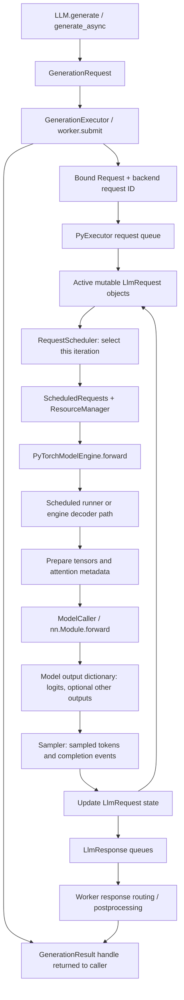
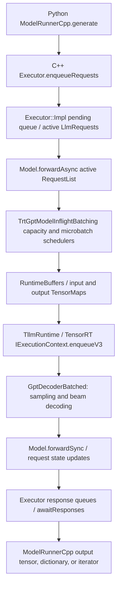

# TensorRT-LLM execution APIs: requests, scheduling, runners, and responses

## Source baseline and scope

This is a source audit, pinned to TensorRT-LLM commit **`cf5dc9f970e10751f0d8e5d4daa91b50d95f86bb`**, dated October 3, 2026. Links in the main sections refer to that revision. The audit follows implementation and call sites; it does not infer behavior from class names or represent a runtime benchmark.

There are two materially different API generations:

* **Current Python/PyTorch execution:** `GenerationExecutor` → `PyExecutor` → scheduler/resources → `PyTorchModelEngine` → model forward → sampler → responses. The new `ScheduledModelRunner` and `PackedModelRunner` interfaces are present, but decoder-only execution still uses methods on `PyTorchModelEngine`.
* **Historical TensorRT engine execution:** Python `runtime.ModelRunnerCpp` → C++ `executor::Executor` → `executor::Model` / `TrtGptModelInflightBatching` → TensorRT runtime and decoder. Section 8 documents this separately against **v0.20.0**, commit **`7965842954628b0b5456a2f7d59786d3dcd41647`**. The old public `Executor` class and Python runtime runner implementations are absent from the current source baseline; current `executor.h` still defines request/result/response payloads.

The central distinction is between **a submitted request**, **mutable execution state for that request**, **a scheduled batch**, **packed model tensors**, **model outputs**, and **a caller-visible result**. These are different objects with different lifetimes. [Current runner selection][runner-selection], [current executor payloads][payloads], [historical public executor][old-executor]

## 1. Current execution flow



This diagram describes ordinary scheduled generation. Packed encode-only execution enters `PyTorchModelEngine.forward(PackedInputs)` without the scheduled-request/resource-manager interface. Overlap, pipeline parallelism, speculative decoding, and disaggregated execution add staging and synchronization; the ordinary loop is the clearest place to read the core responsibilities. Compare `PyExecutor._executor_loop`, `_executor_loop_overlap` call sites in the same file, and the pipeline loop rather than assuming a single universal ordering. [Executor loops][pyexecutor], [engine dispatch][engine-forward]

## 2. Submission and caller-facing APIs

| API | Inputs → outputs | Responsibility and lifecycle |
|---|---|---|
| `LLM.generate` / `LLM.generate_async` | User prompt and generation options → completed results / a generation handle | User-facing preprocessing and delegation to the generation executor. Tokenization and text postprocessing belong above model forward. See `tensorrt_llm/llmapi/llm.py`. |
| `GenerationRequest` | Tokenized prompt, `SamplingParams`, streaming, adapters, multimodal/disaggregation/cache options | Submission description, distinct from the active backend `LlmRequest`. Referenced by the generation result while the request is tracked. |
| `GenerationExecutor.submit(request)` | `GenerationRequest` → `GenerationResult` | Abstract submission boundary. `generate_async` constructs a request and calls it; it is a regular method returning a handle, not itself an `async def` coroutine. `generate` submits individual prompts and waits for their handles. |
| `GenerationExecutorWorker` / `BaseWorker.submit` | Frontend request → handle plus an enqueued backend request | Starts the worker, assigns a client ID, registers the result, converts request options, enqueues work, and records client-ID → backend-ID mapping. The worker holds the engine and response thread. Shutdown joins/stops response processing and shuts down the engine. |
| `GenerationResult` | Incoming response updates → accumulated outputs, completion/error state | Caller-visible future and streaming iterator. `result(timeout)` blocks and returns itself; `aresult`/`__await__` await completion; synchronous/asynchronous iteration yields updates. It holds the request and a weak reference to the executor for abort, plus its response queue. |

Sources: [LLM methods][llm], [GenerationRequest][generation-request], [GenerationExecutor][generation-executor], [worker submission][worker-submit], [worker lifecycle][worker], [GenerationResult][generation-result].

### Exact submission path

1. `GenerationExecutor.generate_async` constructs `GenerationRequest` from token IDs and options, then calls `submit`.
2. `BaseWorker.submit` assigns the **client ID**, creates/registers a `GenerationResult`, and calls `_enqueue_request`.
3. `_enqueue_request` constructs the bound `tllm.Request`: `input_token_ids`, `max_tokens`, `streaming`, `sampling_config`, `end_id`, `output_config`, stop/bad words, optional LoRA, prompt tuning, encoder/multimodal/disaggregation and cache settings. Python extension fields carry additional backend state.
4. `PyExecutor.enqueue_request` delegates to `ExecutorRequestQueue.enqueue_request`. The queue allocates a **backend request ID**, adds a `RequestQueueItem`, and returns the ID. Enqueuing is not a model forward and does not wait for generated tokens.
5. The engine thread consumes queued work and creates/activates mutable `LlmRequest` execution state. A request can wait for admission/resources before it appears in a scheduled batch.

`ExecutorRequestQueue._enqueue_impl` holds a queue lock, checks shutdown/admission conditions, and retains the submitted object in its queue item. This path does not establish deep-copy semantics for every request tensor. Client IDs and backend IDs have separate purposes; worker cancellation resolves the mapping before calling `engine.cancel_request`. [Request conversion and submission][worker-submit], [queue implementation][request-queue], [PyExecutor entry points][pyexecutor-api], [active request representation][llm-request]

`GenerationExecutor.create` selects local worker, IPC, RPC, or Ray orchestration according to configuration. These are transport/process arrangements around execution, not additional GPU model-runner contracts. A client-side proxy need not own the actual model process. [Executor factory][executor-factory]

### Result consumption

`GenerationResult` maintains accumulated completion outputs. Its iterators return the **same mutable result handle** as responses arrive; code retaining earlier steps must make its own snapshot. Its async consumption methods require the async queue established when an event loop is present during initialization. Timeout semantics also differ by layer: `GenerationResult.result(timeout)` enforces a completion deadline, while backend `await_responses` waits for currently available response messages. [Result implementation][generation-result]

## 3. Executor, scheduling, and persistent resources

| Class/interface | Inputs → outputs | Responsibility / ownership |
|---|---|---|
| `PyExecutor` | Enqueued requests and cancellation commands → response messages keyed by request ID | Coordinates admission, scheduling, model execution, sampling, response delivery, and termination. Holds the model engine, scheduler, sampler, resource manager, queues, active requests, CUDA streams, and loop thread. |
| `LlmRequest` | Submission data plus evolving state → `create_response()` or no response yet | Mutable request state: context progress, generation tokens, sampling/output flags, slots, completion, and optional per-request tensors. Extends the bound internal batch-manager request. Lives across iterations; scheduled batches reference it. |
| `RequestScheduler.schedule_request` | Active requests plus in-flight IDs → `SchedulerOutput` | Chooses work that can advance under the applicable batch/token/cache constraints. Scheduling policy is selected by configuration, not by the runner. |
| `SchedulerOutput` | Scheduler decision → encoder/context/generation selections, paused/recompute requests and related admission information | Intermediate selection record. `PyExecutor._schedule` translates it into `ScheduledRequests`. |
| `ScheduledRequests` | Selected `LlmRequest` references → categorized batch for this step | Holds encoder requests, chunked context requests, final-context-chunk requests, generation requests, paused/recompute lists, and auxiliary state. It is not a tensor batch or a copy of all active requests. |
| `ResourceManager` | `ScheduledRequests` / an individual request → resource preparation, updates, release | Registry/coordinator for resource managers. Persistent managers own/manage KV cache, slots, and other execution resources. Passed explicitly to model execution. |
| `BaseResourceManager`, `KVCacheManager`, `KVCacheManagerV2`, `SlotManager` | Capacity queries, scheduled work, request termination → allocations/state changes | Allocate and retain state across forwards. Cache blocks and sequence slots are resources associated with request execution; their indices are not interchangeable with external request IDs. |

Sources: [PyExecutor][pyexecutor], [LlmRequest][llm-request], [scheduler contracts and policies][scheduler], [KV-cache v2 scheduler][scheduler-v2], [resource managers][resources].

### How a batch is formed

The ordinary loop calls `_prepare_and_schedule_batch`, then `_schedule`. Scheduler implementations include `SimpleScheduler` with capacity/microbatch collaborators, Python scheduling policies, and `KVCacheV2Scheduler`. Policy controls fitting, pausing, and recomputation behavior. The selected set can change every iteration as requests arrive, finish, become eligible, or exhaust resources. [Batch preparation][batch-preparation], [scheduling][schedule], [scheduler implementations][scheduler], [v2 scheduler][scheduler-v2]

`_schedule` groups context work by whether the current chunk is the last prompt chunk. `ScheduledRequests.all_requests()` means context plus generation requests; encoder requests are separately represented. Its `batch_size` counts decoder requests, not packed token rows, vocabulary rows, or beam-expanded sequences. Consequently:

* A frontend call with several prompts does not reserve a fixed GPU batch for their entire lifetime.
* A request may contribute only a prompt chunk to one iteration.
* A context chunk that is not final advances prefill state without yielding the next generated token.
* Final context chunks and generation work enter the next-token sampling path; beams/speculation can increase the amount of tensor work per request.

After scheduling, `resource_manager.prepare_resources(scheduled_batch)` prepares the resources for execution and can adjust the scheduled work. The runner consumes the resulting batch; it does not perform external request admission. [ScheduledRequests][scheduler], [ordinary executor loop][ordinary-loop]

### One ordinary iteration

The non-overlap loop makes the functional order explicit:

1. Fetch/admit work and schedule a batch.
2. Prepare resources and any encoder work.
3. `_forward_step` calls the model engine on the execution stream.
4. Apply guided-decoding constraints when configured, then `_sample_async`.
5. Advance context/generation state and apply sampled tokens with `_update_requests`.
6. Handle cancellation, build/enqueue responses, and terminate finished work when resource/transfer dependencies allow it.
7. Update remaining resource bookkeeping and iteration statistics.

Some operations move or overlap in the overlap/pipeline variants; do not interpret this list as a required device-wide synchronization after each step. [Ordinary loop][ordinary-loop], [forward and sampling helpers][forward-sample]

## 4. Model-engine and model-runner contracts

### Engine entry point

`ModelEngine` defines the executor-facing abstraction: sequence capacity, `forward`, and `warmup`. `PyTorchModelEngine` loads/holds the model and manages execution preparation, graphs, metadata, reusable buffers, and the selected runner. The concrete entry point is:

```python
PyTorchModelEngine.forward(
    batch: ScheduledRequests | PackedInputs,
    resource_manager: ResourceManager | None = None,
    new_tensors_device: SampleStateTensors | None = None,
    cache_indirection_buffer: torch.Tensor | None = None,
)
```

For scheduled work it builds `ScheduledInputs`, derives `gather_context_logits` from context requests, and passes speculation settings. For packed work it asserts a `PackedModelRunner` and dispatches directly. Scheduled execution requires a resource manager. The concrete implementation normally returns an output dictionary, but the transitional decoder path explicitly preserves a tensor return used by block-CUDA-graph body capture; a universal dictionary guarantee applies to the new runner interfaces, not every internal engine capture path. [ModelEngine and construction][engine], [forward dispatch][engine-forward]

### New runner interfaces

All of the following are defined in `tensorrt_llm/_torch/pyexecutor/engine/runners/interface.py`. [Runner contracts][runner-contracts]

| API/data type | Inputs and outputs | Ownership and lifetime |
|---|---|---|
| `ModelRunner` | `release_graphs()`; `wait_for_input_copy()` | Shared lifecycle interface. Before releasing graphs, the caller must stop execution and synchronize outstanding work. Input-copy waiting protects reuse of host staging storage. |
| `ScheduledModelRunner` | `warmup(resource_manager)`; `forward(inputs: ScheduledInputs, *, resource_manager, is_dummy=False) -> dict[str, Any]` | Executes an already scheduled batch against persistent resources. `is_dummy` identifies warmup/profiling calls. It does not return the client response or own frontend scheduling. |
| `PackedModelRunner` | `warmup()`; `forward(inputs: PackedInputs) -> dict[str, Any]` | Receives a batch already packed with its sequence boundaries and model-specific inputs. Its interface has no scheduler or resource-manager argument. |
| `ScheduledInputs` | `batch`, optional prior `new_tensors_device`, optional `cache_indirection_buffer`, `gather_context_logits`, `enable_spec_decode`, `runtime_draft_len` | Frozen record, but its batch/tensors are **borrowed** and their contents are not frozen. Keep them valid until GPU consumption finishes. |
| `PackedInputs` | Flat `input_ids: list[int]`, `sequence_lengths: list[int]`, optional `multi_item_part_lens`, `model_inputs: dict`, `gather_context_logits` | Token lists are referenced rather than copied. Callers must not mutate them in flight. `model_inputs` carries family-specific model inputs, not scheduling/lifecycle commands. |
| `PreparedInputs` | `kwargs: dict[str, Any]`, optional tensor `gather_ids` | Internal preparation result that wraps model keyword arguments and optional output-row selection. Not a submitted request or result. |
| `RunnerConfig` | Batch/token/sequence/beam limits, `without_logits`, attention backend and runtime features | Immutable runner settings, distinct from per-request sampling parameters. |

An output dictionary may contain `runtime_draft_len`. The scheduled engine wrapper removes that field and updates its own runtime draft length; omission preserves the input value. The input record itself is not mutated to report that update. [Forward dispatch][engine-forward]

### Which runner actually executes which model?

`resolve_runner_type` selects the following, in this order:

| Model/configuration | Selected implementation | Actual execution boundary |
|---|---|---|
| Encode-only, excluding multimodal encoder-only | `EncoderRunner` | `PackedModelRunner`; packs/prepares encoder inputs and executes encoder forward. |
| Multimodal encoder-only | `MultimodalEncoderRunner` | Scheduled no-KV-cache family through `NoKVCacheRunner`. |
| Non-generation model | `PoolingRunner` | Scheduled no-KV-cache family through `NoKVCacheRunner`. |
| Encoder-decoder model | `EncoderDecoderRunner` | Runner owns the encoder stage; decoder execution remains in the engine. |
| Ordinary decoder-only generation | No separate runner (`None`) | `PyTorchModelEngine._forward_scheduled` → `_forward_decoder`. |

This distinction follows both the resolver and the engine's `_fallback_to_engine` condition, which also includes `EncoderDecoderRunner`. A decoder-only request does **not** currently traverse an imagined `DecoderRunner.forward`. The shared runner interfaces describe an ongoing extraction of responsibilities from the engine. [Resolver][runner-selection], [engine initialization][engine], [engine fallback][engine-forward], [encoder runner][encoder-runner], [encoder-decoder runner][encdec-runner], [no-KV runner][no-kv-runner], [pooling runner][pooling-runner], [multimodal runner][mm-runner]

## 5. What the model receives and produces

There are three separate input boundaries: executor → engine (`ScheduledRequests`), engine → runner (`ScheduledInputs`, where a runner exists), and prepared tensors → loaded model (`kwargs`). A runner is not required to accept only raw token tensors; the scheduled contract deliberately accepts request state and runtime resources.

### Decoder tensor preparation

For ordinary decoder execution, read `PyTorchModelEngine._forward_decoder`, `_prepare_inputs`, and `_prepare_tp_inputs`. They construct the model arguments from context chunks, current decode tokens, beam/speculation state, and persistent cache metadata. [Decoder path][decoder-path], [tensor preparation][prepare-inputs]

| Prepared argument/state | Meaning |
|---|---|
| `input_ids` | Packed token tensor, using reusable CUDA input storage. Contains context chunks followed by generation work, with beam/speculative expansion and optional graph padding. Physical buffer length need not equal the number of logical requests. |
| `position_ids` | Position information for packed tokens; the standard path uses a leading position dimension, while multimodal rotary variants need different position data. |
| `attn_metadata` | Per-step sequence/context lengths, request IDs, prompt lengths, number of context sequences, cache state, backend-specific prepared metadata, and a reference to the cache manager. |
| `inputs_embeds`, `multimodal_params` | Optional alternative/model-family inputs. The ordinary prepared dictionary initializes `inputs_embeds` to `None`. |
| `resource_manager` | Access to persistent resources required by supported model paths. |
| Optional `lora_params`, `spec_metadata`, cross-attention and other family fields | Adapter, speculative, encoder-decoder, or multimodal requirements. They depend on the selected model and configuration. |
| `return_context_logits` | Passed at model call time to control whether context-token logits are retained rather than only next-token-relevant rows. |

Prior `SampleStateTensors.new_tokens` can supply decode input directly on device; the engine can avoid routing each next token through a host round trip. Cache indirection is relevant to beam decoding. `KVCacheParams` and attention metadata describe cached-token counts and cache-manager access. These are execution dependencies, not a new caller-provided KV tensor for every forward. [Preparation implementation][prepare-inputs], [engine forward helpers][model-call-site]

### The actual model call

`PyTorchModelEngine.model_forward` uses `ModelCaller`. `ModelCaller.__call__` establishes model execution context, including attention/speculation metadata and compilation/auxiliary-stream context, then calls the loaded `nn.Module.forward`. It retains the model and supporting execution objects; the attention metadata exposed through model extra attributes uses a weak reference. [ModelCaller][model-caller]

For a representative causal LM, `DecoderModelForCausalLM.forward` accepts `attn_metadata`, token/position IDs, optional embeddings, context-logit flag, speculation metadata, and LoRA parameters. It runs the decoder model to obtain hidden states and invokes the logits processor with the LM head. Model-family implementations can add or change outputs. [Causal LM forward][causal-lm]

Below this, `AttentionBackend.forward(q, k, v, metadata, forward_args, **kwargs)` consumes Q/K/V and prepared attention metadata. Persistent KV-cache access is mediated by the metadata/cache manager and the backend implementation. Ordinary model output is not a complete returned KV-cache object for the executor to replace after each step. [Attention interface][attention]

### Forward outputs and their interpretation

`PyTorchModelEngine._forward_step` normalizes a tensor model output to `{"logits": tensor}` and preserves dictionaries. It can gather selected logits rows; `without_logits` paths preserve their model-specific outputs. A sampling callback may execute at the tail of forward for graph capture, so the logical model/sampler boundary need not be two separate GPU launches. [Model call and output normalization][model-call-site]

For generation, logits are scores consumed by sampling. Their row count depends on packed context rows, requested context logits, decode sequences/beams, speculative tokens, and pipeline placement. **`[batch_size, vocab_size]` is not a universal forward-output shape.** Encoder/non-generation families can expose other tensors through their output dictionaries. Read a selected model family and runner before imposing additional shape/key guarantees. [Preparation][prepare-inputs], [causal LM][causal-lm], [encoder runner][encoder-runner], [runner contracts][runner-contracts]

The runner interfaces do not promise that every returned tensor is an independent, durable copy. Concrete implementations establish that property: for example, `EncoderRunner._execute_prepared` clones tensor outputs from its CUDA-graph execution before returning them. Request response construction separately copies selected streaming outputs for transport safety. Retaining a model-output dictionary and retaining a completed public response are therefore different ownership questions. [Encoder output handling][encoder-runner], [response construction][request-response]

## 6. Sampling and returning results

| API | Inputs → outputs | Lifecycle and execution role |
|---|---|---|
| `Sampler.sample_async` | `ScheduledRequests`, model-output dictionary, context-logit prefix sums, optional resources → `SampleState` | Converts logits into next-token decisions under request sampling settings. Asynchronous completion is represented explicitly. |
| `SampleStateTensors` | `new_tokens`, optional `log_probs` tensors | Device/host sample payload. Device tokens can feed the next iteration. |
| `SampleState` | Request references, device/host sample tensors, sampler event, runtime draft length | Keeps the sampling result associated with the requests and completion event needed to consume it safely. |
| `Sampler.update_requests` | `SampleState` and resources → mutations of active requests | Makes sampled tokens and completion state visible in request state. `TorchSampler.update_requests` synchronizes its sampler event before consuming the host-visible result. |
| `LlmRequest.create_response` | Current request state → optional `LlmResponse` | Builds result data when there is something to report. Wraps serialized bound result data and Python-side outputs. Streaming tensor/log-prob paths include copies to avoid mutation races during IPC. |
| `PyExecutor.await_responses` | Optional backend request ID(s), optional timeout → ready response list(s) | Drains backend response queues. No ID returns all ready messages; one ID returns that request's messages; a list returns one list per ID. The list-ID implementation applies the supplied timeout to each individual wait. |

Sources: [sampler contracts and implementation][sampler], [request response construction][request-response], [response waiting][pyexecutor-api].

`PyExecutor._sample_async` runs output handlers for requested logits/additional outputs and passes the batch to the sampler. `_update_request_states` advances context progress; `_update_requests` applies sampling results. Thus, the model's output dictionary is an intermediate result; response assembly needs request state and output policy as well. [Forward/sample helpers][forward-sample], [ordinary loop][ordinary-loop]

`_handle_responses` examines active requests and streaming/completion conditions, calls `create_response`, and passes messages to `_enqueue_responses`. The latter performs configured rank collection and appends responses to the backend-ID-indexed response map under a condition variable. `_await_any_response` drains available entries; `_await_single_response` waits for and removes one request's ready messages. Timeout can produce an empty list. Fatal executor errors are propagated through the waiting/error machinery. [Response construction and queues][response-handling]

The worker's response helper calls `engine.await_responses`, routes updates to the matching frontend result or transport queue, and cleans up completed tracking. Optional postprocessing converts token results into caller-facing text. `GenerationResult` consumes these updates and exposes completion outputs, log probabilities, finish reasons, and any requested extra outputs. Streaming messages can be incremental, while the handle accumulates state; do not assume every layer uses the same delta/cumulative representation. [Worker response routing][worker-responses], [result consumption][generation-result]

## 7. Ownership, synchronization, and shutdown

* **Executor lifetime:** the worker holds the engine; `PyExecutor` holds the execution collaborators and drives its loop thread. Initialization warms up the engine against the resource manager. These objects outlive individual batches. [Executor construction/lifecycle][pyexecutor], [worker][worker]
* **Request lifetime:** queue items retain submissions; active `LlmRequest` objects persist across iterations; scheduled batches and sample states reference those mutable objects. Completion messages are created before ordinary termination frees request resources. Disaggregated transfers can defer release beyond logical token completion. [Queue][request-queue], [termination][termination], [response handling][response-handling]
* **Resource lifetime:** cache/slot managers retain persistent state. `prepare_resources`, `update_resources`, and `free_resources` are distinct operations; forward completion alone is not request termination. [ResourceManager][resources]
* **Buffer lifetime:** runner `InputBuffers` contains reusable CUDA token/position storage and optional beam-indirection/gather/draft storage. The legacy decoder path has corresponding engine-owned storage. Stable addresses matter for captured graphs. A frozen input dataclass does not prevent another owner from changing a referenced list/tensor. [InputBuffers][input-buffers], [runner contracts][runner-contracts], [engine][engine]
* **GPU completion:** `PyExecutor._forward_step` establishes dependencies between the execution and default streams. A returned Python dictionary does not mean all device writes have completed on the CPU. Sampling events, stream waits, and input-copy synchronization establish when consumers or buffer reuse are safe. [Forward helper][forward-sample], [sampler][sampler], [runner lifecycle][runner-contracts]
* **Cancellation:** `cancel_request` queues a cancellation command; the execution loop processes it. Cancellation is not an immediate free of memory that an in-flight kernel may still use. [Queue cancellation][request-queue], [executor cancellation][pyexecutor-api]
* **Shutdown:** `PyExecutor.shutdown` signals shutdown, waits/joins its worker, tears down auxiliary components, releases graph references before resource-manager shutdown, and synchronizes CUDA as required. It deliberately avoids unconditional `model_engine.cleanup()` in this path because temporary executors are also used during initialization/capacity profiling; it drops its engine reference, while terminal engine cleanup handles model teardown. Runner `release_graphs` and full model cleanup are separate lifecycle actions. [Shutdown implementation][pyexecutor-api], [engine cleanup][engine-cleanup]

## 8. Historical C++ executor / TensorRT-engine path (v0.20.0 only)

This section is pinned separately because these familiar class names do not describe the current PyTorch runner hierarchy.



### Key public and internal interfaces

| API | Inputs → outputs | Responsibility / ownership and lifecycle |
|---|---|---|
| `executor::Request` | Token IDs, max output tokens, sampling/output configuration, streaming, optional model-specific inputs | Copyable/movable value-like request with a private implementation. Submission copies request data into pending work; this does not promise deep copies of externally backed tensor storage. |
| `executor::Executor` | Engine directory or serialized engine/configuration, or `shared_ptr<Model>`, plus executor configuration | Public asynchronous service. Owns an implementation through `unique_ptr`; noncopyable, movable. Supports `enqueueRequest(s)`, `awaitResponses`, `cancelRequest`, `shutdown`, and `canEnqueueRequests`. Distributed callers must respect which participant can enqueue. |
| `Executor::enqueueRequest(s)` | `Request const&` / vector of requests → ID / vector of IDs | Copies requests into pending `RequestWithId` entries and wakes execution machinery. Returned IDs identify submitted work, not generated outputs. |
| `Executor::awaitResponses` | Optional ID(s), timeout → `Response` vector(s) | Returns ready responses; the any-request overload does not promise request ordering. Streaming produces multiple messages per request. |
| `executor::Response` / `Result` | Request/client identity plus error or generated output | `Result` contains beam token IDs, final flags, optional log probabilities/logits/encoder output and finish metadata. `Response` carries an error or a result through its private implementation. |
| `executor::Model` | `forwardAsync(RequestList const&) -> void`; `forwardSync() -> void` | Internal execution abstraction receiving active mutable requests, not a flat tensor batch. It attempts to advance a fitting subset; output appears through updated request state. Also exposes capacity/resources/termination/statistics interfaces. |
| `TrtGptModelInflightBatching` | Active requests → scheduled TensorRT execution and decoding | Derives from `TrtGptModel`, implements scheduling, cache/slot preparation, TensorRT invocation, decoder invocation, and request-state updates. Its lifetime spans many executor iterations. |
| `RuntimeBuffers` | Scheduled requests and model/runtime configuration → named input/output tensor maps | Holds reusable tensor storage used by execution. Includes token IDs, context/sequence lengths, request types, logits, and applicable hidden-state/transformer buffers. |
| `runtime::TllmRuntime` | Bound named tensors and execution-context index → enqueue success | Owns TensorRT runtime, engine, execution contexts, stream/buffer-management infrastructure. `executeContext` launches `enqueueV3`; its boolean return is launch success, not token output or GPU completion. |
| `runtime::GptDecoderBatched` | `decoder_batch::Input const&`, `decoder_batch::Output&` → CUDA event from `forwardAsync` | Performs decoding/sampling/beam work and writes decoder output buffers. Completion is handled by the model's synchronization and request-update path. |

Sources: [public executor, Request/Result/Response][old-executor], [Executor::Impl][old-impl], [internal Model][old-model], [inflight model header][old-ifb-header], [inflight model implementation][old-ifb], [RuntimeBuffers][old-buffers], [TensorRT runtime][old-runtime], [decoder][old-decoder].

### Submission, batch formation, model inputs, and output delivery

`Executor::Impl::enqueueRequests` allocates IDs and copies requests into a mutex-protected pending queue. `fetchNewRequests` converts pending work to internal `LlmRequest` objects. The internal `RequestList` is a list of `shared_ptr<LlmRequest>`; copying a list does not copy all execution state. [Executor::Impl][old-impl], [batch-manager common types][old-common]

The execution loop coordinates `forwardSync`, response population, newly fetched requests, and `forwardAsync`. Crucially, `Executor::Impl::forwardAsync` passes the **active request list** to `mModel`; fitting and microbatch selection occur inside `TrtGptModelInflightBatching::forwardAsync`. Its capacity scheduler checks available resources, its microbatch scheduler selects context/generation work, and the model manages pausing, slots, KV allocations, and adapter resources before executing the selected work. [Execution loop and model delegation][old-impl], [model scheduling][old-ifb]

`executeBatch` dispatches context/generation work, fused or separated according to configuration. `executeStep` calls `prepareBuffers`, which populates runtime input/output maps, then executes the context or captured graph. This is where logical requests become TensorRT-engine bindings. `RuntimeBuffers` declares names such as `input_ids`, `last_token_ids`, `host_request_types`, `context_lengths`, `host_context_lengths`, `sequence_length`, and `logits`; additional transformer/cache bindings depend on engine configuration. TensorRT sees these tensors and addresses, not the original public `Request` object. [Inflight model execution][old-ifb], [buffer definitions][old-buffers]

`TllmRuntime::executeContext` calls `IExecutionContext::enqueueV3` on its stream. GPU work fills bound output storage, after which decoder work samples/selects tokens. `TrtGptModelInflightBatching::forwardSync`, decoder synchronization, and `updateRequests` make results visible in `LlmRequest`. `Executor::Impl::populateNewResponses` calls request response construction, enqueues messages, and removes completed active work while preserving references needed by outstanding transfers. The public caller obtains these messages with `awaitResponses`. [TensorRT launch][old-runtime], [decoding and updates][old-ifb], [response population][old-impl]

Ownership matters here too: `executor::Tensor::of` explicitly wraps external storage **without taking ownership**. Request copying is therefore not a general permission to destroy all buffers passed with a request; backing storage must satisfy its API's asynchronous lifetime. [Tensor ownership API][old-tensor]

The public C++ `shutdown()` is documented as blocking until requests terminate or its timeout is reached. `awaitResponses` consumes ready messages; calling the ID overload again after all responses were consumed can wait indefinitely without a timeout. The executor is a long-lived service, while individual response objects carry the returned result/error data. [Public lifecycle and wait contracts][old-executor]

### The two historical Python classes named “ModelRunner”

| Python class | Position in the stack | Input/output behavior |
|---|---|---|
| `runtime.ModelRunnerCpp` | Convenience wrapper **above** the C++ executor | `from_dir` constructs a bound `Executor` and stores it as `session`. `generate(batch_input_ids, ...)` constructs per-prompt requests and calls `session.enqueue_requests`. `_initialize_and_fill_output` awaits responses until each request is final, then assembles output tensors/dictionaries in caller batch order; `_stream` yields streaming results. |
| `runtime.ModelRunner` | Wrapper over `GenerationSession`, a separate direct runtime route | `generate` prepares the batch, calls `session.setup`, then `session.decode`, returning tensors/dictionaries or streaming output according to options. It is not the inflight C++ executor's internal model interface. |

Sources: [ModelRunnerCpp construction/generation/result assembly][old-python-cpp], [ModelRunner direct session execution][old-python-runner].

## 9. Boundary summary

| Boundary | Actual object crossing it | Where the next transformation occurs |
|---|---|---|
| Caller → generation executor | `GenerationRequest` | Worker converts options to bound backend `Request`. |
| Worker → current backend executor | Request + allocated backend ID | Queue consumption creates active `LlmRequest` state. |
| Current scheduler → engine | `ScheduledRequests` + resource manager + optional prior sample/beam tensors | Engine builds `ScheduledInputs` and dispatches runner or decoder fallback. |
| Current preparation → loaded model | Packed tensors and attention/model metadata in keyword arguments | Model computes hidden states/logits/other family outputs. |
| Current model → sampler | Output dictionary, ordinarily including logits | Sampler produces token decisions and an event-backed sample state. |
| Current execution state → caller | `LlmResponse` → routed `GenerationResult` updates | Worker/postprocessor/result handle assemble caller-visible outputs. |
| Historical C++ executor → internal model | `RequestList` of shared mutable requests | Inflight model performs scheduling and TensorRT tensor preparation internally. |
| Historical TensorRT runtime → internal decoder | Bound logits and other runtime buffers | Decoder selects tokens; request mutation and response queues return them to the caller. |

These boundaries explain why model-forward return values alone cannot describe the complete generation API: scheduling, persistent state, sampling, completion, and response assembly have their own interfaces and lifetimes.

## 10. Source navigation

Paths are relative to the TensorRT-LLM repository. Each link resolves to the audited commit and a relevant class/function.

| Current source file | Start with |
|---|---|
| [`tensorrt_llm/executor/executor.py`][generation-executor] | `GenerationExecutor.submit`, `generate_async`, `create` |
| [`tensorrt_llm/executor/base_worker.py`][worker-submit] | `BaseWorker._enqueue_request`, `submit`, `AwaitResponseHelper` |
| [`tensorrt_llm/executor/result.py`][generation-result] | `GenerationResult.result`, `aresult`, iteration |
| [`tensorrt_llm/_torch/pyexecutor/py_executor.py`][pyexecutor] | `PyExecutor._executor_loop`, `_schedule`, `_forward_step`, `_sample_async`, `_handle_responses` |
| [`tensorrt_llm/_torch/pyexecutor/scheduler/scheduler.py`][scheduler] | `ScheduledRequests`, `RequestScheduler`, `SimpleScheduler` |
| [`tensorrt_llm/_torch/pyexecutor/resource_manager.py`][resources] | `ResourceManager`, `BaseResourceManager`, `KVCacheManager`, `SlotManager` |
| [`tensorrt_llm/_torch/pyexecutor/model_engine.py`][engine-forward] | `ModelEngine`, `PyTorchModelEngine.forward`, `_forward_decoder`, `_prepare_tp_inputs` |
| [`tensorrt_llm/_torch/pyexecutor/engine/runners/interface.py`][runner-contracts] | `ScheduledInputs`, `PackedInputs`, `ScheduledModelRunner`, `PackedModelRunner` |
| [`tensorrt_llm/_torch/pyexecutor/engine/model_call.py`][model-caller] | `ModelCaller.__call__` |
| [`tensorrt_llm/_torch/pyexecutor/sampler/sampler.py`][sampler] | `Sampler`, `SampleState`, `TorchSampler.update_requests` |
| [`tensorrt_llm/_torch/pyexecutor/llm_request.py`][llm-request] | `LlmRequest.create_response`, `LlmResponse`, `LlmResult` |

| Historical v0.20.0 source file | Start with |
|---|---|
| [`cpp/include/tensorrt_llm/executor/executor.h`][old-executor] | `Executor`, `Request`, `Response`, `Result` |
| [`cpp/tensorrt_llm/executor/executorImpl.cpp`][old-impl] | `Executor::Impl::enqueueRequests`, `executionLoop`, `populateNewResponses` |
| [`cpp/tensorrt_llm/executor/model.h`][old-model] | `Model::forwardAsync`, `forwardSync` |
| [`cpp/tensorrt_llm/batch_manager/trtGptModelInflightBatching.cpp`][old-ifb] | `forwardAsync`, `prepareBuffers`, `executeStep`, `decoderStepAsync`, `updateRequests` |
| [`cpp/include/tensorrt_llm/batch_manager/runtimeBuffers.h`][old-buffers] | `RuntimeBuffers` and tensor binding names |
| [`cpp/tensorrt_llm/runtime/tllmRuntime.cpp`][old-runtime] | `TllmRuntime::executeContext` |
| [`tensorrt_llm/runtime/model_runner_cpp.py`][old-python-cpp] | `ModelRunnerCpp.generate`, `_initialize_and_fill_output`, `_stream` |
| [`tensorrt_llm/runtime/model_runner.py`][old-python-runner] | `ModelRunner.generate` and direct session calls |

<!-- Pinned source references. C = current audit; H = historical v0.20.0. -->

[runner-selection]: https://github.com/NVIDIA/TensorRT-LLM/blob/cf5dc9f970e10751f0d8e5d4daa91b50d95f86bb/tensorrt_llm/_torch/pyexecutor/engine/runners/__init__.py#L47
[payloads]: https://github.com/NVIDIA/TensorRT-LLM/blob/cf5dc9f970e10751f0d8e5d4daa91b50d95f86bb/cpp/include/tensorrt_llm/executor/executor.h#L596
[pyexecutor]: https://github.com/NVIDIA/TensorRT-LLM/blob/cf5dc9f970e10751f0d8e5d4daa91b50d95f86bb/tensorrt_llm/_torch/pyexecutor/py_executor.py#L394
[engine-forward]: https://github.com/NVIDIA/TensorRT-LLM/blob/cf5dc9f970e10751f0d8e5d4daa91b50d95f86bb/tensorrt_llm/_torch/pyexecutor/model_engine.py#L6051
[llm]: https://github.com/NVIDIA/TensorRT-LLM/blob/cf5dc9f970e10751f0d8e5d4daa91b50d95f86bb/tensorrt_llm/llmapi/llm.py#L660
[generation-request]: https://github.com/NVIDIA/TensorRT-LLM/blob/cf5dc9f970e10751f0d8e5d4daa91b50d95f86bb/tensorrt_llm/executor/request.py#L92
[generation-executor]: https://github.com/NVIDIA/TensorRT-LLM/blob/cf5dc9f970e10751f0d8e5d4daa91b50d95f86bb/tensorrt_llm/executor/executor.py#L82
[worker-submit]: https://github.com/NVIDIA/TensorRT-LLM/blob/cf5dc9f970e10751f0d8e5d4daa91b50d95f86bb/tensorrt_llm/executor/base_worker.py#L342
[worker]: https://github.com/NVIDIA/TensorRT-LLM/blob/cf5dc9f970e10751f0d8e5d4daa91b50d95f86bb/tensorrt_llm/executor/worker.py#L48
[generation-result]: https://github.com/NVIDIA/TensorRT-LLM/blob/cf5dc9f970e10751f0d8e5d4daa91b50d95f86bb/tensorrt_llm/executor/result.py#L1074
[request-queue]: https://github.com/NVIDIA/TensorRT-LLM/blob/cf5dc9f970e10751f0d8e5d4daa91b50d95f86bb/tensorrt_llm/_torch/pyexecutor/executor_request_queue.py#L86
[pyexecutor-api]: https://github.com/NVIDIA/TensorRT-LLM/blob/cf5dc9f970e10751f0d8e5d4daa91b50d95f86bb/tensorrt_llm/_torch/pyexecutor/py_executor.py#L1725
[llm-request]: https://github.com/NVIDIA/TensorRT-LLM/blob/cf5dc9f970e10751f0d8e5d4daa91b50d95f86bb/tensorrt_llm/_torch/pyexecutor/llm_request.py#L896
[executor-factory]: https://github.com/NVIDIA/TensorRT-LLM/blob/cf5dc9f970e10751f0d8e5d4daa91b50d95f86bb/tensorrt_llm/executor/executor.py#L559
[scheduler]: https://github.com/NVIDIA/TensorRT-LLM/blob/cf5dc9f970e10751f0d8e5d4daa91b50d95f86bb/tensorrt_llm/_torch/pyexecutor/scheduler/scheduler.py#L184
[scheduler-v2]: https://github.com/NVIDIA/TensorRT-LLM/blob/cf5dc9f970e10751f0d8e5d4daa91b50d95f86bb/tensorrt_llm/_torch/pyexecutor/scheduler/scheduler_v2.py#L150
[resources]: https://github.com/NVIDIA/TensorRT-LLM/blob/cf5dc9f970e10751f0d8e5d4daa91b50d95f86bb/tensorrt_llm/_torch/pyexecutor/resource_manager.py#L2964
[batch-preparation]: https://github.com/NVIDIA/TensorRT-LLM/blob/cf5dc9f970e10751f0d8e5d4daa91b50d95f86bb/tensorrt_llm/_torch/pyexecutor/py_executor.py#L3925
[schedule]: https://github.com/NVIDIA/TensorRT-LLM/blob/cf5dc9f970e10751f0d8e5d4daa91b50d95f86bb/tensorrt_llm/_torch/pyexecutor/py_executor.py#L6618
[ordinary-loop]: https://github.com/NVIDIA/TensorRT-LLM/blob/cf5dc9f970e10751f0d8e5d4daa91b50d95f86bb/tensorrt_llm/_torch/pyexecutor/py_executor.py#L4439
[forward-sample]: https://github.com/NVIDIA/TensorRT-LLM/blob/cf5dc9f970e10751f0d8e5d4daa91b50d95f86bb/tensorrt_llm/_torch/pyexecutor/py_executor.py#L7727
[engine]: https://github.com/NVIDIA/TensorRT-LLM/blob/cf5dc9f970e10751f0d8e5d4daa91b50d95f86bb/tensorrt_llm/_torch/pyexecutor/model_engine.py#L245
[runner-contracts]: https://github.com/NVIDIA/TensorRT-LLM/blob/cf5dc9f970e10751f0d8e5d4daa91b50d95f86bb/tensorrt_llm/_torch/pyexecutor/engine/runners/interface.py#L26
[encoder-runner]: https://github.com/NVIDIA/TensorRT-LLM/blob/cf5dc9f970e10751f0d8e5d4daa91b50d95f86bb/tensorrt_llm/_torch/pyexecutor/engine/runners/encoder.py#L560
[encdec-runner]: https://github.com/NVIDIA/TensorRT-LLM/blob/cf5dc9f970e10751f0d8e5d4daa91b50d95f86bb/tensorrt_llm/_torch/pyexecutor/engine/runners/encoder_decoder.py#L40
[no-kv-runner]: https://github.com/NVIDIA/TensorRT-LLM/blob/cf5dc9f970e10751f0d8e5d4daa91b50d95f86bb/tensorrt_llm/_torch/pyexecutor/engine/runners/no_kv_cache.py#L61
[pooling-runner]: https://github.com/NVIDIA/TensorRT-LLM/blob/cf5dc9f970e10751f0d8e5d4daa91b50d95f86bb/tensorrt_llm/_torch/pyexecutor/engine/runners/pooling.py#L21
[mm-runner]: https://github.com/NVIDIA/TensorRT-LLM/blob/cf5dc9f970e10751f0d8e5d4daa91b50d95f86bb/tensorrt_llm/_torch/pyexecutor/engine/runners/mm_encoder.py#L18
[decoder-path]: https://github.com/NVIDIA/TensorRT-LLM/blob/cf5dc9f970e10751f0d8e5d4daa91b50d95f86bb/tensorrt_llm/_torch/pyexecutor/model_engine.py#L6111
[prepare-inputs]: https://github.com/NVIDIA/TensorRT-LLM/blob/cf5dc9f970e10751f0d8e5d4daa91b50d95f86bb/tensorrt_llm/_torch/pyexecutor/model_engine.py#L4766
[model-call-site]: https://github.com/NVIDIA/TensorRT-LLM/blob/cf5dc9f970e10751f0d8e5d4daa91b50d95f86bb/tensorrt_llm/_torch/pyexecutor/model_engine.py#L6370
[model-caller]: https://github.com/NVIDIA/TensorRT-LLM/blob/cf5dc9f970e10751f0d8e5d4daa91b50d95f86bb/tensorrt_llm/_torch/pyexecutor/engine/model_call.py#L26
[causal-lm]: https://github.com/NVIDIA/TensorRT-LLM/blob/cf5dc9f970e10751f0d8e5d4daa91b50d95f86bb/tensorrt_llm/_torch/models/modeling_utils.py#L486
[attention]: https://github.com/NVIDIA/TensorRT-LLM/blob/cf5dc9f970e10751f0d8e5d4daa91b50d95f86bb/tensorrt_llm/_torch/attention/backends/interface.py#L1013
[sampler]: https://github.com/NVIDIA/TensorRT-LLM/blob/cf5dc9f970e10751f0d8e5d4daa91b50d95f86bb/tensorrt_llm/_torch/pyexecutor/sampler/sampler.py#L124
[request-response]: https://github.com/NVIDIA/TensorRT-LLM/blob/cf5dc9f970e10751f0d8e5d4daa91b50d95f86bb/tensorrt_llm/_torch/pyexecutor/llm_request.py#L1215
[response-handling]: https://github.com/NVIDIA/TensorRT-LLM/blob/cf5dc9f970e10751f0d8e5d4daa91b50d95f86bb/tensorrt_llm/_torch/pyexecutor/py_executor.py#L8330
[worker-responses]: https://github.com/NVIDIA/TensorRT-LLM/blob/cf5dc9f970e10751f0d8e5d4daa91b50d95f86bb/tensorrt_llm/executor/base_worker.py#L1211
[termination]: https://github.com/NVIDIA/TensorRT-LLM/blob/cf5dc9f970e10751f0d8e5d4daa91b50d95f86bb/tensorrt_llm/_torch/pyexecutor/py_executor.py#L8197
[input-buffers]: https://github.com/NVIDIA/TensorRT-LLM/blob/cf5dc9f970e10751f0d8e5d4daa91b50d95f86bb/tensorrt_llm/_torch/pyexecutor/engine/input_buffers.py#L12
[engine-cleanup]: https://github.com/NVIDIA/TensorRT-LLM/blob/cf5dc9f970e10751f0d8e5d4daa91b50d95f86bb/tensorrt_llm/_torch/pyexecutor/model_engine.py#L3738
[old-executor]: https://github.com/NVIDIA/TensorRT-LLM/blob/7965842954628b0b5456a2f7d59786d3dcd41647/cpp/include/tensorrt_llm/executor/executor.h#L1404
[old-impl]: https://github.com/NVIDIA/TensorRT-LLM/blob/7965842954628b0b5456a2f7d59786d3dcd41647/cpp/tensorrt_llm/executor/executorImpl.cpp#L858
[old-model]: https://github.com/NVIDIA/TensorRT-LLM/blob/7965842954628b0b5456a2f7d59786d3dcd41647/cpp/tensorrt_llm/executor/model.h#L31
[old-ifb-header]: https://github.com/NVIDIA/TensorRT-LLM/blob/7965842954628b0b5456a2f7d59786d3dcd41647/cpp/tensorrt_llm/batch_manager/trtGptModelInflightBatching.h#L99
[old-ifb]: https://github.com/NVIDIA/TensorRT-LLM/blob/7965842954628b0b5456a2f7d59786d3dcd41647/cpp/tensorrt_llm/batch_manager/trtGptModelInflightBatching.cpp#L914
[old-buffers]: https://github.com/NVIDIA/TensorRT-LLM/blob/7965842954628b0b5456a2f7d59786d3dcd41647/cpp/include/tensorrt_llm/batch_manager/runtimeBuffers.h#L58
[old-runtime]: https://github.com/NVIDIA/TensorRT-LLM/blob/7965842954628b0b5456a2f7d59786d3dcd41647/cpp/tensorrt_llm/runtime/tllmRuntime.cpp#L491
[old-decoder]: https://github.com/NVIDIA/TensorRT-LLM/blob/7965842954628b0b5456a2f7d59786d3dcd41647/cpp/include/tensorrt_llm/runtime/gptDecoderBatched.h#L40
[old-common]: https://github.com/NVIDIA/TensorRT-LLM/blob/7965842954628b0b5456a2f7d59786d3dcd41647/cpp/include/tensorrt_llm/batch_manager/common.h#L36
[old-tensor]: https://github.com/NVIDIA/TensorRT-LLM/blob/7965842954628b0b5456a2f7d59786d3dcd41647/cpp/include/tensorrt_llm/executor/tensor.h#L71
[old-python-cpp]: https://github.com/NVIDIA/TensorRT-LLM/blob/7965842954628b0b5456a2f7d59786d3dcd41647/tensorrt_llm/runtime/model_runner_cpp.py#L62
[old-python-runner]: https://github.com/NVIDIA/TensorRT-LLM/blob/7965842954628b0b5456a2f7d59786d3dcd41647/tensorrt_llm/runtime/model_runner.py#L515
