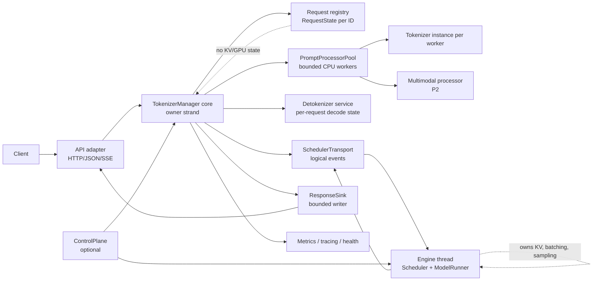
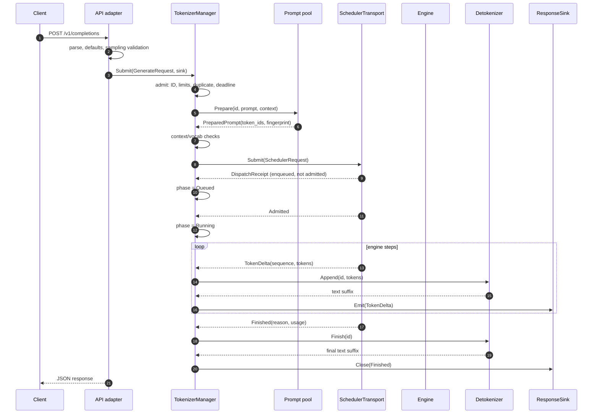
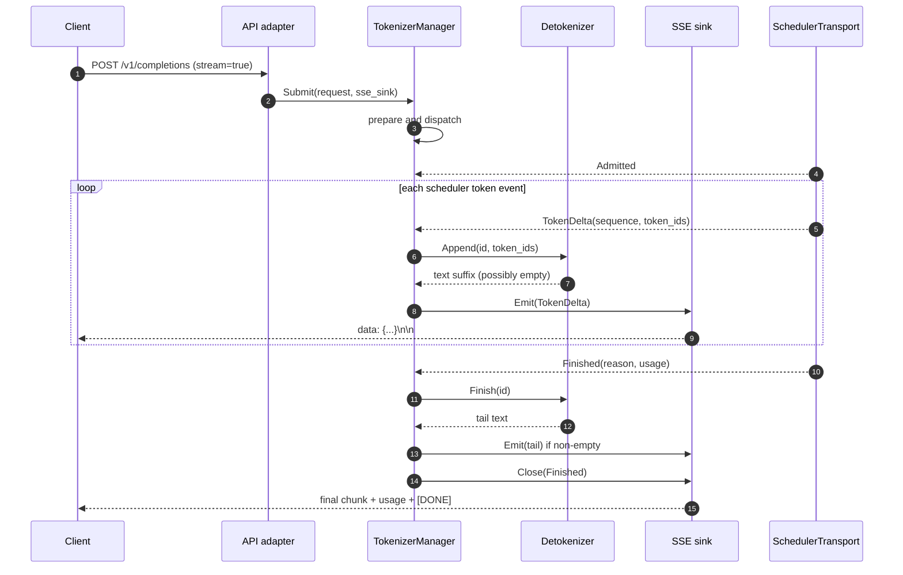
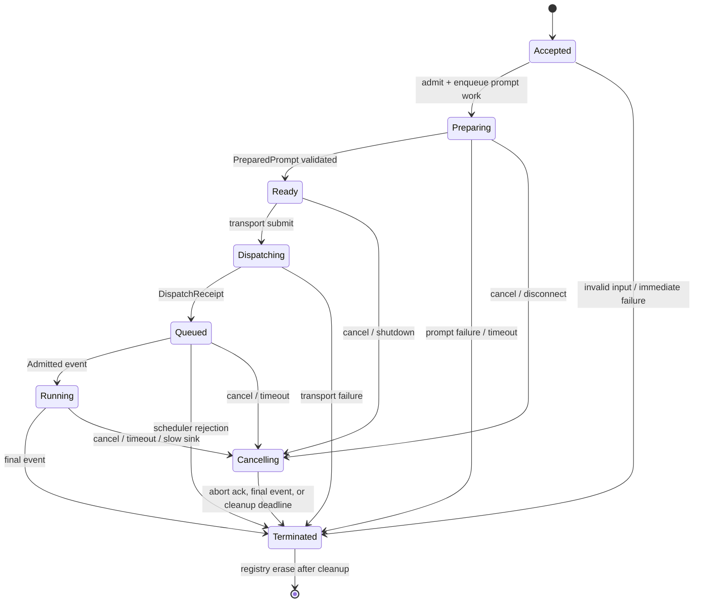

# Production-Grade Modern C++ TokenizerManager for InferX

| | |
|---|---|
| Status | Proposed design, ready for implementation review |
| Inspection date | 2026-10-20 |
| Upstream reference | `sgl-project/sglang` `main` at commit `15e8e687dbd7d3c252595bdb3140e89af21c9eb6` |
| Target repository | InferX (`/home/gc/InferX`), C++23, Boost.Asio/Beast, Abseil Status, `tokenizers-cpp` |
| Primary deliverable | This document plus the interface proposal in Section 8 |
| Implementation status | Design only. No production code was added and no tests were run for this document. |

## 0. Evidence and terminology

This document deliberately separates four kinds of claims:

- **[S] Verified SGLang source** - observed in the pinned upstream source listed in Section 15. Line numbers are from that commit and may drift.
- **[R] Verified InferX repository** - observed in the local checkout on the inspection date.
- **[D] Proposed C++ design** - an architectural choice for InferX, not a claim about SGLang.
- **[A] Assumption / open question** - depends on a target deployment or repository decision. See Section 14.

The SGLang source was browsed as raw files at the pinned commit; there was no local SGLang checkout to execute. No SGLang or InferX inference tests were run for this design. The design therefore distinguishes source-backed behavior from inferred intent.

Workflow followed: inspect repository structure/build/async/test conventions; inspect the SGLang manager, request, scheduler, detokenizer, output, batch, LoRA/session, and shutdown paths; record assumptions; choose component ownership and concurrency; review cancellation/lifetime/wire/shutdown; then write this document. Implementation is intentionally deferred to the staged plan in Section 13.

The repository uses `inferx::Status`/`StatusOr` (Abseil), `inferx::RequestId = std::uint64_t`, `inferx::TokenId = int`, Boost.Asio awaitables, and C++23. The proposal uses those conventions rather than introducing a competing error, ID, or coroutine system. Folly is vendored as a submodule, but it is not linked by the current build (Section 9.3).

---

## 1. Executive summary

### 1.1 The central decision

The C++ `TokenizerManager` is a **request-facing coordination layer**, not a second scheduler and not a GPU worker:

1. The API adapter parses protocol-specific JSON into a normalized internal `GenerateRequest`.
2. `TokenizerManager` owns admission, request identity, per-request frontend state, prompt preparation orchestration, dispatch, cancellation, output aggregation, and exactly-once terminal delivery.
3. A bounded prompt-worker pool performs tokenization, chat-template rendering, and (in a later phase) multimodal preprocessing. It has no access to the scheduler or request registry.
4. A scheduler transport carries token-ID requests and token-level events to and from the existing engine thread. The engine remains the sole owner of scheduling, KV cache, sampling state, and GPU execution.
5. A detokenizer service owns per-request incremental decode state. It emits text deltas, never full-prefix duplicates.
6. A response sink is the only boundary through which a client learns about deltas and completion. It is non-blocking and bounded; a slow client cannot stall the manager's state loop.

This preserves SGLang's important lifecycle behavior while removing Python-specific implementation details: the manager still correlates one `rid` with one request state, streams per-step outputs, aborts by ID, aggregates batch children independently, and removes state only after terminal delivery. It does not copy SGLang's process layout, Python futures, unbounded queues, or object-shaped IPC.

### 1.2 What changes in InferX

The current InferX serving path is a useful baseline:

- `InferxDispatcher::HandleCompletions` parses a completions request, calls `TokenizerPool::Prepare` directly, submits token IDs to `EngineGateway`, and consumes `CompletionEvent`s (`src/server/serve.cc:134-163`).
- `EngineGateway` owns the engine thread, a scheduler, and a per-request `EventQueue`. It performs full re-decode on the engine thread (`src/server/engine_gateway.cc:221`, `:258`).
- `TokenizerPool` already provides bounded prompt admission, cancellation, deadlines, and drain semantics (`include/inferx/tokenizer/tokenizer_pool.h:51-94`).
- The repository has no `TokenizerManager`, no chat route, no multimodal runtime, no logprobs response path, and no stop-string implementation in the scheduler (it validates stop token IDs but the scheduler's finish checks only EOS/stop-token IDs; see `src/engine/scheduler.cc` and `include/inferx/sampling/sampling_params.h`).

The proposal keeps the good pieces (the bounded tokenizer pool, the engine thread, the coroutine HTTP front end) and inserts a manager-owned request model and lifecycle between them. It moves detokenization off the engine thread and makes output delivery explicit and bounded.

### 1.3 Key design decisions

| Decision | Choice | Why |
|---|---|---|
| API normalization | In the API adapter, not the core manager | Protocol-specific JSON and OpenAI defaults should not leak into the engine-facing manager. The manager still revalidates its own invariants because it can be called by non-HTTP front ends. |
| State owner | One Asio strand owned by `TokenizerManager` | Request registry and lifecycle are single-owner data. This avoids a registry lock around every token and makes terminal election race-free. |
| Request state | Frontend-only `RequestState`, owned by the registry | Scheduler/KV/GPU state stays in the engine. The manager keeps only what is needed to admit, correlate, deliver, and cancel. |
| Prompt work | Bounded worker pool, one tokenizer/processor instance per worker | The FFI tokenizer is not assumed thread-safe; per-worker ownership avoids a lock around encode and matches the existing `TokenizerPool`. |
| Scheduler boundary | `SchedulerTransport` with versioned logical events | The current in-process gateway can be adapted; a future process split does not serialize C++ layout or pointers. |
| Detokenization | Separate per-request `Detokenizer` service, incremental suffix output | Decoding on the engine thread couples GPU scheduling to CPU text work and makes full re-decode quadratic. |
| Output delivery | `ResponseSink` with bounded buffers and exactly-once `Close` | Deltas, terminal states, slow consumers, and disconnects need different policies; a single unbounded event queue is not sufficient. |
| IDs | Keep `uint64_t RequestId` at the engine boundary; optional client string ID | Avoids churn in `Request`, `Scheduler`, and `EngineGateway`, while still supporting correlation and duplicate detection. |
| Cancellation | Two-phase: client terminal election plus scheduler cleanup | The client must not wait for GPU cleanup, but the registry cannot drop the ID before late scheduler events are harmless. |
| Async runtime | Boost.Asio awaitables in v1 | The repository already uses Asio/Beast; Folly is not integrated. Folly mappings are shown in Section 9.3 for a future decision. |

### 1.4 Priority summary

P0 is the minimum production path for the current text-completions server. P1 adds parity and operational completeness. P2 depends on engine or deployment capabilities that do not exist in the current tree.

- **P0:** text and pre-tokenized token IDs, sampling validation, tokenization, request registry/lifecycle, dispatch, streaming and non-streaming delivery, cancellation/disconnect, timeouts, bounded admission, usage counts, health, startup, shutdown, basic metrics.
- **P1:** chat templates, stop strings, logprobs, batch encode optimization, pause/resume admission, tracing.
- **P2:** multimodal preprocessing, structured output/grammar, LoRA serving, sessions, cache/profile/weight-update control RPCs, multi-worker frontend sharding, transport reconnection.

Detailed classification and rationale are in Section 3.

---

## 2. SGLang behavior map

### 2.1 Source basis

The inspected upstream revision is `15e8e687dbd7d3c252595bdb3140e89af21c9eb6` on `main`. The main files examined were:

- `python/sglang/srt/managers/tokenizer_manager.py`
- `python/sglang/srt/managers/io_struct.py`
- `python/sglang/srt/managers/detokenizer_manager.py`
- `python/sglang/srt/managers/scheduler.py`
- `python/sglang/srt/managers/schedule_batch.py`
- `python/sglang/srt/managers/scheduler_components/output_streamer.py`
- `python/sglang/srt/managers/multi_tokenizer_mixin.py`
- `python/sglang/srt/managers/async_dynamic_batch_tokenizer.py`
- `python/sglang/srt/sampling/sampling_params.py`
- `python/sglang/srt/entrypoints/engine.py`, `http_server.py`, and the OpenAI serving files.

The repository's own implementation was read in `include/inferx/...` and `src/...`, especially the tokenizer, server, engine, and scheduler components. The `docs/tokenizer_process_pool.md` note was also inspected.

### 2.2 Responsibilities and ownership

| SGLang component | What it actually does | Owner of the responsibility | Evidence |
|---|---|---|---|
| OpenAI/completions serving | Parses protocol requests, applies chat rendering/templates, builds `GenerateReqInput`, and streams HTTP/SSE responses. | API/frontend process | `serving_chat.py` builds `GenerateReqInput` with `image_data`, `video_data`, `audio_data`, `sampling_params`, and `stream` at lines 1306-1318; chat prompt IDs are built around lines 1166-1190 and 1543-1818. |
| `GenerateReqInput` normalization | Expands batch/n, normalizes modality arrays, sampling fields, request IDs, LoRA paths, sessions, and logprob fields. It validates the all-empty/all-three input shape. | Request object, invoked by the manager | `io_struct.py:177-405`; `normalize_batch_and_arguments` at `406-958`; `_validate_inputs` at `444-458`. |
| `TokenizerManager` | Keeps `rid_to_state`, validates prompt length and request features, tokenizes/preprocesses, dispatches tokenized requests, aggregates outputs, handles aborts, and removes state. | Frontend manager | `tokenizer_manager.py:267-361` (`ReqState`), `910-984` (`generate_request`), `1111-1291` (`_tokenize_one_request`), `1322-1451` (`_validate_one_request`), `1545-1676` (`_create_tokenized_object`), `1781-1813` (`_send_one_request`), `2253-2278` (`abort_request`), `2477-2491` (`handle_loop`), `2492-2810` (`_handle_batch_output`). |
| Tokenizer and multimodal processor | Encodes text, applies model-specific multimodal processing, and produces token IDs/processor outputs. | Manager process in single-worker mode; tokenizer worker process in multi-worker mode | `init_tokenizer_and_processor` at `tokenizer_manager.py:607-661`; `_tokenize_one_request` at `1111-1291`; `_create_tokenized_object` at `1545-1676`. |
| Scheduler IPC | Sends typed tokenized requests over ZeroMQ; receives typed outputs/control messages. | Manager to scheduler | `init_ipc_channels` at `tokenizer_manager.py:675-695`; `io_struct.py` defines typed messages and `msgpack_encode/decode` around `2710-2728`. |
| Scheduler | Owns batching, KV allocation, request state, sampling, finish checks, and resource cleanup. It receives token-level requests, not text. | Engine/scheduler process | `scheduler.py:442` class; generate handling at `2870-3265`; abort at `5548-5690`; queue/timeout limits at `3487-3587`. |
| `SchedulerOutputStreamer` | Converts finish state and generated tokens into batched `BatchTokenIDOutput`, including incremental-decode offsets. | Scheduler-side output stage | `scheduler_components/output_streamer.py:51-133`, `_GenerationStreamAccumulator` at `322-778`, especially `accept` at `425-520` and `to_payload` at `695-778`. |
| `DetokenizerManager` | Owns per-request incremental decode state, decodes token-ID batches, trims stop strings/tokens, and forwards `BatchStrOutput`. | Separate detokenizer process (or worker) | `detokenizer_manager.py:76-101` (`DecodeStatus`), `190-221` (`trim_matched_stop`), `304-424` (`_decode_batch_token_id_output`), `526-537` (`LimitedCapacityDict`). |
| Abort path | Manager sends `AbortReq` by rid. Scheduler removes waiting requests directly, marks running requests to finish after a step, and sends an abort result. Manager deletes state when the abort result arrives. | Manager + scheduler, with a shared rid | `tokenizer_manager.py:2253-2278`, `3589-3656`; `scheduler.py:5548-5690`; `io_struct.py:2283-2296`. |
| Batch path | A batch is a list of independent tokenized requests with per-child rids. The manager sets up one response generator/state per child. | Manager | `tokenizer_manager.py:2086-2208`; `BatchTokenizedGenerateReqInput` at `io_struct.py:1188-1201`. |
| LoRA/session/control | Manager resolves LoRA references, opens/closes sessions, and forwards typed control RPCs; scheduler owns adapter and session execution state. | Split frontend/control and engine | LoRA resolution at `tokenizer_manager.py:3735-3809`; session handling around `3716-3734`; scheduler control methods at `scheduler.py:5921-6040`; `SessionParams` at `io_struct.py:135-151`. |
| Shutdown | SIGTERM sets a graceful-exit state, waits for `rid_to_state` to drain, asks schedulers to shut down, then terminates children. | Manager + launcher/watchdog | `sigterm_watchdog` at `tokenizer_manager.py:3520-3584`; launcher setup in `entrypoints/engine.py:1035-1090` and around `2928-3035`. |
| Multi-worker frontend | Multiple HTTP workers each run a `TokenizerWorker`; a router forwards prepared requests to the scheduler and routes outputs back to the originating worker. A detokenizer router pins request state by worker/rid hash. | Frontend launcher/router | `multi_tokenizer_mixin.py:592-717` (`MultiTokenizerRouter`), `718-801` (`MultiDetokenizerRouter`), `828-912` (`TokenizerWorker`). |

One important nuance: SGLang's optional `AsyncDynamicbatchTokenizer` uses a single-thread executor and an `asyncio.Queue` to batch single-string encodes (`async_dynamic_batch_tokenizer.py:17-164`). That queue has no capacity in the inspected implementation. It is a throughput optimization, not process isolation and not a complete admission policy. The C++ design may add batch encode as P1, but it must keep the manager's bounded admission and per-item failure semantics.

### 2.3 Data crossing each boundary

| Boundary | SGLang data | C++ equivalent |
|---|---|---|
| HTTP/API to manager | Protocol JSON -> `GenerateReqInput` with text or input IDs, modality arrays, sampling, stream flag, LoRA/session selectors. | API adapter -> `server::GenerateRequest`; no JSON in the manager. |
| Manager to tokenizer/processor | Text/input IDs/media + tokenizer options; manager state is not passed into the tokenizer. | `PromptProcessorPool::Prepare(RequestId, PromptInput, PrepareContext)`. |
| Manager to scheduler | `TokenizedGenerateReqInput`: input text/IDs, processed multimodal data, sampling params, stream, rid, LoRA/session/control fields. | `SchedulerRequest`: request id, token IDs, sampling, cache salt, optional token-level fields. |
| Scheduler to detokenizer | `BatchTokenIDOutput`: rids, finish reasons, decoded-text seed, decode IDs, read offsets, output IDs, token counts, logprobs. | `SchedulerEvent` token deltas + terminal event, then `Detokenizer::Append/Finish`. |
| Detokenizer to manager | `BatchStrOutput`: text deltas, output IDs, metadata, usage/logprobs. | `DecodeDelta` (text suffix), manager emits `TokenDelta` to the sink. |
| Manager to HTTP | Python dicts / SSE chunks. | `ResponseSink` events; HTTP sink owns SSE framing and socket writes. |
| Control | Typed RPC objects over IPC. | Optional `ControlPlane::Call` with correlation IDs and deadlines; not in the token hot path. |

### 2.4 Behavior that must be preserved

1. **One live request state per request ID.** SGLang stores `rid_to_state` and rejects duplicate rids within a request (`tokenizer_manager.py:3810-3860`; `io_struct.py:390-398`).
2. **Token IDs are the engine boundary.** The scheduler never needs raw text or Python media objects; text decoding is downstream.
3. **Per-step incremental output.** SGLang's detokenizer tracks surrounding/read offsets and returns only the new suffix (`detokenizer_manager.py:76-101`, `304-424`).
4. **Exactly one terminal result per client request.** Normal completion, scheduler abort, queue rejection, and client disconnect all converge on one output/exception path.
5. **Abort is by request ID and is idempotent.** Late or duplicate abort results are ignored if the state is already gone (`tokenizer_manager.py:3589-3610`).
6. **Batch children are independent.** A batch is not one scheduler request state; each child has its own rid and output generator.
7. **Token and text accounting are distinct.** Empty text does not mean zero generated tokens; `completion_tokens` comes from token counts.
8. **Prompt limits are checked after tokenization.** SGLang adds reserved tokens and compares prompt plus requested output against context (`tokenizer_manager.py:1322-1451`).
9. **Readiness is explicit.** SGLang has a starting/up/unhealthy server state and a startup gate (`tokenizer_manager.py:707-733`, `RunServe`-equivalent startup code).
10. **Shutdown drains request state before killing children.** Current InferX already separates `RequestStop` from `Shutdown` in `EngineGateway` and drains through `WaitDrained`; the manager should preserve that pattern.
11. **Pre-dispatch failure cleanup is distinct from post-dispatch cleanup.** SGLang removes undelivered states locally but aborts dispatched requests and retains their state until the scheduler responds (`_release_req_states_on_failure`, `tokenizer_manager.py:3862-3886`). The C++ `client_terminal_sent`/`cleanup_done` split encodes the same distinction.

### 2.5 Behavior that should intentionally differ in C++

| SGLang behavior | C++ design | Reason |
|---|---|---|
| Python `asyncio`/futures, `rid_to_state` mutated from coroutines | Single owner strand; registry only mutated there | Makes lifecycle races explicit and avoids a lock on every token. |
| SGLang `rid` is a UUID string and is used for both client and scheduler identity | `uint64_t` internal `RequestId`; optional client string ID for correlation/idempotency | Matches `inferx::Request`, `Scheduler`, and `EngineGateway`; no string allocation on the engine boundary. |
| `ReqState` contains output text, output IDs, logprobs, times, and many feature-specific lists | `RequestState` contains only frontend coordination fields; logprobs only when requested; decoder state lives in `Detokenizer` | Avoids a god object and keeps scheduler-owned/decoder-owned state out of the registry. |
| One unbounded Python list/event per request and a dynamic batch queue with no capacity | Bounded registry, bounded prompt queue, bounded sink buffer, explicit backpressure | Unbounded memory is not acceptable under overload or a stalled client. |
| `DetokenizerManager` is a separate process by default | `Detokenizer` service behind an interface; v1 can use a dedicated decode executor in-process, process split later | The repository has no process supervision or IPC framing for this; the interface preserves the separation. |
| SGLang uses msgpack over ZMQ for Python structs | Explicit versioned wire messages for any future process split; in-process transport uses logical events | C++ object layout and `shared_ptr` are not a wire format. |
| SGLang checks stop strings in the scheduler with a tokenizer on the scheduler side | Token IDs/EOS stay in the scheduler; text stop strings are a detokenizer policy in v1 (P1), coordinated by the manager | Keeps the scheduler token-only; see trade-offs in Section 14. |
| SGLang supports a large feature surface in one manager (LoRA, sessions, elastic EP, weight updates, many logprob formats) | Compose optional services; do not put every control-plane feature in the core manager | Keeps the P0 manager reviewable and testable. |

---

## 3. Requirements and non-goals

### 3.1 P0 - required for the current production text path

| Capability | Owner | Notes |
|---|---|---|
| Text prompt input | API adapter -> manager -> prompt pool | Existing `/v1/completions` prompt string is the first supported form. |
| Pre-tokenized token-ID input | API adapter -> manager | No tokenizer call for this path; still validate vocabulary/range/context. |
| Sampling-parameter validation | API adapter + manager + scheduler | Range checks at ingress; vocabulary-relative checks after tokenizer metadata/engine config; scheduler remains authoritative for admission. |
| Tokenization | Prompt pool | One tokenizer instance per worker; bounded queue; deadline and cancellation. |
| Request ID creation/uniqueness/correlation | Manager | Internal monotonic ID; optional client ID for duplicate detection; IDs never reused. |
| Request registry and lifecycle | Manager | Single owner strand; legal transitions; terminal election. |
| Scheduler dispatch and error handling | Manager + transport | Explicit dispatch receipt versus scheduler admission event. |
| Streaming detokenization | Detokenizer + manager + sink | Incremental text suffix; no duplicated prefix. |
| Non-streaming completion | Manager + sink | Accumulate in sink; one final result. |
| Client disconnect/cancel | Manager | Cancel tokenization or send abort; exactly-once terminal. |
| Batch submission | Manager | Per-item state and result; partial admission allowed; independent failures. |
| Deadlines/overload/backpressure | Manager + pool + transport + sink | Bounded queues and explicit 503/429 categories. |
| Prompt/completion token usage | Scheduler event -> manager -> sink | Logprobs are P1; usage is P0. |
| Health/readiness/startup | Manager + server | No serving until tokenizer and transport are ready. |
| Graceful shutdown | Manager + server | Stop admission, drain or cancel, join safely, no late-callback UAF. |
| Metrics/logging | Manager | Low-cardinality counters/histograms; no raw prompt or request ID labels. |

### 3.2 P1 - parity/operational improvements

| Capability | Owner | Why P1 |
|---|---|---|
| Chat-template rendering | Prompt processor | Current server has no chat route; the interface should accept `ChatPrompt` now, but the first release can return `Unimplemented` for chat. |
| Stop strings / stop regex | Detokenizer policy + manager | Current scheduler handles EOS/stop token IDs only. Correct text stop semantics need holdback and token/text mapping; this is a separate, testable feature. |
| Logprobs | Scheduler/sampler -> manager/detokenizer -> sink | Sampling metadata exists but the response path is not wired; adding it changes engine output structures. |
| Batch prompt encoding | Prompt pool | Optional performance optimization; group only by tokenizer fingerprint/identical options, preserve per-item errors, and never split or concatenate text across BPE boundaries. |
| Pause/resume admission | Manager + control plane | Needed for weight updates and maintenance; not needed for basic serving. |
| Tracing | Manager/metrics | Useful for latency attribution; metrics without tracing are still sufficient for P0. |
| Idempotency for client-supplied request IDs | Manager | Duplicate live IDs are P0; replaying completed results is P1/P2 and requires a retention policy. |

### 3.3 P2 - optional or dependent on missing engine capabilities

| Capability | Why P2 |
|---|---|
| Multimodal input preprocessing | The current engine has no multimodal model path. The request and wire types should preserve ordering now, but implementation waits for the model/attention path. |
| Structured output (JSON schema, regex, grammar) | The current sampling/engine does not expose a grammar state or a compiler. The manager should not fake constraints by silently ignoring them. |
| LoRA selection/lifecycle | `LoRAConfig` exists, but there is no runtime adapter registry or LoRA-aware runner in the inspected tree. |
| Sessions | No session controller in the current scheduler. The request field is reserved; control semantics need a separate design. |
| Cache/profile/memory/weight-update control RPCs | The current engine has no RPC surface. These belong to a separate control plane when introduced. |
| Embedding requests | The current engine is a generation engine. A `RequestKind::kEmbedding` extension is possible, but not part of this manager's first scope. |
| Multi-worker TokenizerManager sharding | The current server is one process with 2-4 I/O threads. Sharding is for measured frontend saturation, not initial correctness. |
| Transport reconnection/retry | In-process engine failure is fatal. Cross-process transparent resume would require idempotent request replay and retained decoder state; out of scope. |
| Beam search / n > 1 | Not in the current API/engine path; would multiply child states and requires output-group semantics. |

### 3.4 Non-goals

The manager must **not**:

- schedule prefill/decode, allocate KV blocks, preempt requests, or inspect GPU state;
- own the scheduler's `Request` object, sampling RNG state, or model runner output buffers;
- tokenize on an I/O thread or engine thread;
- perform blocking socket writes on the state-owner loop;
- store raw media pointers or C++ object layouts in a cross-process wire message;
- claim zero-copy because a `shared_ptr` avoids an initial copy;
- silently accept unsupported features or turn a scheduler rejection into a successful client result;
- create unbounded queues for requests, token deltas, batches, or response bytes.

---

## 4. Architecture

### 4.1 Component diagram



### 4.2 Component responsibilities and lifetimes

| Component | Owns | Must not own | Executor/thread | Lifetime |
|---|---|---|---|---|
| API adapter (`src/server/api.*`) | Protocol parsing, defaults, HTTP error shape, SSE framing | Request lifecycle, tokenizer instances, scheduler state | Asio I/O session coroutine | Per request/connection |
| `TokenizerManager` facade | Composition root; start/stop; public submit/cancel API | Scheduler policy, GPU state | Calls into owner strand; no blocking work | `RunServe` lifetime |
| `ManagerCore` (internal) | Registry, admission, lifecycle, event routing, timers, batch map | Tokenizer internals, decode offsets, KV/GPU state | One Asio strand | Shared by async callbacks until shutdown completes |
| `RequestRegistry` | `RequestId -> unique_ptr<RequestState>` | Shared request state, scheduler `Request` | Owner strand only | Manager lifetime |
| `PromptProcessorPool` | Bounded job queue, worker threads, per-worker tokenizer/processor instances | Request registry, scheduler, response sockets | Worker threads; completions posted back | Manager lifetime |
| `Tokenizer` / `PromptProcessor` | Encode/decode/template/media work | Request lifecycle | One instance per worker; not shared concurrently | Pool lifetime |
| `Detokenizer` | Per-request incremental decode state | Scheduler output ordering, request registry | Dedicated decode executor or pinned decode worker | Manager lifetime |
| `SchedulerTransport` | Submission queue, event stream, abort messages | Scheduler policy, KV, GPU | Transport executor/engine thread; manager reads events | Manager lifetime |
| Engine (`Scheduler`, `ModelRunner`, `Request`) | Batching, KV, sampling, model execution | Client text/sink/HTTP | Engine thread | Server lifetime |
| `ResponseSink` | Bounded delivery buffer, writer task, terminal line | Manager registry, scheduler | Sink writer executor; manager calls non-blocking | Shared ownership until terminal close |
| `MetricsSink` | Counters/histograms/gauges | Request payloads | Thread-safe or owner-serialized | Process lifetime |
| `ControlPlane` (optional) | Cache/profile/weight/LoRA/session commands | Request hot path | Control executor | Process lifetime |

The important boundary is between `RequestState` (frontend coordination) and the engine's `Request` (scheduler-owned inference state). The manager may copy token IDs and usage counts from events; it must not read or mutate `Request`, KV blocks, or model runner state.

---

## 5. Request sequence diagrams

### 5.1 Normal non-streaming generation



Key semantics:

- `Submit` returns after manager admission and transport enqueue, not after generation completion.
- The `DispatchReceipt` means "the transport accepted the request"; scheduler admission is a separate event. This avoids conflating a full scheduler queue with a successful inference admission.
- The sink accumulates text for a non-streaming client. The manager does not build a second full result unless needed for stop strings/logging.

### 5.2 Streaming generation



The sink is responsible for coalescing a tail delta and the finish reason if the protocol requires it. The manager guarantees ordering: all deltas for a request precede `Close`. An empty text suffix is valid; token timing and usage still advance.

### 5.3 Cancellation or client disconnect

```mermaid
sequenceDiagram
  autonumber
  participant C as Client
  participant A as API adapter
  participant M as TokenizerManager
  participant P as Prompt pool
  participant T as SchedulerTransport
  participant E as Engine
  participant S as ResponseSink
  C--xA: disconnect / cancel
  A->>M: Cancel(id, reason)
  M->>M: elect client terminal = Failed/Cancelled
  M->>S: Close(Failed/Cancelled) [exactly once]
  alt not yet dispatched
    M->>P: Cancel(id)
    P-->>M: Cancelled result (late result discarded)
    M->>M: cleanup_done = true; erase
  else dispatched / running
    M->>T: Abort(id, reason)
    T->>E: AbortReq
    E-->>T: abort result or final
    T-->>M: Finished/Failed (late output)
    M->>M: drop client output; mark cleanup_done; erase
  end
  note over M: Abort acknowledgement deadline bounds cleanup.<br/>Late events after erasure are dropped by ID.
```

The registry entry may remain after the client terminal event. This is not a boolean; `client_terminal_sent` and `cleanup_done` are separate. The client must not wait for GPU cleanup, but the manager must not erase the ID while a late scheduler event could still be interpreted as a new request.

### 5.4 Batched submission

```mermaid
sequenceDiagram
  autonumber
  participant A as API adapter
  participant M as TokenizerManager
  participant P as Prompt pool
  participant T as SchedulerTransport
  participant S1 as Sink item 0
  participant S2 as Sink item 1
  A->>M: SubmitBatch(BatchId, items/sinks)
  M->>M: validate batch size/bytes
  loop each item in input order
    M->>M: admit item; on failure record per-item error
    M->>P: Prepare(item id, input)
    P-->>M: tokens or per-item failure
    M->>T: Submit(item request)
  end
  M-->>A: BatchSubmitResult[per-item StatusOr<RequestId>]
  T-->>M: independent events for each child
  M->>S1: item 0 deltas/Close
  M->>S2: item 1 deltas/Close
```

Batch admission may be partial. An already-admitted child is not cancelled because a later child failed admission. A batch-level envelope failure (too many items or aggregate bytes) rejects all items before any child is admitted. Streaming item events carry the input index; non-streaming aggregates preserve input order in the API adapter, not in a shared `RequestState`.

---

## 6. Per-request lifecycle and state machine

### 6.1 Phases

```cpp
enum class RequestPhase : std::uint8_t {
  kAccepted,     // admitted to the manager; registry entry exists
  kPreparing,    // prompt worker owns the input
  kReady,        // prompt artifacts validated
  kDispatching,  // SchedulerTransport::Submit in progress
  kQueued,       // transport accepted; scheduler admission not yet observed
  kRunning,      // scheduler admitted the request
  kCancelling,   // client terminal elected; scheduler cleanup may be pending
  kTerminated,   // client terminal has been delivered; cleanup may still be pending
};
```

`kTerminated` is a **client-facing** phase. It does not imply that the scheduler has released resources or that the registry has erased the entry. Those are represented by `cleanup_done` and the registry removal rule in Section 6.4.

### 6.2 Legal transitions



State-specific rules:

- `kAccepted`/`kPreparing`/`kReady` may be cancelled before dispatch; cancellation completes with a pool cancel, and a late `Prepare` result is discarded.
- Only `kQueued`/`kRunning` may send an abort to the scheduler. A `kDispatching` cancellation may race with a dispatch that has already been enqueued; the manager must re-check phase after the dispatch call and send an abort if the transport accepted it (the `dispatched` flag records that receipt).
- `kTerminated` is entered only by the owner strand. The terminal event is recorded before `ResponseSink::Close` is called.
- No transition out of `kTerminated` for client-visible output. Cleanup-only transitions are flags, not phases.
- A terminal callback must never be scheduled as a detached task that can run after the registry erases the state. See Section 11.

### 6.3 Terminal election and notification invariant

For every request for which `TokenizerManager::Submit` returned `OK`:

1. Exactly one terminal event (`Finished` or `Failed`) is delivered through `ResponseSink::Close`.
2. No `TokenDelta` is emitted after `Close`.
3. `Close` is called exactly once, even if the request had no tokens, timed out, was cancelled, or the manager shut down.
4. `Submit` returning an error means no terminal event is delivered; the caller owns the sink and no registry entry exists (or it was removed before return).
5. Once the terminal event is elected, all later scheduler events for that request are cleanup-only and never reach the sink.

The manager elects the terminal event on the owner strand. `Cancel` on another thread only posts a cancellation request; it does not call the sink. This makes "cancel races final" deterministic: whichever terminal-producing action the owner strand processes first wins. After a cancellation is processed, a scheduler final event is cleanup-only; the client has already received `Failed/Cancelled`.

The sink contract requires `Close` to be non-blocking and to reserve space for the terminal event. A sink may drop queued deltas to make room for the terminal event; it must not drop the terminal event.

### 6.4 Registry removal and late output

The registry entry is removed only when both are true:

- `client_terminal_sent == true` (or the sink is known dead and close was attempted), and
- `cleanup_done == true` (no prompt work remains; scheduler has acknowledged/terminated, or the cleanup deadline expired).

A normal scheduler `Finished`/`Failed` event sets `cleanup_done = true` as it elects the terminal. A cancellation sets it only when the abort acknowledgement, scheduler final event, or cleanup deadline arrives. If `cleanup_done` never arrives, an `abort_ack_deadline` timer forces terminal cleanup and erases the entry. This is a deliberate bounded leak: a dead scheduler cannot keep the frontend registry alive forever.

Late events:

- If the ID is absent, drop the event and increment a `late_or_unknown_event` counter. Do not log the token payload.
- If the ID is present but `client_terminal_sent`, drop client-visible output; only update cleanup flags (for example, an abort ack or final usage for logs).
- If `sequence <= last_event_sequence`, treat as duplicate and drop.
- If `sequence > last_event_sequence + 1`, treat as a protocol gap: fail the request, abort the scheduler request, and record a transport protocol error. Do not concatenate across a gap.
- If an event arrives after the final event but is not a duplicate, record a protocol violation; do not emit it.

### 6.5 Race resolution table

| Race | Resolution |
|---|---|
| Tokenization completes vs cancel | Owner strand serializes. If cancel was processed first, phase is `kCancelling`, the pool result is discarded, and no dispatch occurs. If prepare completed first, dispatch may proceed; a cancel processed after dispatch sends an abort. |
| Dispatch returns success vs cancel | `Submit` returns a receipt; the owner re-checks phase. If cancellation was elected while dispatching, send abort immediately; the receipt is used only for correlation. |
| Dispatch failure vs concurrent cancel | Whichever terminal action is processed first wins. A transport failure creates `Failed{TransportFailure}`; later cancel is a no-op. |
| First output vs disconnect | Disconnect posts cancel. If the first delta is processed first and the sink accepts it, it may be delivered; then cancel closes the sink. If cancel is processed first, the delta is dropped. No delta after close. |
| Final output vs explicit cancel | If final is processed first, client sees `Finished`; cancel becomes a no-op. If cancel is processed first, client sees `Failed/Cancelled`; the later final only completes cleanup. |
| Duplicate final events | First terminal wins; duplicates are ignored by sequence/terminal state. |
| Timeout vs final | Owner timer and event processing are serialized. The first terminal-producing action wins. Cancel the timer when terminal is elected. |
| Slow sink vs final | If `Emit` reports a full buffer, elect `Failed{SlowConsumer}`, abort the scheduler request, and close the sink with a reserved terminal slot. A final event that arrives later is cleanup-only. |
| Shutdown vs in-flight request | Shutdown stops admission, then drains or cancels by policy. Every in-flight request gets one terminal event before the manager core is released. Late transport events after transport stop are dropped. |
| Registry erase vs late callback | Callbacks capture `shared_ptr<ManagerCore>` plus `RequestId`, never `RequestState*`. The owner looks up the ID at callback time. If absent, drop. |

---

## 7. Data model

### 7.1 Request and input types

```cpp
// include/inferx/server/request_model.h (proposed)
#pragma once

#include <chrono>
#include <cstddef>
#include <cstdint>
#include <memory>
#include <optional>
#include <string>
#include <variant>
#include <vector>

#include "inferx/core/status.h"
#include "inferx/engine/request.h"
#include "inferx/sampling/sampling_params.h"
#include "inferx/tokenizer/id.h"

namespace inferx::server {

using Clock = std::chrono::steady_clock;
using RequestId = inferx::RequestId;  // std::uint64_t in the current tree
class ResponseSink;

struct BatchId {
  std::uint64_t value = 0;
};

enum class RequestKind : std::uint8_t {
  kGeneration,
  // kEmbedding is reserved for a future engine; it is not implemented.
};

enum class Modality : std::uint8_t {
  kImage,
  kAudio,
  kVideo,
};

struct MediaTiming {
  std::optional<double> start_seconds;
  std::optional<double> end_seconds;
  // Optional sampled video-frame timestamps. The model processor decides
  // whether it needs frames; the API model preserves the timing metadata.
  std::vector<double> frame_timestamps_seconds;
};

// Immutable byte storage for one raw media item. shared_ptr is used only on
// the frontend side: the API adapter and prompt worker may need the same
// bytes while an asynchronous prepare is in flight. It is never serialized.
struct MediaBuffer {
  std::vector<std::byte> bytes;
};

struct MediaItem {
  Modality modality = Modality::kImage;
  std::shared_ptr<const MediaBuffer> data;
  std::string mime_type;
  std::optional<int> audio_sample_rate_hz;  // audio
  std::optional<int> video_frame_count;     // video, when known
  std::optional<MediaTiming> timing;
};

struct TextPart {
  std::string text;
};

struct MediaPart {
  MediaItem media;
};

using ContentPart = std::variant<TextPart, MediaPart>;

// Ordered by construction. This is deliberately not {text, vector<media>}:
// media position in the prompt is part of the request contract.
struct MultimodalInput {
  std::vector<ContentPart> parts;
};

enum class Role : std::uint8_t {
  kSystem,
  kUser,
  kAssistant,
  kTool,
};

struct ChatMessage {
  Role role = Role::kUser;
  std::vector<ContentPart> content;
  std::string name;
};

struct ChatTemplateOptions {
  bool add_generation_prompt = true;
  bool continue_final_message = false;
};

struct ChatPrompt {
  std::vector<ChatMessage> messages;
  ChatTemplateOptions options;
};

struct TextPrompt {
  std::string text;
};

struct TokenIdsPrompt {
  std::vector<TokenId> ids;
};

// Exactly one alternative is valid for a request. Chat is a prompt-rendering
// input, not a scheduler input.
using PromptInput =
    std::variant<TextPrompt, TokenIdsPrompt, MultimodalInput, ChatPrompt>;

struct GenerateRequest {
  // Optional caller-provided correlation/idempotency key. The internal
  // RequestId is always allocated by the manager.
  std::optional<std::string> client_request_id;
  PromptInput input;
  sampling::SamplingParams sampling;
  bool stream = false;
  bool include_usage = true;
  std::optional<Clock::time_point> deadline;
  std::optional<std::string> lora_name;   // P2
  std::optional<std::string> session_id;  // P2
};

struct BatchItem {
  GenerateRequest request;
  std::shared_ptr<ResponseSink> sink;
};

struct BatchRequest {
  BatchId id;
  std::vector<BatchItem> items;
};

}  // namespace inferx::server
```

Why `shared_ptr<const MediaBuffer>`: an API request may be admitted, then wait in a bounded prompt queue while the HTTP coroutine continues or disconnects. An immutable shared buffer makes that lifetime explicit and avoids a copy per handoff. It does **not** make the model preprocessing zero-copy: decoding, resizing, tokenization, and tensor packing may copy. Once `PromptArtifacts` is produced, the raw `PromptInput` is released so the registry does not retain media indefinitely.

Why `std::variant<TextPart, MediaPart>`: SGLang's native request object carries separate `image_data`/`video_data`/`audio_data` arrays plus a prompt/input-ID sequence whose template inserts model-specific placeholders (`io_struct.py:177-405`; `serving_chat.py:1306-1318`). That is workable for SGLang's model processors, but a generic C++ API should preserve the caller's interleaving directly. A model-agnostic `{text, vector<media>}` representation cannot express "image, then text, then image" without an undocumented placeholder convention. If a target API deliberately exposes attachment-only semantics, the adapter must still define and test a deterministic placeholder ordering before constructing `MultimodalInput`.

### 7.2 Response and error types

```cpp
// include/inferx/server/response.h (proposed)
#pragma once

#include <cstdint>
#include <optional>
#include <string>
#include <variant>
#include <vector>

#include "inferx/core/status.h"
#include "inferx/engine/request.h"
#include "inferx/server/request_model.h"

namespace inferx::server {

enum class ErrorCategory : std::uint8_t {
  kInvalidInput,
  kNotFound,
  kConflict,
  kOverloaded,
  kCancelled,
  kDeadlineExceeded,
  kTokenizerFailure,
  kSchedulerRejected,
  kTransportFailure,
  kSlowConsumer,
  kShuttingDown,
  kProtocolError,
  kInternal,
};

struct RequestError {
  ErrorCategory category = ErrorCategory::kInternal;
  std::string code;     // stable machine-readable code, e.g. "context_length_exceeded"
  std::string message;  // safe for the client; must not contain prompt/media bytes
  std::string param;    // offending field, when applicable
  bool retryable = false;
};

struct Usage {
  int prompt_tokens = 0;
  int completion_tokens = 0;
  int cached_tokens = 0;
};

struct TokenLogprob {
  TokenId token_id = 0;
  float logprob = 0.0F;
};

struct TokenDelta {
  std::uint64_t sequence = 0;
  std::uint32_t first_token_index = 0;
  std::vector<TokenId> tokens;  // incremental, never the full prefix
  std::string text;             // incremental text suffix; may be empty
  std::vector<TokenLogprob> logprobs;  // P1; empty otherwise
};

struct Finished {
  FinishReason reason = FinishReason::kStopped;
  std::optional<StopReason> stop;
  Usage usage;
};

struct Failed {
  RequestError error;
};

using TerminalEvent = std::variant<Finished, Failed>;

// Exactly-once terminal contract:
// - Emit is non-blocking and may return ResourceExhausted if the buffer is full.
// - Close is non-blocking and must reserve/retain the terminal event even if
//   deltas have to be dropped.
// - After Close, Emit returns FailedPrecondition.
// - The manager calls Close exactly once for every accepted request.
class ResponseSink {
 public:
  virtual ~ResponseSink() = default;
  virtual Status Emit(TokenDelta event) = 0;
  virtual Status Close(TerminalEvent terminal) = 0;
};

struct FinalResult {
  RequestId id = 0;
  std::string text;
  std::vector<TokenId> tokens;
  FinishReason reason = FinishReason::kStopped;
  std::optional<StopReason> stop;
  Usage usage;
  std::vector<TokenLogprob> logprobs;  // P1
};

}  // namespace inferx::server
```

`TokenDelta.tokens` is the canonical incremental token stream; `text` is the decoder's text suffix. A sink that only needs text can ignore tokens, but token counts and logprobs remain correct. Consumers must not reconstruct the full prefix by concatenating `tokens` from an arbitrary starting point without checking `first_token_index`.

### 7.3 Prepared prompt and processed media

```cpp
// include/inferx/server/prompt_processor.h (proposed)
#pragma once

#include <cstddef>
#include <cstdint>
#include <string>
#include <vector>

#include "inferx/core/status.h"
#include "inferx/server/request_model.h"
#include "inferx/tokenizer/id.h"

namespace inferx::server {

struct PromptLimits {
  std::size_t max_prompt_bytes = 8U << 20;
  std::size_t max_prompt_tokens = 0;  // 0 means "use model context limit"
  std::size_t max_media_bytes = 32U << 20;
  std::size_t max_media_items = 16;
};

struct PrepareContext {
  RequestId request_id = 0;
  Clock::time_point deadline{};
  PromptLimits limits;
};

// Processed media is already model-specific. It is not the raw API payload.
// `data` is a byte buffer at the wire boundary; never a shared_ptr.
struct ProcessedMedia {
  Modality modality = Modality::kImage;
  std::string mime_type;
  std::string dtype;
  std::vector<std::int64_t> shape;
  std::vector<std::byte> data;
  std::vector<std::int32_t> token_positions;  // placeholder positions
};

struct PreparedPrompt {
  std::vector<TokenId> token_ids;
  int prompt_tokens = 0;
  std::uint64_t tokenizer_fingerprint = 0;
  std::vector<ProcessedMedia> processed_media;  // empty for text/token-only
};

class PromptProcessor {
 public:
  virtual ~PromptProcessor() = default;

  // Runs on a prompt worker. The processor has exclusive use of its tokenizer
  // and template assets for the duration of this call.
  virtual StatusOr<PreparedPrompt> Prepare(const PromptInput& input,
                                           const PrepareContext& context) = 0;
};

}  // namespace inferx::server
```

`ProcessedMedia::data` is a real byte buffer for the in-process boundary and for a future wire representation. If a future transport uses shared memory, it carries a handle/offset/length record, not a `shared_ptr<ProcessedMedia>` or a process-local address. `token_positions` records where the model's placeholder tokens are in `token_ids`, which is necessary for multimodal models that splice features into the sequence.

### 7.4 Scheduler events

```cpp
// include/inferx/server/scheduler_transport.h (excerpt)
enum class SchedulerEventKind : std::uint8_t {
  kAdmitted,
  kTokenDelta,
  kFinished,
  kFailed,
  kAbortAcknowledged,
  kTransportFailed,
};

struct SchedulerEvent {
  RequestId id = 0;
  SchedulerEventKind kind = SchedulerEventKind::kTokenDelta;
  std::uint64_t sequence = 0;
  std::uint64_t attempt = 0;
  std::uint32_t first_token_index = 0;
  std::vector<TokenId> tokens;       // incremental for kTokenDelta
  int prompt_tokens = 0;
  int completion_tokens = 0;
  std::optional<FinishReason> finish_reason;
  std::optional<StopReason> stop_reason;
  std::optional<Usage> usage;
  RequestError error;                // for kFailed/kTransportFailed
};
```

The final event does not repeat the whole token prefix. The manager already has the canonical token stream; repeating it would be ambiguous and O(n) per step. If a transport needs a cumulative form for a future client, it can send `first_token_index` and let the receiver verify, but the manager's sink contract remains incremental.

### 7.5 Per-request frontend state

```cpp
// include/inferx/server/tokenizer_manager.h (internal detail, excerpt)
namespace inferx::server::detail {

enum class RequestPhase : std::uint8_t {
  kAccepted,
  kPreparing,
  kReady,
  kDispatching,
  kQueued,
  kRunning,
  kCancelling,
  kTerminated,
};

struct RequestState {
  RequestId id = 0;
  RequestPhase phase = RequestPhase::kAccepted;
  std::optional<std::string> client_request_id;
  std::shared_ptr<ResponseSink> sink;

  sampling::SamplingParams sampling;  // copy of the validated request params
  std::string cache_salt;
  bool stream = false;
  bool include_usage = true;
  DecodeOptions decode_options;

  std::optional<PromptInput> input;         // released after preparation
  std::optional<PreparedPrompt> prepared;   // released after dispatch

  std::vector<TokenId> pending_tokens;      // awaiting detokenization
  std::vector<TokenId> emitted_tokens;      // canonical emitted stream
  std::string accumulated_text;             // non-streaming/stop/logging only

  std::uint64_t last_event_sequence = 0;
  std::uint32_t next_token_index = 0;
  bool decode_running = false;
  std::optional<SchedulerEvent> pending_finish;

  bool dispatched = false;
  bool abort_requested = false;
  bool abort_acknowledged = false;
  bool client_terminal_sent = false;
  bool cleanup_done = false;
  std::optional<TerminalEvent> terminal;

  std::optional<Clock::time_point> deadline;
  Clock::time_point accepted_at{};
  Clock::time_point prepare_started_at{};
  Clock::time_point prepared_at{};
  Clock::time_point dispatch_at{};
  Clock::time_point admitted_at{};
  Clock::time_point first_token_at{};
  Clock::time_point terminated_at{};
};

}  // namespace inferx::server::detail
```

Field justification:

| Field | Why it exists | Why it is not scheduler state |
|---|---|---|
| `id`, `client_request_id` | Registry key and optional caller correlation/idempotency. | The scheduler has its own `RequestId` but does not need the client string. |
| `phase` | Legal lifecycle and race resolution. | Scheduler phases are prefill/decode/scheduling, not frontend admission. |
| `sink` | Exactly-once terminal delivery and delta delivery. | The engine never writes client sockets. |
| `sampling`, `cache_salt`, `stream`, `include_usage` | Needed until dispatch/terminal to construct the scheduler request and choose sink/aggregation behavior. | Scheduler owns sampler state; these are request options. |
| `decode_options` | Decode policy for the detokenizer (special tokens, spacing). | Tokenizer/decode policy is not scheduler state. |
| `input` | Needed only until `Prepare` completes; then release media/text. | Scheduler receives token IDs and processed payloads, not raw API input. |
| `prepared` | Needed only until dispatch; keeps prompt token count/fingerprint for validation. | Scheduler owns its own `Request` and KV state. |
| `pending_tokens` | Bounded handoff to a detokenizer that may be off the owner thread. | Scheduler owns sampling; this is only text work. |
| `emitted_tokens`, `accumulated_text` | Final usage, non-streaming result, stop-string/logging; bounded by context/output limits. | They are copies/observations, not engine state. |
| `last_event_sequence`, `next_token_index` | Duplicate/gap detection and idempotency. | Transport-level sequencing; the scheduler may not expose it. |
| `decode_running`, `pending_finish` | Prevents out-of-order append/finish for one request when decode is async. | Decoder state lives in `Detokenizer`. |
| `dispatched` | Selects pool-cancel versus scheduler abort on cancellation. | Scheduler has its own admission/abort state. |
| `abort_requested`, `abort_acknowledged` | Distinguishes "client terminal already sent" from "scheduler still owns cleanup". | Scheduler has its own abort state. |
| `cleanup_done`, `terminal` | Registry removal and exactly-once terminal election. | Frontend-only. |
| timestamps/deadline | Deadlines and metrics (TTFT, queue, end-to-end). | Scheduler timestamps may be reported separately, not conflated. |

No `RequestState` field stores KV blocks, computed tokens, batching position, sampler RNG state, or model output tensors. Those remain in `inferx::Request`, `Scheduler`, and `ModelRunner`. Trace context is likewise not a lifecycle field; it is carried in a separate per-request telemetry record or a sampled trace span, so the registry does not grow with tracing backends.

### 7.6 Request registry

```cpp
// include/inferx/server/tokenizer_manager.h (internal detail, excerpt)
class RequestRegistry {
 public:
  // Owner-thread only. Returns AlreadyExists on collision.
  StatusOr<RequestState*> Insert(std::unique_ptr<RequestState> state);
  RequestState* Find(RequestId id);
  bool Erase(RequestId id);
  std::size_t Size() const;

 private:
  std::unordered_map<RequestId, std::unique_ptr<RequestState>> requests_;
};
```

The registry is a plain owner-thread data structure, not a thread-safe service. `Find` returns a non-owning borrow valid only on the owner strand; it must never be stored in a callback, captured across an `co_await`, or passed to a worker thread. A `RequestState` is a `struct` rather than a class with many invariant-enforcing setters because it is an internal record: all transitions are performed by `ManagerCore`, and a public setter would falsely suggest that concurrent mutation is supported. The public request/response value types are the types in Sections 7.1-7.4.

`ManagerCore` also owns a `BatchId -> std::vector<RequestId>` map used by `CancelBatch`, batch metrics, and logging. It is not a shared request state and does not affect child lifecycles; it is removed when all children are erased or at shutdown. A `client_request_id -> RequestId` index is maintained separately while a request is live; a duplicate live client ID returns `kConflict` rather than overwriting the first request.

---

## 8. C++ interface proposal

The headers below are intentionally small and mutually consistent. They use the repository's `StatusOr`, `RequestId`, and `Status` aliases, C++23 language features, and Asio awaitables. Exceptions are reserved for initialization/test failures; runtime request handling returns `Status`/`StatusOr`. Ownership is RAII: `unique_ptr` for the registry and state, `shared_ptr` only where lifetime is genuinely shared (core, sink, immutable media), non-owning `RequestState*` borrows only on the owner strand. Virtual interfaces are used only at genuine substitution boundaries (tokenizer backend, prompt processor, transport, detokenizer, sink, metrics/control), not for internal policy types. No raw owning pointers, detached request tasks, or blocking waits on the state loop. The code is a design target, not a claim that these exact declarations exist today.

### 8.1 Tokenizer interface

```cpp
// include/inferx/tokenizer/tokenizer.h (proposed extension)
#pragma once

#include <cstdint>
#include <memory>
#include <string>
#include <vector>

#include "absl/status/statusor.h"
#include "absl/strings/string_view.h"
#include "absl/types/span.h"
#include "inferx/core/status.h"
#include "inferx/tokenizer/id.h"

namespace inferx {

struct EncodeOptions {
  bool add_special_tokens = false;
  bool return_token_type_ids = false;
};

struct DecodeOptions {
  // Compatibility default matches tokenizers-cpp's current Decode(ids), which
  // passes false. An API adapter that wants OpenAI-style special-token
  // skipping sets this explicitly.
  bool skip_special_tokens = false;
  bool spaces_between_special_tokens = true;
};

struct TokenizerInfo {
  int64_t vocab_size = 0;
  std::vector<TokenId> eos_token_ids;
};

class Tokenizer {
 public:
  virtual ~Tokenizer() = default;

  // Existing methods remain the compatibility surface.
  virtual StatusOr<std::vector<int>> Encode(absl::string_view text) const = 0;
  virtual StatusOr<std::string> Decode(absl::Span<const int> ids) const = 0;
  virtual int64_t vocab_size() const = 0;

  // New options are non-breaking overloads. Implementations that do not
  // support special-token behavior can return Unimplemented.
  virtual StatusOr<std::vector<int>> Encode(
      absl::string_view text, const EncodeOptions& options) const;
  virtual StatusOr<std::string> Decode(
      absl::Span<const int> ids, const DecodeOptions& options) const;

  // Default implementation loops; a backend with native batching overrides it.
  virtual StatusOr<std::vector<std::vector<int>>> EncodeBatch(
      absl::Span<const std::string> texts,
      const EncodeOptions& options) const;

  // EOS metadata is needed for validation and stop-token policy. The default
  // returns the vocabulary size and an empty EOS list.
  virtual TokenizerInfo Info() const;

  static StatusOr<std::shared_ptr<Tokenizer>> FromFile(const std::string& path);
};

inline StatusOr<std::vector<int>> Tokenizer::Encode(
    absl::string_view text, const EncodeOptions& options) const {
  if (options.add_special_tokens) {
    return UnimplementedError("this tokenizer does not expose special-token encoding");
  }
  return Encode(text);
}

inline StatusOr<std::string> Tokenizer::Decode(
    absl::Span<const int> ids, const DecodeOptions& options) const {
  if (options.skip_special_tokens || !options.spaces_between_special_tokens) {
    return UnimplementedError("this tokenizer does not expose decode options");
  }
  return Decode(ids);
}

inline StatusOr<std::vector<std::vector<int>>> Tokenizer::EncodeBatch(
    absl::Span<const std::string> texts, const EncodeOptions& options) const {
  std::vector<std::vector<int>> out;
  out.reserve(texts.size());
  for (const std::string& text : texts) {
    auto ids = Encode(text, options);
    if (!ids.ok()) return ids.status();
    out.push_back(*std::move(ids));
  }
  return out;
}

inline TokenizerInfo Tokenizer::Info() const {
  return TokenizerInfo{vocab_size(), {}};
}

}  // namespace inferx
```

Thread-safety contract: a `Tokenizer` instance is **not** assumed thread-safe. The prompt pool owns one instance per worker; the detokenizer owns a separate instance (or one per decode worker) and never shares it with prompt encoding. `EncodeBatch` is called only by the owning worker.

Special-token compatibility: the current InferX facade calls the backend's default `Encode`/`Decode`, which pass `false` for add/skip special tokens. The new `EncodeOptions`/`DecodeOptions` defaults preserve that behavior; an OpenAI adapter that wants special-token skipping must request it explicitly. Chat/template code must not apply a second BOS/EOS pass when the template already inserted special tokens.

### 8.2 Prompt worker and detokenizer interfaces

```cpp
// include/inferx/server/tokenizer_manager.h (excerpt)
#include <chrono>
#include <memory>
#include <string>
#include <vector>

#include <boost/asio.hpp>

#include "inferx/core/status.h"
#include "inferx/server/prompt_processor.h"
#include "inferx/tokenizer/tokenizer.h"
#include "inferx/tokenizer/tokenizer_pool.h"

namespace inferx::server {

using Strand = boost::asio::strand<boost::asio::io_context::executor_type>;

class PromptProcessorPool {
 public:
  virtual ~PromptProcessorPool() = default;

  // Completion is posted back to the caller's manager strand by the manager
  // adapter; the pool itself owns worker threads and never touches registry
  // state. `input` is moved so raw text/media can be released after prepare.
  virtual boost::asio::awaitable<StatusOr<PreparedPrompt>> Prepare(
      RequestId request_id, PromptInput input,
      const PrepareContext& context) = 0;

  virtual void Cancel(RequestId request_id) = 0;
  virtual void BeginDrain() = 0;
  virtual boost::asio::awaitable<Status> JoinUntil(
      std::chrono::steady_clock::time_point deadline) = 0;

  // Startup gate: every worker has loaded its tokenizer/template assets or
  // failed. `TokenizerManager::Start` waits on this before accepting work.
  virtual Status WaitUntilReady(std::chrono::milliseconds timeout) = 0;
  virtual PoolHealth Health() const = 0;
};

struct DecodeDelta {
  std::string text;  // incremental suffix; may be empty
};

class Detokenizer {
 public:
  virtual ~Detokenizer() = default;

  // The first Append for a request creates its decode state. Tokens are passed
  // by value: an awaitable must not capture a span that may dangle.
  virtual boost::asio::awaitable<StatusOr<DecodeDelta>> Append(
      RequestId request_id, std::vector<TokenId> tokens,
      const DecodeOptions& options) = 0;

  // Flushes any held-back UTF-8/replacement bytes and releases decode state.
  virtual boost::asio::awaitable<StatusOr<DecodeDelta>> Finish(
      RequestId request_id) = 0;

  virtual void Cancel(RequestId request_id) = 0;
  virtual void BeginDrain() = 0;
  virtual boost::asio::awaitable<Status> JoinUntil(
      std::chrono::steady_clock::time_point deadline) = 0;
};

}  // namespace inferx::server
```

The prompt pool loads immutable tokenizer/template assets once and reports a fingerprint in every `PreparedPrompt`; assets are not implicitly reloaded while serving. A failed asset load makes the pool unready, and startup fails rather than falling back to encoding on an I/O thread. The detokenizer is stateful per request and thread-affine. A v1 implementation can own one decode thread and a bounded job queue; the interface already supports a future sharded or process-based implementation. `Append`/`Finish` for the same request must not run concurrently; the manager's `decode_running` flag and per-request pending token queue enforce that without blocking other requests. The text-only adapter maps the existing `inferx::PreparedPrompt` to `server::PreparedPrompt`; the existing `TokenizerPool` admission/cancel/drain semantics are preserved.

The current `TextDelta`/`detail::Utf8Boundary` helpers (`include/inferx/server/text_delta.h`, `include/inferx/server/utf8.h`) are useful reference tests, but they assume full re-decode of a growing list and can be quadratic. The new detokenizer should keep token/text offsets (SGLang's `DecodeStatus` pattern) and decode only the relevant surrounding/read window, while preserving the "do not emit a partial UTF-8 character" invariant. A backend-native incremental decoder can replace the offset implementation behind the same interface.

### 8.3 Scheduler transport interface

```cpp
// include/inferx/server/scheduler_transport.h (proposed)
#pragma once

#include <chrono>
#include <cstdint>
#include <memory>
#include <optional>
#include <string>
#include <vector>

#include <boost/asio.hpp>

#include "inferx/core/status.h"
#include "inferx/engine/request.h"
#include "inferx/sampling/sampling_params.h"
#include "inferx/server/request_model.h"
#include "inferx/server/response.h"

namespace inferx::server {

enum class AbortReason : std::uint8_t {
  kClientDisconnect,
  kUserCancel,
  kTimeout,
  kShutdown,
  kSlowConsumer,
  kProtocolError,
};

struct SchedulerRequest {
  RequestId id = 0;
  std::vector<TokenId> prompt;
  sampling::SamplingParams params;
  std::string cache_salt;
  std::optional<TokenId> eos_override;  // P1
  int priority = 0;                     // reserved
  // `params.stop_strings` is a detokenizer policy in this design, not a
  // token-level scheduler condition. Token-level stops are in params.
  // lora_id/session_id are added only when those engines exist.
};

struct DispatchReceipt {
  RequestId id = 0;
  std::uint64_t attempt = 0;
  // This means the transport accepted the request for delivery. It does not
  // mean the scheduler admitted it or that generation started.
};

struct TransportHealth {
  bool started = false;
  bool healthy = false;
  std::size_t in_flight = 0;
  std::uint64_t transport_errors = 0;
  std::string detail;
};

// SchedulerEvent is defined earlier in this header (Section 7.4).
using SchedulerEventBatch = std::vector<SchedulerEvent>;

class SchedulerTransport {
 public:
  virtual ~SchedulerTransport() = default;

  // Start/Stop are not concurrent with a normal Submit/Abort call except that
  // Stop may be used to unblock Receive during shutdown.
  virtual Status Start() = 0;
  // Non-blocking: enqueue only. ResourceExhausted means the transport queue is
  // full; it does not mean the scheduler rejected an admitted request.
  virtual StatusOr<DispatchReceipt> Submit(SchedulerRequest request) = 0;
  // Non-blocking; the scheduler observes it asynchronously.
  virtual void Abort(RequestId id, AbortReason reason) = 0;

  // Single-consumer event stream. Returns nullopt after Stop/transport close.
  // The manager re-posts to its owner strand before touching registry state.
  virtual boost::asio::awaitable<std::optional<SchedulerEventBatch>> Receive() = 0;

  // Completes when the transport has no live requests, or the deadline passes.
  virtual boost::asio::awaitable<Status> Drain(
      std::chrono::steady_clock::time_point deadline) = 0;

  virtual void Stop() = 0;
  virtual TransportHealth Health() const = 0;
};

}  // namespace inferx::server
```

`SchedulerEventBatch` is `using SchedulerEventBatch = std::vector<SchedulerEvent>;` in the concrete header. `Receive` is the only consumer; `Submit`/`Abort` may be called from the manager owner. The in-process adapter wraps the current `EngineGateway`; the wire implementation must not expose `CompletionEvent`, `std::string` internals, `std::variant` layout, or `shared_ptr`.

### 8.3.1 Wire protocol for a future process split

The in-process adapter does not need serialization, but the logical protocol must be defined now so a later UDS/ZeroMQ/shared-memory transport does not invent incompatible semantics. The wire format is explicit, versioned, little-endian, and independent of C++ object layout:

```cpp
// include/inferx/server/scheduler_wire.h (proposed; future process split)
#pragma once

#include <cstdint>

namespace inferx::server::wire {

inline constexpr std::uint16_t kVersion = 1;
inline constexpr std::uint32_t kMaxFrameBytes = 64U << 20;  // configurable

enum class MessageType : std::uint16_t {
  kHello = 1,
  kHelloAck = 2,
  kSubmit = 3,
  kAdmitted = 4,
  kTokenDelta = 5,
  kFinished = 6,
  kFailed = 7,
  kAbort = 8,
  kAbortAck = 9,
  kControl = 10,
  kControlReply = 11,
  kDrain = 12,
  kDrained = 13,
  kHeartbeat = 14,
};

// Serialized field by field. Never memcpy this struct onto the wire.
struct FrameHeader {
  std::uint32_t payload_bytes = 0;
  std::uint16_t version = kVersion;
  MessageType type = MessageType::kHello;
  std::uint16_t flags = 0;
  std::uint64_t correlation_id = 0;  // request ID or control correlation ID
  std::uint64_t attempt = 0;         // stale-attempt rejection after restart
};

// A large media/embedding payload is referenced, not copied into every
// message. The transport defines the shared-memory/handle namespace and
// lifetime/release rules; the receiver validates bounds before mapping.
struct BlobRef {
  std::uint64_t blob_id = 0;
  std::uint64_t offset = 0;
  std::uint64_t length = 0;
  std::uint32_t checksum = 0;
};

}  // namespace inferx::server::wire
```

Encoding rules:

- Fixed-width integers are serialized little-endian; strings are `u32 length + bytes` with a configured maximum; token arrays are `u32 count + i32[]`; optional fields use an explicit presence bitmap, not C++ `std::optional` layout.
- `FrameHeader.payload_bytes` excludes the header. A receiver rejects a frame larger than `kMaxFrameBytes`, a truncated frame, or a version mismatch before allocating the payload.
- `Hello`/`HelloAck` perform a startup handshake: protocol version, tokenizer/template fingerprint, supported message types, and process identity. A mismatch fails startup; there is no silent downgrade.
- New optional fields are append-only and ignored by an older compatible receiver. A new required message type or a changed field meaning requires a version bump.
- `Submit` carries request ID, prompt tokens, explicit sampling fields, token-level stops, cache salt, and attempt ID. It does not carry C++ `SamplingParams` memory layout. Absolute `steady_clock` deadlines are not portable across processes; carry a relative timeout/duration or let the receiver apply its own deadline.
- `TokenDelta` carries request ID, attempt, per-request sequence, `first_token_index`, and incremental tokens. It never carries the full prefix. `Finished` carries finish reason, stop metadata, and usage; it does not repeat text or tokens.
- `Abort` carries request ID/attempt and a stable reason enum. `AbortAck` carries the same correlation ID. A stale attempt is dropped.
- Control requests/replies use `correlation_id` and a deadline; control traffic is separate from the token stream and must not block it.
- A frame decoder is a security boundary: fuzz it, cap lengths, validate counts against remaining bytes, and never trust a length field to allocate unbounded memory.

The in-process transport implements the same event/sequence semantics without encoding. Round-trip tests serialize `SchedulerRequest`/`SchedulerEvent` through the wire codec and compare the decoded logical fields, ensuring the two implementations cannot drift.

Transport comparison for the target repository:

| Transport | Fit | Trade-offs |
|---|---|---|
| In-process bounded queue (current `EngineGateway` adapted) | **Chosen for v1** | Lowest latency, no framing or serialization, but engine failure takes down the server and the manager cannot be a separate process. Still requires logical events/backpressure; do not expose the current unbounded `EventQueue` directly. |
| Unix-domain stream socket + framed protocol | Good future process split | Bounded, local-only, easy to supervise; requires framing/versioning/backpressure and explicit failure/restart semantics. Asio supports it without a new dependency. |
| ZeroMQ + msgpack (SGLang's approach) | Possible if the repository adopts a ZMQ dependency | Well-suited to multi-process fan-out and typed messages; adds a dependency, serialization/pickling concerns, and does not by itself provide bounded memory or cancellation. Do not copy Python object layouts. |
| Shared memory + control channel | For large media/embeddings only | Avoids large copies but adds handle lifetime, permissions, release, and crash-cleanup complexity. Not justified before measuring prompt/media copies. |
| Existing Boost.Interprocess message queues (`include/inferx/dist/worker_ipc.h`) | Not suitable as-is for the scheduler hot path | `WireMessage` is a fixed union with a 512-token prompt cap and fixed text field; it is a worker-control protocol, not an extensible request/stream protocol. Do not extend it with pointers or variable-length overflows without a redesign. |
| HTTP/gRPC | Control plane only | Text/JSON overhead and request/response semantics are a poor fit for per-token deltas. Fine for cache/profile/weight control if the deployment already uses it. |

### 8.4 Manager and registry interface

```cpp
// include/inferx/server/tokenizer_manager.h (public surface)
#pragma once

#include <chrono>
#include <cstddef>
#include <cstdint>
#include <memory>
#include <optional>
#include <string>
#include <string_view>
#include <unordered_map>
#include <utility>
#include <vector>

#include <boost/asio.hpp>

#include "inferx/core/status.h"
#include "inferx/server/prompt_processor.h"
#include "inferx/server/request_model.h"
#include "inferx/server/response.h"
#include "inferx/server/scheduler_transport.h"
#include "inferx/tokenizer/tokenizer.h"
#include "inferx/tokenizer/tokenizer_pool.h"

namespace inferx::server {

using Clock = std::chrono::steady_clock;

enum class CancelReason : std::uint8_t {
  kClientDisconnect,
  kUserRequest,
  kTimeout,
  kShutdown,
  kSlowConsumer,
};

enum class ShutdownMode : std::uint8_t {
  kDrain,   // let admitted work finish until the deadline
  kCancel,  // cancel non-terminal work, then close sinks
};

struct BatchSubmitResult {
  BatchId id;
  std::vector<StatusOr<RequestId>> items;  // input order
};

struct ManagerHealth {
  bool accepting = false;
  bool draining = false;
  std::size_t live_requests = 0;
  std::size_t pending_prepare = 0;
  std::size_t pending_dispatch = 0;
  PoolHealth prompt_pool;
  TransportHealth transport;
};

class MetricsSink {
 public:
  virtual ~MetricsSink() = default;
  virtual void AddCounter(std::string_view name, std::uint64_t value,
                          const std::vector<std::pair<std::string, std::string>>& labels) = 0;
  virtual void RecordHistogram(double value, std::string_view name,
                               const std::vector<std::pair<std::string, std::string>>& labels) = 0;
  virtual void SetGauge(std::string_view name, double value,
                        const std::vector<std::pair<std::string, std::string>>& labels) = 0;
};

class TokenizerManager {
 public:
  struct Options {
    std::size_t max_live_requests = 256;
    std::size_t max_pending_prompt_bytes = 32U << 20;
    std::size_t max_batch_items = 64;
    std::size_t max_batch_bytes = 32U << 20;
    std::size_t max_response_buffer_events = 256;
    std::size_t max_response_buffer_bytes = 1U << 20;
    std::chrono::milliseconds prepare_timeout{10000};
    std::chrono::milliseconds abort_ack_timeout{5000};
    std::chrono::milliseconds shutdown_grace{10000};
  };

  TokenizerManager(boost::asio::io_context& io, Options options,
                   std::shared_ptr<PromptProcessorPool> prompt_pool,
                   std::shared_ptr<Detokenizer> detokenizer,
                   std::unique_ptr<SchedulerTransport> transport,
                   std::shared_ptr<MetricsSink> metrics = nullptr);
  ~TokenizerManager();

  TokenizerManager(const TokenizerManager&) = delete;
  TokenizerManager& operator=(const TokenizerManager&) = delete;

  // Starts the transport/event loop, waits for the prompt pool readiness gate,
  // and only then enables admission. Returns an error rather than serving
  // unready. Call once; not from an I/O callback.
  Status Start();

  // Admission + dispatch enqueue. Completion means the manager accepted the
  // request and started (or completed) its prompt preparation; it does NOT
  // mean generation completed. On OK, `sink` will receive exactly one Close.
  // On error, no terminal event is sent.
  boost::asio::awaitable<StatusOr<RequestId>> Submit(
      GenerateRequest request, std::shared_ptr<ResponseSink> sink);

  // Per-item admission. A batch-level limit failure rejects all items; after
  // that, items are admitted independently and may partially succeed.
  boost::asio::awaitable<BatchSubmitResult> SubmitBatch(BatchRequest request);

  // Non-streaming convenience: creates a bounded buffering sink, awaits the
  // terminal event, and returns the final result. Caller must not use this for
  // stream=true. It must be awaited; it does not block the owner strand.
  boost::asio::awaitable<StatusOr<FinalResult>> SubmitAndWait(
      GenerateRequest request);

  // Idempotent. Safe from any thread; posts to the owner strand. Unknown,
  // already-terminal, or already-cancelled IDs are no-ops.
  void Cancel(RequestId id, CancelReason reason = CancelReason::kUserRequest);
  void CancelBatch(BatchId id, CancelReason reason = CancelReason::kUserRequest);

  // Stops admitting new work immediately; in-flight work is unaffected until
  // Shutdown/ForceStop.
  void StopAccepting();

  // Stops admission, then drains or cancels under one deadline. Does not join
  // from an I/O callback. Completion means no manager-owned work can call a
  // sink after it returns (except a sink that already owns its own connection).
  boost::asio::awaitable<Status> Shutdown(ShutdownMode mode,
                                           Clock::time_point deadline);

  // Last-resort synchronous stop for destructor/RunServe unwind. Closes sinks,
  // stops transport/pools, and releases the core after callbacks drain.
  void ForceStop();

  ManagerHealth Health() const;

 private:
  struct Impl;
  std::shared_ptr<Impl> impl_;
};

}  // namespace inferx::server
```

### 8.5 Optional control plane

```cpp
// include/inferx/server/control_plane.h (optional; P1/P2)
#pragma once

#include <chrono>
#include <cstdint>
#include <string>

#include <boost/asio.hpp>

#include "inferx/core/status.h"

namespace inferx::server {

enum class ControlOperation : std::uint8_t {
  kPauseAdmission,
  kResumeAdmission,
  kFlushCache,
  kStartProfile,
  kStopProfile,
  kLoadLoRA,
  kUnloadLoRA,
  kOpenSession,
  kCloseSession,
};

struct ControlRequest {
  std::uint64_t correlation_id = 0;
  ControlOperation operation = ControlOperation::kPauseAdmission;
  std::string payload;
  std::chrono::steady_clock::time_point deadline{};
};

struct ControlReply {
  std::uint64_t correlation_id = 0;
  Status status = OkStatus();
  std::string payload;
};

class ControlPlane {
 public:
  virtual ~ControlPlane() = default;
  virtual boost::asio::awaitable<ControlReply> Call(ControlRequest request) = 0;
};

}  // namespace inferx::server
```

The core manager needs only two control effects in P0/P1: `StopAccepting`/pause admission, and cancel-all on shutdown. Cache, profile, weights, LoRA, and sessions belong to a separate control plane or engine RPC surface. The manager should not become the owner of all inference operations merely because SGLang's Python manager exposes many control methods.

### 8.6 Public asynchronous API contracts

| API | Completion means | Errors | Continuation executor | Cancellation | Thread safety | Task lifetime |
|---|---|---|---|---|---|---|
| `TokenizerManager::Submit` | Request admitted by manager and prompt preparation started/enqueued. Not generation completion. | `Status` returned; no sink terminal on failure. | Manager owner strand | `Cancel(id)` or sink failure | Safe from any thread; posts to owner | Must be awaited; the manager tracks the request after return |
| `SubmitBatch` | Batch envelope validated, per-item admission attempted. | Per-item `StatusOr`; batch-level error returned in each item. | Manager owner strand | `CancelBatch`/`Cancel` | Safe from any thread; posts | Must be awaited |
| `SubmitAndWait` | Final result or failure for a non-streaming request. | `StatusOr<FinalResult>` | Manager owner strand | Awaiting coroutine cancellation cancels the internal request | Safe from any thread | Must be awaited; no detached wait |
| `PromptProcessorPool::Prepare` | Prompt artifacts or failure. | `StatusOr<PreparedPrompt>` | Pool worker; manager adapter re-posts to strand | `Cancel(id)`; late result discarded | Pool-owned; caller must not touch worker state | Must be awaited by manager |
| `Detokenizer::Append/Finish` | Text suffix for the appended tokens / flushed tail. | `StatusOr<DecodeDelta>` | Decode executor; manager re-posts | `Cancel(id)` | Per-request serialized | Must be awaited; no span captured |
| `SchedulerTransport::Receive` | One event batch or `nullopt` after close. | No routine exceptions; transport failure is an event/status | Transport executor; manager re-posts | `Stop()` closes stream | Single consumer | Must be awaited by the manager event loop |
| `Shutdown` | No manager-owned callback will touch registry/sink after return. | `Status` if deadline/cancel path had a problem | Manager owner strand | Deadline-driven; `ForceStop` fallback | Call from non-I/O context | Must be awaited; do not call from sink writer callback |
| `ControlPlane::Call` | Control response or failure. | `ControlReply.status` | Control executor; caller re-posts | Deadline/cancellation token | Safe from control threads | Must be awaited; correlation ID required |

All manager awaitables complete on the manager's owner strand unless explicitly stated. A caller that needs a different executor must re-post. No manager API blocks on `.get()`, `.wait()`, synchronous network I/O, or a tokenizer call.

---

## 9. Coroutine examples and Folly evaluation

### 9.1 Asio examples

The following examples use the repository's Asio style. They are representative, not compiled production code.

**Submit and admit.**

```cpp
boost::asio::awaitable<StatusOr<RequestId>> TokenizerManager::Submit(
    GenerateRequest request, std::shared_ptr<ResponseSink> sink) {
  auto core = impl_;  // shared_ptr<Impl>; keeps the core alive across awaits
  co_await boost::asio::post(core->strand, boost::asio::use_awaitable);

  if (!core->accepting) {
    co_return FailedPreconditionError("server is not accepting requests");
  }
  if (sink == nullptr) {
    co_return InvalidArgumentError("response sink is required");
  }
  // Admit allocates the internal id, checks duplicate/limits, copies the
  // sampling/cache/stream/decode options into RequestState, and inserts it.
  const StatusOr<RequestId> id = core->Admit(std::move(request), std::move(sink));
  if (!id.ok()) co_return id.status();

  // Preparation runs in a tracked child task, not as a detached fire-and-forget.
  core->SpawnPrepareAndDispatch(*id);
  co_return *id;
}
```

`Admit` runs entirely on the owner strand: it allocates an ID, checks duplicates/limits, inserts `RequestState`, and arms the deadline. If `SpawnPrepareAndDispatch` cannot start, it must synchronously terminate the state and close the sink before returning, so the `Submit` OK contract remains true.

**Prepare, then dispatch.**

```cpp
boost::asio::awaitable<void> ManagerCore::PrepareAndDispatch(RequestId id) {
  auto self = shared_from_this();
  auto* state = registry_.Find(id);
  if (state == nullptr || state->phase != RequestPhase::kAccepted) co_return;

  state->phase = RequestPhase::kPreparing;
  state->prepare_started_at = Clock::now();
  PromptInput input = std::move(*state->input);
  state->input.reset();

  PrepareContext context;
  context.request_id = id;
  context.deadline = state->deadline.value_or(Clock::now() + options_.prepare_timeout);

  auto prepared = co_await prompt_pool_->Prepare(id, std::move(input), context);

  // The pool may complete on any of its threads. Re-establish owner affinity
  // before touching registry state.
  co_await boost::asio::post(strand_, boost::asio::use_awaitable);
  state = registry_.Find(id);
  if (state == nullptr) co_return;  // erased by shutdown; late result dropped

  if (state->phase == RequestPhase::kCancelling) {
    FinishCancelledLocked(id, state);
    co_return;
  }
  if (!prepared.ok()) {
    TerminateLocked(id, state, ToRequestError(prepared.status()));
    co_return;
  }

  // Manager-owned invariants after tokenization.
  if (prepared->prompt_tokens > context.limits.max_prompt_tokens) {
    TerminateLocked(id, state, ContextLengthError(prepared->prompt_tokens));
    co_return;
  }
  state->prepared = std::move(*prepared);
  state->phase = RequestPhase::kReady;

  SchedulerRequest scheduler_request;
  scheduler_request.id = id;
  scheduler_request.prompt = state->prepared->token_ids;
  // Token-level stops remain in params; text stop strings are applied by the
  // detokenizer, not by this token-only scheduler.
  scheduler_request.params = state->sampling;
  scheduler_request.cache_salt = state->cache_salt;

  state->phase = RequestPhase::kDispatching;
  state->dispatch_at = Clock::now();
  auto receipt = transport_->Submit(std::move(scheduler_request));
  if (!receipt.ok()) {
    TerminateLocked(id, state, TransportError(receipt.status()));
    co_return;
  }
  state->phase = RequestPhase::kQueued;
  state->dispatched = true;
  state->prepared.reset();  // token IDs are now owned by transport/scheduler
}
```

The `co_await post(strand_)` is not cosmetic: a completion from a worker pool or transport may run on a different executor. The code never holds a `RequestState*` across an `co_await`; it re-looks up the ID after resuming.

**Event consumption and output.**

```cpp
boost::asio::awaitable<void> ManagerCore::RunEvents() {
  auto self = shared_from_this();
  for (;;) {
    auto batch = co_await transport_->Receive();
    if (!batch.has_value()) break;  // transport stopped
    co_await boost::asio::post(strand_, boost::asio::use_awaitable);
    for (const SchedulerEvent& event : *batch) {
      HandleEventLocked(event);  // no blocking; may spawn a decode task
    }
  }
}

void ManagerCore::HandleEventLocked(const SchedulerEvent& event) {
  RequestState* state = registry_.Find(event.id);
  if (state == nullptr) {
    metrics_->AddCounter("manager.late_or_unknown_event", 1, {});
    return;
  }
  if (state->client_terminal_sent) {
    UpdateCleanupOnlyLocked(event, state);
    return;
  }
  if (event.sequence <= state->last_event_sequence) return;  // duplicate
  if (event.sequence != state->last_event_sequence + 1) {
    FailProtocolLocked(event.id, state, event.sequence);
    return;
  }
  state->last_event_sequence = event.sequence;

  switch (event.kind) {
    case SchedulerEventKind::kAdmitted:
      state->phase = RequestPhase::kRunning;
      state->admitted_at = Clock::now();
      break;
    case SchedulerEventKind::kTokenDelta:
      EnqueueDecodeLocked(event.id, state, event);
      break;
    case SchedulerEventKind::kFinished:
    case SchedulerEventKind::kFailed:
      EnqueueTerminalLocked(event.id, state, event);
      break;
    case SchedulerEventKind::kAbortAcknowledged:
      state->abort_acknowledged = true;
      state->cleanup_done = true;
      MaybeEraseLocked(state);
      break;
    case SchedulerEventKind::kTransportFailed:
      FailAllLiveLocked(event.error);
      break;
  }
}
```

**Decode serialization for one request.**

```cpp
boost::asio::awaitable<void> ManagerCore::DecodeLoop(RequestId id) {
  auto self = shared_from_this();
  auto* state = registry_.Find(id);
  if (state == nullptr || state->decode_running) co_return;

  state->decode_running = true;
  for (;;) {
    auto* current = registry_.Find(id);
    if (current == nullptr || current->pending_tokens.empty()) break;

    std::vector<TokenId> tokens = std::move(current->pending_tokens);
    current->pending_tokens.clear();
    const DecodeOptions options = current->decode_options;

    auto delta = co_await detokenizer_->Append(id, std::move(tokens), options);
    co_await boost::asio::post(strand_, boost::asio::use_awaitable);
    current = registry_.Find(id);
    if (current == nullptr) break;
    if (!delta.ok()) {
      FailSinkLocked(id, current, DecodeError(delta.status()));
      break;
    }
    if (!delta->text.empty()) {
      EmitTextLocked(id, current, std::move(delta->text));
    }
    if (current->pending_finish.has_value()) break;
  }

  if (auto* current = registry_.Find(id); current != nullptr) {
    current->decode_running = false;
    if (current->pending_finish.has_value()) {
      // Finish must be serialized after all appended tokens. The owner loop
      // spawns a separate tracked task; it must not race another Append.
      SpawnFinishLocked(id);
    }
  }
}
```

The exact implementation can use a single decode executor, a sharded pool, or an in-process detokenizer, but the interface rule is constant: one request has at most one outstanding `Append`/`Finish`, and all registry mutations happen on the owner strand.

**Abort.**

```cpp
void TokenizerManager::Cancel(RequestId id, CancelReason reason) {
  auto core = impl_;
  boost::asio::post(core->strand, [core, id, reason] {
    RequestState* state = core->registry_.Find(id);
    if (state == nullptr || state->client_terminal_sent) return;
    if (state->abort_requested) return;

    state->abort_requested = true;
    state->phase = RequestPhase::kCancelling;
    core->ElectTerminalLocked(
        id, state,
        Failed{RequestError{ErrorCategory::kCancelled, "cancelled",
                            "request cancelled", {}, false}});

    if (!state->dispatched) {
      core->prompt_pool_->Cancel(id);
      // cleanup_done is set when the pool reports/returns Cancelled.
    } else {
      core->transport_->Abort(id, ToAbortReason(reason));
      core->ArmAbortAckDeadline(id);
    }
  });
}
```

`ElectTerminalLocked` calls `sink->Close` exactly once, marks `client_terminal_sent`, and records the terminal. It does not erase the registry entry; cleanup follows. `Cancel` never blocks on the transport or GPU.

### 9.2 Executor and cancellation rules

1. The registry, `RequestState`, batch map, admission counters, and terminal election live on one `Strand`.
2. Tokenizer workers never call the registry. They receive a `RequestId` and immutable input; their result is re-posted to the manager strand.
3. The detokenizer owns decode state on its own executor. The manager sends value-type token batches and re-posts results. A per-request `decode_running` flag serializes Append/Finish.
4. Transport `Receive` is a single-consumer coroutine. It may complete on the transport executor; the manager re-posts before handling events.
5. `ResponseSink` calls are non-blocking. If a sink implementation posts to a writer executor, it must copy/move the event and return immediately. It must not call back into the manager synchronously.
6. Cancellation is cooperative at async boundaries, not an exception injected into an arbitrary thread. `Cancel` posts to the owner; already-running tokenizer/decoder work is allowed to finish and its result is discarded.
7. No `.get()`, `.wait()`, synchronous network write, or blocking tokenizer call is allowed on the owner strand or an Asio I/O callback.
8. Detached coroutines are not used for request work. A tracked task scope (or equivalent completion signal) must be waited on by `Shutdown`. Every spawned task captures `shared_ptr<ManagerCore>` and a request ID, never a raw state pointer.
9. A single owner strand is appropriate for the registry because metadata work is small compared with tokenization/GPU work. If profiling shows owner-strand event processing or terminal delivery saturating, shard the registry by a stable hash of `RequestId`, pin each request and its decoder to one shard, and fan out batch/control/all-request operations explicitly. Do not shard before measuring: batch state, cancel-all, metrics, and shutdown become multi-shard coordination problems.

### 9.3 Folly evaluation and representative signatures

**Availability in this repository.** Folly is present as `third_party/folly` in `.gitmodules`, but it is not added by `cmake/InferXDependencies.cmake`, no target links `folly::folly`, and the repository contains no `folly::` usage in its build. The current concurrency framework is Boost.Asio/Beast. Therefore:

- The v1 recommendation is **not** to add Folly. Adding it would require a new build integration, a second coroutine/runtime model, and a clear ownership/executor story.
- If the target repository later standardizes on Folly, the manager contracts in this document map cleanly. The manager's state owner becomes a `folly::Executor`; transport/decoder completions use `co_withExecutor` to return to it; cancellation uses `folly::CancellationToken`; bounded queues use `folly::coro::BoundedQueue`.

Representative equivalent signatures:

```cpp
#include <folly/CancellationToken.h>
#include <folly/coro/Task.h>

folly::coro::Task<StatusOr<RequestId>> SubmitAsync(
    GenerateRequest request,
    std::shared_ptr<ResponseSink> sink,
    folly::CancellationToken cancel);

folly::coro::Task<StatusOr<PreparedPrompt>> PrepareAsync(
    RequestId request_id,
    PromptInput input,
    PrepareContext context,
    folly::CancellationToken cancel);

folly::coro::Task<StatusOr<DecodeDelta>> AppendAsync(
    RequestId request_id,
    std::vector<TokenId> tokens,
    DecodeOptions options,
    folly::CancellationToken cancel);
```

Representative submit path:

```cpp
folly::coro::Task<StatusOr<RequestId>> SubmitAsync(
    GenerateRequest request, std::shared_ptr<ResponseSink> sink,
    folly::CancellationToken cancel) {
  // The manager's executor is attached by the integration adapter using
  // co_withExecutor(managerExecutor, SubmitAsync(...)). Executor stickiness
  // means this coroutine stays on that executor across awaits.
  co_await folly::coro::co_reschedule_on_current_executor;

  if (cancel.isCancellationRequested()) {
    co_return absl::CancelledError("request cancelled before admission");
  }
  if (sink == nullptr) {
    co_return InvalidArgumentError("response sink is required");
  }

  const StatusOr<RequestId> id = AdmitOnCurrentExecutor(std::move(request), std::move(sink));
  if (!id.ok()) co_return id.status();

  // The child task must be owned by a tracked AsyncScope or manager task group.
  SpawnPrepareAndDispatch(*id);
  co_return *id;
}
```

Representative tokenize, dispatch, output, and abort paths:

```cpp
folly::coro::Task<StatusOr<PreparedPrompt>> PrepareAndDispatchAsync(
    RequestId id, PromptInput input, PrepareContext context,
    folly::CancellationToken cancel) {
  co_await folly::coro::co_reschedule_on_current_executor;
  if (cancel.isCancellationRequested()) {
    co_return absl::CancelledError("cancelled before prepare");
  }

  auto prepared = co_await folly::coro::co_withCancellation(
      cancel, prompt_pool_->Prepare(id, std::move(input), context));
  co_await folly::coro::co_reschedule_on_current_executor;

  if (cancel.isCancellationRequested()) {
    prompt_pool_->Cancel(id);
    co_return absl::CancelledError("cancelled during prepare");
  }
  if (!prepared.ok()) co_return prepared.status();

  // Dispatch is a manager-owner operation. The receipt is not admission.
  SchedulerRequest request = BuildSchedulerRequest(id, *prepared);
  auto receipt = transport_->Submit(std::move(request));
  if (!receipt.ok()) co_return receipt.status();
  co_return std::move(*prepared);
}

folly::coro::Task<void> ConsumeEventsAsync() {
  co_await folly::coro::co_reschedule_on_current_executor;
  for (;;) {
    auto event = co_await events_.dequeue();  // BoundedQueue<SchedulerEvent>
    if (event.kind == SchedulerEventKind::kTransportFailed) {
      FailAllLive(event.error);
      break;
    }
    HandleEventOnManagerExecutor(event);
  }
}

void CancelAsync(RequestId id, folly::CancellationToken cancel) {
  // The task is tracked by the manager's AsyncScope; it is not a detached
  // fire-and-forget task. Terminal election happens on the manager executor.
  managerScope_.add(
      folly::coro::co_withExecutor(managerExecutor_, CancelTask(id, cancel)));
}
```

These examples are contracts, not a mandate to add Folly. The important invariants are the same as the Asio path: one owner executor, bounded queue, explicit terminal election, no `.get()`, and no dropped task.

Critical Folly semantics for this design:

- `folly::coro::Task` is lazy; it must be awaited or started with an executor. Do not create a task and drop it.
- A `Task` is executor-sticky. Use `co_withExecutor`/the manager executor for work that mutates registry state; do not assume an awaited child continues on the pool thread.
- Use `folly::CancellationToken` for cooperative cancellation and `folly::coro::BoundedQueue` for bounded handoffs. A bounded `try_enqueue` failure is the explicit overload signal; do not replace it with an unbounded queue.
- `co_await folly::coro::sleep`/timeout helpers are cancellation-aware, but a timeout must not silently discard a terminal event. The manager owns terminal election, not the timeout helper.
- Folly does not remove the need for the per-request serialization described above. A second runtime would still need a single state owner for the registry.

If Folly is adopted, the preferred shape is **one** Folly executor for manager state and one worker pool for prompt/decode work. Do not mix Asio strands and Folly executors for the same mutable registry.

---

## 10. Error and backpressure policy

### 10.1 Error categories

| Category | Typical cause | Client status | Retryable | Notes |
|---|---|---|---|---|
| `kInvalidInput` | Malformed JSON, bad field type, empty input, bad sampling range, unsupported feature | 400 | No | API adapter and manager share a stable code/param. |
| `kNotFound` | Unknown model, LoRA, or session | 404 | No | Model check stays in adapter; LoRA/session in control/manager. |
| `kConflict` | Duplicate live request ID or conflicting batch/ID state | 409 | No | IDs are never reused. |
| `kOverloaded` | Manager/prompt/transport queue full | 503 (optionally 429) | Yes | Include `Retry-After`; do not queue unboundedly. |
| `kCancelled` | Client disconnect or explicit cancel | No response / 499 internally | No | Do not try to write to a dead socket. |
| `kDeadlineExceeded` | Admission, prepare, or inference deadline | 504 (or 503) | Yes | Manager deadline is frontend-facing; scheduler may have its own. |
| `kTokenizerFailure` | Deterministic encode/template failure | 400 | No | The same input will fail again; do not retry blindly. |
| `kTokenizerFailure` (infrastructure) | Worker pool unavailable, shutting down, timeout | 503 | Yes | Distinct code from invalid input; no raw payload in message. |
| `kSchedulerRejected` | Scheduler queue/capacity/KV rejection | 503 | Yes | Scheduler remains authoritative; manager must not override. |
| `kTransportFailure` | Transport/engine lost, protocol violation | 502/503 | Yes (new request) | In-flight request is failed; no transparent resume in P0. |
| `kSlowConsumer` | Sink buffer full/writer stalled | Stream close; no new response | No | Abort scheduler request; terminal event is reserved. |
| `kShuttingDown` | New work after drain begins | 503 | Yes | Include readiness state. |
| `kProtocolError` | Gap/out-of-order/duplicate non-duplicate event | 500/502 | No | Fail the request; do not concatenate. |
| `kInternal` | Invariant violation, unexpected exception | 500 | Maybe | Log with request ID/lengths, not prompt bytes. |

`RequestError.code` is a stable string for the API adapter. The adapter maps categories/codes to HTTP status and OpenAI error shape; the manager does not know OpenAI. Existing `MakeError` in `src/server/api.cc` is the model for the response shape.

### 10.2 Validation ownership

| Rule | Where | Why |
|---|---|---|
| JSON syntax, field types, unknown/unsupported API fields | API adapter | Protocol-specific; keeps manager free of JSON. |
| Defaults (sampling, max tokens, model name) | API adapter | API/serving policy, not engine invariants. |
| Model name/existence | API adapter | The manager should not parse model names. |
| Exactly one prompt alternative | Manager | The manager can be called by HTTP, gRPC, or embedded clients; it must not trust the adapter. |
| Request ID length/characters and duplicate live client ID | Manager | Registry invariant and idempotency boundary. |
| Sampling range/NaN/Inf | API adapter and manager | Cheap defense in depth; manager may expose a non-HTTP API. |
| Mutually exclusive options (one grammar, `n > 1` vs engine support, stream-only vs final-only fields) | API adapter and manager | Reject explicitly; do not silently choose one or ignore a constraint. |
| Vocabulary-relative sampling checks (token IDs, top-k, logit bias) | Manager after tokenizer info, scheduler again | Manager may not know model config; scheduler is authoritative. |
| Prompt bytes/media count/MIME/size | Manager + prompt processor | Manager enforces admission limits; processor validates decodability/model support. |
| Context-length and prompt + max output | Manager after tokenization; scheduler again | Token count is only known after tokenization; scheduler remains the final admission authority. |
| Stop string count/length/prefix holdback | Manager/Api + detokenizer | Text policy; scheduler only sees token-level stops. |
| Structured schema validity | API adapter/structured compiler (P2) | The manager should not own a grammar compiler. |
| LoRA/session existence/authorization | Control/LoRA/session service (P2) | Separate lifecycle and policy; manager only correlates. |
| Deadline validity | API adapter + manager | Deadline is optional; reject non-finite/negative durations. |

Normalization and validation are both necessary because they answer different questions. Normalization chooses a representation and fills defaults; validation enforces security, capacity, and lifecycle invariants. The manager must not duplicate API-specific normalization, but it must revalidate manager-owned invariants even when the adapter already did.

### 10.3 Limits and backpressure

Proposed starting points are hypotheses, not measured guarantees:

| Limit | Starting policy | On exhaustion |
|---|---|---|
| Live managed requests | `max_live_requests` (default 256; derive from scheduler `queue_capacity + max_num_seqs` if configured) | `kOverloaded` before allocating more prompt state. |
| Pending prompt requests/bytes | Reuse `TokenizerPoolConfig` (default 128 requests, 32 MiB) | 503; no inline fallback. |
| Single prompt bytes | `max_prompt_bytes` (default 8 MiB; aligned with current HTTP body cap) | 400/413 before worker admission. |
| Prompt tokens + max output | Model context limit, checked after tokenization | 400 `context_length_exceeded`; no silent truncation unless an explicit policy is enabled. |
| Media per item/total | P2; e.g. 32 MiB total, 16 items | 400/413; never log bytes. |
| Batch size/aggregate bytes | `max_batch_items` (default 64) and `max_batch_bytes` (default 32 MiB) | Reject the batch envelope before admitting children; or per-item errors if only capacity is exhausted. |
| Scheduler queue | Existing `RequestQueue`/`SchedulerConfig` | Scheduler event `kFailed{kSchedulerRejected}`; manager maps 503. |
| Response sink events/bytes | 256 events / 1 MiB per request (configurable) | `Emit` returns `ResourceExhausted`; manager cancels and closes with `kSlowConsumer`. |
| Transport event queue | Bounded; drop/keep policy is transport-specific | Protocol error/fail request rather than unbounded growth. |
| Detokenizer pending tokens | Bound by max output tokens + per-request queue | Cancel request/close sink if the decoder cannot keep up; never grow without limit. |
| Global timeout | Optional deadline per request; prepare timeout and abort-ack timeout | `kDeadlineExceeded`; abort scheduler if dispatched. |

The current `EventQueue` in `include/inferx/server/engine_gateway.h` is unbounded and relies on a 4096-event slow-consumer heuristic (`src/server/engine_gateway.cc:34`, `:108-112`). The new sink policy makes the bound explicit and reserves terminal delivery; the manager should not use an unbounded per-request queue as its primary backpressure mechanism.

### 10.4 Slow clients and disconnect

- The HTTP sink has a bounded per-request queue and a dedicated writer coroutine. `Emit` enqueues; it never writes the socket from the manager strand.
- If the queue is full, `Emit` returns `ResourceExhausted`. The manager elects `Failed{kSlowConsumer}`, aborts the scheduler request, and calls `Close` with the terminal event. The sink may drop queued deltas to make room for the terminal event.
- If the client disconnects, the writer detects the socket error, closes the sink, and calls `Cancel`. The manager treats this as a client cancel; no further writes are attempted.
- A non-streaming request with a dead client still triggers cancellation; the sink close is best effort.
- A sink must never call `Emit` or `Close` back into the manager on the manager's stack; it must return immediately. The manager must not wait for a socket flush before releasing request state.

### 10.5 Timeouts

- `PrepareContext.deadline` bounds queue + encode/template/media work. The pool owns the timer; the manager also has a deadline guard for late completions.
- After dispatch, the manager has an optional request deadline. At expiry it elects `Failed{kDeadlineExceeded}`, sends `Abort`, and keeps the registry entry until cleanup or `abort_ack_timeout`.
- The scheduler may have its own waiting/running timeouts. Its abort result is authoritative for cleanup, not for the client's already-elected deadline.
- If the final event and the deadline race, the owner strand elects one terminal. The timer is cancelled on terminal election.
- Shutdown has its own overall deadline; it must not rely on the abort-ack timer alone.

### 10.6 Transport failure and reconnect

- In-process transport/engine failure is fatal to in-flight requests. The manager marks all live requests `Failed{kTransportFailure}` (or `kShuttingDown` during shutdown), closes sinks, stops admission, and reports unhealthy.
- No transparent resume in P0: a new process cannot reconstruct decoder state, stop-string holdback, or partially streamed output without a retained token log and client acknowledgement. Retrying can duplicate generated text and usage.
- A future transport may support reconnection for **new** requests only. Idempotent replay requires a persisted request key, retained output, and a clear "already streamed" contract; it is not implied by reconnecting the socket.

### 10.7 Observability

Minimum metrics and trace points:

| Metric | Type | Labels (low cardinality) | Timestamp owner / meaning |
|---|---|---|---|
| `manager.active_requests` | gauge | model, endpoint | Owner strand; requests with a registry entry. |
| `manager.pending_prepare` | gauge | pool | Owner strand; admitted but not prepared. |
| `manager.pending_dispatch` | gauge | transport | Owner strand; prepared but not yet admitted/running. |
| `manager.rejected_requests` | counter | reason (`overloaded`, `invalid`, `timeout`, `shutdown`) | Owner strand; increment at admission/rejection. |
| `manager.tokenization_latency` | histogram | pool, outcome | Pool; enqueue-to-complete. |
| `manager.dispatch_latency` | histogram | transport, outcome | Owner/transport; submit-to-dispatch receipt and submit-to-admit separately. |
| `manager.ttft` | histogram | stream flag, model | Owner/sink; define frontend TTFT (accepted to first sink write) and scheduler TTFT (admission to first token) separately. |
| `manager.inter_token_latency` | histogram | model | Owner/sink; time between emitted token batches; exclude empty retries explicitly. |
| `manager.end_to_end_latency` | histogram | finish reason | Owner; accepted to terminal election. |
| `manager.prompt_tokens`, `manager.completion_tokens` | counter/histogram | model | Terminal event; usage from scheduler final, not from text length. |
| `manager.aborts`, `manager.timeouts`, `manager.errors` | counter | category, finish reason | Owner; stable categories only. |
| `manager.sink_queue_events`, `manager.sink_queue_bytes` | gauge | sink kind | Sink; pressure per request or aggregate, not per ID. |
| `manager.slow_consumer_events` | counter | sink kind | Manager/sink; increments on `kSlowConsumer`. |
| `transport.events_in/out`, `transport.errors`, `transport.latency` | counter/histogram | transport, message kind | Transport; no request IDs. |
| `tokenizer.worker_ready/busy/down` | gauge | pool | Pool health. |

Timestamp ownership:

- `accepted_at`: manager admission.
- `prepare_enqueued_at`, `prepare_started_at`, `prepared_at`: manager/pool boundary.
- `dispatch_enqueued_at`, `dispatch_receipt_at`: manager/transport boundary.
- `admitted_at`: scheduler `kAdmitted` event.
- `first_token_at`: manager when the first token event is processed; optionally a scheduler timestamp from the event.
- `first_sink_write_at`: sink writer; use this for client-facing TTFT.
- `terminated_at`: manager terminal election; use this for end-to-end.

Do not label metrics with raw `RequestId`, prompt text, media bytes, or arbitrary client strings; those are unbounded-cardinality and may be sensitive. Trace spans (`manager.submit`, `prompt.prepare`, `transport.dispatch`, `scheduler.first_token`, `detokenizer.append`, `sink.write`, `manager.finish`) can carry a sampled request ID as a trace attribute, not as a metric label.

### 10.8 Graceful shutdown order

`RunServe` (or its replacement) must own the outer sequence. The manager's `Shutdown(mode, deadline)` performs the manager-internal part:

1. **Stop admission.** Set `accepting = false`; new `Submit` calls fail with `kShuttingDown`. Stop accepting new HTTP connections outside the manager.
2. **Choose drain or cancel.** In drain mode, admitted requests may finish until the deadline. In cancel mode, elect `Failed{kShuttingDown}` for every non-terminal request and send aborts.
3. **Stop new prompt work.** Call `PromptProcessorPool::BeginDrain()`; queued jobs drain or are cancelled according to the pool policy. Late prepare results are discarded.
4. **Resolve queued/running work.** In drain mode, wait for terminal events; in cancel mode, close sinks and abort scheduler requests. Every accepted request must receive one terminal event before the core is released.
5. **Handle outstanding scheduler requests.** Send abort for non-terminal requests; wait for `cleanup_done` or `abort_ack_timeout`; drop late events. Do not erase a state while a valid event could still be interpreted.
6. **Close sinks and transport.** Close all sinks exactly once; call `SchedulerTransport::Stop()`; close the receive stream; reject further `Submit`.
7. **Stop pools and executors in order.** Detokenizer `BeginDrain`/`JoinUntil`, prompt pool `JoinUntil`, tracked manager tasks, then the sink writer tasks. Do not stop the `io_context` before these joins complete.
8. **Release the core.** After joins, release `ManagerCore`; any queued callback must observe the stopping flag and drop. Call `io_context::stop()` last, after no manager-owned work can call a sink.

If a scheduler does not acknowledge an abort, the manager force-terminates the request at the abort-ack deadline, records the event, and proceeds. A stuck GPU call cannot be safely killed by the manager; the outer process supervisor/termination policy owns that hard deadline. The existing `RunServe` already separates `RequestStop` from `Shutdown` and arms a grace timer before draining (`src/server/serve.cc:366-385`); the new manager should preserve that property rather than joining from a signal/I/O callback.

### 10.9 Security and logging

- Enforce HTTP body, prompt bytes, media bytes, media count, batch size, and output-buffer limits before allocating large objects.
- Validate MIME types and model-supported modalities; reject unsupported media rather than attempting a best-effort decode. Bound decompression/decoding work.
- Reject malformed/unsupported API fields explicitly where they affect semantics (`n > 1`, logprobs when unavailable, structured output when unavailable); do not silently ignore a constraint.
- Never log prompt text, media bytes, token logits, or raw client strings at normal levels. Log request ID, model, endpoint, lengths, status/category, and latency.
- Validate client request-ID length/characters; bound template/schema/control payloads. Treat remote chat templates and control RPCs as trusted configuration, not arbitrary request data.
- LoRA/session/control authorization belongs to the adapter/control plane, not the core manager. The manager enforces existence/capacity only when those features are enabled.

---

## 11. Thread-safety and ownership table

| Object | Owner | Who may read/write | Executor | Lifetime rule | Synchronization |
|---|---|---|---|---|---|
| `TokenizerManager::Impl` / `ManagerCore` | `TokenizerManager` (`shared_ptr`) | Manager methods and tracked child tasks | Owner strand for mutable state | Shared by callbacks; released after shutdown | State only touched on owner strand; atomics only for health snapshots/flags if needed |
| `RequestRegistry` / `RequestState` | `ManagerCore` | Owner strand only | Owner strand | Unique entry; erased on cleanup | No mutex; single-owner invariant |
| `ResponseSink` | Shared between manager and connection/session | Manager calls `Emit`/`Close`; writer drains its own queue | Sink writer executor | Manager holds a reference until terminal; sink may outlive session | Internal mutex or lock-free queue; terminal reservation |
| `PromptProcessorPool` | `TokenizerManager` | Manager submits/cancels; workers run jobs | Worker threads | Manager lifetime | Pool mutex for job handoff; tokenizer not shared |
| `Tokenizer` / `PromptProcessor` instance | One worker | Only that worker | Worker thread | Pool lifetime | No cross-thread access |
| `Detokenizer` / per-request decode state | Detokenizer service | Manager sends `Append`/`Finish`; decode executor owns state | Decode executor/worker | Manager lifetime; per request until Finish/Cancel | Per-request serialization; no shared tokenizer across decode workers |
| `SchedulerTransport` | Manager | Manager calls `Submit`/`Abort`/`Receive`/`Stop` | Transport/engine executor | Manager lifetime | Implementation-defined queue/lock; `Receive` single-consumer; `Stop` closes |
| Engine `Scheduler`, `Request`, `ModelRunner`, KV cache | Engine thread | Engine thread only | Engine thread | Server lifetime | No manager access |
| `MetricsSink` | Process | Manager/transport/pool as configured | Any | Process lifetime | Implementation must be thread-safe or called only on owner |
| `ControlPlane` | Process/control service | Manager/control handlers | Control executor | Process lifetime | Typed request/reply correlation; deadlines |
| Asio `io_context`/strands | `RunServe` | Server/manager coroutines | I/O threads | Outlives manager; stopped last | Asio executor semantics |
| `Clock` timestamps | Owner strand | Manager | Owner strand | Per request | No cross-thread mutation |

### 11.1 Shared ownership decisions

There are only three intentional shared-ownership relationships; each has a reason and a bound:

1. **`ManagerCore` (`shared_ptr`)** - asynchronous callbacks, event loops, timers, and decode tasks need to reach manager state. Capturing `shared_ptr<ManagerCore>` keeps the core alive while a callback is queued. The strong references must drain during `Shutdown`; `ForceStop` closes sinks and stops accepting. Callbacks capture a request ID, not a state pointer.
2. **`ResponseSink` (`shared_ptr`)** - the manager and the HTTP/session layer both need the sink. The manager keeps it until exactly-once close; the session may close the connection independently. The sink must own or weak-reference its connection, never a raw stream reference.
3. **`MediaBuffer` (`shared_ptr<const>`)** - an async prompt prepare may outlive the API handler. Immutable bytes are shared only until `PromptArtifacts` is produced; raw media is then released. This is not a claim of end-to-end zero-copy.

`RequestState` is never shared: it is `unique_ptr` in the registry. `Request` is never shared with the manager: it stays in the engine. `Tokenizer`/`DecodeSession` instances are never shared across threads.

### 11.2 No-use-after-free rules

- No async callback captures `this` from `TokenizerManager`, `ManagerCore`, or `RequestState`.
- Every callback captures `shared_ptr<ManagerCore>` and a `RequestId`; it re-looks up state on the owner strand.
- `Shutdown` stops admission, stops transport receive, drains/cancels tracked tasks, waits for pool/decode joins, then releases the core. The `io_context` is stopped only after those joins.
- `ResponseSink` cannot call manager methods on the manager's stack; it only enqueues/writes.
- Transport `Stop` must not invoke an event callback after it returns; the event stream closes and the manager's receive loop exits.
- Timers are cancelled/ignored by a generation/epoch check after terminal election. A cancelled timer callback that still runs checks the request's terminal flag before acting.
- Detached tasks are prohibited for request work. A tracked task scope is required so `Shutdown` can wait or cancel.
- A sink's disconnect/cancel callback must not call through a destroyed `TokenizerManager` facade. Either keep the facade alive until the HTTP session layer has joined, or use a weak manager handle that posts a no-op once the core is gone. `RunServe` stops the `io_context` after manager shutdown and destroys the facade after sessions are closed; this ordering is a correctness requirement, not an implementation detail.

---

## 12. Testing strategy

### 12.1 Test layers

| Layer | What to test | Suggested location |
|---|---|---|
| Unit | Request model validation, sampling ranges, ID allocation/collision, state transitions, error mapping, batch index handling, sink exactly-once, UTF-8/token decode helpers | `tests/unit/server/`, `tests/unit/tokenizer/` |
| Component | Prompt pool with fake tokenizer/processor, detokenizer with a deterministic fake tokenizer, transport with a fake scheduler | `tests/integration/server/` |
| Transport adapter | In-process `EngineGateway` adapter event ordering, abort, drain, late events | `tests/integration/server/` |
| End-to-end (CPU fake / small model) | HTTP completions streaming/non-streaming, batch, disconnect, overload; no GPU where possible | `tests/integration/server/` |
| Concurrency | Race tests with TSAN; abort/final/disconnect storms | CTest label `concurrency`; ASan/TSan builds |
| Fuzz | JSON parser, wire frame decoder, UTF-8/incremental decoder, request-ID/string lengths | `tests/fuzz/` with libFuzzer |
| Performance | Tokenizer latency, queue delay, TTFT/ITL, memory under long prompts and slow sinks | `benchmarks/` |

The repository already uses GoogleTest/CTest and has `tests/testdata/tiny_tokenizer/tokenizer.json`, `tests/integration/server/tokenizer_pool_test.cc`, `tests/unit/server/event_queue_test.cc`, `tests/unit/server/text_delta_test.cc`, `tests/unit/server/server_api_test.cc`, and tokenizer parity tests. New tests should follow `inferx_add_test` and labels (`unit`, `integration`). Sanitizer flags are not currently defined in the inspected CMake; adding CMake options is part of the test work, not assumed to exist.

### 12.2 Required concrete cases

1. **Text and pre-tokenized input:** both produce identical scheduler requests for the same token sequence; pre-tokenized input skips tokenizer work; empty/oversized token arrays are rejected.
2. **Ordered text/media interleaving:** `[text A, image, text B, audio]` preserves positions through `PreparedPrompt`/`token_positions`; an attachment-only input without a documented placeholder convention is rejected or explicitly normalized.
3. **Malformed/empty/unsupported media:** unknown MIME, empty bytes, oversized item, too many items, invalid audio sample rate/video timing; no raw bytes in errors/logs.
4. **Invalid sampling/context overflow:** NaN/Inf temperature, `top_p` out of range, negative token IDs, prompt + max tokens over context, over-vocabulary logit bias; no scheduler dispatch on failure.
5. **Streaming concatenation:** concatenating emitted text deltas equals the final decoded text; tokens are incremental; no duplicated prefix; empty text with non-empty tokens is handled.
6. **UTF-8/subword boundaries:** a multi-byte character split across token events is held back and emitted exactly once; replacement characters and special tokens follow the configured decode policy.
7. **Duplicate/late/missing/out-of-order events:** duplicate sequence drops; gap fails with `kProtocolError`; late event after cancel/final is cleanup-only; unknown ID drops and increments a counter.
8. **Abort races:** cancel before tokenization, during tokenization, after dispatch, during streaming, and racing final output; exactly one terminal event in each case.
9. **Client disconnect/slow consumer:** sink `Emit` failure cancels and closes; terminal event still reaches the sink contract; no blocking write on owner strand.
10. **Batch partial admission:** batch envelope over limit rejects all; capacity exhaustion admits earlier items and returns per-item overload errors; one child failure does not cancel siblings; order preserved.
11. **Tokenizer failure/queue saturation:** deterministic encode error maps to 400; pool unavailable/queue full maps to 503; no inline fallback; worker stays usable after cancellation.
12. **Scheduler rejection/transport loss/missing abort ack:** rejection is 503; transport loss fails all live requests; abort-ack deadline erases cleanup state without duplicate terminal.
13. **Timeout vs completion:** deadline timer and final event race; one terminal; timer cancelled/ignored afterward.
14. **Graceful/forced shutdown with callbacks in flight:** no callback touches destroyed state; in-flight requests receive one terminal; sinks close; pools/transport join in order.
15. **Request ID collision and exactly-once notification:** duplicate client ID rejected while live; duplicate internal ID impossible; second `Close` is a no-op/FailedPrecondition at the sink; manager does not emit after close.
16. **Thread-safety/race tests:** submit/cancel/final/disconnect storms under TSAN; sink writer and manager owner concurrent; pool cancellation and late completion.
17. **Wire protocol:** round-trip frames, version mismatch, truncated frame, oversized length, unknown message type, duplicate/stale attempt; no pointer/layout serialization.

### 12.3 Tools and commands

Recommended:

- GoogleTest/CTest, consistent with `inferx_add_test`.
- ThreadSanitizer and AddressSanitizer builds for the concurrency tests. Add explicit CMake options rather than assuming they exist.
- libFuzzer targets for parser/wire/UTF-8 decode. Keep fuzz seeds small and deterministic.
- Existing `tiny_tokenizer` for token-for-token parity with the facade; add a second tokenizer fixture with special tokens/byte-level behavior if available.
- Stress harness for 10k+ requests, mixed streaming/non-streaming, slow sinks, cancellations, and shutdown.
- Performance harness for queue delay, prompt length distribution, TTFT/ITL, RSS, and sink buffer pressure.

No tests were run for this document. The implementation plan in Section 13 defines the commands to run after code exists.

---

## 13. Implementation plan

### 13.1 Staged milestones

**M0 - Interfaces and fakes (1-2 days).**

- Add `request_model.h`, `response.h`, `prompt_processor.h`, `scheduler_transport.h`, and `tokenizer_manager.h` skeletons.
- Implement fake prompt pool, fake detokenizer, fake transport, and recording sink in tests.
- Add unit tests for request validation, ID allocation, phases, sink exactly-once, and response event ordering.
- No behavior change to the existing server.

Acceptance: compiles under C++23; unit tests pass; no new dependency.

**M1 - Manager core on the current completions path (3-5 days).**

- Implement `ManagerCore` on an Asio strand.
- Admit/normalize/validate text and token-ID requests.
- Adapt `TokenizerPool` behind `PromptProcessorPool`; keep the existing worker/queue/timeout/drain semantics.
- Adapt `EngineGateway` behind an in-process `SchedulerTransport`; centralize its per-request events into `Receive`.
- Move tokenization/authorization out of `InferxDispatcher::HandleCompletions`; the HTTP adapter calls `TokenizerManager::Submit`.
- Keep non-streaming and streaming HTTP/SSE behavior byte-compatible where possible.

Acceptance: existing `server_api_test`, `event_queue_test`, `text_delta_test`, and `tokenizer_pool_test` behavior is preserved; completions integration test passes; cancel/disconnect produces one terminal; no tokenizer call on an I/O callback.

**M2 - Detokenizer and bounded delivery (3-5 days).**

- Implement `Detokenizer` with per-request state and incremental suffix logic; move decode off `EngineGateway`'s engine thread.
- Preserve `TextDelta`/UTF-8 holdback tests; add token-for-token/text parity.
- Add bounded `ResponseSink` for HTTP/SSE and a slow-consumer path.
- Add manager deadlines, abort-ack timeout, cleanup flags, late-event handling.
- Add basic metrics and health fields.

Acceptance: streaming deltas concatenate to final text; duplicate/late/gap tests pass; slow sink does not block; abort/deadline races pass under TSAN; engine thread no longer calls the tokenizer decoder.

**M3 - Batch, chat, stop strings, logprobs (5-8 days, split as needed).**

- Batch admission with per-item results and independent sinks; ordered non-streaming aggregation in the adapter.
- Chat prompt rendering in the prompt processor; template/tokenizer fingerprint; no double BOS/EOS.
- Stop-string holdback/trim in the detokenizer with manager abort; define usage semantics and tests.
- Pass through logprobs if the engine event/sampler path supports them; otherwise return a stable "not supported" error rather than silently dropping.
- Optional batch encode only when it preserves per-item failure semantics.

Acceptance: batch partial admission/independent failure tests; chat template/token parity; stop-string token/text edge cases; logprobs error or data is explicit.

**M4 - P2 features and multi-worker (only after engine support).**

- Multimodal ordered input -> processed media/token placements; wire blob references; no pointer serialization.
- Structured output compiler/grammar integration.
- LoRA/session control integration.
- Cache/profile/weight-update control plane.
- Multi-worker/sharded frontend or process-split transport, with the versioned protocol.

Acceptance: each feature has explicit engine support, end-to-end tests, and a documented failure/backpressure policy.

### 13.2 File-level impact

Likely new files:

- `include/inferx/server/request_model.h`
- `include/inferx/server/response.h`
- `include/inferx/server/prompt_processor.h`
- `include/inferx/server/scheduler_transport.h`
- `include/inferx/server/tokenizer_manager.h`
- `include/inferx/server/control_plane.h` (optional)
- `src/server/tokenizer_manager.cc`
- `src/server/scheduler_transport_inprocess.cc`
- `src/server/response_sink.cc`
- `src/server/detokenizer.cc`
- tests under `tests/unit/server/` and `tests/integration/server/`

Likely modified files:

- `include/inferx/tokenizer/tokenizer.h` and `src/tokenizer/tokenizer.cc` for options/info/batch.
- `include/inferx/tokenizer/tokenizer_pool.h` / `src/tokenizer/tokenizer_pool.cc` for the prompt-processor adapter (preserve existing behavior).
- `include/inferx/server/engine_gateway.h` / `src/server/engine_gateway.cc` to expose a transport event stream and remove decode from the engine thread.
- `src/server/serve.cc` / `src/server/api.cc` to build `GenerateRequest` and call the manager.
- `src/server/CMakeLists.txt`, `tests/.../CMakeLists.txt`.
- `docs/tokenizer_design.md` (this document) updated to match the actual implementation.

The existing `TokenizerPool` is not discarded: it is the stage-1 worker pool and already has the right admission/cancel/drain properties. The manager should wrap it rather than creating a second tokenizer pool. Changes should be incremental and reviewable; this design does not require rewriting the sampler, attention, KV cache, or model runner modules.

### 13.3 Acceptance criteria checklist

- [ ] Grounded in inspected SGLang source and the local InferX tree.
- [ ] API adaptation, tokenization, request state, scheduler transport, detokenization, and scheduler-owned state are clearly separated.
- [ ] Every public async API has completion/error/executor/cancellation/thread-safety/lifetime semantics.
- [ ] Lifecycle transitions and cancellation/final/disconnect/timeout races are explicit.
- [ ] Streaming output is incremental; delta concatenation is tested; no duplicate prefix.
- [ ] Backpressure and bounded memory are first-class and tested under overload/slow clients.
- [ ] Multimodal ordering and media lifetime are defined; no `{text, vector<media>}` ambiguity.
- [ ] IPC/wire never relies on C++ object layout, pointers, `shared_ptr`, or `std::string` internals.
- [ ] Shutdown prevents use-after-free from late callbacks and tests it.
- [ ] Interfaces are internally consistent and plausible for C++23/Asio (or a documented Folly mapping).
- [ ] Tests cover normal operation, malformed input, and adversarial races/failures.
- [ ] Verified SGLang behavior, proposed C++ choices, assumptions, and optional features are distinguished.

---

## 14. Open questions and trade-offs

| Question | Current recommendation | Trade-off / trigger for change |
|---|---|---|
| Asio vs Folly | Use Asio; keep Folly mapping as an alternative | Asio is already integrated; Folly adds build/runtime complexity. Revisit only if the repository standardizes on Folly or needs Folly-specific cancellation/queue semantics. |
| Where does detokenization run? | Dedicated decode executor/service in-process; process split later | In-process is simpler and preserves current deployment. A separate process isolates FFI crashes but adds IPC and state-loss behavior. |
| Tokenizer crash isolation | Per-worker threads in v1; supervised processes P2 | An FFI panic can abort the server. Process isolation costs IPC, restart, and asset-load time; add it only if crash isolation is a requirement. |
| Stop strings in scheduler vs detokenizer | Detokenizer/manager for text; scheduler only token-level stops | Preserves token-only scheduler, but needs careful token/text holdback and usage accounting. Scheduler-side matching is closer to SGLang but requires a tokenizer or tokenized matcher in the scheduler. |
| Multimodal placement | Prompt processor produces token IDs + processed media; scheduler receives serialized payload | Keeps ordering and model-specific processing outside the core, but requires an engine multimodal path and a wire/shared-memory design for large payloads. |
| Scheduler admission event | Require an explicit `kAdmitted` event | Distinguishes transport enqueue from scheduler admission. If the engine cannot expose it, define `kQueued` as "transport accepted" and never claim admission. |
| In-process transport vs UDS/ZMQ | In-process adapter for v1 | A process split needs framing, versioning, and failure semantics. Do not use the current fixed-size `WireMessage` for prompts (it caps at 512 tokens). |
| Request ID type | Keep `uint64_t` internal; optional client string | Strong ID types would improve type safety but ripple through `Request`, `Scheduler`, and tests. Revisit if the engine boundary changes. |
| Batch partial admission | Per-item admission after envelope validation | Matches independent child semantics and avoids all-or-nothing surprises. A strict batch mode can be an adapter option. |
| Sink API: callbacks vs stream | `ResponseSink` for production; `SubmitAndWait` convenience | Callbacks are composable with HTTP/SSE; a future `AsyncGenerator`/channel can sit on top without changing the manager. |
| `std::expected` vs `StatusOr` | `StatusOr` to match the repository | C++23 `std::expected` is available, but mixing error types is worse than consistency. |
| Multi-worker/sharding | Single owner strand first | Measure owner-strand event latency and registry size. Shard by request ID only with a plan for batch/control fan-out. |
| Control plane scope | Separate service; manager exposes admission pause/stop | Prevent the manager from becoming a monolith of cache/profile/weight/LoRA/session concerns. |
| Zero-copy media | Not claimed | `shared_ptr` avoids an initial copy only. Measure copies before introducing shared memory; define ownership and cleanup. |
| Client ID idempotency/replay | Duplicate live IDs rejected; replay P2 | Completed-result retention and "already streamed" semantics need an explicit API contract. |
| Chat template source/pinning | Template + tokenizer fingerprint at startup | Remote-code templates and mutable files are a security/reproducibility risk. Fail startup on a missing/mismatched template. |
| Speculative decoding/beam/n>1 | Out of scope for this manager | They change output grouping and finish semantics; handle in a separate design. |

---

## 15. Source references

### 15.1 SGLang (pinned commit)

All links use `15e8e687dbd7d3c252595bdb3140e89af21c9eb6`. Line ranges are from the inspection date and may drift.

- Tokenizer manager state and lifecycle:
  - `ReqState`: `python/sglang/srt/managers/tokenizer_manager.py#L267-L361`
  - `generate_request`: `#L910-L984`
  - `_tokenize_one_request`: `#L1111-L1291`
  - `_validate_one_request`: `#L1322-L1451`
  - `_create_tokenized_object`: `#L1545-L1676`
  - `_send_one_request`: `#L1781-L1813`
  - `abort_request`: `#L2253-L2278`
  - `handle_loop`: `#L2477-L2491`
  - `_handle_batch_output`: `#L2492-L2810`
  - `sigterm_watchdog`: `#L3520-L3584`
  - `_handle_abort_req`: `#L3589-L3656`
  - `_init_req_state` / `_release_req_states_on_failure`: `#L3810-L3886`
- Request/output structures:
  - `SessionParams`: `python/sglang/srt/managers/io_struct.py#L135-L151`
  - `GenerateReqInput`: `#L177-L405`
  - normalization: `#L406-L958`
  - `TokenizedGenerateReqInput`: `#L1065-L1187`
  - `BatchTokenizedGenerateReqInput`: `#L1188-L1201`
  - `BatchTokenIDOutput`: `#L1627-L1727`
  - `BatchStrOutput`: `#L1728-L1846`
  - `AbortReq`: `#L2283-L2296`
  - msgpack helpers: `#L2710-L2728`
- Detokenizer:
  - `DecodeStatus`: `python/sglang/srt/managers/detokenizer_manager.py#L76-L101`
  - `trim_matched_stop`: `#L190-L221`
  - `_decode_batch_token_id_output`: `#L304-L424`
  - bounded decode-state dict: `#L526-L537`
- Scheduler:
  - class: `python/sglang/srt/managers/scheduler.py#L442`
  - request generation/admission: `#L2870-L3265`
  - queue limit: `#L3487-L3532`
  - waiting/running timeout aborts: `#L3533-L3587`
  - abort: `#L5548-L5690`
  - LoRA/session/control: `#L5921-L6040`
- Finish and stop semantics:
  - finish reason classes: `python/sglang/srt/managers/schedule_batch.py#L276-L340`
  - stop-string/stop-token checks: `#L1845-L2061`
- Output streaming:
  - `SchedulerOutputStreamer`: `python/sglang/srt/managers/scheduler_components/output_streamer.py#L51-L133`
  - accumulator and `accept`: `#L322-L520`
  - payload construction: `#L695-L778`
- Tokenizer batching and sampling:
  - `AsyncDynamicbatchTokenizer`: `python/sglang/srt/managers/async_dynamic_batch_tokenizer.py#L17-L164`
  - sampling verification/normalization: `python/sglang/srt/sampling/sampling_params.py#L229-L367`
- Multi-worker and process layout:
  - `MultiTokenizerRouter`: `python/sglang/srt/managers/multi_tokenizer_mixin.py#L592-L717`
  - `MultiDetokenizerRouter`: `#L718-L801`
  - `TokenizerWorker`: `#L828-L912`
  - detokenizer launch/router: `python/sglang/srt/entrypoints/engine.py#L1035-L1090`
- Chat/API adaptation:
  - prompt IDs / multimodal split: `python/sglang/srt/entrypoints/openai/serving_chat.py#L1166-L1190`
  - `GenerateReqInput` construction: `#L1306-L1318`
  - message processing/template path: `#L1543-L1818`

Repository links (raw GitHub form for convenience; the commit is the same as above):

- `https://github.com/sgl-project/sglang/blob/15e8e687dbd7d3c252595bdb3140e89af21c9eb6/python/sglang/srt/managers/tokenizer_manager.py`
- `https://github.com/sgl-project/sglang/blob/15e8e687dbd7d3c252595bdb3140e89af21c9eb6/python/sglang/srt/managers/io_struct.py`
- `https://github.com/sgl-project/sglang/blob/15e8e687dbd7d3c252595bdb3140e89af21c9eb6/python/sglang/srt/managers/detokenizer_manager.py`
- `https://github.com/sgl-project/sglang/blob/15e8e687dbd7d3c252595bdb3140e89af21c9eb6/python/sglang/srt/managers/scheduler.py`
- `https://github.com/sgl-project/sglang/blob/15e8e687dbd7d3c252595bdb3140e89af21c9eb6/python/sglang/srt/managers/schedule_batch.py`
- `https://github.com/sgl-project/sglang/blob/15e8e687dbd7d3c252595bdb3140e89af21c9eb6/python/sglang/srt/managers/scheduler_components/output_streamer.py`
- `https://github.com/sgl-project/sglang/blob/15e8e687dbd7d3c252595bdb3140e89af21c9eb6/python/sglang/srt/managers/multi_tokenizer_mixin.py`
- `https://github.com/sgl-project/sglang/blob/15e8e687dbd7d3c252595bdb3140e89af21c9eb6/python/sglang/srt/managers/async_dynamic_batch_tokenizer.py`
- `https://github.com/sgl-project/sglang/blob/15e8e687dbd7d3c252595bdb3140e89af21c9eb6/python/sglang/srt/sampling/sampling_params.py`
- `https://github.com/sgl-project/sglang/blob/15e8e687dbd7d3c252595bdb3140e89af21c9eb6/python/sglang/srt/entrypoints/engine.py`
- `https://github.com/sgl-project/sglang/blob/15e8e687dbd7d3c252595bdb3140e89af21c9eb6/python/sglang/srt/entrypoints/openai/serving_chat.py`

### 15.2 InferX repository files inspected

- Build/dependencies: `CMakeLists.txt`, `cmake/InferXDependencies.cmake`, `cmake/InferxHelpers.cmake`, `src/server/CMakeLists.txt`. C++23 is set; Boost.Asio/Beast are interface targets; Folly is vendored as a submodule but not linked in the inspected build.
- Tokenizer: `include/inferx/tokenizer/tokenizer.h`, `src/tokenizer/tokenizer.cc`, `include/inferx/tokenizer/tokenizer_pool.h`, `src/tokenizer/tokenizer_pool.cc`, `include/inferx/tokenizer/id.h`, `include/inferx/config/tokenizer_pool_config.h`, `src/config/tokenizer_pool_config.cc`.
- Server: `include/inferx/server/api.h`, `src/server/api.cc`, `include/inferx/server/serve.h`, `src/server/serve.cc`, `include/inferx/server/http_server.h`, `src/server/http_server.cc`, `include/inferx/server/engine_gateway.h`, `src/server/engine_gateway.cc`, `include/inferx/server/text_delta.h`, `include/inferx/server/utf8.h`, `include/inferx/server/completion_signal.h`.
- Engine/scheduler: `include/inferx/engine/request.h`, `include/inferx/engine/request_queue.h`, `include/inferx/engine/scheduler.h`, `src/engine/scheduler.cc`, `include/inferx/engine/scheduler_output.h`, `include/inferx/engine/types.h`, `include/inferx/sampling/sampling_params.h`, `src/sampling/sampling_params.cc`, `include/inferx/config/scheduler_config.h`, `include/inferx/config/lora_config.h`, `include/inferx/config/model_config.h`.
- Tests/docs: `tests/integration/server/tokenizer_pool_test.cc`, `tests/unit/server/server_api_test.cc`, `tests/unit/server/event_queue_test.cc`, `tests/unit/server/text_delta_test.cc`, `tests/integration/server/CMakeLists.txt`, `docs/tokenizer_process_pool.md`, `docs/executor.md`, `docs/logging.md`.

### 15.3 Inspection limitations

- SGLang was inspected at a pinned commit, not executed. Behavior described as verified is code-level behavior; runtime timing and platform-specific behavior were not measured.
- This document does not claim that SGLang's process topology, ZMQ/msgpack encoding, Python futures, or dynamic tokenizer batching should be copied into C++.
- No production code or tests were added for this design, and no tests were run. The current InferX tree has 47 CTest entries registered in `build-dbg`; their presence is not evidence that they pass after the proposed changes.
- Interface snippets are a design target. They intentionally omit some includes, default implementations, and error-mapping helpers; they are not a claim of compilation.
