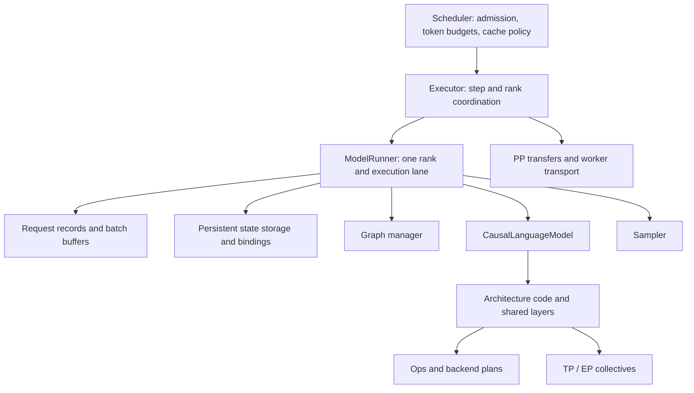

# Model executor and runner design

Status: phases 1-5 implemented (step semantics, rank coordination in
engine::ModelExecutor, private execution helpers under
src/models/execution/, explicit model preparation, single-rank decode
graphs with sampling kept eager). Phases 6-8 remain future work. The
boundaries below now describe the code.

The proposed boundary is **one rank-local runner that executes a prepared step through the model's own execution contract**, with a separate executor coordinating ranks. Models own mathematical structure, optimized execution paths, weights, and activation-workspace layout. The runner owns the execution lane, request execution records, persistent state allocations, batch buffers, graph lifecycle, and invocation of sampling. The scheduler owns admission, token budgets, preemption policy, and logical cache allocation.

This preserves `CausalLanguageModel`, `DecoderLm`, architecture-specific construction, and shared layers. It does not add a universal model interpreter or a runner subclass for each architecture.

## 1. What the reference engines teach us

Sources below are official documentation and source code inspected for this proposal. `main` and `latest` URLs are moving references, not pinned release guarantees; different backends and versions have different support matrices. In particular, distinguish TensorRT-LLM's engine-based C++ API from its PyTorch execution stack, and vLLM's established V1 runner from its separately documented Model Runner V2 design.

### Execution boundaries

| Engine | Relevant structure | Lesson for InferX |
|---|---|---|
| vLLM | Engine core schedules and manages cache; an executor drives workers; workers host a model runner; model implementations contain forward computation. The executor is a distributed execution boundary, not a neural-network implementation. | Separate rank coordination from rank-local execution; keep serving objects out of model inputs. [Architecture](https://docs.vllm.ai/en/latest/design/arch_overview/) |
| SGLang | Scheduler/worker orchestration feeds `ForwardBatch` to `ModelRunner`; the runner coordinates attention setup, eager/graph execution and model invocation. Models and computational layers remain separate. | A prepared execution batch is useful, but copying a large collection of feature flags and optional fields would obscure InferX's smaller contract. [Runner](https://github.com/sgl-project/sglang/blob/main/python/sglang/srt/model_executor/model_runner.py), [batch](https://github.com/sgl-project/sglang/blob/main/python/sglang/srt/model_executor/forward_batch_info.py) |
| TensorRT-LLM | The C++ `Executor` accepts asynchronous generation requests and performs iteration-level batching. Its scope is broader than InferX's local runner. In the PyTorch stack, `ModelEngine` performs input preparation and execution, with resource managers handling persistent resources. | Borrow the separation between orchestration, execution, and resource lifecycle; do not create a second scheduler inside `ModelRunner`. [C++ executor](https://nvidia.github.io/TensorRT-LLM/advanced/executor.html), [model engine](https://github.com/NVIDIA/TensorRT-LLM/blob/main/tensorrt_llm/_torch/pyexecutor/model_engine.py), [resources](https://github.com/NVIDIA/TensorRT-LLM/blob/main/tensorrt_llm/_torch/pyexecutor/resource_manager.py) |

### Comparison by responsibility

| Concern | vLLM | SGLang | TensorRT-LLM |
|---|---|---|---|
| Runtime state | V1 runner maintains execution/request data; MRV2 explicitly separates persistent request rows from gathered per-step inputs. | Request-to-token mappings, token/cache pools, and forward-batch data are distinct. | Request/resource lifecycle is distinct from model-engine inputs and buffers. |
| Workspace | Model/backend buffers and graph allocations participate in worker memory budgeting. MRV2 also discusses reuse of temporary memory. | Backend workspaces and graph preparation accompany model execution; cache pools are separately represented. | Model engine manages execution buffers, warmup and graph paths; resource managers represent longer-lived resources. |
| KV and heterogeneous state | Hybrid cache specifications/groups accommodate layers with different retention needs. | Specialized pool implementations include MLA layouts; recurrent/hybrid state receives explicit handling rather than being ordinary attention KV. | Resource-manager composition accommodates KV and other request resources, including distinct cache roles. |
| Batching | Scheduler token allocations become flattened model inputs; request residency need not equal batch row order. | Forward modes distinguish decode, extend, verification and other paths; forward batches carry execution metadata. | In-flight batching combines requests each iteration; input preparation translates scheduled requests into model-engine tensors. |
| CUDA graphs | Explicit full/piecewise modes and backend-dependent eligibility; graph selection depends on batch composition. | Separate eager and graph runners with eligibility checks and graph setup; decode and prefill need different treatment. | Warmup, capture/replay, shared graph pools and metadata preparation are coordinated around model execution. |
| TP / PP | Workers execute model shards; PP requires intermediate activations between stages. | Runner accepts PP proxy tensors; model/layer parallelism cooperates with worker groups. | TP shards tensors; PP partitions layers, with activation transfer between stages. |
| EP | Expert distribution and communication can span the participating TP/DP ranks; the topology is not simply another multiplier. | MoE routing, dispatch, expert computation and combine are explicit stages; dispatch can use DeepEP. | EP distributes experts; module-level parallel choices and expert placement differ from dense tensor sharding. |

Evidence for the state/workspace and batching comparison: [vLLM runner](https://github.com/vllm-project/vllm/blob/main/vllm/v1/worker/gpu_model_runner.py), [MRV2 design](https://github.com/vllm-project/vllm/blob/main/docs/design/model_runner_v2.md), [SGLang pools](https://github.com/sgl-project/sglang/blob/main/python/sglang/srt/mem_cache/memory_pool.py), and the runner, batch, model-engine and resource-manager sources above. Evidence for cache and graph distinctions: [vLLM hybrid cache design](https://docs.vllm.ai/en/latest/design/hybrid_kv_cache_manager/), [vLLM graphs](https://docs.vllm.ai/en/latest/design/cuda_graphs/), [SGLang graph setup](https://github.com/sgl-project/sglang/blob/main/python/sglang/srt/model_executor/model_runner_components/cuda_graph_setup.py). Distributed details: [vLLM EP](https://docs.vllm.ai/en/latest/serving/expert_parallel_deployment/), [SGLang EP](https://docs.sglang.io/docs/advanced_features/expert_parallelism), [TensorRT-LLM parallelism](https://nvidia.github.io/TensorRT-LLM/features/parallel-strategy.html).

My synthesis: share **resource lifetimes and execution contracts**, not an engine-wide description of every model operation. Graph capture is an execution strategy over a valid model path. Cache allocation policy is distinct from cache storage and kernel layout. Distributed control is distinct from collectives inside layers. These are design conclusions for InferX, not claims that the three projects use identical abstractions.

## 2. InferX's current starting point

Use the checked-out headers and sources as authoritative. `docs/model_execution.md` still describes older family/causal APIs, while [models_reimplement.md](models_reimplement.md) explains the direction of the current architecture refactor.

| Existing code | Preserve | Change or clarify |
|---|---|---|
| [model.h](include/inferx/models/model.h) | `CausalLanguageModel::Forward` and `ComputeLogits`, raw execution geometry, borrowed outputs, serialized execution. | Add explicit preparation and per-step planning; allow selected logits to be fewer than scheduled sequences. |
| [forward_context.h](include/inferx/models/forward_context.h) | Borrowed `OpContext`, `ModelState`, communicator. | Keep it small. Extend communication by named groups when PP/EP arrive; never attach scheduler or server configuration. |
| [decoder_lm.h](include/inferx/models/decoder_lm.h), [decoder.cc](src/models/layers/decoder.cc) | Optional decoder composition, concrete layer workspaces, fused residual/norm schedule, sharing temporary buffers across layers. | Replace first-forward workspace allocation with explicit initialization; expose memory accounting and capture eligibility without exposing internal tensors. |
| [requirements.h](include/inferx/models/requirements.h) | Typed paged/recurrent declarations, separate persistent pools. | Evolve beyond exactly one state variant per decoder layer only when a real model needs it. Distinguish layout from retention and lifecycle. |
| [model_runner.cc](src/models/model_runner.cc) | Flat batching, pinned staging, persistent request records, sampler, stream ownership and failure poisoning. | Extract rank coordination, batch packing and graph management; repair replay and sampling contracts before optimizing. |
| [kv_block_pool.h](include/inferx/cache/kv_block_pool.h) | Stable allocation, per-layer heterogeneous layouts, logical block indices. | One shared free list is adequate initially; it cannot independently reclaim sliding-window layers. |
| [recurrent_state_pool.h](include/inferx/cache/recurrent_state_pool.h) | Per-slot delta-rule and convolution state, stream-ordered reset. | Make slot capacity visible to admission; define preemption, prefix reuse and eventual speculative rollback. |
| [parallel_config.h](include/inferx/config/parallel_config.h), [comm.h](include/inferx/dist/comm.h) | Explicit rank-local TP and stream-ordered communication. | Current configuration is TP-only; communication supports BF16 all-reduce/all-gather, not a general PP/EP substrate. |

Specific constraints observed in the source:

- `CreateGroup` currently stores peer runners inside rank zero's runner. Separate coordinator state from the state of rank zero without changing scheduling semantics.
- `DecoderStack::InitWorkspace` is lazy. Its shared packed projection buffer and typed attention/MLA/GDN/MLP/MoE workspaces are useful; there is no reason to reconstruct them in the runner.
- Current MLA execution expands into K/V caches. The cache layout comments discuss latent storage, but that is not the current `RunMlaAttention` implementation. A future compressed MLA path must declare its actual storage representation.
- GPTQ/AWQ `QuantPlan` currently supports load-time conversion to BF16. Do not describe it as native quantized execution. Native packed linear/MoE kernels require a new execution representation underneath model layers.
- TP rejects MLA and recurrent mixers in `ShardStackForRank`; rank groups reject CUDA graphs. PP and EP need additional implementation, not just configuration flags.
- Decode graphs are indexed by batch size and currently capture `Sampler::Sample`. Sampling uploads parameters from per-step host vectors on the non-greedy path and selects greedy/non-greedy on the host. Replaying that graph does not rerun these host decisions or provide a sound lifetime/update contract for those vectors. Treat this as a replay correctness risk to resolve and test, not a claim of a reproduced failure.
- Every scheduled chunk currently gets logits and sampling, and increments the runner's generated counter; the scheduler discards samples from incomplete prompts. This wastes work and makes RNG advancement depend on prompt chunking. The proposed contract samples only requested output positions.

## 3. Ownership and architectural boundaries



**Executor**, in the engine layer, accepts a scheduler step, dispatches it to participating workers, handles health/failure and joins the results. A local deployment uses the same facade with one runner. A worker owns device/process setup and hosts the runner; IPC and thread orchestration live outside the model. Initially extract a concrete coordinator rather than introduce an executor class hierarchy for every launch mode.

**ModelRunner**, initially kept at its existing path, owns one model instance, one compute lane, batch staging, request execution records, persistent pools and graph handles. It translates scheduler deltas, validates the step, prepares model execution, launches it, invokes sampling, and reports completed results. There is one generic runner, not `LlamaRunner`, `MlaRunner`, or `MoeRunner`.

**Model** owns architecture semantics, weights, execution ordering, activation aliasing and model-specific preparation. It chooses how to use shared layers. A model may bypass `DecoderLm` entirely. It never admits requests, allocates logical cache blocks, decides eviction, samples tokens, or launches worker processes.

**Layers and ops** own kernel selection, fusion legality, attention-plan construction, quantized representations, and required low-level communication. The runner does not inspect a layer list and replay its operations. `OpContext` remains a borrowed device/stream handle; backend plans carry backend state explicitly.

**Cache services** own storage and typed lifecycle operations. The scheduler remains the sole authority for logical page allocation and retention policy. Initially keep `runner.kv_pool()` as a compatibility accessor to the existing scheduler-owned free-list operations. When multiple retention groups are implemented, replace this exposure with a narrow scheduler-side cache manager and rank-local storage bindings. Do not run independent allocation policies on every rank.

**Sampler** owns logits processing and sampling scratch. The runner supplies per-request parameters and RNG offsets and maps output rows back to requests. Stop accounting stays in the scheduler. Sampling remains outside the model even if it is eventually included in a graph.

## 4. Runtime state and batching

Separate four lifetimes:

| Lifetime | Contents | Ownership / release |
|---|---|---|
| Model instance | Weights, architecture config, prepared kernel choices | Model; destroyed only after in-flight work and graphs are drained. |
| Execution lane | Activation workspace, library scratch, graph handles, input/output capacity buffers | Model/ops own layouts; runner owns lane lifecycle and enforces fixed capacity. |
| Active request | Committed computed-token count, token source, RNG position, cache mappings, recurrent slot | Runner execution record plus scheduler-authoritative logical allocation. Release after completion. |
| Step | Flattened tokens, positions, query offsets, state indices, output selection, backend metadata | Runner slot and model step plan; valid until its completion event. |

Use stable request slots independent of batch order. Keep a request-ID-to-slot map; construct a compact batch-to-slot mapping each step. Reordering or compacting a batch must not move recurrent state or reset RNG. A slot generation counter prevents a delayed result from updating a reused request ID. Initially CPU packing is sufficient; GPU gathering is a later optimization supported by the same mapping.

The scheduler/runner copies have different roles: the scheduler may hold a planned end watermark; the runner tracks the last successfully completed watermark. Validate the planned end against `committed_start + scheduled_count`, then commit only after execution succeeds. Do not add a third authoritative token history in another helper.

### Step contract

Keep `SchedulerOutput` as the engine message; keep it out of `ModelInputs`. Add a monotonically increasing step ID at the executor boundary before asynchronous or distributed replay is supported. Explicit lifecycle messages eventually distinguish new, resumed/recomputed, preempted, and finished requests; do not reinterpret append-only block diffs as arbitrary remapping.

A prepared batch contains:

- Flat token IDs and positions; query offsets and sequence lengths; batch-to-request-slot mapping.
- Cache group block tables and recurrent state indices, initially the existing single paged group and optional recurrent indices.
- Explicit output row selection plus the reverse map to scheduled requests. A request in an incomplete prefill chunk normally selects no row.
- Actual token/sequence/output counts and, for graph execution, separate capacity counts and validity masks.
- A mode derived from execution geometry: uniform one-token decode, extend/prefill, or mixed. Future verification has its own semantics; `query_length == 1` alone is not proof of decode.

Do not keep separate full implementations for prefill and decode packing. Both are ragged token batches. A model/backend may select different kernels or split a mixed batch when needed; its plan must retain output order and state update semantics.

Example: A contributes three mid-prompt tokens, B contributes one decode token. Query offsets are `[0, 3, 4]`, total tokens are four, and the only output row is `3`. Both requests advance computed-token state. Only B samples and advances its RNG. Return two scheduler result entries, with an empty token vector for A; `Scheduler::UpdateFromOutput` already accepts empty samples. `ComputeLogits` can be skipped when there are no selected rows.

Initially keep synchronous `Run`: validate, stage, prepare, enqueue, wait, commit, return. Later introduce `Enqueue`/`Complete` with owned step slots and events. A borrowed scheduler span must be copied before its sender can reuse it. Pinned buffers and CPU planning arrays cannot be reused merely because a host method returned.

## 5. Model preparation and workspace

### Minimal model API evolution

Retain `Forward` and `ComputeLogits`. Add a small preparation contract, illustrated below; these names are proposed, not existing APIs:

```cpp
struct ExecutionLimits {
  int max_tokens;
  int max_sequences;
  int max_logit_rows;
};

// Model-owned concrete plans remain private to the implementation.
struct StepExecutionInfo {
  ExecutionPathId path;          // Stable identity of chosen launch structure.
  GraphEligibility graph;       // Unsupported or eligible under explicit constraints.
  uint64_t workspace_generation;
};

// Proposed additions to CausalLanguageModel:
Status Prepare(const ExecutionLimits&, ForwardContext&);
MemoryUsage memory_usage() const;
StatusOr<StepExecutionInfo> PrepareStep(
    const ModelInputs&, const LogitSelection&, ForwardContext&);
```

`Prepare` allocates all model/layer workspaces for the configured limits, initializes backend handles, and finalizes stable storage. It is state-neutral: it must not advance request state. If real launches are needed for autotuning, use reserved scratch state. State specifications must be finalized before pool allocation; backend/cache representation selection happens during model construction, not after live requests exist.

`PrepareStep` validates model-specific geometry and refreshes attention/kernel plans, but does not advance persistent sequence state. Host planning and metadata uploads happen here, outside capture. Device planning may instead run inside `Forward` if it is capture-safe and recomputes from current device inputs on every replay. Store plans privately in the model; return only the information needed for runner dispatch. Under the initial serialized contract, the next `Forward` consumes the most recent preparation. Re-preparation cannot overlap a launch using mutable plan storage.

There is no universal `ExecutionPlan` describing all layers. Add an opaque typed plan handle and multiple plan slots only when real concurrent execution requires them. Capability defaults should be conservative: a custom model with a valid eager implementation may report no graph support.

### Who owns workspace?

Keep activation workspace in the model or its composition helper. `DecoderStack` knows that hidden/residual buffers remain live across layer operations and when packed QKV and gate/up projection scratch can alias. The runner cannot infer that from hidden width and layer count.

Ops/backend plan objects declare scratch size, alignment and lifetime. Model preparation allocates it or lends appropriately aligned slices of model-owned storage. Start with the existing typed workspace structs and explicit accounting. Add a shared scratch arena only where measured duplication warrants it; avoid a string-keyed tensor registry or a general activation-memory compiler.

For sequential layers sharing a scratch role, reserve the maximum requirement among those layers, not their sum. Sum simultaneously live roles. Tensor shape similarity alone does not justify aliasing: residuals, MoE dispatch buffers, collective inputs and outputs can overlap in lifetime. Quantized scales and accumulation buffers count as separate roles.

Memory planning uses:

`device budget >= weights + model workspace + runner buffers + sampling + communication + recurrent state + KV storage + graph overhead + reserve`

Report each term per rank. Derive KV capacity after reserving bounded non-KV requirements. With explicit `num_kv_blocks`, validate the budget and fail with a breakdown if it cannot fit. For homogeneous logical TP pages, choose a common capacity feasible on every participating rank, even when their local byte costs differ.

Warmup uses sacrificial slots/pages and representative shape buckets. Measure untracked library/graph overhead before admission, then finalize the budget. If this exceeds the reservation, destroy provisional graphs and rebuild smaller pools before serving; never silently resize graph-bound storage while requests are live.

Graph handles are destroyed before their referenced buffers. Normal prepared execution must not allocate/free device memory, resize tensors, initialize libraries or autotune. CPU reference paths remain possible without graphs; this does not imply every existing op has a CPU implementation.

## 6. Persistent state and KV cache

### Incremental state representation

For the first implementation, retain `PagedKvStateSpec`, `RecurrentStateSpec`, their pools, and the per-layer mapping. Use the existing heterogeneous `KvBlockPool::Create(layouts)` instead of duplicating a uniform-layout cache implementation.

Extend declarations when needed along these concrete axes:

| Property | Examples | Authority |
|---|---|---|
| Physical representation | Separate K/V; compressed MLA latent plus positional component; scales for quantized KV | Model/backend construction declares exact layout. |
| Retention | Full sequence, sliding window plus pinned sinks, fixed recurrent slot, read-only encoder state | Model declares semantics; cache manager applies policy. |
| Mapping | Token pages, request slots, encoder-object handles | Cache service allocates; runner binds indices. |
| Lifecycle capability | Reset, copy/fork, snapshot/restore, prefix compatibility | State implementation explicitly implements or rejects. |

A future `StateId` identifies a declared state resource, not necessarily a decoder-layer ordinal. Bind a small closed variant of paged, recurrent and eventually encoder-state resources by ID. This permits zero resources or multiple resources per layer and avoids pretending that all models are decoder stacks. Introduce this only with the first consumer that needs it; do not build an extensible `void*` resource registry now.

Cache layout must describe all persistent tensors and bytes, including scales, padding and alignment. `entries_per_token = 1` alone cannot express every compressed or quantized representation, nor does the current K/V accessor implement them. Add typed accessors with their real kernels. Rank-local declarations already account for TP sharding/replication; the allocator must not divide head counts again.

### Retention and allocation policy

Initially preserve one logical page index across all paged layers. This supports heterogeneous bytes per layer but conservatively retains windowed-layer pages for the full request. Document the memory cost.

Later, group resources by compatible allocation/retention semantics. A full-attention group and a sliding-window group can have independent page tables and capacities. Translate them into backend metadata once per relevant layout/geometry group. Do not group solely by identical bytes per token, and do not reuse an attention plan across different head geometry, mask policy or cache format merely because block sizes match.

Prefix reuse requires semantic compatibility: model/weight and adapter identity, positions/attention policy, cache representation, and available state at the prefix boundary. A recurrent model cannot reuse attention KV for a prefix while resetting its recurrent slot to zero. Initially reject nonzero cached starts for recurrent requests unless an appropriate state snapshot is supplied; recompute from the beginning instead.

### Lifecycle rules

| Event | Paged state | Recurrent state |
|---|---|---|
| Admit fresh request | Reserve pages; valid written range starts empty. | Acquire slot and reset before reads. |
| Append step | Write granted positions; publish completed range after success. | Advance exactly once in token order. |
| Finish/cancel | Release after last referencing work completes. | Return slot after completion; reset on next acquisition. |
| Recompute preemption | Release mappings and re-admit with explicit replay source. | Reset and replay from a valid starting point. |
| Fork/prefix sharing | Refcounts and copy-on-write for any mutable shared tail. | Clone a matching snapshot or recompute; sharing a mutable slot is invalid. |
| Speculative reject | Restore committed logical length; isolate writes to shared pages. | Restore/checkpoint or replay accepted prefix; shortening a length counter is insufficient. |

Admission must account for all resources, not only free KV pages: sequence slots, recurrent slots, token capacity and later encoder/MoE communication capacities. Reserve logical resources atomically across required groups; on pre-launch rejection release provisional reservations. Initially the runner may own the recurrent free list while advertising capacity to the scheduler, but the scheduler must respect it.

After a device error or partially launched step, do not retry against possibly mutated state. Preserve the current fail-stop approach: poison the runner, abort peer work, and reconstruct. Validation failures before any mutation can be rejected without poisoning once that boundary is explicit.

## 7. CUDA graph design

Use a small concrete `GraphManager` owned by the local runner. It operates on the same prepared model callable used by eager execution. Start with single-rank, exact-size, uniform decode graphs covering `Forward + ComputeLogits`; keep sampling eager until its preparation and device launch are cleanly separated.

Graph support is the intersection of model path, ops plans, state update kernels and communication support. A CUDA device or successful eager warmup is not a sufficient capability test.

### Graph identity and dynamic data

The conceptual key is:

`{model/execution generation, path, phase, token capacity, sequence capacity, output-row capacity, backend-plan compatibility, parallel stage/group mode}`

The manager is scoped to one model/lane. Immutable dtype, cache layout, quantization implementation and topology can therefore be represented by the execution generation rather than repeated in every key. Any host decision that changes launches, captured scalar arguments or scratch requirements must either change the path/key or be frozen for that graph. Context-length thresholds that change a kernel path need a compatibility class too.

Tokens, positions, sequence lengths, page IDs, recurrent-slot IDs, output row IDs and RNG offsets are dynamic values. Store them at stable device addresses and update them before every replay. A host variable does not become dynamic because its pointed-to input tensor is stable.

Preparation order:

1. Validate and pack actual inputs; resolve model path and graph eligibility.
2. Upload dynamic metadata to stable buffers and perform host-side planning outside capture.
3. Capture during controlled initialization using reserved dummy state, after library initialization. Reset dummy recurrent state between warmup executions; warmup must not double-advance a live request.
4. Replay with current inputs on the ordered stream, then run sampling and output transfer.
5. Commit request progress only after completion; never count capture/warmup as a generated token.

Exact-size graphs avoid padding initially. Bucket padding is a later optimization requiring every kernel to honor active counts/masks. Dummy rows need valid isolated page/slot storage or a proven no-write path; padding must not alter real recurrent slots, real KV, expert routing results or RNG counters. Fallback to eager when this cannot be guaranteed.

Split sampling into `PrepareSampling` (validate/pack/upload current parameters) and `LaunchSampling` (device work). Only then consider capturing the launch. Distinguish greedy and stochastic launch structure, or use a common masked device path. Never capture transient host-vector uploads and assume replay refreshes them.

Graph memory is bounded by configured buckets and a byte budget. Rebuilds, storage relocation, changed weights/packing, changed expert placement, or changed topology invalidate applicable graphs. Evict/destroy only after their last use completes. Failure to capture a supported optional path may fall back to eager if capture cleanup leaves a healthy stream; an execution/device failure is not a fallback opportunity.

Piecewise graphs are deferred. If needed, models expose a small number of meaningful graphable regions around unsupported operations. The runner must not split models by discovering internal layers. Eager, full graph and eventual regional execution must invoke the same computational implementation.

## 8. Architecture paths, fusion and quantization

| Model/path | Model and layers decide | Runner supplies |
|---|---|---|
| Llama/Qwen dense decoder | QKV packing, RoPE, attention kernel, residual/norm fusion, MLP. | Ragged inputs, paged-state bindings, stream and selected logits. |
| Gemma / sliding-window / attention sinks | Scaling, masks, normalization placement, window/sink semantics. | Correct state groups and current metadata; no architecture-name branches. |
| DeepSeek MLA | Decompressed reference path versus compressed latent path; projection absorption; backend plans. | The declared cache layout and workspace budget, independent of ordinary K/V geometry. |
| Qwen3-Next hybrid | Attention/GDN ordering and distinct prefill/decode recurrent kernels. | Both paged and recurrent bindings, slot indices and lifecycle guarantees. |
| Mixtral / Qwen MoE / gpt-oss | Routing semantics, shared experts, packed expert kernels, activation variants. | Communication groups and resource capacities; no host loop over experts in runner. |
| Native quantized execution | Weight/scales representation, packing, accumulation dtype, per-shape backend choice. | Memory accounting, prepared path identity and compatible graph lifetime. |

Keep fusion at the lowest level that can prove it correct. For example, add+RMSNorm may span a decoder block boundary; QKV+RoPE+cache-write can be an attention implementation; dispatch+expert GEMM may be a MoE backend. Preserve a reference path for numerical comparison, but do not duplicate the runner pipeline for each fusion.

Quantization policy belongs to loading and layers. Resolve packed weight support and device compatibility before serving. Layer/backend objects may choose different GEMM algorithms for prefill and decode, with explicit scratch and graph constraints. The runner must not switch on AWQ/GPTQ/FP8 labels. Weight quantization and KV quantization are separate choices; neither implies the other.

Avoid one global graph-support Boolean on `ModelInfo`. Engine-facing facts stay small; execution capability depends on the resolved device, backend, topology and selected path. Unsupported combinations fail early with concrete reasons; an optional graph optimization can instead report an eager fallback reason.

## 9. Distributed execution: TP, PP and EP

### Coordination contract

Introduce an explicit topology descriptor with named communication groups and model placement. Keep global rank identity separate from TP rank, PP stage, attention replication and expert ownership. EP may reuse ranks already participating in TP/DP; do not define world size as `TP * PP * EP` without an actual placement model.

The executor distributes a step ID, request lifecycle updates, logical allocation decisions, token inputs or references, and output selection. Each local runner maps these into its rank-local storage. All ranks validate compatible model/plan fingerprints and capacities at startup. Advance to the next dependent step only after the selected output owner has published sampled tokens and all participants have accepted completion.

Use persistent worker execution threads/processes instead of spawning new asynchronous threads per step. Retain health polling, cancellation and communicator abort so one failed rank cannot leave peers indefinitely blocked. An idle rank in a participating EP group may still need to issue matching collectives.

### Tensor parallelism

Keep sharding in model loading and collective placement in computational layers. Q/K/V head replication and vocab shards remain model knowledge. The runner supplies the TP group, not layer-specific reduction instructions.

For the first migration retain full gathered logits and one sampling owner, matching the current API. All ranks that participate in the LM-head gather still execute it. A later distributed sampler can operate on sharded logits with an explicit output-layout contract; it must not silently change `Logits` from full vocabulary to a shard.

Logical TP page IDs can remain synchronized while physical addresses and per-rank bytes differ. Capacity negotiation uses the limiting participant. Keep TP graphs disabled until the communicator supports graph capture, ranks agree on graph shape/mode and capture order, and collective sequence tests pass. Independent local graph fallback can deadlock; eligibility is agreed for the participating group before launch.

### Pipeline parallelism

PP is not another all-reduce. It needs stage-local model loading, intermediate activation transport and a microbatch schedule owned by the executor.

Add a separate, concrete stage contract when PP is implemented: first stage consumes token inputs; middle stages consume activation bundles; last stage produces hidden states/logits. A bundle may include hidden and residual tensors plus row metadata, rather than assuming a single hidden tensor. The model defines stage partition boundaries and their tensor schema; the runner only transports declared bundles. `DecoderLm` can implement this as an optional stage composition without forcing all causal models into layer ranges.

Each stage owns only its local persistent state and activation workspace. Start with one in-flight microbatch, explicit sends/receives and backpressure. Multiple microbatches require separate workspace/input slots or proven event-ordered reuse. The last-stage sampling owner sends accepted tokens back to the input stage and coordinator. Make `Send/Recv`, tags/step IDs, buffer ownership and failure handling explicit in the communication layer before exposing PP configuration.

### Expert parallelism

EP belongs inside the MoE computational path: route, dispatch tokens, execute local experts, combine. The runner supplies EP groups and lane resources; it does not move whole requests between experts. Extend communication with typed dispatch/combine facilities, including variable token counts and appropriate dtypes, rather than disguising all-to-all as BF16 all-gather.

Placement and quantized expert loading are construction concerns. Backend dispatch plans specify upper bounds, scratch and graph eligibility. Routing overflow must have a defined eager fallback or rejection before an unsafe launch; silently dropping tokens is not an inference optimization. Expert rebalancing occurs at a quiescent boundary and increments the placement/execution generation.

Bring up TP, then PP and EP independently in eager mode. Combined PP/EP requires group-local collective ordering, microbatch identities and capacity negotiation; single-feature support does not certify every combination.

## 10. Extension boundaries and things to defer

- **Speculative decoding:** build draft/verify coordination above local runners. Add multi-row logits and explicit accepted-token commits, then state checkpoint/rollback capabilities. Keep it disabled for recurrent state until rejection recovery is implemented.
- **Multimodal/encoder-decoder:** add typed model inputs and encoder/cross-attention state when implementing a concrete architecture. Encoding and cross-state preparation are model/task execution, not scheduler internals. Do not preemptively attach every modality field to `AttentionBatch`.
- **LoRA/adapters:** bind immutable adapter identity/version to execution and prefix-cache compatibility. Use an optional typed binding when supported; graph compatibility depends on the backend's adapter path.
- **Disaggregated prefill/decode or offload:** transport a declared state bundle and its completed watermark, representation version and ownership. KV alone is not sufficient for hybrid models. Destination readiness is an explicit dependency before execution.
- **Multiple concurrent lanes:** share immutable weights only after model execution workspace has been separated per lane. The present serialized model object cannot safely serve two streams using the same activation workspace.

Defer a generic resource plugin registry, a universal model IR, automatic liveness compiler, per-architecture runners, a separate executor for each quantization format, and an asynchronous scheduler rewrite. None is necessary to establish the proposed boundaries.

## 11. Implementation plan

Every phase should be a reviewable change with working eager execution. This document proposes changes; it does not apply them.

| Phase | Concrete work and likely files | Completion criteria |
|---|---|---|
| 1. Freeze contracts and fix step semantics | `models/model.h`, `engine/scheduler_output.h`, `model_runner.cc`, scheduler integration. Define committed versus planned watermarks, explicit output-row mapping, empty samples for partial prefill, and RNG advancement only for sampled outputs. | Chunked and unchunked prompts produce equivalent deterministic sampling streams; mixed batches preserve result order. Existing public `Run` behavior remains usable. |
| 2. Separate orchestration from local execution | Add `engine/model_executor.{h,cc}`; extract `CreateGroup`/peer coordination. Keep `ModelRunner::CreateGroup` as a delegating compatibility entry during migration. Update `dist/worker_main.cc`, serving/gateway and diagnostics callers as needed. | Single-rank and existing TP tests pass; one rank's error aborts peers; local runner has no peer vector. |
| 3. Extract private batching and state lifecycle | Add `src/models/execution/{batch_buffers,request_state,state_storage}.{h,cc}` as concrete implementation helpers. Centralize slot mapping, validation and retire/reset logic. Retain existing cache pools and one paged group. | Reordering, finish-only steps, ID/slot reuse and recurrent exhaustion behave correctly without stale state. No duplicate allocation authority. |
| 4. Explicit model preparation | Extend `CausalLanguageModel`; implement in `DecoderLm`, `DecoderStack`, LM head and backend plans. Move lazy allocation out of forward; expose memory usage and path capability. Update test models. | Prepared eager execution performs no device allocation; memory accounting covers model, sampler, cache and communication. Unsupported paths fail before admission. |
| 5. Safe single-rank graphs | Add private `graph_manager.{h,cc}`. Capture model/logits only, outside live request execution. Add stable path/generation keys and controlled warmup. Separate sampling preparation from device launch before optional sampler capture. | Replay parity under changing context lengths, block tables, request order and sampling settings; no transient host pointers retained; graph memory bounded. |
| 6. Heterogeneous retention and state extensions | Extend requirements/bindings only for concrete compressed MLA, grouped window cache, or non-layer state consumers. Add scheduler-side group allocation and accounting. | Correct numerical behavior and measured memory benefit; hybrid prefix/preemption paths reject unsupported state combinations. |
| 7. Distributed foundations and new modes | Named group topology and persistent workers; TP graph validation; PP transport/stage API; EP dispatch/combine and placement, delivered as separate changes. | Each mode passes eager correctness/failure tests before graphs or combinations are enabled. Support matrix documents actual model/backend combinations. |
| 8. Measured throughput improvements | Dirty-range uploads, device-side gathering, bounded graph buckets, asynchronous step slots, regional graphs and overlap only where profiling justifies them. | Improvements demonstrated against phase-5 baseline with unchanged state/output semantics and bounded memory. |

No new public helper interface is needed merely because a private implementation exceeds a file-size preference. Extract helpers around actual ownership and independently testable invariants. Existing architecture factories and loading helpers continue to construct models; the executor does not duplicate model loading logic.

### Validation plan

Use the existing `tests/model_runner_test.cc`, `tests/model_test.cc`, `tests/tensor_parallel_test.cc`, model parity/quantization tests and cache tests as starting points. Add tests for semantics, not for private class shapes.

| Area | Required evidence |
|---|---|
| Batch protocol | Mixed and partial prefill, zero selected logits, finish-only steps, invalid/duplicate updates, context and integer bounds, request reorder, ID generation reuse. |
| Stateful correctness | Full prefill versus chunks; multiple decode steps; recurrent reset/reuse; prefix-start rejection without snapshot; preemption replay; distinct state layouts in one model. Compare state tensors as well as tokens. |
| Workspace | Allocation instrumentation after `Prepare`; maximum configured token/sequence/logit shapes; aliasing-sensitive residual/MoE paths; graceful budget failure with no live requests. |
| Graph replay | Eager/graph logits within dtype-specific tolerances; deterministic RNG parity; greedy-to-stochastic changes; page-boundary growth and changed lengths; batch-size return to an earlier graph; slot reuse; dummy state isolation; invalidation and safe destruction. |
| Distributed | TP logits/token parity against single rank; replicated KV heads; rank mismatch; failure/timeout abort; PP activation schema and microbatch ordering; EP dispatch/combine against local MoE including empty expert destinations. |
| Numerical paths | Dense, window/sink, MLA, recurrent hybrid and MoE representatives; load-time dequantization baseline versus any future native quantized kernels with explicit error budgets. |

Do not require exact token equality for arbitrary low-precision floating-point ties. Use controlled fixtures for exact sampling assertions, compare logits/state within justified tolerances, and separately test RNG counters and output-row mapping.

Measure CPU packing time, upload bytes, host synchronization, prefill throughput, decode inter-token latency, TTFT, graph hit/fallback reasons, graph bytes, peak/reserved device memory, and collective time. Compare equal models, capacities, dtypes, sampling policies and workloads. A decode latency win that substantially reduces KV capacity must be reported as a tradeoff.

The first implementation milestone is phases 1–5: one clean local runner, a separate rank coordinator, explicit workspace preparation, correct heterogeneous state binding, and reliable decode graphs. PP, EP, grouped retention and asynchronous overlap then extend established contracts instead of multiplying runner implementations.

## 12. Concrete executor class design

This section makes the earlier boundaries concrete using TensorRT-LLM as a reference. It distinguishes the generation executor from the scheduled-step executor; the `ModelExecutor` proposed in phase 2 remains the latter.

### TensorRT-LLM reference and naming

TensorRT-LLM's `PyExecutor` constructor receives a `RequestScheduler`, `ResourceManager`, `ModelEngine`, `Sampler`, and distributed runtime. These are collaborators in its generation loop. `ModelEngine` defines forward execution and warmup; `PyTorchModelEngine` implements the backend-specific behavior. Resource managers expose capacity and prepare/update/free lifecycle operations. The public C++ `Executor` is a request/response service, with submission, cancellation and response retrieval. These are related architectural roles, not one interchangeable API across backends. [PyExecutor source](https://github.com/NVIDIA/TensorRT-LLM/blob/main/tensorrt_llm/_torch/pyexecutor/py_executor.py), [ModelEngine source](https://github.com/NVIDIA/TensorRT-LLM/blob/main/tensorrt_llm/_torch/pyexecutor/model_engine.py), [resource-manager source](https://github.com/NVIDIA/TensorRT-LLM/blob/main/tensorrt_llm/_torch/pyexecutor/resource_manager.py), [C++ Executor API](https://nvidia.github.io/TensorRT-LLM/advanced/executor.html).

For InferX, use these names:

| TensorRT-LLM reference role | InferX class | Deliberate adaptation |
|---|---|---|
| Request-level executor / `PyExecutor` orchestration | `engine::GenerationExecutor` | Owns the generation loop and composes the existing scheduler. Extract from gateway/driver loops when unifying those callers; do not add another loop around them. |
| Distributed execution machinery | `engine::ModelExecutor` | Executes one already-scheduled step across ranks. Never admits or reschedules requests. |
| Model-engine execution | Existing `ModelRunner` | Rank-local batch preparation, state binding, eager/graph execution and sampling invocation. Do not also add a `ModelEngine` wrapper with the same responsibilities. |
| `RequestScheduler` | Existing `Scheduler` | Scheduling policy and authoritative generation requests. |
| Resource management | `ExecutionResourceManager` plus rank-local `StateStorage` | Separate logical reservations from device storage. A concrete typed composition initially suffices. |
| `Sampler` | Existing `sampling::Sampler` | Separate computational component, owned on the rank that produces samples. |

This is a responsibility mapping, not a claim that TensorRT-LLM has InferX's proposed object tree. In particular, InferX keeps sampling execution within the local runner's lane while generation policy remains above it.

### Ownership tree

The following is the target composition after logical allocation has been separated from `KvBlockPool`. Initially retain the compatibility arrangement described in section 3.

```text
EngineGateway / benchmark driver                 external adapter
└── GenerationExecutor                           engine-thread confined
    ├── ExecutionResourceManager                 logical allocations/capacities
    ├── Scheduler                                borrows resource manager
    │   └── Request records                      authoritative generation state
    └── ModelExecutor                            coordinates scheduled steps
        ├── worker transport / group health
        └── rank workers                         local objects or remote processes
            └── ModelRunner                      one serialized lane per rank
                ├── ExecutionLane                stream, events; borrows runtime
                ├── ParallelContext              rank-local communicator handles
                ├── RequestStateTable            execution mirror, slots, watermarks
                ├── BatchBuffers                 pinned/device input storage
                ├── StateStorage                 KV/recurrent pools and bindings
                ├── CausalLanguageModel          weights and activation workspace
                ├── Sampler                      only on output owner initially
                └── GraphManager                 graph handles, keys, output views
```

Remote workers are owned through their process lifetime and transport, not through a cross-process C++ pointer. Keep the existing worker entry point; a new public `Worker` base class is unnecessary. `GenerationExecutor` is optional for low-level tests and model diagnostics, which may call `ModelExecutor` or `ModelRunner` directly.

| Class | Owns / does | Must not own / do |
|---|---|---|
| `GenerationExecutor` | Scheduler/resource/execution composition; submit/cancel queues if needed; step loop; token result publication; shutdown coordination. | HTTP, tokenization, model math or a second set of live request records. |
| `Scheduler` | Waiting/running/finished requests; token budget and preemption decisions; output/stop accounting. | Device buffers, graph handles, rank execution. |
| `ExecutionResourceManager` | Logical page/slot reservations, refcounts, capacities and retirement bookkeeping. Scheduler chooses policy; manager enforces feasibility. | Model weights, activation scratch, kernel launch order, rank-local allocation policy. |
| `ModelExecutor` | Step IDs, rank dispatch, output-owner selection, group success/failure, sampled-token fanout and later PP microbatch orchestration. | Request admission, sampling algorithms, cache eviction policy. |
| `ModelRunner` | Validation and preparation of one rank's work; ordered invocation of its concrete helpers; local failure state. | Peer runners, scheduler policy, architecture-name dispatch. |
| `ExecutionLane` | Stream/event RAII and completion ordering. | Model-dependent workspace layout or a hidden global allocator. |
| `StateStorage` | Physical persistent pools, stable bindings, reset/copy operations on the lane. | Independent logical allocation decisions on every rank. |
| `RequestStateTable` | Request ID/generation to stable slot; committed execution positions; token source and RNG execution state. | Another scheduler or independently authoritative generated text history. |
| `BatchBuffers` | Fixed-capacity packing/upload buffers and row maps. | Persistent model state or model architecture parsing. |
| `GraphManager` | Capture/replay/invalidation and graph-memory budget. | A second implementation of model forward or kernel selection. |
| `CausalLanguageModel` | Architecture-specific preparation, computation, weights, activation layout and path capabilities. | Serving requests and logical state allocation. |

Prefer value members for concrete helpers and `unique_ptr` for ownership requiring indirection. Contexts and prepared views borrow; they do not extend lifetime. Use polymorphism at the existing model and communication boundaries. Introduce a transport interface only when local and remote implementations actually need it; avoid abstract bases for every manager.

### Suggested C++ surface

Illustrative signatures below describe the target synchronous contract, not a compilable patch. `GenerationRequest`, `GenerationEvent`, `ResourcePlan`, `RankStep` and result types are value messages; implementations should reuse existing request/output types where possible.

```cpp
namespace inferx::engine {

class GenerationExecutor {
 public:
  static StatusOr<std::unique_ptr<GenerationExecutor>> Create(
      const EngineOptions&);
  StatusOr<RequestId> Submit(GenerationRequest request);
  Status Cancel(RequestId id);
  Status Step();                         // Schedule -> execute -> update.
  std::vector<GenerationEvent> TakeEvents(); // Token events, no text decoding.
  Status Shutdown();
 private:
  ExecutionResourceManager resources_;
  Scheduler scheduler_;                  // Borrows resources_.
  std::unique_ptr<ModelExecutor> execution_;
  // One engine thread mutates these members. Cross-thread adapters enqueue.
};

class ModelExecutor {
 public:
  static StatusOr<std::unique_ptr<ModelExecutor>> Create(
      const ModelConfig&, const ExecutionOptions&);
  const ExecutionCapacity& capacity() const;
  StatusOr<ModelRunnerOutput> Execute(const SchedulerOutput&);
  Status Shutdown();
 private:
  struct Impl;                           // Local or transported rank dispatch.
  std::unique_ptr<Impl> impl_;
};

class ExecutionResourceManager {
 public:
  StatusOr<ResourcePlan> Reserve(const AdmissionPlan&);
  Status Commit(const ResourcePlan&, StepId completed_step);
  void CancelReservation(const ResourcePlan&); // Before execution only.
  void Retire(RequestId, StepId last_use);
  void ReclaimThrough(StepId completed_step);
  const ExecutionCapacity& capacity() const;
};

} // namespace inferx::engine

class ModelRunner {
 public:
  Status Initialize();                   // Storage, model preparation, warmup.
  StatusOr<RankStepResult> Run(const RankStep&); // Ordered, waits initially.
  Status ApplyAcceptedTokens(const AcceptedTokens&);
  Status Shutdown();
 private:
  Status ValidateStep(const RankStep&) const;
  StatusOr<PreparedBatch> PrepareBatch(const RankStep&);
  StatusOr<models::Logits> ExecuteModel(const PreparedBatch&);
  StatusOr<RankStepResult> FinishStep(const PreparedBatch&);
  // Concrete owned helpers shown in the ownership tree.
};
```

`Reserve` consumes the scheduler's proposed admissions/extensions; it does not decide priorities. `ResourcePlan` contains logical mappings and reservation identity, serialized into the rank step. The target resource manager becomes the one logical allocator; migrating to it requires removing the free-list authority from physical pools, rather than maintaining two allocators. Reservations for shared pages include refcount and mutable-tail rules. `Commit` publishes successful progress; it does not imply device writes can be rolled back on error.

Keep `RankStep` close to the existing scheduler delta protocol initially, augmented with step identity and output-owner role. No serialization of raw tensors, host spans or model internals is permitted across processes. The model continues to receive only `ModelInputs`, `LogitSelection` and `ForwardContext`.

`RankStepResult` contains completed step identity and execution status on every rank, plus sampled tokens only on the designated output rank. Borrowed logits stay inside the runner until sampling finishes. `ModelExecutor` returns owning token results, not workspace-backed tensors. Tensor results for diagnostics require an explicit copy or lease.

### Interactions for one iteration

1. `GenerationExecutor` drains submissions/cancellations into `Scheduler`. The scheduler proposes allocations through `ExecutionResourceManager` and returns the scheduled step. A finish-only step still retires local state.
2. `ModelExecutor` assigns the step ID, validates group readiness, and dispatches the same logical decisions to participating ranks. Each runner validates and binds its rank-local storage.
3. `ModelRunner` updates its execution mirror, applies required slot resets and prepares `BatchBuffers`. `CausalLanguageModel::PrepareStep` refreshes backend plans and reports the execution path. These operations retain the lifetime rules in sections 4–7.
4. `GraphManager` replays an eligible model path, or the runner invokes the same model callable eagerly. All required TP participants execute model collectives, including logits gathering even on ranks that do not sample.
5. The output owner's `Sampler` consumes selected logits. Each runner waits for its lane completion and reports status. The coordinator waits for group success, distributes accepted tokens, and obtains acknowledgments before the next dependent step.
6. The generation executor passes completed results to the scheduler, commits logical resources, publishes token events and reclaims retired resources whose last use completed. No prompt-intermediate sample is published or counted toward RNG progress.

Local watermarks may have advanced before another rank reports failure. Therefore group failure poisons the group and fails affected requests; it does not retry the scheduled step. Pre-launch validation failures may cancel reservations only when no rank has mutated state. Cancellation of an in-flight request suppresses future outputs but waits for completion before releasing its resources.

### Initialization, threading and teardown

Construction performs model loading/backend selection, rank-local requirements discovery, common capacity negotiation, physical storage allocation, explicit workspace preparation and isolated warmup before admission opens. Build the scheduler only once its resource capacities are known. Use factories so partial initialization returns a status and cleans up safely.

Initially `GenerationExecutor` is driven by the existing engine thread; `Step`, scheduling and resource mutation are serialized. A separate worker thread per participating device runs local steps concurrently where collectives require it. Do not add an internal background thread and continue driving `Step` from the gateway simultaneously. If a request-level asynchronous API is later desirable, wrap this same loop with queues.

Shutdown stops admission, drains or fails live work, aborts stalled communication when necessary, joins workers, destroys graphs, releases model and persistent buffers, then destroys streams/communicators. Encode safe member ordering plus explicit drain logic; RAII alone cannot establish GPU completion. A runner must never outlive the runtime/world whose handles it borrows.

### What to implement first

Extract `ModelExecutor` from `ModelRunner::CreateGroup`; keep `ModelRunner` as the TensorRT-LLM-style model-engine boundary. Implement the private state/buffer/graph helpers as concrete classes during phases 3–5. Extract `GenerationExecutor` only while consolidating existing gateway and driver loops, preserving the existing scheduler. Introduce `ExecutionResourceManager` with the logical allocator migration, not as a second wrapper around an independently allocating pool.

This class design adds boundaries where ownership differs, while preserving model-specific execution inside the model and reusable kernel behavior inside layers/ops.
