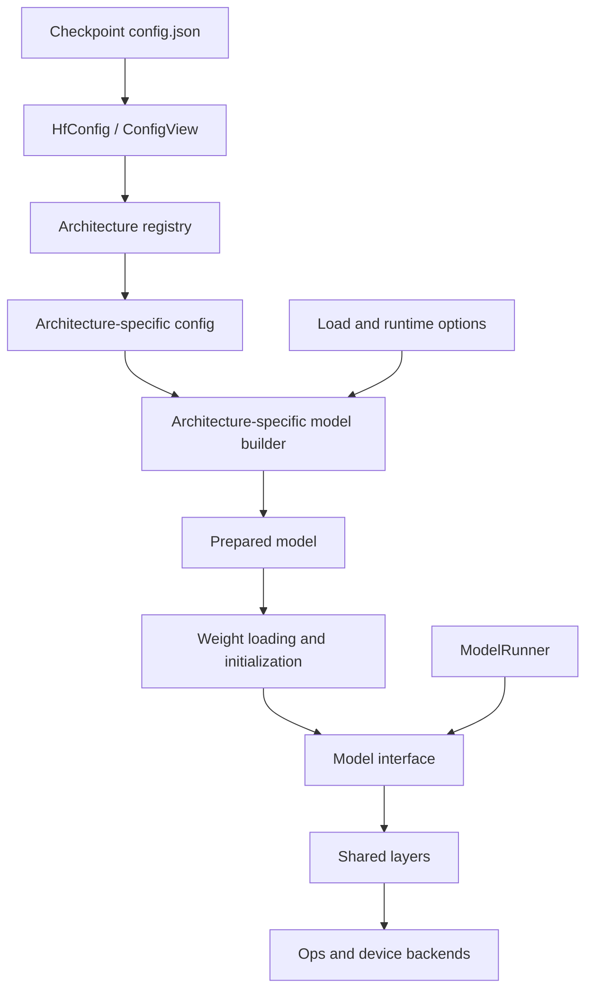

# Models Layer Reimplementation Proposal

Status: implemented. The structure below (typed per-architecture configs,
registry-selected factories, architectures/ + layers/ + loading/, and the
CausalLanguageModel boundary) now describes the code under
`include/inferx/models/` and `src/models/`.

## Design direction

Use one typed configuration and one model implementation per architecture, built
from shared computational layers. Architectures include Qwen3, Llama, and
DeepSeekV3; different checkpoint sizes instantiate the same architecture with
different configuration values.

The existing family implementations translate into a shared `DecoderConfig`.
The earlier proposal in `docs/model_architecture.md` generalizes that into
`ModelSpec`. This proposal instead makes each architecture's own configuration
the authoritative representation throughout construction. A shared decoder-stack
helper remains optional rather than defining the model contract.

vLLM distinguishes deployment configuration from its Hugging Face architecture
configuration, and SGLang has model implementations consuming architecture-specific
configurations. These are useful patterns to adopt in C++:

- [vLLM configuration](https://docs.vllm.ai/en/stable/api/vllm/config/model/)
- [SGLang model implementation](https://github.com/sgl-project/sglang/blob/main/python/sglang/srt/models/qwen3_5.py)

## Configuration ownership

| Configuration | Owns | Consumer |
|---|---|---|
| `ModelLoadOptions` | Checkpoint location, requested dtype, loading policy | Model loader |
| `Qwen3Config`, `LlamaConfig`, etc. | Architecture dimensions, numerical semantics, layer topology | Corresponding model |
| `ExecutionConfig`, `ParallelConfig`, `CacheConfig` | Device execution, parallelism, cache policy | Runner and construction context |
| Serving and generation settings | API name, tokenizer settings, sampling defaults | Engine and serving layer |

Each architecture owns its parsing, defaults, validation, and normalization.
The existing `HfConfig` and `ConfigView` utilities can provide checked JSON access
underneath. The following configuration is illustrative:

```cpp
namespace inferx::models::qwen3 {

struct Qwen3Config {
  int64_t vocab_size;
  int64_t hidden_size;
  int64_t intermediate_size;
  int64_t num_hidden_layers;
  int64_t num_attention_heads;
  int64_t num_key_value_heads;
  int64_t head_dim;
  int64_t max_position_embeddings;

  double rms_norm_eps;
  RopeConfig rope;
  bool attention_bias;
  bool tie_word_embeddings;

  static StatusOr<Qwen3Config> Parse(const ConfigView&);
  Status Validate() const;
};

}  // namespace inferx::models::qwen3
```

`Qwen3MoeConfig` and `Qwen3NextConfig` are separate types. Shared value types such
as `RopeConfig` reduce duplication, but each parser decides which options and
defaults are valid for its architecture.

Parsing rules:

- Missing required fields produce errors with the full field path.
- Defaults follow the architecture's semantics.
- Unsupported numerical or structural options fail before weight allocation.
- Unrelated checkpoint metadata can be ignored.
- Typed configs own their values and retain no borrowed JSON views.
- Global model dimensions stay immutable; rank-local dimensions are derived
  separately.

## Architecture and construction



The registry selects an architecture, then a typed factory handles its lifecycle:

```cpp
RegisterArchitecture<Qwen3Config, Qwen3ForCausalLM>(
    registry, "Qwen3ForCausalLM", "qwen3");
```

The factory performs these steps:

1. Parse and validate the architecture config.
2. Validate execution support for the requested device, dtype, and parallelism.
3. Construct the model structure and declare parameters and state requirements.
4. Load and validate weights.
5. Initialize execution resources.

The registry erases the concrete type at the factory boundary. Inside
`Qwen3ForCausalLM`, construction and configuration remain fully typed. Adding a
model does not require extending a global configuration variant.

Use explicit built-in registration for predictable static linking. Keep
registration separate from model implementation, and reject ambiguous architecture
identities.

## Model implementations own composition

A Qwen3 implementation explicitly assembles:

```text
Qwen3ForCausalLM
├── Qwen3Model
│   ├── TokenEmbedding
│   ├── Qwen3DecoderLayer × N
│   │   ├── RMSNorm
│   │   ├── Qwen3Attention
│   │   ├── RMSNorm
│   │   └── GatedMLP
│   └── RMSNorm
└── LMHead
```

`Qwen3Attention` composes shared QKV projections, Q/K normalization, RoPE,
attention, and output projection.

`Qwen3NextModel` owns its attention/recurrent layer schedule. `DeepseekV3Model`
owns its MLA and MoE assembly. Shared layers receive small, concrete layer options
and never inspect architecture names or checkpoint JSON.

A shared decoder-stack helper is useful where execution order matches.
Architecture implementations remain free to define different residual ordering,
nested models, or additional heads.

## Execution boundary

Keep a small task-specific interface. For the initial causal language models,
the conceptual contract is:

```cpp
class CausalLanguageModel {
 public:
  virtual ~CausalLanguageModel() = default;

  virtual const ModelInfo& info() const = 0;
  virtual const ModelRequirements& requirements() const = 0;

  virtual StatusOr<HiddenStates> Forward(
      const ModelInputs&, ForwardContext&) = 0;

  virtual StatusOr<Logits> ComputeLogits(
      const HiddenStates&, const LogitSelection&,
      ForwardContext&) = 0;
};
```

`ModelInfo` exposes only engine-facing facts: vocabulary size, supported context
length, and task capabilities. Architecture configuration remains private to the
concrete model.

`ForwardContext` carries explicit execution dependencies: operation context,
attention metadata, state bindings, workspace, and communication resources.

| Owner | Resources |
|---|---|
| Model | Architecture config, layers, weights |
| Runner | Execution lane, scratch workspace, graph captures |
| Cache/state manager | Persistent request state and allocation lifecycle |
| Forward context | Borrowed references valid for one execution |

Document output-buffer lifetimes and concurrency restrictions. Preallocate
workspace for configured execution capacities; graph-captured forwards require
stable addresses and capture-compatible operations.

Sampling remains outside the model.

## Weights, state, and parallelism

These mechanisms support architecture implementations without becoming
architecture dispatchers themselves.

- **Weights:** Each architecture declares checkpoint naming and fusion mappings.
  Shared layers declare parameter shapes and shard rules. A generic loader handles
  tensor access, transformation, upload, and completeness checks. Tied parameters
  are explicit aliases.
- **Quantization:** Separate checkpoint storage format from execution method.
  Resolve supported methods during preparation, potentially per module; reject
  unsupported combinations early.
- **State:** Layers declare structured requirements for paged KV, recurrent state,
  or latent attention state. The runtime allocates those resources and binds
  validated handles before execution.
- **Parallelism:** Parallel linear and attention components own their shard
  geometry and communication contracts. Architecture configs retain global
  dimensions.

State requirements also need lifecycle semantics: reset, release, and any
supported prefix reuse or speculative rollback. Introducing a genuinely new state
kind may require runtime support; a handle abstraction alone cannot supply that
behavior.

## Suggested layout

```text
models/
  model.h
  model_info.h
  registry.h
  load_options.h
  forward_context.h
  requirements.h

  configs/
    rope.h

  architectures/
    llama/
      config.h / config.cc
      model.h / model.cc
      weights.cc
    qwen3/
      config.h / config.cc
      model.h / model.cc
      weights.cc
    qwen3_moe/
    qwen3_next/
    deepseek_v3/
    gemma3/
    gpt_oss/

  layers/
    embedding.*
    linear.*
    normalization.*
    rotary.*
    attention.*
    mla.*
    gated_delta_net.*
    gated_mlp.*
    moe.*

  loading/
    checkpoint_reader.*
    parameter_spec.h
    weight_mapping.*
    weight_loader.*
```

Headers and sources follow the repository's existing `include/` and `src/` split.
The runner logically belongs in the execution or engine layer because it consumes
scheduler output and manages execution resources.

## Implementation sequence and acceptance

All four sequence steps landed: Qwen3 dense as the complete vertical slice,
Llama validating component reuse, Qwen3-Next for heterogeneous state, and
DeepSeek-V3 for MLA and MoE boundaries (plus qwen2, mistral, gemma3,
mixtral, and gpt_oss carried over from the previous layer).

1. Build Qwen3 dense as the complete vertical slice: typed config, model assembly,
   weight loading, execution, and numerical parity.
2. Add Llama to validate component reuse.
3. Add Qwen3-Next to validate heterogeneous state.
4. Add DeepSeek-V3 to validate MLA and MoE boundaries.

Acceptance covers configuration errors, weight mapping and completeness,
prefill/decode parity, tensor-parallel correctness, state reset, and execution
performance. Existing tests provide useful foundations, though some will need new
interfaces.

The central design rule is that an architecture owns its semantics and
composition; shared infrastructure owns reusable computation and execution
mechanics.
